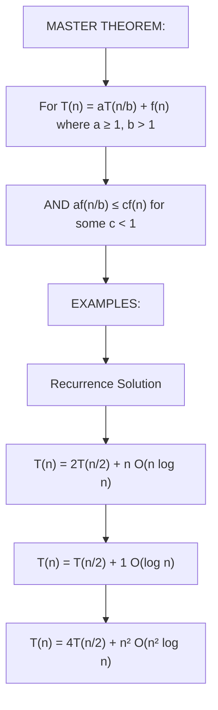

---

# Advanced Algorithm Patterns & Competitive Programming

> **Part B of Advanced Algorithms**
> **Navigation**: [Part A: Core Techniques](06a_Greedy_BitManip.md) | [Part B: Advanced Patterns]

---

## PART 12: Advanced Algorithm Patterns for Interviews

### Pattern 1: Meet in the Middle

```
CONCEPT:
Split problem into two halves, solve each, combine.
Reduces O(2^n) to O(2^(n/2) * log(2^(n/2)))

USE CASES:
- Subset sum with n up to 40
- 4Sum with large arrays
- Problems where n is too large for brute force but small enough for 2^(n/2)

WHEN TO USE:
- 20 ≤ n ≤ 40 (too big for 2^n, too small for DP)
- Need all possible combinations
- Can split problem naturally into two halves
```

```java
// Meet in the Middle: Subset Sum for n up to 40
public class MeetInMiddle {
    public int countSubsetSums(int[] arr, int target) {
        int n = arr.length;
        int leftHalf = n / 2;
        int rightHalf = n - leftHalf;

        // Generate all possible sums for left half
        List<Long> leftSums = new ArrayList<>();
        generateSums(arr, 0, leftHalf, 0, leftSums);

        // Generate all possible sums for right half
        List<Long> rightSums = new ArrayList<>();
        generateSums(arr, leftHalf, n, 0, rightSums);

        // Sort right sums for binary search
        Collections.sort(rightSums);

        int count = 0;
        for (long leftSum : leftSums) {
            // Find how many right sums complement this left sum
            long needed = target - leftSum;
            int lower = lowerBound(rightSums, needed);
            int upper = upperBound(rightSums, needed);
            count += (upper - lower);
        }

        return count;
    }

    private void generateSums(int[] arr, int start, int end,
                              long currentSum, List<Long> sums) {
        if (start == end) {
            sums.add(currentSum);
            return;
        }
        // Don't include current element
        generateSums(arr, start + 1, end, currentSum, sums);
        // Include current element
        generateSums(arr, start + 1, end, currentSum + arr[start], sums);
    }

    private int lowerBound(List<Long> list, long target) {
        int lo = 0, hi = list.size();
        while (lo < hi) {
            int mid = lo + (hi - lo) / 2;
            if (list.get(mid) < target) lo = mid + 1;
            else hi = mid;
        }
        return lo;
    }

    private int upperBound(List<Long> list, long target) {
        int lo = 0, hi = list.size();
        while (lo < hi) {
            int mid = lo + (hi - lo) / 2;
            if (list.get(mid) <= target) lo = mid + 1;
            else hi = mid;
        }
        return lo;
    }
}
```

### Pattern 2: Sqrt Decomposition

```
CONCEPT:
Divide array into √n blocks for efficient queries.

TIME COMPLEXITY:
- Preprocessing: O(n)
- Query: O(√n)
- Update: O(1) to O(√n)

USE CASES:
- Range sum queries with updates
- Mode queries
- Range minimum queries (simpler than Segment Tree)
```

```java
public class SqrtDecomposition {
    private int[] arr;
    private int[] blockSum;
    private int blockSize;

    public SqrtDecomposition(int[] input) {
        this.arr = input.clone();
        this.blockSize = (int) Math.ceil(Math.sqrt(input.length));
        int numBlocks = (int) Math.ceil((double) input.length / blockSize);
        this.blockSum = new int[numBlocks];

        // Build block sums
        for (int i = 0; i < input.length; i++) {
            blockSum[i / blockSize] += input[i];
        }
    }

    // Range sum query [l, r]
    public int query(int l, int r) {
        int sum = 0;

        // If l and r in same block, iterate directly
        if (l / blockSize == r / blockSize) {
            for (int i = l; i <= r; i++) {
                sum += arr[i];
            }
            return sum;
        }

        // Left partial block
        int leftBlockEnd = (l / blockSize + 1) * blockSize - 1;
        for (int i = l; i <= leftBlockEnd; i++) {
            sum += arr[i];
        }

        // Full blocks in middle
        for (int block = l / blockSize + 1; block < r / blockSize; block++) {
            sum += blockSum[block];
        }

        // Right partial block
        int rightBlockStart = (r / blockSize) * blockSize;
        for (int i = rightBlockStart; i <= r; i++) {
            sum += arr[i];
        }

        return sum;
    }

    // Point update
    public void update(int index, int value) {
        int block = index / blockSize;
        blockSum[block] += (value - arr[index]);
        arr[index] = value;
    }
}
```

### Pattern 3: Mo's Algorithm

```
CONCEPT:
Offline algorithm for range queries without updates.
Sort queries cleverly to minimize array traversal.

TIME COMPLEXITY:
O((n + q) * √n) where q = number of queries

KEY INSIGHT:
Sort queries by (left / √n, right) to minimize pointer movements.
```

```java
public class MosAlgorithm {
    private int blockSize;

    // Count distinct elements in range queries
    public int[] processQueries(int[] arr, int[][] queries) {
        int n = arr.length;
        int q = queries.length;
        blockSize = (int) Math.sqrt(n);

        // Create query objects with original indices
        int[][] indexedQueries = new int[q][3];
        for (int i = 0; i < q; i++) {
            indexedQueries[i] = new int[]{queries[i][0], queries[i][1], i};
        }

        // Sort by Mo's ordering
        Arrays.sort(indexedQueries, (a, b) -> {
            int blockA = a[0] / blockSize;
            int blockB = b[0] / blockSize;
            if (blockA != blockB) return blockA - blockB;
            // Zig-zag optimization for even/odd blocks
            return (blockA % 2 == 0) ? a[1] - b[1] : b[1] - a[1];
        });

        int[] result = new int[q];
        int[] count = new int[1000001]; // Frequency array
        int distinctCount = 0;
        int currL = 0, currR = -1;

        for (int[] query : indexedQueries) {
            int l = query[0], r = query[1], idx = query[2];

            // Expand/contract right pointer
            while (currR < r) {
                currR++;
                if (count[arr[currR]]++ == 0) distinctCount++;
            }
            while (currR > r) {
                if (--count[arr[currR]] == 0) distinctCount--;
                currR--;
            }

            // Expand/contract left pointer
            while (currL < l) {
                if (--count[arr[currL]] == 0) distinctCount--;
                currL++;
            }
            while (currL > l) {
                currL--;
                if (count[arr[currL]]++ == 0) distinctCount++;
            }

            result[idx] = distinctCount;
        }

        return result;
    }
}
```

### Pattern 4: Heavy-Light Decomposition

```
CONCEPT:
Decompose tree into heavy and light paths.
Enables efficient path queries on trees.

TIME COMPLEXITY:
- Preprocessing: O(n)
- Path Query: O(log²n) with Segment Tree
- Path Update: O(log²n)

KEY INSIGHT:
Any path from leaf to root crosses at most log(n) light edges.
```

```java
public class HeavyLightDecomposition {
    private List<List<Integer>> adj;
    private int[] parent, depth, heavy, head, pos;
    private int[] segTree;
    private int n, currPos;

    public HeavyLightDecomposition(int n) {
        this.n = n;
        adj = new ArrayList<>();
        for (int i = 0; i < n; i++) adj.add(new ArrayList<>());
        parent = new int[n];
        depth = new int[n];
        heavy = new int[n];
        head = new int[n];
        pos = new int[n];
        segTree = new int[4 * n];
        Arrays.fill(heavy, -1);
    }

    public void addEdge(int u, int v) {
        adj.get(u).add(v);
        adj.get(v).add(u);
    }

    // DFS to find heavy children
    private int dfs(int v, int p, int d) {
        parent[v] = p;
        depth[v] = d;
        int size = 1;
        int maxChildSize = 0;

        for (int u : adj.get(v)) {
            if (u != p) {
                int childSize = dfs(u, v, d + 1);
                size += childSize;
                if (childSize > maxChildSize) {
                    maxChildSize = childSize;
                    heavy[v] = u;
                }
            }
        }
        return size;
    }

    // Decompose into chains
    private void decompose(int v, int h) {
        head[v] = h;
        pos[v] = currPos++;

        if (heavy[v] != -1) {
            decompose(heavy[v], h);  // Continue heavy path
        }

        for (int u : adj.get(v)) {
            if (u != parent[v] && u != heavy[v]) {
                decompose(u, u);  // Start new chain
            }
        }
    }

    // Query maximum on path from u to v
    public int pathQuery(int u, int v) {
        int result = Integer.MIN_VALUE;

        while (head[u] != head[v]) {
            if (depth[head[u]] < depth[head[v]]) {
                int temp = u; u = v; v = temp;
            }
            result = Math.max(result, segQuery(1, 0, n - 1, pos[head[u]], pos[u]));
            u = parent[head[u]];
        }

        if (depth[u] > depth[v]) {
            int temp = u; u = v; v = temp;
        }
        return Math.max(result, segQuery(1, 0, n - 1, pos[u], pos[v]));
    }

    private int segQuery(int node, int start, int end, int l, int r) {
        if (r < start || l > end) return Integer.MIN_VALUE;
        if (l <= start && end <= r) return segTree[node];
        int mid = (start + end) / 2;
        return Math.max(
            segQuery(2 * node, start, mid, l, r),
            segQuery(2 * node + 1, mid + 1, end, l, r)
        );
    }
}
```

---

## PART 13: String Algorithms Deep Dive

### Manacher's Algorithm (Longest Palindromic Substring)

```
CONCEPT:
Find longest palindromic substring in O(n).
Uses previously computed palindromes to skip comparisons.

KEY INSIGHT:
If we're at position i and we know a palindrome centered at c
extends to right boundary r, we can use mirror position.
```

```java
public class ManacherAlgorithm {
    public String longestPalindrome(String s) {
        // Transform: "abc" → "^#a#b#c#$"
        StringBuilder sb = new StringBuilder("^#");
        for (char c : s.toCharArray()) {
            sb.append(c).append('#');
        }
        sb.append('$');
        String T = sb.toString();
        int n = T.length();

        int[] P = new int[n];  // P[i] = radius of palindrome centered at i
        int C = 0, R = 0;      // Center and right boundary

        for (int i = 1; i < n - 1; i++) {
            int mirror = 2 * C - i;

            if (i < R) {
                P[i] = Math.min(R - i, P[mirror]);
            }

            // Expand around center i
            while (T.charAt(i + P[i] + 1) == T.charAt(i - P[i] - 1)) {
                P[i]++;
            }

            // Update center and right boundary
            if (i + P[i] > R) {
                C = i;
                R = i + P[i];
            }
        }

        // Find maximum
        int maxLen = 0, centerIdx = 0;
        for (int i = 1; i < n - 1; i++) {
            if (P[i] > maxLen) {
                maxLen = P[i];
                centerIdx = i;
            }
        }

        int start = (centerIdx - maxLen) / 2;
        return s.substring(start, start + maxLen);
    }
}
```

### Z-Algorithm (Pattern Matching)

```
CONCEPT:
Z[i] = length of longest substring starting at i
that matches a prefix of the string.

TIME: O(n + m) for pattern matching
SPACE: O(n + m)

USE CASES:
- Pattern matching
- Finding periods in string
- Longest common prefix queries
```

```java
public class ZAlgorithm {
    public int[] calculateZ(String s) {
        int n = s.length();
        int[] Z = new int[n];
        int L = 0, R = 0;

        for (int i = 1; i < n; i++) {
            if (i < R) {
                Z[i] = Math.min(R - i, Z[i - L]);
            }

            // Try to extend
            while (i + Z[i] < n && s.charAt(Z[i]) == s.charAt(i + Z[i])) {
                Z[i]++;
            }

            // Update window
            if (i + Z[i] > R) {
                L = i;
                R = i + Z[i];
            }
        }

        return Z;
    }

    // Find all occurrences of pattern in text
    public List<Integer> findPattern(String text, String pattern) {
        String combined = pattern + "$" + text;
        int[] Z = calculateZ(combined);

        List<Integer> matches = new ArrayList<>();
        int patLen = pattern.length();

        for (int i = patLen + 1; i < combined.length(); i++) {
            if (Z[i] == patLen) {
                matches.add(i - patLen - 1);
            }
        }

        return matches;
    }
}
```

### Suffix Array (Memory-Efficient Alternative to Suffix Tree)

```
CONCEPT:
Array of starting positions of all suffixes, sorted lexicographically.
Much more memory-efficient than Suffix Tree.

TIME: O(n log n) construction, O(m log n) search
SPACE: O(n)
```

```java
public class SuffixArray {
    private String text;
    private int[] sa;      // Suffix array
    private int[] lcp;     // LCP array

    public SuffixArray(String text) {
        this.text = text;
        int n = text.length();

        // Build suffix array using prefix doubling
        Integer[] order = new Integer[n];
        int[] rank = new int[n];
        int[] tmp = new int[n];

        // Initialize with character ranks
        for (int i = 0; i < n; i++) {
            order[i] = i;
            rank[i] = text.charAt(i);
        }

        for (int k = 1; k < n; k *= 2) {
            final int[] r = rank;
            final int kk = k;

            // Sort by (rank[i], rank[i+k])
            Arrays.sort(order, (a, b) -> {
                if (r[a] != r[b]) return r[a] - r[b];
                int ra = a + kk < n ? r[a + kk] : -1;
                int rb = b + kk < n ? r[b + kk] : -1;
                return ra - rb;
            });

            // Update ranks
            tmp[order[0]] = 0;
            for (int i = 1; i < n; i++) {
                int prev = order[i - 1], curr = order[i];
                boolean same = r[prev] == r[curr] &&
                    (prev + kk < n ? r[prev + kk] : -1) ==
                    (curr + kk < n ? r[curr + kk] : -1);
                tmp[curr] = tmp[prev] + (same ? 0 : 1);
            }
            rank = tmp.clone();
        }

        this.sa = new int[n];
        for (int i = 0; i < n; i++) {
            sa[i] = order[i];
        }

        buildLCP();
    }

    // Kasai's algorithm for LCP array
    private void buildLCP() {
        int n = text.length();
        lcp = new int[n];
        int[] rank = new int[n];

        for (int i = 0; i < n; i++) {
            rank[sa[i]] = i;
        }

        int k = 0;
        for (int i = 0; i < n; i++) {
            if (rank[i] == 0) {
                k = 0;
                continue;
            }

            int j = sa[rank[i] - 1];
            while (i + k < n && j + k < n &&
                   text.charAt(i + k) == text.charAt(j + k)) {
                k++;
            }

            lcp[rank[i]] = k;
            if (k > 0) k--;
        }
    }

    // Count distinct substrings
    public long countDistinctSubstrings() {
        int n = text.length();
        long total = (long) n * (n + 1) / 2;
        long duplicates = 0;
        for (int i = 1; i < n; i++) {
            duplicates += lcp[i];
        }
        return total - duplicates;
    }
}
```

---

> **Note:** Graph algorithms (Tarjan's SCC, Kosaraju's, 2-SAT, A*, Bridges)
> have been moved to their proper home:
> [05d_Graphs_Advanced_Algos.md](05d_Graphs_Advanced_Algos.md)

---

> 🔬 **Section Challenge — PART 13: String Algorithms Deep Dive**

## PART 15: Competitive Programming Tricks

### Fast I/O

```java
import java.io.*;
import java.util.*;

public class FastIO {
    static BufferedReader br = new BufferedReader(
        new InputStreamReader(System.in));
    static PrintWriter out = new PrintWriter(
        new BufferedOutputStream(System.out));
    static StringTokenizer st;

    static String next() throws IOException {
        while (st == null || !st.hasMoreTokens())
            st = new StringTokenizer(br.readLine());
        return st.nextToken();
    }

    static int nextInt() throws IOException {
        return Integer.parseInt(next());
    }

    static long nextLong() throws IOException {
        return Long.parseLong(next());
    }

    static double nextDouble() throws IOException {
        return Double.parseDouble(next());
    }

    public static void main(String[] args) throws IOException {
        int n = nextInt();
        int[] arr = new int[n];
        for (int i = 0; i < n; i++) {
            arr[i] = nextInt();
        }

        // Process...

        out.println("Result");
        out.flush();
    }
}
```

### Modular Arithmetic Utilities

```java
public class ModUtils {
    static final long MOD = 1_000_000_007;

    // Modular exponentiation
    static long power(long base, long exp, long mod) {
        long result = 1;
        base %= mod;
        while (exp > 0) {
            if ((exp & 1) == 1) {
                result = (result * base) % mod;
            }
            base = (base * base) % mod;
            exp >>= 1;
        }
        return result;
    }

    // Modular inverse using Fermat's little theorem
    static long modInverse(long a, long mod) {
        return power(a, mod - 2, mod);
    }

    // nCr mod p
    static long nCr(int n, int r, long[] fact, long[] invFact) {
        if (r > n || r < 0) return 0;
        return (fact[n] * invFact[r] % MOD) * invFact[n - r] % MOD;
    }

    // Precompute factorials
    static void precomputeFactorials(int maxN, long[] fact, long[] invFact) {
        fact[0] = 1;
        for (int i = 1; i <= maxN; i++) {
            fact[i] = fact[i - 1] * i % MOD;
        }
        invFact[maxN] = modInverse(fact[maxN], MOD);
        for (int i = maxN - 1; i >= 0; i--) {
            invFact[i] = invFact[i + 1] * (i + 1) % MOD;
        }
    }

    // Lucas theorem for large n, r with small prime p
    static long lucasnCr(long n, long r, int p) {
        if (r == 0) return 1;
        return (lucasnCr(n / p, r / p, p) *
                smallnCr((int)(n % p), (int)(r % p), p)) % p;
    }

    static long smallnCr(int n, int r, int p) {
        if (r > n) return 0;
        long num = 1, den = 1;
        for (int i = 0; i < r; i++) {
            num = num * (n - i) % p;
            den = den * (i + 1) % p;
        }
        return num * power(den, p - 2, p) % p;
    }
}
```

### Coordinate Compression

```java
public class CoordinateCompression {
    public static int[] compress(int[] arr) {
        // Get unique sorted values
        Set<Integer> set = new TreeSet<>();
        for (int x : arr) set.add(x);

        // Create mapping
        Map<Integer, Integer> map = new HashMap<>();
        int idx = 0;
        for (int x : set) {
            map.put(x, idx++);
        }

        // Compress
        int[] compressed = new int[arr.length];
        for (int i = 0; i < arr.length; i++) {
            compressed[i] = map.get(arr[i]);
        }

        return compressed;
    }

    // Example: Range queries with large values
    // Original: [1000000, 1, 999999]
    // Compressed: [2, 0, 1]
}
```

### Bit Manipulation Tricks

```java
public class BitTricks {
    // Count set bits (Brian Kernighan)
    static int countBits(int n) {
        int count = 0;
        while (n != 0) {
            n &= (n - 1);
            count++;
        }
        return count;
    }

    // Check if power of 2
    static boolean isPowerOf2(int n) {
        return n > 0 && (n & (n - 1)) == 0;
    }

    // Get lowest set bit
    static int lowestSetBit(int n) {
        return n & (-n);
    }

    // Turn off lowest set bit
    static int turnOffLowest(int n) {
        return n & (n - 1);
    }

    // Check if i-th bit is set
    static boolean isBitSet(int n, int i) {
        return (n & (1 << i)) != 0;
    }

    // Set i-th bit
    static int setBit(int n, int i) {
        return n | (1 << i);
    }

    // Clear i-th bit
    static int clearBit(int n, int i) {
        return n & ~(1 << i);
    }

    // Toggle i-th bit
    static int toggleBit(int n, int i) {
        return n ^ (1 << i);
    }

    // Get highest set bit position
    static int highestSetBitPos(int n) {
        return 31 - Integer.numberOfLeadingZeros(n);
    }

    // Next permutation with same number of bits
    static int nextPermutation(int n) {
        int t = n | (n - 1);
        return (t + 1) | (((~t & -~t) - 1) >> (Integer.numberOfTrailingZeros(n) + 1));
    }

    // Iterate through all subsets of a bitmask
    static void iterateSubsets(int mask) {
        for (int subset = mask; subset > 0; subset = (subset - 1) & mask) {
            // Process subset
            System.out.println(Integer.toBinaryString(subset));
        }
    }
}
```

---

> 🔬 **Section Challenge — PART 15: Competitive Programming Tricks**

## PART 16: Algorithm Complexity Analysis Deep Dive

### Master Theorem Reference

```
MASTER THEOREM:
For T(n) = aT(n/b) + f(n) where a ≥ 1, b > 1

Case 1: f(n) = O(n^(log_b(a) - ε)) for some ε > 0
        → T(n) = Θ(n^(log_b(a)))

Case 2: f(n) = Θ(n^(log_b(a)) * log^k(n))
        → T(n) = Θ(n^(log_b(a)) * log^(k+1)(n))

Case 3: f(n) = Ω(n^(log_b(a) + ε)) for some ε > 0
        AND af(n/b) ≤ cf(n) for some c < 1
        → T(n) = Θ(f(n))

EXAMPLES:
┌───────────────────────────────────┬─────────────────┐
│ Recurrence                        │ Solution        │
├───────────────────────────────────┼─────────────────┤
│ T(n) = 2T(n/2) + n                │ O(n log n)      │
│ T(n) = 2T(n/2) + 1                │ O(n)            │
│ T(n) = 2T(n/2) + n²               │ O(n²)           │
│ T(n) = T(n/2) + 1                 │ O(log n)        │
│ T(n) = T(n/2) + n                 │ O(n)            │
│ T(n) = 4T(n/2) + n                │ O(n²)           │
│ T(n) = 4T(n/2) + n²               │ O(n² log n)     │
│ T(n) = 3T(n/2) + n                │ O(n^1.585)      │
│ T(n) = T(n-1) + n                 │ O(n²)           │
│ T(n) = T(n-1) + 1                 │ O(n)            │
│ T(n) = 2T(n-1) + 1                │ O(2^n)          │
└───────────────────────────────────┴─────────────────┘
```

**Flow:**
1. MASTER THEOREM:
2. For T(n) = aT(n/b) + f(n) where a ≥ 1, b > 1
3. AND af(n/b) ≤ cf(n) for some c < 1
4. EXAMPLES:
5. Recurrence Solution
6. T(n) = 2T(n/2) + n O(n log n)
7. T(n) = T(n/2) + 1 O(log n)



### Amortized Analysis

```
AGGREGATE METHOD:
Sum all operations, divide by n.

ACCOUNTING METHOD:
Assign amortized cost to each operation.
Some pay more (save credit), some use saved credit.

POTENTIAL METHOD:
Define potential function Φ.
Amortized cost = actual cost + ΔΦ

EXAMPLE: Dynamic Array (ArrayList)
- Push when full: copy all elements + add new = O(n)
- Push when not full: add new = O(1)

Amortized Analysis:
- n pushes: 1 + 2 + 4 + 8 + ... + n copies
- Total copies ≈ 2n
- Amortized per push = O(1)

PROOF (Accounting Method):
- Charge 3 for each push
- 1 to insert current element
- 1 to move current element when array doubles
- 1 to move an element that was there before doubling
```

---

## PART 17: LeetCode Problem Categories Reference

```
BINARY SEARCH VARIATIONS:
┌─────────────────────────────────────────┬───────────────┐
│ Problem Type                            │ LeetCode      │
├─────────────────────────────────────────┼───────────────┤
│ Classic Binary Search                   │ 704           │
│ Search Insert Position                  │ 35            │
│ First/Last Position                     │ 34            │
│ Search in Rotated Array                 │ 33, 81        │
│ Find Minimum in Rotated Array           │ 153, 154      │
│ Search 2D Matrix                        │ 74, 240       │
│ Peak Element                            │ 162           │
│ Koko Eating Bananas (Answer BS)         │ 875           │
│ Capacity to Ship (Answer BS)            │ 1011          │
│ Split Array Largest Sum                 │ 410           │
│ Median of Two Sorted Arrays             │ 4             │
└─────────────────────────────────────────┴───────────────┘

TWO POINTERS:
┌─────────────────────────────────────────┬───────────────┐
│ Two Sum (Sorted)                        │ 167           │
│ 3Sum                                    │ 15            │
│ Container With Most Water               │ 11            │
│ Trapping Rain Water                     │ 42            │
│ Remove Duplicates                       │ 26, 80        │
│ Move Zeroes                             │ 283           │
│ Partition Labels                        │ 763           │
│ Sort Colors                             │ 75            │
│ Reverse Vowels                          │ 345           │
└─────────────────────────────────────────┴───────────────┘

SLIDING WINDOW:
┌─────────────────────────────────────────┬───────────────┐
│ Maximum Sum Subarray Size K             │ 643           │
│ Minimum Window Substring                │ 76            │
│ Longest Substring Without Repeat        │ 3             │
│ Longest Repeating Character Replacement │ 424           │
│ Permutation in String                   │ 567           │
│ Find All Anagrams                       │ 438           │
│ Minimum Size Subarray Sum               │ 209           │
│ Maximum Sliding Window                  │ 239           │
│ Fruit Into Baskets                      │ 904           │
└─────────────────────────────────────────┴───────────────┘

DYNAMIC PROGRAMMING:
┌─────────────────────────────────────────┬────────────────┐
│ Climbing Stairs                         │ 70             │
│ House Robber I, II, III                 │ 198, 213, 337  │
│ Coin Change I, II                       │ 322, 518       │
│ Longest Increasing Subsequence          │ 300            │
│ Longest Common Subsequence              │ 1143           │
│ Edit Distance                           │ 72             │
│ 0/1 Knapsack (Practice)                 │ -              │
│ Partition Equal Subset Sum              │ 416            │
│ Target Sum                              │ 494            │
│ Palindromic Substrings                  │ 647            │
│ Longest Palindromic Subsequence         │ 516            │
│ Word Break I, II                        │ 139, 140       │
│ Decode Ways                             │ 91             │
│ Unique Paths I, II                      │ 62, 63         │
│ Min Path Sum                            │ 64             │
│ Maximal Square                          │ 221            │
│ Best Time Buy Sell Stock I-IV           │ 121,122,123,188│
│ Interleaving String                     │ 97             │
│ Burst Balloons                          │ 312            │
│ Matrix Chain Multiplication             │ -              │
└─────────────────────────────────────────┴────────────────┘

GRAPH ALGORITHMS:
┌─────────────────────────────────────────┬───────────────┐
│ Number of Islands                       │ 200           │
│ Clone Graph                             │ 133           │
│ Course Schedule I, II                   │ 207, 210      │
│ Pacific Atlantic Water Flow             │ 417           │
│ Network Delay Time                      │ 743           │
│ Cheapest Flights K Stops                │ 787           │
│ Redundant Connection I, II              │ 684, 685      │
│ Graph Valid Tree                        │ 261           │
│ Number of Connected Components          │ 323           │
│ Word Ladder I, II                       │ 127, 126      │
│ Alien Dictionary                        │ 269           │
│ Minimum Spanning Tree                   │ 1584          │
│ Critical Connections                    │ 1192          │
└─────────────────────────────────────────┴───────────────┘

TREE PROBLEMS:
┌─────────────────────────────────────────┬───────────────┐
│ Traversals (In/Pre/Post/Level)          │ 94,144,145,102│
│ Maximum Depth                           │ 104           │
│ Same Tree / Subtree                     │ 100, 572      │
│ Invert Binary Tree                      │ 226           │
│ Symmetric Tree                          │ 101           │
│ Path Sum I, II, III                     │ 112, 113, 437 │
│ Lowest Common Ancestor                  │ 236, 235      │
│ Serialize/Deserialize                   │ 297           │
│ Binary Tree Maximum Path Sum            │ 124           │
│ Validate BST                            │ 98            │
│ Kth Smallest in BST                     │ 230           │
│ BST Iterator                            │ 173           │
│ Construct from Traversals               │ 105, 106      │
│ Diameter of Binary Tree                 │ 543           │
│ Count Complete Tree Nodes               │ 222           │
└─────────────────────────────────────────┴───────────────┘

HEAP / PRIORITY QUEUE:
┌─────────────────────────────────────────┬───────────────┐
│ Kth Largest Element                     │ 215           │
│ Top K Frequent Elements                 │ 347           │
│ Merge K Sorted Lists                    │ 23            │
│ Find Median from Data Stream            │ 295           │
│ Task Scheduler                          │ 621           │
│ Reorganize String                       │ 767           │
│ Meeting Rooms II                        │ 253           │
│ K Closest Points                        │ 973           │
│ Sliding Window Maximum                  │ 239           │
└─────────────────────────────────────────┴───────────────┘

BACKTRACKING:
┌─────────────────────────────────────────┬───────────────┐
│ Subsets I, II                           │ 78, 90        │
│ Permutations I, II                      │ 46, 47        │
│ Combinations                            │ 77            │
│ Combination Sum I, II, III              │ 39, 40, 216   │
│ Letter Combinations Phone               │ 17            │
│ Generate Parentheses                    │ 22            │
│ Palindrome Partitioning                 │ 131           │
│ N-Queens                                │ 51            │
│ Sudoku Solver                           │ 37            │
│ Word Search I, II                       │ 79, 212       │
└─────────────────────────────────────────┴───────────────┘
```

---

## PART 18: Essential Templates for Competitive Programming

### Union-Find with Path Compression & Union by Rank

```java
public class UnionFind {
    private int[] parent, rank;
    private int components;

    public UnionFind(int n) {
        parent = new int[n];
        rank = new int[n];
        components = n;
        for (int i = 0; i < n; i++) {
            parent[i] = i;
        }
    }

    public int find(int x) {
        if (parent[x] != x) {
            parent[x] = find(parent[x]); // Path compression
        }
        return parent[x];
    }

    public boolean union(int x, int y) {
        int px = find(x), py = find(y);
        if (px == py) return false;

        if (rank[px] < rank[py]) {
            parent[px] = py;
        } else if (rank[px] > rank[py]) {
            parent[py] = px;
        } else {
            parent[py] = px;
            rank[px]++;
        }
        components--;
        return true;
    }

    public boolean connected(int x, int y) {
        return find(x) == find(y);
    }

    public int getComponents() {
        return components;
    }
}
```

### Segment Tree with Lazy Propagation

```java
public class SegmentTreeLazy {
    private long[] tree, lazy;
    private int n;

    public SegmentTreeLazy(int[] arr) {
        this.n = arr.length;
        tree = new long[4 * n];
        lazy = new long[4 * n];
        build(arr, 1, 0, n - 1);
    }

    private void build(int[] arr, int node, int start, int end) {
        if (start == end) {
            tree[node] = arr[start];
        } else {
            int mid = (start + end) / 2;
            build(arr, 2 * node, start, mid);
            build(arr, 2 * node + 1, mid + 1, end);
            tree[node] = tree[2 * node] + tree[2 * node + 1];
        }
    }

    private void pushDown(int node, int start, int end) {
        if (lazy[node] != 0) {
            tree[node] += (end - start + 1) * lazy[node];
            if (start != end) {
                lazy[2 * node] += lazy[node];
                lazy[2 * node + 1] += lazy[node];
            }
            lazy[node] = 0;
        }
    }

    public void updateRange(int l, int r, long val) {
        updateRange(1, 0, n - 1, l, r, val);
    }

    private void updateRange(int node, int start, int end, int l, int r, long val) {
        pushDown(node, start, end);
        if (r < start || l > end) return;
        if (l <= start && end <= r) {
            lazy[node] += val;
            pushDown(node, start, end);
            return;
        }
        int mid = (start + end) / 2;
        updateRange(2 * node, start, mid, l, r, val);
        updateRange(2 * node + 1, mid + 1, end, l, r, val);
        tree[node] = tree[2 * node] + tree[2 * node + 1];
    }

    public long queryRange(int l, int r) {
        return queryRange(1, 0, n - 1, l, r);
    }

    private long queryRange(int node, int start, int end, int l, int r) {
        if (r < start || l > end) return 0;
        pushDown(node, start, end);
        if (l <= start && end <= r) return tree[node];
        int mid = (start + end) / 2;
        return queryRange(2 * node, start, mid, l, r) +
               queryRange(2 * node + 1, mid + 1, end, l, r);
    }
}
```

### Binary Indexed Tree (Fenwick Tree)

```java
public class FenwickTree {
    private long[] bit;
    private int n;

    public FenwickTree(int n) {
        this.n = n;
        this.bit = new long[n + 1];
    }

    // Add delta to index i (0-indexed)
    public void update(int i, long delta) {
        for (++i; i <= n; i += i & (-i)) {
            bit[i] += delta;
        }
    }

    // Sum of [0, i] (0-indexed)
    public long query(int i) {
        long sum = 0;
        for (++i; i > 0; i -= i & (-i)) {
            sum += bit[i];
        }
        return sum;
    }

    // Sum of [l, r] (0-indexed)
    public long rangeQuery(int l, int r) {
        return query(r) - (l > 0 ? query(l - 1) : 0);
    }

    // Build from array
    public static FenwickTree build(int[] arr) {
        FenwickTree ft = new FenwickTree(arr.length);
        for (int i = 0; i < arr.length; i++) {
            ft.update(i, arr[i]);
        }
        return ft;
    }
}
```

---

---

> 🔬 **Section Challenge — PART 18: Essential Templates for Competitive Programming**

## 🏋️ Practice & Interview Questions — Algorithms

### Sorting

**Q1.** Which sorting algorithm does Java use for `Arrays.sort(int[])`? Why not MergeSort?
<details><summary>Answer</summary>

**Dual-Pivot QuickSort** — for primitives. MergeSort requires O(N) extra space. QuickSort is in-place and cache-friendly. Stability doesn't matter for primitives (equal ints are indistinguishable). For objects (`Arrays.sort(Object[])`), Java uses **TimSort** (stable, O(N log N) worst).
</details>

**Q2.** Trace Merge Sort on `[4,2,7,1]`.
<details><summary>Answer</summary>

Split: `[4,2]` `[7,1]` → Split: `[4]` `[2]` `[7]` `[1]` → Merge: `[2,4]` `[1,7]` → Merge: `[1,2,4,7]`
</details>

**Q3.** ⭐⭐ Sort Colors (Dutch National Flag — 3-way partition).
<details><summary>Solution</summary>

```java
int lo=0, mid=0, hi=n-1;
while(mid<=hi){
    if(nums[mid]==0) swap(nums,lo++,mid++);
    else if(nums[mid]==1) mid++;
    else swap(nums,mid,hi--);
}
```
</details>

### Binary Search

**Q4.** ⭐ Search in Rotated Sorted Array.
<details><summary>Solution</summary>

```java
int lo=0, hi=n-1;
while(lo<=hi){
    int mid=(lo+hi)/2;
    if(nums[mid]==target) return mid;
    if(nums[lo]<=nums[mid]){ // left half sorted
        if(nums[lo]<=target&&target<nums[mid]) hi=mid-1; else lo=mid+1;
    } else { // right half sorted
        if(nums[mid]<target&&target<=nums[hi]) lo=mid+1; else hi=mid-1;
    }
}
return -1;
```
</details>

**Q5.** ⭐ Find First and Last Position (binary search twice).
<details><summary>Solution</summary>

```java
// First: find leftmost with while(lo<hi){ if arr[mid]>=target hi=mid else lo=mid+1 }
// Last: find rightmost with while(lo<hi){ if arr[mid]<=target lo=mid+1 else hi=mid } return lo-1
```
</details>

**Q6.** ⭐⭐ Koko Eating Bananas — binary search on answer.
<details><summary>Key insight</summary>

Binary search the eating speed k in range [1, max(piles)]. For each k, calculate hours needed. Find minimum k where hours ≤ H.
</details>

### Dynamic Programming

**Q7.** ⭐ Climbing Stairs — n steps, 1 or 2 at a time. How many ways?
<details><summary>Solution</summary>

```java
// Fibonacci sequence! dp[i] = dp[i-1] + dp[i-2]
int a=1, b=1;
for(int i=2;i<=n;i++){ int c=a+b; a=b; b=c; }
return b;
```
</details>

**Q8.** ⭐ Coin Change — minimum coins for amount.
<details><summary>Solution</summary>

```java
int[] dp = new int[amount+1]; Arrays.fill(dp, amount+1);
dp[0]=0;
for(int i=1;i<=amount;i++)
    for(int c:coins) if(c<=i) dp[i]=Math.min(dp[i],dp[i-c]+1);
return dp[amount]>amount?-1:dp[amount];
```
</details>

**Q9.** ⭐⭐ Longest Common Subsequence.
<details><summary>Solution</summary>

```java
int[][] dp=new int[m+1][n+1];
for(int i=1;i<=m;i++) for(int j=1;j<=n;j++){
    if(text1.charAt(i-1)==text2.charAt(j-1)) dp[i][j]=dp[i-1][j-1]+1;
    else dp[i][j]=Math.max(dp[i-1][j],dp[i][j-1]);
}
return dp[m][n];
```
</details>

**Q10.** ⭐⭐ Word Break — can string be segmented using dictionary words?
<details><summary>Solution</summary>

```java
boolean[] dp=new boolean[n+1]; dp[0]=true;
for(int i=1;i<=n;i++) for(String w:wordDict)
    if(i>=w.length()&&dp[i-w.length()]&&s.substring(i-w.length(),i).equals(w)) dp[i]=true;
return dp[n];
```
</details>

**Q11.** ⭐⭐⭐ Edit Distance (Levenshtein).
<details><summary>Solution</summary>

```java
int[][] dp=new int[m+1][n+1];
for(int i=0;i<=m;i++) dp[i][0]=i;
for(int j=0;j<=n;j++) dp[0][j]=j;
for(int i=1;i<=m;i++) for(int j=1;j<=n;j++){
    if(word1.charAt(i-1)==word2.charAt(j-1)) dp[i][j]=dp[i-1][j-1];
    else dp[i][j]=1+Math.min(dp[i-1][j-1],Math.min(dp[i-1][j],dp[i][j-1]));
}
```
</details>

### Graph Algorithms

**Q12.** ⭐ Number of Islands (BFS/DFS grid traversal).
<details><summary>Solution</summary>

```java
for each cell (i,j) if grid[i][j]=='1': count++; BFS/DFS to mark all connected land as visited
```
</details>

**Q13.** ⭐⭐ Course Schedule — detect cycle in directed graph (Topological sort).
<details><summary>Solution</summary>

```java
// Kahn's algorithm: indegree array + BFS queue
// If result size == numCourses → no cycle → can finish
```
</details>

**Q14.** ⭐⭐ Dijkstra's Shortest Path.
<details><summary>Solution</summary>

```java
PriorityQueue<int[]> pq=new PriorityQueue<>((a,b)->a[1]-b[1]); // [node, dist]
pq.offer(new int[]{src,0}); dist[src]=0;
while(!pq.isEmpty()){
    int[] curr=pq.poll(); int u=curr[0],d=curr[1];
    if(d>dist[u]) continue; // stale
    for(int[] neighbor:graph[u]) if(dist[u]+neighbor[1]<dist[neighbor[0]]){
        dist[neighbor[0]]=dist[u]+neighbor[1]; pq.offer(new int[]{neighbor[0],dist[neighbor[0]]});
    }
}
```
</details>

### MCQ Rapid Fire

| # | Question | Answer |
|---|---|---|
| 1 | QuickSort avg/worst | O(N log N) avg, O(N²) worst |
| 2 | MergeSort space complexity | O(N) |
| 3 | HeapSort space complexity | O(1) (in-place) |
| 4 | Binary search precondition | Sorted array |
| 5 | BFS time complexity on graph | O(V+E) |
| 6 | DFS space complexity | O(V) (recursion stack) |
| 7 | Dijkstra fails on | Negative weight edges |
| 8 | Bellman-Ford handles | Negative weights, detects negative cycles |
| 9 | Floyd-Warshall use case | All-pairs shortest path, O(V³) |
| 10 | Topological sort requires | Directed Acyclic Graph (DAG) |

---

## 🧠 Deep Conceptual Questions — Algorithm Design & Analysis

**C1. What does O(N log N) "feel like" and why is it the complexity barrier for comparison-based sorting?**
<details><summary>Deep Answer</summary>

O(N log N) for N=1M ≈ 20M operations. O(N²) ≈ 1 trillion. The difference is 50,000x. **Comparison sort lower bound**: any comparison-based sort must distinguish between N! possible orderings. Each comparison has 2 outcomes. A decision tree with N! leaves needs ≥ log₂(N!) height ≈ N log N (Stirling's approximation). Therefore NO comparison sort can beat O(N log N) in the worst case. Non-comparison sorts (counting sort, radix sort, bucket sort) break this bound by using non-comparison operations — but require constraints on input (e.g., integer range bounded by N).
</details>

**C2. Greedy algorithms: when do they work and what must be proven?**
<details><summary>Deep Answer</summary>

A greedy algorithm makes the locally optimal choice at each step. Works when problem has: (1) **Greedy choice property**: local optimal leads to global optimal — the choice never needs to be revised. (2) **Optimal substructure**: optimal solution to the problem contains optimal solutions to subproblems. To PROVE greedy is correct: use "exchange argument" — assume optimal solution differs from greedy, show you can swap greedy's choice in without making it worse, contradiction. Greedy FAILS when: future choices depend on current choice in complex ways (use DP instead). Classic works: interval scheduling, Huffman coding, Dijkstra. Classic fails: 0-1 knapsack (use DP).
</details>

**C3. Dynamic Programming: what is "overlapping subproblems" and why does it matter?**
<details><summary>Deep Answer</summary>

Overlapping subproblems: the same sub-computation appears multiple times. Fibonacci: `fib(5)` calls `fib(4)` and `fib(3)`. `fib(4)` also calls `fib(3)`. Without memoization: `fib(3)` computed exponentially many times → O(2^N). With memoization: each sub-result computed once and stored → O(N). DP is valuable SPECIFICALLY when: (1) problem has optimal substructure AND (2) subproblems overlap. If no overlap: just use divide-and-conquer (merge sort's subproblems don't overlap → no DP needed). DP = "smart recursion" = avoid recomputing.
</details>

**C4. Top-down (memoization) vs Bottom-up (tabulation) DP — when to choose each?**
<details><summary>Deep Answer</summary>

**Top-down (memoization)**: Write natural recursion + cache results. Easy to implement, only computes needed subproblems (sparse computation). Cons: recursion overhead and stack depth risk. Use when: problem is naturally recursive, only a fraction of subproblems needed. **Bottom-up (tabulation)**: Fill DP table iteratively from base cases. No recursion overhead, better cache performance, easier space optimization. Use when: need all subproblems (or most of them), want to optimize space (can often reduce to 1D from 2D). Rule: start with top-down for correctness verification, optimize to bottom-up for performance.
</details>

**C5. Dijkstra's Algorithm: why does it fail on negative weights?**
<details><summary>Deep Answer</summary>

Dijkstra assumes: once a node is "settled" (extracted from the priority queue with its final shortest distance), that distance is optimal. With negative weights: settling node A at distance 5 might not be final — a path through B (distance 7) → C (edge -10) → A gives distance -3. But A was already settled! Dijkstra doesn't revisit settled nodes. Bellman-Ford handles negatives by relaxing ALL edges N-1 times — no "settled" assumption. For graphs with negative cycles: Bellman-Ford detects them (if distances still decrease after N-1 rounds, there's a negative cycle).
</details>

**C6. Union-Find: why is path compression + union by rank/size nearly O(1)?**
<details><summary>Deep Answer</summary>

**Path compression**: when finding the root of element x, make every node on the path point directly to the root. Flattens the tree. Future finds on those paths: O(1). **Union by rank**: always attach the smaller tree under the larger → limits tree height to O(log N). Combined: inverse Ackermann function α(N) amortized — so slow-growing it's practically constant (α(10^80) = 4). Neither alone is optimal: path compression without union by rank → O(log N) amortized. Union by rank without path compression → O(log N). Together → α(N) ≈ O(1) amortized. Used in: Kruskal's MST, cycle detection, connected components.
</details>

**C7. Binary Search on the Answer — what types of problems does it apply to?**
<details><summary>Deep Answer</summary>

When the answer space is **monotone**: "if X is achievable, then all values less extreme than X are also achievable." Problems: minimize the maximum (aggressive cows, split array), find minimum valid threshold (Koko bananas, minimum days to bloom), divide-and-conquer feasibility. Template: binary search on the answer range [lo, hi], for each mid check `isFeasible(mid)` in O(N) or O(N log N). Total: O(N log(answer_range)). Key insight: reframe "find optimal value" as "find smallest X where condition holds" → enables binary search on a non-array space.
</details>

**C8. Why does merge sort guarantee stability while quicksort doesn't?**
<details><summary>Deep Answer</summary>

**Merge sort stability**: during merge, when two elements are equal, we always take from the LEFT array first → preserves original relative order. **QuickSort instability**: the partition step swaps elements across the pivot without regard to original order. Two equal elements may be placed on opposite sides of the pivot, reversing their order. QuickSort CAN be made stable (Lomuto partition with careful implementation) but loses performance. Java uses TimSort for objects (stable), dual-pivot quicksort for primitives (stability irrelevant since primitives without fields).
</details>

**C9. Backtracking: what's the difference from plain DFS and when to use vs DP?**
<details><summary>Deep Answer</summary>

**Backtracking vs DFS**: DFS visits every path. Backtracking prunes paths early when a constraint is violated — avoids exploring infeasible branches. Same asymptotic but drastically different practical performance with good pruning. **Backtracking vs DP**: backtracking for **combinatorial/enumeration** problems (find all solutions, permutations, subsets). DP for **optimization** problems (find optimal single solution). Backtracking produces exponential solutions in worst case but is necessary when you need ALL solutions. DP finds the optimal in polynomial time when overlapping subproblems exist.
</details>

**C10. What is amortized analysis and how does it differ from average-case analysis?**
<details><summary>Deep Answer</summary>

**Amortized**: analyzes the average cost per operation over a SEQUENCE of operations — in the worst case. No probability involved. Guarantees: N operations ALWAYS take O(N·T) total, even if some individual operations are O(N·T). Example: ArrayList append is O(N) when resizing, but amortized O(1) because resizing is rare. **Average-case**: analyzes expected cost of a SINGLE operation assuming random input. QuickSort is O(N log N) average-case (random pivot). Amortized is a stronger guarantee — it holds even for adversarial input sequences.
</details>

> **Navigation**: [< Previous](06c_Advanced_Algo_Deep.md) | [Back to Index](../00_MASTER_INDEX.md) | [Next >](06e_Algorithm_Patterns.md)
