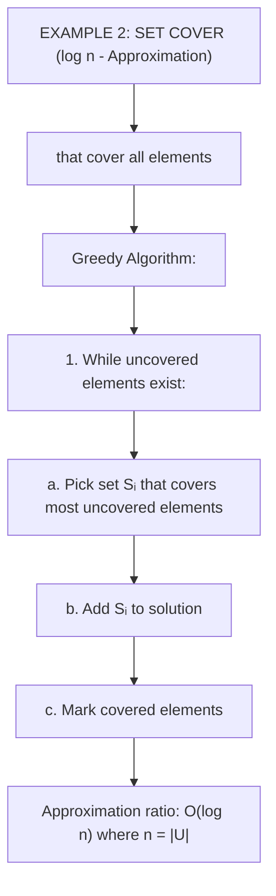
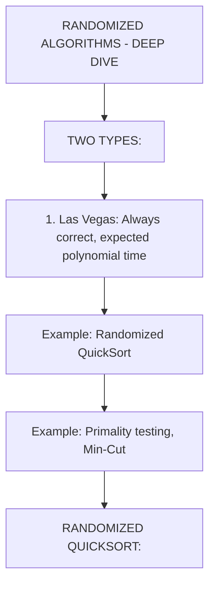
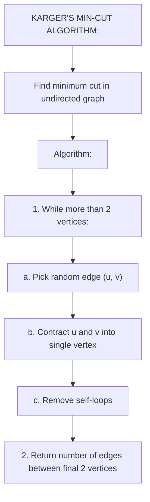
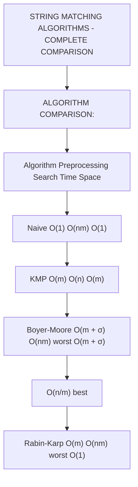
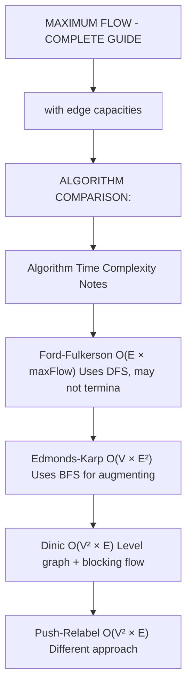
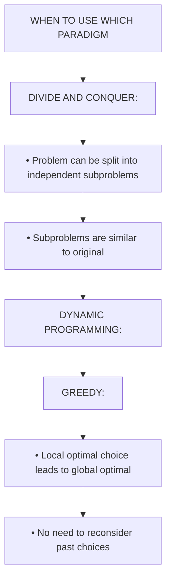

> **Navigation**: [< Previous Chapter](06d_String_Algorithms.md) | [Back to Index](../00_MASTER_INDEX.md)
> 🧠 **Mental Model**: See [Optimization Pipeline](../14_Mental_Models/14_Optimization_Pipeline.md) — systematic brute force to optimal approach

---

# 🔬 PART FINAL: MODERN ALGORITHMS AND ADVANCED TOPICS

## 📚 NP — Completeness — the Complete Understanding


## P Vs Np - The Millennium Prize Problem


**Complexity Classes**:
P (Polynomial Time):
- Problems solvable in O(n^k) for some constant k
- Examples: Sorting, Shortest Path, MST, Matrix Multiplication
- These are "tractable" - efficient algorithms exist
NP (Nondeterministic Polynomial Time):
- Problems where solutions can be VERIFIED in polynomial time
- NOT "Non-Polynomial"!
- Examples: SAT, Traveling Salesman, Vertex Cover
NP-Complete:
- Hardest problems in NP
- If any NP-Complete problem has a polynomial solution → P = NP
- 21 original NP-Complete problems (Karp's 21)
NP-Hard:
- At least as hard as NP-Complete
- May not even be in NP (solution might not be verifiable in poly time)
- Example: Halting Problem (undecidable!)
VISUAL RELATIONSHIP (if P ≠ NP):
NP-Hard
┌─────────────────────────────────┐
| |                                 | |
| |     NP-Complete                 | |
┌─────────────┼─────────────────────────────────┤
| |             |                                 | |
| |      NP     |    • SAT                        | |
| |             |    • 3-SAT                      | |
| |  ┌──────┐   |    • Vertex Cover               | |
| |  |  P   |   |    • Hamiltonian Path           | |
| |  |      |   |    • Traveling Salesman         | |
| |  └──────┘   |    • Graph Coloring             | |
| |             |    • Subset Sum                 | |
└─────────────┴─────────────────────────────────┘
PROVING NP-COMPLETENESS:
To show problem X is NP-Complete:
1. Show X is in NP (solution verifiable in poly time)
2. Show X is NP-Hard (reduce known NP-Complete problem to X in poly time)
Reduction: If A reduces to B in polynomial time, written A ≤_p B:
- We can transform any instance of A to an instance of B
- Transformation takes polynomial time
- Solution to transformed B gives solution to original A
If B has polynomial solution and A ≤_p B → A has polynomial solution
Contrapositive: If A has no poly solution and A ≤_p B → B has no poly sol

```java
public Set<Integer> vertexCover2Approx(int n, int[][] edges) {
    Set<Integer> cover = new HashSet<>();
    Set<String> remaining = new HashSet<>();

    for (int[] e : edges) {
        remaining.add(e[0] + "," + e[1]);
    }

    for (int[] e : edges) {
        String key = e[0] + "," + e[1];
        if (remaining.contains(key)) {
            cover.add(e[0]);
            cover.add(e[1]);

            // Remove all edges incident to e[0] or e[1]
            remaining.removeIf(s -> {
                String[] parts = s.split(",");
                int u = Integer.parseInt(parts[0]);
                int v = Integer.parseInt(parts[1]);
                return u == e[0] || u == e[1] || v == e[0] || v == e[1];
            });
        }
    }
    return cover;
}
```

```
│ │
│ │
│ EXAMPLE 2: SET COVER (log n - Approximation) │
│ ──────────────────────────────────────────── │
│ Problem: Given universe U and sets S₁...Sₘ, find minimum number of sets │
│ that cover all elements │
│ │
│ Greedy Algorithm: │
│ 1. While uncovered elements exist: │
│ a. Pick set Sᵢ that covers most uncovered elements │
│ b. Add Sᵢ to solution │
│ c. Mark covered elements │
│ │
│ Approximation ratio: O(log n) where n = |U| │
│ (This is optimal unless P = NP!) │
│ │
│ │
│ EXAMPLE 3: TSP with Triangle Inequality (1.5-Approximation) │
│ ───────────────────────────────────────────────────────────── │
│ Christofides Algorithm: │
│ 1. Find MST of graph │
│ 2. Find minimum weight perfect matching on odd-degree vertices │
│ 3. Combine MST + Matching (Eulerian graph) │
│ 4. Find Euler tour │
│ 5. Shortcut to Hamiltonian cycle │
│ │
│ Approximation ratio: 3/2 = 1.5 │
│ (Best known for metric TSP!) │
│ │
└─────────────────────────────────────────────────────────────────────────────────┘
```

**Flow:**
- EXAMPLE 2: SET COVER (log n - Approximation)
- ↓
- that cover all elements
- ↓
- Greedy Algorithm:
- ↓
- 1. While uncovered elements exist:
- ↓
- a. Pick set Sᵢ that covers most uncovered elements
- ↓
- b. Add Sᵢ to solution
- ↓
- c. Mark covered elements




## 📌 Randomized Algorithms


```
┌─────────────────────────────────────────────────────────────────────────────────┐
│ RANDOMIZED ALGORITHMS - DEEP DIVE                                               │
├─────────────────────────────────────────────────────────────────────────────────┤
│                                                                                 │
│ TWO TYPES:                                                                      │
│ ───────────                                                                     │
│ 1. Las Vegas: Always correct, expected polynomial time                          │
│ Example: Randomized QuickSort                                                   │
│                                                                                 │
│ 2. Monte Carlo: May be wrong, but guaranteed polynomial time                    │
│ Example: Primality testing, Min-Cut                                             │
│                                                                                 │
│                                                                                 │
│ RANDOMIZED QUICKSORT:                                                           │
│ ─────────────────────                                                           │
```

**Flow:**
- RANDOMIZED ALGORITHMS - DEEP DIVE
- ↓
- TWO TYPES:
- ↓
- 1. Las Vegas: Always correct, expected polynomial time
- ↓
- Example: Randomized QuickSort
- ↓
- Example: Primality testing, Min-Cut
- ↓
- RANDOMIZED QUICKSORT:




```java
void randomizedQuickSort(int[] arr, int low, int high) {
    if (low < high) {
        // Random pivot selection
        int randomIndex = low + random.nextInt(high - low + 1);
        swap(arr, randomIndex, high);  // Move pivot to end

        int pivotIndex = partition(arr, low, high);
        randomizedQuickSort(arr, low, pivotIndex - 1);
        randomizedQuickSort(arr, pivotIndex + 1, high);
    }
}

// Expected time: O(n log n)
// Worst case: O(n²) but probability is 1/n! → negligible
```

```
│ │
│ │
│ KARGER'S MIN-CUT ALGORITHM: │
│ ──────────────────────────── │
│ Find minimum cut in undirected graph │
│ │
│ Algorithm: │
│ 1. While more than 2 vertices: │
│ a. Pick random edge (u, v) │
│ b. Contract u and v into single vertex │
│ c. Remove self-loops │
│ 2. Return number of edges between final 2 vertices │
│ │
│ Probability of finding min-cut: ≥ 1/n² │
│ Run n² log n times → P(failure) < 1/n │
│ Total time: O(n⁴ log n) basic, O(n² log³ n) improved │
│ │
│ │
│ MILLER-RABIN PRIMALITY TEST: │
│ ───────────────────────────── │
```

**Flow:**
- KARGER'S MIN-CUT ALGORITHM:
- ↓
- Find minimum cut in undirected graph
- ↓
- Algorithm:
- ↓
- 1. While more than 2 vertices:
- ↓
- a. Pick random edge (u, v)
- ↓
- b. Contract u and v into single vertex
- ↓
- c. Remove self-loops




```java
// Monte Carlo: May report composite as prime, never reports prime as composite
public boolean isProbablePrime(long n, int iterations) {
    if (n < 2) return false;
    if (n == 2 || n == 3) return true;
    if (n % 2 == 0) return false;

    // Write n-1 as 2^r * d
    long d = n - 1;
    int r = 0;
    while (d % 2 == 0) {
        d /= 2;
        r++;
    }

    // Witness loop
    for (int i = 0; i < iterations; i++) {
        long a = 2 + random.nextLong() % (n - 3);
        if (!millerRabinTest(n, d, r, a)) {
            return false;  // Definitely composite
        }
    }
    return true;  // Probably prime
}

private boolean millerRabinTest(long n, long d, int r, long a) {
    long x = modPow(a, d, n);
    if (x == 1 || x == n - 1) return true;

    for (int i = 0; i < r - 1; i++) {
        x = modPow(x, 2, n);
        if (x == n - 1) return true;
    }
    return false;
}

// Probability of error after k iterations: ≤ (1/4)^k
// For k = 40: error probability < 10^-24
```

```
│ │
└─────────────────────────────────────────────────────────────────────────────────┘
```


## 📝 Advanced String Algorithms


```
┌─────────────────────────────────────────────────────────────────────────────────┐
│ STRING MATCHING ALGORITHMS - COMPLETE COMPARISON                                │
├─────────────────────────────────────────────────────────────────────────────────┤
│                                                                                 │
│ ALGORITHM COMPARISON:                                                           │
│ ┌─────────────────────┬────────────────┬────────────────┬──────────────────┐    │
│ │ Algorithm │ Preprocessing │ Search Time │ Space │                             │
│ ├─────────────────────┼────────────────┼────────────────┼──────────────────┤    │
│ │ Naive │ O(1) │ O(nm) │ O(1) │                                                 │
│ │ KMP │ O(m) │ O(n) │ O(m) │                                                    │
│ │ Boyer-Moore │ O(m + σ) │ O(nm) worst │ O(m + σ) │                             │
│ │ │ │ O(n/m) best │ │                                                           │
│ │ Rabin-Karp │ O(m) │ O(nm) worst │ O(1) │                                      │
│ │ │ │ O(n+m) expected│ │                                                        │
│ │ Z-Algorithm │ O(m) │ O(n) │ O(n+m) │                                          │
│ │ Suffix Array │ O(n log n) │ O(m log n) │ O(n) │                               │
│ │ Suffix Tree │ O(n) │ O(m) │ O(n) │                                            │
│ │ Aho-Corasick │ O(Σ|patterns|) │ O(n+matches) │ O(Σ|patterns|·σ) │             │
│ └─────────────────────┴────────────────┴────────────────┴──────────────────┘    │
│                                                                                 │
│ n = text length, m = pattern length, σ = alphabet size                          │
│                                                                                 │
```

**Flow:**
- STRING MATCHING ALGORITHMS - COMPLETE COMPARISON
- ↓
- ALGORITHM COMPARISON:
- ↓
- Algorithm Preprocessing Search Time Space
- ↓
- Naive O(1) O(nm) O(1)
- ↓
- KMP O(m) O(n) O(m)
- ↓
- Boyer-Moore O(m + σ) O(nm) worst O(m + σ)
- ↓
- O(n/m) best




```java
// Z-ALGORITHM: Find all occurrences of pattern in text
// Z[i] = length of longest substring starting at i that matches prefix
public int[] zFunction(String s) {
    int n = s.length();
    int[] z = new int[n];
    int l = 0, r = 0;

    for (int i = 1; i < n; i++) {
        if (i < r) {
            z[i] = Math.min(r - i, z[i - l]);
        }
        while (i + z[i] < n && s.charAt(z[i]) == s.charAt(i + z[i])) {
            z[i]++;
        }
        if (i + z[i] > r) {
            l = i;
            r = i + z[i];
        }
    }
    return z;
}

// Usage: Find pattern P in text T
// Create S = P + "$" + T
// All positions where z[i] == len(P) are matches

// AHO-CORASICK: Multiple pattern matching
class AhoCorasick {
    int[][] trie;
    int[] fail, output;
    int size = 0;

    public AhoCorasick(int maxStates, int alphabetSize) {
        trie = new int[maxStates][alphabetSize];
        fail = new int[maxStates];
        output = new int[maxStates];
        Arrays.fill(trie[0], -1);
    }

    public void addPattern(String pattern, int index) {
        int state = 0;
        for (char c : pattern.toCharArray()) {
            int ch = c - 'a';
            if (trie[state][ch] == -1) {
                trie[state][ch] = ++size;
                Arrays.fill(trie[size], -1);
            }
            state = trie[state][ch];
        }
        output[state] |= (1 << index);
    }

    public void build() {
        Queue<Integer> queue = new LinkedList<>();

        // Initialize fail function for depth 1
        for (int c = 0; c < 26; c++) {
            if (trie[0][c] != -1) {
                fail[trie[0][c]] = 0;
                queue.offer(trie[0][c]);
            } else {
                trie[0][c] = 0;
            }
        }

        // BFS to compute fail function
        while (!queue.isEmpty()) {
            int state = queue.poll();
            for (int c = 0; c < 26; c++) {
                if (trie[state][c] != -1) {
                    int next = trie[state][c];
                    int f = fail[state];
                    while (trie[f][c] == -1) f = fail[f];
                    fail[next] = trie[f][c];
                    output[next] |= output[fail[next]];
                    queue.offer(next);
                }
            }
        }
    }

    public List<int[]> search(String text) {
        List<int[]> matches = new ArrayList<>();
        int state = 0;

        for (int i = 0; i < text.length(); i++) {
            int c = text.charAt(i) - 'a';
            while (trie[state][c] == -1) state = fail[state];
            state = trie[state][c];

            if (output[state] != 0) {
                for (int j = 0; j < 32; j++) {
                    if ((output[state] & (1 << j)) != 0) {
                        matches.add(new int[]{i, j});  // position, pattern index
                    }
                }
            }
        }
        return matches;
    }
}
```

```
│ │
└─────────────────────────────────────────────────────────────────────────────────┘
```


## 🌐 Network Flow Algorithms


```
┌─────────────────────────────────────────────────────────────────────────────────┐
│ MAXIMUM FLOW - COMPLETE GUIDE                                                   │
├─────────────────────────────────────────────────────────────────────────────────┤
│                                                                                 │
│ PROBLEM: Find maximum flow from source s to sink t in a directed graph          │
│ with edge capacities                                                            │
│                                                                                 │
│ ALGORITHM COMPARISON:                                                           │
│ ┌─────────────────────┬────────────────────────┬────────────────────────────┐   │
│ │ Algorithm │ Time Complexity │ Notes │                                         │
│ ├─────────────────────┼────────────────────────┼────────────────────────────┤   │
│ │ Ford-Fulkerson │ O(E × maxFlow) │ Uses DFS, may not terminate│                │
│ │ Edmonds-Karp │ O(V × E²) │ Uses BFS for augmenting │                          │
│ │ Dinic │ O(V² × E) │ Level graph + blocking flow│                              │
│ │ Push-Relabel │ O(V² × E) │ Different approach │                               │
│ │ Dinic (unit cap) │ O(E × √V) │ For unit capacity graphs │                     │
│ └─────────────────────┴────────────────────────┴────────────────────────────┘   │
│                                                                                 │
```

**Flow:**
- MAXIMUM FLOW - COMPLETE GUIDE
- ↓
- with edge capacities
- ↓
- ALGORITHM COMPARISON:
- ↓
- Algorithm Time Complexity Notes
- ↓
- Ford-Fulkerson O(E × maxFlow) Uses DFS, may not termina
- ↓
- Edmonds-Karp O(V × E²) Uses BFS for augmenting
- ↓
- Dinic O(V² × E) Level graph + blocking flow




```java
// DINIC'S ALGORITHM - O(V²E)
class Dinic {
    int[] level, iter;
    List<int[]>[] graph;  // int[] = {to, capacity, rev_index}
    int n;

    public Dinic(int n) {
        this.n = n;
        graph = new ArrayList[n];
        for (int i = 0; i < n; i++) graph[i] = new ArrayList<>();
        level = new int[n];
        iter = new int[n];
    }

    public void addEdge(int from, int to, int cap) {
        graph[from].add(new int[]{to, cap, graph[to].size()});
        graph[to].add(new int[]{from, 0, graph[from].size() - 1});  // Reverse edge
    }

    private boolean bfs(int s, int t) {
        Arrays.fill(level, -1);
        Queue<Integer> q = new LinkedList<>();
        level[s] = 0;
        q.offer(s);

        while (!q.isEmpty()) {
            int v = q.poll();
            for (int[] e : graph[v]) {
                if (e[1] > 0 && level[e[0]] < 0) {
                    level[e[0]] = level[v] + 1;
                    q.offer(e[0]);
                }
            }
        }
        return level[t] >= 0;
    }

    private int dfs(int v, int t, int f) {
        if (v == t) return f;

        for (; iter[v] < graph[v].size(); iter[v]++) {
            int[] e = graph[v].get(iter[v]);
            if (e[1] > 0 && level[v] < level[e[0]]) {
                int d = dfs(e[0], t, Math.min(f, e[1]));
                if (d > 0) {
                    e[1] -= d;
                    graph[e[0]].get(e[2])[1] += d;
                    return d;
                }
            }
        }
        return 0;
    }

    public int maxFlow(int s, int t) {
        int flow = 0;
        while (bfs(s, t)) {
            Arrays.fill(iter, 0);
            int f;
            while ((f = dfs(s, t, Integer.MAX_VALUE)) > 0) {
                flow += f;
            }
        }
        return flow;
    }
}

// APPLICATIONS OF MAX FLOW:
// 1. Bipartite Matching: Add source to left, sink to right, unit capacities
// 2. Min Cut: Run max flow, find reachable vertices from source in residual
// 3. Maximum Edge-Disjoint Paths: Unit capacities, max flow = # paths
// 4. Circulation with Demands: Add super-source and super-sink
```

```
│ │
└─────────────────────────────────────────────────────────────────────────────────┘
```


> 🔬 **Section Challenge — 🌐 Network Flow Algorithms**
>
> **Challenge 1 (Reasoning):** Two-pointer pattern reduces O(N²) brute force to O(N). What is the KEY invariant that makes this safe?
> <details><summary>Answer</summary>
>
> The invariant: all pairs we SKIP are guaranteed to not contain the answer. In 3Sum: once we fix `nums[i]` and use l/r pointers, we can safely skip because the array is sorted. If `sum > 0`: decreasing r decreases the sum (smaller right value). If `sum < 0`: increasing l increases the sum (larger left value). We never skip a valid pair because monotonicity guarantees it.
> </details>
>

## 📌 Computational Geometry Basics


```
┌─────────────────────────────────────────────────────────────────────────────────┐
│ COMPUTATIONAL GEOMETRY - ESSENTIAL ALGORITHMS                                   │
├─────────────────────────────────────────────────────────────────────────────────┤
│                                                                                 │
```


```java
// CONVEX HULL - Graham Scan O(n log n)
public List<int[]> convexHull(int[][] points) {
    int n = points.length;
    if (n < 3) return Arrays.asList(points);

    // Find bottom-most point (or left-most if tie)
    int minIdx = 0;
    for (int i = 1; i < n; i++) {
        if (points[i][1] < points[minIdx][1] ||
            (points[i][1] == points[minIdx][1] && points[i][0] < points[minIdx][0])) {
            minIdx = i;
        }
    }
    swap(points, 0, minIdx);
    int[] pivot = points[0];

    // Sort by polar angle with pivot
    Arrays.sort(points, 1, n, (a, b) -> {
        int cross = crossProduct(pivot, a, b);
        if (cross == 0) {  // Collinear
            return distance(pivot, a) - distance(pivot, b);
        }
        return -cross;  // Counter-clockwise order
    });

    // Build hull
    List<int[]> hull = new ArrayList<>();
    for (int[] p : points) {
        while (hull.size() > 1 &&
               crossProduct(hull.get(hull.size()-2), hull.get(hull.size()-1), p) <= 0) {
            hull.remove(hull.size() - 1);
        }
        hull.add(p);
    }
    return hull;
}

// Cross product: (b-a) × (c-a)
// > 0: counter-clockwise, < 0: clockwise, = 0: collinear
int crossProduct(int[] a, int[] b, int[] c) {
    return (b[0] - a[0]) * (c[1] - a[1]) - (b[1] - a[1]) * (c[0] - a[0]);
}

// LINE SEGMENT INTERSECTION
boolean intersects(int[] p1, int[] p2, int[] p3, int[] p4) {
    int d1 = direction(p3, p4, p1);
    int d2 = direction(p3, p4, p2);
    int d3 = direction(p1, p2, p3);
    int d4 = direction(p1, p2, p4);

    if (((d1 > 0 && d2 < 0) || (d1 < 0 && d2 > 0)) &&
        ((d3 > 0 && d4 < 0) || (d3 < 0 && d4 > 0))) {
        return true;
    }

    // Collinear cases
    if (d1 == 0 && onSegment(p3, p4, p1)) return true;
    if (d2 == 0 && onSegment(p3, p4, p2)) return true;
    if (d3 == 0 && onSegment(p1, p2, p3)) return true;
    if (d4 == 0 && onSegment(p1, p2, p4)) return true;

    return false;
}

int direction(int[] a, int[] b, int[] c) {
    return (c[0] - a[0]) * (b[1] - a[1]) - (b[0] - a[0]) * (c[1] - a[1]);
}

boolean onSegment(int[] a, int[] b, int[] c) {
    return Math.min(a[0], b[0]) <= c[0] && c[0] <= Math.max(a[0], b[0]) &&
           Math.min(a[1], b[1]) <= c[1] && c[1] <= Math.max(a[1], b[1]);
}

// CLOSEST PAIR OF POINTS - O(n log n)
// Divide and conquer: split, solve recursively, merge considering strip
```

```
│ │
└─────────────────────────────────────────────────────────────────────────────────┘
```


## 📋 Algorithm Design Paradigms — Summary


```
┌─────────────────────────────────────────────────────────────────────────────────┐
│ WHEN TO USE WHICH PARADIGM                                                      │
├─────────────────────────────────────────────────────────────────────────────────┤
│                                                                                 │
│ DIVIDE AND CONQUER:                                                             │
│ • Problem can be split into independent subproblems                             │
│ • Subproblems are similar to original                                           │
│ • Examples: Merge Sort, Quick Sort, Binary Search, Strassen's Matrix            │
│                                                                                 │
│ DYNAMIC PROGRAMMING:                                                            │
│ • Optimal substructure: optimal solution uses optimal subsolutions              │
│ • Overlapping subproblems: same subproblems solved multiple times               │
│ • Examples: Fibonacci, Knapsack, LCS, Edit Distance, Matrix Chain               │
│                                                                                 │
│ GREEDY:                                                                         │
│ • Local optimal choice leads to global optimal                                  │
│ • No need to reconsider past choices                                            │
│ • Examples: Huffman, Activity Selection, Dijkstra, MST (Prim, Kruskal)          │
│                                                                                 │
│ BACKTRACKING:                                                                   │
│ • Find all (or some) solutions                                                  │
│ • Build solution incrementally, abandon if invalid                              │
│ • Examples: N-Queens, Sudoku, Subset Sum, Permutations                          │
│                                                                                 │
│ BRANCH AND BOUND:                                                               │
│ • Optimization problems                                                         │
│ • Use bounds to prune search space                                              │
│ • Examples: TSP, Integer Linear Programming, 0/1 Knapsack                       │
│                                                                                 │
│                                                                                 │
│ COMPLEXITY CHEAT SHEET:                                                         │
│ ┌──────────────────────┬────────────────────────────────────────────────────┐   │
│ │ If you see... │ Think about... │                                              │
│ ├──────────────────────┼────────────────────────────────────────────────────┤   │
│ │ Sorted array │ Binary search O(log n) │                                       │
│ │ Find all subsets │ 2^n solutions (exponential) │                              │
│ │ Find all permutations│ n! solutions (factorial) │                             │
│ │ Shortest path │ BFS (unweighted), Dijkstra (weighted) │                       │
│ │ Connected components │ DFS/BFS/Union-Find │                                   │
│ │ Optimal order │ DP on intervals │                                             │
│ │ Maximum/Minimum │ DP, Greedy, or Binary search on answer │                    │
│ │ Graph with cycles │ May need to detect or handle cycles │                     │
│ │ String matching │ KMP, Z-algorithm, Rolling hash │                            │
│ │ Range queries │ Segment Tree, Fenwick Tree │                                  │
│ │ Multiple patterns │ Trie, Aho-Corasick │                                      │
│ └──────────────────────┴────────────────────────────────────────────────────┘   │
│                                                                                 │
└─────────────────────────────────────────────────────────────────────────────────┘
```

**Flow:**
- WHEN TO USE WHICH PARADIGM
- ↓
- DIVIDE AND CONQUER:
- ↓
- • Problem can be split into independent subproblems
- ↓
- • Subproblems are similar to original
- ↓
- DYNAMIC PROGRAMMING:
- ↓
- GREEDY:
- ↓
- • Local optimal choice leads to global optimal




```

---

_Master these algorithms to understand the foundations of computer science!_ 🎯
```

---

> **Prev**: [Part A: Core Algorithm Techniques](06a_Greedy_BitManip.md)

---


# 💪 Curated Practice Problems — Advanced Algorithms

> **HOW TO USE**: These are harder problems covering greedy, bit manipulation, string algorithms, and competitive patterns.
> Attempt only after mastering the fundamentals in earlier chapters.

---

## Section 1: Greedy Algorithms

| # | Problem | Platform | Difficulty | Key Technique |
|---|---------|----------|------------|---------------|
| 1 | Jump Game (LC 55) | LeetCode | Medium | Track farthest reachable |
| 2 | Jump Game II (LC 45) | LeetCode | Medium | Greedy BFS-style levels |
| 3 | Gas Station (LC 134) | LeetCode | Medium | If total >= 0, solution exists |
| 4 | Task Scheduler (LC 621) | LeetCode | Medium | Most frequent first + idle slots |
| 5 | Non-overlapping Intervals (LC 435) | LeetCode | Medium | Sort by end, count kept |
| 6 | Merge Intervals (LC 56) | LeetCode | Medium | Sort by start, merge overlapping |
| 7 | Meeting Rooms II (LC 253) | LeetCode | Medium | Min heap for end times |
| 8 | Partition Labels (LC 763) | LeetCode | Medium | Last occurrence of each char |
| 9 | Minimum Number of Arrows (LC 452) | LeetCode | Medium | Interval scheduling |
| 10 | Candy (LC 135) | LeetCode | Hard | Two-pass left-to-right, right-to-left |

---


> 🔬 **Section Challenge — Section 1: Greedy Algorithms**
>
> **Challenge 1 (Reasoning):** Interval scheduling: select maximum number of non-overlapping intervals. Why does sorting by END time work, not by START time or duration?
> <details><summary>Answer</summary>
>
> Sorting by end time: greedily picking the interval that ends earliest leaves maximum time for future intervals. Formal proof (exchange argument): suppose optimal solution picks interval A instead of interval B (B ends earlier). We can swap A for B without losing any other interval (B ends ≤ A ends, so anything compatible with A is also compatible with B). Sorting by start time fails: a very long interval starting early would block many shorter intervals. Sorting by duration fails: a short interval might overlap two others.
> </details>
>

## Section 2: Bit Manipulation

| # | Problem | Platform | Difficulty | Key Technique |
|---|---------|----------|------------|---------------|
| 1 | Single Number (LC 136) | LeetCode | Easy | XOR all elements |
| 2 | Number of 1 Bits (LC 191) | LeetCode | Easy | n & (n-1) clears last set bit |
| 3 | Counting Bits (LC 338) | LeetCode | Easy | dp[i] = dp[i>>1] + (i&1) |
| 4 | Missing Number (LC 268) | LeetCode | Easy | XOR with indices |
| 5 | Reverse Bits (LC 190) | LeetCode | Easy | Shift and build result |
| 6 | Single Number II (LC 137) | LeetCode | Medium | Count bits mod 3 |
| 7 | Single Number III (LC 260) | LeetCode | Medium | XOR + rightmost set bit split |
| 8 | Subsets (LC 78) | LeetCode | Medium | Bitmask 0 to 2^n-1 |
| 9 | Maximum XOR of Two Numbers (LC 421) | LeetCode | Medium | Trie on binary representation |
| 10 | Minimum Flips to Make a OR b Equal to c (LC 1318) | LeetCode | Medium | Bit-by-bit analysis |

---

## Section 3: String Algorithms

| # | Problem | Platform | Difficulty | Key Technique |
|---|---------|----------|------------|---------------|
| 1 | Longest Common Prefix (LC 14) | LeetCode | Easy | Vertical scan or binary search |
| 2 | Implement strStr() / KMP (LC 28) | LeetCode | Easy | KMP failure function |
| 3 | Longest Palindromic Substring (LC 5) | LeetCode | Medium | Expand around center or Manacher |
| 4 | Longest Palindromic Subsequence (LC 516) | LeetCode | Medium | 2D DP |
| 5 | Edit Distance (LC 72) | LeetCode | Medium | Classic 2D DP |
| 6 | Wildcard Matching (LC 44) | LeetCode | Hard | DP or greedy with backtrack |
| 7 | Regular Expression Matching (LC 10) | LeetCode | Hard | DP with * handling |
| 8 | Shortest Palindrome (LC 214) | LeetCode | Hard | KMP on s + "#" + reverse(s) |
| 9 | Repeated Substring Pattern (LC 459) | LeetCode | Easy | KMP failure function insight |
| 10 | Minimum Window Substring (LC 76) | LeetCode | Hard | Sliding window + freq map |

---


## HIDDEN GEMS — Advanced

| # | Problem | Platform | Why It's Valuable |
|---|---------|----------|-------------------|
| 1 | Maximum Product of Word Lengths (LC 318) | LeetCode | Bitmask for character sets |
| 2 | Wiggle Sort II (LC 324) | LeetCode | Median + 3-way partition |
| 3 | Queue Reconstruction by Height (LC 406) | LeetCode | Sort desc height, insert by k |
| 4 | UTF-8 Validation (LC 393) | LeetCode | Bit manipulation for encoding |
| 5 | Gray Code (LC 89) | LeetCode | i XOR (i >> 1) — elegant bit pattern |
| 6 | Circular Array Loop (LC 457) | LeetCode | Slow/fast pointer on circular |

---


---

## 🏋️ Practice & Interview Questions — Algorithms

### Sorting
**Q1.** Which sorting algorithm does Java use for `Arrays.sort(int[])`? Why not MergeSort?
<details><summary>Answer</summary>

**Dual-Pivot QuickSort** — for primitives. MergeSort requires O(N) extra space. QuickSort is in-place and cache-friendly. Stability doesn't matter for primitives (equal ints are indistinguishable). For objects (`Arrays.sort(Object[])`), Java uses **TimSort** (stable, O(N log N) worst).
</details>

**Q2.** Trace Merge Sort on `[4,2,7,1]`.
<details><summary>Answer</summary>

Split: `[4,2]` `[7,1]` → Split: `[4]` `[2]` `[7]` `[1]` → Merge: `[2,4]` `[1,7]` → Merge: `[1,2,4,7]`
</details>

**Q3.** ⭐⭐ Sort Colors (Dutch National Flag — 3-way partition).
<details><summary>Solution</summary>

```java
int lo=0, mid=0, hi=n-1;
while(mid<=hi){
    if(nums[mid]==0) swap(nums,lo++,mid++);
    else if(nums[mid]==1) mid++;
    else swap(nums,mid,hi--);
}
```
</details>

### Binary Search
**Q4.** ⭐ Search in Rotated Sorted Array.
<details><summary>Solution</summary>

```java
int lo=0, hi=n-1;
while(lo<=hi){
    int mid=(lo+hi)/2;
    if(nums[mid]==target) return mid;
    if(nums[lo]<=nums[mid]){ // left half sorted
        if(nums[lo]<=target&&target<nums[mid]) hi=mid-1; else lo=mid+1;
    } else { // right half sorted
        if(nums[mid]<target&&target<=nums[hi]) lo=mid+1; else hi=mid-1;
    }
}
return -1;
```
</details>

**Q5.** ⭐ Find First and Last Position (binary search twice).
<details><summary>Solution</summary>

```java
// First: find leftmost with while(lo<hi){ if arr[mid]>=target hi=mid else lo=mid+1 }
// Last: find rightmost with while(lo<hi){ if arr[mid]<=target lo=mid+1 else hi=mid } return lo-1
```
</details>

**Q6.** ⭐⭐ Koko Eating Bananas — binary search on answer.
<details><summary>Key insight</summary>

Binary search the eating speed k in range [1, max(piles)]. For each k, calculate hours needed. Find minimum k where hours ≤ H.
</details>

### Dynamic Programming
**Q7.** ⭐ Climbing Stairs — n steps, 1 or 2 at a time. How many ways?
<details><summary>Solution</summary>

```java
// Fibonacci sequence! dp[i] = dp[i-1] + dp[i-2]
int a=1, b=1;
for(int i=2;i<=n;i++){ int c=a+b; a=b; b=c; }
return b;
```
</details>

**Q8.** ⭐ Coin Change — minimum coins for amount.
<details><summary>Solution</summary>

```java
int[] dp = new int[amount+1]; Arrays.fill(dp, amount+1);
dp[0]=0;
for(int i=1;i<=amount;i++)
    for(int c:coins) if(c<=i) dp[i]=Math.min(dp[i],dp[i-c]+1);
return dp[amount]>amount?-1:dp[amount];
```
</details>

**Q9.** ⭐⭐ Longest Common Subsequence.
<details><summary>Solution</summary>

```java
int[][] dp=new int[m+1][n+1];
for(int i=1;i<=m;i++) for(int j=1;j<=n;j++){
    if(text1.charAt(i-1)==text2.charAt(j-1)) dp[i][j]=dp[i-1][j-1]+1;
    else dp[i][j]=Math.max(dp[i-1][j],dp[i][j-1]);
}
return dp[m][n];
```
</details>

**Q10.** ⭐⭐ Word Break — can string be segmented using dictionary words?
<details><summary>Solution</summary>

```java
boolean[] dp=new boolean[n+1]; dp[0]=true;
for(int i=1;i<=n;i++) for(String w:wordDict)
    if(i>=w.length()&&dp[i-w.length()]&&s.substring(i-w.length(),i).equals(w)) dp[i]=true;
return dp[n];
```
</details>

**Q11.** ⭐⭐⭐ Edit Distance (Levenshtein).
<details><summary>Solution</summary>

```java
int[][] dp=new int[m+1][n+1];
for(int i=0;i<=m;i++) dp[i][0]=i;
for(int j=0;j<=n;j++) dp[0][j]=j;
for(int i=1;i<=m;i++) for(int j=1;j<=n;j++){
    if(word1.charAt(i-1)==word2.charAt(j-1)) dp[i][j]=dp[i-1][j-1];
    else dp[i][j]=1+Math.min(dp[i-1][j-1],Math.min(dp[i-1][j],dp[i][j-1]));
}
```
</details>

### Graph Algorithms
**Q12.** ⭐ Number of Islands (BFS/DFS grid traversal).
<details><summary>Solution</summary>

```java
for each cell (i,j) if grid[i][j]=='1': count++; BFS/DFS to mark all connected land as visited
```
</details>

**Q13.** ⭐⭐ Course Schedule — detect cycle in directed graph (Topological sort).
<details><summary>Solution</summary>

```java
// Kahn's algorithm: indegree array + BFS queue
// If result size == numCourses → no cycle → can finish
```
</details>

**Q14.** ⭐⭐ Dijkstra's Shortest Path.
<details><summary>Solution</summary>

```java
PriorityQueue<int[]> pq=new PriorityQueue<>((a,b)->a[1]-b[1]); // [node, dist]
pq.offer(new int[]{src,0}); dist[src]=0;
while(!pq.isEmpty()){
    int[] curr=pq.poll(); int u=curr[0],d=curr[1];
    if(d>dist[u]) continue; // stale
    for(int[] neighbor:graph[u]) if(dist[u]+neighbor[1]<dist[neighbor[0]]){
        dist[neighbor[0]]=dist[u]+neighbor[1]; pq.offer(new int[]{neighbor[0],dist[neighbor[0]]});
    }
}
```
</details>

### MCQ Rapid Fire
| # | Question | Answer |
|---|---|---|
| 1 | QuickSort avg/worst | O(N log N) avg, O(N²) worst |
| 2 | MergeSort space complexity | O(N) |
| 3 | HeapSort space complexity | O(1) (in-place) |
| 4 | Binary search precondition | Sorted array |
| 5 | BFS time complexity on graph | O(V+E) |
| 6 | DFS space complexity | O(V) (recursion stack) |
| 7 | Dijkstra fails on | Negative weight edges |
| 8 | Bellman-Ford handles | Negative weights, detects negative cycles |
| 9 | Floyd-Warshall use case | All-pairs shortest path, O(V³) |
| 10 | Topological sort requires | Directed Acyclic Graph (DAG) |


---

## 🧠 Deep Conceptual Questions — Algorithm Design & Analysis

**C1. What does O(N log N) "feel like" and why is it the complexity barrier for comparison-based sorting?**
<details><summary>Deep Answer</summary>

O(N log N) for N=1M ≈ 20M operations. O(N²) ≈ 1 trillion. The difference is 50,000x. **Comparison sort lower bound**: any comparison-based sort must distinguish between N! possible orderings. Each comparison has 2 outcomes. A decision tree with N! leaves needs ≥ log₂(N!) height ≈ N log N (Stirling's approximation). Therefore NO comparison sort can beat O(N log N) in the worst case. Non-comparison sorts (counting sort, radix sort, bucket sort) break this bound by using non-comparison operations — but require constraints on input (e.g., integer range bounded by N).
</details>

**C2. Greedy algorithms: when do they work and what must be proven?**
<details><summary>Deep Answer</summary>

A greedy algorithm makes the locally optimal choice at each step. Works when problem has: (1) **Greedy choice property**: local optimal leads to global optimal — the choice never needs to be revised. (2) **Optimal substructure**: optimal solution to the problem contains optimal solutions to subproblems. To PROVE greedy is correct: use "exchange argument" — assume optimal solution differs from greedy, show you can swap greedy's choice in without making it worse, contradiction. Greedy FAILS when: future choices depend on current choice in complex ways (use DP instead). Classic works: interval scheduling, Huffman coding, Dijkstra. Classic fails: 0-1 knapsack (use DP).
</details>

**C3. Dynamic Programming: what is "overlapping subproblems" and why does it matter?**
<details><summary>Deep Answer</summary>

Overlapping subproblems: the same sub-computation appears multiple times. Fibonacci: `fib(5)` calls `fib(4)` and `fib(3)`. `fib(4)` also calls `fib(3)`. Without memoization: `fib(3)` computed exponentially many times → O(2^N). With memoization: each sub-result computed once and stored → O(N). DP is valuable SPECIFICALLY when: (1) problem has optimal substructure AND (2) subproblems overlap. If no overlap: just use divide-and-conquer (merge sort's subproblems don't overlap → no DP needed). DP = "smart recursion" = avoid recomputing.
</details>

**C4. Top-down (memoization) vs Bottom-up (tabulation) DP — when to choose each?**
<details><summary>Deep Answer</summary>

**Top-down (memoization)**: Write natural recursion + cache results. Easy to implement, only computes needed subproblems (sparse computation). Cons: recursion overhead and stack depth risk. Use when: problem is naturally recursive, only a fraction of subproblems needed. **Bottom-up (tabulation)**: Fill DP table iteratively from base cases. No recursion overhead, better cache performance, easier space optimization. Use when: need all subproblems (or most of them), want to optimize space (can often reduce to 1D from 2D). Rule: start with top-down for correctness verification, optimize to bottom-up for performance.
</details>

**C5. Dijkstra's Algorithm: why does it fail on negative weights?**
<details><summary>Deep Answer</summary>

Dijkstra assumes: once a node is "settled" (extracted from the priority queue with its final shortest distance), that distance is optimal. With negative weights: settling node A at distance 5 might not be final — a path through B (distance 7) → C (edge -10) → A gives distance -3. But A was already settled! Dijkstra doesn't revisit settled nodes. Bellman-Ford handles negatives by relaxing ALL edges N-1 times — no "settled" assumption. For graphs with negative cycles: Bellman-Ford detects them (if distances still decrease after N-1 rounds, there's a negative cycle).
</details>

**C6. Union-Find: why is path compression + union by rank/size nearly O(1)?**
<details><summary>Deep Answer</summary>

**Path compression**: when finding the root of element x, make every node on the path point directly to the root. Flattens the tree. Future finds on those paths: O(1). **Union by rank**: always attach the smaller tree under the larger → limits tree height to O(log N). Combined: inverse Ackermann function α(N) amortized — so slow-growing it's practically constant (α(10^80) = 4). Neither alone is optimal: path compression without union by rank → O(log N) amortized. Union by rank without path compression → O(log N). Together → α(N) ≈ O(1) amortized. Used in: Kruskal's MST, cycle detection, connected components.
</details>

**C7. Binary Search on the Answer — what types of problems does it apply to?**
<details><summary>Deep Answer</summary>

When the answer space is **monotone**: "if X is achievable, then all values less extreme than X are also achievable." Problems: minimize the maximum (aggressive cows, split array), find minimum valid threshold (Koko bananas, minimum days to bloom), divide-and-conquer feasibility. Template: binary search on the answer range [lo, hi], for each mid check `isFeasible(mid)` in O(N) or O(N log N). Total: O(N log(answer_range)). Key insight: reframe "find optimal value" as "find smallest X where condition holds" → enables binary search on a non-array space.
</details>

**C8. Why does merge sort guarantee stability while quicksort doesn't?**
<details><summary>Deep Answer</summary>

**Merge sort stability**: during merge, when two elements are equal, we always take from the LEFT array first → preserves original relative order. **QuickSort instability**: the partition step swaps elements across the pivot without regard to original order. Two equal elements may be placed on opposite sides of the pivot, reversing their order. QuickSort CAN be made stable (Lomuto partition with careful implementation) but loses performance. Java uses TimSort for objects (stable), dual-pivot quicksort for primitives (stability irrelevant since primitives without fields).
</details>

**C9. Backtracking: what's the difference from plain DFS and when to use vs DP?**
<details><summary>Deep Answer</summary>

**Backtracking vs DFS**: DFS visits every path. Backtracking prunes paths early when a constraint is violated — avoids exploring infeasible branches. Same asymptotic but drastically different practical performance with good pruning. **Backtracking vs DP**: backtracking for **combinatorial/enumeration** problems (find all solutions, permutations, subsets). DP for **optimization** problems (find optimal single solution). Backtracking produces exponential solutions in worst case but is necessary when you need ALL solutions. DP finds the optimal in polynomial time when overlapping subproblems exist.
</details>

**C10. What is amortized analysis and how does it differ from average-case analysis?**
<details><summary>Deep Answer</summary>

**Amortized**: analyzes the average cost per operation over a SEQUENCE of operations — in the worst case. No probability involved. Guarantees: N operations ALWAYS take O(N·T) total, even if some individual operations are O(N·T). Example: ArrayList append is O(N) when resizing, but amortized O(1) because resizing is rare. **Average-case**: analyzes expected cost of a SINGLE operation assuming random input. QuickSort is O(N log N) average-case (random pivot). Amortized is a stronger guarantee — it holds even for adversarial input sequences.
</details>


> **Navigation**: [< Previous](06d_String_Algorithms.md) | [Back to Index](../00_MASTER_INDEX.md) | [Next >](07a_Advanced_DS_Core.md)