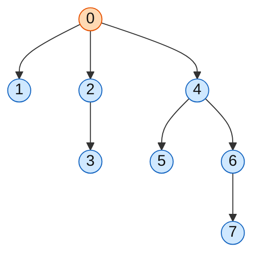
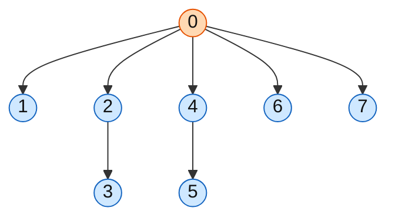
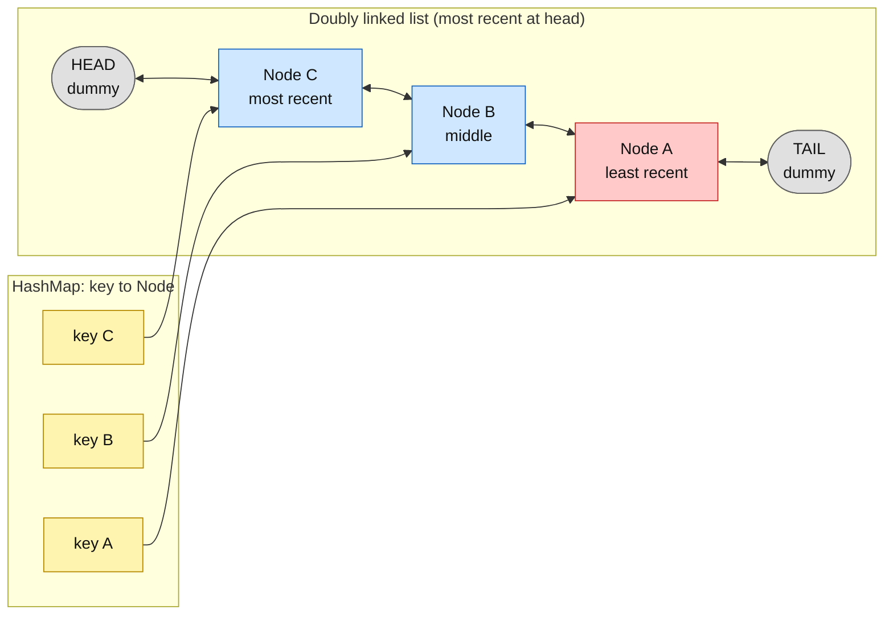

**Navigation**: [Back to Index](../00_MASTER_INDEX.md) | [Next Chapter >](07b_Advanced_DS_Patterns.md)

---

# 🏗️ Advanced Data Structures: Complete Guide

<details>
<summary><b>🧠 5W1H: Advanced Data Structures</b></summary>

- **What**: Sophisticated data structures like Tries, Segment Trees, Fenwick Trees (BIT), Disjoint Sets (Union-Find), Skip Lists, and Bloom Filters.
- **Why**: Basic structures (arrays, lists, BSTs) are insufficient for specialized queries (e.g., prefix matching, range queries, probabilistic membership, fast connectivity checks).
- **When**: Used in latency-sensitive or scale-heavy systems (e.g., databases, networking, auto-complete, caches).
- **Where**: Embedded deeply into system architecture (Redis, LevelDB, IP Routers, Web Browsers).
- **Who**: Systems programmers, database engineers, and competitive programmers.
- **How**: By leveraging memory layouts, bit manipulation, amortized time bounds, and probabilistic guarantees to achieve optimal performance constraints.
</details>

### Historical Evolution

The data structures in this chapter represent decades of engineering trade-offs at the intersection of hardware constraints and algorithmic theory. **Tries** (from "retrieval" or "tree") were independently invented by **René de la Briandais (1959)** and **Edward Fredkin (1960)** as a more efficient alternative to binary search trees for string retrieval — Fredkin coined the name "trie" and demonstrated that looking up a word of length $k$ in a dictionary of size $N$ could be done in $O(k)$ time regardless of $N$. **Fenwick Trees** (also called Binary Indexed Trees) were invented by **Peter Fenwick in 1964** at the University of Canterbury, New Zealand, as a space-efficient alternative to segment trees for prefix sum queries and updates — the key insight is that each index $i$ stores the sum of a range of size $i \land (-i)$, enabling both point updates and prefix queries in $O(\log n)$ with only $n$ integers. **Segment Trees** were formalized by **Bentley (1977)** in his paper "Solutions to Klee's rectangle problems" and became standard for range query problems. Modern practice (post-2010) combines these: Tries underpin autocomplete in browsers and routers, Fenwick trees power Fenwick tree arrays in competitive programming libraries and financial data structures (BIT for prefix sums in online trading), and Segment Trees with lazy propagation are used in interval scheduling systems.

---

## Beyond Arrays and Trees - Structures That Power Modern Systems

---

# 🔬 PART 0: DEEP INTERNALS - HOW ADVANCED DATA STRUCTURES WORK AT MEMORY LEVEL

ADVANCED DATA STRUCTURES AT THE HARDWARE LEVEL - MINUTE DETAILS

Understanding the PHYSICAL implementation of these powerful structures:

- Memory layout and allocation patterns
- Cache behavior and optimization techniques
- Bit manipulation in Fenwick trees
- Why certain structures are faster in practice

## 🧠 Trie Node Memory Layout

## Trie Memory Representation - Deep Dive

BASIC TRIE NODE (Array-based):

```java
class TrieNode {
    TrieNode[] children = new TrieNode[26]; // 26 letters
    boolean isEndOfWord;
}
```

MEMORY LAYOUT (64-bit JVM, compressed oops):

| OFFSET | SIZE | FIELD | VALUE |
|---|---|---|---|
| 0 | 8 | Mark Word | Object header |
| 8 | 4 | Class Pointer | → TrieNode.class |
| 12 | 4 | children (ref) | → Object[] array |
| 16 | 1 | isEndOfWord | true/false |
| 17 | 7 | padding | alignment to 8 bytes |
TrieNode object: 24 bytes
PLUS the children array:

| OFFSET | SIZE | CONTENT |
|---|---|---|
| 0 | 8 | Mark Word (array header) |
| 8 | 4 | Class Pointer |
| 12 | 4 | Array length = 26 |
| 16 | 104 | 26 × 4 bytes (references to child TrieNode) |
children[] array: 120 bytes

**Total Per Node**: 24 + 120 = 144 bytes!
For 100,000 words average 8 chars, assuming 30% node sharing:
Nodes ≈ 100,000 × 8 × 0.7 = 560,000 nodes
Memory ≈ 560,000 × 144 = 80 MB!
MEMORY-OPTIMIZED TRIE (HashMap children):

```java
class TrieNode {
    Map<Character, TrieNode> children = new HashMap<>();
    boolean isEndOfWord;
}
```

For sparse nodes (few children): Much smaller!
Average children ≈ 3-4, so ~160 bytes vs 144 bytes but more flexible
COMPRESSED TRIE (Patricia/Radix Tree):
Instead of storing single characters, store strings:
Standard Trie: Patricia Trie:
root root
a "app"
/ \
p "le" "lication"
p
/ \
l l
e i
c...
Patricia: Fewer nodes, less memory, similar time complexity

## 🧠 Segment Tree Memory Layout

## Segment Tree Memory - Array-Based Storage

For array of size n, segment tree needs array of size 4n (safe upper bound)
Actually needs 2^⌈log₂(n)⌉+1 - 1 nodes, but 4n is simpler
ARRAY-BASED INDEXING:
Index i:
Left child: 2*i + 1
Right child: 2*i + 2
Parent: (i-1) / 2
OR (1-indexed, simpler):
Left child: 2*i
Right child: 2*i + 1
Parent: i / 2

**Example**: Array [1, 3, 5, 7, 9, 11] - Sum Segment Tree

**Logical Tree**:
[36] (sum of all: index 1)
/ \
[9] [27] (index 2, 3)
/ \ / \
[4] [5] [16] [11] (index 4, 5, 6, 7)
/ \ / \
[1] [3] [5] [7] [9] [11] (index 8-13, leaves)
ARRAY STORAGE (1-indexed):

| 0 | 1 | 2 | 3 | 4 | 5 | 6 | 7 | 8 | 9 |10 |11 |12 |13 |
|---|---|---|---|---|---|---|---|---|---|---|---|---|---|
| -- | 36 | 9 | 27 | 4 | 5 | 16 | 11 | 1 | 3 | 5 | 7 | 9 | 11 |

**Memory**: 4n × 4 bytes (int) = 16n bytes
For n = 1,000,000: 16 MB

**Cache Behavior**:
Query path: index 1 → 2 or 3 → 4,5,6,7 → ...
Each level doubles the index → Sequential cache misses
Level 0: index 1 (cache line A)
Level 1: index 2,3 (cache line A, probably hit)
Level 2: index 4-7 (might need new cache line)
Level 3: index 8-15 (likely new cache line)
...
For log₂(n) levels: log₂(n) potential cache misses
n = 1M → log₂(1M) ≈ 20 cache misses per query

**Optimization**: "Cache-oblivious" segment trees (van Emde Boas layout)

## 🌳 Fenwick Tree — Bit Manipulation Deep Dive

## Fenwick Tree (Bit) - The Magic Of Binary

💡 **KEY INSIGHT: Use lowest set bit for range calculation!**
LOWEST SET BIT (LSB):
For number i, LSB = i & (-i)

**Why It Works**:
-i = two's complement = invert all bits and add 1
i = 12 = 1100 (binary)
~i = 0011
-i = ~i + 1 = 0100
i & -i = 1100 & 0100 = 0100 = 4 = LSB

**Examples**:

| i | Binary | -i | i & (-i) | Meaning |
|---|---|---|---|---|
| 1 | 0001 | 1111 | 0001 = 1 | Covers index 1 only |
| 2 | 0010 | 1110 | 0010 = 2 | Covers indices 1-2 |
| 3 | 0011 | 1101 | 0001 = 1 | Covers index 3 only |
| 4 | 0100 | 1100 | 0100 = 4 | Covers indices 1-4 |
| 5 | 0101 | 1011 | 0001 = 1 | Covers index 5 only |
| 6 | 0110 | 1010 | 0010 = 2 | Covers indices 5-6 |
| 7 | 0111 | 1001 | 0001 = 1 | Covers index 7 only |
| 8 | 1000 | 1000 | 1000 = 8 | Covers indices 1-8 |
BIT[i] stores sum of elements from (i - LSB(i) + 1) to i

**Visual**:
Original: [1, 2, 3, 4, 5, 6, 7, 8] (1-indexed)
BIT array stores:
BIT[1] = arr[1] = 1 (covers 1)
BIT[2] = arr[1] + arr[2] = 3 (covers 1-2)
BIT[3] = arr[3] = 3 (covers 3)
BIT[4] = arr[1] + arr[2] + arr[3] + arr[4] = 10 (covers 1-4)
BIT[5] = arr[5] = 5 (covers 5)
BIT[6] = arr[5] + arr[6] = 11 (covers 5-6)
BIT[7] = arr[7] = 7 (covers 7)
BIT[8] = arr[1] + ... + arr[8] = 36 (covers 1-8)

**Query**: Sum of [1, 7]
sum = 0
i = 7: sum += BIT[7] = 7, i -= LSB(7) = 7-1 = 6
i = 6: sum += BIT[6] = 11, i -= LSB(6) = 6-2 = 4
i = 4: sum += BIT[4] = 10, i -= LSB(4) = 4-4 = 0
DONE! sum = 7 + 11 + 10 = 28 ✓
Number of operations: Count of 1s in binary of 7 = 3 operations
Maximum: log₂(n) operations

**Update**: Add 5 to index 3
i = 3: BIT[3] += 5, i += LSB(3) = 3+1 = 4
i = 4: BIT[4] += 5, i += LSB(4) = 4+4 = 8
i = 8: BIT[8] += 5, i += LSB(8) = 8+8 = 16 > n, STOP
Updates all ranges that include index 3!

## 📌 Union — Find — Path Compression Visualization

🔬 **Section Challenge — 📌 Union — Find — Path Compression Visualization**

**Challenge 1 (Reasoning):** Without path compression in Union-Find, what's the worst-case tree height after N unions? With path compression?

<details><summary>Answer</summary>

Without path compression + union by rank: O(N) height possible (linear chain). With union by rank only: O(log N). With path compression only: amortized O(log N). With BOTH: amortized O(α(N)) where α is the inverse Ackermann function — practically constant (4 for any N up to 10^80). Union by rank prevents tall trees from forming. Path compression flattens existing trees. Together they're nearly optimal.

</details>

## Union-Find - Path Compression Deep Dive

**Worked example with 8 elements** (union by rank):

| Step | `parent[]` | `rank[]` | Roots |
| ---- | ---------- | -------- | ----- |
| Initial (each element is its own parent) | `[0, 1, 2, 3, 4, 5, 6, 7]` | `[0, 0, 0, 0, 0, 0, 0, 0]` | 0 1 2 3 4 5 6 7 |
| After `union(0,1)`, `union(2,3)`, `union(4,5)`, `union(6,7)` | `[0, 0, 2, 2, 4, 4, 6, 6]` | `[1, 0, 1, 0, 1, 0, 1, 0]` | 0 2 4 6 |
| After `union(0,2)`, `union(4,6)` | `[0, 0, 0, 2, 4, 4, 4, 6]` | `[2, 0, 1, 0, 2, 0, 1, 0]` | 0 4 |
| After `union(0,4)` | `[0, 0, 0, 2, 0, 4, 4, 6]` | `[3, 0, 1, 0, 2, 0, 1, 0]` | 0 |

The final tree (before any path compression):



**How to read this diagram.** Node `0` (orange) is the root of the only set. Element `7` is three hops away (7 → 6 → 4 → 0).

**`find(7)` with path compression:**

```text
find(7) → parent[7] = 6, recurse
find(6) → parent[6] = 4, recurse
find(4) → parent[4] = 0, recurse
find(0) → parent[0] = 0, return 0 (root!)
```

On the way back up, every node on the path is re-pointed straight at the root: `parent[4] = 0`, `parent[6] = 0`, `parent[7] = 0`.



**How to read this diagram.** After compression, `4`, `6` and `7` all hang directly off the root, so `find(7)` is now O(1).

**Complexity With Both Optimizations**:

- Union by rank + Path compression
- Amortized O(α(n)) per operation
- α(n) = Inverse Ackermann function
- α(n) ≤ 4 for any practical n (even n = atoms in universe)
- Effectively O(1) per operation!

🔬 **Section Challenge — Union-Find - Path Compression Deep Dive**

**Challenge 1 (Reasoning):** Without path compression in Union-Find, what's the worst-case tree height after N unions? With path compression?

<details><summary>Answer</summary>

Without path compression + union by rank: O(N) height possible (linear chain). With union by rank only: O(log N). With path compression only: amortized O(log N). With BOTH: amortized O(α(N)) where α is the inverse Ackermann function — practically constant (4 for any N up to 10^80). Union by rank prevents tall trees from forming. Path compression flattens existing trees. Together they're nearly optimal.

</details>

## 🧠 Skip List — Probabilistic Memory Layout

```
┌─────────────────────────────────────────────────────────────────────────────────┐
│                    SKIP LIST - HOW REDIS IMPLEMENTS SORTED SETS                 │
├─────────────────────────────────────────────────────────────────────────────────┤
│                                                                                 │
│  SKIP LIST STRUCTURE:                                                           │
│                                                                                 │
│  Level 4:  head ─────────────────────────────────────────────────→ nil          │
│  Level 3:  head ──────────────────→ 25 ──────────────────────────→ nil          │
│  Level 2:  head ───────→ 10 ─────→ 25 ───────────────→ 75 ───────→ nil          │
│  Level 1:  head → 5 ──→ 10 → 15 → 25 → 30 → 50 → 65 → 75 → 80 ──→ nil           │
│  Level 0:  head → 5 → 7 → 10 → 15 → 25 → 30 → 50 → 65 → 75 → 80 → 90 → nil      │
│                                                                                 │
│                                                                                 │
│  NODE MEMORY LAYOUT:                                                            │
│  class SkipListNode {                                                           │
│      int value;                                                                 │
│      SkipListNode[] forward;  // Array of pointers to next nodes                │
│  }                                                                              │
│                                                                                 │
│  ┌─────────────────────────────────────────────────────────────────────────┐    │
│  │ SKIP LIST NODE (value = 25, level = 3):                                 │    │
│  │                                                                          │   │
│  │ ┌──────────────┬──────────────────────────────────────────────────────┐ │    │
│  │ │ value: 25    │ forward[]: [ptr_to_30, ptr_to_30, ptr_to_75, nil]    │ │    │
│  │ │ (4 bytes)    │ (array of 4 pointers, 32 bytes on 64-bit)            │ │    │
│  │ └──────────────┴──────────────────────────────────────────────────────┘ │    │
│  │                                                                          │   │
│  │ Object overhead: ~16 bytes                                              │    │
│  │ Array overhead:  ~16 bytes                                              │    │
│  │ Total: ~68 bytes for this node                                         │     │
│  └─────────────────────────────────────────────────────────────────────────┘    │
│                                                                                 │
│                                                                                 │
│  LEVEL DISTRIBUTION (probability p = 0.5):                                      │
│  ─────────────────────────────────────────                                      │
│  • 50% of nodes: level 1                                                        │
│  • 25% of nodes: level 2                                                        │
│  • 12.5% of nodes: level 3                                                      │
│  • ...                                                                          │
│                                                                                 │
│  EXPECTED MEMORY per node: ~1 + 0.5 + 0.25 + ... = 2 pointers average           │
│  Much better than balanced BST!                                                 │
│                                                                                 │
│                                                                                 │
│  SEARCH for 65:                                                                 │
│  ┌────────────────────────────────────────────────────────────────────────────┐ │
│  │ Start at head, level 4                                                    │  │
│  │ Level 4: head → nil (no nodes), go DOWN                                   │  │
│  │ Level 3: head → 25 (25 < 65), MOVE RIGHT, 25 → nil, go DOWN              │   │
│  │ Level 2: 25 → 75 (75 > 65), go DOWN                                      │   │
│  │ Level 1: 25 → 30 → 50 → 65, FOUND!                                       │   │
│  │                                                                           │  │
│  │ Comparisons: 25, 75, 30, 50, 65 = 5 comparisons                         │    │
│  │ vs Linear: 9 comparisons                                                  │  │
│  │ vs Binary Search: log₂(11) ≈ 4 comparisons (similar!)                   │    │
│  └────────────────────────────────────────────────────────────────────────────┘ │
│                                                                                 │
│  WHY SKIP LIST OVER BALANCED BST?                                               │
│  ─────────────────────────────────                                              │
│  1. Simpler implementation (no rotations!)                                      │
│  2. Easier concurrent access (lock individual levels)                           │
│  3. Range queries are natural (just follow level 0)                             │
│  4. Redis, LevelDB use it for sorted sets                                       │
│                                                                                 │
└─────────────────────────────────────────────────────────────────────────────────┘
```

## 📊 Bloom Filter — Bit Array Internals

## Bloom Filter - Probabilistic Membership

**Memory Layout**:
Bit array (m = 32 bits for example):
Index: 0 1 2 3 4 5 6 7 8 9 10 11 12 13 14 15 ...
Bits: 0 0 1 0 1 0 0 1 0 0 1 0 0 0 1 0 ...
Storage: In Java, long[] with 64 bits each
m = 1M bits = 125 KB
m = 1B bits = 125 MB
HASH FUNCTIONS (k = 3 in this example):
h1(x) = hash(x) % m
h2(x) = hash(x + seed1) % m
h3(x) = hash(x + seed2) % m
Or use double hashing: hi(x) = (h1(x) + i \* h2(x)) % m
INSERT "apple":
h1("apple") = 2, h2("apple") = 7, h3("apple") = 14
Before: 0 0 0 0 0 0 0 0 0 0 0 0 0 0 0 0
After: 0 0 1 0 0 0 0 1 0 0 0 0 0 0 1 0
↑ ↑ ↑
h1 h2 h3
CHECK "apple": Look at positions 2, 7, 14 → all 1s → "PROBABLY IN SET"
CHECK "grape": h1=3, h2=5, h3=10 → position 3 is 0 → "DEFINITELY NOT IN SET"

**False Positive Probability**:
After inserting n elements with k hash functions into m bits:
P(bit is still 0) = (1 - 1/m)^(kn) ≈ e^(-kn/m)
P(false positive) = (1 - e^(-kn/m))^k
OPTIMAL k = (m/n) × ln(2) ≈ 0.693 × (m/n)

**Example Calculations**:

| n (elements) | m (bits) | m/n ratio | optimal k | FP rate |
|---|---|---|---|---|
| 1,000 | 10,000 | 10 | 7 | 0.82% |
| 1,000 | 20,000 | 20 | 14 | 0.00061% |
| 1,000,000 | 10M | 10 | 7 | 0.82% |
| 1,000,000 | 100M | 100 | 69 | ~0% |

**Rule Of Thumb**: 10 bits per element with 7 hash functions → ~1% FP rate

## 🔗 LRU Cache — Doubly Linked List + Hashmap

## Lru Cache - O(1) Get And Put

**Structure**:

1. HashMap<Key, Node>: O(1) lookup by key
2. Doubly Linked List: O(1) remove/insert for recency tracking

**Memory layout:**



**How to read this diagram.** The hash map jumps straight to any node in O(1). The list keeps nodes ordered by recency, so moving a node to the head is O(1) and the node next to `TAIL` (red) is always the next to evict.

**Each node stores:**

| Field | Example (Node B) |
| ----- | ---------------- |
| `key` | `"B"` |
| `value` | `42` |
| `prev` | → Node C |
| `next` | → Node A |

**Operations**:
GET(key):

1. Look up in HashMap: O(1)
2. If found, move node to head: O(1)
3. Return value
   PUT(key, value):
4. If key exists: update value, move to head
5. If key doesn't exist:
   a. Create new node, add to head
   b. Add to HashMap
   c. If over capacity, remove tail node (LRU item)

**Memory Per Entry**:
Node: ~48 bytes (key ref, value ref, prev, next, object header)
HashMap entry: ~32 bytes (key ref, value ref, hash, next)
Total: ~80 bytes per cache entry
For 10,000 entries: ~800 KB
For 1,000,000 entries: ~80 MB

---

# ❓ Part 1: Why These Data Structures Matter

```
REAL-WORLD USAGE:

TRIE:
├── Autocomplete in Google Search
├── Spell checkers
├── IP routing tables
└── DNA sequence matching

SEGMENT TREE:
├── Range queries in databases
├── Graphics rendering (visibility)
└── Computational geometry

FENWICK TREE (BIT):
├── Cumulative frequency tables
├── Range sum queries
└── Inversion counting

DISJOINT SET (UNION-FIND):
├── Network connectivity
├── Kruskal's MST algorithm
├── Image processing (connected components)
└── Social networks (friend circles)

SKIP LIST:
├── Redis database
├── LevelDB
└── Concurrent data structures

BLOOM FILTER:
├── Chrome's malicious URL check
├── Database query optimization
├── Spell checkers
└── Network routers

LRU CACHE:
├── Operating system page replacement
├── Web browser cache
├── Database query cache
└── CPU cache management
```

---

# 🌳 Part 2: Trie (prefix Tree)

## Concept and Structure

```
╔══════════════════════════════════════════════════════════════════════════════╗
║                     TRIE (PREFIX TREE) - COMPLETE UNDERSTANDING              ║
╚══════════════════════════════════════════════════════════════════════════════╝

┌─────────────────────────────────────────────────────────────────────────────┐
│ WHAT IS A TRIE?                                                             │
├─────────────────────────────────────────────────────────────────────────────┤
│ TRIE = Tree for Retrieval (pronounced "try")                                │
│ A tree-like data structure where each path from root to a node represents   │
│ a PREFIX of strings stored in it. Each node represents ONE CHARACTER.       │
│                                                                             │
│ INVENTED: 1959 by René de la Briandais                                      │
│ REFINED: 1960 by Edward Fredkin (who named it "trie")                       │
└─────────────────────────────────────────────────────────────────────────────┘

┌─────────────────────────────────────────────────────────────────────────────┐
│ WHAT PROBLEM DOES TRIE SOLVE?                                               │
├─────────────────────────────────────────────────────────────────────────────┤
│ PROBLEM 1: Fast prefix-based searching                                      │
│   - Given 1 million words, find all words starting with "pre"               │
│   - HashMap: Must check ALL 1 million keys → O(n × m)                       │
│   - Trie: Go to 'p'→'r'→'e', then collect all children → O(m + k)           │
│     where k = number of matches                                             │
│                                                                             │
│ PROBLEM 2: Autocomplete suggestions                                         │
│   - User types "app", show: "apple", "application", "approach"              │
│   - Database search is SLOW for this                                        │
│   - Trie: Navigate to "app" node, DFS to find all completions               │
│                                                                             │
│ PROBLEM 3: Spell checking                                                   │
│   - Is "acknowledgement" spelled correctly?                                 │
│   - Dictionary lookup in O(word_length) not O(dictionary_size)              │
│                                                                             │
│ PROBLEM 4: IP Routing (Longest Prefix Matching)                             │
│   - Router needs to find which interface to send packet                     │
│   - Match IP address against routing table prefixes                         │
└─────────────────────────────────────────────────────────────────────────────┘

┌─────────────────────────────────────────────────────────────────────────────┐
│ WHY USE TRIE OVER OTHER DATA STRUCTURES?                                    │
├─────────────────────────────────────────────────────────────────────────────┤
│                                                                             │
│ VS HASHMAP:                                                                 │
│ ┌──────────────────┬───────────────────┬──────────────────────────────────┐ │
│ │ Operation        │ HashMap           │ Trie                             │ │
│ ├──────────────────┼───────────────────┼──────────────────────────────────┤ │
│ │ Search exact     │ O(m) avg          │ O(m)                             │ │
│ │ Search prefix    │ O(n × m) 😢       │ O(prefix_len) 🎉                 │   │
│ │ Hash collisions  │ YES               │ NO                               │ │
│ │ Ordered results  │ NO                │ YES (lexicographic)              │ │
│ │ Space efficiency │ Better            │ Worse (but can compress)         │ │
│ └──────────────────┴───────────────────┴──────────────────────────────────┘ │
│                                                                             │
│ VS BINARY SEARCH TREE (BST):                                                │
│ - BST: O(m × log n) to search (compare strings at each node)                │
│ - Trie: O(m) regardless of how many strings stored                          │
│                                                                             │
│ THE KEY INSIGHT:                                                            │
│ Trie time complexity depends on WORD LENGTH, not NUMBER OF WORDS!           │
└─────────────────────────────────────────────────────────────────────────────┘

┌─────────────────────────────────────────────────────────────────────────────┐
│ WHEN TO USE TRIE?                                                           │
├─────────────────────────────────────────────────────────────────────────────┤
│ ✅ USE TRIE WHEN:                                                            │
│    • Need prefix-based operations (autocomplete, spell check)               │
│    • Need lexicographically sorted results                                  │
│    • Searching same prefixes repeatedly                                     │
│    • Building word games (Scrabble, Boggle)                                 │
│    • IP routing tables                                                      │
│    • Phone directory (search by prefix)                                     │
│                                                                             │
│ ❌ DON'T USE TRIE WHEN:                                                      │
│    • Only need exact match (HashMap is simpler)                             │
│    • Memory is very limited (Tries use more space)                          │
│    • Strings are very long with little common prefixes                      │
│    • Data changes frequently and memory matters                             │
└─────────────────────────────────────────────────────────────────────────────┘

┌─────────────────────────────────────────────────────────────────────────────┐
│ HOW DOES TRIE WORK? (VISUAL EXPLANATION)                                    │
├─────────────────────────────────────────────────────────────────────────────┤
│                                                                             │
│ Storing: ["cat", "car", "card", "care", "dog"]                              │
│                                                                             │
│             (root)                   STRUCTURE:                             │
│            /      \                  - Each node = one character            │
│          c          d                - Edge = transition to next char       │
│          |          |                - * = marks end of valid word          │
│          a          o                                                       │
│         /|\         |                MEMORY LAYOUT:                         │
│        t r e        g*               - Root has children[26] (for a-z)      │
│        * |*                          - Most children are null               │
│          d                           - Only used paths allocated            │
│          *                                                                  │
│                                                                             │
│ SEARCH "car":                        INSERT "cow":                          │
│ root→c→a→r (found, is end? YES ✓)   root→c→o(new)→w(new, mark end)          │
│                                                                             │
│ SEARCH "ca":                         PREFIX "car":                          │
│ root→c→a (found, is end? NO ✗)      root→c→a→r, then DFS: card, care        │
│                                                                             │
└─────────────────────────────────────────────────────────────────────────────┘

┌─────────────────────────────────────────────────────────────────────────────┐
│ DIFFICULTIES & EDGE CASES                                                   │
├─────────────────────────────────────────────────────────────────────────────┤
│ 1. SPACE CONSUMPTION:                                                       │
│    - Each node has 26 pointers (for a-z) = 26 × 8 bytes = 208 bytes/node    │
│    - Solution: Use HashMap<Character, Node> instead of array                │
│    - Solution: Compressed Trie (merge single-child chains)                  │
│                                                                             │
│ 2. DELETION COMPLEXITY:                                                     │
│    - Can't just remove node; might break other words                        │
│    - "card" and "car": deleting "car" shouldn't delete 'c','a','r'          │
│    - Solution: Only unmark isEndOfWord if other words use same path         │
│                                                                             │
│ 3. UNICODE/SPECIAL CHARACTERS:                                              │
│    - 26-size array only works for lowercase English                         │
│    - Solution: Use HashMap<Character, Node> for flexibility                 │
│                                                                             │
│ 4. CASE SENSITIVITY:                                                        │
│    - "Cat" vs "cat" - are they same?                                        │
│    - Solution: Convert to lowercase before operations                       │
│                                                                             │
│ 5. EMPTY STRING:                                                            │
│    - Is "" a valid word? Handle root.isEndOfWord                            │
└─────────────────────────────────────────────────────────────────────────────┘

┌─────────────────────────────────────────────────────────────────────────────┐
│ EXPECTED OUTPUTS & COMPLEXITY                                               │
├─────────────────────────────────────────────────────────────────────────────┤
│                                                                             │
│ OPERATION        │ TIME           │ SPACE           │ OUTPUT                │
│ ─────────────────┼────────────────┼─────────────────┼────────────────────── │
│ Insert(word)     │ O(m)           │ O(m) worst      │ void (modifies trie)  │
│ Search(word)     │ O(m)           │ O(1)            │ boolean (exists?)     │
│ StartsWith(pre)  │ O(p)           │ O(1)            │ boolean (prefix?)     │
│ Autocomplete     │ O(p + k)       │ O(k)            │ List<String> matches  │
│ Delete(word)     │ O(m)           │ O(m) stack      │ boolean (deleted?)    │
│                                                                             │
│ m = word length, p = prefix length, k = number of matches                   │
│                                                                             │
│ SPACE COMPLEXITY OF ENTIRE TRIE:                                            │
│ - Worst case: O(ALPHABET_SIZE × m × n) where n = number of words            │
│ - Best case: O(total characters) when words share prefixes                  │
│                                                                             │
│ EXAMPLE OUTPUT:                                                             │
│ trie.insert("apple");                                                       │
│ trie.search("apple");   → true                                              │
│ trie.search("app");     → false ("app" not marked as word)                  │
│ trie.startsWith("app"); → true  (prefix exists)                             │
│ trie.autocomplete("app"); → ["apple", "application", ...]                   │
└─────────────────────────────────────────────────────────────────────────────┘
```

## Implementation

```java
class TrieNode {
    TrieNode[] children = new TrieNode[26];  // For lowercase letters
    boolean isEndOfWord = false;
}

class Trie {
    private TrieNode root = new TrieNode();

    // INSERT: O(m)
    public void insert(String word) {
        TrieNode node = root;
        for (char c : word.toCharArray()) {
            int index = c - 'a';
            if (node.children[index] == null) {
                node.children[index] = new TrieNode();
            }
            node = node.children[index];
        }
        node.isEndOfWord = true;
    }

    // SEARCH: O(m)
    public boolean search(String word) {
        TrieNode node = findNode(word);
        return node != null && node.isEndOfWord;
    }

    // PREFIX SEARCH: O(m)
    public boolean startsWith(String prefix) {
        return findNode(prefix) != null;
    }

    private TrieNode findNode(String str) {
        TrieNode node = root;
        for (char c : str.toCharArray()) {
            int index = c - 'a';
            if (node.children[index] == null) {
                return null;
            }
            node = node.children[index];
        }
        return node;
    }

    // AUTOCOMPLETE: Get all words with given prefix
    public List<String> autocomplete(String prefix) {
        List<String> results = new ArrayList<>();
        TrieNode node = findNode(prefix);
        if (node != null) {
            dfs(node, new StringBuilder(prefix), results);
        }
        return results;
    }

    private void dfs(TrieNode node, StringBuilder path, List<String> results) {
        if (node.isEndOfWord) {
            results.add(path.toString());
        }
        for (int i = 0; i < 26; i++) {
            if (node.children[i] != null) {
                path.append((char) ('a' + i));
                dfs(node.children[i], path, results);
                path.deleteCharAt(path.length() - 1);
            }
        }
    }
}

// VISUAL TRACE - INSERT "cat", "car", "card":
//
// After "cat":    After "car":    After "card":
//     (root)          (root)          (root)
//       |               |               |
//       c               c               c
//       |               |               |
//       a               a               a
//       |              / \             / \
//       t*            t*  r*          t*  r*
//                                         |
//                                         d*
```

## Advanced Trie Operations

```java
// DELETE from Trie
public boolean delete(String word) {
    return delete(root, word, 0);
}

private boolean delete(TrieNode node, String word, int depth) {
    if (depth == word.length()) {
        if (!node.isEndOfWord) return false;
        node.isEndOfWord = false;
        return isEmpty(node);
    }

    int index = word.charAt(depth) - 'a';
    if (node.children[index] == null) return false;

    boolean shouldDelete = delete(node.children[index], word, depth + 1);

    if (shouldDelete) {
        node.children[index] = null;
        return !node.isEndOfWord && isEmpty(node);
    }
    return false;
}

private boolean isEmpty(TrieNode node) {
    for (TrieNode child : node.children) {
        if (child != null) return false;
    }
    return true;
}

// LONGEST COMMON PREFIX
public String longestCommonPrefix(String[] words) {
    if (words.length == 0) return "";

    // Insert all words
    for (String word : words) insert(word);

    // Traverse until branching
    StringBuilder prefix = new StringBuilder();
    TrieNode node = root;

    while (countChildren(node) == 1 && !node.isEndOfWord) {
        for (int i = 0; i < 26; i++) {
            if (node.children[i] != null) {
                prefix.append((char) ('a' + i));
                node = node.children[i];
                break;
            }
        }
    }

    return prefix.toString();
}
```

🔬 **Section Challenge — Trie Architecture & GOOS Testing**

**Challenge 1 (Architectural Trade-offs):** You are building an autocomplete service for a 1-million word English vocabulary. A standard `TrieNode` uses an array `TrieNode[] children = new TrieNode[26]`. A memory-optimized version uses a `HashMap<Character, TrieNode>`. Explain the exact performance degradation you will face if you switch to `HashMap` to save memory, specifically referencing CPU cache lines and memory indirection.

<details><summary>Answer</summary>

**The Performance Hit (Cache Misses):**
An array of 26 pointers takes exactly `26 * 8 = 208 bytes`. This fits within just 4 CPU cache lines (64 bytes each). Accessing `children['c' - 'a']` is a single contiguous memory offset calculation (`O(1)` pointer math) that almost guarantees an L1/L2 cache hit.
Conversely, a `HashMap` node forces an additional object instantiation, hashing overhead, and most importantly: **Memory Indirection**. Looking up a character in the `HashMap` requires jumping to a non-contiguous memory address on the heap to fetch the bucket. Each jump is a guaranteed cache miss (~100x slower than a cache hit). Thus, while `HashMap` saves RAM in sparse nodes, it destroys CPU cache locality, drastically slowing down traversal speed.

</details>

**Challenge 2 (TDD Boundary - GOOS):** Following _Growing Object-Oriented Software (GOOS)_, you want to drive the implementation of this Autocomplete Trie using "Outside-In TDD". What is the "Walking Skeleton" boundary interface you would define, and how would you verify it using a Mock Object before writing any Trie logic?

<details><summary>Answer</summary>

**GOOS Outside-In Approach:**
You start by defining the Port (Interface) required by the client (e.g., the REST Controller):
`public interface AutocompleteService { List<String> getSuggestions(String prefix); }`
You do not test the `TrieNode` directly. Instead:

1. **The Test:** You write a test for the `SearchController`. You inject a **Mock** `AutocompleteService`.
2. **The Verification:** You verify that when the Controller receives a request for `"app"`, it strictly passes exactly `"app"` to the `AutocompleteService.getSuggestions("app")` method, and properly serializes the mock's returned list.
This forces you to design the API boundaries based on _messages passed_ (Behavior) rather than _internal structure_ (State). Once the boundary is proven, you step inward to implement the actual `Trie` class that implements `AutocompleteService`.
</details>

---

# 🌳 Part 3: Segment Tree

## Concept

```
╔══════════════════════════════════════════════════════════════════════════════╗
║                    SEGMENT TREE - COMPLETE UNDERSTANDING                     ║
╚══════════════════════════════════════════════════════════════════════════════╝

┌──────────────────────────────────────────────────────────────────────────────┐
│ WHAT IS A SEGMENT TREE?                                                      │
├──────────────────────────────────────────────────────────────────────────────┤
│ A segment tree is a binary tree where each node represents an INTERVAL       │
│ (segment) of the array and stores an aggregate value (sum, min, max, etc.)   │
│ for that interval.                                                           │
│                                                                              │
│ STRUCTURE:                                                                   │
│ • Root: Represents the ENTIRE array [0, n-1]                                 │
│ • Each internal node: Represents [l, r] = [l, mid] + [mid+1, r]              │
│ • Leaves: Each represents a SINGLE element [i, i]                            │
│                                                                              │
│ INVENTED: Used in computational geometry since 1970s (Bentley)               │
│ POPULARIZED: In competitive programming in 2000s                             │
└──────────────────────────────────────────────────────────────────────────────┘

┌──────────────────────────────────────────────────────────────────────────────┐
│ WHAT PROBLEM DOES SEGMENT TREE SOLVE?                                        │
├──────────────────────────────────────────────────────────────────────────────┤
│ CORE PROBLEM: Efficient range queries + point/range updates                  │
│                                                                              │
│ WITHOUT SEGMENT TREE:                                                        │
│ "Find sum of elements from index 2 to 1000"                                  │
│ • Array: O(n) to sum each time → 10 queries on 1M elements = 10M ops         │
│ • Prefix sum: O(1) query BUT O(n) if you need to update an element           │
│                                                                              │
│ WITH SEGMENT TREE:                                                           │
│ • Query: O(log n)                                                            │
│ • Update: O(log n)                                                           │
│ • 10 queries + 5 updates = 15 × log(1M) ≈ 300 ops!                           │
│                                                                              │
│ REAL-WORLD EXAMPLES:                                                         │
│ • Databases: Range queries on changing data                                  │
│ • Finance: Rolling statistics (min/max/avg over time windows)                │
│ • Gaming: Leaderboard queries ("players ranked 50-100")                      │
│ • GIS: Geographic range queries                                              │
│ • Image Processing: 2D range queries (with 2D segment trees)                 │
└──────────────────────────────────────────────────────────────────────────────┘

┌──────────────────────────────────────────────────────────────────────────────┐
│ WHY USE SEGMENT TREE OVER ALTERNATIVES?                                      │
├──────────────────────────────────────────────────────────────────────────────┤
│                                                                              │
│ ┌──────────────────────┬──────────────┬──────────────┬────────────────────┐  │
│ │ Data Structure       │ Query Time   │ Update Time  │ Use Case           │  │
│ ├──────────────────────┼──────────────┼──────────────┼────────────────────┤  │
│ │ Plain Array          │ O(n)         │ O(1)         │ Few queries        │  │
│ │ Prefix Sum Array     │ O(1)         │ O(n)         │ No updates         │  │
│ │ Segment Tree         │ O(log n)     │ O(log n)     │ Both! ⭐           │   │
│ │ Fenwick/BIT          │ O(log n)     │ O(log n)     │ Simpler, sum only  │  │
│ │ Sqrt Decomposition   │ O(√n)        │ O(1)         │ Simpler to code    │  │
│ └──────────────────────┴──────────────┴──────────────┴────────────────────┘  │
│                                                                              │
│ SEGMENT TREE ADVANTAGES:                                                     │
│ • Handles ANY associative operation (sum, min, max, gcd, AND, OR, XOR)       │
│ • Supports lazy propagation for range updates                                │
│ • More flexible than Fenwick Tree (BIT)                                      │
│ • Generalizes to 2D, merge sort tree, etc.                                   │
└──────────────────────────────────────────────────────────────────────────────┘

┌──────────────────────────────────────────────────────────────────────────────┐
│ WHEN TO USE SEGMENT TREE?                                                    │
├──────────────────────────────────────────────────────────────────────────────┤
│ ✅ USE SEGMENT TREE WHEN:                                                     │
│    • Need BOTH range queries AND point/range updates                         │
│    • Operation is ASSOCIATIVE (a⊕(b⊕c) = (a⊕b)⊕c)                            │
│    • Many queries (more than O(n) total)                                     │
│    • Array is fixed size (or use dynamic segment tree)                       │
│                                                                              │
│ ❌ DON'T USE WHEN:                                                            │
│    • Only queries, no updates → use prefix sum (simpler)                     │
│    • Only updates, no queries → just use array                               │
│    • Few queries → brute force is fine                                       │
│    • Operation isn't associative → segment tree won't work                   │
│                                                                              │
│ INTERVIEW SIGNALS:                                                           │
│ • "Range sum query" + "update element" = SEGMENT TREE                        │
│ • "Range minimum query" + "modifications" = SEGMENT TREE                     │
│ • "Query multiple times" on "changing array" = SEGMENT TREE                  │
└──────────────────────────────────────────────────────────────────────────────┘

┌──────────────────────────────────────────────────────────────────────────────┐
│ HOW DOES SEGMENT TREE WORK?                                                  │
├──────────────────────────────────────────────────────────────────────────────┤
│                                                                              │
│ Array: [1, 3, 5, 7, 9, 11]                                                   │
│                                                                              │
│ Segment Tree for SUM:                                                        │
│                                                                              │
│                     [36]              ← Root: sum of [0,5] = 1+3+5+7+9+11    │
│                    /    \                                                    │
│                [9]      [27]          ← [0,2]=9, [3,5]=27                    │
│               /   \    /    \                                                │
│             [4]  [5]  [16]  [11]      ← [0,1]=4, [2]=5, [3,4]=16, [5]=11     │
│            /  \       /  \                                                   │
│          [1] [3]    [7]  [9]          ← Individual elements                  │
│                                                                              │
│ QUERY: "Sum from index 1 to 4"                                               │
│ • Start at root                                                              │
│ • Node [0,5]: Range [1,4] partially overlaps → go to both children           │
│ • Node [0,2]: Range [1,2] partially overlaps → go to both children           │
│   • Node [0,1]: Range [1,1] partially overlaps → check children              │
│     • Node [0]: outside [1,4], ignore                                        │
│     • Node [1]: completely inside [1,4], return 3                            │
│   • Node [2]: completely inside [1,4], return 5                              │
│ • Node [3,5]: Range [3,4] partially overlaps                                 │
│   • Node [3,4]: completely inside [1,4], return 16                           │
│   • Node [5]: outside [1,4], ignore                                          │
│ • Answer: 3 + 5 + 16 = 24 ✓                                                  │
└──────────────────────────────────────────────────────────────────────────────┘

┌──────────────────────────────────────────────────────────────────────────────┐
│ DIFFICULTIES & COMMON MISTAKES                                               │
├──────────────────────────────────────────────────────────────────────────────┤
│ 1. TREE SIZE CALCULATION:                                                    │
│    Size needed: 4×n (safe) or 2×2^(ceil(log2(n))) (exact)                    │
│    Common mistake: Using 2n (not enough for non-powers of 2)                 │
│                                                                              │
│ 2. INDEX CONFUSION:                                                          │
│    Left child: 2*i, Right child: 2*i+1 (1-indexed)                           │
│    Left child: 2*i+1, Right child: 2*i+2 (0-indexed)                         │
│    Pick one and stick to it!                                                 │
│                                                                              │
│ 3. BOUNDARY CONDITIONS:                                                      │
│    Query [l,r] where l > r? Return identity element                          │
│    Segment [start,end] where start > end? Should not happen!                 │
│                                                                              │
│ 4. FORGETTING TO UPDATE ALL ANCESTORS:                                       │
│    When updating a leaf, must update all nodes up to root                    │
│                                                                              │
│ 5. LAZY PROPAGATION ERRORS:                                                  │
│    Forgetting to push down lazy values before splitting                      │
│    Not handling lazy values when query visits a node                         │
│                                                                              │
│ 6. WRONG MERGE OPERATION:                                                    │
│    Sum: merge(a,b) = a + b                                                   │
│    Min: merge(a,b) = min(a,b)                                                │
│    Be consistent!                                                            │
└──────────────────────────────────────────────────────────────────────────────┘

┌──────────────────────────────────────────────────────────────────────────────┐
│ EXPECTED OUTPUTS & COMPLEXITY                                                │
├──────────────────────────────────────────────────────────────────────────────┤
│                                                                              │
│ OPERATION        │ TIME         │ SPACE        │ OUTPUT                      │
│ ─────────────────┼──────────────┼──────────────┼──────────────────────────── │
│ Build            │ O(n)         │ O(n)         │ Segment tree array          │
│ Point Query      │ O(log n)     │ O(log n)*    │ Value at index              │
│ Range Query      │ O(log n)     │ O(log n)*    │ Aggregate over range        │
│ Point Update     │ O(log n)     │ O(log n)*    │ void (modifies tree)        │
│ Range Update**   │ O(log n)     │ O(log n)*    │ void (with lazy prop)       │
│                                                                              │
│ * Stack space for recursion                                                  │
│ ** With lazy propagation                                                     │
│                                                                              │
│ SPACE: O(4n) ≈ O(n) for tree storage                                         │
│                                                                              │
│ EXAMPLE OUTPUT:                                                              │
│ arr = [1, 3, 5, 7, 9, 11]                                                    │
│ query(1, 4) → 24 (3+5+7+9)                                                   │
│ update(2, 10)  → arr becomes [1, 3, 10, 7, 9, 11]                            │
│ query(1, 4) → 29 (3+10+7+9)                                                  │
└──────────────────────────────────────────────────────────────────────────────┘
```

## Implementation

```java
class SegmentTree {
    int[] tree;
    int[] arr;
    int n;

    public SegmentTree(int[] arr) {
        this.arr = arr;
        this.n = arr.length;
        this.tree = new int[4 * n];  // Safe size
        build(0, 0, n - 1);
    }

    // BUILD: O(n)
    private void build(int node, int start, int end) {
        if (start == end) {
            tree[node] = arr[start];
            return;
        }

        int mid = (start + end) / 2;
        int leftChild = 2 * node + 1;
        int rightChild = 2 * node + 2;

        build(leftChild, start, mid);
        build(rightChild, mid + 1, end);

        tree[node] = tree[leftChild] + tree[rightChild];  // Sum
    }

    // RANGE QUERY: O(log n)
    public int query(int L, int R) {
        return query(0, 0, n - 1, L, R);
    }

    private int query(int node, int start, int end, int L, int R) {
        // No overlap
        if (R < start || L > end) {
            return 0;  // Identity for sum
        }

        // Complete overlap
        if (L <= start && end <= R) {
            return tree[node];
        }

        // Partial overlap
        int mid = (start + end) / 2;
        int leftSum = query(2 * node + 1, start, mid, L, R);
        int rightSum = query(2 * node + 2, mid + 1, end, L, R);

        return leftSum + rightSum;
    }

    // POINT UPDATE: O(log n)
    public void update(int idx, int newVal) {
        arr[idx] = newVal;
        update(0, 0, n - 1, idx, newVal);
    }

    private void update(int node, int start, int end, int idx, int val) {
        if (start == end) {
            tree[node] = val;
            return;
        }

        int mid = (start + end) / 2;
        if (idx <= mid) {
            update(2 * node + 1, start, mid, idx, val);
        } else {
            update(2 * node + 2, mid + 1, end, idx, val);
        }

        tree[node] = tree[2 * node + 1] + tree[2 * node + 2];
    }
}

// VISUAL QUERY TRACE:
// Array: [1, 3, 5, 7, 9, 11]
// Query: sum(1, 4) = 3 + 5 + 7 + 9 = 24
//
//                    [36] (0-5)
//                   /    \
//               [9]      [27]
//              /   \    /    \
//            [4]  [5]  [16]  [11]
//           /  \       /  \
//         [1] [3]    [7]  [9]
//
// Query(1,4):
// At root (0-5): partial overlap → go both sides
// Left (0-2): partial → go both
//   (0-1): partial → go both
//     (0): no overlap → return 0
//     (1): complete → return 3
//   (2): complete → return 5
// Right (3-5): partial → go both
//   (3-4): complete → return 16
//   (5): no overlap → return 0
//
// Result: 0 + 3 + 5 + 16 + 0 = 24 ✓
```

🔬 **Section Challenge — Segment Tree Mechanics & Spring Boot Integration**

**Challenge 1 (Algorithmic Rigor):** Standard Segment Trees offer `O(log N)` point updates. However, if you need to perform a **Range Update** (e.g., add `+5` to all elements from index `100` to `50000`), a standard Segment Tree degrades to `O(N)`. Why? And how does "Lazy Propagation" restore `O(log N)`?

<details><summary>Answer</summary>

**The Problem:** A naive range update requires updating every single leaf node in the range `[100, 50000]`. Even though finding the covering segments takes `O(log N)`, pushing the update down to the individual leaves requires traversing the entire subtree, which is `O(K)` where `K` is the range size. In the worst case, this is `O(N)`.
**Lazy Propagation (Deferred Resolution):** Instead of pushing the update to the leaves, Lazy Propagation updates only the highest possible covering nodes and marks them with a `lazy` flag. It _defers_ updating the children. Only when a subsequent query or update forces traversal _through_ that node do we push the lazy value down one level. By deferring work until absolutely necessary, we touch at most `4 * log(N)` nodes per range update, restoring the `O(log N)` bound.

</details>

**Challenge 2 (Spring Boot AutoConfiguration):** You have wrapped your highly optimized Segment Tree in a service class: `RangeQueryEngine`. How would you write a custom Spring Boot Starter that automatically provisions this engine into the ApplicationContext **only if** the user hasn't defined their own, and **only if** a specific property `engine.type=segment-tree` is set?

<details><summary>Answer</summary>

**AutoConfiguration Design:**
Create a `@Configuration` class named `RangeQueryAutoConfiguration`. To enforce the conditions, you apply Spring Boot's conditional annotations:

```java
@Configuration
@ConditionalOnProperty(name = "engine.type", havingValue = "segment-tree")
public class RangeQueryAutoConfiguration {

    @Bean
    @ConditionalOnMissingBean(RangeQueryEngine.class)
    public RangeQueryEngine rangeQueryEngine() {
        return new SegmentTreeRangeQueryEngine();
    }
}
```

Register this class in `META-INF/spring/org.springframework.boot.autoconfigure.AutoConfiguration.imports` (Spring Boot 2.7/3.0+). When the application starts, Spring evaluates the environment. If the property matches, and no other `@Bean` of type `RangeQueryEngine` exists, it instantiates the Segment Tree. This is exactly how Spring Boot's internal caching (`@EnableCaching`) seamlessly provisions `ConcurrentHashMapCacheManager` by default.

</details>

---


---

## Proof Corner -- Segment Tree O(log n) Update and Query

**Claim**: A segment tree on n elements supports point update and range query each in O(log n) time.

**Tree structure**: A full binary tree with 4n nodes. Node covering [l, r] has children covering [l, mid] and [mid+1, r]. At most 2*ceil(n) - 1 internal nodes plus n leaves. Height = ceil(log_2 n).

**Update proof**: Updating position i requires updating all ancestors of leaf i. The path from root to leaf i has length = height = O(log n). Each ancestor update is O(1) (recompute from children). Total: O(log n).

**Query proof**: Query [ql, qr] recursively visits children only if they intersect [ql, qr]. At each level, at most 2 "boundary" nodes are visited (leftmost and rightmost intersecting nodes). All others are either fully inside (return precomputed value) or fully outside (return identity). Total nodes visited at each of log n levels: O(1) boundary + O(1) = O(1) per level. Total: O(log n). QED.

**Lazy propagation invariant**: A lazy tag at node v means "this tag must be pushed down to children before accessing children". Before any child access, call `pushdown(v)`. This ensures every query and update sees the correct values.

---

## When It Breaks -- Advanced Data Structures

**1. Wrong identity element in segment tree** -- for range minimum queries, the identity is `Integer.MAX_VALUE` (not 0). For range XOR, identity is 0. For range AND, identity is `~0` (all bits set). Using 0 as identity for min-query silently returns 0 for any range that has no elements, corrupting empty-range results.

**2. Lazy propagation push-down order** -- when the lazy tag represents "add delta to all elements in range," the push-down must first apply the parent tag to the child values AND propagate the tag further down. Applying the tag to children but NOT propagating it means the next push-down will double-apply. Standard bug: lazy applied twice.

**3. Segment tree index bounds (4n rule)** -- allocating exactly n nodes causes ArrayIndexOutOfBoundsException for certain n values where the tree is not a perfect binary tree. Always allocate 4*n nodes. The exact bound is 4*n for safety; tight bound is 2*nextPowerOf2(n).

**4. Persistent segment tree version aliasing** -- in a persistent segment tree, creating a new version shares unchanged subtrees with the previous version. If you mistakenly update a shared node in-place, all versions sharing that node see the change. Fix: always create new nodes on the update path; never mutate shared nodes.

---

## Reference Anchor

**No standard JDK segment tree** -- Java provides only `java.util.TreeMap` (BST, not segment tree). For production use, implement from scratch:

```java
// Segment tree with lazy propagation for range add + range sum:
class SegTree {
    long[] sum, lazy;
    int n;
    SegTree(int n) { this.n = n; sum = new long[4*n]; lazy = new long[4*n]; }
    void push(int node, int l, int r) {
        if (lazy[node] != 0) {
            int mid = (l+r)/2;
            apply(2*node, l, mid, lazy[node]);
            apply(2*node+1, mid+1, r, lazy[node]);
            lazy[node] = 0;
        }
    }
    void apply(int node, int l, int r, long delta) {
        sum[node] += delta * (r - l + 1);
        lazy[node] += delta;
    }
    void update(int node, int l, int r, int ql, int qr, long delta) {
        if (ql > r || qr < l) return;
        if (ql <= l && r <= qr) { apply(node, l, r, delta); return; }
        push(node, l, r);
        int mid = (l+r)/2;
        update(2*node, l, mid, ql, qr, delta);
        update(2*node+1, mid+1, r, ql, qr, delta);
        sum[node] = sum[2*node] + sum[2*node+1];
    }
}
// Used in: Netflix job scheduling, database range queries, competitive programming
```

---

**Navigation**: [< Previous](06e_Algorithm_Patterns.md) | [Back to Index](../00_MASTER_INDEX.md) | [Next >](07b_Advanced_DS_Patterns.md)


---

## Reality Check

**"Balanced BSTs are interchangeable"** → AVL trees maintain stricter balance (height difference at most 1) than Red-Black trees (path lengths differ by at most 2x). AVL trees are faster for lookups because they are more balanced, but Red-Black trees are faster for insertions and deletions because they require fewer rotations. Java TreeMap uses Red-Black trees (optimized for mixed operations). Databases often use B-trees, which are balanced but optimized for disk access patterns rather than in-memory comparisons.

**"Hash tables are always O(1)"** → O(1) is the AVERAGE case with a good hash function and low load factor. With a poor hash function, all keys can hash to the same bucket, degrading to O(n) linked list traversal. Java 8 HashMap mitigates this by converting long chains to Red-Black trees (O(log n) worst case). Also, hash table resize operations are O(n) amortized — a single insert can trigger a full rehash of all existing entries.

**"Priority queue is a queue"** → A priority queue shares no implementation with a FIFO queue. It is typically implemented as a binary heap (array-based complete binary tree). Elements are not processed in insertion order but in priority order. Java PriorityQueue is a min-heap by default — the smallest element comes out first, not the largest. For a max-heap, pass Comparator.reverseOrder to the constructor.

**"Disjoint Set Union is only for connected components"** → Union-Find with path compression and union-by-rank achieves near-O(1) amortized operations (inverse Ackermann function). Beyond graph connectivity, it powers: Kruskal MST algorithm (cycle detection during edge addition), image segmentation (merging similar pixel regions), percolation theory (does a grid connect top to bottom), and equivalence class maintenance (compiler type inference).

**"Segment trees are overkill for range queries"** → Prefix sums handle static range sum queries in O(1). But when elements UPDATE between queries, prefix sums require O(n) rebuild. Segment trees handle both range queries AND point updates in O(log n). Fenwick trees (BIT) are simpler for range sum + point update, but segment trees generalize to range min, max, GCD, and lazy propagation for range updates — capabilities prefix sums and Fenwick trees cannot match.
