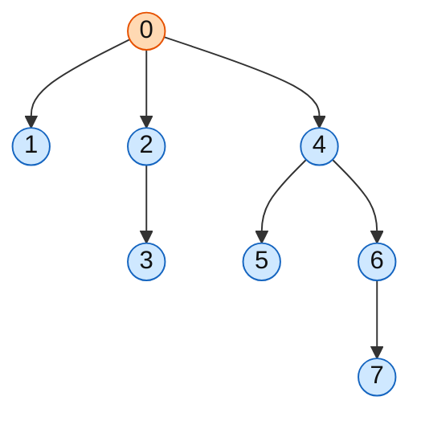
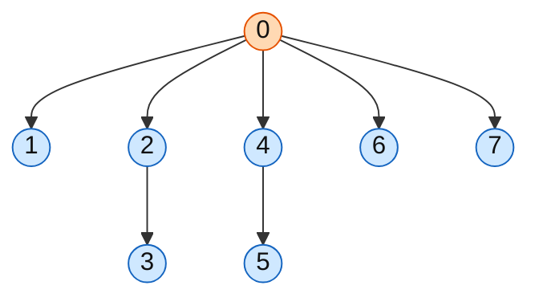
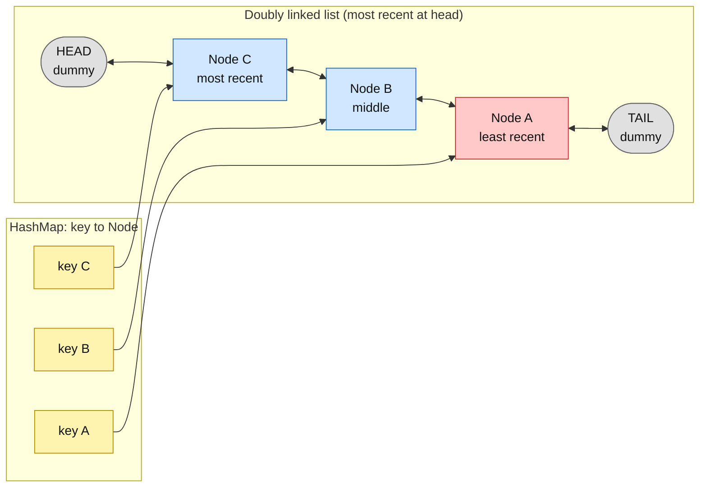

# 🔬 PART 0: DEEP INTERNALS - HOW ADVANCED DATA STRUCTURES WORK AT MEMORY LEVEL

> **Navigation**: [Chapter overview](../07a_Advanced_DS_Core.md) | [Trie (prefix Tree) →](02_trie_prefix_tree.md)
> Page 1 of 3 in **Advanced Data Structures: Complete Guide**


ADVANCED DATA STRUCTURES AT THE HARDWARE LEVEL - MINUTE DETAILS

Understanding the PHYSICAL implementation of these powerful structures:

- Memory layout and allocation patterns
- Cache behavior and optimization techniques
- Bit manipulation in Fenwick trees
- Why certain structures are faster in practice

## 🧠 Trie Node Memory Layout

## Trie Memory Representation - Deep Dive

BASIC TRIE NODE (Array-based):

```java
class TrieNode {
    TrieNode[] children = new TrieNode[26]; // 26 letters
    boolean isEndOfWord;
}
```

MEMORY LAYOUT (64-bit JVM, compressed oops):

| OFFSET | SIZE | FIELD | VALUE |
|---|---|---|---|
| 0 | 8 | Mark Word | Object header |
| 8 | 4 | Class Pointer | → TrieNode.class |
| 12 | 4 | children (ref) | → Object[] array |
| 16 | 1 | isEndOfWord | true/false |
| 17 | 7 | padding | alignment to 8 bytes |
TrieNode object: 24 bytes
PLUS the children array:

| OFFSET | SIZE | CONTENT |
|---|---|---|
| 0 | 8 | Mark Word (array header) |
| 8 | 4 | Class Pointer |
| 12 | 4 | Array length = 26 |
| 16 | 104 | 26 × 4 bytes (references to child TrieNode) |
children[] array: 120 bytes

**Total Per Node**: 24 + 120 = 144 bytes!
For 100,000 words average 8 chars, assuming 30% node sharing:
Nodes ≈ 100,000 × 8 × 0.7 = 560,000 nodes
Memory ≈ 560,000 × 144 = 80 MB!
MEMORY-OPTIMIZED TRIE (HashMap children):

```java
class TrieNode {
    Map<Character, TrieNode> children = new HashMap<>();
    boolean isEndOfWord;
}
```

For sparse nodes (few children): Much smaller!
Average children ≈ 3-4, so ~160 bytes vs 144 bytes but more flexible
COMPRESSED TRIE (Patricia/Radix Tree):
Instead of storing single characters, store strings:
Standard Trie: Patricia Trie:
root root
a "app"
/ \
p "le" "lication"
p
/ \
l l
e i
c...
Patricia: Fewer nodes, less memory, similar time complexity

## 🧠 Segment Tree Memory Layout

## Segment Tree Memory - Array-Based Storage

For array of size n, segment tree needs array of size 4n (safe upper bound)
Actually needs 2^⌈log₂(n)⌉+1 - 1 nodes, but 4n is simpler
ARRAY-BASED INDEXING:
Index i:
Left child: 2*i + 1
Right child: 2*i + 2
Parent: (i-1) / 2
OR (1-indexed, simpler):
Left child: 2*i
Right child: 2*i + 1
Parent: i / 2

**Example**: Array [1, 3, 5, 7, 9, 11] - Sum Segment Tree

**Logical Tree**:
[36] (sum of all: index 1)
/ \
[9] [27] (index 2, 3)
/ \ / \
[4] [5] [16] [11] (index 4, 5, 6, 7)
/ \ / \
[1] [3] [5] [7] [9] [11] (index 8-13, leaves)
ARRAY STORAGE (1-indexed):

| 0 | 1 | 2 | 3 | 4 | 5 | 6 | 7 | 8 | 9 |10 |11 |12 |13 |
|---|---|---|---|---|---|---|---|---|---|---|---|---|---|
| -- | 36 | 9 | 27 | 4 | 5 | 16 | 11 | 1 | 3 | 5 | 7 | 9 | 11 |

**Memory**: 4n × 4 bytes (int) = 16n bytes
For n = 1,000,000: 16 MB

**Cache Behavior**:
Query path: index 1 → 2 or 3 → 4,5,6,7 → ...
Each level doubles the index → Sequential cache misses
Level 0: index 1 (cache line A)
Level 1: index 2,3 (cache line A, probably hit)
Level 2: index 4-7 (might need new cache line)
Level 3: index 8-15 (likely new cache line)
...
For log₂(n) levels: log₂(n) potential cache misses
n = 1M → log₂(1M) ≈ 20 cache misses per query

**Optimization**: "Cache-oblivious" segment trees (van Emde Boas layout)

## 🌳 Fenwick Tree — Bit Manipulation Deep Dive

## Fenwick Tree (Bit) - The Magic Of Binary

💡 **KEY INSIGHT: Use lowest set bit for range calculation!**
LOWEST SET BIT (LSB):
For number i, LSB = i & (-i)

**Why It Works**:
-i = two's complement = invert all bits and add 1
i = 12 = 1100 (binary)
~i = 0011
-i = ~i + 1 = 0100
i & -i = 1100 & 0100 = 0100 = 4 = LSB

**Examples**:

| i | Binary | -i | i & (-i) | Meaning |
|---|---|---|---|---|
| 1 | 0001 | 1111 | 0001 = 1 | Covers index 1 only |
| 2 | 0010 | 1110 | 0010 = 2 | Covers indices 1-2 |
| 3 | 0011 | 1101 | 0001 = 1 | Covers index 3 only |
| 4 | 0100 | 1100 | 0100 = 4 | Covers indices 1-4 |
| 5 | 0101 | 1011 | 0001 = 1 | Covers index 5 only |
| 6 | 0110 | 1010 | 0010 = 2 | Covers indices 5-6 |
| 7 | 0111 | 1001 | 0001 = 1 | Covers index 7 only |
| 8 | 1000 | 1000 | 1000 = 8 | Covers indices 1-8 |
BIT[i] stores sum of elements from (i - LSB(i) + 1) to i

**Visual**:
Original: [1, 2, 3, 4, 5, 6, 7, 8] (1-indexed)
BIT array stores:
BIT[1] = arr[1] = 1 (covers 1)
BIT[2] = arr[1] + arr[2] = 3 (covers 1-2)
BIT[3] = arr[3] = 3 (covers 3)
BIT[4] = arr[1] + arr[2] + arr[3] + arr[4] = 10 (covers 1-4)
BIT[5] = arr[5] = 5 (covers 5)
BIT[6] = arr[5] + arr[6] = 11 (covers 5-6)
BIT[7] = arr[7] = 7 (covers 7)
BIT[8] = arr[1] + ... + arr[8] = 36 (covers 1-8)

**Query**: Sum of [1, 7]
sum = 0
i = 7: sum += BIT[7] = 7, i -= LSB(7) = 7-1 = 6
i = 6: sum += BIT[6] = 11, i -= LSB(6) = 6-2 = 4
i = 4: sum += BIT[4] = 10, i -= LSB(4) = 4-4 = 0
DONE! sum = 7 + 11 + 10 = 28 ✓
Number of operations: Count of 1s in binary of 7 = 3 operations
Maximum: log₂(n) operations

**Update**: Add 5 to index 3
i = 3: BIT[3] += 5, i += LSB(3) = 3+1 = 4
i = 4: BIT[4] += 5, i += LSB(4) = 4+4 = 8
i = 8: BIT[8] += 5, i += LSB(8) = 8+8 = 16 > n, STOP
Updates all ranges that include index 3!

## 📌 Union — Find — Path Compression Visualization

🔬 **Section Challenge — 📌 Union — Find — Path Compression Visualization**

**Challenge 1 (Reasoning):** Without path compression in Union-Find, what's the worst-case tree height after N unions? With path compression?

<details><summary>Answer</summary>

Without path compression + union by rank: O(N) height possible (linear chain). With union by rank only: O(log N). With path compression only: amortized O(log N). With BOTH: amortized O(α(N)) where α is the inverse Ackermann function — practically constant (4 for any N up to 10^80). Union by rank prevents tall trees from forming. Path compression flattens existing trees. Together they're nearly optimal.

</details>

## Union-Find - Path Compression Deep Dive

**Worked example with 8 elements** (union by rank):

| Step | `parent[]` | `rank[]` | Roots |
| ---- | ---------- | -------- | ----- |
| Initial (each element is its own parent) | `[0, 1, 2, 3, 4, 5, 6, 7]` | `[0, 0, 0, 0, 0, 0, 0, 0]` | 0 1 2 3 4 5 6 7 |
| After `union(0,1)`, `union(2,3)`, `union(4,5)`, `union(6,7)` | `[0, 0, 2, 2, 4, 4, 6, 6]` | `[1, 0, 1, 0, 1, 0, 1, 0]` | 0 2 4 6 |
| After `union(0,2)`, `union(4,6)` | `[0, 0, 0, 2, 4, 4, 4, 6]` | `[2, 0, 1, 0, 2, 0, 1, 0]` | 0 4 |
| After `union(0,4)` | `[0, 0, 0, 2, 0, 4, 4, 6]` | `[3, 0, 1, 0, 2, 0, 1, 0]` | 0 |

The final tree (before any path compression):



**How to read this diagram.** Node `0` (orange) is the root of the only set. Element `7` is three hops away (7 → 6 → 4 → 0).

**`find(7)` with path compression:**

```text
find(7) → parent[7] = 6, recurse
find(6) → parent[6] = 4, recurse
find(4) → parent[4] = 0, recurse
find(0) → parent[0] = 0, return 0 (root!)
```

On the way back up, every node on the path is re-pointed straight at the root: `parent[4] = 0`, `parent[6] = 0`, `parent[7] = 0`.



**How to read this diagram.** After compression, `4`, `6` and `7` all hang directly off the root, so `find(7)` is now O(1).

**Complexity With Both Optimizations**:

- Union by rank + Path compression
- Amortized O(α(n)) per operation
- α(n) = Inverse Ackermann function
- α(n) ≤ 4 for any practical n (even n = atoms in universe)
- Effectively O(1) per operation!

## 🧠 Skip List — Probabilistic Memory Layout

```
┌─────────────────────────────────────────────────────────────────────────────────┐
│                    SKIP LIST - HOW REDIS IMPLEMENTS SORTED SETS                 │
├─────────────────────────────────────────────────────────────────────────────────┤
│                                                                                 │
│  SKIP LIST STRUCTURE:                                                           │
│                                                                                 │
│  Level 4:  head ─────────────────────────────────────────────────→ nil          │
│  Level 3:  head ──────────────────→ 25 ──────────────────────────→ nil          │
│  Level 2:  head ───────→ 10 ─────→ 25 ───────────────→ 75 ───────→ nil          │
│  Level 1:  head → 5 ──→ 10 → 15 → 25 → 30 → 50 → 65 → 75 → 80 ──→ nil           │
│  Level 0:  head → 5 → 7 → 10 → 15 → 25 → 30 → 50 → 65 → 75 → 80 → 90 → nil      │
│                                                                                 │
│                                                                                 │
│  NODE MEMORY LAYOUT:                                                            │
│  class SkipListNode {                                                           │
│      int value;                                                                 │
│      SkipListNode[] forward;  // Array of pointers to next nodes                │
│  }                                                                              │
│                                                                                 │
│  ┌─────────────────────────────────────────────────────────────────────────┐    │
│  │ SKIP LIST NODE (value = 25, level = 3):                                 │    │
│  │                                                                          │   │
│  │ ┌──────────────┬──────────────────────────────────────────────────────┐ │    │
│  │ │ value: 25    │ forward[]: [ptr_to_30, ptr_to_30, ptr_to_75, nil]    │ │    │
│  │ │ (4 bytes)    │ (array of 4 pointers, 32 bytes on 64-bit)            │ │    │
│  │ └──────────────┴──────────────────────────────────────────────────────┘ │    │
│  │                                                                          │   │
│  │ Object overhead: ~16 bytes                                              │    │
│  │ Array overhead:  ~16 bytes                                              │    │
│  │ Total: ~68 bytes for this node                                         │     │
│  └─────────────────────────────────────────────────────────────────────────┘    │
│                                                                                 │
│                                                                                 │
│  LEVEL DISTRIBUTION (probability p = 0.5):                                      │
│  ─────────────────────────────────────────                                      │
│  • 50% of nodes: level 1                                                        │
│  • 25% of nodes: level 2                                                        │
│  • 12.5% of nodes: level 3                                                      │
│  • ...                                                                          │
│                                                                                 │
│  EXPECTED MEMORY per node: ~1 + 0.5 + 0.25 + ... = 2 pointers average           │
│  Much better than balanced BST!                                                 │
│                                                                                 │
│                                                                                 │
│  SEARCH for 65:                                                                 │
│  ┌────────────────────────────────────────────────────────────────────────────┐ │
│  │ Start at head, level 4                                                    │  │
│  │ Level 4: head → nil (no nodes), go DOWN                                   │  │
│  │ Level 3: head → 25 (25 < 65), MOVE RIGHT, 25 → nil, go DOWN              │   │
│  │ Level 2: 25 → 75 (75 > 65), go DOWN                                      │   │
│  │ Level 1: 25 → 30 → 50 → 65, FOUND!                                       │   │
│  │                                                                           │  │
│  │ Comparisons: 25, 75, 30, 50, 65 = 5 comparisons                         │    │
│  │ vs Linear: 9 comparisons                                                  │  │
│  │ vs Binary Search: log₂(11) ≈ 4 comparisons (similar!)                   │    │
│  └────────────────────────────────────────────────────────────────────────────┘ │
│                                                                                 │
│  WHY SKIP LIST OVER BALANCED BST?                                               │
│  ─────────────────────────────────                                              │
│  1. Simpler implementation (no rotations!)                                      │
│  2. Easier concurrent access (lock individual levels)                           │
│  3. Range queries are natural (just follow level 0)                             │
│  4. Redis, LevelDB use it for sorted sets                                       │
│                                                                                 │
└─────────────────────────────────────────────────────────────────────────────────┘
```

## 📊 Bloom Filter — Bit Array Internals

## Bloom Filter - Probabilistic Membership

**Memory Layout**:
Bit array (m = 32 bits for example):
Index: 0 1 2 3 4 5 6 7 8 9 10 11 12 13 14 15 ...
Bits: 0 0 1 0 1 0 0 1 0 0 1 0 0 0 1 0 ...
Storage: In Java, long[] with 64 bits each
m = 1M bits = 125 KB
m = 1B bits = 125 MB
HASH FUNCTIONS (k = 3 in this example):
h1(x) = hash(x) % m
h2(x) = hash(x + seed1) % m
h3(x) = hash(x + seed2) % m
Or use double hashing: hi(x) = (h1(x) + i \* h2(x)) % m
INSERT "apple":
h1("apple") = 2, h2("apple") = 7, h3("apple") = 14
Before: 0 0 0 0 0 0 0 0 0 0 0 0 0 0 0 0
After: 0 0 1 0 0 0 0 1 0 0 0 0 0 0 1 0
↑ ↑ ↑
h1 h2 h3
CHECK "apple": Look at positions 2, 7, 14 → all 1s → "PROBABLY IN SET"
CHECK "grape": h1=3, h2=5, h3=10 → position 3 is 0 → "DEFINITELY NOT IN SET"

**False Positive Probability**:
After inserting n elements with k hash functions into m bits:
P(bit is still 0) = (1 - 1/m)^(kn) ≈ e^(-kn/m)
P(false positive) = (1 - e^(-kn/m))^k
OPTIMAL k = (m/n) × ln(2) ≈ 0.693 × (m/n)

**Example Calculations**:

| n (elements) | m (bits) | m/n ratio | optimal k | FP rate |
|---|---|---|---|---|
| 1,000 | 10,000 | 10 | 7 | 0.82% |
| 1,000 | 20,000 | 20 | 14 | 0.00061% |
| 1,000,000 | 10M | 10 | 7 | 0.82% |
| 1,000,000 | 100M | 100 | 69 | ~0% |

**Rule Of Thumb**: 10 bits per element with 7 hash functions → ~1% FP rate

## 🔗 LRU Cache — Doubly Linked List + Hashmap

## Lru Cache - O(1) Get And Put

**Structure**:

1. HashMap<Key, Node>: O(1) lookup by key
2. Doubly Linked List: O(1) remove/insert for recency tracking

**Memory layout:**



**How to read this diagram.** The hash map jumps straight to any node in O(1). The list keeps nodes ordered by recency, so moving a node to the head is O(1) and the node next to `TAIL` (red) is always the next to evict.

**Each node stores:**

| Field | Example (Node B) |
| ----- | ---------------- |
| `key` | `"B"` |
| `value` | `42` |
| `prev` | → Node C |
| `next` | → Node A |

**Operations**:
GET(key):

1. Look up in HashMap: O(1)
2. If found, move node to head: O(1)
3. Return value
   PUT(key, value):
4. If key exists: update value, move to head
5. If key doesn't exist:
   a. Create new node, add to head
   b. Add to HashMap
   c. If over capacity, remove tail node (LRU item)

**Memory Per Entry**:
Node: ~48 bytes (key ref, value ref, prev, next, object header)
HashMap entry: ~32 bytes (key ref, value ref, hash, next)
Total: ~80 bytes per cache entry
For 10,000 entries: ~800 KB
For 1,000,000 entries: ~80 MB

---

## ❓ Part 1: Why These Data Structures Matter

**REAL-WORLD USAGE:**

**TRIE:**

- Autocomplete in Google Search
- Spell checkers
- IP routing tables
- DNA sequence matching

**SEGMENT TREE:**

- Range queries in databases
- Graphics rendering (visibility)
- Computational geometry

**FENWICK TREE (BIT):**

- Cumulative frequency tables
- Range sum queries
- Inversion counting

**DISJOINT SET (UNION-FIND):**

- Network connectivity
- Kruskal's MST algorithm
- Image processing (connected components)
- Social networks (friend circles)

**SKIP LIST:**

- Redis database
- LevelDB
- Concurrent data structures

**BLOOM FILTER:**

- Chrome's malicious URL check
- Database query optimization
- Spell checkers
- Network routers

**LRU CACHE:**

- Operating system page replacement
- Web browser cache
- Database query cache
- CPU cache management

---

[Chapter overview](../07a_Advanced_DS_Core.md) | [Trie (prefix Tree) →](02_trie_prefix_tree.md)
