**Navigation**: [< Previous Chapter](07a_Advanced_DS_Core.md) | [Back to Index](../00_MASTER_INDEX.md)

---

# PART 4: FENWICK TREE (Binary Indexed Tree)

## Concept

```
FENWICK TREE: More space-efficient than Segment Tree
              for prefix sums and point updates.

Key Insight: Use binary representation of indices!

Index i's parent in Fenwick tree = i - (i & -i)
(Remove the lowest set bit)

Array:     [_, 1, 3, 5, 7, 9, 11, 13, 15]  (1-indexed)
BIT:       [_, 1, 4, 5, 16, 9, 20, 13, 64]

BIT[i] stores sum of elements in range determined by lowest set bit.

BIT[1] = arr[1]                    (binary: 0001, range size 1)
BIT[2] = arr[1] + arr[2]           (binary: 0010, range size 2)
BIT[3] = arr[3]                    (binary: 0011, range size 1)
BIT[4] = arr[1]+arr[2]+arr[3]+arr[4]  (binary: 0100, range size 4)
```

## Implementation

```java
class FenwickTree {
    int[] bit;
    int n;

    public FenwickTree(int[] arr) {
        this.n = arr.length;
        this.bit = new int[n + 1];  // 1-indexed

        // Build BIT
        for (int i = 0; i < n; i++) {
            update(i, arr[i]);
        }
    }

    // UPDATE: O(log n)
    // Add 'delta' to element at index i
    public void update(int i, int delta) {
        i++;  // Convert to 1-indexed
        while (i <= n) {
            bit[i] += delta;
            i += (i & -i);  // Move to next responsible node
        }
    }

    // PREFIX SUM: O(log n)
    // Sum of elements from 0 to i
    public int prefixSum(int i) {
        i++;  // Convert to 1-indexed
        int sum = 0;
        while (i > 0) {
            sum += bit[i];
            i -= (i & -i);  // Move to parent
        }
        return sum;
    }

    // RANGE SUM: O(log n)
    public int rangeSum(int L, int R) {
        if (L == 0) return prefixSum(R);
        return prefixSum(R) - prefixSum(L - 1);
    }
}

// VISUAL TRACE - prefixSum(6):
// BIT indices:  1   2   3   4   5   6   7   8
// BIT values:  [1,  4,  5, 16,  9, 20, 13, 64]
//
// i = 7 (6+1 in 1-indexed)
// Binary: 111
//
// Step 1: i=7 (111), add BIT[7]=13, i = 7 - (7 & -7) = 7-1 = 6
// Step 2: i=6 (110), add BIT[6]=20, i = 6 - (6 & -6) = 6-2 = 4
// Step 3: i=4 (100), add BIT[4]=16, i = 4 - (4 & -4) = 4-4 = 0
// Stop: i=0
//
// Sum = 13 + 20 + 16 = 49
// Verify: 1+3+5+7+9+11+13 = 49 ✓
```

---

# PART 4b: SEGMENT TREE — Complete Implementation

```
╔══════════════════════════════════════════════════════════════════════════════╗
║                      SEGMENT TREE — THEORY & CODE                            ║
╠══════════════════════════════════════════════════════════════════════════════╣
║  A Segment Tree allows:                                                      ║
║  • Range Query (sum/min/max/gcd) in O(log n)                                 ║
║  • Point Update in O(log n)                                                  ║
║  • Range Update with Lazy Propagation in O(log n)                            ║
║  • Uses O(4n) space (built as complete binary tree in array)                 ║
║                                                                              ║
║  WHEN TO USE vs BIT/FENWICK:                                                 ║
║  • BIT: Only prefix-sum/point-update. Simpler, less memory.                  ║
║  • Segment Tree: Range update, range min/max, lazy propagation.              ║
║    More powerful but ~2× more code.                                          ║
║                                                                              ║
║  VISUAL:                                                                     ║
║  Array: [1, 3, 5, 7, 9, 11]                                                  ║
║                                                                              ║
║                    [0,5]=36                                                  ║
║                  /          \                                                ║
║            [0,2]=9         [3,5]=27                                          ║
║            /    \          /     \                                           ║
║        [0,1]=4  [2]=5  [3,4]=16  [5]=11                                      ║
║        /    \          /    \                                                ║
║     [0]=1  [1]=3   [3]=7  [4]=9                                              ║
║                                                                              ║
║  Each node stores aggregate (sum/min/max) of its range.                      ║
╚══════════════════════════════════════════════════════════════════════════════╝
```

**Flow:**
1. SEGMENT TREE — THEORY & CODE
2. A Segment Tree allows:
3. • Range Query (sum/min/max/gcd) in O(log n)
4. • Point Update in O(log n)
5. • Range Update with Lazy Propagation in O(log n)
6. • Uses O(4n) space (built as complete binary tree in ar WHEN TO USE vs BIT/FENWICK:

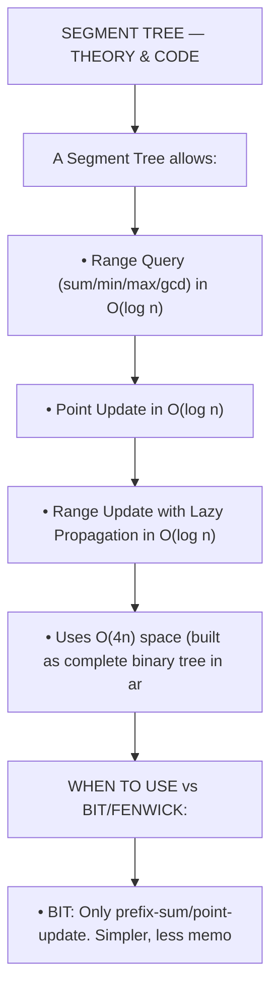

## Segment Tree Implementation (Range Sum + Point Update)

```java
class SegmentTree {
    int[] tree;
    int n;
    
    public SegmentTree(int[] arr) {
        n = arr.length;
        tree = new int[4 * n];  // 4× for safe sizing
        build(arr, 0, 0, n - 1);
    }
    
    // BUILD: O(n)
    private void build(int[] arr, int node, int start, int end) {
        if (start == end) {
            tree[node] = arr[start];  // Leaf
        } else {
            int mid = (start + end) / 2;
            build(arr, 2 * node + 1, start, mid);       // Left child
            build(arr, 2 * node + 2, mid + 1, end);     // Right child
            tree[node] = tree[2 * node + 1] + tree[2 * node + 2];  // Merge
        }
    }
    
    // POINT UPDATE: O(log n)
    public void update(int idx, int val) {
        update(0, 0, n - 1, idx, val);
    }
    
    private void update(int node, int start, int end, int idx, int val) {
        if (start == end) {
            tree[node] = val;
        } else {
            int mid = (start + end) / 2;
            if (idx <= mid) update(2 * node + 1, start, mid, idx, val);
            else update(2 * node + 2, mid + 1, end, idx, val);
            tree[node] = tree[2 * node + 1] + tree[2 * node + 2];
        }
    }
    
    // RANGE QUERY: O(log n)
    public int query(int L, int R) {
        return query(0, 0, n - 1, L, R);
    }
    
    private int query(int node, int start, int end, int L, int R) {
        if (R < start || end < L) return 0;            // No overlap
        if (L <= start && end <= R) return tree[node];  // Total overlap
        int mid = (start + end) / 2;                    // Partial overlap
        return query(2 * node + 1, start, mid, L, R)
             + query(2 * node + 2, mid + 1, end, L, R);
    }
}
```

## Segment Tree with Lazy Propagation (Range Update)

```java
class LazySegTree {
    int[] tree, lazy;
    int n;
    
    public LazySegTree(int[] arr) {
        n = arr.length;
        tree = new int[4 * n];
        lazy = new int[4 * n];
        build(arr, 0, 0, n - 1);
    }
    
    private void build(int[] arr, int node, int start, int end) {
        if (start == end) { tree[node] = arr[start]; return; }
        int mid = (start + end) / 2;
        build(arr, 2*node+1, start, mid);
        build(arr, 2*node+2, mid+1, end);
        tree[node] = tree[2*node+1] + tree[2*node+2];
    }
    
    private void pushDown(int node, int start, int end) {
        if (lazy[node] != 0) {
            int mid = (start + end) / 2;
            tree[2*node+1] += lazy[node] * (mid - start + 1);
            tree[2*node+2] += lazy[node] * (end - mid);
            lazy[2*node+1] += lazy[node];
            lazy[2*node+2] += lazy[node];
            lazy[node] = 0;
        }
    }
    
    // RANGE UPDATE: add val to all elements in [L,R]
    public void rangeUpdate(int L, int R, int val) {
        rangeUpdate(0, 0, n-1, L, R, val);
    }
    
    private void rangeUpdate(int node, int start, int end, int L, int R, int val) {
        if (R < start || end < L) return;
        if (L <= start && end <= R) {
            tree[node] += val * (end - start + 1);
            lazy[node] += val;
            return;
        }
        pushDown(node, start, end);
        int mid = (start + end) / 2;
        rangeUpdate(2*node+1, start, mid, L, R, val);
        rangeUpdate(2*node+2, mid+1, end, L, R, val);
        tree[node] = tree[2*node+1] + tree[2*node+2];
    }
    
    public int query(int L, int R) { return query(0, 0, n-1, L, R); }
    
    private int query(int node, int start, int end, int L, int R) {
        if (R < start || end < L) return 0;
        if (L <= start && end <= R) return tree[node];
        pushDown(node, start, end);
        int mid = (start + end) / 2;
        return query(2*node+1, start, mid, L, R) + query(2*node+2, mid+1, end, L, R);
    }
}
```

## Curated Segment Tree / BIT Problems

| # | Problem | LC# | Pattern | Difficulty |
|---|---------|-----|---------|-----------|
| 1 | [Range Sum Query - Mutable](https://leetcode.com/problems/range-sum-query-mutable/) | 307 | BIT or Segment Tree | Medium |
| 2 | [Count of Smaller Numbers After Self](https://leetcode.com/problems/count-of-smaller-numbers-after-self/) | 315 | BIT + coordinate compress | Hard |
| 3 | [My Calendar I](https://leetcode.com/problems/my-calendar-i/) | 729 | Segment Tree / TreeMap | Medium |
| 4 | [My Calendar II](https://leetcode.com/problems/my-calendar-ii/) | 731 | Segment Tree with lazy | Medium |
| 5 | [My Calendar III](https://leetcode.com/problems/my-calendar-iii/) | 732 | Segment Tree with lazy | Hard |
| 6 | [Count of Range Sum](https://leetcode.com/problems/count-of-range-sum/) | 327 | BIT / Merge Sort | Hard |
| 7 | [Reverse Pairs](https://leetcode.com/problems/reverse-pairs/) | 493 | BIT / Merge Sort | Hard |
| 8 | [Rectangle Area II](https://leetcode.com/problems/rectangle-area-ii/) | 850 | Segment Tree + sweep | Hard |
| 9 | [Falling Squares](https://leetcode.com/problems/falling-squares/) | 699 | Segment Tree (range max) | Hard |
| 10 | [Range Sum Query 2D - Mutable](https://leetcode.com/problems/range-sum-query-2d-mutable/) | 308 | 2D BIT | Hard |

---

# 🔗 Part 5: Disjoint Set (union — Find)

## Concept

```
DISJOINT SET: Manage collection of non-overlapping sets

Operations:
- FIND: Which set does element belong to?
- UNION: Merge two sets

OPTIMIZATIONS:
1. Path Compression: Flatten tree during FIND
2. Union by Rank: Attach smaller tree under larger

          Before Compression    After Compression
               1                      1
              /|\                   / | \ \
             2 3 4                2  3  4  5
             |
             5
```

## Implementation

```java
class DisjointSet {
    int[] parent;
    int[] rank;

    public DisjointSet(int n) {
        parent = new int[n];
        rank = new int[n];
        for (int i = 0; i < n; i++) {
            parent[i] = i;  // Each element is its own parent
            rank[i] = 0;
        }
    }

    // FIND with Path Compression: O(α(n)) ≈ O(1) amortized
    public int find(int x) {
        if (parent[x] != x) {
            parent[x] = find(parent[x]);  // Path compression
        }
        return parent[x];
    }

    // UNION by Rank: O(α(n)) ≈ O(1) amortized
    public void union(int x, int y) {
        int rootX = find(x);
        int rootY = find(y);

        if (rootX == rootY) return;  // Already in same set

        // Union by rank
        if (rank[rootX] < rank[rootY]) {
            parent[rootX] = rootY;
        } else if (rank[rootX] > rank[rootY]) {
            parent[rootY] = rootX;
        } else {
            parent[rootY] = rootX;
            rank[rootX]++;
        }
    }

    // Check if same set
    public boolean connected(int x, int y) {
        return find(x) == find(y);
    }

    // Count number of disjoint sets
    public int countSets() {
        int count = 0;
        for (int i = 0; i < parent.length; i++) {
            if (parent[i] == i) count++;
        }
        return count;
    }
}

// VISUAL TRACE:
// Initial: {0}, {1}, {2}, {3}, {4}
// parent: [0, 1, 2, 3, 4]
//
// union(0, 1):
// parent: [0, 0, 2, 3, 4]
//    0
//    |
//    1
//
// union(2, 3):
// parent: [0, 0, 2, 2, 4]
//    0       2
//    |       |
//    1       3
//
// union(0, 2):
// parent: [0, 0, 0, 2, 4]
//        0
//      / |
//     1  2
//        |
//        3
//
// After path compression on find(3):
// parent: [0, 0, 0, 0, 4]
//        0
//      / | \
//     1  2  3
```

## Application: Kruskal's MST

```java
public int kruskalMST(int n, int[][] edges) {
    // Sort edges by weight
    Arrays.sort(edges, (a, b) -> a[2] - b[2]);

    DisjointSet ds = new DisjointSet(n);
    int mstWeight = 0;
    int edgesUsed = 0;

    for (int[] edge : edges) {
        int u = edge[0], v = edge[1], weight = edge[2];

        if (!ds.connected(u, v)) {
            ds.union(u, v);
            mstWeight += weight;
            edgesUsed++;

            if (edgesUsed == n - 1) break;  // MST complete
        }
    }

    return mstWeight;
}
```

---

# 📌 Part 6: Skip List

## Concept

```
SKIP LIST: Probabilistic alternative to balanced trees

Like a linked list with "express lanes" for faster traversal.

Level 3:  1 ────────────────────────────────> 9
Level 2:  1 ──────────> 4 ──────────> 7 ───> 9
Level 1:  1 ───> 3 ───> 4 ───> 6 ───> 7 ───> 9
Level 0:  1 → 2 → 3 → 4 → 5 → 6 → 7 → 8 → 9 → null

Search for 6:
- Start at top left
- Move right until would overshoot
- Drop down one level
- Repeat

Path: 1→9 (overshoot) ↓ 1→4→7 (overshoot) ↓ 4→6 ✓
```

**Flow:**
1. Path: 1 9 (overshoot) ↓ 1 7 (overshoot) ↓ 4
2. 6 ✓

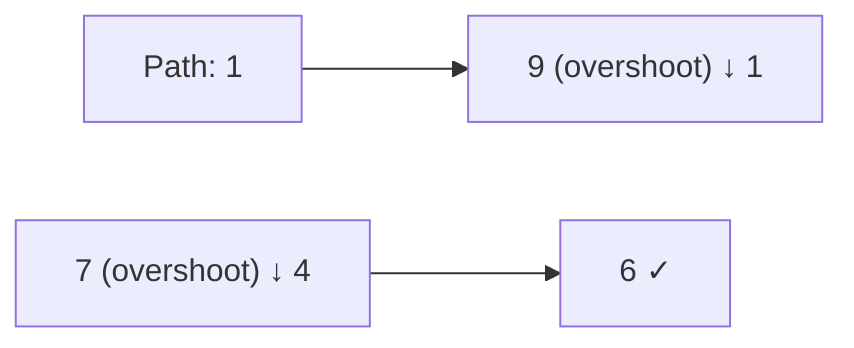

## Implementation

```java
class SkipListNode {
    int val;
    SkipListNode[] forward;

    SkipListNode(int val, int level) {
        this.val = val;
        this.forward = new SkipListNode[level + 1];
    }
}

class SkipList {
    private static final int MAX_LEVEL = 16;
    private static final double P = 0.5;
    private SkipListNode head;
    private int level;
    private Random random;

    public SkipList() {
        head = new SkipListNode(Integer.MIN_VALUE, MAX_LEVEL);
        level = 0;
        random = new Random();
    }

    private int randomLevel() {
        int lvl = 0;
        while (random.nextDouble() < P && lvl < MAX_LEVEL) {
            lvl++;
        }
        return lvl;
    }

    // SEARCH: O(log n) average
    public boolean search(int target) {
        SkipListNode current = head;
        for (int i = level; i >= 0; i--) {
            while (current.forward[i] != null &&
                   current.forward[i].val < target) {
                current = current.forward[i];
            }
        }
        current = current.forward[0];
        return current != null && current.val == target;
    }

    // INSERT: O(log n) average
    public void insert(int val) {
        SkipListNode[] update = new SkipListNode[MAX_LEVEL + 1];
        SkipListNode current = head;

        // Find insert position at each level
        for (int i = level; i >= 0; i--) {
            while (current.forward[i] != null &&
                   current.forward[i].val < val) {
                current = current.forward[i];
            }
            update[i] = current;
        }

        int newLevel = randomLevel();
        if (newLevel > level) {
            for (int i = level + 1; i <= newLevel; i++) {
                update[i] = head;
            }
            level = newLevel;
        }

        SkipListNode newNode = new SkipListNode(val, newLevel);
        for (int i = 0; i <= newLevel; i++) {
            newNode.forward[i] = update[i].forward[i];
            update[i].forward[i] = newNode;
        }
    }

    // DELETE: O(log n) average
    public boolean delete(int val) {
        SkipListNode[] update = new SkipListNode[MAX_LEVEL + 1];
        SkipListNode current = head;

        for (int i = level; i >= 0; i--) {
            while (current.forward[i] != null &&
                   current.forward[i].val < val) {
                current = current.forward[i];
            }
            update[i] = current;
        }

        current = current.forward[0];
        if (current == null || current.val != val) {
            return false;
        }

        for (int i = 0; i <= level; i++) {
            if (update[i].forward[i] != current) break;
            update[i].forward[i] = current.forward[i];
        }

        while (level > 0 && head.forward[level] == null) {
            level--;
        }

        return true;
    }
}
```

---

# 📌 Part 7: Bloom Filter

## Concept

```
BLOOM FILTER: Space-efficient probabilistic data structure

- Tells if element is POSSIBLY IN set or DEFINITELY NOT in set
- No false negatives, possible false positives
- Cannot delete elements

USE CASE: Quick membership test before expensive operation

Example: Check if URL is malicious
1. Check Bloom Filter (fast, in memory)
2. If "possibly yes", check actual database (slow)
3. If "definitely no", skip database check

Structure: Bit array + multiple hash functions

Insert "hello":
h1("hello") = 3
h2("hello") = 7
h3("hello") = 11

Bit array: [0,0,0,1,0,0,0,1,0,0,0,1,0,0,0,0]
                ^         ^         ^
```

## Implementation

```java
class BloomFilter {
    private BitSet bitSet;
    private int size;
    private int numHashes;

    public BloomFilter(int expectedElements, double falsePositiveRate) {
        // Optimal size: -n*ln(p) / (ln(2)^2)
        this.size = (int) Math.ceil(
            -expectedElements * Math.log(falsePositiveRate) /
            (Math.log(2) * Math.log(2))
        );
        // Optimal hash count: (m/n) * ln(2)
        this.numHashes = (int) Math.round(
            (double) size / expectedElements * Math.log(2)
        );
        this.bitSet = new BitSet(size);
    }

    // ADD element
    public void add(String element) {
        for (int i = 0; i < numHashes; i++) {
            int hash = getHash(element, i);
            bitSet.set(hash);
        }
    }

    // CHECK membership
    public boolean mightContain(String element) {
        for (int i = 0; i < numHashes; i++) {
            int hash = getHash(element, i);
            if (!bitSet.get(hash)) {
                return false;  // Definitely not present
            }
        }
        return true;  // Possibly present (could be false positive)
    }

    private int getHash(String element, int i) {
        // Double hashing: h(i) = h1 + i*h2
        int h1 = element.hashCode();
        int h2 = element.hashCode() * 31;
        return Math.abs((h1 + i * h2) % size);
    }
}

// VISUAL EXAMPLE:
// Size = 16, numHashes = 3
//
// Add "cat": positions 2, 7, 12
// Bit array: [0,0,1,0,0,0,0,1,0,0,0,0,1,0,0,0]
//
// Add "dog": positions 4, 8, 14
// Bit array: [0,0,1,0,1,0,0,1,1,0,0,0,1,0,1,0]
//
// Check "cat": positions 2, 7, 12 → all 1 → POSSIBLY PRESENT ✓
// Check "rat": positions 2, 4, 11 → 11 is 0 → DEFINITELY NOT PRESENT
// Check "bird": positions 2, 8, 12 → all 1 → FALSE POSITIVE!
```

---

# 💾 Part 8: LRU Cache

## Concept

```
LRU (Least Recently Used) CACHE:
Fixed-size cache that evicts least recently used item when full.

Operations needed:
- GET: O(1) - HashMap
- PUT: O(1) - HashMap + update order
- EVICT: O(1) - Doubly Linked List

Structure: HashMap + Doubly Linked List

        HashMap                 Doubly Linked List
    ┌─────────────┐         HEAD ←→ A ←→ B ←→ C ←→ TAIL
    │ "A" → nodeA │                 ↑           ↑
    │ "B" → nodeB │              Most         Least
    │ "C" → nodeC │             Recent       Recent
    └─────────────┘

Access B → Move B to front:
HEAD ←→ B ←→ A ←→ C ←→ TAIL
```

**Flow:**
1. LRU (Least Recently Used) CACHE:
2. Operations needed:
3. - GET: O(1) - HashMap
4. - PUT: O(1) - HashMap + update order
5. - EVICT: O(1) - Doubly Linked List
6. Structure: HashMap + Doubly Linked List
7. HashMap Doubly Linked List

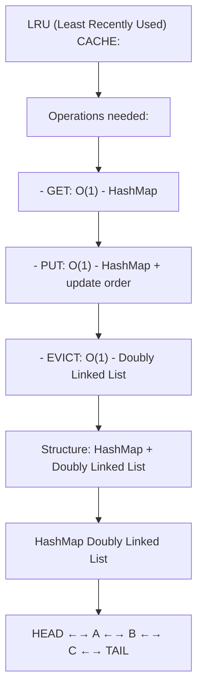

## Implementation

```java
class LRUCache {
    class DLinkedNode {
        int key, value;
        DLinkedNode prev, next;
    }

    private Map<Integer, DLinkedNode> cache = new HashMap<>();
    private int capacity;
    private DLinkedNode head, tail;  // Dummy nodes

    public LRUCache(int capacity) {
        this.capacity = capacity;
        head = new DLinkedNode();
        tail = new DLinkedNode();
        head.next = tail;
        tail.prev = head;
    }

    // GET: O(1)
    public int get(int key) {
        DLinkedNode node = cache.get(key);
        if (node == null) return -1;

        moveToHead(node);  // Mark as recently used
        return node.value;
    }

    // PUT: O(1)
    public void put(int key, int value) {
        DLinkedNode node = cache.get(key);

        if (node != null) {
            node.value = value;
            moveToHead(node);
        } else {
            DLinkedNode newNode = new DLinkedNode();
            newNode.key = key;
            newNode.value = value;

            cache.put(key, newNode);
            addToHead(newNode);

            if (cache.size() > capacity) {
                DLinkedNode lru = removeTail();
                cache.remove(lru.key);
            }
        }
    }

    private void addToHead(DLinkedNode node) {
        node.prev = head;
        node.next = head.next;
        head.next.prev = node;
        head.next = node;
    }

    private void removeNode(DLinkedNode node) {
        node.prev.next = node.next;
        node.next.prev = node.prev;
    }

    private void moveToHead(DLinkedNode node) {
        removeNode(node);
        addToHead(node);
    }

    private DLinkedNode removeTail() {
        DLinkedNode lru = tail.prev;
        removeNode(lru);
        return lru;
    }
}

// VISUAL TRACE:
// Capacity = 3
//
// put(1, 1):  [1]
// put(2, 2):  [2, 1]
// put(3, 3):  [3, 2, 1]
// get(1):     [1, 3, 2]  (1 moved to front)
// put(4, 4):  [4, 1, 3]  (2 evicted as LRU)
// get(2):     -1         (2 was evicted)
```

---

# 🌳 Part 9: B — Tree and B+ Tree

## Concept

```
B-TREE: Self-balancing tree optimized for disk access
        Used in databases and file systems

Properties (order m):
- Each node has at most m children
- Each non-leaf has at least ⌈m/2⌉ children
- Root has at least 2 children (if not leaf)
- All leaves at same level
- Node with k children has k-1 keys

B-Tree (order 3):
              [10, 20]
             /   |    \
        [5,7]  [15,17] [25,30]

B+ TREE: Variant where:
- All data in leaves
- Leaves linked for range queries
- Internal nodes only have keys (guides)

B+ Tree:
              [10, 20]
             /   |    \
        [5,7]→[10,15,17]→[20,25,30]→null
         ↑                    ↑
        Data                 Data

WHY B+ TREE for DATABASES?
1. All data at leaves → consistent access time
2. Linked leaves → efficient range queries
3. More keys per node → shallower tree → fewer disk reads
```

**Flow:**
1. [5,7]
2. [10,15,17]
3. [20,25,30] null
4. All data at leaves consistent access time
5. Linked leaves efficient range queries
6. More keys per node shallower tree

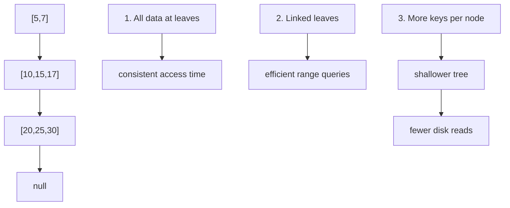

---

# ⚖️ Part 10: Comparison Table

```
┌───────────────────┬─────────────┬─────────────┬─────────────────────┐
│ Data Structure    │ Search      │ Insert      │ Space               │
├───────────────────┼─────────────┼─────────────┼─────────────────────┤
│ Trie              │ O(m)        │ O(m)        │ O(ALPHABET × m × n) │
│ Segment Tree      │ O(log n)    │ O(log n)    │ O(4n)               │
│ Fenwick Tree      │ O(log n)    │ O(log n)    │ O(n)                │
│ Disjoint Set      │ O(α(n))≈O(1)│ O(α(n))≈O(1)│ O(n)                │
│ Skip List         │ O(log n)*   │ O(log n)*   │ O(n)*               │
│ Bloom Filter      │ O(k)        │ O(k)        │ O(m) bits           │
│ LRU Cache         │ O(1)        │ O(1)        │ O(n)                │
│ B-Tree (order m)  │ O(log n)    │ O(log n)    │ O(n)                │
└───────────────────┴─────────────┴─────────────┴─────────────────────┘

* = average case for Skip List
m = string length for Trie
k = number of hash functions for Bloom Filter
α = inverse Ackermann function (practically constant)
```

**Flow:**
1. Data Structure Search Insert Space
2. Trie O(m) O(m) O(ALPHABET × m × n)
3. Segment Tree O(log n) O(log n) O(4n)
4. Fenwick Tree O(log n) O(log n) O(n)
5. Skip List O(log n)*O(log n)* O(n)*
6. Bloom Filter O(k) O(k) O(m) bits
7. LRU Cache O(1) O(1) O(n)

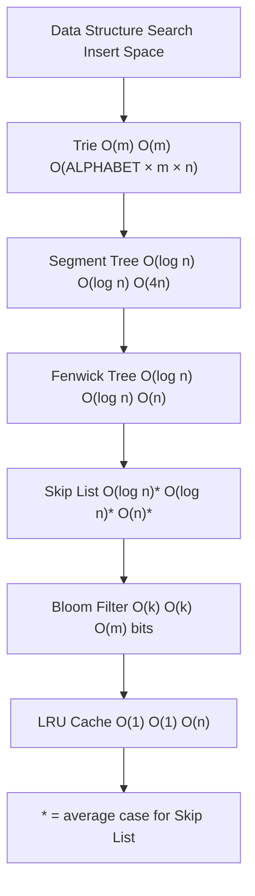

---

_These data structures are the building blocks of modern systems!_ 🏗️

---

# 🚀 Part 11: More Advanced Data Structures

## Sparse Table (Range Minimum Query)

```
SPARSE TABLE: Precompute answers for all power-of-2 ranges
              Perfect for STATIC arrays with repeated queries

IDEA: Any range can be covered by at most 2 overlapping power-of-2 ranges

Array: [3, 1, 4, 1, 5, 9, 2, 6]

Sparse Table (for MIN):
┌───────────────────────────────────────────────────────────────┐
│ k=0 (2^0=1): [3, 1, 4, 1, 5, 9, 2, 6]  (each element itself)  │
│ k=1 (2^1=2): [1, 1, 1, 1, 5, 2, 2, -]  (min of 2)             │
│ k=2 (2^2=4): [1, 1, 1, 1, 2, 2, -, -]  (min of 4)             │
│ k=3 (2^3=8): [1, -, -, -, -, -, -, -]  (min of 8)             │
└───────────────────────────────────────────────────────────────┘

Query(2, 6): min(sparse[2][2], sparse[3][2]) = min(1, 2) = 1
             Using k=2 (length 4), overlapping ranges [2-5] and [3-6]
```

**Flow:**
1. SPARSE TABLE: Precompute answers for all power-of-2 ran
2. Perfect for STATIC arrays with repeated queries
3. Array: [3, 1, 4, 1, 5, 9, 2, 6]
4. Sparse Table (for MIN):
5. k=0 (2^0=1): [3, 1, 4, 1, 5, 9, 2, 6] (each element its k=1 (2^1=2): [1, 1, 1, 1, 5, 2, 2, -] (min of 2) k=2 (2^2=4): [1, 1, 1, 1, 2, 2, -, -] (min of 4)

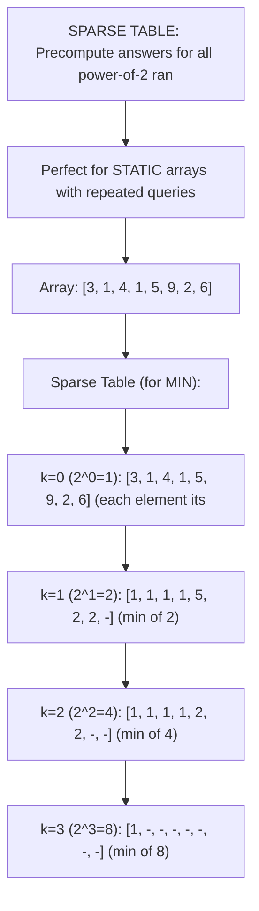

```java
class SparseTable {
    int[][] sparse;
    int[] log;
    int n;

    public SparseTable(int[] arr) {
        n = arr.length;
        int k = (int)(Math.log(n) / Math.log(2)) + 1;
        sparse = new int[n][k];
        log = new int[n + 1];

        // Precompute logs
        log[1] = 0;
        for (int i = 2; i <= n; i++) {
            log[i] = log[i / 2] + 1;
        }

        // Base case: ranges of length 1
        for (int i = 0; i < n; i++) {
            sparse[i][0] = arr[i];
        }

        // Build table: O(n log n)
        for (int j = 1; j < k; j++) {
            for (int i = 0; i + (1 << j) <= n; i++) {
                sparse[i][j] = Math.min(
                    sparse[i][j - 1],
                    sparse[i + (1 << (j - 1))][j - 1]
                );
            }
        }
    }

    // Query: O(1)
    public int query(int L, int R) {
        int j = log[R - L + 1];
        return Math.min(sparse[L][j], sparse[R - (1 << j) + 1][j]);
    }
}

// WHEN TO USE:
// ✓ Static array (no updates)
// ✓ Many queries
// ✓ Need O(1) query time
// ✗ Array changes frequently → use Segment Tree instead
```

---

## Monotonic Stack

```
MONOTONIC STACK: Stack that maintains increasing/decreasing order
                 Reveals relationships between elements

USE CASES:
├── Next Greater Element
├── Previous Greater Element
├── Next Smaller Element
├── Stock Span Problem
├── Largest Rectangle in Histogram
└── Trapping Rain Water

VISUAL EXAMPLE - Next Greater Element:
Array: [4, 5, 2, 10, 8]

Step by step (decreasing stack, process right to left):
┌────────────────────────────────────────────────────────────────┐
│ i=4: arr[4]=8   Stack=[]      → NGE=-1   Stack=[8]             │
│ i=3: arr[3]=10  Stack=[8]     → 10>8, pop → NGE=-1  Stack=[10] │
│ i=2: arr[2]=2   Stack=[10]    → 2<10 → NGE=10  Stack=[10,2]    │
│ i=1: arr[1]=5   Stack=[10,2]  → 5>2, pop → NGE=10  Stack=[10,5]│
│ i=0: arr[0]=4   Stack=[10,5]  → 4<5 → NGE=5   Stack=[10,5,4]   │
└────────────────────────────────────────────────────────────────┘

Result: [5, 10, 10, -1, -1]
```

**Flow:**
1. Reveals relationships between elements
2. USE CASES:
3. Next Greater Element
4. Previous Greater Element
5. Next Smaller Element
6. Stock Span Problem
7. Largest Rectangle in Histogram

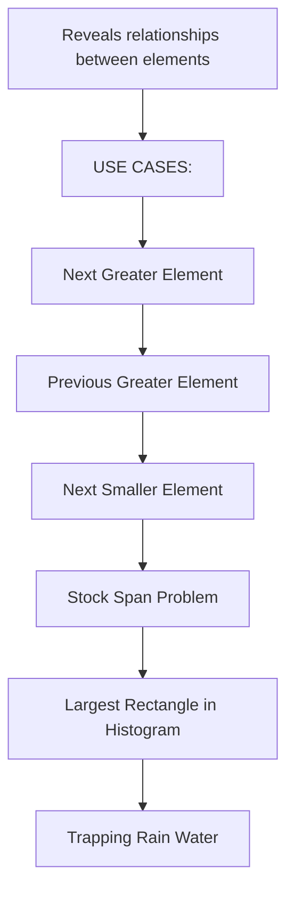

```java
// Next Greater Element
public int[] nextGreater(int[] arr) {
    int n = arr.length;
    int[] result = new int[n];
    Stack<Integer> stack = new Stack<>();

    // Process from right to left
    for (int i = n - 1; i >= 0; i--) {
        // Pop smaller elements
        while (!stack.isEmpty() && stack.peek() <= arr[i]) {
            stack.pop();
        }

        // Stack top is next greater, or -1 if empty
        result[i] = stack.isEmpty() ? -1 : stack.peek();

        // Push current element
        stack.push(arr[i]);
    }

    return result;
}

// Largest Rectangle in Histogram
public int largestRectangleArea(int[] heights) {
    Stack<Integer> stack = new Stack<>();
    int maxArea = 0;
    int n = heights.length;

    for (int i = 0; i <= n; i++) {
        int h = (i == n) ? 0 : heights[i];

        while (!stack.isEmpty() && h < heights[stack.peek()]) {
            int height = heights[stack.pop()];
            int width = stack.isEmpty() ? i : i - stack.peek() - 1;
            maxArea = Math.max(maxArea, height * width);
        }

        stack.push(i);
    }

    return maxArea;
}

// VISUAL TRACE - Largest Rectangle:
// heights = [2, 1, 5, 6, 2, 3]
//
//        _
//       | |
//     _ | |
//    | || |_  _
//  _ | || || || |
// | || || || || |
// 0  1  2  3  4  5
//
// Largest rectangle: height=5, width=2 → area=10 (indices 2-3)
```

---

🔬 **Section Challenge — Monotonic Stack**

**Challenge 1 (Reasoning):** Monotonic DECREASING stack — when you push a new element, which existing elements are popped and what information do those pops tell you?
<details><summary>Answer</summary>

In a decreasing stack (top is smallest), pushing element `x`: all elements smaller than `x` are popped. For each popped element `y`: `x` is the NEXT GREATER ELEMENT of `y`. This is the key insight: the pop event = answer event. Application: Daily Temperatures (next warmer day), Largest Rectangle in Histogram (right boundary), Next Greater Element. Each element is pushed and popped exactly once → O(N) total.
</details>


## Monotonic Deque (Sliding Window Maximum)

```
MONOTONIC DEQUE: Deque that maintains decreasing order
                 Front always has maximum of current window

PROBLEM: Find maximum in each sliding window of size k

Array: [1, 3, -1, -3, 5, 3, 6, 7], k=3

┌─────────────────────────────────────────────────────────────────┐
│ Window [1,3,-1]     Deque: [3,-1]     Max: 3                    │
│ Window [3,-1,-3]    Deque: [3,-1,-3]  Max: 3                    │
│ Window [-1,-3,5]    Deque: [5]        Max: 5                    │
│ Window [-3,5,3]     Deque: [5,3]      Max: 5                    │
│ Window [5,3,6]      Deque: [6]        Max: 6                    │
│ Window [3,6,7]      Deque: [7]        Max: 7                    │
└─────────────────────────────────────────────────────────────────┘

Result: [3, 3, 5, 5, 6, 7]
```

**Flow:**
1. MONOTONIC DEQUE: Deque that maintains decreasing order
2. Front always has maximum of current window
3. PROBLEM: Find maximum in each sliding window of size k
4. Array: [1, 3, -1, -3, 5, 3, 6, 7], k=3
5. Window [1,3,-1] Deque: [3,-1] Max: 3
6. Window [3,-1,-3] Deque: [3,-1,-3] Max: 3
7. Window [-1,-3,5] Deque: [5] Max: 5

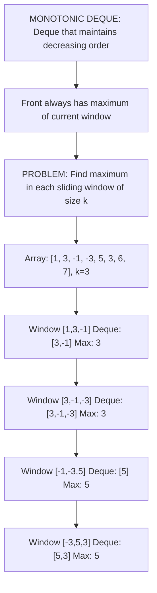

```java
public int[] maxSlidingWindow(int[] nums, int k) {
    int n = nums.length;
    int[] result = new int[n - k + 1];
    Deque<Integer> deque = new ArrayDeque<>();  // Store indices

    for (int i = 0; i < n; i++) {
        // Remove indices outside window
        while (!deque.isEmpty() && deque.peekFirst() < i - k + 1) {
            deque.pollFirst();
        }

        // Remove smaller elements (they can't be max)
        while (!deque.isEmpty() && nums[deque.peekLast()] < nums[i]) {
            deque.pollLast();
        }

        // Add current index
        deque.offerLast(i);

        // Record result when window is full
        if (i >= k - 1) {
            result[i - k + 1] = nums[deque.peekFirst()];
        }
    }

    return result;
}
```

---

🔬 **Section Challenge — Monotonic Deque (Sliding Window Maximum)**

**Challenge 1 (Reasoning):** Sliding window guarantees O(N). How? Each element is added and removed exactly how many times?
<details><summary>Answer</summary>

Each element enters the window exactly ONCE (right pointer advances past it) and leaves exactly ONCE (left pointer advances past it). Total operations: 2N regardless of window size changes. Compare to brute force: for each ending position, scan back to find optimal start = O(N²). The window's state (sum, freq map, etc.) is maintained INCREMENTALLY — O(1) per pointer move.
</details>

**Challenge 2 (Bug Hunt):** Minimum Window Substring: the while loop to shrink the window runs `while(valid) { shrink; }`. What's wrong with this logic?
<details><summary>Answer</summary>

Should shrink `while(valid)` to find the minimum window — this is correct! But the common bug: not updating `left++` BEFORE rechecking validity, or forgetting to update the answer BEFORE shrinking. The answer should be captured at the moment the window first becomes valid, then kept updated as we shrink to find smaller valid windows.
</details>


## Circular Buffer (Ring Buffer)

```
RING BUFFER: Fixed-size buffer that wraps around
             Used in: Audio processing, Network buffers, Logging

STRUCTURE:
┌─────────────────────────────────────────────────────────┐
│         ┌───┬───┬───┬───┬───┬───┬───┬───┐               │
│         │ A │ B │ C │ D │ E │   │   │   │               │
│         └───┴───┴───┴───┴───┴───┴───┴───┘               │
│           ↑                   ↑                         │
│         HEAD                TAIL                        │
│         (read)              (write)                     │
│                                                         │
│  After adding F, G, H, I:                               │
│         ┌───┬───┬───┬───┬───┬───┬───┬───┐               │
│         │ A │ B │ C │ D │ E │ F │ G │ H │               │
│         └───┴───┴───┴───┴───┴───┴───┴───┘               │
│           ↑                               ↑             │
│         HEAD                            TAIL            │
│                                                         │
│  After adding I (wraps around):                         │
│         ┌───┬───┬───┬───┬───┬───┬───┬───┐               │
│         │ I │ B │ C │ D │ E │ F │ G │ H │               │
│         └───┴───┴───┴───┴───┴───┴───┴───┘               │
│             ↑ ↑                                         │
│          TAIL HEAD                                      │
└─────────────────────────────────────────────────────────┘
```

**Flow:**
1. A B C D E
2. A B C D E F G H
3. I B C D E F G H

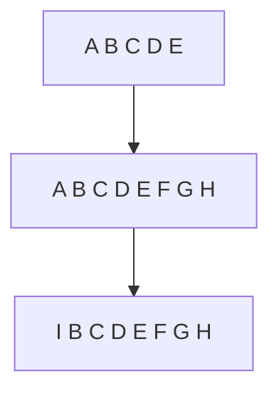

```java
class CircularBuffer<T> {
    private Object[] buffer;
    private int head = 0;  // Read position
    private int tail = 0;  // Write position
    private int size = 0;
    private int capacity;

    public CircularBuffer(int capacity) {
        this.capacity = capacity;
        this.buffer = new Object[capacity];
    }

    public void enqueue(T item) {
        if (isFull()) {
            // Overwrite oldest (or throw exception)
            head = (head + 1) % capacity;
            size--;
        }
        buffer[tail] = item;
        tail = (tail + 1) % capacity;
        size++;
    }

    @SuppressWarnings("unchecked")
    public T dequeue() {
        if (isEmpty()) {
            throw new IllegalStateException("Buffer empty");
        }
        T item = (T) buffer[head];
        buffer[head] = null;
        head = (head + 1) % capacity;
        size--;
        return item;
    }

    public boolean isEmpty() { return size == 0; }
    public boolean isFull() { return size == capacity; }
    public int size() { return size; }
}

// USE CASE: Rate Limiter with time window
class SlidingWindowRateLimiter {
    private long[] timestamps;
    private int head = 0;
    private int count = 0;
    private int maxRequests;
    private long windowMs;

    public SlidingWindowRateLimiter(int maxRequests, long windowMs) {
        this.timestamps = new long[maxRequests];
        this.maxRequests = maxRequests;
        this.windowMs = windowMs;
    }

    public synchronized boolean allowRequest() {
        long now = System.currentTimeMillis();
        long windowStart = now - windowMs;

        // Remove expired timestamps
        while (count > 0 && timestamps[head] < windowStart) {
            head = (head + 1) % maxRequests;
            count--;
        }

        if (count < maxRequests) {
            int tail = (head + count) % maxRequests;
            timestamps[tail] = now;
            count++;
            return true;
        }

        return false;
    }
}
```

---

## Quadtree (Spatial Indexing)

```
QUADTREE: Tree where each node has exactly 4 children
          Used for: 2D spatial indexing, collision detection, image compression

STRUCTURE:
┌─────────────────────────────────────────────────────────────────┐
│                                                                 │
│    ┌─────────────┬─────────────┐                                │
│    │             │             │                                │
│    │     NW      │     NE      │                                │
│    │             │             │                                │
│    ├─────────────┼─────────────┤                                │
│    │             │             │                                │
│    │     SW      │     SE      │                                │
│    │             │             │                                │
│    └─────────────┴─────────────┘                                │
│                                                                 │
│  Each quadrant can be subdivided further if needed              │
│                                                                 │
│  Example: Storing points (3,7), (5,2), (8,8), (1,4)             │
│                                                                 │
│    10┌─────────────┬─────────────┐                              │
│      │    (3,7)    │    (8,8)    │                              │
│    5 │    (1,4)    │             │                              │
│      ├─────────────┼─────────────┤                              │
│      │             │    (5,2)    │                              │
│    0 │             │             │                              │
│      └─────────────┴─────────────┘                              │
│      0      5      10                                           │
└─────────────────────────────────────────────────────────────────┘
```

**Flow:**
1. NW NE / SW SE
2. (3,7) (8,8) / (1,4) / (5,2)

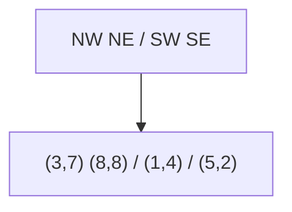

```java
class QuadTree {
    private static final int MAX_POINTS = 4;
    private static final int MAX_DEPTH = 8;

    double x, y, width, height;  // Boundary
    List<Point> points;
    QuadTree nw, ne, sw, se;     // Children
    int depth;

    public QuadTree(double x, double y, double w, double h, int depth) {
        this.x = x; this.y = y;
        this.width = w; this.height = h;
        this.depth = depth;
        this.points = new ArrayList<>();
    }

    public boolean insert(Point p) {
        // Check if point is in boundary
        if (!contains(p)) return false;

        // If space available and no children
        if (points.size() < MAX_POINTS && nw == null) {
            points.add(p);
            return true;
        }

        // Subdivide if needed
        if (nw == null) subdivide();

        // Try to insert in children
        if (nw.insert(p)) return true;
        if (ne.insert(p)) return true;
        if (sw.insert(p)) return true;
        if (se.insert(p)) return true;

        return false;  // Should not happen
    }

    private void subdivide() {
        double halfW = width / 2, halfH = height / 2;
        nw = new QuadTree(x, y + halfH, halfW, halfH, depth + 1);
        ne = new QuadTree(x + halfW, y + halfH, halfW, halfH, depth + 1);
        sw = new QuadTree(x, y, halfW, halfH, depth + 1);
        se = new QuadTree(x + halfW, y, halfW, halfH, depth + 1);

        // Move existing points to children
        for (Point p : points) {
            nw.insert(p); ne.insert(p);
            sw.insert(p); se.insert(p);
        }
        points.clear();
    }

    // Query all points in range
    public List<Point> queryRange(double qx, double qy, double qw, double qh) {
        List<Point> result = new ArrayList<>();

        // Check if range intersects this quad
        if (!intersects(qx, qy, qw, qh)) return result;

        // Check points in this quad
        for (Point p : points) {
            if (p.x >= qx && p.x <= qx + qw &&
                p.y >= qy && p.y <= qy + qh) {
                result.add(p);
            }
        }

        // Recurse to children
        if (nw != null) {
            result.addAll(nw.queryRange(qx, qy, qw, qh));
            result.addAll(ne.queryRange(qx, qy, qw, qh));
            result.addAll(sw.queryRange(qx, qy, qw, qh));
            result.addAll(se.queryRange(qx, qy, qw, qh));
        }

        return result;
    }
}

// USE CASE: Finding nearby restaurants
// Instead of checking all 10,000 restaurants,
// QuadTree lets you check only those in relevant quadrants
// Reduces O(n) to O(log n) for spatial queries
```

---

## Merkle Tree (Hash Tree)

```
MERKLE TREE: Tree where each leaf is hash of data block,
             and each non-leaf is hash of its children's hashes

Used in: Blockchain, Git, Databases (PostgreSQL), P2P networks

STRUCTURE:
┌─────────────────────────────────────────────────────────────────┐
│                                                                 │
│                    [Root Hash: abcd1234]                        │
│                           /        \                            │
│              [Hash: ab12]           [Hash: cd34]                │
│               /       \              /        \                 │
│         [H: a1]    [H: b2]     [H: c3]     [H: d4]              │
│            |          |           |           |                 │
│         Block A   Block B     Block C     Block D               │
│                                                                 │
│  VERIFICATION:                                                  │
│  To verify Block C is unchanged:                                │
│  1. Hash Block C → should match [H: c3]                         │
│  2. Combine with [H: d4] → should match [Hash: cd34]            │
│  3. Combine with [Hash: ab12] → should match Root               │
│                                                                 │
│  Only need O(log n) hashes to verify any block!                 │
└─────────────────────────────────────────────────────────────────┘
```

**Flow:**
1. MERKLE TREE: Tree where each leaf is hash of data block
2. and each non-leaf is hash of its children's hashes STRUCTURE: [Root Hash: abcd1234] [Hash: ab12] [Hash: cd34] Block A Block B Block C Block D VERIFICATION:

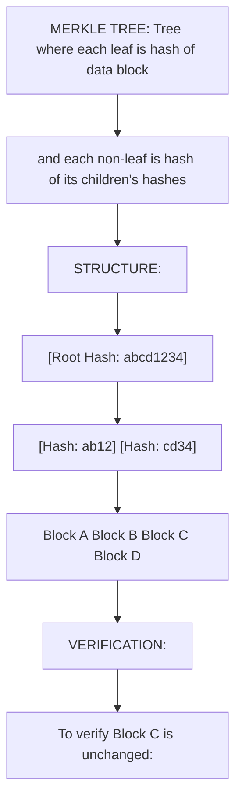

```java
import java.security.MessageDigest;

class MerkleTree {
    private String[] leaves;
    private String[][] tree;

    public MerkleTree(String[] data) {
        int n = data.length;
        // Pad to power of 2
        int size = 1;
        while (size < n) size *= 2;

        leaves = new String[size];
        for (int i = 0; i < n; i++) {
            leaves[i] = hash(data[i]);
        }
        for (int i = n; i < size; i++) {
            leaves[i] = hash("");  // Padding
        }

        buildTree();
    }

    private void buildTree() {
        int levels = (int)(Math.log(leaves.length) / Math.log(2)) + 1;
        tree = new String[levels][];
        tree[0] = leaves;

        for (int i = 1; i < levels; i++) {
            int prevLen = tree[i - 1].length;
            tree[i] = new String[prevLen / 2];

            for (int j = 0; j < tree[i].length; j++) {
                tree[i][j] = hash(tree[i-1][2*j] + tree[i-1][2*j+1]);
            }
        }
    }

    public String getRoot() {
        return tree[tree.length - 1][0];
    }

    // Get proof for leaf at index
    public List<String> getProof(int index) {
        List<String> proof = new ArrayList<>();

        for (int i = 0; i < tree.length - 1; i++) {
            int siblingIdx = (index % 2 == 0) ? index + 1 : index - 1;
            proof.add(tree[i][siblingIdx]);
            index /= 2;
        }

        return proof;
    }

    // Verify data at index using proof
    public boolean verify(String data, int index, List<String> proof) {
        String currentHash = hash(data);

        for (String sibling : proof) {
            if (index % 2 == 0) {
                currentHash = hash(currentHash + sibling);
            } else {
                currentHash = hash(sibling + currentHash);
            }
            index /= 2;
        }

        return currentHash.equals(getRoot());
    }

    private String hash(String data) {
        try {
            MessageDigest md = MessageDigest.getInstance("SHA-256");
            byte[] bytes = md.digest(data.getBytes());
            StringBuilder sb = new StringBuilder();
            for (byte b : bytes) {
                sb.append(String.format("%02x", b));
            }
            return sb.toString().substring(0, 8);  // Shortened for display
        } catch (Exception e) {
            return data.hashCode() + "";
        }
    }
}
```

---

# 🧩 Part 12: Leetcode Problems By Data Structure

## Practice Problems Mapped to DS

```
TRIE:
├── LC 208: Implement Trie (Prefix Tree)          ⭐ Medium
├── LC 211: Design Add and Search Words           ⭐ Medium
├── LC 212: Word Search II                        🔥 Hard
├── LC 648: Replace Words                         ⭐ Medium
└── LC 1268: Search Suggestions System            ⭐ Medium

SEGMENT TREE:
├── LC 307: Range Sum Query - Mutable             ⭐ Medium
├── LC 315: Count of Smaller Numbers After Self   🔥 Hard
├── LC 493: Reverse Pairs                         🔥 Hard
└── LC 327: Count of Range Sum                    🔥 Hard

DISJOINT SET (UNION-FIND):
├── LC 200: Number of Islands                     ⭐ Medium
├── LC 547: Number of Provinces                   ⭐ Medium
├── LC 684: Redundant Connection                  ⭐ Medium
├── LC 721: Accounts Merge                        ⭐ Medium
├── LC 990: Satisfiability of Equality Equations  ⭐ Medium
└── LC 1584: Min Cost to Connect All Points       ⭐ Medium

MONOTONIC STACK:
├── LC 84: Largest Rectangle in Histogram         🔥 Hard
├── LC 85: Maximal Rectangle                      🔥 Hard
├── LC 496: Next Greater Element I                ⭐ Easy
├── LC 503: Next Greater Element II               ⭐ Medium
├── LC 739: Daily Temperatures                    ⭐ Medium
└── LC 901: Online Stock Span                     ⭐ Medium

LRU CACHE:
├── LC 146: LRU Cache                             ⭐ Medium
├── LC 460: LFU Cache                             🔥 Hard
└── LC 1472: Design Browser History               ⭐ Medium

HEAP/PRIORITY QUEUE:
├── LC 23: Merge k Sorted Lists                   🔥 Hard
├── LC 295: Find Median from Data Stream          🔥 Hard
├── LC 347: Top K Frequent Elements               ⭐ Medium
├── LC 373: Find K Pairs with Smallest Sums       ⭐ Medium
└── LC 767: Reorganize String                     ⭐ Medium
```

**Flow:**
1. TRIE:
2. LC 208: Implement Trie (Prefix Tree) ⭐ Medium
3. TRIE:
4. LC 211: Design Add and Search Words ⭐ Medium
5. TRIE:
6. LC 212: Word Search II 🔥 Hard
7. TRIE:
8. LC 648: Replace Words ⭐ Medium
9. TRIE:
10. LC 1268: Search Suggestions System ⭐ Medium
11. SEGMENT TREE:
12. LC 307: Range Sum Query - Mutable ⭐ Medium

```mermaid
flowchart TD
    N1["TRIE:"]
    N2["LC 208: Implement Trie (Prefix Tree) ⭐ Medium"]
    N3["LC 211: Design Add and Search Words ⭐ Medium"]
    N4["LC 212: Word Search II 🔥 Hard"]
    N5["LC 648: Replace Words ⭐ Medium"]
    N6["LC 1268: Search Suggestions System ⭐ Medium"]
    N7["SEGMENT TREE:"]
    N8["LC 307: Range Sum Query - Mutable ⭐ Medium"]
    N9["LC 315: Count of Smaller Numbers After Self 🔥 Hard"]
    N10["LC 493: Reverse Pairs 🔥 Hard"]
    N11["LC 327: Count of Range Sum 🔥 Hard"]
    N12["DISJOINT SET (UNION-FIND):"]
    N13["LC 200: Number of Islands ⭐ Medium"]
    N14["LC 547: Number of Provinces ⭐ Medium"]
    N15["LC 684: Redundant Connection ⭐ Medium"]
    N16["LC 721: Accounts Merge ⭐ Medium"]
    N17["LC 990: Satisfiability of Equality Equations ⭐ Medium"]
    N18["LC 1584: Min Cost to Connect All Points ⭐ Medium"]
    N19["MONOTONIC STACK:"]
    N20["LC 84: Largest Rectangle in Histogram 🔥 Hard"]
    N21["LC 85: Maximal Rectangle 🔥 Hard"]
    N22["LC 496: Next Greater Element I ⭐ Easy"]
    N23["LC 503: Next Greater Element II ⭐ Medium"]
    N24["LC 739: Daily Temperatures ⭐ Medium"]
    N25["LC 901: Online Stock Span ⭐ Medium"]
    N26["LRU CACHE:"]
    N27["LC 146: LRU Cache ⭐ Medium"]
    N28["LC 460: LFU Cache 🔥 Hard"]
    N29["LC 1472: Design Browser History ⭐ Medium"]
    N30["HEAP/PRIORITY QUEUE:"]
    N31["LC 23: Merge k Sorted Lists 🔥 Hard"]
    N32["LC 295: Find Median from Data Stream 🔥 Hard"]
    N33["LC 347: Top K Frequent Elements ⭐ Medium"]
    N34["LC 373: Find K Pairs with Smallest Sums ⭐ Medium"]
    N35["LC 767: Reorganize String ⭐ Medium"]
    N1 --> N2
    N1 --> N3
    N1 --> N4
    N1 --> N5
    N1 --> N6
    N7 --> N8
    N7 --> N9
    N7 --> N10
    N7 --> N11
    N12 --> N13
    N12 --> N14
    N12 --> N15
    N12 --> N16
    N12 --> N17
    N12 --> N18
    N19 --> N20
    N19 --> N21
    N19 --> N22
    N19 --> N23
    N19 --> N24
    N19 --> N25
    N26 --> N27
    N26 --> N28
    N26 --> N29
    N30 --> N31
    N30 --> N32
    N30 --> N33
    N30 --> N34
    N30 --> N35
```

---

# 📋 Part 13: Complexity Cheat Sheet (extended)

```
┌─────────────────────────────────────────────────────────────────────────────┐
│                    COMPLETE COMPLEXITY REFERENCE                            │
├─────────────────────────────────────────────────────────────────────────────┤
│ DATA STRUCTURE      │ ACCESS │ SEARCH │ INSERT │ DELETE │ SPACE             │
├─────────────────────┼────────┼────────┼────────┼────────┼───────────────────┤
│ Array               │ O(1)   │ O(n)   │ O(n)   │ O(n)   │ O(n)              │
│ Dynamic Array       │ O(1)   │ O(n)   │ O(1)*  │ O(n)   │ O(n)              │
│ Singly Linked List  │ O(n)   │ O(n)   │ O(1)   │ O(1)   │ O(n)              │
│ Doubly Linked List  │ O(n)   │ O(n)   │ O(1)   │ O(1)   │ O(n)              │
│ Stack               │ O(n)   │ O(n)   │ O(1)   │ O(1)   │ O(n)              │
│ Queue               │ O(n)   │ O(n)   │ O(1)   │ O(1)   │ O(n)              │
│ Hash Table          │ N/A    │ O(1)*  │ O(1)*  │ O(1)*  │ O(n)              │
│ BST (balanced)      │ O(logn)│ O(logn)│ O(logn)│ O(logn)│ O(n)              │
│ BST (worst)         │ O(n)   │ O(n)   │ O(n)   │ O(n)   │ O(n)              │
│ AVL Tree            │ O(logn)│ O(logn)│ O(logn)│ O(logn)│ O(n)              │
│ Red-Black Tree      │ O(logn)│ O(logn)│ O(logn)│ O(logn)│ O(n)              │
│ B-Tree              │ O(logn)│ O(logn)│ O(logn)│ O(logn)│ O(n)              │
│ Heap                │ O(1)†  │ O(n)   │ O(logn)│ O(logn)│ O(n)              │
│ Trie                │ O(m)   │ O(m)   │ O(m)   │ O(m)   │ O(ALPHABET*m*n)   │
│ Segment Tree        │ O(logn)│ O(logn)│ O(logn)│ O(logn)│ O(4n)             │
│ Fenwick Tree        │ N/A    │ O(logn)│ O(logn)│ N/A    │ O(n)              │
│ Sparse Table        │ O(1)   │ O(1)   │ N/A    │ N/A    │ O(n log n)        │
│ Disjoint Set        │ N/A    │ O(α)   │ O(α)   │ N/A    │ O(n)              │
│ Skip List           │ O(logn)│ O(logn)│ O(logn)│ O(logn)│ O(n log n)*       │
│ Bloom Filter        │ N/A    │ O(k)   │ O(k)   │ N/A    │ O(m) bits         │
│ QuadTree            │ O(logn)│ O(logn)│ O(logn)│ O(logn)│ O(n)              │
└─────────────────────┴────────┴────────┴────────┴────────┴───────────────────┘

* = amortized or average case
† = O(1) for peek/min, O(log n) for extract
α = inverse Ackermann function ≈ O(1) for practical purposes
m = string/key length
k = number of hash functions
```

**Flow:**
1. COMPLETE COMPLEXITY REFERENCE
2. DATA STRUCTURE ACCESS SEARCH INSERT DELETE SPACE
3. Fenwick Tree N/A O(logn) O(logn) N/A O(n)
4. Sparse Table O(1) O(1) N/A N/A O(n log n)
5. Disjoint Set N/A O(α) O(α) N/A O(n)
6. Bloom Filter N/A O(k) O(k) N/A O(m) bits
7. - = amortized or average case

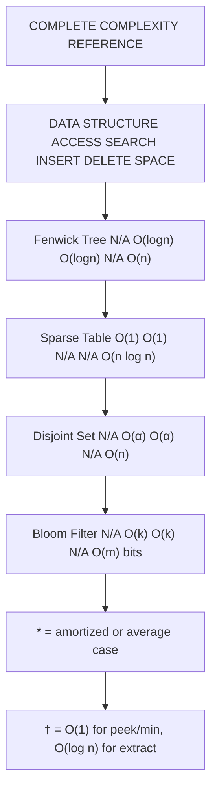

---

# 📌 Part 14: When to Use What (decision Flowchart)

```
START: What problem are you solving?

├── Need KEY-VALUE lookup?
│   ├── Keys are strings with prefix search? → TRIE
│   ├── Need O(1) operations? → HASH MAP
│   └── Need ordered keys? → TREE MAP (Red-Black)
│
├── Need RANGE operations?
│   ├── Static array, many queries? → SPARSE TABLE
│   ├── Updates needed?
│   │   ├── Point update + range query? → SEGMENT TREE or FENWICK
│   │   └── Range update + range query? → SEGMENT TREE with LAZY PROP
│   └── Range minimum specifically? → SPARSE TABLE (if static)
│
├── Need to track CONNECTIVITY?
│   └── Merge sets dynamically? → DISJOINT SET (UNION-FIND)
│
├── Need ORDERING with fast access?
│   ├── Min/Max quickly? → HEAP / PRIORITY QUEUE
│   ├── Next greater/smaller? → MONOTONIC STACK
│   └── Sliding window max? → MONOTONIC DEQUE
│
├── Need SPATIAL queries?
│   ├── 2D points? → QUADTREE
│   ├── Higher dimensions? → KD-TREE
│   └── Rectangles? → R-TREE
│
├── Need APPROXIMATE membership?
│   └── Fast "definitely not" check? → BLOOM FILTER
│
├── Need CACHING?
│   ├── Least recently used eviction? → LRU CACHE
│   └── Least frequently used eviction? → LFU CACHE
│
└── Need INTEGRITY verification?
    └── Efficient proof of data? → MERKLE TREE
```

**Flow:**
1. START: What problem are you solving?
2. Need KEY-VALUE lookup?
3. START: What problem are you solving?
4. Keys are strings with prefix search?
5. TRIE
6. START: What problem are you solving?
7. Need O(1) operations?
8. HASH MAP
9. START: What problem are you solving?
10. Need ordered keys?
11. TREE MAP (Red-Black)
12. START: What problem are you solving?
13. Need RANGE operations?
14. START: What problem are you solving?
15. Static array, many queries?
16. SPARSE TABLE

```mermaid
flowchart TD
    N1["START: What problem are you solving?"]
    N2["Need KEY-VALUE lookup?"]
    N3["Keys are strings with prefix search? → TRIE"]
    N4["Need O(1) operations? → HASH MAP"]
    N5["Need ordered keys? → TREE MAP (Red-Black)"]
    N6["Need RANGE operations?"]
    N7["Static array, many queries? → SPARSE TABLE"]
    N8["Updates needed?"]
    N9["Point update + range query? → SEGMENT TREE or FENWICK"]
    N10["Range update + range query? → SEGMENT TREE with LAZY PR"]
    N11["Range minimum specifically? → SPARSE TABLE (if static)"]
    N12["Need to track CONNECTIVITY?"]
    N13["Merge sets dynamically? → DISJOINT SET (UNION-FIND)"]
    N14["Need ORDERING with fast access?"]
    N15["Min/Max quickly? → HEAP / PRIORITY QUEUE"]
    N16["Next greater/smaller? → MONOTONIC STACK"]
    N17["Sliding window max? → MONOTONIC DEQUE"]
    N18["Need SPATIAL queries?"]
    N19["2D points? → QUADTREE"]
    N20["Higher dimensions? → KD-TREE"]
    N21["Rectangles? → R-TREE"]
    N22["Need APPROXIMATE membership?"]
    N23["Fast 'definitely not' check? → BLOOM FILTER"]
    N24["Need CACHING?"]
    N25["Least recently used eviction? → LRU CACHE"]
    N26["Least frequently used eviction? → LFU CACHE"]
    N27["Need INTEGRITY verification?"]
    N28["Efficient proof of data? → MERKLE TREE"]
    N1 --> N2
    N1 --> N3
    N1 --> N4
    N1 --> N5
    N1 --> N6
    N1 --> N7
    N1 --> N8
    N1 --> N9
    N1 --> N10
    N1 --> N11
    N1 --> N12
    N1 --> N13
    N1 --> N14
    N1 --> N15
    N1 --> N16
    N1 --> N17
    N1 --> N18
    N1 --> N19
    N1 --> N20
    N1 --> N21
    N1 --> N22
    N1 --> N23
    N1 --> N24
    N1 --> N25
    N1 --> N26
    N1 --> N27
    N1 --> N28
```

---

_Master these structures, and you can build anything!_ 🚀

