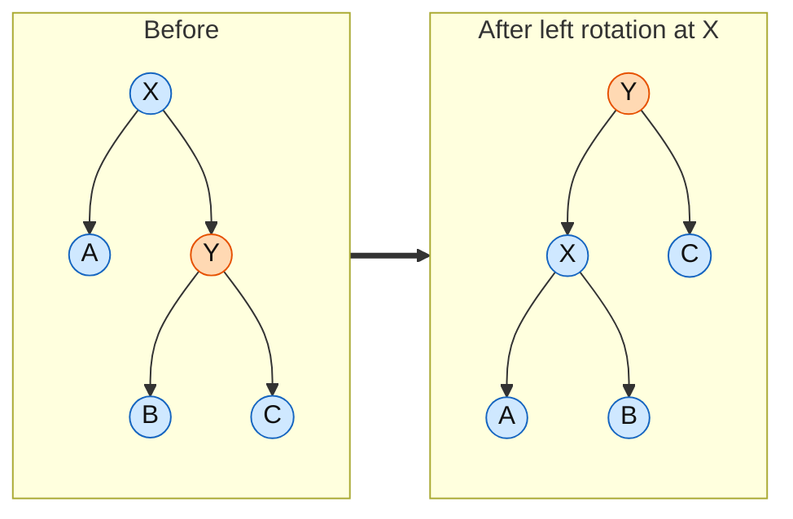
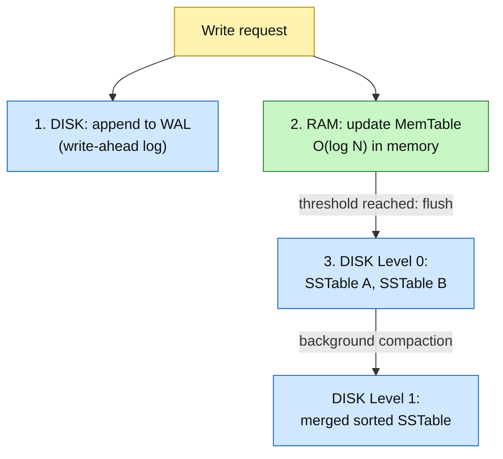
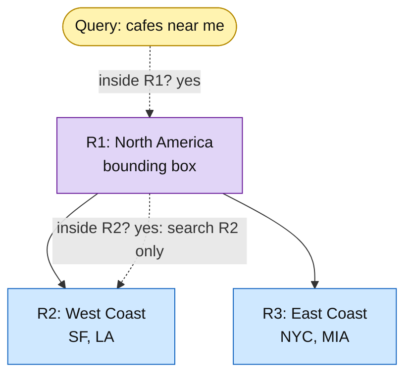
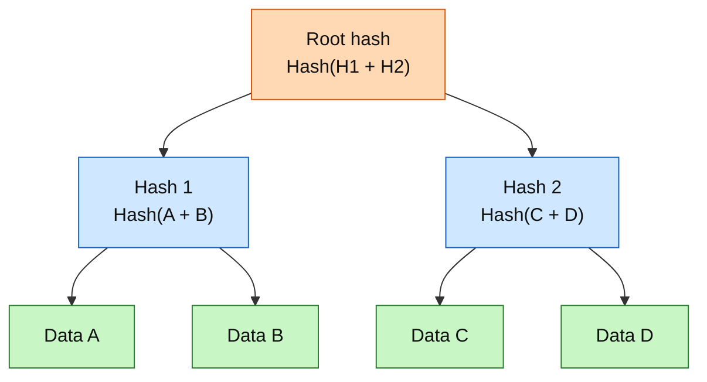

**Navigation**: [Back to Index](00_INDEX.md) | [Previous Chapter <](07b_Advanced_DS_Patterns.md) | [Next Chapter >](07d_Probabilistic_DS_Deep.md)

---

# 🌲 Advanced Trees: Deep Dive (System Internals & Architecture)

## Beyond Binary Search Trees — The Structures Running Modern Infrastructure

---

## 🔗 Bridge — Where This Chapter Fits

| Dimension | This chapter |
| --- | --- |
| **Builds on** | [Trees](05_Trees.md), [AVL/Red-Black (DS)](../02_Data_Structures/02b_DS_Variants_Advanced.md) |
| **You will learn** | Red-black insert/delete rules, B-trees and B+ trees, LSM trees, spatial trees, Merkle trees |
| **Leads to** | [Production](13_Algorithms_In_Production.md), [Probabilistic DS](07d_Probabilistic_DS_Deep.md) |
| **Abstraction level** | L6: system-level tree structures |

> [!NOTE]
> The full gap-free reading order and dependency graph are in the [Learning Path](00_LEARNING_PATH.md).

---

## 💬 Explain It Like a Study Partner — Advanced Trees Deep Dive

### 1. The bottom line

Real systems use trees tuned for disks, writes, space and integrity, not just balanced BSTs in memory.

### 2. The textbook core

- Red-black trees bound height by 2·log₂(n+1) with a few rotations per update.
- B+ trees pack many keys per node to minimise disk I/O.
- LSM trees buffer writes and merge sorted runs.
- Merkle trees hash children to verify data integrity quickly.

### 3. The real-world analogy

A **library with sections, shelves and a catalog**: a B-tree is the multi-level catalog that gets you to the right shelf in a few lookups.

### 4. Walkthrough

1. Insert key into a B+ tree with order 4.
2. Descend to the leaf.
3. If the leaf overflows, split it and push the middle key to the parent.
4. The tree grows from the root only when the root splits.

> [!NOTE]
> **Quick check:** Why do databases prefer B+ trees to binary trees? *High fan-out means fewer disk page reads.*

---


## 📚 PART 1: The Mathematics of Balancing

Standard Binary Search Trees (BST) degenerate into $O(N)$ linked lists when elements are inserted consecutively. **Self-balancing trees** maintain a height of $O(\log N)$ by imposing structural invariants.

### The Asymptotic Height Constraint

A tree of $N$ nodes has the minimum possible height bounded by:
$$ H \ge \lfloor \log_2(N+1) \rfloor $$
Self-balancing trees guarantee $H = \Theta(\log N)$, ensuring that **Search, Insert, and Delete** continuously operate in optimal bounds.

| Tree Type     | Height Bound             | Balance Factor                                     |
| ------------- | ------------------------ | -------------------------------------------------- |
| **AVL Tree**  | $\approx 1.44 \log_2(N)$ | Strict: Left/Right height difference $\le 1$.      |
| **Red-Black** | $\le 2 \log_2(N+1)$      | Relaxed: Black-height must match across all paths. |

_Engineering Tradeoff:_ AVL provides faster lookups due to shallower depth. Red-Black provides faster inserts/deletes because its relaxed rules require fewer rotations to fix.

---

## 🔴⚫ PART 2: Red-Black Trees (The Kernel's Choice)

Red-Black trees are the backbone of `java.util.TreeMap`, `java.util.TreeSet`, `std::map` in C++, and the Linux Completely Fair Scheduler (CFS).

In Java 8+, `HashMap` bins will **Treeify** — converting a linked-list bucket into a Red-Black tree when the bin exceeds 8 elements (and total array size > 64) to defend against Hash Collision DoS attacks.

### 2.1 The 5 Sacred Invariants

1. **Node Color:** Every node is either RED or BLACK.
2. **Root Property:** The root is ALWAYS BLACK.
3. **Leaf Property:** All leaves (NIL/null references) are considered BLACK.
4. **Red Sequence Rule:** If a node is RED, both its children MUST be BLACK (No two consecutive red nodes on any path).
5. **Black Height Rule:** Every simple path from a given node to any of its descendant leaves contains the _same number of BLACK nodes_.

### 2.2 Rotations & Deletion Complexity

Insertions use the **Uncle's Color** to determine whether to perform a _Color Flip_ or a _Rotation_.

However, **Deletion in a Red-Black Tree** is notoriously one of the most complex algorithms in standard computer science, containing **6 distinct cases** handling "Double Black" nodes to restore the Black Height invariant without violating the Red Sequence rule.



**How to read this diagram.** The right child `Y` is lifted above `X`; `Y`'s old left subtree `B` becomes `X`'s right subtree. In-order order `A X B Y C` is unchanged. Only a constant number of pointers change: **O(1)**.

### 2.3 Concurrency: The SkipList Alternative

Because rotating a Red-Black tree demands locking multiple nodes (parent, child, uncle, grandparent), they are terrible for highly concurrent writes.

- _Java Solution:_ Instead of a `ConcurrentTreeMap`, Java provides `ConcurrentSkipListMap` — a probabilistically balanced linked-list structure that allows **Wait-Free / Lock-Free** concurrent insertions via CAS (Compare-And-Swap) operations.

---

## 📖 PART 3: B-Trees & Disk Paging

While Red-Black trees dominate RAM, storage memory (HDD/SSD) is read in **Pages/Blocks** (typically 4KB to 16KB).
A standard binary tree might require 20 random pointer jumps (20 page faults) for 1 million records. **B-Trees flatten the tree** to radically reduce depth, maximizing data fetched per I/O read.

### 3.1 B-Tree Internal Architecture

A B-tree of order $m$ (maximum children per node):

- A node with $k$ children contains exactly $k-1$ keys.
- **Node Splitting:** When a node exceeds $m-1$ keys during insertion, it undergoes a **Split**. The node divides in half, and the strictly _median key_ is pushed up to the parent.

#### Visualizing a B-Tree Node (Order 4)

```text
┌───────────────────────────────────────────┐
│               [ 15 | 30 | 45 ]            │
└──────┬───────────┬────────┬─────────┬─────┘
       │           │        │         │
    < 15       15-29      30-44      > 45
```

---

## 🚀 PART 4: B+ Trees (Relational SQL Engines)

In modern databases (MySQL InnoDB, PostgreSQL), **B+ Trees** universally replace standard B-Trees.

### Multi-Level Indexing & Linked Leaves

1. **Routing-Only Internals:** Internal nodes do not store actual rows. They only act as traffic cops.
2. **Linked Leaves:** Leaf nodes form a doubly-linked list, yielding $O(1)$ sequential range queries (`BETWEEN`, `ORDER BY`).

### Clustered vs Non-Clustered Indexes

- **Clustered Index (Primary Key):** The table _is_ the B+ Tree. The leaf nodes contain the physical row data.
- **Secondary Index:** The leaf nodes contain the indexed column, plus a pointer (usually the Primary Key) back to the Clustered Index. This causes a **Secondary Lookup (Key Lookup)**.

### The Scale Math: Why Databases Scale to Billions

Let's calculate capacity using a standard **4KB Disk Page**.

```text
┌─────────────────────────────────────────────────────────────┐
│ B+ TREE CAPACITY MATH (4KB Disk Page)                       │
├─────────────────────────────────────────────────────────────┤
│ Page Size:     4096 bytes                                   │
│ Key Size:      8 bytes (e.g., BIGINT UUID)                  │
│ Pointer:       8 bytes (to child node)                      │
│ Total/Entry:   16 bytes                                     │
│                                                             │
│ Branching Factor (m): 4096 / 16 = 256 children per node     │
│                                                             │
│ Level 1 (Root):   1 node      => 256 ranges                 │
│ Level 2:          256 nodes   => 65,536 ranges              │
│ Level 3:          65,536      => 16.7 Million ranges        │
│ Level 4:          16.7M       => 4.2 Billion ranges         │
│                                                             │
│ RESULT: Finding 1 in 4.2 BILLION rows takes exactly 4 reads!│
└─────────────────────────────────────────────────────────────┘
```

---

## ☄️ PART 5: LSM Trees (NoSQL & Big Data)

B+ Trees suffer under heavy, concurrent pure-write workloads because updating scattered nodes causes **Random Disk I/O**. Modern Distributed systems (Cassandra, Kafka, RocksDB, LevelDB) bypass B+ Trees using **Log-Structured Merge-Trees (LSM)**.

### The LSM Anatomy: Eliminating Random Writes

LSM Trees convert all random writes into **Sequential Log Appends**.

1. **WAL (Write-Ahead Log):** Every command is instantly appended to a sequential file on disk. If the server crashes, data is recovered from here.
2. **MemTable:** Concurrently, the data is pushed rapidly into an _in-memory_ tree (Red-Black / Skip List).
3. **SSTable (Sorted String Table):** When the MemTable fills up (e.g., 16MB), it is flushed sequentially to disk as an immutable, read-only file.
4. **Bloom Filters:** Reads must search multiple SSTables. To prevent massive I/O, a Bloom Filter (probabilistic bit-array) sits in front of each SSTable, instantly answering _"Is this key definitely NOT here?"_
5. **Compaction:** Background threads eventually merge multiple Level-0 SSTables into larger Level-1 SSTables, purging deleted data (Tombstones).



**How to read this diagram.** Every write is logged sequentially (durability) and applied in memory (speed). When the MemTable fills it is flushed as an immutable sorted file, and background compaction merges files into larger sorted levels.

---

## 🎲 PART 6: Treaps (Cartesian Trees)

A **Treap** (Tree + Heap) achieves self-balancing without complex rotation invariants (like Red-Black) by relying on **Probability**.

### The Hybrid Rule

Every node has two values: A **Key** (the actual data) and a **Priority** (a random number).

1. **BST Property:** Keys must be ordered left-to-right.
2. **Heap Property:** Priorities must obey the Max-Heap property (parent priority > child priority).

By assigning random priorities upon insertion, the Treap simulates constructing a standard BST from a _randomly shuffled_ array, structurally guaranteeing an expected height of $O(\log N)$ perfectly dodging sorted-input degeneration!

---

## 🔄 PART 7: Splay Trees (The Cache Optimizer)

A Splay Tree ignores height limits. Instead, it moves the **most recently accessed element** directly to the root via **Splaying**.

### Rotations (Zig, Zig-Zig, Zig-Zag)

When a node is queried, it is rotated upward using paired operations. By moving it to the root, future queries for the same key are essentially $O(1)$.

- **Temporal Locality:** Splay Trees naturally act as an LRU Cache without maintaining separate queues.
- Used in IP Routing tables, network packets, and some GC tracking algorithms where a tiny subset of data receives 99% of the traffic.

---

## 🗺️ PART 8: Spatial Trees (R-Trees & QuadTrees)

How does Uber find the closest drivers in $O(\log N)$ time across a 2D map? Searching a 1D B-Tree is impossible for geographic coordinates (Latitude, Longitude).

### The Spatial Strategy

- **QuadTrees:** Recursively divide a 2D space into 4 equal quadrants (NW, NE, SW, SE). If a quadrant has too many points, it splits again.
- **R-Trees (Rectangle Trees):** B-Trees but for multi-dimensional spaces. Nodes represent **Minimum Bounding Rectangles (MBR)**.



**How to read this diagram.** Each node is a rectangle that contains its children's rectangles. A query descends only into rectangles that overlap the search area, skipping whole regions (R3 here). PostGIS (PostgreSQL's spatial extension) uses this idea via GiST indexes.

---

## 🔐 PART 9: Merkle Trees (The Cryptographic Trust)

A **Merkle Tree (Hash Tree)** flips the concept of a tree upside down: it's not used to _find_ data, it's used to **verify the mathematical integrity** of enormous datasets in distributed systems.

### Core Architecture

- **Leaves** are cryptographic hashes of data blocks.
- **Parent Nodes** are hashes of the combined hashes of their children.
- **Root Node (Merkle Root)** mathematically represents the exact state of the entire system.



**How to read this diagram.** Each parent stores the hash of its children, so changing any data block changes the root hash. Comparing two roots tells you whether two datasets match; descending only into the differing hashes finds the changed block in O(log n).

### Production Use Cases:

1. **Blockchain:** SPV (Simplified Payment Verification). You only need the $O(\log N)$ branches to mathematically prove your transaction is in the block, without downloading the whole GiB block.
2. **Git:** Every commit is part of a Merkle-like DAG. If one byte in one file changes, the root hash changes.
3. **DynamoDB / Cassandra Anti-Entropy:** Nodes compare their Merkle Roots. If they match, they are 100% perfectly synced. If they differ, they follow the differing branches down in $O(\log N)$ network calls to find the exact missing rows.

---

## 🧩 PART 10: Tree Augmentation - Making Trees Answer Richer Questions

A normal balanced tree answers: **"Is this key present?"** or **"What is the next key?"**

An augmented tree answers: **"How many keys are smaller?"**, **"Which interval overlaps this one?"**, **"What is the kth element?"**, or **"What is the aggregate over this ordered range?"**

The trick is simple but powerful: every node stores extra metadata that can be recomputed from its children after every rotation.

### 10.1 Order Statistic Tree

Store `size` at every node:

```text
size(node) = 1 + size(left) + size(right)
```

Now the tree supports:

| Operation          | Meaning                       | Complexity |
| ------------------ | ----------------------------- | ---------- |
| `rank(x)`          | Count how many keys are `< x` | `O(log N)` |
| `select(k)`        | Find kth smallest key         | `O(log N)` |
| `countRange(L, R)` | Count keys in `[L, R]`        | `O(log N)` |

#### `select(k)` Logic

```text
at node:
    leftSize = size(node.left)

    if k == leftSize + 1: node is answer
    if k <= leftSize: go left
    else: go right with k = k - leftSize - 1
```

This is the mental model behind leaderboard ranks, percentile queries, online median structures, and "kth smallest in a dynamic set" problems.

### 10.2 Interval Tree

Store intervals like `[start, end]`, ordered by `start`, and add one field:

```text
maxEnd(node) = max(node.end, maxEnd(left), maxEnd(right))
```

When searching for any interval that overlaps `[qStart, qEnd]`:

1. If current interval overlaps, return it.
2. If left child exists and `left.maxEnd >= qStart`, an overlap may exist on the left.
3. Otherwise go right.

Why this works: if the entire left subtree ends before `qStart`, no interval in that subtree can possibly overlap the query.

Production examples:

- Calendar conflict detection
- Meeting room booking
- Genome range queries
- Firewall / IP range rules
- IDE syntax highlighting ranges

### 10.3 Rotation-Safe Metadata Rule

Every augmented tree lives or dies by this rule:

> After a rotation, recompute metadata bottom-up for exactly the nodes whose children changed.

For a left rotation around `x`:

```text
before: x -> right = y
after:  y -> left = x

recompute(x)
recompute(y)
```

Do not recompute the whole tree. That destroys the point of balancing. Local pointer changes should require local metadata repairs.

---

## 🧪 PART 11: Red-Black Tree Insert/Delete - The Real Case Map

Interview explanations often stop at the five invariants. Real mastery starts when you can reason about the fix-up cases.

### 11.1 Insert Fix-Up

New nodes are inserted as **RED** because adding a red node does not immediately change black-height.

| Case | Parent | Uncle                   | Action                                      | Why                      |
| ---- | ------ | ----------------------- | ------------------------------------------- | ------------------------ |
| 1    | BLACK  | any                     | Stop                                        | No invariant broken      |
| 2    | RED    | RED                     | Recolor parent+uncle BLACK, grandparent RED | Push red conflict upward |
| 3    | RED    | BLACK/null and triangle | Rotate parent to make line                  | Convert to case 4        |
| 4    | RED    | BLACK/null and line     | Rotate grandparent, recolor                 | Remove consecutive red   |

Triangle means `left-right` or `right-left`.
Line means `left-left` or `right-right`.

```text
Triangle case:

      G                   G
     /                   /
    P        rotate     N
     \       left      /
      N              P

Now it is a line case.
```

The beautiful thing: insertion needs at most two rotations after the recolor chain stops.

### 11.2 Delete Fix-Up and "Double Black"

Deletion is harder because removing a BLACK node reduces black-height on one path.

Instead of thinking "the null child is broken", think:

> One subtree is carrying a missing black credit. The fix-up moves, pays, or cancels that debt.

| Case          | Sibling                         | Sibling Children                              | Action                                                               |
| ------------- | ------------------------------- | --------------------------------------------- | -------------------------------------------------------------------- |
| Sibling RED   | RED                             | any                                           | Rotate parent, recolor sibling/parent, convert to black-sibling case |
| Sibling BLACK | BLACK | both children BLACK | Recolor sibling RED, move double-black upward |
| Sibling BLACK | BLACK | near child RED, far child BLACK | Rotate sibling to convert to far-red case |
| Sibling BLACK | BLACK | far child RED | Rotate parent, recolor, finish |

The "far child" is the child farther from the double-black node. If the double-black node is on the left, sibling's far child is sibling.right.

### 11.3 Why Java Uses Red-Black, Not AVL, for `TreeMap`

`TreeMap` is a general-purpose mutable map. Java optimizes for predictable overall behavior, not the absolute shallowest possible tree.

| Concern                   | AVL             | Red-Black      |
| ------------------------- | --------------- | -------------- |
| Lookup depth              | Slightly better | Slightly worse |
| Insert/delete rotations   | More frequent   | Usually fewer  |
| Implementation complexity | Moderate        | Moderate-hard  |
| Mutable map workload      | Good            | Excellent      |
| Standard library fit      | Good            | Better default |

Rule of thumb:

- AVL: choose when reads dominate and tree height must be extremely tight.
- Red-Black: choose when inserts/deletes are common and you need stable general-purpose performance.

---

## 🏭 PART 12: B+ Tree vs LSM Tree - The Storage Engine Tradeoff

Both structures are "sorted index" designs, but they optimize different physical realities.

| Dimension           | B+ Tree                     | LSM Tree                                          |
| ------------------- | --------------------------- | ------------------------------------------------- |
| Write path          | Update pages in-place       | Append WAL + memory table                         |
| Read path           | Usually one tree descent    | Check memtable + SSTables                         |
| Range scan          | Excellent via linked leaves | Good after compaction, worse across many files    |
| Write amplification | Page splits + random writes | Compaction rewrites data                          |
| Read amplification  | Low                         | Can be high without Bloom filters                 |
| Space amplification | Usually lower               | Higher during compaction/tombstones               |
| Best fit            | OLTP relational indexes     | Write-heavy logs, time-series, distributed stores |

### 12.1 The Three Amplifications

Storage engines are judged by three brutal metrics:

| Metric              | Meaning                                        | Example                                         |
| ------------------- | ---------------------------------------------- | ----------------------------------------------- |
| Write amplification | Physical bytes written / logical bytes written | LSM compaction rewrites old data                |
| Read amplification  | Physical reads needed for one logical read     | LSM may check several SSTables                  |
| Space amplification | Extra bytes stored beyond live data            | Old versions and tombstones wait for compaction |

You cannot minimize all three at once. A database engine is basically a negotiated treaty between these costs.

### 12.2 Tombstones Are Not Free

In an LSM tree, delete usually means:

```text
put(key, TOMBSTONE)
```

The value is not immediately removed from every old SSTable. It disappears only after compaction has merged away older versions.

Failure modes:

- Too many tombstones make reads slower.
- Range scans may walk over dead records.
- A delayed compaction backlog can make "deleted" data occupy disk for a long time.
- Wrong TTL/compaction settings can resurrect old data in distributed repair scenarios.

### 12.3 Hot Key and Page Split Thinking

B+ trees dislike random page splits under heavy write pressure.
LSM trees dislike read paths that fan out across too many sorted files.

Practical tuning questions:

1. Are writes mostly sequential or random?
2. Are reads mostly point lookups or range scans?
3. Can stale reads be tolerated?
4. Is storage cheap but latency strict?
5. Does the workload have hot partitions or monotonically increasing keys?

This is why "which database is better?" is the wrong question. The better question is: **which storage engine shape matches the workload's pain?**

---

## 🧱 PART 13: Persistent Trees - Keeping Every Version

A persistent data structure preserves old versions after updates.

The usual trick is **path copying**:

```text
update one leaf in a segment tree:

old root -> copies only O(log N) nodes along the update path
unchanged subtrees are shared between versions
```

### 13.1 Persistent Segment Tree

Useful for:

- kth smallest in subarray
- offline range frequency queries
- immutable snapshots
- versioned configuration
- time-travel debugging

Complexities:

| Operation            | Complexity                                                  |
| -------------------- | ----------------------------------------------------------- |
| Build                | `O(N log V)` or `O(N)` depending on compression/build style |
| Update version       | `O(log N)` new nodes                                        |
| Query version        | `O(log N)`                                                  |
| Compare two versions | `O(log N)` if aggregate supports subtraction                |

Important mental model:

> Persistence does not copy the whole tree. It copies the path of change and shares everything else.

### 13.2 Copy-on-Write vs Full Copy

| Strategy           | Memory                        | Speed                     | When                |
| ------------------ | ----------------------------- | ------------------------- | ------------------- |
| Full copy          | `O(N)` per version            | Simple but expensive      | Tiny data           |
| Copy-on-write tree | `O(log N)` per update         | More complex              | Serious versioning  |
| Event sourcing     | Store commands, rebuild state | Cheap writes, replay cost | Business audit logs |

Persistent trees are the DSA version of immutable architecture.

---

## 🧨 PART 14: Production Failure Modes and Debugging Smells

Advanced trees fail in ways that look "impossible" unless you know the invariants.

| Symptom                                   | Likely Cause                                   | Structure           |
| ----------------------------------------- | ---------------------------------------------- | ------------------- |
| `TreeMap` loses entries                   | Comparator inconsistent with equals            | Red-Black / TreeMap |
| Range query misses item                   | Mutable key changed after insertion            | Any ordered tree    |
| DB index gets huge                        | Low-cardinality or wide indexed column         | B+ Tree             |
| Writes suddenly slow                      | Page split storm or compaction backlog         | B+ / LSM            |
| Read latency spikes                       | Too many SSTables checked                      | LSM                 |
| Spatial query returns too many candidates | Loose bounding rectangles                      | R-Tree              |
| Merkle sync never settles                 | Non-deterministic serialization before hashing | Merkle Tree         |

### 14.1 Comparator Contract Trap

For Java ordered structures:

```java
compare(a, b) == 0
```

means the tree treats `a` and `b` as the same key, even if `a.equals(b)` is false.

Bad comparator:

```java
// BUG: different users with same score collapse into one TreeSet entry
Comparator<User> byScore = (a, b) -> a.score - b.score;
```

Safer comparator:

```java
Comparator<User> byScoreThenId =
    Comparator.comparingInt((User u) -> u.score)
              .thenComparingLong(u -> u.id);
```

The comparator is not just sorting decoration. In a tree map/set, it defines identity.

### 14.2 Interview Ladder

Practice these in order:

1. Explain why sorted insertion breaks a plain BST.
2. Prove Red-Black height is `O(log N)` using black-height.
3. Trace one Red-Black insertion case with uncle red.
4. Trace one rotation and list which pointers change.
5. Implement order-statistic `select(k)`.
6. Explain why B+ tree leaves are linked.
7. Compare B+ and LSM with the three amplifications.
8. Explain how Bloom filters rescue LSM point reads.
9. Explain Merkle tree anti-entropy without hand-waving.
10. Design a calendar conflict checker with an interval tree.

---

## 🧠 SUMMARY & SYSTEM DESIGN CHEAT SHEET

| Structure                | Production Use Case                     | The Core Engineering "Trick"                                                            |
| ------------------------ | --------------------------------------- | --------------------------------------------------------------------------------------- |
| **AVL Tree**             | Immutable / Read-Heavy Cache            | Strict balancing guarantees the shallowest possible pointer tree.                       |
| **Red-Black**            | Mutable In-Memory Maps (OS/Java)        | Loose balances prevent cascading rotation storms on mass inserts.                       |
| **B/B+ Tree**            | Relational SQL (MySQL/PostgreSQL)       | Ultra-fat nodes adapt to physical disk page sizes. B+ links leaves for range scans.     |
| **LSM Tree**             | Big Data / NoSQL (Cassandra)            | Replaces random disk seeks with pure sequential log appends + compactions.              |
| **Treap**                | Competitive Programming / Routers       | Uses random priorities (Heaps) to probabilistically enforce balance.                    |
| **Splay**                | LRU Caches / Packet Routing             | Forces frequently requested keys to naturally surface to the tree's root.               |
| **Quad/R-Tree**          | Spatial DBs (PostGIS, Uber, Maps)       | Boxes multi-dimensional coordinates into hierarchical bounding rectangles.              |
| **Order Statistic Tree** | Leaderboards / percentile queries       | Stores subtree sizes so rank and kth queries stay `O(log N)`.                           |
| **Interval Tree**        | Calendars / range conflicts             | Stores `maxEnd` metadata to prune impossible overlap branches.                          |
| **Persistent Tree**      | Versioned snapshots / kth range queries | Path-copying preserves history with only `O(log N)` new nodes per update.               |
| **Merkle Tree**          | Crypto / Git / DB Anti-Entropy          | Hashes bubble up to a single Root allowing $O(\log N)$ mathematical state verification. |


---

### Proof Corner -- B-Tree Minimum Degree and Height

**Claim**: A B-tree of minimum degree t and n keys has height at most log_t((n+1)/2).

**Proof**: The root has at least 1 key. Every other node has at least t-1 keys. The tree of height h has at least 1 key at the root + 2*(t-1) keys at level 1 + 2*t*(t-1) keys at level 2 + ... = 1 + 2*(t-1)*(t^{h-1} - 1)/(t-1) + ...

**Simplified lower bound**: n+1 >= 2*t^h, so h <= log_t((n+1)/2). For t=1000 (typical disk page), a B-tree with 10^12 keys has height <= log_1000(5*10^11) <= 4. This is why databases use B-trees: 4 disk reads to find any of a trillion records.

**Trie vs B-tree**: Trie height = key length L (independent of n). B-tree height = O(log_t n). For fixed-length keys, Trie is O(L) per op; B-tree is O(L log_t n). Trie wins for short keys in memory; B-tree wins on disk (fewer I/Os due to large branching factor t).

---

### Section Challenge -- Advanced Trees

**Problem 1 (8 min)**: An AVL tree has height at most 1.44 log_2 n. Prove the minimum number of nodes in an AVL tree of height h.

<details><summary>Model Answer</summary>

Let N(h) = minimum number of nodes in an AVL tree of height h.

Base cases: N(-1) = 0 (empty tree), N(0) = 1 (single node), N(1) = 2.

Recurrence: An AVL tree of height h has a root, one subtree of height h-1 (to achieve height h), and one subtree of height >= h-2 (minimum, to satisfy AVL balance). So N(h) = 1 + N(h-1) + N(h-2).

This is similar to Fibonacci: N(h) = Fib(h+3) - 1 where Fib is the Fibonacci sequence. Since Fib(k) ~ phi^k / sqrt(5), N(h) ~ phi^(h+3) / sqrt(5). Therefore h <= log_phi(n * sqrt(5)) - 3 ≈ 1.44 log_2(n).

</details>

---

### Reference Anchor

**java.util.TreeMap -- Red-Black tree in production**:
```java
// java.util.TreeMap: O(log n) per put/get/remove. Backed by a Red-Black tree.
// Red-Black invariants: (1) root is black, (2) red node has black children,
// (3) all paths from any node to null have same number of black nodes.
// These invariants guarantee height <= 2*log_2(n+1) -- so O(log n) operations.

TreeMap<Integer, String> tm = new TreeMap<>();
tm.put(5, "five"); tm.put(3, "three"); tm.put(7, "seven");
System.out.println(tm.floorKey(6));   // 5 -- largest key <= 6
System.out.println(tm.ceilingKey(4)); // 5 -- smallest key >= 4
System.out.println(tm.subMap(3, 7));  // {3=three, 5=five} -- [3,7) range

// Source: jdk/src/java.base/share/classes/java/util/TreeMap.java
// Production use: TreeMap is the standard for ordered key access in Java.
// Use NavigableMap interface for floor/ceiling/higher/lower operations.
```

---

### Brute Force to Optimal -- Tree Structure Selection

| Use case | Brute Force | Problem | Optimal tree | Gain |
|----------|-------------|---------|-------------|------|
| Ordered iteration | Sort on every access | O(n log n) per access | TreeMap (BST) | O(log n) insert, O(n) iterate |
| Prefix search | Scan all keys | O(n*L) | Trie | O(L) per query |
| Range overlap queries | Scan all intervals | O(n) per query | Interval Tree | O(log n + k) where k=matches |
| Large dataset on disk | Full scan | O(n/B) disk I/Os | B-Tree | O(log_B n) disk I/Os |


---

## 🏢 Enterprise Lens — Advanced Trees Deep Dive

| Area | What top-tier engineering looks like |
| ---- | ------------------------------------ |
| **Where it runs in production** | Database indexes (PostgreSQL, MySQL), storage engines (RocksDB), file systems, Git and blockchain (Merkle) |
| **Failure modes** | Cascading splits under hot keys; write amplification; wrong fill factors |
| **Testing and verification** | Fuzz insert/delete sequences and validate invariants (balance, ordering, node occupancy) after each op |

---

## Reality Check

**"Red-black trees are the fastest balanced BST implementation"** → Red-black trees guarantee O(log n) height. But "fastest" depends on the operation mix. AVL trees: stricter balance (height ≤ 1.44 log₂n) → faster lookups (shorter paths). Red-black trees: looser balance → fewer rotations on insert/delete. For write-heavy workloads: red-black. For read-heavy: AVL. B-trees: optimal for disk (minimise I/O by maximising branching factor — one node per disk page). Treap (BST + heap priorities): simpler implementation via randomisation. Java's `TreeMap` uses red-black trees.

**"Splay trees are impractical because they don't guarantee balance"** → Splay trees restructure on every access (move accessed node to root via rotations). No O(log n) worst case per operation, but O(log n) amortised. Their advantage: recently accessed items stay near the root — O(1) access if the same items are repeatedly accessed. Real uses: splay trees appear in some LRU caches, network packet schedulers, and compiler implementations. Splaying provides temporal locality exploitation that balanced BSTs don't.

**"2-3-4 trees are just textbook examples — nobody uses them"** → A 2-3-4 tree is isomorphic to a red-black tree: each 2-3-4 node maps to one or two red-black nodes. This is precisely why red-black tree insertion is complex — it's implementing 2-3-4 node splits and promotions via rotation+recoloring. Understanding 2-3-4 trees (what each rotation actually represents conceptually) makes red-black tree insertion comprehensible. B-trees generalise 2-3-4 trees: a B-tree of order 3 is a 2-3 tree; order 4 is a 2-3-4 tree. Database index internals are B-trees.

**"Treaps are less efficient than AVL or red-black trees"** → Same O(log n) expected height. Treap = BST on keys, Heap on random priorities. The random priority ensures the expected tree structure matches a random BST, which has O(log n) expected height. Advantages: simpler implementation than AVL/red-black (no rotations for balance, priority determines structure), naturally supports split/merge in O(log n) — useful for competitive programming where you need to split and merge sorted sequences. Persistent treaps (used in functional programming) exploit the split/merge without complex rotation bookkeeping.

**"AVL tree rotations are complex and error-prone"** → Four rotation cases: LL (single right rotation), RR (single left rotation), LR (left-right double rotation), RL (right-left double rotation). Once you derive WHY each case occurs (unbalanced after insert in a specific subtree), the rotations follow mechanically. The key insight: rotations preserve BST order while reducing height. In production Java, you never implement these manually (`TreeMap` handles it). In interview/competitive programming, implement a treap instead — same O(log n), simpler implementation using only split/merge.
