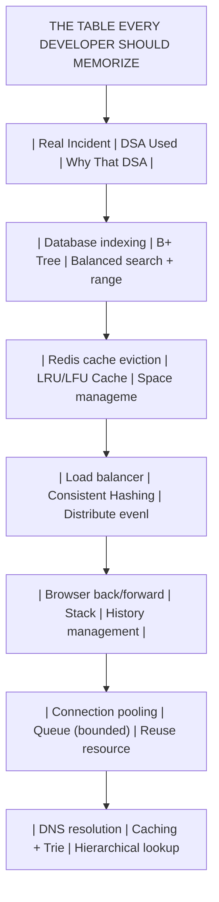

> **Navigation**: [< Previous Chapter](08a_NumberTheory_Core.md) | [Back to Index](../00_MASTER_INDEX.md)

---

# 📌 Part 5: More Essential Algorithms
# ═══════════════════════════════════════════════════════════

## Algorithm: Kadane's Algorithm (Maximum Subarray Sum) ⭐⭐⭐

```java
/**
 * WHY: One of the most asked interview questions
 * WHERE: Stock profit analysis, signal processing, network traffic
 * 
 * REAL INCIDENT:
 *   Amazon retail team needed to find peak sales window
 *   Daily profit/loss: [-2, 1, -3, 4, -1, 2, 1, -5, 4]
 *   Best contiguous period: [4, -1, 2, 1] = 6 profit
 * 
 * HOW: Track current sum, reset when it goes negative
 * 
 * Time: O(n), Space: O(1)
 */
public static int kadane(int[] arr) {
    int maxSum = arr[0];
    int currentSum = arr[0];
    
    for (int i = 1; i < arr.length; i++) {
        // Either extend current subarray or start fresh
        currentSum = Math.max(arr[i], currentSum + arr[i]);
        maxSum = Math.max(maxSum, currentSum);
    }
    
    return maxSum;
}

// With indices (find WHERE the maximum subarray is)
public static int[] kadaneWithIndices(int[] arr) {
    int maxSum = arr[0], currentSum = arr[0];
    int start = 0, end = 0, tempStart = 0;
    
    for (int i = 1; i < arr.length; i++) {
        if (arr[i] > currentSum + arr[i]) {
            currentSum = arr[i];
            tempStart = i;
        } else {
            currentSum += arr[i];
        }
        
        if (currentSum > maxSum) {
            maxSum = currentSum;
            start = tempStart;
            end = i;
        }
    }
    
    return new int[]{maxSum, start, end};
}

// TEST:
// kadane([-2, 1, -3, 4, -1, 2, 1, -5, 4]) → 6 (subarray: [4, -1, 2, 1])
// kadane([-1, -2, -3]) → -1 (all negative? pick least negative)
// kadane([5, -3, 5]) → 7 (entire array)
```

---

## Algorithm: Dutch National Flag (3-Way Partition) ⭐⭐

```java
/**
 * WHY: Sort array with only 3 distinct values in ONE pass
 * WHERE: Sorting 0s, 1s, 2s  |  Red, White, Blue balls
 * 
 * REAL INCIDENT:
 *   Priority queue at hospital ER:
 *   Priority 0 (Critical) → front
 *   Priority 1 (Urgent) → middle  
 *   Priority 2 (Normal) → end
 *   Need to sort patients in O(n) single pass
 * 
 * HOW: Three pointers - low, mid, high
 *   - 0s go to low region
 *   - 1s stay in middle
 *   - 2s go to high region
 * 
 * Time: O(n), Space: O(1)
 */
public static void dutchNationalFlag(int[] arr) {
    int low = 0, mid = 0, high = arr.length - 1;
    
    while (mid <= high) {
        switch (arr[mid]) {
            case 0:
                swap(arr, low, mid);
                low++;
                mid++;
                break;
            case 1:
                mid++;
                break;
            case 2:
                swap(arr, mid, high);
                high--;
                // Don't increment mid! New element needs checking
                break;
        }
    }
}

private static void swap(int[] arr, int i, int j) {
    int temp = arr[i];
    arr[i] = arr[j];
    arr[j] = temp;
}

// TEST:
// [2,0,1,2,0,1,0] → [0,0,0,1,1,2,2]
// [0,0,0] → [0,0,0]
// [2,1,0] → [0,1,2]
```

---

## Algorithm: Boyer-Moore Voting (Majority Element) ⭐⭐

```java
/**
 * WHY: Find element that appears more than n/2 times
 * WHERE: Election vote counting, consensus in distributed systems
 * 
 * REAL INCIDENT:
 *   Online poll with millions of votes
 *   Need to find winner (if exists) without storing all counts
 *   Memory constraint: Only O(1) extra space!
 * 
 * HOW: Maintain candidate and count
 *   - Same as candidate → count++
 *   - Different → count--
 *   - Count reaches 0 → new candidate
 * 
 * INTUITION: Majority element will "survive" all the cancellations
 * 
 * Time: O(n), Space: O(1)
 */
public static int majorityElement(int[] nums) {
    int candidate = nums[0];
    int count = 1;
    
    // Phase 1: Find candidate
    for (int i = 1; i < nums.length; i++) {
        if (count == 0) {
            candidate = nums[i];
            count = 1;
        } else if (nums[i] == candidate) {
            count++;
        } else {
            count--;
        }
    }
    
    // Phase 2: Verify (optional, needed if majority not guaranteed)
    count = 0;
    for (int num : nums) {
        if (num == candidate) count++;
    }
    
    return count > nums.length / 2 ? candidate : -1;
}

// TEST:
// majorityElement([3, 2, 3]) → 3
// majorityElement([2, 2, 1, 1, 1, 2, 2]) → 2
// majorityElement([1, 2, 3]) → -1 (no majority)
```

---

## Algorithm: Tortoise and Hare (Cycle Detection) ⭐⭐

```java
/**
 * WHY: Detect cycles in linked lists or arrays
 * WHERE: Deadlock detection, finding duplicates, infinite loop detection
 * 
 * REAL INCIDENT:
 *   Database had circular foreign key references
 *   A → B → C → A (cycle!)
 *   Floyd's algorithm detected it without extra memory
 * 
 * HOW: Two pointers - slow (1 step) and fast (2 steps)
 *   If cycle exists, they WILL meet
 *   Finding start of cycle: Reset slow to head, both move 1 step
 * 
 * Time: O(n), Space: O(1)
 */
public static boolean hasCycle(ListNode head) {
    if (head == null) return false;
    
    ListNode slow = head;
    ListNode fast = head;
    
    while (fast != null && fast.next != null) {
        slow = slow.next;
        fast = fast.next.next;
        
        if (slow == fast) return true; // Cycle detected!
    }
    
    return false; // No cycle
}

// Find WHERE the cycle starts
public static ListNode findCycleStart(ListNode head) {
    ListNode slow = head, fast = head;
    
    // Phase 1: Detect cycle
    while (fast != null && fast.next != null) {
        slow = slow.next;
        fast = fast.next.next;
        if (slow == fast) break;
    }
    
    if (fast == null || fast.next == null) return null; // No cycle
    
    // Phase 2: Find start
    slow = head;
    while (slow != fast) {
        slow = slow.next;
        fast = fast.next;
    }
    
    return slow; // Start of cycle
}

// Application: Find duplicate in array (no extra space)
// Array of n+1 elements, values 1 to n → at least one duplicate
public static int findDuplicate(int[] nums) {
    int slow = nums[0];
    int fast = nums[0];
    
    // Phase 1: Find meeting point
    do {
        slow = nums[slow];
        fast = nums[nums[fast]];
    } while (slow != fast);
    
    // Phase 2: Find duplicate
    slow = nums[0];
    while (slow != fast) {
        slow = nums[slow];
        fast = nums[fast];
    }
    
    return slow;
}
```

---

## Algorithm: Monotonic Stack ⭐⭐

```java
/**
 * WHY: Find next greater/smaller element efficiently
 * WHERE: Stock price analysis, histogram problems, building skylines
 * 
 * REAL INCIDENT:
 *   Weather app needed "next warmer day" feature
 *   Given daily temperatures, for each day find how many days 
 *   until a warmer temperature
 * 
 * HOW: Stack stores indices, maintain decreasing order
 *   When we find larger element, pop everything smaller
 * 
 * Time: O(n), Space: O(n)
 */

// Next Greater Element
public static int[] nextGreaterElement(int[] arr) {
    int n = arr.length;
    int[] result = new int[n];
    Arrays.fill(result, -1); // Default: no greater element
    
    Stack<Integer> stack = new Stack<>(); // Stores indices
    
    for (int i = 0; i < n; i++) {
        // Pop elements smaller than current
        while (!stack.isEmpty() && arr[stack.peek()] < arr[i]) {
            result[stack.pop()] = arr[i];
        }
        stack.push(i);
    }
    
    return result;
}

// Daily Temperatures (days until warmer)
public static int[] dailyTemperatures(int[] temps) {
    int n = temps.length;
    int[] result = new int[n];
    
    Stack<Integer> stack = new Stack<>();
    
    for (int i = 0; i < n; i++) {
        while (!stack.isEmpty() && temps[stack.peek()] < temps[i]) {
            int prevDay = stack.pop();
            result[prevDay] = i - prevDay; // Days until warmer
        }
        stack.push(i);
    }
    
    return result;
}

// Largest Rectangle in Histogram ⭐⭐⭐
public static int largestRectangleInHistogram(int[] heights) {
    Stack<Integer> stack = new Stack<>();
    int maxArea = 0;
    
    for (int i = 0; i <= heights.length; i++) {
        int currentHeight = (i == heights.length) ? 0 : heights[i];
        
        while (!stack.isEmpty() && currentHeight < heights[stack.peek()]) {
            int height = heights[stack.pop()];
            int width = stack.isEmpty() ? i : (i - stack.peek() - 1);
            maxArea = Math.max(maxArea, height * width);
        }
        
        stack.push(i);
    }
    
    return maxArea;
}

// TEST:
// nextGreaterElement([4, 5, 2, 10, 8]) → [5, 10, 10, -1, -1]
// dailyTemperatures([73,74,75,71,69,72,76,73]) → [1,1,4,2,1,1,0,0]
// largestRectangleInHistogram([2,1,5,6,2,3]) → 10
```

---

## Algorithm: Prefix Sum & Difference Array ⭐⭐

```java
/**
 * WHY: Answer range sum queries in O(1) after O(n) preprocessing
 * WHERE: Financial reports, analytics dashboards, image processing
 * 
 * REAL INCIDENT:
 *   Flipkart analytics: "Total revenue between day 50 and day 100?"
 *   Without prefix sum: scan 50 entries every query
 *   With prefix sum: ONE subtraction!
 * 
 * Time: Build O(n), Query O(1)
 */

// 1D Prefix Sum
public static long[] buildPrefixSum(int[] arr) {
    long[] prefix = new long[arr.length + 1];
    for (int i = 0; i < arr.length; i++) {
        prefix[i + 1] = prefix[i] + arr[i];
    }
    return prefix;
}

// Range sum query [left, right] inclusive
public static long rangeSum(long[] prefix, int left, int right) {
    return prefix[right + 1] - prefix[left];
}

// 2D Prefix Sum (for matrix queries)
public static long[][] build2DPrefixSum(int[][] matrix) {
    int m = matrix.length, n = matrix[0].length;
    long[][] prefix = new long[m + 1][n + 1];
    
    for (int i = 1; i <= m; i++) {
        for (int j = 1; j <= n; j++) {
            prefix[i][j] = matrix[i-1][j-1] 
                         + prefix[i-1][j] 
                         + prefix[i][j-1] 
                         - prefix[i-1][j-1];
        }
    }
    
    return prefix;
}

// Difference Array: Efficient range updates
// Add +val to all elements from index left to right
public static void rangeUpdate(int[] diff, int left, int right, int val) {
    diff[left] += val;
    if (right + 1 < diff.length) {
        diff[right + 1] -= val;
    }
}

// Convert difference array back to original
public static int[] reconstructFromDiff(int[] diff) {
    int[] result = new int[diff.length];
    result[0] = diff[0];
    for (int i = 1; i < diff.length; i++) {
        result[i] = result[i - 1] + diff[i];
    }
    return result;
}
```

---

# ═══════════════════════════════════════════════════════════
# 🧩 Part 6: Data Structure Problems With Why — How
# ═══════════════════════════════════════════════════════════

## Stack Problems

### Problem S1: Valid Parentheses (THE classic stack problem)

```java
/**
 * WHY: Compilers use this to check code syntax
 * WHERE: IDE error highlighting, JSON/XML validation
 * 
 * REAL INCIDENT:
 *   A production config file had mismatched braces
 *   System crashed at midnight. Stack-based validator
 *   was added to prevent deployment of bad configs.
 */
public static boolean isValidParentheses(String s) {
    Stack<Character> stack = new Stack<>();
    
    for (char c : s.toCharArray()) {
        if (c == '(' || c == '{' || c == '[') {
            stack.push(c);
        } else {
            if (stack.isEmpty()) return false;
            
            char top = stack.pop();
            if (c == ')' && top != '(') return false;
            if (c == '}' && top != '{') return false;
            if (c == ']' && top != '[') return false;
        }
    }
    
    return stack.isEmpty();
}

// TEST:
// isValidParentheses("()[]{}") → true
// isValidParentheses("([)]") → false
// isValidParentheses("{[]}") → true
```

### Problem S2: Min Stack (Stack that returns min in O(1))

```java
/**
 * WHY: Need to track minimum while supporting push/pop
 * WHERE: Real-time min price tracker, job scheduler priority
 * 
 * TRICK: Store pairs (value, currentMin) or use two stacks
 */
class MinStack {
    private Stack<int[]> stack = new Stack<>(); // [value, currentMin]
    
    public void push(int val) {
        int min = stack.isEmpty() ? val : Math.min(val, stack.peek()[1]);
        stack.push(new int[]{val, min});
    }
    
    public void pop() {
        stack.pop();
    }
    
    public int top() {
        return stack.peek()[0];
    }
    
    public int getMin() {
        return stack.peek()[1]; // O(1)!
    }
}
```

---

## Queue & Deque Problems

### Problem Q1: Sliding Window Maximum ⭐⭐

```java
/**
 * WHY: Find maximum in every window of size k
 * WHERE: Stock market (max price in last k days), network monitoring
 * 
 * REAL INCIDENT:
 *   Network monitoring: Alert if max latency in any 5-minute 
 *   window exceeds 500ms. Need to compute this sliding max
 *   efficiently for millions of data points.
 * 
 * DSA: Monotonic Deque
 * Time: O(n), Space: O(k)
 */
public static int[] maxSlidingWindow(int[] nums, int k) {
    int n = nums.length;
    int[] result = new int[n - k + 1];
    Deque<Integer> deque = new ArrayDeque<>(); // Stores indices
    
    for (int i = 0; i < n; i++) {
        // Remove elements outside current window
        while (!deque.isEmpty() && deque.peekFirst() < i - k + 1) {
            deque.pollFirst();
        }
        
        // Remove elements smaller than current (they'll never be max)
        while (!deque.isEmpty() && nums[deque.peekLast()] < nums[i]) {
            deque.pollLast();
        }
        
        deque.offerLast(i);
        
        // Window is full, record result
        if (i >= k - 1) {
            result[i - k + 1] = nums[deque.peekFirst()];
        }
    }
    
    return result;
}

// TEST:
// maxSlidingWindow([1,3,-1,-3,5,3,6,7], 3) → [3,3,5,5,6,7]
```

---

## HashMap Problems

### Problem H1: Two Sum (THE most asked question)

```java
/**
 * WHY: Foundation of many hash-based solutions
 * WHERE: Financial matching (find two transactions that sum to X)
 */
public static int[] twoSum(int[] nums, int target) {
    Map<Integer, Integer> map = new HashMap<>();
    
    for (int i = 0; i < nums.length; i++) {
        int complement = target - nums[i];
        
        if (map.containsKey(complement)) {
            return new int[]{map.get(complement), i};
        }
        
        map.put(nums[i], i);
    }
    
    return new int[]{-1, -1};
}
```

### Problem H2: Subarray Sum Equals K ⭐⭐

```java
/**
 * WHY: Count subarrays with given sum using prefix sum + hashmap
 * WHERE: Analytics - find all date ranges where revenue = target
 * 
 * TRICK: If prefix[j] - prefix[i] = k, subarray (i, j] has sum k
 * So we need: prefix[j] - k = prefix[i]
 * Count how many prefix[i] values we've seen
 */
public static int subarraySum(int[] nums, int k) {
    Map<Integer, Integer> prefixCount = new HashMap<>();
    prefixCount.put(0, 1); // Empty subarray
    
    int count = 0;
    int currentSum = 0;
    
    for (int num : nums) {
        currentSum += num;
        
        // How many prefix sums equal (currentSum - k)?
        count += prefixCount.getOrDefault(currentSum - k, 0);
        
        prefixCount.merge(currentSum, 1, Integer::sum);
    }
    
    return count;
}

// TEST:
// subarraySum([1, 1, 1], 2) → 2  (subarrays: [1,1], [1,1])
// subarraySum([1, 2, 3], 3) → 2  (subarrays: [1,2], [3])
```

### Problem H3: Longest Consecutive Sequence ⭐⭐

```java
/**
 * WHY: Find longest streak of consecutive numbers in O(n)
 * WHERE: Identify continuous time ranges in logs, find gaps in data
 * 
 * REAL INCIDENT:
 *   Server log had timestamps. Needed to find longest period
 *   of continuous minute-by-minute data (no gaps).
 * 
 * TRICK: Only start counting from sequence START (no num-1 in set)
 */
public static int longestConsecutive(int[] nums) {
    Set<Integer> set = new HashSet<>();
    for (int num : nums) set.add(num);
    
    int maxLength = 0;
    
    for (int num : set) {
        // Only start counting if this is the START of a sequence
        if (!set.contains(num - 1)) {
            int current = num;
            int length = 1;
            
            while (set.contains(current + 1)) {
                current++;
                length++;
            }
            
            maxLength = Math.max(maxLength, length);
        }
    }
    
    return maxLength;
}

// TEST:
// longestConsecutive([100, 4, 200, 1, 3, 2]) → 4 (sequence: 1,2,3,4)
// longestConsecutive([0, 3, 7, 2, 5, 8, 4, 6, 0, 1]) → 9
```

---

## Tree Problems

### Problem T1: Lowest Common Ancestor ⭐⭐

```java
/**
 * WHY: Find common parent of two nodes
 * WHERE: 
 *   - Organization chart: "Who supervises both person A and person B?"
 *   - File system: common parent directory
 *   - Git: merge base of two branches
 * 
 * REAL INCIDENT:
 *   HR system needed to find lowest-level manager who oversees
 *   both Employee X and Employee Y for conflict resolution
 */
public static TreeNode lowestCommonAncestor(TreeNode root, TreeNode p, TreeNode q) {
    if (root == null || root == p || root == q) return root;
    
    TreeNode left = lowestCommonAncestor(root.left, p, q);
    TreeNode right = lowestCommonAncestor(root.right, p, q);
    
    if (left != null && right != null) return root; // Split point = LCA
    return left != null ? left : right;
}
```

### Problem T2: Serialize/Deserialize Binary Tree ⭐⭐⭐

```java
/**
 * WHY: Convert tree to string and back
 * WHERE: 
 *   - Send tree data over network (API responses)
 *   - Store tree in database
 *   - Cache tree structures in Redis
 * 
 * REAL INCIDENT:
 *   Menu hierarchy stored as tree in DB. Needed to cache
 *   in Redis (string storage). Serialize tree → store → 
 *   deserialize on read.
 */
public static String serialize(TreeNode root) {
    if (root == null) return "null";
    return root.val + "," + serialize(root.left) + "," + serialize(root.right);
}

public static TreeNode deserialize(String data) {
    Queue<String> queue = new LinkedList<>(Arrays.asList(data.split(",")));
    return deserializeHelper(queue);
}

private static TreeNode deserializeHelper(Queue<String> queue) {
    String val = queue.poll();
    if ("null".equals(val)) return null;
    
    TreeNode node = new TreeNode(Integer.parseInt(val));
    node.left = deserializeHelper(queue);
    node.right = deserializeHelper(queue);
    return node;
}
```

---

# ═══════════════════════════════════════════════════════════
# 📌 Part 7: Real — Life Incident → DSA Mapping Table
# ═══════════════════════════════════════════════════════════

```
╔══════════════════════════════════════════════════════════════════════════════════╗
║  THE TABLE EVERY DEVELOPER SHOULD MEMORIZE                                       ║
╚══════════════════════════════════════════════════════════════════════════════════╝

| Real Incident                           | DSA Used                    | Why That DSA               |
|----------------------------------------|-----------------------------|-----------------------------|
| Git merge conflicts                     | 3-way merge, LCA           | Find common ancestor       |
| Google Maps directions                  | Dijkstra, A*               | Shortest path in graph     |
| Instagram feed                          | Merge K Sorted Lists        | Combine sorted timelines   |
| Amazon "customers also bought"          | Collaborative filtering     | Matrix + HashMap           |
| Uber surge pricing                      | Demand/Supply ratio         | Math + Sliding window      |
| Bank fraud detection                    | Sliding window              | Time-based event counting  |
| WhatsApp message order                  | Sequence numbers + Queue    | Buffer + reorder           |
| Netflix "continue watching"             | LRU Cache                   | O(1) access + eviction     |
| Google autocomplete                     | Trie + Priority Queue       | Prefix search + ranking    |
| Twitter trending                        | Min Heap (Top K)            | Maintain top K efficiently |
| Splitwise settle debts                  | Greedy + Two Pointers       | Minimize transactions      |
| Hospital ER triage                      | Priority Queue              | Process by priority        |
| Database indexing                       | B+ Tree                     | Balanced search + range    |
| Redis cache eviction                    | LRU/LFU Cache               | Space management          |
| JWT token validation                    | Hash + Digital Signature    | Integrity verification     |
| Rate limiting APIs                      | Token Bucket / Sliding Win  | Throttle requests          |
| Load balancer                           | Consistent Hashing          | Distribute evenly          |
| Spell checker                           | Trie + Edit Distance        | Word lookup + similarity   |
| File compression (zip)                  | Huffman Coding              | Frequency-based encoding   |
| Undo/Redo in editors                    | Stack (two stacks)          | LIFO operations            |
| Browser back/forward                    | Stack                       | History management         |
| Task scheduler (OS)                     | Priority Queue + RR         | Fairness + priority        |
| Connection pooling                      | Queue (bounded)             | Reuse resources            |
| Garbage collection (Java)              | Graph traversal (BFS/DFS)   | Find unreachable objects   |
| DNS resolution                          | Caching + Trie              | Hierarchical lookup        |
| Forum thread nesting                    | Tree (N-ary)                | Parent-child hierarchy     |
| Excel formula dependency               | Topological Sort (DAG)      | Calculate in order         |
| MapReduce                               | Divide and Conquer          | Parallel processing        |
```

**Flow:**
- THE TABLE EVERY DEVELOPER SHOULD MEMORIZE
- ↓
- Real Incident
- ↓
- DSA Used
- ↓
- Why That DSA
- ↓
- Real Incident
- ↓
- DSA Used
- ↓
- Why That DSA
- ↓
- Database indexing
- ↓
- B+ Tree
- ↓
- Balanced search + range
- ↓
- Database indexing
- ↓
- B+ Tree
- ↓
- Balanced search + range
- ↓
- Redis cache eviction
- ↓
- LRU/LFU Cache
- ↓
- Space manageme
- ↓
- Redis cache eviction
- ↓
- LRU/LFU Cache
- ↓
- Space manageme
- ↓
- Load balancer
- ↓
- Consistent Hashing
- ↓
- Distribute evenl
- ↓
- Load balancer
- ↓
- Consistent Hashing
- ↓
- Distribute evenl
- ↓
- Browser back/forward
- ↓
- Stack
- ↓
- History management
- ↓
- Browser back/forward
- ↓
- Stack
- ↓
- History management
- ↓
- Connection pooling
- ↓
- Queue (bounded)
- ↓
- Reuse resource



---

*This file is Part 1. See PART 8 (Study Plan) at the end of this guide*

---

# ═══════════════════════════════════════════════════════════
# PART 8: STUDY PLAN (Starting Feb 10, 2026)
# ═══════════════════════════════════════════════════════════

```
╔══════════════════════════════════════════════════════════════════════════════════╗
║  📅 GCD, PATTERNS & ALGORITHMS STUDY PLAN                                         ║
║  Start: February 10, 2026 (Tuesday)                                              ║
║  Duration: 4 Weeks                                                               ║
║  Daily Time: 3-4 hours                                                           ║
╚══════════════════════════════════════════════════════════════════════════════════╝

WEEK 1 (Feb 10-16): NUMBER THEORY + PATTERNS
─────────────────────────────────────────────
Day 1 (Mon Feb 10): GCD algorithms (all 4 versions)
  → Write each from scratch 3 times
  → Solve: Rectangle cutting, Water jug

Day 2 (Tue Feb 11): LCM + Prime checking  
  → isPrime (brute + optimized)
  → Solve: Fraction simplify, Array GCD

Day 3 (Wed Feb 12): Sieve of Eratosthenes + Prime Factorization
  → Build sieve, Count primes to 1 million
  → Solve: Count divisors, Find all factors

Day 4 (Thu Feb 13): Modular Arithmetic
  → modPow, modInverse, nCr mod
  → Practice large number problems

Day 5 (Fri Feb 14): Pattern Programs Set 1
  → Patterns 1-6 (Triangles, Pyramid, Pascal's)
  → Focus on index relationships

Day 6 (Sat Feb 15): Pattern Programs Set 2
  → Patterns 7-12 (Diamond, Butterfly, Spiral, Zigzag)
  → Connect to matrix problems

Day 7 (Sun Feb 16): REVISION + Practice
  → Redo all GCD problems without looking
  → Redo 5 patterns from memory

WEEK 2 (Feb 17-23): ESSENTIAL ALGORITHMS
─────────────────────────────────────────
Day 8 (Mon Feb 17): Kadane's Algorithm
  → Basic + with indices
  → Solve 3 variants on LeetCode

Day 9 (Tue Feb 18): Dutch National Flag + Boyer-Moore  
  → Sort colors, Majority element
  → Real-world: ER triage sorting

Day 10 (Wed Feb 19): Floyd's Cycle Detection
  → Linked list cycle, Find duplicate number
  → Understand mathematical proof

Day 11 (Thu Feb 20): Monotonic Stack
  → Next greater element, Daily temperatures
  → Largest rectangle in histogram

Day 12 (Fri Feb 21): Prefix Sum + Difference Array
  → 1D and 2D prefix sum
  → Range queries, Range updates

Day 13 (Sat Feb 22): Two Pointers Deep Dive
  → Two Sum, Container with most water
  → 3Sum, Trapping rain water

Day 14 (Sun Feb 23): REVISION + Practice
  → All 6 algorithms without looking
  → Solve 2 new problems per algorithm

WEEK 3 (Feb 24 - Mar 2): DATA STRUCTURE PROBLEMS
──────────────────────────────────────────────────
Day 15 (Mon Feb 24): Stack Problems
  → Valid parentheses, Min Stack
  → Evaluate Expression

Day 16 (Tue Feb 25): Queue + Deque Problems
  → Sliding Window Maximum
  → Design Circular Queue

Day 17 (Wed Feb 26): HashMap Problems
  → Two Sum, Subarray Sum = K
  → Longest Consecutive Sequence

Day 18 (Thu Feb 27): Tree Problems
  → LCA, Serialize/Deserialize
  → Level Order Traversal

Day 19 (Fri Feb 28): Heap / Priority Queue Problems
  → K Closest Points, Merge K Lists
  → Top K Frequent Elements

Day 20 (Sat Mar 1): Graph Problems
  → BFS, DFS, Topological Sort
  → Detect Cycle, Connected Components

Day 21 (Sun Mar 2): REVISION 
  → One problem from each DS category
  → Time yourself (30 min per problem)

WEEK 4 (Mar 3-9): REAL-WORLD PROBLEMS + MOCK
─────────────────────────────────────────────
Day 22 (Mon Mar 3): E-commerce problems (Part 1)
Day 23 (Tue Mar 4): Banking + Finance problems
Day 24 (Wed Mar 5): Food Delivery + Social Media
Day 25 (Thu Mar 6): Streaming + Healthcare  
Day 26 (Fri Mar 7): Travel + Logistics
Day 27 (Sat Mar 8): Payment + Gaming + Search
Day 28 (Sun Mar 9): FULL MOCK INTERVIEW
  → 4 problems, 2 hours, no help
  → Review and identify weak areas

═══════════════════════════════════════════════════════════════════════════════
DAILY ROUTINE (apply 6 learning techniques):
─────────────────────────────────────────────
1. QUESTION FIRST (5 min): Read problem, ask "what pattern is this?"
2. ACTIVE RECALL (45 min): Solve without looking at notes
3. BLURTING (10 min): Write everything you know about the topic
4. BREAK (15 min): 45-15 block
5. CODE (45 min): Implement solution, test
6. FEYNMAN (15 min): Explain solution to imaginary person
7. 2-3-7 REVIEW: Review yesterday's problems briefly
═══════════════════════════════════════════════════════════════════════════════
```

---

# 💪 Curated Practice Problems — Number Theory & Math

> **HOW TO USE**: These problems apply GCD, primes, modular arithmetic, and combinatorics.
> Section 1 = fundamentals. Section 2 = medium applications. Section 3 = advanced/competitive.

---

## Section 1: GCD, LCM & Basic Math

| # | Problem | Platform | Difficulty | Key Technique |
|---|---------|----------|------------|---------------|
| 1 | Greatest Common Divisor of Strings (LC 1071) | LeetCode | Easy | GCD on string lengths |
| 2 | Count Primes (LC 204) | LeetCode | Medium | Sieve of Eratosthenes |
| 3 | Power of Three (LC 326) | LeetCode | Easy | Modular arithmetic or log |
| 4 | Happy Number (LC 202) | LeetCode | Easy | Cycle detection (Floyd's) |
| 5 | Ugly Number II (LC 264) | LeetCode | Medium | 3-pointer merge (2,3,5 multiples) |
| 6 | Nth Digit (LC 400) | LeetCode | Medium | Digit counting pattern |
| 7 | Excel Sheet Column Number (LC 171) | LeetCode | Easy | Base-26 conversion |
| 8 | Factorial Trailing Zeroes (LC 172) | LeetCode | Medium | Count factors of 5 |

---

## Section 2: Modular Arithmetic & Combinatorics

| # | Problem | Platform | Difficulty | Key Technique |
|---|---------|----------|------------|---------------|
| 1 | Pow(x, n) (LC 50) | LeetCode | Medium | Fast exponentiation (binary) |
| 2 | Super Pow (LC 372) | LeetCode | Medium | Modular exponentiation |
| 3 | Unique Paths (LC 62) | LeetCode | Medium | C(m+n-2, m-1) or DP |
| 4 | Integer Break (LC 343) | LeetCode | Medium | Math: maximize product with 3s |
| 5 | Perfect Squares (LC 279) | LeetCode | Medium | Lagrange's 4-square theorem or BFS |
| 6 | Water and Jug Problem (LC 365) | LeetCode | Medium | GCD: solvable iff z % gcd(x,y) == 0 |
| 7 | Smallest Good Base (LC 483) | LeetCode | Hard | Math + binary search |

---

## Section 3: Advanced Math / Competitive

| # | Problem | Platform | Difficulty | Key Technique |
|---|---------|----------|------------|---------------|
| 1 | Fraction to Recurring Decimal (LC 166) | LeetCode | Medium | Long division + cycle detection |
| 2 | Largest Component Size by Common Factor (LC 952) | LeetCode | Hard | Union-Find by prime factors |
| 3 | Count Primes (Sieve variants) | Codeforces | Medium | Segmented sieve, linear sieve |
| 4 | Mirror Reflection (LC 858) | LeetCode | Medium | LCM to find which corner |
| 5 | Broken Calculator (LC 991) | LeetCode | Medium | Work backwards (greedy + math) |
| 6 | Reaching Points (LC 780) | LeetCode | Hard | Work backwards with modulo |

---

## HIDDEN GEMS — Number Theory

| # | Problem | Platform | Why It's Valuable |
|---|---------|----------|-------------------|
| 1 | X of a Kind in a Deck of Cards (LC 914) | LeetCode | GCD of all frequencies |
| 2 | Bulb Switcher (LC 319) | LeetCode | Perfect squares insight — pure math |
| 3 | Minimum Moves to Equal Array Elements (LC 453) | LeetCode | sum - n*min (math reduction) |
| 4 | Valid Perfect Square (LC 367) | LeetCode | Binary search or 1+3+5+... series |
| 5 | Distribute Candies to People (LC 1103) | LeetCode | Simulation with modular index |

---

> **Navigation**: [< Previous](08a_NumberTheory_Core.md) | [Back to Index](../00_MASTER_INDEX.md) | [Next >](09_Pattern_Programs_Complete.md)