> **Navigation**: [< Previous](10_Bit_Manipulation_Complete.md) | [Back to Index](../00_MASTER_INDEX.md) | [Next >](12_Greedy_Algorithms_Complete.md)

# 🔄 Backtracking Complete Guide

> The Art of "Try Everything, Undo, Try Next"

## Table of Contents

0. [PART 0: Complete Understanding](#part-0)
1. [What is Backtracking?](#what-is-backtracking)
2. [The Universal Template](#universal-template)
3. [Subsets Pattern](#subsets-pattern)
4. [Permutations Pattern](#permutations-pattern)
5. [Combinations Pattern](#combinations-pattern)
6. [Classic Problems](#classic-problems)
7. [Optimization Techniques](#optimization)
8. [Interview Problems](#interview-problems)
9. [Practice Problems List](#practice-list)
10. [Quick Reference](#quick-reference)

---

## PART 0: COMPLETE UNDERSTANDING — The WHY Before the WHAT <a name="part-0"></a>

### What Problem Does Backtracking Solve?

```
THE FUNDAMENTAL PROBLEM:
Some problems have SO MANY possible solutions that you can't 
list them all upfront. But you need to find ONE (or ALL) valid ones.

Examples:
  - How many ways to place 8 queens on a chessboard? (92 solutions out of 4B+)
  - What are all valid combinations of parentheses? 
  - Solve this Sudoku puzzle
  - Find a path through this maze

BRUTE FORCE would try everything → for 8 queens: 64^8 = 281 trillion positions
BACKTRACKING prunes early → only explore VALID partial solutions
```

**Flow:**
- BRUTE FORCE would try everything
- ↓
- for 8 queens: 64^8 = 281 trillion positions
- ↓
- BACKTRACKING prunes early
- ↓
- only explore VALID partial solutions

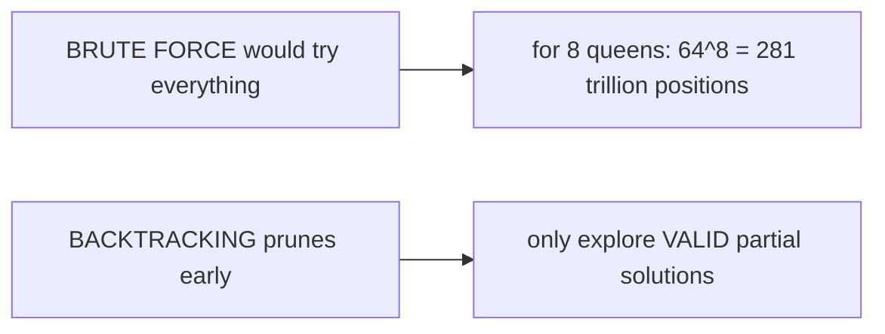

### The Mental Model: Exploring a Tree of Choices

```
Every backtracking problem is a DECISION TREE:

  "Choose a letter for position 1"
           /    |    \
          a     b     c
         /|\   /|\   /|\    ← "Choose for position 2"
        a b c a b c a b c
        ...

At each node, you have CHOICES.
Some branches lead to valid solutions. Others are dead ends.

BACKTRACKING = DFS through this tree, BUT:
  - Before going deeper → CHECK if this partial solution CAN lead to a valid one
  - If NO → PRUNE this branch (don't explore further) → HUGE time savings
  - If dead end → UNDO last choice (backtrack) → try next option
```

**Flow:**
- - Before going deeper
- ↓
- CHECK if this partial solution CAN lead to a valid
- ↓
- - If NO
- ↓
- PRUNE this branch (don't explore further)
- ↓
- HUGE time savings
- ↓
- - If dead end
- ↓
- UNDO last choice (backtrack)
- ↓
- try next option

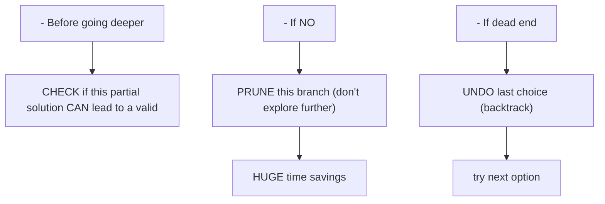

### The Universal 3-Step Framework: Choose → Explore → Unchoose

```
for each CHOICE at current position:
    1. CHOOSE:   Make a choice (add to current path)
    2. EXPLORE:  Recurse to next position
    3. UNCHOOSE: Undo the choice (remove from path) ← THIS IS BACKTRACKING

WHY "unchoose"? Because after exploring one branch, you need to
return to the same state to try the NEXT branch. Like hiking:
you go down a trail, hit a dead end, walk BACK to the fork,
then try the other trail.
```

**Flow:**
- 1. CHOOSE: Make a choice (add to current path)
- ↓
- 2. EXPLORE: Recurse to next position
- ↓
- you go down a trail, hit a dead end, walk BACK to the f
- ↓
- then try the other trail.

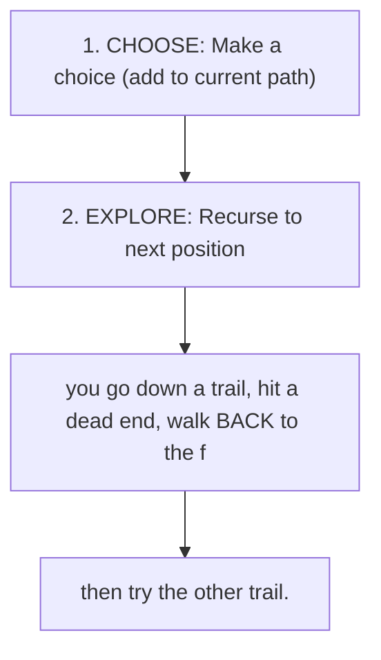

### When to Use Backtracking vs Other Approaches

```
✅ USE BACKTRACKING WHEN:
  - Generate ALL solutions (subsets, permutations, combinations)
  - Constraint satisfaction (Sudoku, N-Queens, crossword)
  - Path finding in a maze
  - Problem says "find all", "list all", "count all valid"

❌ DO NOT USE WHEN:
  - You only need the COUNT (not the actual solutions) → Use DP instead
  - You need the OPTIMAL solution → Use DP or Greedy
  - The state space is too large even with pruning (n > 20-25)
  - There's a mathematical formula (combinations = n! / (k! * (n-k)!))

  BACKTRACKING = "I need to enumerate" 
  DP = "I need to optimize"
  GREEDY = "I can make local choices that are globally optimal"
```

**Flow:**
- - You only need the COUNT (not the actual solution
- ↓
- Use DP instead
- ↓
- - You need the OPTIMAL solution
- ↓
- Use DP or Greedy

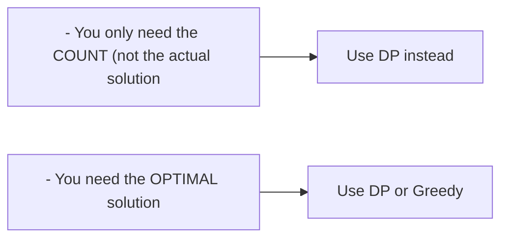

### Historical Context

```
1960s: Backtracking was formalized by Walker (1960) and Golomb & Baumert (1965)
The 8-Queens problem (1848, Max Bezzel) was one of the first applications.
Today it's the foundation for:
  - SAT solvers (automated theorem proving)
  - Compiler optimization (register allocation)
  - AI game engines (chess move generation)
  - Regex matchers
```

📖 **Related mental model:** [14_Mental_Models/01_Recursion_Tree_Thinking.md](../14_Mental_Models/01_Recursion_Tree_Thinking.md) — Part 4 covers the Choose-Explore-Unchoose framework in depth.

---


## What is Backtracking? <a name="what-is-backtracking"></a>

### The Core Idea

```
Backtracking = DFS + Undo

Explore all possible paths.
When you hit a dead end, GO BACK and try a different path.

┌─────────────────────────────────────────────────────────────────┐
│                     BACKTRACKING FLOW                           │
├─────────────────────────────────────────────────────────────────┤
│                                                                 │
│    1. CHOOSE    →    2. EXPLORE    →    3. UNCHOOSE             │
│                                                                 │
│    Make a            Recursively         Undo the               │
│    decision          explore with        decision               │
│                      that choice         (backtrack)            │
│                                                                 │
└─────────────────────────────────────────────────────────────────┘
```

**Flow:**
- Backtracking = DFS + Undo
- ↓
- Explore all possible paths.
- ↓
- When you hit a dead end, GO BACK and try a different pa
- ↓
- BACKTRACKING FLOW
- ↓
- 1. CHOOSE
- ↓
- 2. EXPLORE
- ↓
- 3. UNCHOOSE
- ↓
- 1. CHOOSE
- ↓
- 2. EXPLORE
- ↓
- 3. UNCHOOSE
- ↓
- Make a Recursively Undo the
- ↓
- decision explore with decision

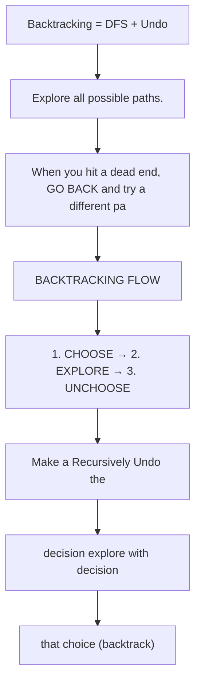

### Visual: Decision Tree

```
Problem: Generate all subsets of [1, 2]

                    Start []
                   /        \
        Include 1 /          \ Exclude 1
                 /            \
              [1]              []
             /    \          /    \
      Inc 2 /      \ Exc 2  / Inc 2\ Exc 2
           /        \      /        \
        [1,2]      [1]   [2]        []

Result: [[], [1], [2], [1,2]]
```

### When to Use Backtracking?

```
┌─────────────────────────────────────────────────────────────────┐
│              USE BACKTRACKING WHEN YOU SEE:                     │
├─────────────────────────────────────────────────────────────────┤
│  ✓ "Generate all..."                                            │
│  ✓ "Find all possible..."                                       │
│  ✓ "Print all combinations/permutations/subsets"                │
│  ✓ "All ways to..."                                             │
│  ✓ Constraint satisfaction (Sudoku, N-Queens)                   │
│  ✓ Path finding with constraints                                │
│  ✓ Game solving (word search, crossword)                        │
└─────────────────────────────────────────────────────────────────┘

Time Complexity usually: O(2^n) or O(n!) - exponential
That's OK! Problem asks for ALL solutions.
```

**Flow:**
- USE BACKTRACKING WHEN YOU SEE:
- ↓
- ✓ 'Generate all...'
- ↓
- ✓ 'Find all possible...'
- ↓
- ✓ 'Print all combinations/permutations/subsets'
- ↓
- ✓ 'All ways to...'
- ↓
- ✓ Constraint satisfaction (Sudoku, N-Queens)
- ↓
- ✓ Path finding with constraints

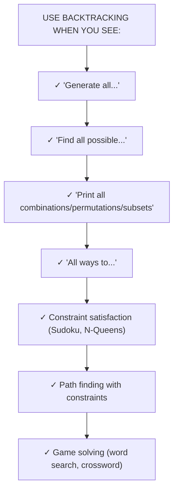

---


## The Universal Template <a name="universal-template"></a>

### 🎯 MEMORIZE THIS TEMPLATE

```java
// ═══════════════════════════════════════════════════════════════
//              THE UNIVERSAL BACKTRACKING TEMPLATE
// ═══════════════════════════════════════════════════════════════

void backtrack(current_state, choices, result) {
    // BASE CASE: When to add to result?
    if (reached_goal) {
        result.add(copy_of_current_state);
        return;
    }

    // RECURSIVE CASE: Try all choices
    for (choice in choices) {
        // 1. Skip invalid choices (pruning)
        if (!isValid(choice)) continue;

        // 2. MAKE the choice
        current_state.add(choice);

        // 3. EXPLORE with that choice
        backtrack(next_state, remaining_choices, result);

        // 4. UNDO the choice (backtrack)
        current_state.remove(choice);
    }
}
```

### Real Java Implementation

```java
public class BacktrackingTemplate {

    public List<List<Integer>> solve(int[] nums) {
        List<List<Integer>> result = new ArrayList<>();
        List<Integer> current = new ArrayList<>();
        backtrack(nums, 0, current, result);
        return result;
    }

    private void backtrack(int[] nums, int start,
                          List<Integer> current,
                          List<List<Integer>> result) {
        // Base case: add current state to result
        result.add(new ArrayList<>(current));  // MUST copy!

        // Try all choices from 'start' onwards
        for (int i = start; i < nums.length; i++) {
            // 1. CHOOSE
            current.add(nums[i]);

            // 2. EXPLORE
            backtrack(nums, i + 1, current, result);

            // 3. UNCHOOSE (backtrack)
            current.remove(current.size() - 1);
        }
    }
}
```

### Critical Points

```
┌─────────────────────────────────────────────────────────────────┐
│                  CRITICAL IMPLEMENTATION NOTES                  │
├─────────────────────────────────────────────────────────────────┤
│                                                                 │
│  1. ALWAYS COPY before adding to result:                        │
│     result.add(new ArrayList<>(current));  ✓                    │
│     result.add(current);  ✗ (adds reference, will be modified)  │
│                                                                 │
│  2. REMOVE from END (last element):                             │
│     current.remove(current.size() - 1);  ✓                      │
│     current.remove(element);  ✗ (removes by value, slower)      │
│                                                                 │
│  3. 'start' parameter controls:                                 │
│     start = i + 1  →  No duplicates, subsets/combinations       │
│     start = i      →  Can reuse elements                        │
│     No start       →  Permutations (use visited array)          │
│                                                                 │
└─────────────────────────────────────────────────────────────────┘
```

**Flow:**
- CRITICAL IMPLEMENTATION NOTES
- ↓
- 1. ALWAYS COPY before adding to result:
- ↓
- result.add(new ArrayList<>(current)); ✓
- ↓
- result.add(current); ✗ (adds reference, will be modifie
- ↓
- 2. REMOVE from END (last element):
- ↓
- current.remove(current.size() - 1); ✓
- ↓
- current.remove(element); ✗ (removes by value, slower)

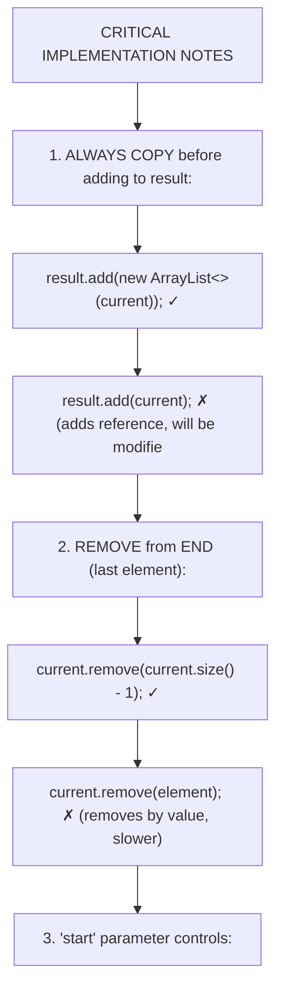

---

## Subsets Pattern <a name="subsets-pattern"></a>

### Problem: Subsets (LeetCode 78)

```
Input: [1, 2, 3]
Output: [[], [1], [2], [3], [1,2], [1,3], [2,3], [1,2,3]]

Each element: include OR exclude → 2^n subsets
```

**Flow:**
- Each element: include OR exclude
- ↓
- 2^n subsets

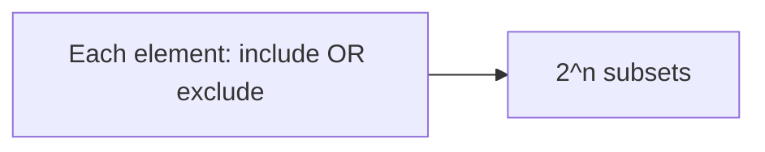

### Solution

```java
public List<List<Integer>> subsets(int[] nums) {
    List<List<Integer>> result = new ArrayList<>();
    backtrack(nums, 0, new ArrayList<>(), result);
    return result;
}

private void backtrack(int[] nums, int start,
                       List<Integer> current,
                       List<List<Integer>> result) {
    // Every state is a valid subset - add it!
    result.add(new ArrayList<>(current));

    for (int i = start; i < nums.length; i++) {
        current.add(nums[i]);                    // Choose
        backtrack(nums, i + 1, current, result); // Explore
        current.remove(current.size() - 1);      // Unchoose
    }
}
```

### Visual Trace

```
backtrack(start=0, current=[])
├── Add []
├── i=0: Choose 1
│   └── backtrack(start=1, current=[1])
│       ├── Add [1]
│       ├── i=1: Choose 2
│       │   └── backtrack(start=2, current=[1,2])
│       │       ├── Add [1,2]
│       │       ├── i=2: Choose 3
│       │       │   └── backtrack(start=3, current=[1,2,3])
│       │       │       └── Add [1,2,3]
│       │       └── Unchoose 3
│       │       └── return
│       ├── Unchoose 2
│       ├── i=2: Choose 3
│       │   └── backtrack(start=3, current=[1,3])
│       │       └── Add [1,3]
│       └── Unchoose 3
│       └── return
├── Unchoose 1
├── i=1: Choose 2
│   └── backtrack(start=2, current=[2])
│       ├── Add [2]
│       ├── i=2: Choose 3
│       │   └── backtrack(start=3, current=[2,3])
│       │       └── Add [2,3]
│       └── Unchoose 3
├── Unchoose 2
├── i=2: Choose 3
│   └── backtrack(start=3, current=[3])
│       └── Add [3]
└── Unchoose 3

Result: [[], [1], [1,2], [1,2,3], [1,3], [2], [2,3], [3]]
```

**Flow:**
- backtrack(start=0, current=[])
- ↓
- Add []
- ↓
- backtrack(start=0, current=[])
- ↓
- i=0: Choose 1
- ↓
- backtrack(start=0, current=[])
- ↓
- backtrack(start=1, current=[1])
- ↓
- backtrack(start=0, current=[])
- ↓
- Add [1]
- ↓
- backtrack(start=0, current=[])
- ↓
- i=1: Choose 2
- ↓
- backtrack(start=0, current=[])
- ↓
- backtrack(start=2, current=[1,2])

```mermaid
flowchart TD
    N1["backtrack(start=0, current=[])"]
    N2["Add []"]
    N3["i=0: Choose 1"]
    N4["backtrack(start=1, current=[1])"]
    N5["Add [1]"]
    N6["i=1: Choose 2"]
    N7["backtrack(start=2, current=[1,2])"]
    N8["Add [1,2]"]
    N9["i=2: Choose 3"]
    N10["backtrack(start=3, current=[1,2,3])"]
    N11["Add [1,2,3]"]
    N12["Unchoose 3"]
    N13["return"]
    N14["Unchoose 2"]
    N15["backtrack(start=3, current=[1,3])"]
    N16["Add [1,3]"]
    N17["Unchoose 1"]
    N18["backtrack(start=2, current=[2])"]
    N19["Add [2]"]
    N20["backtrack(start=3, current=[2,3])"]
    N21["Add [2,3]"]
    N22["backtrack(start=3, current=[3])"]
    N23["Add [3]"]
    N1 --> N2
    N1 --> N3
    N1 --> N4
    N1 --> N5
    N1 --> N6
    N1 --> N7
    N1 --> N8
    N1 --> N9
    N1 --> N10
    N1 --> N11
    N1 --> N12
    N1 --> N13
    N1 --> N14
    N1 --> N15
    N1 --> N16
    N1 --> N17
    N1 --> N18
    N1 --> N19
    N1 --> N20
    N1 --> N21
    N1 --> N22
    N1 --> N23
```

### Subsets II - With Duplicates (LeetCode 90)

```java
/*
Input: [1, 2, 2]
Output: [[], [1], [1,2], [1,2,2], [2], [2,2]]
No duplicate subsets!
*/

public List<List<Integer>> subsetsWithDup(int[] nums) {
    List<List<Integer>> result = new ArrayList<>();
    Arrays.sort(nums);  // CRITICAL: Sort first!
    backtrack(nums, 0, new ArrayList<>(), result);
    return result;
}

private void backtrack(int[] nums, int start,
                       List<Integer> current,
                       List<List<Integer>> result) {
    result.add(new ArrayList<>(current));

    for (int i = start; i < nums.length; i++) {
        // SKIP DUPLICATES: If same as previous element, skip
        if (i > start && nums[i] == nums[i - 1]) continue;

        current.add(nums[i]);
        backtrack(nums, i + 1, current, result);
        current.remove(current.size() - 1);
    }
}

/*
Why i > start (not i > 0)?
- i > start means: among siblings at same level
- First occurrence at level is OK
- Duplicates at same level create duplicate subsets
*/
```

---


## Permutations Pattern <a name="permutations-pattern"></a>

### Problem: Permutations (LeetCode 46)

```
Input: [1, 2, 3]
Output: [[1,2,3], [1,3,2], [2,1,3], [2,3,1], [3,1,2], [3,2,1]]

n! permutations (3! = 6)
```

### Solution: Using Visited Array

```java
public List<List<Integer>> permute(int[] nums) {
    List<List<Integer>> result = new ArrayList<>();
    boolean[] visited = new boolean[nums.length];
    backtrack(nums, visited, new ArrayList<>(), result);
    return result;
}

private void backtrack(int[] nums, boolean[] visited,
                       List<Integer> current,
                       List<List<Integer>> result) {
    // Base case: permutation complete
    if (current.size() == nums.length) {
        result.add(new ArrayList<>(current));
        return;
    }

    // Try ALL elements (not from start!)
    for (int i = 0; i < nums.length; i++) {
        if (visited[i]) continue;  // Skip used elements

        visited[i] = true;         // Mark as used
        current.add(nums[i]);
        backtrack(nums, visited, current, result);
        current.remove(current.size() - 1);
        visited[i] = false;        // Unmark
    }
}
```

### Solution: Using Swap (Space Optimized)

```java
public List<List<Integer>> permute(int[] nums) {
    List<List<Integer>> result = new ArrayList<>();
    backtrack(nums, 0, result);
    return result;
}

private void backtrack(int[] nums, int start, List<List<Integer>> result) {
    if (start == nums.length) {
        // Convert array to list
        List<Integer> perm = new ArrayList<>();
        for (int num : nums) perm.add(num);
        result.add(perm);
        return;
    }

    for (int i = start; i < nums.length; i++) {
        swap(nums, start, i);            // Choose
        backtrack(nums, start + 1, result);  // Explore
        swap(nums, start, i);            // Unchoose
    }
}

private void swap(int[] nums, int i, int j) {
    int temp = nums[i];
    nums[i] = nums[j];
    nums[j] = temp;
}
```

### Visual: Swap Method

```
Initial: [1, 2, 3], start = 0

Level 0: Fix position 0
├── swap(0,0): [1, 2, 3]
│   └── Level 1: Fix position 1
│       ├── swap(1,1): [1, 2, 3]
│       │   └── Level 2: Fix position 2
│       │       └── swap(2,2): [1, 2, 3] → Add [1,2,3]
│       └── swap(1,2): [1, 3, 2]
│           └── Level 2: [1, 3, 2] → Add [1,3,2]
│           └── swap(1,2) back: [1, 2, 3]
├── swap(0,1): [2, 1, 3]
│   └── Level 1: ...
│       → Add [2,1,3], [2,3,1]
└── swap(0,2): [3, 2, 1]
    └── Level 1: ...
        → Add [3,2,1], [3,1,2]
```

**Flow:**
- Level 0: Fix position 0
- ↓
- swap(0,0): [1, 2, 3]
- ↓
- Level 0: Fix position 0
- ↓
- Level 1: Fix position 1
- ↓
- Level 0: Fix position 0
- ↓
- swap(1,1): [1, 2, 3]
- ↓
- Level 0: Fix position 0
- ↓
- Level 2: Fix position 2
- ↓
- Level 0: Fix position 0
- ↓
- swap(2,2): [1, 2, 3]
- ↓
- Add [1,2,3]
- ↓
- Level 0: Fix position 0
- ↓
- swap(1,2): [1, 3, 2]

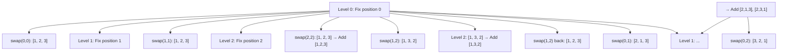

### Permutations II - With Duplicates (LeetCode 47)

```java
/*
Input: [1, 1, 2]
Output: [[1,1,2], [1,2,1], [2,1,1]]  (3 unique, not 6)
*/

public List<List<Integer>> permuteUnique(int[] nums) {
    List<List<Integer>> result = new ArrayList<>();
    Arrays.sort(nums);  // Sort to group duplicates
    boolean[] visited = new boolean[nums.length];
    backtrack(nums, visited, new ArrayList<>(), result);
    return result;
}

private void backtrack(int[] nums, boolean[] visited,
                       List<Integer> current,
                       List<List<Integer>> result) {
    if (current.size() == nums.length) {
        result.add(new ArrayList<>(current));
        return;
    }

    for (int i = 0; i < nums.length; i++) {
        if (visited[i]) continue;

        // KEY: Skip duplicate if previous same element not used
        if (i > 0 && nums[i] == nums[i-1] && !visited[i-1]) continue;

        visited[i] = true;
        current.add(nums[i]);
        backtrack(nums, visited, current, result);
        current.remove(current.size() - 1);
        visited[i] = false;
    }
}

/*
Why !visited[i-1]?
- If we have [1a, 1b, 2] and want to pick 1 for first position
- We should only pick 1a (the first 1)
- If 1a is already used (!visited[i-1] is false), we can use 1b
- If 1a is NOT used (!visited[i-1] is true), skip 1b
- This ensures duplicates are used in order
*/
```

---


## Combinations Pattern <a name="combinations-pattern"></a>

### Problem: Combinations (LeetCode 77)

```
Input: n = 4, k = 2
Output: [[1,2], [1,3], [1,4], [2,3], [2,4], [3,4]]

C(n,k) = n! / (k!(n-k)!)
```

### Solution

```java
public List<List<Integer>> combine(int n, int k) {
    List<List<Integer>> result = new ArrayList<>();
    backtrack(n, k, 1, new ArrayList<>(), result);
    return result;
}

private void backtrack(int n, int k, int start,
                       List<Integer> current,
                       List<List<Integer>> result) {
    // Base case: combination complete
    if (current.size() == k) {
        result.add(new ArrayList<>(current));
        return;
    }

    // Pruning: need (k - current.size()) more elements
    // Can't exceed: i <= n - (k - current.size()) + 1
    for (int i = start; i <= n - (k - current.size()) + 1; i++) {
        current.add(i);
        backtrack(n, k, i + 1, current, result);
        current.remove(current.size() - 1);
    }
}
```

### Combination Sum (LeetCode 39)

```java
/*
Find all combinations that sum to target (can reuse elements)
Input: candidates = [2,3,6,7], target = 7
Output: [[2,2,3], [7]]
*/

public List<List<Integer>> combinationSum(int[] candidates, int target) {
    List<List<Integer>> result = new ArrayList<>();
    backtrack(candidates, target, 0, new ArrayList<>(), result);
    return result;
}

private void backtrack(int[] candidates, int remaining, int start,
                       List<Integer> current, List<List<Integer>> result) {
    if (remaining == 0) {
        result.add(new ArrayList<>(current));
        return;
    }
    if (remaining < 0) return;  // Pruning

    for (int i = start; i < candidates.length; i++) {
        current.add(candidates[i]);
        // i (not i+1) because we can reuse same element
        backtrack(candidates, remaining - candidates[i], i, current, result);
        current.remove(current.size() - 1);
    }
}
```

### Combination Sum II - No Reuse (LeetCode 40)

```java
/*
Each number used at most once, no duplicate combinations
Input: candidates = [10,1,2,7,6,1,5], target = 8
Output: [[1,1,6], [1,2,5], [1,7], [2,6]]
*/

public List<List<Integer>> combinationSum2(int[] candidates, int target) {
    List<List<Integer>> result = new ArrayList<>();
    Arrays.sort(candidates);  // Sort for duplicate handling
    backtrack(candidates, target, 0, new ArrayList<>(), result);
    return result;
}

private void backtrack(int[] candidates, int remaining, int start,
                       List<Integer> current, List<List<Integer>> result) {
    if (remaining == 0) {
        result.add(new ArrayList<>(current));
        return;
    }

    for (int i = start; i < candidates.length; i++) {
        // Pruning: remaining elements too large
        if (candidates[i] > remaining) break;

        // Skip duplicates at same level
        if (i > start && candidates[i] == candidates[i-1]) continue;

        current.add(candidates[i]);
        // i + 1 because each element used once
        backtrack(candidates, remaining - candidates[i], i + 1, current, result);
        current.remove(current.size() - 1);
    }
}
```

### Combination Sum III (LeetCode 216)

```java
/*
Find k numbers from 1-9 that sum to n, each used once
*/

public List<List<Integer>> combinationSum3(int k, int n) {
    List<List<Integer>> result = new ArrayList<>();
    backtrack(k, n, 1, new ArrayList<>(), result);
    return result;
}

private void backtrack(int k, int remaining, int start,
                       List<Integer> current, List<List<Integer>> result) {
    if (current.size() == k && remaining == 0) {
        result.add(new ArrayList<>(current));
        return;
    }
    if (current.size() >= k || remaining < 0) return;

    for (int i = start; i <= 9; i++) {
        current.add(i);
        backtrack(k, remaining - i, i + 1, current, result);
        current.remove(current.size() - 1);
    }
}
```

---


## Classic Problems <a name="classic-problems"></a>

### N-Queens (LeetCode 51) ⭐⭐⭐

```java
/*
Place n queens on n×n board such that no two attack each other
Queens attack: same row, column, or diagonal
*/

public List<List<String>> solveNQueens(int n) {
    List<List<String>> result = new ArrayList<>();
    int[] queens = new int[n];  // queens[row] = col position
    Arrays.fill(queens, -1);

    Set<Integer> cols = new HashSet<>();      // Columns used
    Set<Integer> diag1 = new HashSet<>();     // r - c (main diagonal)
    Set<Integer> diag2 = new HashSet<>();     // r + c (anti-diagonal)

    backtrack(n, 0, queens, cols, diag1, diag2, result);
    return result;
}

private void backtrack(int n, int row, int[] queens,
                       Set<Integer> cols, Set<Integer> diag1, Set<Integer> diag2,
                       List<List<String>> result) {
    if (row == n) {
        result.add(buildBoard(queens, n));
        return;
    }

    for (int col = 0; col < n; col++) {
        // Check if position is safe
        if (cols.contains(col)) continue;
        if (diag1.contains(row - col)) continue;
        if (diag2.contains(row + col)) continue;

        // Place queen
        queens[row] = col;
        cols.add(col);
        diag1.add(row - col);
        diag2.add(row + col);

        // Recurse to next row
        backtrack(n, row + 1, queens, cols, diag1, diag2, result);

        // Remove queen (backtrack)
        queens[row] = -1;
        cols.remove(col);
        diag1.remove(row - col);
        diag2.remove(row + col);
    }
}

private List<String> buildBoard(int[] queens, int n) {
    List<String> board = new ArrayList<>();
    for (int row = 0; row < n; row++) {
        char[] rowChars = new char[n];
        Arrays.fill(rowChars, '.');
        rowChars[queens[row]] = 'Q';
        board.add(new String(rowChars));
    }
    return board;
}
```

### Visual: N-Queens Conflict Detection

```
Queen at (row, col) attacks:

Same column: col
        ↓
    . . Q . .
    . . ↓ . .
    . . ↓ . .

Main diagonal (r - c is constant):
    Q . . . .   (0,0): r-c = 0
    . ↘ . . .   (1,1): r-c = 0
    . . ↘ . .   (2,2): r-c = 0

Anti-diagonal (r + c is constant):
    . . . . Q   (0,4): r+c = 4
    . . . ↙ .   (1,3): r+c = 4
    . . ↙ . .   (2,2): r+c = 4
```

**Flow:**
- Queen at (row, col) attacks:
- ↓
- Same column: col
- ↓
- Main diagonal (r - c is constant):
- ↓
- Anti-diagonal (r + c is constant):

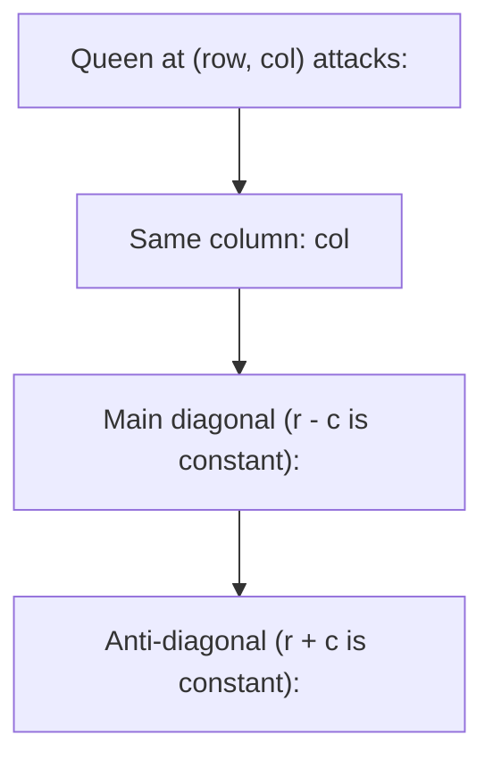

### Sudoku Solver (LeetCode 37) ⭐⭐⭐

```java
public void solveSudoku(char[][] board) {
    backtrack(board);
}

private boolean backtrack(char[][] board) {
    // Find empty cell
    for (int row = 0; row < 9; row++) {
        for (int col = 0; col < 9; col++) {
            if (board[row][col] != '.') continue;

            // Try digits 1-9
            for (char c = '1'; c <= '9'; c++) {
                if (!isValid(board, row, col, c)) continue;

                board[row][col] = c;  // Place digit

                if (backtrack(board)) return true;  // If solved, done

                board[row][col] = '.';  // Backtrack
            }

            return false;  // No valid digit, need to backtrack
        }
    }
    return true;  // All cells filled
}

private boolean isValid(char[][] board, int row, int col, char c) {
    for (int i = 0; i < 9; i++) {
        // Check row
        if (board[row][i] == c) return false;
        // Check column
        if (board[i][col] == c) return false;
        // Check 3x3 box
        int boxRow = 3 * (row / 3) + i / 3;
        int boxCol = 3 * (col / 3) + i % 3;
        if (board[boxRow][boxCol] == c) return false;
    }
    return true;
}
```

### Word Search (LeetCode 79) ⭐⭐

```java
/*
Find if word exists in grid (moving horizontally/vertically)
*/

private int[][] DIRS = {{0,1}, {0,-1}, {1,0}, {-1,0}};

public boolean exist(char[][] board, String word) {
    int m = board.length, n = board[0].length;

    for (int i = 0; i < m; i++) {
        for (int j = 0; j < n; j++) {
            if (backtrack(board, word, i, j, 0)) {
                return true;
            }
        }
    }
    return false;
}

private boolean backtrack(char[][] board, String word,
                          int row, int col, int index) {
    // Base case: found complete word
    if (index == word.length()) return true;

    // Boundary and match check
    if (row < 0 || row >= board.length ||
        col < 0 || col >= board[0].length ||
        board[row][col] != word.charAt(index)) {
        return false;
    }

    // Mark as visited (using the cell itself)
    char temp = board[row][col];
    board[row][col] = '#';

    // Explore all 4 directions
    for (int[] dir : DIRS) {
        if (backtrack(board, word, row + dir[0], col + dir[1], index + 1)) {
            return true;
        }
    }

    // Backtrack: restore original character
    board[row][col] = temp;
    return false;
}
```

### Generate Parentheses (LeetCode 22) ⭐⭐

```java
/*
Generate all valid combinations of n pairs of parentheses
Input: n = 3
Output: ["((()))", "(()())", "(())()", "()(())", "()()()"]
*/

public List<String> generateParenthesis(int n) {
    List<String> result = new ArrayList<>();
    backtrack(n, 0, 0, new StringBuilder(), result);
    return result;
}

private void backtrack(int n, int open, int close,
                       StringBuilder current, List<String> result) {
    // Base case: used all parentheses
    if (current.length() == 2 * n) {
        result.add(current.toString());
        return;
    }

    // Can add open if we have remaining
    if (open < n) {
        current.append('(');
        backtrack(n, open + 1, close, current, result);
        current.deleteCharAt(current.length() - 1);
    }

    // Can add close only if open > close
    if (close < open) {
        current.append(')');
        backtrack(n, open, close + 1, current, result);
        current.deleteCharAt(current.length() - 1);
    }
}
```

### Letter Combinations of Phone Number (LeetCode 17) ⭐

```java
public List<String> letterCombinations(String digits) {
    if (digits.isEmpty()) return new ArrayList<>();

    String[] mapping = {"", "", "abc", "def", "ghi", "jkl", "mno", "pqrs", "tuv", "wxyz"};
    List<String> result = new ArrayList<>();
    backtrack(digits, 0, new StringBuilder(), mapping, result);
    return result;
}

private void backtrack(String digits, int index, StringBuilder current,
                       String[] mapping, List<String> result) {
    if (index == digits.length()) {
        result.add(current.toString());
        return;
    }

    String letters = mapping[digits.charAt(index) - '0'];
    for (char c : letters.toCharArray()) {
        current.append(c);
        backtrack(digits, index + 1, current, mapping, result);
        current.deleteCharAt(current.length() - 1);
    }
}
```

### Palindrome Partitioning (LeetCode 131) ⭐⭐

```java
/*
Partition string such that every substring is a palindrome
Input: "aab"
Output: [["a","a","b"], ["aa","b"]]
*/

public List<List<String>> partition(String s) {
    List<List<String>> result = new ArrayList<>();
    backtrack(s, 0, new ArrayList<>(), result);
    return result;
}

private void backtrack(String s, int start,
                       List<String> current, List<List<String>> result) {
    if (start == s.length()) {
        result.add(new ArrayList<>(current));
        return;
    }

    for (int end = start + 1; end <= s.length(); end++) {
        String substring = s.substring(start, end);
        if (isPalindrome(substring)) {
            current.add(substring);
            backtrack(s, end, current, result);
            current.remove(current.size() - 1);
        }
    }
}

private boolean isPalindrome(String s) {
    int left = 0, right = s.length() - 1;
    while (left < right) {
        if (s.charAt(left++) != s.charAt(right--)) return false;
    }
    return true;
}
```

---

## Optimization Techniques <a name="optimization"></a>

### 1. Pruning - Cut Branches Early

```java
// Without pruning: explores invalid paths
for (int i = start; i < nums.length; i++) {
    current.add(nums[i]);
    backtrack(...);
    current.remove(...);
}

// With pruning: skip impossible cases
for (int i = start; i < nums.length; i++) {
    // Prune 1: Remaining elements won't reach target
    if (sum + nums[i] > target) break;  // (array is sorted)

    // Prune 2: Not enough elements remaining
    if (nums.length - i < k - current.size()) break;

    current.add(nums[i]);
    backtrack(...);
    current.remove(...);
}
```

### 2. Avoid String Concatenation

```java
// ❌ SLOW: Creates new String each time
private void backtrack(String current, ...) {
    // ...
    backtrack(current + c, ...);  // O(n) each call
}

// ✅ FAST: Use StringBuilder
private void backtrack(StringBuilder current, ...) {
    current.append(c);
    backtrack(current, ...);
    current.deleteCharAt(current.length() - 1);
}
```

### 3. Use Primitive Arrays Over Lists When Possible

```java
// ❌ ArrayList overhead
List<Integer> current = new ArrayList<>();

// ✅ Primitive array (when size known)
int[] current = new int[k];
int currentSize = 0;
```

### 4. Pre-sort to Enable Pruning

```java
// Sort once at the beginning
Arrays.sort(nums);

// Now can use pruning like:
if (nums[i] > remaining) break;  // All future elements also > remaining
if (i > start && nums[i] == nums[i-1]) continue;  // Skip duplicates
```

### 5. Cache Expensive Computations

```java
// For palindrome partitioning, precompute palindrome matrix
boolean[][] isPalin = new boolean[n][n];
for (int end = 0; end < n; end++) {
    for (int start = 0; start <= end; start++) {
        isPalin[start][end] = s.charAt(start) == s.charAt(end) &&
                              (end - start <= 2 || isPalin[start+1][end-1]);
    }
}
// Now check isPalin[i][j] in O(1) instead of O(n)
```

---

## Interview Problems <a name="interview-problems"></a>

### Quick Classification

```
┌───────────────────────────────────────────────────────────────────┐
│                  BACKTRACKING PROBLEM TYPES                       │
├───────────────────────────────────────────────────────────────────┤
│                                                                   │
│  SUBSETS:                    PERMUTATIONS:                        │
│  - Subsets I, II             - Permutations I, II                 │
│  - Combination Sum 1-3       - Next Permutation                   │
│  - Palindrome Partitioning   - Permutation Sequence               │
│                                                                   │
│  COMBINATIONS:               GRID/MATRIX:                         │
│  - Combinations (n,k)        - N-Queens                           │
│  - Letter Combinations       - Sudoku Solver                      │
│  - Generate Parentheses      - Word Search                        │
│                                                                   │
│  STRING:                     PATH FINDING:                        │
│  - Restore IP Addresses      - Path Sum II                        │
│  - Word Break II             - All Paths from Source to Target    │
│  - Decode Ways               - Unique Paths III                   │
│                                                                   │
└───────────────────────────────────────────────────────────────────┘
```

**Flow:**
- BACKTRACKING PROBLEM TYPES
- ↓
- SUBSETS: PERMUTATIONS:
- ↓
- - Subsets I, II - Permutations I, II
- ↓
- - Combination Sum 1-3 - Next Permutation
- ↓
- - Palindrome Partitioning - Permutation Sequence
- ↓
- COMBINATIONS: GRID/MATRIX:
- ↓
- - Combinations (n,k) - N-Queens

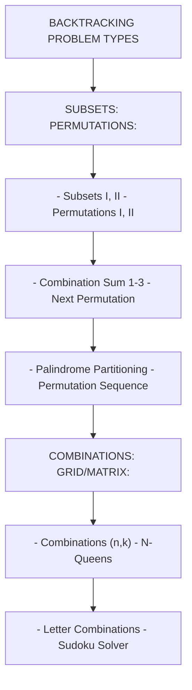

### Restore IP Addresses (LeetCode 93) ⭐⭐

```java
public List<String> restoreIpAddresses(String s) {
    List<String> result = new ArrayList<>();
    backtrack(s, 0, new ArrayList<>(), result);
    return result;
}

private void backtrack(String s, int start, List<String> parts, List<String> result) {
    // 4 parts and used all characters
    if (parts.size() == 4 && start == s.length()) {
        result.add(String.join(".", parts));
        return;
    }
    // Invalid states
    if (parts.size() == 4 || start == s.length()) return;

    // Try 1, 2, or 3 digits
    for (int len = 1; len <= 3 && start + len <= s.length(); len++) {
        String part = s.substring(start, start + len);

        // Validate: no leading zeros, value <= 255
        if (part.length() > 1 && part.charAt(0) == '0') continue;
        if (Integer.parseInt(part) > 255) continue;

        parts.add(part);
        backtrack(s, start + len, parts, result);
        parts.remove(parts.size() - 1);
    }
}
```

### Word Break II (LeetCode 140) ⭐⭐⭐

```java
public List<String> wordBreak(String s, List<String> wordDict) {
    Set<String> dict = new HashSet<>(wordDict);
    Map<Integer, List<String>> memo = new HashMap<>();
    return backtrack(s, 0, dict, memo);
}

private List<String> backtrack(String s, int start,
                               Set<String> dict, Map<Integer, List<String>> memo) {
    if (memo.containsKey(start)) return memo.get(start);

    List<String> result = new ArrayList<>();

    if (start == s.length()) {
        result.add("");
        return result;
    }

    for (int end = start + 1; end <= s.length(); end++) {
        String word = s.substring(start, end);
        if (!dict.contains(word)) continue;

        List<String> rest = backtrack(s, end, dict, memo);
        for (String sentence : rest) {
            result.add(word + (sentence.isEmpty() ? "" : " " + sentence));
        }
    }

    memo.put(start, result);
    return result;
}
```

---

## Practice Problems List <a name="practice-list"></a>

### Easy 🟢

| Problem             | Pattern      | Key Trick         |
| ------------------- | ------------ | ----------------- |
| Subsets             | Subsets      | Every state valid |
| Letter Combinations | Combinations | Mapping array     |
| Binary Watch        | Combinations | Bit count         |
| Path Sum II         | Path finding | Track path        |

### Medium 🟡

| Problem                 | Pattern      | Key Trick             |
| ----------------------- | ------------ | --------------------- |
| Subsets II              | Subsets      | Skip duplicates       |
| Permutations I, II      | Permutations | Visited array         |
| Combinations            | Combinations | Start parameter       |
| Combination Sum 1-4     | Combinations | Vary start (i vs i+1) |
| Generate Parentheses    | Combinations | open/close count      |
| Word Search             | Grid         | 4-direction DFS       |
| Palindrome Partitioning | Subsets      | isPalindrome check    |
| Restore IP Addresses    | Combinations | Validation            |
| N-Queens                | Constraint   | Diagonal tracking     |
| Sudoku Solver           | Constraint   | isValid check         |

### Hard 🔴

| Problem                    | Pattern         | Key Trick       |
| -------------------------- | --------------- | --------------- |
| N-Queens II                | Constraint      | Count only      |
| Word Break II              | Subsets + Memo  | Memoization     |
| Expression Add Operators   | String          | Track operand   |
| Unique Paths III           | Grid            | Visit all cells |
| Remove Invalid Parentheses | BFS + Backtrack | Min removals    |

---

## Quick Reference <a name="quick-reference"></a>

### The Decision Flow

```
┌─────────────────────────────────────────────────────────────────┐
│              WHICH PATTERN TO USE?                              │
├─────────────────────────────────────────────────────────────────┤
│                                                                 │
│  "Generate all subsets" → SUBSETS PATTERN                       │
│      start = i + 1, every state valid                           │
│                                                                 │
│  "Generate all permutations" → PERMUTATIONS PATTERN             │
│      Use visited[], iterate from 0                              │
│                                                                 │
│  "Find k numbers that sum to n" → COMBINATIONS PATTERN          │
│      start = i + 1, size = k is base case                       │
│                                                                 │
│  "Can reuse elements" → start = i (not i + 1)                   │
│                                                                 │
│  "Has duplicates" → Sort first + skip condition                 │
│                                                                 │
└─────────────────────────────────────────────────────────────────┘
```

**Flow:**
- WHICH PATTERN TO USE?
- ↓
- 'Generate all subsets'
- ↓
- SUBSETS PATTERN
- ↓
- 'Generate all subsets'
- ↓
- SUBSETS PATTERN
- ↓
- start = i + 1, every state valid
- ↓
- 'Generate all permutations'
- ↓
- PERMUTATIONS PATTERN
- ↓
- 'Generate all permutations'
- ↓
- PERMUTATIONS PATTERN
- ↓
- Use visited[], iterate from 0
- ↓
- 'Find k numbers that sum to n'
- ↓
- COMBINATIONS PATTERN
- ↓
- 'Find k numbers that sum to n'
- ↓
- COMBINATIONS PATTERN
- ↓
- start = i + 1, size = k is base case

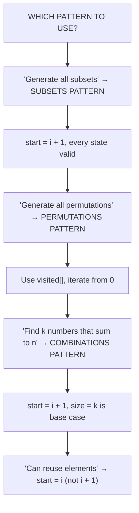

### Skip Duplicates Cheat Sheet

```java
// For SUBSETS/COMBINATIONS with duplicates:
if (i > start && nums[i] == nums[i-1]) continue;

// For PERMUTATIONS with duplicates:
if (i > 0 && nums[i] == nums[i-1] && !visited[i-1]) continue;

// PRE-REQUISITE: Array must be sorted!
Arrays.sort(nums);
```

### Complexity Analysis

```
┌─────────────────────────────────────────────────────────────────┐
│              TIME COMPLEXITIES                                  │
├─────────────────────────────────────────────────────────────────┤
│  Subsets:           O(n × 2^n)  - 2^n subsets, O(n) to copy     │
│  Permutations:      O(n × n!)   - n! permutations, O(n) copy    │
│  Combinations (k):  O(k × C(n,k))                               │
│  N-Queens:          O(n!)       - roughly                       │
│  Sudoku:            O(9^m)      - m = empty cells               │
└─────────────────────────────────────────────────────────────────┘

Space: O(n) for recursion stack (excluding output)
```

**Flow:**
- TIME COMPLEXITIES
- ↓
- Subsets: O(n × 2^n) - 2^n subsets, O(n) to copy
- ↓
- Permutations: O(n × n!) - n! permutations, O(n) copy
- ↓
- Combinations (k): O(k × C(n,k))
- ↓
- N-Queens: O(n!) - roughly
- ↓
- Sudoku: O(9^m) - m = empty cells
- ↓
- Space: O(n) for recursion stack (excluding output)

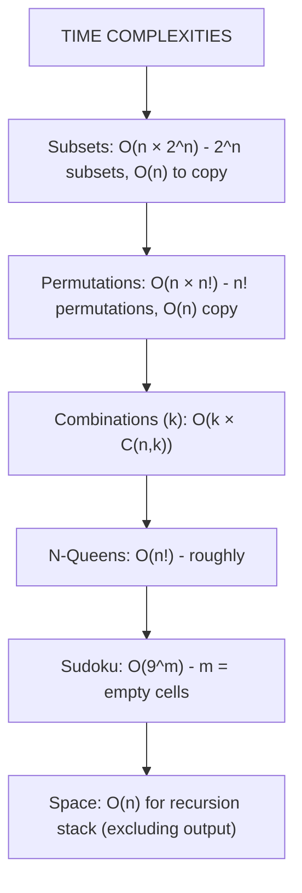

### Debug Tips

```
1. Print the decision tree:
   private void backtrack(..., int depth) {
       System.out.println("  ".repeat(depth) + "Current: " + current);
       // ...
   }

2. Common bugs:
   - Forgot new ArrayList<>(current) when adding to result
   - Forgot Arrays.sort() before duplicate handling
   - Wrong skip condition for duplicates
   - Forgot to backtrack (undo the choice)

3. Test cases:
   - Empty input
   - Single element
   - All duplicates
   - Large input (check TLE)
```

---

## Summary: Master These 3 Templates

```
╔═══════════════════════════════════════════════════════════════╗
║              THE 3 ESSENTIAL TEMPLATES                        ║
╠═══════════════════════════════════════════════════════════════╣
║                                                               ║
║  1. SUBSETS (every state is answer)                           ║
║     result.add(copy); // at start                             ║
║     for i = start to n, start = i+1                           ║
║                                                               ║
║  2. PERMUTATIONS (full length is answer)                      ║
║     if size == n: add;                                        ║
║     for i = 0 to n, use visited[]                             ║
║                                                               ║
║  3. COMBINATIONS (fixed size k is answer)                     ║
║     if size == k: add;                                        ║
║     for i = start to n, start = i+1                           ║
║                                                               ║
╚═══════════════════════════════════════════════════════════════╝

All three share: CHOOSE → EXPLORE → UNCHOOSE
```

**Flow:**
- All three share: CHOOSE
- ↓
- EXPLORE
- ↓
- UNCHOOSE

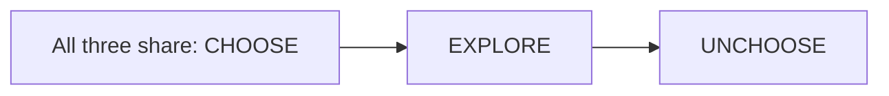

**Pro Tip:** When solving a new backtracking problem, first identify which of these 3 patterns it maps to. Then adapt the template!


---

> **Navigation**: [< Previous](10_Bit_Manipulation_Complete.md) | [Back to Index](../00_MASTER_INDEX.md) | [Next >](12_Greedy_Algorithms_Complete.md)

> 🔬 **Section Challenge — Summary: Master These 3 Templates**
>
> **Challenge 1 (Reasoning):** Prefix sum initialized as `prefix[0] = 0` — why the leading zero and not `prefix[0] = arr[0]`?
> <details><summary>Answer</summary>
>
> `prefix[0] = 0` (empty prefix) makes range sum formula uniform: `sum(l,r) = prefix[r+1] - prefix[l]`. Without the 0: `sum(0,r) = prefix[r] - 0` (special case needed). With it: `sum(0,r) = prefix[r+1] - prefix[0] = prefix[r+1]`. Same formula everywhere. This is the 'sentinel' pattern — adding a dummy initial value to eliminate special cases. Same trick used in dummy linked list nodes.
> </details>
>

