**Navigation**: [< Previous](12_Greedy_Algorithms_Complete.md) | [Back to Index](../00_MASTER_INDEX.md) | [Next >](14_Union_Find_DSU_Complete.md)
🧠 **Mental Model**: See [Array & String Thinking](../14_Mental_Models/04_Array_String_Thinking.md) — pointer patterns and string manipulation mental models

# 🔤 String Algorithms Complete Guide

KMP, Rabin-Karp, Z-Algorithm & Pattern Matching Mastery

## Table of Contents

1. [Why String Algorithms?](#why-string-algorithms)
2. [Naive Pattern Matching](#naive-matching)
3. [KMP Algorithm](#kmp-algorithm)
4. [Z-Algorithm](#z-algorithm)
5. [Rabin-Karp (Rolling Hash)](#rabin-karp)
6. [Manacher's Algorithm](#manachers)
7. [Trie Data Structure](#trie)
8. [Suffix Arrays](#suffix-arrays)
9. [Interview Problems](#interview-problems)
10. [Quick Reference](#quick-reference)

---

## Why String Algorithms? <a name="why-string-algorithms"></a>

### Real-World Applications

```
┌─────────────────────────────────────────────────────────────────┐
│           WHERE STRING ALGORITHMS ARE USED                      │
├─────────────────────────────────────────────────────────────────┤
│  • Text Editors (Find & Replace)                                │
│  • Search Engines (Pattern matching)                            │
│  • DNA Sequencing (Substring search)                            │
│  • Plagiarism Detection (Similarity)                            │
│  • Antivirus (Signature matching)                               │
│  • Network Intrusion Detection                                  │
│  • Spell Checkers                                               │
│  • Data Compression                                             │
└─────────────────────────────────────────────────────────────────┘
```

**Flow:**
1. WHERE STRING ALGORITHMS ARE USED
2. • Text Editors (Find & Replace)
3. • Search Engines (Pattern matching)
4. • DNA Sequencing (Substring search)
5. • Plagiarism Detection (Similarity)
6. • Antivirus (Signature matching)
7. • Network Intrusion Detection

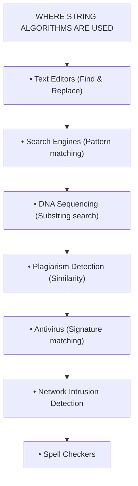

### The Pattern Matching Problem

```
TEXT:    "ABABDABACDABABCABAB"
PATTERN: "ABABCABAB"

Find all occurrences of PATTERN in TEXT.

Naive: O(n * m) - Too slow for large texts
KMP:   O(n + m) - Linear time!
```

---

## Naive Pattern Matching <a name="naive-matching"></a>

### The Simple Approach

```java
/*
Slide pattern over text, compare character by character.
Time: O((n-m+1) * m) ≈ O(n*m) worst case
*/

public List<Integer> naiveSearch(String text, String pattern) {
    List<Integer> positions = new ArrayList<>();
    int n = text.length(), m = pattern.length();
    
    for (int i = 0; i <= n - m; i++) {
        int j;
        for (j = 0; j < m; j++) {
            if (text.charAt(i + j) != pattern.charAt(j)) {
                break;
            }
        }
        if (j == m) {  // Full match
            positions.add(i);
        }
    }
    return positions;
}
```

### Visual: Why It's Slow

```
TEXT:    A A A A A A A A A B
PATTERN: A A A A B

Attempt 1: A A A A A  vs  A A A A B  → Mismatch at position 4
Attempt 2:   A A A A A  vs  A A A A B  → Mismatch at position 4
Attempt 3:     A A A A A  vs  A A A A B  → Mismatch at position 4
...

We keep rechecking characters we've already seen!
KMP/Z-algo avoid this redundant work.
```

**Flow:**
1. Attempt 1: A A A A A vs A A A A B
2. Mismatch at position 4
3. Attempt 2: A A A A A vs A A A A B
4. Mismatch at position 4
5. Attempt 3: A A A A A vs A A A A B
6. Mismatch at position 4

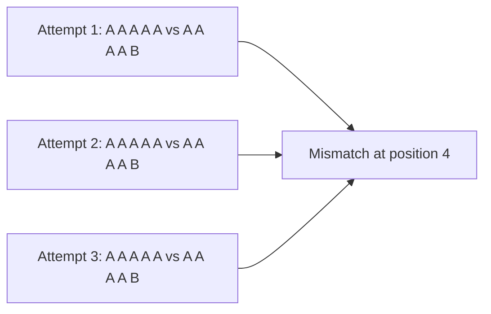

---

## KMP Algorithm <a name="kmp-algorithm"></a>

### The Key Insight

```
When mismatch occurs, we DON'T start from scratch.
We use information about the pattern itself to skip ahead.

The LPS (Longest Proper Prefix which is also Suffix) array
tells us how far we can skip.

Pattern: A B A B C A B A B
LPS:     0 0 1 2 0 1 2 3 4

LPS[i] = Length of longest proper prefix of pattern[0..i]
         that is also a suffix of pattern[0..i]
```

### Visual: LPS Array Construction

```
Pattern: A B A B C A B A B
Index:   0 1 2 3 4 5 6 7 8

i=0: "A"        → No proper prefix/suffix → LPS[0] = 0
i=1: "AB"       → Prefixes: {A}, Suffixes: {B} → None match → LPS[1] = 0
i=2: "ABA"      → Prefixes: {A, AB}, Suffixes: {A, BA} → "A" matches → LPS[2] = 1
i=3: "ABAB"     → Prefixes: {A, AB, ABA}, Suffixes: {B, AB, BAB} → "AB" matches → LPS[3] = 2
i=4: "ABABC"    → No match → LPS[4] = 0
i=5: "ABABCA"   → "A" matches → LPS[5] = 1
i=6: "ABABCAB"  → "AB" matches → LPS[6] = 2
i=7: "ABABCABA" → "ABA" matches → LPS[7] = 3
i=8: "ABABCABAB"→ "ABAB" matches → LPS[8] = 4

LPS = [0, 0, 1, 2, 0, 1, 2, 3, 4]
```

**Flow:**
1. i=0: 'A'
2. No proper prefix/suffix
3. LPS[0] = 0 i=1: 'AB'
4. Prefixes: {A}, Suffixes: {B}
5. None match
6. LPS[1] = 0 i=2: 'ABA'
7. Prefixes: {A, AB}, Suffixes: {A, BA}

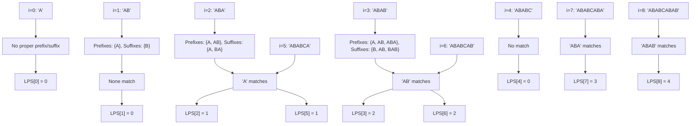

### Complete KMP Implementation

```java
public class KMP {
    
    // Main KMP search
    public List<Integer> search(String text, String pattern) {
        List<Integer> result = new ArrayList<>();
        if (pattern.isEmpty()) return result;
        
        int[] lps = buildLPS(pattern);
        int n = text.length(), m = pattern.length();
        int i = 0, j = 0;  // i for text, j for pattern
        
        while (i < n) {
            if (text.charAt(i) == pattern.charAt(j)) {
                i++;
                j++;
            }
            
            if (j == m) {  // Found complete match
                result.add(i - j);
                j = lps[j - 1];  // Continue searching
            } else if (i < n && text.charAt(i) != pattern.charAt(j)) {
                // Mismatch after some matches
                if (j != 0) {
                    j = lps[j - 1];  // Use LPS to skip
                } else {
                    i++;
                }
            }
        }
        return result;
    }
    
    // Build LPS (Longest Prefix Suffix) array
    private int[] buildLPS(String pattern) {
        int m = pattern.length();
        int[] lps = new int[m];
        int len = 0;  // Length of previous longest prefix suffix
        int i = 1;
        
        lps[0] = 0;  // LPS[0] is always 0
        
        while (i < m) {
            if (pattern.charAt(i) == pattern.charAt(len)) {
                len++;
                lps[i] = len;
                i++;
            } else {
                if (len != 0) {
                    len = lps[len - 1];  // Don't increment i
                } else {
                    lps[i] = 0;
                    i++;
                }
            }
        }
        return lps;
    }
}
```

### Visual: KMP Search in Action

```
TEXT:    A B A B D A B A B C A B A B
PATTERN: A B A B C A B A B
LPS:     0 0 1 2 0 1 2 3 4

Step 1: Compare from start
        A B A B D A B A B C A B A B
        A B A B C
                ↑ Mismatch at index 4!
        
        j = 4, lps[3] = 2
        Skip: Instead of starting over, jump to j = 2
        
Step 2: Continue with j = 2 (pattern already matched "AB")
        A B A B D A B A B C A B A B
            A B A B C
            ↑ Now comparing text[4] with pattern[2]
            
        Still mismatch! j = 2, lps[1] = 0
        
Step 3: j = 0
        A B A B D A B A B C A B A B
                A B A B C A B A B
                ↑ Start fresh from here
                
Step 4: Full match found at index 5!
        A B A B D [A B A B C A B A B]
```

**Flow:**
1. TEXT: A B A B D A B A B C A B A B
2. PATTERN: A B A B C A B A B
3. LPS: 0 0 1 2 0 1 2 3 4
4. Step 1: Compare from start
5. ↑ Mismatch at index 4!
6. j = 4, lps[3] = 2
7. Skip: Instead of starting over, jump to j = 2

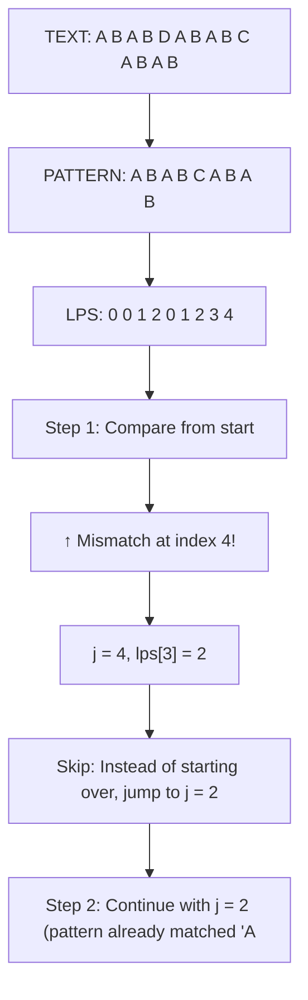

### Time Complexity Analysis

```
┌─────────────────────────────────────────────────────────────────┐
│              KMP COMPLEXITY                                     │
├─────────────────────────────────────────────────────────────────┤
│  LPS Construction: O(m) where m = pattern length                │
│  Search: O(n) where n = text length                             │
│  Total: O(n + m)                                                │
│                                                                 │
│  Space: O(m) for LPS array                                      │
│                                                                 │
│  Why O(n)?                                                      │
│  - i never decreases (always moves forward in text)             │
│  - j can decrease but total decreases ≤ total increases         │
│  - Each char in text visited at most twice                      │
└─────────────────────────────────────────────────────────────────┘
```

**Flow:**
1. KMP COMPLEXITY
2. LPS Construction: O(m) where m = pattern length
3. Search: O(n) where n = text length
4. Total: O(n + m)
5. Space: O(m) for LPS array
6. Why O(n)?
7. - i never decreases (always moves forward in text)

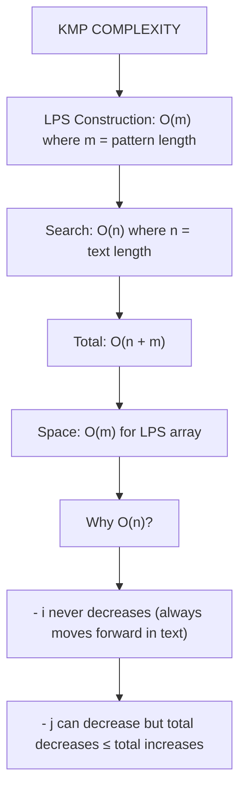

### KMP Applications

```java
// Application 1: Check if pattern exists
public boolean contains(String text, String pattern) {
    return !search(text, pattern).isEmpty();
}

// Application 2: Count occurrences
public int countOccurrences(String text, String pattern) {
    return search(text, pattern).size();
}

// Application 3: Find shortest period of string
// Period: smallest repeating unit
// "ababab" has period "ab" (length 2)
public int shortestPeriod(String s) {
    int[] lps = buildLPS(s);
    int n = s.length();
    int period = n - lps[n - 1];
    
    // Check if it divides evenly
    if (n % period == 0) {
        return period;
    }
    return n;  // String itself is the period
}

// Application 4: Check if string is rotation
// "abcde" rotated = "cdeab", "deabc", etc.
public boolean isRotation(String s1, String s2) {
    if (s1.length() != s2.length()) return false;
    // s2 is rotation of s1 iff s2 is substring of s1+s1
    return !search(s1 + s1, s2).isEmpty();
}
```

---

## Z-Algorithm <a name="z-algorithm"></a>

### The Z-Array Concept

```
Z[i] = Length of longest substring starting at i
       that matches a prefix of the string

String: a a b c a a b x a a a z
Z:      -  1 0 0 3 1 0 0 2 2 1 0 

Z[0] is undefined (or set to length)
Z[1] = 1: "a" matches prefix "a"
Z[4] = 3: "aab" matches prefix "aab"
Z[8] = 2: "aa" matches prefix "aa"
```

### Z-Algorithm Implementation

```java
public class ZAlgorithm {
    
    // Build Z-array
    public int[] buildZ(String s) {
        int n = s.length();
        int[] z = new int[n];
        
        int left = 0, right = 0;
        
        for (int i = 1; i < n; i++) {
            if (i < right) {
                // Use previously computed value
                z[i] = Math.min(right - i, z[i - left]);
            }
            
            // Extend match
            while (i + z[i] < n && s.charAt(z[i]) == s.charAt(i + z[i])) {
                z[i]++;
            }
            
            // Update window
            if (i + z[i] > right) {
                left = i;
                right = i + z[i];
            }
        }
        return z;
    }
    
    // Pattern matching using Z-algorithm
    public List<Integer> search(String text, String pattern) {
        List<Integer> result = new ArrayList<>();
        
        // Concatenate: pattern + "$" + text
        String combined = pattern + "$" + text;
        int[] z = buildZ(combined);
        int m = pattern.length();
        
        // Find positions where Z[i] = pattern length
        for (int i = m + 1; i < combined.length(); i++) {
            if (z[i] == m) {
                result.add(i - m - 1);  // Adjust index
            }
        }
        return result;
    }
}
```

### Visual: Z-Array Construction

```
String: a a b a a b a a a
Index:  0 1 2 3 4 5 6 7 8

i=1: Compare s[1..] with s[0..]
     "abaabaa a" vs "aab aabaa a"
     Match: "a" → Z[1] = 1
     Window: [1, 2)

i=2: i >= right, start fresh
     "b..." vs "a..." → No match → Z[2] = 0

i=3: i >= right, start fresh
     "aabaaa" vs "aabaab..." 
     Match: "aab" → Z[3] = 3
     Window: [3, 6)

i=4: i < right, i - left = 1, Z[1] = 1, right - i = 2
     Z[4] = min(2, 1) = 1, then try to extend
     s[1] = 'a', s[5] = 'b' → No extend
     Z[4] = 1

Continue...
Final Z = [-, 1, 0, 3, 1, 0, 2, 2, 1]
```

**Flow:**
1. Match: 'a'
2. Z[1] = 1
3. 'b...' vs 'a...'
4. No match
5. Z[2] = 0
6. Match: 'aab'
7. Z[3] = 3 s[1] = 'a', s[5] = 'b'
8. No extend

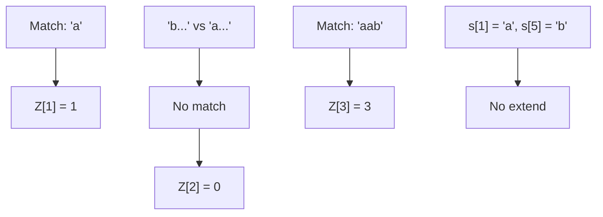

### Z-Algorithm vs KMP

```
┌─────────────────────────────────────────────────────────────────┐
│              Z-ALGORITHM vs KMP                                 │
├─────────────────────────────────────────────────────────────────┤
│                                                                 │
│  Both: O(n + m) time, O(m) space                                │
│                                                                 │
│  Z-Algorithm:                                                   │
│  ✓ Conceptually simpler                                         │
│  ✓ More intuitive (direct prefix matching)                      │
│  ✓ Useful for many string problems                              │
│  ✗ Requires concatenation (extra space for search)              │
│                                                                 │
│  KMP:                                                           │
│  ✓ True O(m) space (no concatenation)                           │
│  ✓ Better for streaming (online algorithm)                      │
│  ✗ LPS logic more complex                                       │
│                                                                 │
│  Interview tip: Know both, use whichever feels natural          │
│                                                                 │
└─────────────────────────────────────────────────────────────────┘
```

**Flow:**
1. Z-ALGORITHM vs KMP
2. Both: O(n + m) time, O(m) space
3. Z-Algorithm:
4. ✓ Conceptually simpler
5. ✓ More intuitive (direct prefix matching)
6. ✓ Useful for many string problems
7. ✗ Requires concatenation (extra space for search)

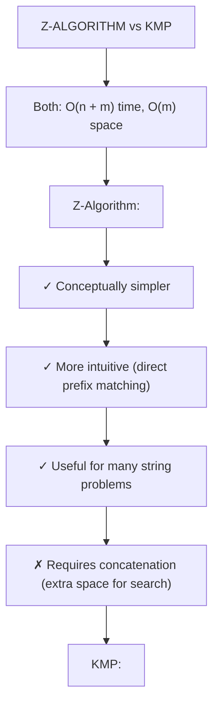

### Z-Array Applications

```java
// Application 1: Find all occurrences (shown above)

// Application 2: Longest prefix that is also suffix
public String longestPrefixSuffix(String s) {
    int[] z = buildZ(s);
    int n = s.length();
    int maxLen = 0;
    
    for (int i = 1; i < n; i++) {
        // Check if match extends to end
        if (i + z[i] == n) {
            maxLen = Math.max(maxLen, z[i]);
        }
    }
    return s.substring(0, maxLen);
}

// Application 3: Count distinct substrings
// (Advanced - combine with suffix array)
```

---

## Rabin-Karp (Rolling Hash) <a name="rabin-karp"></a>

### The Hashing Idea

```
Instead of comparing characters, compare HASH values.
If hashes match, verify with actual comparison.

Use "rolling hash" to update hash in O(1) when sliding window.

Hash("ABC") = A*b² + B*b¹ + C*b⁰  (where b = base, like 26 or 31)

When sliding from "ABC" to "BCD":
New hash = (Old hash - A*b²) * b + D
```

### Rabin-Karp Implementation

```java
public class RabinKarp {
    private static final long BASE = 31;
    private static final long MOD = 1_000_000_007;
    
    public List<Integer> search(String text, String pattern) {
        List<Integer> result = new ArrayList<>();
        int n = text.length(), m = pattern.length();
        if (m > n) return result;
        
        // Compute hash of pattern and first window
        long patternHash = computeHash(pattern, m);
        long textHash = computeHash(text, m);
        
        // Precompute BASE^(m-1) for rolling
        long highestPow = 1;
        for (int i = 0; i < m - 1; i++) {
            highestPow = (highestPow * BASE) % MOD;
        }
        
        // Slide window
        for (int i = 0; i <= n - m; i++) {
            if (patternHash == textHash) {
                // Verify to avoid hash collision
                if (text.substring(i, i + m).equals(pattern)) {
                    result.add(i);
                }
            }
            
            // Roll hash to next position
            if (i < n - m) {
                textHash = rollHash(textHash, text.charAt(i), 
                                   text.charAt(i + m), highestPow);
            }
        }
        return result;
    }
    
    private long computeHash(String s, int len) {
        long hash = 0;
        for (int i = 0; i < len; i++) {
            hash = (hash * BASE + s.charAt(i)) % MOD;
        }
        return hash;
    }
    
    private long rollHash(long hash, char oldChar, char newChar, long highestPow) {
        // Remove old char's contribution
        hash = (hash - (oldChar * highestPow) % MOD + MOD) % MOD;
        // Shift left and add new char
        hash = (hash * BASE + newChar) % MOD;
        return hash;
    }
}
```

### Visual: Rolling Hash

```
Pattern: "ABC" with BASE = 31
Hash = 'A'*31² + 'B'*31 + 'C' = 65*961 + 66*31 + 67 = 64577

Text: "XABCD"

Window 1: "XAB"
Hash = 'X'*31² + 'A'*31 + 'B' = 88*961 + 65*31 + 66 = 86639

Window 2: "ABC" (slide right)
- Remove 'X': (86639 - 88*961) * 31 + 'C'
- New hash = 64577 ✓ (matches pattern!)
- Verify: "ABC" == "ABC" ✓

Window 3: "BCD" (slide right)
- Remove 'A', add 'D'
- New hash ≠ 64577
```

### When to Use Rabin-Karp

```
┌─────────────────────────────────────────────────────────────────┐
│              RABIN-KARP USE CASES                               │
├─────────────────────────────────────────────────────────────────┤
│                                                                 │
│  ✓ Multiple pattern search (efficient)                          │
│    Same text, many patterns → compute text hashes once          │
│                                                                 │
│  ✓ 2D pattern matching                                          │
│    Find matrix in larger matrix                                 │
│                                                                 │
│  ✓ Finding repeated substrings                                  │
│    Hash all substrings of length k, find duplicates             │
│                                                                 │
│  ✓ Plagiarism detection                                         │
│    Hash sentences/paragraphs, compare across documents          │
│                                                                 │
│  Complexity:                                                    │
│  Average: O(n + m)                                              │
│  Worst (many collisions): O(n * m)                              │
│                                                                 │
└─────────────────────────────────────────────────────────────────┘
```

**Flow:**
1. RABIN-KARP USE CASES
2. ✓ Multiple pattern search (efficient)
3. Same text, many patterns compute text hashes once
4. ✓ 2D pattern matching
5. Find matrix in larger matrix
6. ✓ Finding repeated substrings
7. Hash all substrings of length k, find duplicates

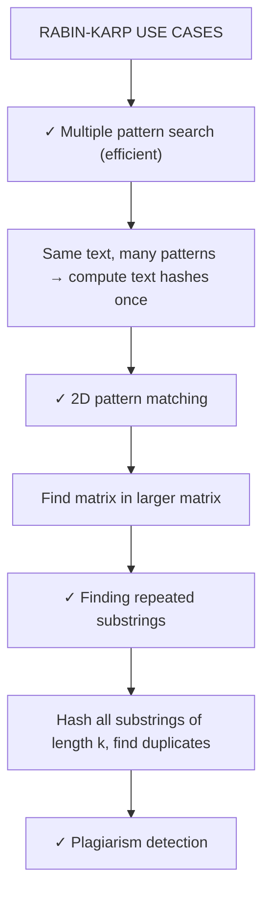

### Multiple Pattern Search

```java
// Find all occurrences of multiple patterns efficiently
public Map<String, List<Integer>> multiSearch(String text, String[] patterns) {
    Map<String, List<Integer>> result = new HashMap<>();
    
    // Group patterns by length
    Map<Integer, List<String>> byLength = new HashMap<>();
    for (String p : patterns) {
        byLength.computeIfAbsent(p.length(), k -> new ArrayList<>()).add(p);
        result.put(p, new ArrayList<>());
    }
    
    // Search each length group
    for (int len : byLength.keySet()) {
        // Precompute pattern hashes
        Map<Long, List<String>> patternHashes = new HashMap<>();
        for (String p : byLength.get(len)) {
            long h = computeHash(p, len);
            patternHashes.computeIfAbsent(h, k -> new ArrayList<>()).add(p);
        }
        
        // Roll through text
        if (len > text.length()) continue;
        
        long textHash = computeHash(text, len);
        long highestPow = modPow(BASE, len - 1, MOD);
        
        for (int i = 0; i <= text.length() - len; i++) {
            if (patternHashes.containsKey(textHash)) {
                String substring = text.substring(i, i + len);
                for (String p : patternHashes.get(textHash)) {
                    if (substring.equals(p)) {
                        result.get(p).add(i);
                    }
                }
            }
            
            if (i < text.length() - len) {
                textHash = rollHash(textHash, text.charAt(i), 
                                   text.charAt(i + len), highestPow);
            }
        }
    }
    return result;
}
```

---

## Manacher's Algorithm <a name="manachers"></a>

### Problem: Longest Palindromic Substring

```
Naive: O(n²) or O(n³)
Manacher's: O(n)!

Key insight: Use symmetry of palindromes to avoid recomputation.
```

### Manacher's Implementation

```java
public class Manacher {
    
    public String longestPalindrome(String s) {
        if (s == null || s.length() == 0) return "";
        
        // Transform: "abc" → "#a#b#c#"
        // This handles both odd and even length palindromes uniformly
        StringBuilder sb = new StringBuilder("#");
        for (char c : s.toCharArray()) {
            sb.append(c).append("#");
        }
        String t = sb.toString();
        int n = t.length();
        
        int[] p = new int[n];  // p[i] = palindrome radius at i
        int center = 0, right = 0;  // Current rightmost palindrome
        
        for (int i = 0; i < n; i++) {
            // Mirror position
            int mirror = 2 * center - i;
            
            if (i < right) {
                // Use mirror's value (bounded by right edge)
                p[i] = Math.min(right - i, p[mirror]);
            }
            
            // Try to expand
            while (i + p[i] + 1 < n && i - p[i] - 1 >= 0 &&
                   t.charAt(i + p[i] + 1) == t.charAt(i - p[i] - 1)) {
                p[i]++;
            }
            
            // Update center and right boundary
            if (i + p[i] > right) {
                center = i;
                right = i + p[i];
            }
        }
        
        // Find maximum
        int maxLen = 0, maxCenter = 0;
        for (int i = 0; i < n; i++) {
            if (p[i] > maxLen) {
                maxLen = p[i];
                maxCenter = i;
            }
        }
        
        // Convert back to original string indices
        int start = (maxCenter - maxLen) / 2;
        return s.substring(start, start + maxLen);
    }
}
```

### Visual: Manacher's Algorithm

```
Original: "abaaba"
Transformed: "#a#b#a#a#b#a#"

Index:   0 1 2 3 4 5 6 7 8 9 10 11 12
String:  # a # b # a # a # b #  a  #
P[i]:    0 1 0 3 0 1 6 1 0 3 0  1  0
               ↑         ↑
          "aba"     "abaaba"
          
P[6] = 6: Center at position 6 (#), radius 6
         In original string: "abaaba" (length 6)
         
The trick: When we know P[center] and we're at position i,
           we can use P[mirror] to initialize P[i].
```

**Flow:**
1. Original: 'abaaba'
2. Transformed: '#a#b#a#a#b#a#'
3. Index: 0 1 2 3 4 5 6 7 8 9 10 11 12
4. String: # a # b # a # a # b # a #
5. 'aba' 'abaaba'
6. P[6] = 6: Center at position 6 (#), radius 6
7. In original string: 'abaaba' (length 6)

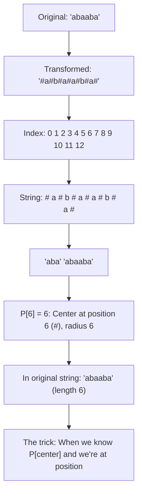

---

## Trie Data Structure <a name="trie"></a>

### What is a Trie?

```
Trie = Prefix Tree

Stores strings efficiently for:
- Prefix search
- Autocomplete
- Spell checking
- Word games (Boggle, Scrabble)

┌─────── root ───────┐
│                    │
▼                    ▼
a                    t
│                    │
▼                    ▼
p ──► e              o
      │              │
      ▼              ▼
      ✓              ✓
     (ape)          (to)
     
Words stored: "ape", "to"
Each node = character
✓ = end of word marker
```

**Flow:**
1. Trie = Prefix Tree
2. Stores strings efficiently for:
3. - Prefix search
4. - Autocomplete
5. - Spell checking
6. - Word games (Boggle, Scrabble)
7. root

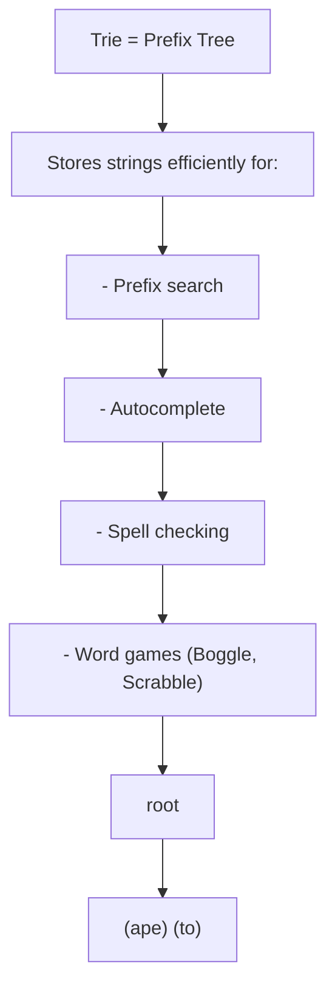

### Trie Implementation

```java
public class Trie {
    private TrieNode root;
    
    class TrieNode {
        TrieNode[] children = new TrieNode[26];
        boolean isEndOfWord = false;
    }
    
    public Trie() {
        root = new TrieNode();
    }
    
    // Insert word - O(m)
    public void insert(String word) {
        TrieNode node = root;
        for (char c : word.toCharArray()) {
            int index = c - 'a';
            if (node.children[index] == null) {
                node.children[index] = new TrieNode();
            }
            node = node.children[index];
        }
        node.isEndOfWord = true;
    }
    
    // Search exact word - O(m)
    public boolean search(String word) {
        TrieNode node = searchNode(word);
        return node != null && node.isEndOfWord;
    }
    
    // Search prefix - O(m)
    public boolean startsWith(String prefix) {
        return searchNode(prefix) != null;
    }
    
    private TrieNode searchNode(String s) {
        TrieNode node = root;
        for (char c : s.toCharArray()) {
            int index = c - 'a';
            if (node.children[index] == null) {
                return null;
            }
            node = node.children[index];
        }
        return node;
    }
    
    // Get all words with prefix
    public List<String> autocomplete(String prefix) {
        List<String> result = new ArrayList<>();
        TrieNode node = searchNode(prefix);
        if (node != null) {
            dfs(node, new StringBuilder(prefix), result);
        }
        return result;
    }
    
    private void dfs(TrieNode node, StringBuilder sb, List<String> result) {
        if (node.isEndOfWord) {
            result.add(sb.toString());
        }
        for (int i = 0; i < 26; i++) {
            if (node.children[i] != null) {
                sb.append((char) ('a' + i));
                dfs(node.children[i], sb, result);
                sb.deleteCharAt(sb.length() - 1);
            }
        }
    }
}
```

### Trie with HashMap (For Unicode/Large Alphabets)

```java
class TrieNode {
    Map<Character, TrieNode> children = new HashMap<>();
    boolean isEndOfWord = false;
}

// Same logic, just use:
// node.children.get(c) instead of node.children[c - 'a']
// node.children.put(c, new TrieNode()) instead of array assignment
```

---

## Suffix Arrays <a name="suffix-arrays"></a>

### What is a Suffix Array?

```
Suffix Array = sorted array of all suffixes (by starting index)

String: "banana"
Suffixes:
0: "banana"
1: "anana"
2: "nana"
3: "ana"
4: "na"
5: "a"

Sorted suffixes:
5: "a"
3: "ana"
1: "anana"
0: "banana"
4: "na"
2: "nana"

Suffix Array = [5, 3, 1, 0, 4, 2]
```

### Simple Suffix Array Construction

```java
public int[] buildSuffixArray(String s) {
    int n = s.length();
    Integer[] sa = new Integer[n];
    
    // Initialize suffix indices
    for (int i = 0; i < n; i++) {
        sa[i] = i;
    }
    
    // Sort by suffix strings
    Arrays.sort(sa, (a, b) -> s.substring(a).compareTo(s.substring(b)));
    
    // Convert to int array
    int[] result = new int[n];
    for (int i = 0; i < n; i++) {
        result[i] = sa[i];
    }
    return result;
}

// O(n² log n) - okay for small strings
// For large strings, use DC3 algorithm O(n)
```

### LCP Array (Longest Common Prefix)

```java
/*
LCP[i] = length of longest common prefix between
         suffix[SA[i]] and suffix[SA[i-1]]

Used for: finding repeated substrings, string comparisons
*/

public int[] buildLCP(String s, int[] sa) {
    int n = s.length();
    int[] rank = new int[n];
    int[] lcp = new int[n];
    
    // Build rank array (inverse of SA)
    for (int i = 0; i < n; i++) {
        rank[sa[i]] = i;
    }
    
    int h = 0;  // Current LCP length
    for (int i = 0; i < n; i++) {
        if (rank[i] > 0) {
            int j = sa[rank[i] - 1];  // Previous suffix in sorted order
            while (i + h < n && j + h < n && s.charAt(i + h) == s.charAt(j + h)) {
                h++;
            }
            lcp[rank[i]] = h;
            if (h > 0) h--;
        }
    }
    return lcp;
}
```

### Applications of Suffix Array

```java
// Find longest repeated substring
public String longestRepeatedSubstring(String s) {
    int[] sa = buildSuffixArray(s);
    int[] lcp = buildLCP(s, sa);
    
    int maxLCP = 0, idx = 0;
    for (int i = 1; i < s.length(); i++) {
        if (lcp[i] > maxLCP) {
            maxLCP = lcp[i];
            idx = sa[i];
        }
    }
    return s.substring(idx, idx + maxLCP);
}

// Count distinct substrings
public int countDistinctSubstrings(String s) {
    int n = s.length();
    int[] sa = buildSuffixArray(s);
    int[] lcp = buildLCP(s, sa);
    
    // Total substrings = n*(n+1)/2
    // Subtract duplicates (sum of LCP values)
    int total = n * (n + 1) / 2;
    int duplicates = 0;
    for (int l : lcp) duplicates += l;
    
    return total - duplicates;
}
```

---

## Interview Problems <a name="interview-problems"></a>

### Problem 1: Implement strStr() (LeetCode 28)

```java
// Find first occurrence of needle in haystack
public int strStr(String haystack, String needle) {
    if (needle.isEmpty()) return 0;
    
    int[] lps = buildLPS(needle);
    int i = 0, j = 0;
    
    while (i < haystack.length()) {
        if (haystack.charAt(i) == needle.charAt(j)) {
            i++;
            j++;
        }
        
        if (j == needle.length()) {
            return i - j;  // First match
        } else if (i < haystack.length() && 
                   haystack.charAt(i) != needle.charAt(j)) {
            if (j != 0) {
                j = lps[j - 1];
            } else {
                i++;
            }
        }
    }
    return -1;
}
```

### Problem 2: Repeated Substring Pattern (LeetCode 459)

```java
// Check if string can be formed by repeating a substring
public boolean repeatedSubstringPattern(String s) {
    int[] lps = buildLPS(s);
    int n = s.length();
    int len = lps[n - 1];  // Longest proper prefix which is also suffix
    
    // If len > 0 and (n - len) divides n evenly,
    // then pattern length = n - len
    return len > 0 && n % (n - len) == 0;
}

// Alternative: s is in (s+s)[1:-1]
public boolean repeatedSubstringPatternSimple(String s) {
    String doubled = s + s;
    return doubled.substring(1, doubled.length() - 1).contains(s);
}
```

### Problem 3: Longest Happy Prefix (LeetCode 1392)

```java
// Longest prefix which is also suffix (proper, not entire string)
public String longestPrefix(String s) {
    int[] lps = buildLPS(s);
    int len = lps[s.length() - 1];
    return s.substring(0, len);
}
```

### Problem 4: Shortest Palindrome (LeetCode 214)

```java
// Add minimum characters at the front to make palindrome
public String shortestPalindrome(String s) {
    // Find longest palindrome starting from index 0
    String rev = new StringBuilder(s).reverse().toString();
    String combined = s + "#" + rev;
    
    int[] lps = buildLPS(combined);
    int palindromeLen = lps[combined.length() - 1];
    
    // Add reverse of remaining suffix to front
    return rev.substring(0, s.length() - palindromeLen) + s;
}
```

### Problem 5: Word Search II (LeetCode 212)

```java
// Find all words from dictionary that exist in grid
public List<String> findWords(char[][] board, String[] words) {
    // Build Trie from words
    TrieNode root = new TrieNode();
    for (String word : words) {
        insert(root, word);
    }
    
    Set<String> result = new HashSet<>();
    int m = board.length, n = board[0].length;
    
    for (int i = 0; i < m; i++) {
        for (int j = 0; j < n; j++) {
            dfs(board, i, j, root, new StringBuilder(), result);
        }
    }
    return new ArrayList<>(result);
}

private void dfs(char[][] board, int i, int j, TrieNode node, 
                 StringBuilder path, Set<String> result) {
    if (i < 0 || i >= board.length || j < 0 || j >= board[0].length) return;
    
    char c = board[i][j];
    if (c == '#' || node.children[c - 'a'] == null) return;
    
    path.append(c);
    node = node.children[c - 'a'];
    
    if (node.isEndOfWord) {
        result.add(path.toString());
    }
    
    board[i][j] = '#';  // Mark visited
    dfs(board, i + 1, j, node, path, result);
    dfs(board, i - 1, j, node, path, result);
    dfs(board, i, j + 1, node, path, result);
    dfs(board, i, j - 1, node, path, result);
    board[i][j] = c;    // Restore
    
    path.deleteCharAt(path.length() - 1);
}
```

### Problem 6: Longest Duplicate Substring (LeetCode 1044)

```java
// Binary search + Rolling hash
public String longestDupSubstring(String s) {
    int left = 1, right = s.length() - 1;
    String result = "";
    
    while (left <= right) {
        int mid = left + (right - left) / 2;
        String dup = findDuplicateOfLength(s, mid);
        
        if (dup != null) {
            result = dup;
            left = mid + 1;
        } else {
            right = mid - 1;
        }
    }
    return result;
}

private String findDuplicateOfLength(String s, int len) {
    long base = 26, mod = (1L << 32);
    long hash = 0, power = 1;
    
    // Compute initial hash and power
    for (int i = 0; i < len; i++) {
        hash = (hash * base + (s.charAt(i) - 'a')) % mod;
        if (i < len - 1) power = (power * base) % mod;
    }
    
    Map<Long, List<Integer>> seen = new HashMap<>();
    seen.put(hash, new ArrayList<>(List.of(0)));
    
    for (int i = len; i < s.length(); i++) {
        // Roll hash
        hash = (hash - (s.charAt(i - len) - 'a') * power % mod + mod) % mod;
        hash = (hash * base + (s.charAt(i) - 'a')) % mod;
        
        if (seen.containsKey(hash)) {
            String candidate = s.substring(i - len + 1, i + 1);
            for (int start : seen.get(hash)) {
                if (s.substring(start, start + len).equals(candidate)) {
                    return candidate;
                }
            }
        }
        seen.computeIfAbsent(hash, k -> new ArrayList<>()).add(i - len + 1);
    }
    return null;
}
```

---

## Quick Reference <a name="quick-reference"></a>

### Algorithm Comparison

```
┌──────────────┬────────────┬───────────┬─────────────────────────────┐
│  Algorithm   │   Time     │   Space   │        Best For             │
├──────────────┼────────────┼───────────┼─────────────────────────────┤
│  Naive       │ O(n*m)     │ O(1)      │ Very short patterns         │
│  KMP         │ O(n+m)     │ O(m)      │ Single pattern, streaming   │
│  Z-Algorithm │ O(n+m)     │ O(n+m)    │ Single pattern, intuitive   │
│  Rabin-Karp  │ O(n+m) avg │ O(m)      │ Multiple patterns           │
│  Trie        │ O(m) query │ O(total)  │ Prefix search, autocomplete │
│  Suffix Array│ O(n log n) │ O(n)      │ All substring queries       │
│  Manacher    │ O(n)       │ O(n)      │ Palindrome problems         │
└──────────────┴────────────┴───────────┴─────────────────────────────┘
```

**Flow:**
1. Algorithm Time Space Best For
2. Naive O(n*m) O(1) Very short patterns
3. KMP O(n+m) O(m) Single pattern, streaming
4. Z-Algorithm O(n+m) O(n+m) Single pattern, intuitive
5. Rabin-Karp O(n+m) avg O(m) Multiple patterns
6. Trie O(m) query O(total) Prefix search, autocomplete
7. Suffix Array O(n log n) O(n) All substring queries

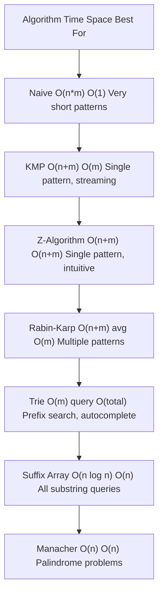

### When to Use What

```
┌─────────────────────────────────────────────────────────────────┐
│              ALGORITHM SELECTION GUIDE                          │
├─────────────────────────────────────────────────────────────────┤
│                                                                 │
│  "Find pattern in text"                                         │
│    → KMP or Z-algorithm (single pattern)                        │
│    → Rabin-Karp (multiple patterns)                             │
│                                                                 │
│  "Check if prefix exists" / "Autocomplete"                      │
│    → Trie                                                       │
│                                                                 │
│  "Longest palindrome"                                           │
│    → Manacher's (O(n))                                          │
│    → DP with memo (O(n²) but simpler)                           │
│                                                                 │
│  "Repeated substring" / "Count substrings"                      │
│    → Rolling hash + Binary search                               │
│    → Suffix array                                               │
│                                                                 │
│  "Is X a rotation of Y?"                                        │
│    → KMP: search Y in X+X                                       │
│                                                                 │
└─────────────────────────────────────────────────────────────────┘
```

**Flow:**
1. ALGORITHM SELECTION GUIDE
2. 'Find pattern in text'
3. KMP or Z-algorithm (single pattern)
4. Rabin-Karp (multiple patterns)
5. 'Check if prefix exists' / 'Autocomplete'
6. Trie
7. 'Longest palindrome'

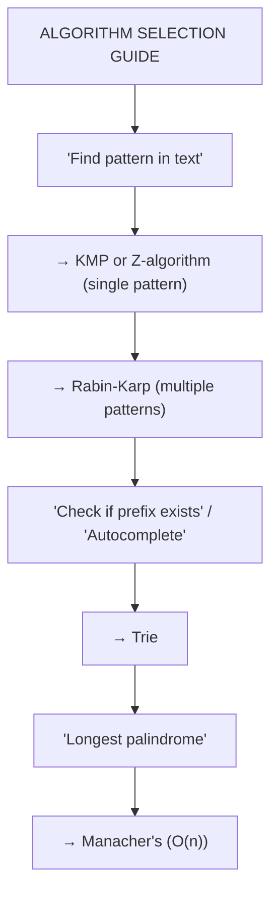

### Common String Tricks

```java
// 1. Is rotation?
boolean isRotation = (s1 + s1).contains(s2);

// 2. Is palindrome?
boolean isPalindrome = s.equals(new StringBuilder(s).reverse().toString());

// 3. Character frequency
int[] freq = new int[26];
for (char c : s.toCharArray()) freq[c - 'a']++;

// 4. Check anagram
Arrays.equals(freq1, freq2);

// 5. String to char array for manipulation
char[] arr = s.toCharArray();
// ... modify arr ...
String result = new String(arr);
```

### Template: Building LPS Array

```java
private int[] buildLPS(String pattern) {
    int m = pattern.length();
    int[] lps = new int[m];
    int len = 0, i = 1;
    
    while (i < m) {
        if (pattern.charAt(i) == pattern.charAt(len)) {
            lps[i++] = ++len;
        } else if (len != 0) {
            len = lps[len - 1];  // Key: don't increment i
        } else {
            lps[i++] = 0;
        }
    }
    return lps;
}
```

---

## Summary

```
╔═══════════════════════════════════════════════════════════════╗
║            STRING ALGORITHMS - MASTER THESE                   ║
╠═══════════════════════════════════════════════════════════════╣
║                                                               ║
║  1. KMP - Pattern matching in O(n+m)                          ║
║     Key: LPS array, never recheck matched characters          ║
║                                                               ║
║  2. RABIN-KARP - Rolling hash for multiple patterns           ║
║     Key: Hash comparison, verify on match                     ║
║                                                               ║
║  3. Z-ALGORITHM - Alternative to KMP, more intuitive          ║
║     Key: Z[i] = prefix match length at position i             ║
║                                                               ║
║  4. TRIE - Prefix search & autocomplete                       ║
║     Key: Tree of characters, end-of-word markers              ║
║                                                               ║
║  Interview Tip: KMP is asked most often.                      ║
║  Know how to build LPS and explain the skip logic.            ║
║                                                               ║
╚═══════════════════════════════════════════════════════════════╝
```

**Flow:**
1. STRING ALGORITHMS - MASTER THESE
2. KMP - Pattern matching in O(n+m)
3. Key: LPS array, never recheck matched characters
4. RABIN-KARP - Rolling hash for multiple patterns
5. Key: Hash comparison, verify on match
6. Z-ALGORITHM - Alternative to KMP, more intuitive
7. Key: Z[i] = prefix match length at position i

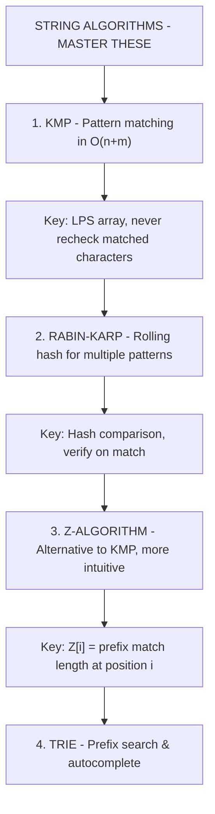

**Pro Tip:** When explaining string algorithms in interviews, draw out the arrays (LPS, Z) step by step. Interviewers love to see you work through examples visually!

---

---

🔬 **Section Challenge — Summary**

**Challenge 1 (Reasoning):** Prefix sum initialized as `prefix[0] = 0` — why the leading zero and not `prefix[0] = arr[0]`?
<details><summary>Answer</summary>

`prefix[0] = 0` (empty prefix) makes range sum formula uniform: `sum(l,r) = prefix[r+1] - prefix[l]`. Without the 0: `sum(0,r) = prefix[r] - 0` (special case needed). With it: `sum(0,r) = prefix[r+1] - prefix[0] = prefix[r+1]`. Same formula everywhere. This is the 'sentinel' pattern — adding a dummy initial value to eliminate special cases. Same trick used in dummy linked list nodes.
</details>


## 🏋️ Practice & Interview Questions — Algorithms

### Sorting

**Q1.** Which sorting algorithm does Java use for `Arrays.sort(int[])`? Why not MergeSort?
<details><summary>Answer</summary>

**Dual-Pivot QuickSort** — for primitives. MergeSort requires O(N) extra space. QuickSort is in-place and cache-friendly. Stability doesn't matter for primitives (equal ints are indistinguishable). For objects (`Arrays.sort(Object[])`), Java uses **TimSort** (stable, O(N log N) worst).
</details>

**Q2.** Trace Merge Sort on `[4,2,7,1]`.
<details><summary>Answer</summary>

Split: `[4,2]` `[7,1]` → Split: `[4]` `[2]` `[7]` `[1]` → Merge: `[2,4]` `[1,7]` → Merge: `[1,2,4,7]`
</details>

**Q3.** ⭐⭐ Sort Colors (Dutch National Flag — 3-way partition).
<details><summary>Solution</summary>

```java
int lo=0, mid=0, hi=n-1;
while(mid<=hi){
    if(nums[mid]==0) swap(nums,lo++,mid++);
    else if(nums[mid]==1) mid++;
    else swap(nums,mid,hi--);
}
```
</details>

### Binary Search

**Q4.** ⭐ Search in Rotated Sorted Array.
<details><summary>Solution</summary>

```java
int lo=0, hi=n-1;
while(lo<=hi){
    int mid=(lo+hi)/2;
    if(nums[mid]==target) return mid;
    if(nums[lo]<=nums[mid]){ // left half sorted
        if(nums[lo]<=target&&target<nums[mid]) hi=mid-1; else lo=mid+1;
    } else { // right half sorted
        if(nums[mid]<target&&target<=nums[hi]) lo=mid+1; else hi=mid-1;
    }
}
return -1;
```
</details>

**Q5.** ⭐ Find First and Last Position (binary search twice).
<details><summary>Solution</summary>

```java
// First: find leftmost with while(lo<hi){ if arr[mid]>=target hi=mid else lo=mid+1 }
// Last: find rightmost with while(lo<hi){ if arr[mid]<=target lo=mid+1 else hi=mid } return lo-1
```
</details>

**Q6.** ⭐⭐ Koko Eating Bananas — binary search on answer.
<details><summary>Key insight</summary>

Binary search the eating speed k in range [1, max(piles)]. For each k, calculate hours needed. Find minimum k where hours ≤ H.
</details>

### Dynamic Programming

**Q7.** ⭐ Climbing Stairs — n steps, 1 or 2 at a time. How many ways?
<details><summary>Solution</summary>

```java
// Fibonacci sequence! dp[i] = dp[i-1] + dp[i-2]
int a=1, b=1;
for(int i=2;i<=n;i++){ int c=a+b; a=b; b=c; }
return b;
```
</details>

**Q8.** ⭐ Coin Change — minimum coins for amount.
<details><summary>Solution</summary>

```java
int[] dp = new int[amount+1]; Arrays.fill(dp, amount+1);
dp[0]=0;
for(int i=1;i<=amount;i++)
    for(int c:coins) if(c<=i) dp[i]=Math.min(dp[i],dp[i-c]+1);
return dp[amount]>amount?-1:dp[amount];
```
</details>

**Q9.** ⭐⭐ Longest Common Subsequence.
<details><summary>Solution</summary>

```java
int[][] dp=new int[m+1][n+1];
for(int i=1;i<=m;i++) for(int j=1;j<=n;j++){
    if(text1.charAt(i-1)==text2.charAt(j-1)) dp[i][j]=dp[i-1][j-1]+1;
    else dp[i][j]=Math.max(dp[i-1][j],dp[i][j-1]);
}
return dp[m][n];
```
</details>

**Q10.** ⭐⭐ Word Break — can string be segmented using dictionary words?
<details><summary>Solution</summary>

```java
boolean[] dp=new boolean[n+1]; dp[0]=true;
for(int i=1;i<=n;i++) for(String w:wordDict)
    if(i>=w.length()&&dp[i-w.length()]&&s.substring(i-w.length(),i).equals(w)) dp[i]=true;
return dp[n];
```
</details>

**Q11.** ⭐⭐⭐ Edit Distance (Levenshtein).
<details><summary>Solution</summary>

```java
int[][] dp=new int[m+1][n+1];
for(int i=0;i<=m;i++) dp[i][0]=i;
for(int j=0;j<=n;j++) dp[0][j]=j;
for(int i=1;i<=m;i++) for(int j=1;j<=n;j++){
    if(word1.charAt(i-1)==word2.charAt(j-1)) dp[i][j]=dp[i-1][j-1];
    else dp[i][j]=1+Math.min(dp[i-1][j-1],Math.min(dp[i-1][j],dp[i][j-1]));
}
```
</details>

### Graph Algorithms

**Q12.** ⭐ Number of Islands (BFS/DFS grid traversal).
<details><summary>Solution</summary>

```java
for each cell (i,j) if grid[i][j]=='1': count++; BFS/DFS to mark all connected land as visited
```
</details>

**Q13.** ⭐⭐ Course Schedule — detect cycle in directed graph (Topological sort).
<details><summary>Solution</summary>

```java
// Kahn's algorithm: indegree array + BFS queue
// If result size == numCourses → no cycle → can finish
```
</details>

**Q14.** ⭐⭐ Dijkstra's Shortest Path.
<details><summary>Solution</summary>

```java
PriorityQueue<int[]> pq=new PriorityQueue<>((a,b)->a[1]-b[1]); // [node, dist]
pq.offer(new int[]{src,0}); dist[src]=0;
while(!pq.isEmpty()){
    int[] curr=pq.poll(); int u=curr[0],d=curr[1];
    if(d>dist[u]) continue; // stale
    for(int[] neighbor:graph[u]) if(dist[u]+neighbor[1]<dist[neighbor[0]]){
        dist[neighbor[0]]=dist[u]+neighbor[1]; pq.offer(new int[]{neighbor[0],dist[neighbor[0]]});
    }
}
```
</details>

### MCQ Rapid Fire

| # | Question | Answer |
|---|---|---|
| 1 | QuickSort avg/worst | O(N log N) avg, O(N²) worst |
| 2 | MergeSort space complexity | O(N) |
| 3 | HeapSort space complexity | O(1) (in-place) |
| 4 | Binary search precondition | Sorted array |
| 5 | BFS time complexity on graph | O(V+E) |
| 6 | DFS space complexity | O(V) (recursion stack) |
| 7 | Dijkstra fails on | Negative weight edges |
| 8 | Bellman-Ford handles | Negative weights, detects negative cycles |
| 9 | Floyd-Warshall use case | All-pairs shortest path, O(V³) |
| 10 | Topological sort requires | Directed Acyclic Graph (DAG) |

---

## 🧠 Deep Conceptual Questions — Algorithm Design & Analysis

**C1. What does O(N log N) "feel like" and why is it the complexity barrier for comparison-based sorting?**
<details><summary>Deep Answer</summary>

O(N log N) for N=1M ≈ 20M operations. O(N²) ≈ 1 trillion. The difference is 50,000x. **Comparison sort lower bound**: any comparison-based sort must distinguish between N! possible orderings. Each comparison has 2 outcomes. A decision tree with N! leaves needs ≥ log₂(N!) height ≈ N log N (Stirling's approximation). Therefore NO comparison sort can beat O(N log N) in the worst case. Non-comparison sorts (counting sort, radix sort, bucket sort) break this bound by using non-comparison operations — but require constraints on input (e.g., integer range bounded by N).
</details>

**C2. Greedy algorithms: when do they work and what must be proven?**
<details><summary>Deep Answer</summary>

A greedy algorithm makes the locally optimal choice at each step. Works when problem has: (1) **Greedy choice property**: local optimal leads to global optimal — the choice never needs to be revised. (2) **Optimal substructure**: optimal solution to the problem contains optimal solutions to subproblems. To PROVE greedy is correct: use "exchange argument" — assume optimal solution differs from greedy, show you can swap greedy's choice in without making it worse, contradiction. Greedy FAILS when: future choices depend on current choice in complex ways (use DP instead). Classic works: interval scheduling, Huffman coding, Dijkstra. Classic fails: 0-1 knapsack (use DP).
</details>

**C3. Dynamic Programming: what is "overlapping subproblems" and why does it matter?**
<details><summary>Deep Answer</summary>

Overlapping subproblems: the same sub-computation appears multiple times. Fibonacci: `fib(5)` calls `fib(4)` and `fib(3)`. `fib(4)` also calls `fib(3)`. Without memoization: `fib(3)` computed exponentially many times → O(2^N). With memoization: each sub-result computed once and stored → O(N). DP is valuable SPECIFICALLY when: (1) problem has optimal substructure AND (2) subproblems overlap. If no overlap: just use divide-and-conquer (merge sort's subproblems don't overlap → no DP needed). DP = "smart recursion" = avoid recomputing.
</details>

**C4. Top-down (memoization) vs Bottom-up (tabulation) DP — when to choose each?**
<details><summary>Deep Answer</summary>

**Top-down (memoization)**: Write natural recursion + cache results. Easy to implement, only computes needed subproblems (sparse computation). Cons: recursion overhead and stack depth risk. Use when: problem is naturally recursive, only a fraction of subproblems needed. **Bottom-up (tabulation)**: Fill DP table iteratively from base cases. No recursion overhead, better cache performance, easier space optimization. Use when: need all subproblems (or most of them), want to optimize space (can often reduce to 1D from 2D). Rule: start with top-down for correctness verification, optimize to bottom-up for performance.
</details>

**C5. Dijkstra's Algorithm: why does it fail on negative weights?**
<details><summary>Deep Answer</summary>

Dijkstra assumes: once a node is "settled" (extracted from the priority queue with its final shortest distance), that distance is optimal. With negative weights: settling node A at distance 5 might not be final — a path through B (distance 7) → C (edge -10) → A gives distance -3. But A was already settled! Dijkstra doesn't revisit settled nodes. Bellman-Ford handles negatives by relaxing ALL edges N-1 times — no "settled" assumption. For graphs with negative cycles: Bellman-Ford detects them (if distances still decrease after N-1 rounds, there's a negative cycle).
</details>

**C6. Union-Find: why is path compression + union by rank/size nearly O(1)?**
<details><summary>Deep Answer</summary>

**Path compression**: when finding the root of element x, make every node on the path point directly to the root. Flattens the tree. Future finds on those paths: O(1). **Union by rank**: always attach the smaller tree under the larger → limits tree height to O(log N). Combined: inverse Ackermann function α(N) amortized — so slow-growing it's practically constant (α(10^80) = 4). Neither alone is optimal: path compression without union by rank → O(log N) amortized. Union by rank without path compression → O(log N). Together → α(N) ≈ O(1) amortized. Used in: Kruskal's MST, cycle detection, connected components.
</details>

**C7. Binary Search on the Answer — what types of problems does it apply to?**
<details><summary>Deep Answer</summary>

When the answer space is **monotone**: "if X is achievable, then all values less extreme than X are also achievable." Problems: minimize the maximum (aggressive cows, split array), find minimum valid threshold (Koko bananas, minimum days to bloom), divide-and-conquer feasibility. Template: binary search on the answer range [lo, hi], for each mid check `isFeasible(mid)` in O(N) or O(N log N). Total: O(N log(answer_range)). Key insight: reframe "find optimal value" as "find smallest X where condition holds" → enables binary search on a non-array space.
</details>

**C8. Why does merge sort guarantee stability while quicksort doesn't?**
<details><summary>Deep Answer</summary>

**Merge sort stability**: during merge, when two elements are equal, we always take from the LEFT array first → preserves original relative order. **QuickSort instability**: the partition step swaps elements across the pivot without regard to original order. Two equal elements may be placed on opposite sides of the pivot, reversing their order. QuickSort CAN be made stable (Lomuto partition with careful implementation) but loses performance. Java uses TimSort for objects (stable), dual-pivot quicksort for primitives (stability irrelevant since primitives without fields).
</details>

**C9. Backtracking: what's the difference from plain DFS and when to use vs DP?**
<details><summary>Deep Answer</summary>

**Backtracking vs DFS**: DFS visits every path. Backtracking prunes paths early when a constraint is violated — avoids exploring infeasible branches. Same asymptotic but drastically different practical performance with good pruning. **Backtracking vs DP**: backtracking for **combinatorial/enumeration** problems (find all solutions, permutations, subsets). DP for **optimization** problems (find optimal single solution). Backtracking produces exponential solutions in worst case but is necessary when you need ALL solutions. DP finds the optimal in polynomial time when overlapping subproblems exist.
</details>

**C10. What is amortized analysis and how does it differ from average-case analysis?**
<details><summary>Deep Answer</summary>

**Amortized**: analyzes the average cost per operation over a SEQUENCE of operations — in the worst case. No probability involved. Guarantees: N operations ALWAYS take O(N·T) total, even if some individual operations are O(N·T). Example: ArrayList append is O(N) when resizing, but amortized O(1) because resizing is rare. **Average-case**: analyzes expected cost of a SINGLE operation assuming random input. QuickSort is O(N log N) average-case (random pivot). Amortized is a stronger guarantee — it holds even for adversarial input sequences.
</details>

**Navigation**: [< Previous](12_Greedy_Algorithms_Complete.md) | [Back to Index](../00_MASTER_INDEX.md) | [Next >](14_Union_Find_DSU_Complete.md)
