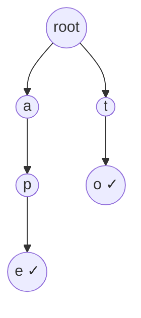

# Trie Data Structure <a name="trie"></a>

> **Navigation**: [← Rabin-Karp (Rolling Hash)](03_rabin_karp_rolling_hash.md) | [Chapter overview](../13_String_Algorithms_Complete.md) | [Suffix Arrays →](05_suffix_arrays.md)
> Page 4 of 7 in **String Algorithms Complete Guide**


## What is a Trie?

**Trie = prefix tree.** It stores strings efficiently for:

- Prefix search
- Autocomplete
- Spell checking
- Word games (Boggle, Scrabble)



**How to read this diagram.** The trie stores the words `ape` and `to`. Each node is a character, and ✓ marks the end of a word.

## Trie Implementation

```java
public class Trie {
    private TrieNode root;

    class TrieNode {
        TrieNode[] children = new TrieNode[26];
        boolean isEndOfWord = false;
    }

    public Trie() {
        root = new TrieNode();
    }

    // Insert word - O(m)
    public void insert(String word) {
        TrieNode node = root;
        for (char c : word.toCharArray()) {
            int index = c - 'a';
            if (node.children[index] == null) {
                node.children[index] = new TrieNode();
            }
            node = node.children[index];
        }
        node.isEndOfWord = true;
    }

    // Search exact word - O(m)
    public boolean search(String word) {
        TrieNode node = searchNode(word);
        return node != null && node.isEndOfWord;
    }

    // Search prefix - O(m)
    public boolean startsWith(String prefix) {
        return searchNode(prefix) != null;
    }

    private TrieNode searchNode(String s) {
        TrieNode node = root;
        for (char c : s.toCharArray()) {
            int index = c - 'a';
            if (node.children[index] == null) {
                return null;
            }
            node = node.children[index];
        }
        return node;
    }

    // Get all words with prefix
    public List<String> autocomplete(String prefix) {
        List<String> result = new ArrayList<>();
        TrieNode node = searchNode(prefix);
        if (node != null) {
            dfs(node, new StringBuilder(prefix), result);
        }
        return result;
    }

    private void dfs(TrieNode node, StringBuilder sb, List<String> result) {
        if (node.isEndOfWord) {
            result.add(sb.toString());
        }
        for (int i = 0; i < 26; i++) {
            if (node.children[i] != null) {
                sb.append((char) ('a' + i));
                dfs(node.children[i], sb, result);
                sb.deleteCharAt(sb.length() - 1);
            }
        }
    }
}
```

## Trie with HashMap (For Unicode/Large Alphabets)

```java
class TrieNode {
    Map<Character, TrieNode> children = new HashMap<>();
    boolean isEndOfWord = false;
}

// Same logic, just use:
// node.children.get(c) instead of node.children[c - 'a']
// node.children.put(c, new TrieNode()) instead of array assignment
```

---

[← Rabin-Karp (Rolling Hash)](03_rabin_karp_rolling_hash.md) | [Chapter overview](../13_String_Algorithms_Complete.md) | [Suffix Arrays →](05_suffix_arrays.md)
