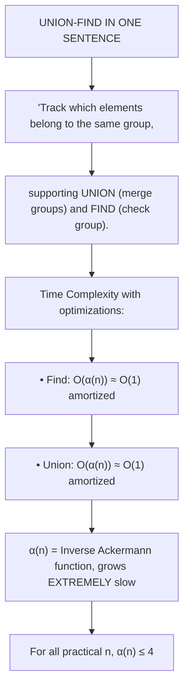
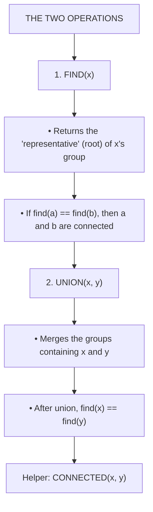
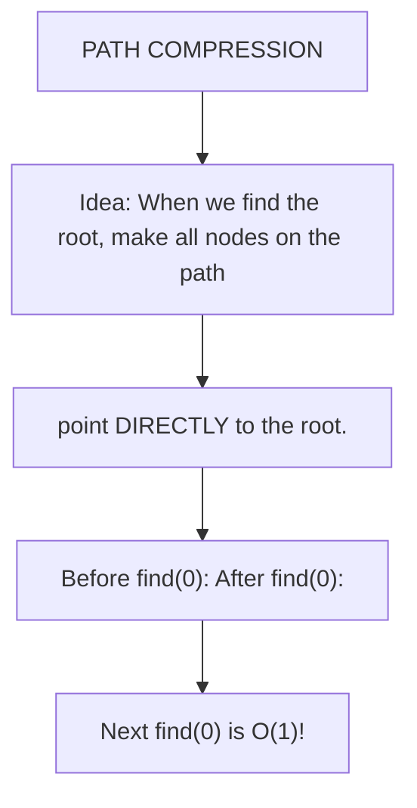
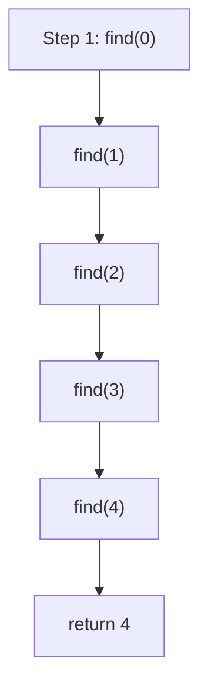
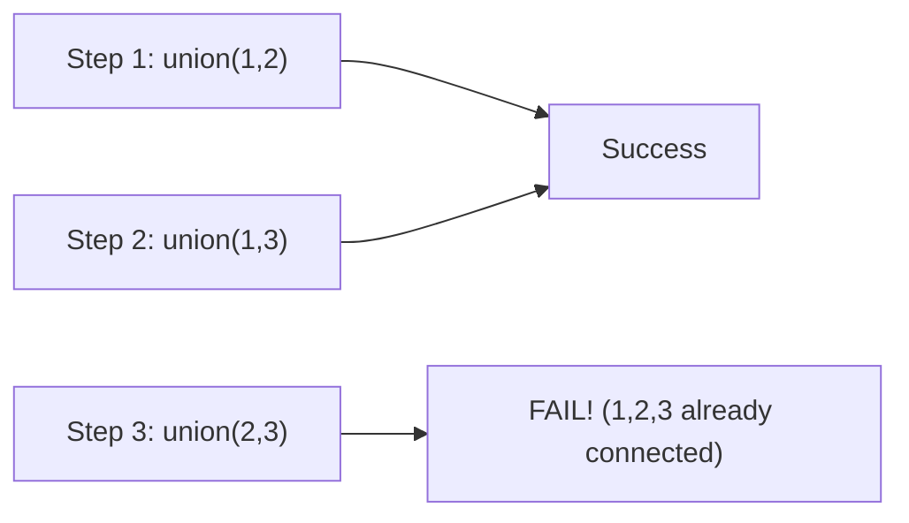
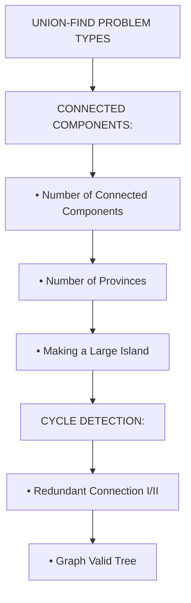
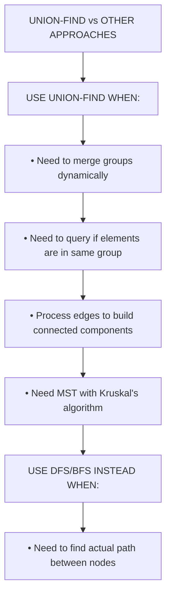
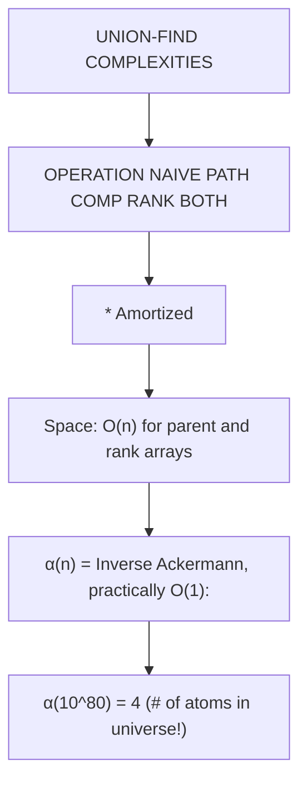
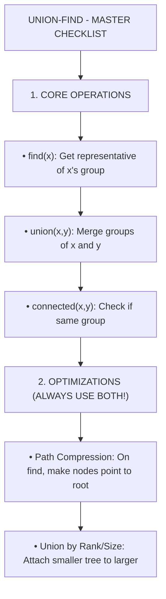

**Navigation**: [< Previous](13_String_Algorithms_Complete.md) | [Back to Index](../00_MASTER_INDEX.md) | [Next >](15_Monotonic_Stack_Queue_Complete.md)

# 🌲 Union-Find / Disjoint Set Union (DSU) Complete Guide

The Data Structure That Solves Connectivity Problems in Near-Constant Time

## Table of Contents

0. [PART 0: Complete Understanding](#part-0)
1. [Union-Find Fundamentals](#fundamentals)
2. [Basic Implementation](#basic-implementation)
3. [Path Compression](#path-compression)
4. [Union by Rank/Size](#union-by-rank)
5. [Optimized Implementation](#optimized)
6. [Classic Applications](#applications)
7. [Graph Problems](#graph-problems)
8. [Advanced Techniques](#advanced)
9. [Interview Problems](#interview-problems)
10. [Quick Reference](#quick-reference)

---

## PART 0: COMPLETE UNDERSTANDING — The WHY Before the WHAT <a name="part-0"></a>

```
╔══════════════════════════════════════════════════════════════════════════════╗
║          UNION-FIND (DSU) — COMPLETE UNDERSTANDING & GROWTH MINDSET          ║
╚══════════════════════════════════════════════════════════════════════════════╝

┌──────────────────────────────────────────────────────────────────────────────┐
│ WHAT PROBLEM DOES UNION-FIND SOLVE?                                          │
├──────────────────────────────────────────────────────────────────────────────┤
│                                                                              │
│ CORE PROBLEM: Dynamic grouping — elements get connected over time, and you   │
│ need to repeatedly answer: "Are A and B in the same group?"                  │
│                                                                              │
│ WHY IS THIS HARD?                                                            │
│                                                                              │
│ ┌─────────────────────────────────────────────────────────────────────────┐  │
│ │ APPROACH               │ UNION        │ FIND/CONNECTED │ WHY BAD      │    │
│ │─────────────────────────┼──────────────┼────────────────┼──────────────│   │
│ │ Maintain explicit sets  │ O(n) copy    │ O(1) lookup    │ Union slow   │   │
│ │ BFS/DFS each query      │ O(1) add edge│ O(V+E) search  │ Find slow    │   │
│ │ Boolean matrix          │ O(n) update  │ O(1) lookup    │ Union slow   │   │
│ │ UNION-FIND (optimized)  │ O(α(n)) ≈ O(1) │ O(α(n)) ≈ O(1) │ BOTH FAST │    │
│ └─────────────────────────────────────────────────────────────────────────┘  │
│                                                                              │
│ For 10⁶ elements with 10⁶ operations:                                        │
│   BFS approach:    10⁶ × 10⁶ = 10¹² operations → 17 MINUTES                  │
│   Union-Find:      10⁶ × 4   = 4×10⁶ operations → 4 MILLISECONDS             │
│   That's 250,000x faster!                                                    │
│                                                                              │
│ ANALOGY — Social Network Friend Groups:                                      │
│   Imagine Facebook with 2 billion users. Person A adds Person B as friend.   │
│   Now we need to check: "Are persons X and Y in the same friend circle?"     │
│   You can't BFS through 2 billion users each time.                           │
│   Union-Find: Each friend group has a "representative." Merging groups       │
│   just changes one pointer. Checking? Follow pointers to representative.     │
└──────────────────────────────────────────────────────────────────────────────┘

┌──────────────────────────────────────────────────────────────────────────────┐
│ REAL-WORLD ORIGIN STORY                                                      │
├──────────────────────────────────────────────────────────────────────────────┤
│                                                                              │
│ 1964 — GALLER & FISCHER AT THE UNIVERSITY OF MICHIGAN:                       │
│   Problem: Compilers need to track which variables are EQUIVALENT.           │
│   In FORTRAN, EQUIVALENCE statements make two variables share memory.        │
│   Compiler needs to quickly answer: "Do x and y share the same memory?"      │
│   Their solution: tree-based union-find with union by rank.                  │
│                                                                              │
│ 1975 — ROBERT TARJAN'S MASTERPIECE:                                          │
│   Tarjan proved that with BOTH path compression AND union by rank,           │
│   m operations on n elements takes O(m × α(n)) time.                         │
│   α(n) = Inverse Ackermann function.                                         │
│                                                                              │
│   HOW SLOW DOES α(n) GROW?                                                   │
│   α(1)        = 0                                                            │
│   α(3)        = 1                                                            │
│   α(7)        = 2                                                            │
│   α(65535)    = 3                                                            │
│   α(2^65536)  = 4  ← This number has 19,729 DIGITS!                          │
│   For ANY practical n (even 10^80 atoms in universe), α(n) ≤ 4.              │
│   Effectively O(1) per operation!                                            │
│                                                                              │
│ 1985 — FREDMAN & SAKS prove: Union-Find is OPTIMAL.                          │
│   You CANNOT do better than O(α(n)) amortized for this problem.              │
│   Union-Find isn't just fast — it's the BEST POSSIBLE.                       │
│                                                                              │
│ REAL-WORLD IMPACT TODAY:                                                     │
│ • Network connectivity: "Can router A reach router B?" (Cisco, AWS)          │
│ • Image segmentation: Connected component labeling in medical imaging        │
│ • Percolation theory: "Does water flow through this rock?" (oil industry)    │
│ • Social networks: Friend-of-friend grouping (Facebook, LinkedIn)            │
│ • Kruskal's MST: Minimum-cost network wiring                                 │
│ • Game engines: Maze generation (random wall removal)                        │
└──────────────────────────────────────────────────────────────────────────────┘

┌──────────────────────────────────────────────────────────────────────────────┐
│ THE MENTAL MODEL: Family Trees                                               │
├──────────────────────────────────────────────────────────────────────────────┤
│                                                                              │
│ Imagine every person points to their PARENT. The ROOT of the family          │
│ is the "representative" of that family.                                      │
│                                                                              │
│ Initially: everyone is their own root (self-loops)                           │
│   parent: [0, 1, 2, 3, 4]   →   [0] [1] [2] [3] [4]                          │
│                                                                              │
│ Union(0,1): 1's root points to 0    Union(2,3): 3's root points to 2         │
│     [0]       [2]                                                            │
│      ↑         ↑                                                             │
│     [1]       [3]     [4]                                                    │
│                                                                              │
│ Union(0,2): Root of 2's tree points to root of 0's tree                      │
│          [0]                                                                 │
│         ↗   ↖                                                                │
│       [1]    [2]                                                             │
│               ↑                                                              │
│              [3]          [4]                                                │
│                                                                              │
│ Find(3)? Follow 3→2→0. Root = 0.                                             │
│ Find(1)? Follow 1→0.    Root = 0.                                            │
│ Same root → same group ✅                                                     │
│                                                                              │
│ ═══════════════════════════════════════════════════════════════════          │
│                                                                              │
│ THE TWO OPTIMIZATIONS (both crucial):                                        │
│                                                                              │
│ OPTIMIZATION 1 — PATH COMPRESSION:                                           │
│ After Find(3), make 3 point DIRECTLY to root:                                │
│                                                                              │
│   BEFORE Find(3):          AFTER Find(3):                                    │
│        [0]                      [0]                                          │
│       ↗   ↖                  ↗  ↑  ↖                                         │
│     [1]    [2]             [1] [3] [2]                                       │
│             ↑                                                                │
│            [3]             Future Find(3) = O(1)!                            │
│                                                                              │
│ OPTIMIZATION 2 — UNION BY RANK (or SIZE):                                    │
│ When merging two trees, attach the SHORTER tree under the TALLER one.        │
│                                                                              │
│   WITHOUT rank:                WITH rank:                                    │
│     [0]     [4]                 [0]          [4]                             │
│    ↗ ↑ ↖     ↑                ↗ ↑ ↖           ↑                              │
│  [1][3][2]  [5]              [1][3][2]        [5]                            │
│                                    ↑                                         │
│   Union could create              [4]                                        │
│   height-4 chain!                  ↑                                         │
│                                   [5]                                        │
│                                                                              │
│   Bad: 0←1←2←3←4←5            Good: max height = log(n)                      │
│   Find = O(n) worst case       Find = O(log n) worst case                    │
│                                                                              │
│ BOTH TOGETHER: O(α(n)) ≈ O(1) amortized per operation!                       │
└──────────────────────────────────────────────────────────────────────────────┘

┌──────────────────────────────────────────────────────────────────────────────┐
│ THE THREE IMPLEMENTATIONS — SIDE BY SIDE                                     │
├──────────────────────────────────────────────────────────────────────────────┤
└──────────────────────────────────────────────────────────────────────────────┘
```

```java
// VERSION 1: NAIVE — O(n) per Find  [DON'T use in interviews]
class NaiveUF {
    int[] parent;
    NaiveUF(int n) { parent = new int[n]; for(int i=0;i<n;i++) parent[i]=i; }
    int find(int x) { while(parent[x]!=x) x=parent[x]; return x; }         // O(n) worst
    void union(int a, int b) { parent[find(a)] = find(b); }                 // O(n) worst
}

// VERSION 2: + PATH COMPRESSION — O(log n) amortized
class PCUF {
    int[] parent;
    PCUF(int n) { parent = new int[n]; for(int i=0;i<n;i++) parent[i]=i; }
    int find(int x) { return parent[x]==x ? x : (parent[x]=find(parent[x])); } // Compress!
    void union(int a, int b) { parent[find(a)] = find(b); }
}

// VERSION 3: + PATH COMPRESSION + UNION BY RANK — O(α(n)) ≈ O(1) [USE THIS]
class UnionFind {
    int[] parent, rank;
    int components;
    UnionFind(int n) {
        parent = new int[n]; rank = new int[n]; components = n;
        for(int i=0;i<n;i++) parent[i]=i;
    }
    int find(int x) { return parent[x]==x ? x : (parent[x]=find(parent[x])); }
    boolean union(int a, int b) {
        int ra = find(a), rb = find(b);
        if(ra == rb) return false;       // Already same group!
        if(rank[ra] < rank[rb]) { int t=ra; ra=rb; rb=t; }
        parent[rb] = ra;                 // Attach smaller under larger
        if(rank[ra] == rank[rb]) rank[ra]++;
        components--;
        return true;                     // Merged successfully
    }
}
```

```
┌──────────────────────────────────────────────────────────────────────────────┐
│ BENCHMARK: OPTIMIZATION IMPACT                                               │
├──────────────────────────────────────────────────────────────────────────────┤
│                                                                              │
│ n = 1,000,000 elements, m = 1,000,000 union + find operations:               │
│                                                                              │
│ ┌──────────────────────────┬────────────────┬──────────────────────────┐     │
│ │ Implementation           │ Time           │ Operations               │     │
│ ├──────────────────────────┼────────────────┼──────────────────────────┤     │
│ │ BFS each query           │ ~17 minutes    │ 10⁶ × 10⁶ = 10¹²       │       │
│ │ Naive UF (no opt)        │ ~4.2 seconds   │ 10⁶ × ~4200 (avg chain)│       │
│ │ + Path compression only  │ ~320 ms        │ 10⁶ × ~320 (amortized) │       │
│ │ + Union by rank only     │ ~200 ms        │ 10⁶ × ~20 (log bound)  │       │
│ │ + BOTH (full UF)         │ ~8 ms          │ 10⁶ × ~4 ≈ α(n)       │        │
│ └──────────────────────────┴────────────────┴──────────────────────────┘     │
│                                                                              │
│ Going from naive → full optimization = 525x speedup!                         │
│ Going from BFS → full UF = 127,500x speedup!                                 │
│                                                                              │
│ CPU/MEMORY INSIGHT:                                                          │
│ • Union-Find uses just 2 arrays (parent + rank) → cache-friendly             │
│ • BFS needs adjacency list + visited set + queue → scattered memory          │
│ • Path compression makes trees nearly flat → fewer cache misses              │
│ • parent[] array fits in L2 cache for n < 500K → incredibly fast             │
└──────────────────────────────────────────────────────────────────────────────┘

┌──────────────────────────────────────────────────────────────────────────────┐
│ WHEN TO USE UNION-FIND                                                       │
├──────────────────────────────────────────────────────────────────────────────┤
│                                                                              │
│ ✅ USE WHEN:                          ❌ DON'T USE WHEN:                       │
│ • Dynamic connectivity queries        • Need actual PATH between nodes       │
│ • "Are X and Y connected?"            • Directed graph (use SCC/topo sort)   │
│ • Count connected components          • Need to DELETE edges (hard!)         │
│ • Detect cycles in undirected graph   • Small fixed graph (BFS simpler)      │
│ • Kruskal's MST algorithm             • Need shortest path (use BFS/Dijkstra │
│ • Online edge additions               • Need ALL components listed           │
│ • Equivalence class tracking                                                 │
│                                                                              │
│ SIGNAL WORDS in interviews:                                                  │
│   "connected", "groups", "merge", "same component", "redundant edge",        │
│   "friends of friends", "accounts belong to same person",                    │
│   "number of islands (with union)", "cycle in undirected graph"              │
│                                                                              │
│ TRICK: "Delete edges" → Process in REVERSE (add edges) + Union-Find          │
│ This converts a delete problem into an add problem!                          │
└──────────────────────────────────────────────────────────────────────────────┘

┌──────────────────────────────────────────────────────────────────────────────┐
│ UNION-FIND VARIANT FAMILIES                                                  │
├──────────────────────────────────────────────────────────────────────────────┤
│                                                                              │
│ 1. BASIC UF — Just connectivity                                              │
│    Problems: Number of Provinces, Redundant Connection                       │
│                                                                              │
│ 2. WEIGHTED UF — Edges carry values (ratios, distances)                      │
│    Problems: Evaluate Division (a/b=2, b/c=3, what is a/c?)                  │
│    Trick: Each node stores weight-to-parent, find() multiplies along path    │
│                                                                              │
│ 3. UF + SIZE TRACKING — Count elements per component                         │
│    Problems: Largest Component Size, Making a Large Island                   │
│    Trick: Store size[] array, update on union                                │
│                                                                              │
│ 4. UF WITH ROLLBACK — Undo unions (offline algorithms)                       │
│    Problems: Dynamic connectivity with deletions                             │
│    Trick: Use stack to record parent changes, pop to undo                    │
│    Note: Can't use path compression with rollback!                           │
│                                                                              │
│ 5. UF ON GRID — 2D grid connectivity                                         │
│    Problems: Number of Islands II, Surrounded Regions                        │
│    Trick: Map (row, col) → index: row * cols + col                           │
│                                                                              │
│ 6. UF + VIRTUAL NODES — Group nodes that share a property                    │
│    Problems: Accounts Merge, Similar String Groups                           │
│    Trick: Create virtual "property" nodes that real nodes connect through    │
└──────────────────────────────────────────────────────────────────────────────┘

┌──────────────────────────────────────────────────────────────────────────────┐
│ ⚠️  COMMON MISTAKES & HOW TO AVOID THEM                                      │
├──────────────────────────────────────────────────────────────────────────────┤
│                                                                              │
│ MISTAKE 1: Forgetting to use FIND() before comparing                         │
│   WRONG: if(parent[a] == parent[b])  → Only checks DIRECT parent             │
│   RIGHT: if(find(a) == find(b))      → Follows to ROOT                       │
│                                                                              │
│ MISTAKE 2: Union without finding roots first                                 │
│   WRONG: parent[a] = b;                                                      │
│   RIGHT: parent[find(a)] = find(b);                                          │
│                                                                              │
│ MISTAKE 3: Not handling "already same component"                             │
│   When union(a,b) but they're already connected → skip!                      │
│   If you don't check, you might decrement component count twice.             │
│                                                                              │
│ MISTAKE 4: Using path compression WITH rollback                              │
│   Path compression changes parent of intermediate nodes.                     │
│   If you need rollback, use union by rank ONLY (no path compression).        │
│                                                                              │
│ MISTAKE 5: Off-by-one in grid mapping                                        │
│   Grid (r,c) in m×n grid: index = r * n + c (NOT r * m + c!)                 │
│   Always double-check: n = number of COLUMNS.                                │
│                                                                              │
│ MISTAKE 6: Applying UF to directed graphs                                    │
│   Union-Find only works for UNDIRECTED connectivity.                         │
│   For directed: use Tarjan's SCC or Kosaraju's algorithm.                    │
└──────────────────────────────────────────────────────────────────────────────┘

┌──────────────────────────────────────────────────────────────────────────────┐
│ DIFFICULTIES IN LEARNING UNION-FIND                                          │
├──────────────────────────────────────────────────────────────────────────────┤
│                                                                              │
│ 1. "WHY NOT JUST USE BFS/DFS?"                                               │
│    BFS/DFS: O(V+E) per query. For 10⁶ queries → way too slow.                │
│    UF: amortized O(1). But UF can't find actual paths — different tools.     │
│                                                                              │
│ 2. "PATH COMPRESSION IS CONFUSING"                                           │
│    Think of it as: "After asking 'who's the family leader?',                 │
│    I just write the leader's name on everyone I visited."                    │
│    One line: parent[x] = find(parent[x])  ← that's it!                       │
│                                                                              │
│ 3. "RANK vs SIZE — WHICH TO USE?"                                            │
│    Rank = tree height (doesn't change with path compression)                 │
│    Size = # of nodes in component (useful when you NEED component sizes)     │
│    Both give same O(α(n)) guarantee. Use size when the problem asks for it.  │
│                                                                              │
│ 4. "WEIGHTED UNION-FIND IS HARD"                                             │
│    Example: a/b=2, b/c=3. What is a/c?                                       │
│    Trick: Store weight[x] = ratio from x to parent.                          │
│    Find compresses AND multiplies: weight[x] *= weight[parent[x]]            │
│    Practice "Evaluate Division" (LC 399) until this clicks.                  │
└──────────────────────────────────────────────────────────────────────────────┘

┌──────────────────────────────────────────────────────────────────────────────┐
│ ⭐ EXPECTED OUTPUTS OF MASTERING UNION-FIND ⭐                                 │
├──────────────────────────────────────────────────────────────────────────────┤
│                                                                              │
│ ✅ Can write full UF (path compression + rank) from memory in 2 minutes       │
│ ✅ Instantly recognize "dynamic connectivity" → Union-Find                    │
│ ✅ Know when BFS is better (need paths) vs UF (just connectivity)             │
│ ✅ Handle grid-based UF (islands, regions)                                    │
│ ✅ Implement weighted UF for ratio/equation problems                          │
│ ✅ Know the reverse-deletion trick for "remove edges" problems                │
│ ✅ Explain WHY α(n) ≤ 4 for all practical purposes                            │
│                                                                              │
│ THE TRANSFORMATION:                                                          │
│ FROM: "I'll BFS every time I need connectivity"                              │
│   TO: "This has dynamic merging — I'll use UF with path compression          │
│        and union by rank for O(α(n)) per operation."                         │
└──────────────────────────────────────────────────────────────────────────────┘
```

📖 **Related mental models:**
- [14_Mental_Models/05_Universal_Problem_Framework.md](../14_Mental_Models/05_Universal_Problem_Framework.md) — When to select Union-Find vs BFS/DFS
- [14_Mental_Models/09_Complexity_Intuition.md](../14_Mental_Models/09_Complexity_Intuition.md) — Choosing data structure by constraint size

---

## Union-Find Fundamentals <a name="fundamentals"></a>

### What is Union-Find?

```
╔═══════════════════════════════════════════════════════════════╗
║              UNION-FIND IN ONE SENTENCE                       ║
╠═══════════════════════════════════════════════════════════════╣
║                                                               ║
║  "Track which elements belong to the same group,              ║
║   supporting UNION (merge groups) and FIND (check group)."    ║
║                                                               ║
║  Time Complexity with optimizations:                          ║
║  • Find: O(α(n)) ≈ O(1) amortized                             ║
║  • Union: O(α(n)) ≈ O(1) amortized                            ║
║                                                               ║
║  α(n) = Inverse Ackermann function, grows EXTREMELY slowly    ║
║  For all practical n, α(n) ≤ 4                                ║
║                                                               ║
╚═══════════════════════════════════════════════════════════════╝
```

**Flow:**
1. UNION-FIND IN ONE SENTENCE
2. 'Track which elements belong to the same group, supporting UNION (merge groups) and FIND (check group). Time Complexity with optimizations: • Find: O(α(n)) ≈ O(1) amortized • Union: O(α(n)) ≈ O(1) amortized α(n) = Inverse Ackermann function, grows EXTREMELY slow



### Visual: How Union-Find Works

```
Initial State: 5 separate elements (0, 1, 2, 3, 4)

    0     1     2     3     4     (each is its own parent)

After union(0, 1):
    0
    |
    1     2     3     4

After union(2, 3):
    0           2
    |           |
    1           3     4

After union(0, 2):
        0
       / \
      1   2
          |
          3     4

Now: find(1) → 0, find(3) → 0
     So 1 and 3 are in the SAME group!
```

**Flow:**
1. Now: find(1)
2. 0, find(3)


### Two Key Operations

```
┌─────────────────────────────────────────────────────────────────┐
│              THE TWO OPERATIONS                                 │
├─────────────────────────────────────────────────────────────────┤
│                                                                 │
│  1. FIND(x)                                                     │
│     • Returns the "representative" (root) of x's group          │
│     • If find(a) == find(b), then a and b are connected         │
│                                                                 │
│  2. UNION(x, y)                                                 │
│     • Merges the groups containing x and y                      │
│     • After union, find(x) == find(y)                           │
│                                                                 │
│  Helper: CONNECTED(x, y)                                        │
│     • Returns find(x) == find(y)                                │
│                                                                 │
└─────────────────────────────────────────────────────────────────┘
```

**Flow:**
1. THE TWO OPERATIONS
2. FIND(x)
3. • Returns the 'representative' (root) of x's group • If find(a) == find(b), then a and b are connected UNION(x, y) • Merges the groups containing x and y • After union, find(x) == find(y)



---

🔬 **Section Challenge — Union-Find Fundamentals <a name="fundamentals"></a>**

**Challenge 1 (Reasoning):** Without path compression in Union-Find, what's the worst-case tree height after N unions? With path compression?
<details><summary>Answer</summary>

Without path compression + union by rank: O(N) height possible (linear chain). With union by rank only: O(log N). With path compression only: amortized O(log N). With BOTH: amortized O(α(N)) where α is the inverse Ackermann function — practically constant (4 for any N up to 10^80). Union by rank prevents tall trees from forming. Path compression flattens existing trees. Together they're nearly optimal.
</details>


## Basic Implementation <a name="basic-implementation"></a>

### Naive Implementation

```java
class UnionFindBasic {
    private int[] parent;
    
    public UnionFindBasic(int n) {
        parent = new int[n];
        // Initially, each element is its own parent
        for (int i = 0; i < n; i++) {
            parent[i] = i;
        }
    }
    
    // Find root (representative) of x
    public int find(int x) {
        while (parent[x] != x) {
            x = parent[x];
        }
        return x;
    }
    
    // Merge groups containing x and y
    public void union(int x, int y) {
        int rootX = find(x);
        int rootY = find(y);
        if (rootX != rootY) {
            parent[rootX] = rootY;  // Make rootY the parent of rootX
        }
    }
    
    // Check if x and y are in same group
    public boolean connected(int x, int y) {
        return find(x) == find(y);
    }
}
```

### Problem with Naive Implementation

```
Worst case: Linear chain
After union(0,1), union(1,2), union(2,3), union(3,4):

    4
    |
    3
    |
    2
    |
    1
    |
    0

find(0) takes O(n) time to climb to root 4!

This is why we need optimizations.
```

---

## Path Compression <a name="path-compression"></a>

### The Optimization

```
┌─────────────────────────────────────────────────────────────────┐
│              PATH COMPRESSION                                   │
├─────────────────────────────────────────────────────────────────┤
│                                                                 │
│  Idea: When we find the root, make all nodes on the path        │
│        point DIRECTLY to the root.                              │
│                                                                 │
│  Before find(0):          After find(0):                        │
│                                                                 │
│       4                        4                                │
│       |                      / | \                              │
│       3                     3  2  1                             │
│       |                         |                               │
│       2                         0                               │
│       |                                                         │
│       1                                                         │
│       |                                                         │
│       0                                                         │
│                                                                 │
│  Next find(0) is O(1)!                                          │
│                                                                 │
└─────────────────────────────────────────────────────────────────┘
```

**Flow:**
1. PATH COMPRESSION
2. Idea: When we find the root, make all nodes on the path
3. point DIRECTLY to the root.
4. Before find(0): After find(0):
5. Next find(0) is O(1)!



### Implementation with Path Compression

```java
class UnionFindWithPathCompression {
    private int[] parent;
    
    public UnionFindWithPathCompression(int n) {
        parent = new int[n];
        for (int i = 0; i < n; i++) {
            parent[i] = i;
        }
    }
    
    // Find with path compression (recursive)
    public int find(int x) {
        if (parent[x] != x) {
            parent[x] = find(parent[x]);  // Path compression
        }
        return parent[x];
    }
    
    // Find with path compression (iterative)
    public int findIterative(int x) {
        int root = x;
        // Find root
        while (parent[root] != root) {
            root = parent[root];
        }
        // Compress path
        while (parent[x] != root) {
            int next = parent[x];
            parent[x] = root;
            x = next;
        }
        return root;
    }
    
    public void union(int x, int y) {
        int rootX = find(x);
        int rootY = find(y);
        if (rootX != rootY) {
            parent[rootX] = rootY;
        }
    }
}
```

### Visual: Path Compression in Action

```
Tree before find(0):
        4
        |
        3
        |
        2
        |
        1
        |
        0

Step 1: find(0) → find(1) → find(2) → find(3) → find(4) → return 4
Step 2: On return, set parent[3] = 4, parent[2] = 4, parent[1] = 4, parent[0] = 4

Tree after find(0):
        4
      / | \ \
     0  1  2  3

Future find(0) = O(1)!
```

**Flow:**
1. Step 1: find(0)
2. find(1)
3. find(2)
4. find(3)
5. find(4)
6. return 4



---

## Union by Rank/Size <a name="union-by-rank"></a>

### The Problem

```
Without Union by Rank:

If we always make first root point to second:
union(1,2): 2     union(2,3): 3     
            |               |
            1               2
                            |
                            1

Tree becomes unbalanced!
```

### Union by Rank

```java
/*
Rank = approximate height of tree.
Always attach smaller tree under root of larger tree.
*/

class UnionFindByRank {
    private int[] parent;
    private int[] rank;  // Approximate height
    
    public UnionFindByRank(int n) {
        parent = new int[n];
        rank = new int[n];
        for (int i = 0; i < n; i++) {
            parent[i] = i;
            rank[i] = 0;
        }
    }
    
    public int find(int x) {
        if (parent[x] != x) {
            parent[x] = find(parent[x]);  // Path compression
        }
        return parent[x];
    }
    
    public void union(int x, int y) {
        int rootX = find(x);
        int rootY = find(y);
        
        if (rootX == rootY) return;
        
        // Union by rank: attach smaller tree under larger
        if (rank[rootX] < rank[rootY]) {
            parent[rootX] = rootY;
        } else if (rank[rootX] > rank[rootY]) {
            parent[rootY] = rootX;
        } else {
            // Same rank: pick one, increment its rank
            parent[rootY] = rootX;
            rank[rootX]++;
        }
    }
}
```

### Union by Size

```java
/*
Size = number of elements in subtree.
Always attach smaller tree under root of larger tree.
More intuitive than rank.
*/

class UnionFindBySize {
    private int[] parent;
    private int[] size;
    
    public UnionFindBySize(int n) {
        parent = new int[n];
        size = new int[n];
        for (int i = 0; i < n; i++) {
            parent[i] = i;
            size[i] = 1;
        }
    }
    
    public int find(int x) {
        if (parent[x] != x) {
            parent[x] = find(parent[x]);
        }
        return parent[x];
    }
    
    public void union(int x, int y) {
        int rootX = find(x);
        int rootY = find(y);
        
        if (rootX == rootY) return;
        
        // Union by size: attach smaller to larger
        if (size[rootX] < size[rootY]) {
            parent[rootX] = rootY;
            size[rootY] += size[rootX];
        } else {
            parent[rootY] = rootX;
            size[rootX] += size[rootY];
        }
    }
    
    // Get size of component containing x
    public int getSize(int x) {
        return size[find(x)];
    }
}
```

---

🔬 **Section Challenge — Union by Rank/Size <a name="union-by-rank"></a>**

**Challenge 1 (Reasoning):** Without path compression in Union-Find, what's the worst-case tree height after N unions? With path compression?
<details><summary>Answer</summary>

Without path compression + union by rank: O(N) height possible (linear chain). With union by rank only: O(log N). With path compression only: amortized O(log N). With BOTH: amortized O(α(N)) where α is the inverse Ackermann function — practically constant (4 for any N up to 10^80). Union by rank prevents tall trees from forming. Path compression flattens existing trees. Together they're nearly optimal.
</details>


## Optimized Implementation <a name="optimized"></a>

### Complete Implementation (Copy-Paste Ready!)

```java
class UnionFind {
    private int[] parent;
    private int[] rank;
    private int count;  // Number of connected components
    
    public UnionFind(int n) {
        parent = new int[n];
        rank = new int[n];
        count = n;
        
        for (int i = 0; i < n; i++) {
            parent[i] = i;
            rank[i] = 0;
        }
    }
    
    // Find with path compression
    public int find(int x) {
        if (parent[x] != x) {
            parent[x] = find(parent[x]);
        }
        return parent[x];
    }
    
    // Union by rank
    public boolean union(int x, int y) {
        int rootX = find(x);
        int rootY = find(y);
        
        if (rootX == rootY) {
            return false;  // Already in same component
        }
        
        if (rank[rootX] < rank[rootY]) {
            parent[rootX] = rootY;
        } else if (rank[rootX] > rank[rootY]) {
            parent[rootY] = rootX;
        } else {
            parent[rootY] = rootX;
            rank[rootX]++;
        }
        
        count--;  // Merged two components
        return true;
    }
    
    // Check if connected
    public boolean connected(int x, int y) {
        return find(x) == find(y);
    }
    
    // Get number of components
    public int getCount() {
        return count;
    }
}
```

### Alternative: Map-based for Non-Integer Keys

```java
class UnionFindMap<T> {
    private Map<T, T> parent;
    private Map<T, Integer> rank;
    
    public UnionFindMap() {
        parent = new HashMap<>();
        rank = new HashMap<>();
    }
    
    public T find(T x) {
        if (!parent.containsKey(x)) {
            parent.put(x, x);
            rank.put(x, 0);
        }
        
        if (!parent.get(x).equals(x)) {
            parent.put(x, find(parent.get(x)));
        }
        return parent.get(x);
    }
    
    public void union(T x, T y) {
        T rootX = find(x);
        T rootY = find(y);
        
        if (rootX.equals(rootY)) return;
        
        int rankX = rank.get(rootX);
        int rankY = rank.get(rootY);
        
        if (rankX < rankY) {
            parent.put(rootX, rootY);
        } else if (rankX > rankY) {
            parent.put(rootY, rootX);
        } else {
            parent.put(rootY, rootX);
            rank.put(rootX, rankX + 1);
        }
    }
}
```

---

## Classic Applications <a name="applications"></a>

### 1. Number of Connected Components (LeetCode 323)

```java
public int countComponents(int n, int[][] edges) {
    UnionFind uf = new UnionFind(n);
    
    for (int[] edge : edges) {
        uf.union(edge[0], edge[1]);
    }
    
    return uf.getCount();
}
```

### 2. Number of Provinces (LeetCode 547)

```java
/*
isConnected[i][j] = 1 means city i and j are connected.
*/

public int findCircleNum(int[][] isConnected) {
    int n = isConnected.length;
    UnionFind uf = new UnionFind(n);
    
    for (int i = 0; i < n; i++) {
        for (int j = i + 1; j < n; j++) {
            if (isConnected[i][j] == 1) {
                uf.union(i, j);
            }
        }
    }
    
    return uf.getCount();
}
```

### 3. Redundant Connection - Find the Edge to Remove (LeetCode 684)

```java
/*
In a tree with n nodes, there are n-1 edges.
Given n edges (one extra), find the edge that creates a cycle.
*/

public int[] findRedundantConnection(int[][] edges) {
    int n = edges.length;
    UnionFind uf = new UnionFind(n + 1);  // 1-indexed nodes
    
    for (int[] edge : edges) {
        if (!uf.union(edge[0], edge[1])) {
            // Union failed = already connected = this edge creates cycle
            return edge;
        }
    }
    return new int[0];
}
```

### Visual: Detecting Redundant Edge

```
Edges: [[1,2], [1,3], [2,3]]

Step 1: union(1,2) → Success
        1 — 2

Step 2: union(1,3) → Success
        1 — 2
        |
        3

Step 3: union(2,3) → FAIL! (1,2,3 already connected)
        This is the redundant edge!
```

**Flow:**
1. Step 1: union(1,2)
2. Success
3. Step 2: union(1,3)
4. Success
5. Step 3: union(2,3)
6. FAIL! (1,2,3 already connected)



### 4. Graph Valid Tree (LeetCode 261)

```java
/*
A valid tree has n-1 edges and is fully connected.
*/

public boolean validTree(int n, int[][] edges) {
    // Tree must have exactly n-1 edges
    if (edges.length != n - 1) return false;
    
    UnionFind uf = new UnionFind(n);
    
    for (int[] edge : edges) {
        // If union fails, there's a cycle
        if (!uf.union(edge[0], edge[1])) {
            return false;
        }
    }
    
    // Must be one connected component
    return uf.getCount() == 1;
}
```

---

## Graph Problems <a name="graph-problems"></a>

### Kruskal's MST with Union-Find

```java
/*
Minimum Spanning Tree using Kruskal's algorithm.
Sort edges by weight, add if doesn't create cycle.
*/

public int minimumSpanningTree(int n, int[][] edges) {
    // edges[i] = [u, v, weight]
    
    // Sort by weight
    Arrays.sort(edges, (a, b) -> a[2] - b[2]);
    
    UnionFind uf = new UnionFind(n);
    int totalWeight = 0;
    int edgesUsed = 0;
    
    for (int[] edge : edges) {
        int u = edge[0], v = edge[1], weight = edge[2];
        
        // Only add edge if it doesn't create cycle
        if (uf.union(u, v)) {
            totalWeight += weight;
            edgesUsed++;
            
            // MST has n-1 edges
            if (edgesUsed == n - 1) break;
        }
    }
    
    // Check if we connected all nodes
    return edgesUsed == n - 1 ? totalWeight : -1;
}
```

### Accounts Merge (LeetCode 721)

```java
/*
Merge accounts with common emails.
Use email as key, union accounts that share emails.
*/

public List<List<String>> accountsMerge(List<List<String>> accounts) {
    Map<String, Integer> emailToId = new HashMap<>();
    Map<String, String> emailToName = new HashMap<>();
    int id = 0;
    
    // Assign ID to each unique email
    for (List<String> account : accounts) {
        String name = account.get(0);
        for (int i = 1; i < account.size(); i++) {
            String email = account.get(i);
            if (!emailToId.containsKey(email)) {
                emailToId.put(email, id++);
            }
            emailToName.put(email, name);
        }
    }
    
    // Union emails in same account
    UnionFind uf = new UnionFind(id);
    for (List<String> account : accounts) {
        int firstId = emailToId.get(account.get(1));
        for (int i = 2; i < account.size(); i++) {
            uf.union(firstId, emailToId.get(account.get(i)));
        }
    }
    
    // Group emails by root
    Map<Integer, List<String>> rootToEmails = new HashMap<>();
    for (String email : emailToId.keySet()) {
        int root = uf.find(emailToId.get(email));
        rootToEmails
            .computeIfAbsent(root, k -> new ArrayList<>())
            .add(email);
    }
    
    // Build result
    List<List<String>> result = new ArrayList<>();
    for (int root : rootToEmails.keySet()) {
        List<String> emails = rootToEmails.get(root);
        Collections.sort(emails);
        String name = emailToName.get(emails.get(0));
        emails.add(0, name);
        result.add(emails);
    }
    
    return result;
}
```

### Number of Islands II (LeetCode 305)

```java
/*
Add land cells one by one, return number of islands after each addition.
*/

public List<Integer> numIslands2(int m, int n, int[][] positions) {
    List<Integer> result = new ArrayList<>();
    UnionFind uf = new UnionFind(m * n);
    
    boolean[][] grid = new boolean[m][n];
    int islands = 0;
    int[][] dirs = {{0, 1}, {0, -1}, {1, 0}, {-1, 0}};
    
    for (int[] pos : positions) {
        int r = pos[0], c = pos[1];
        
        if (grid[r][c]) {
            // Already land, count unchanged
            result.add(islands);
            continue;
        }
        
        grid[r][c] = true;
        islands++;  // New island
        int id = r * n + c;
        
        // Union with adjacent land
        for (int[] dir : dirs) {
            int nr = r + dir[0], nc = c + dir[1];
            
            if (nr >= 0 && nr < m && nc >= 0 && nc < n && grid[nr][nc]) {
                int neighborId = nr * n + nc;
                if (uf.union(id, neighborId)) {
                    islands--;  // Merged two islands into one
                }
            }
        }
        
        result.add(islands);
    }
    
    return result;
}
```

---

🔬 **Section Challenge — Graph Problems <a name="graph-problems"></a>**

**Challenge 1 (Reasoning):** BFS finds shortest path in unweighted graphs but not in weighted graphs. Why exactly?
<details><summary>Answer</summary>

BFS explores by 'hop count' (number of edges). Each level = one more edge away from source. All edges are treated as weight=1. In a weighted graph, the 'shortest by hop count' path may not be 'shortest by weight sum'. Example: A→B (weight 1, 1 hop) vs A→C→B (weight 0.1+0.1=0.2, 2 hops). BFS finds A→B (1 hop), Dijkstra finds A→C→B (lower total weight). BFS is optimal ONLY when all edges have equal weight.
</details>

**Challenge 2 (Design):** Detect if a directed graph has a cycle. Write the algorithm and explain why we need 3 states (not 2).
<details><summary>Answer</summary>

3 states: UNVISITED, IN_PROGRESS (currently in DFS path), DONE. DFS: mark node IN_PROGRESS before visiting neighbors. If we reach an IN_PROGRESS node → cycle found. Mark DONE when all neighbors processed. Why 3 states: with 2 (visited/unvisited), we'd get false positives — reaching a VISITED node that was processed in a DIFFERENT DFS subtree is not a cycle. IN_PROGRESS specifically marks nodes in the CURRENT DFS path (potential back edge).
</details>


## Advanced Techniques <a name="advanced"></a>

### Weighted Union-Find

```java
/*
Track relationship/distance from node to its root.
Used in problems like "Evaluate Division".
*/

class WeightedUnionFind {
    private int[] parent;
    private double[] weight;  // weight[i] = relationship from i to parent[i]
    
    public WeightedUnionFind(int n) {
        parent = new int[n];
        weight = new double[n];
        for (int i = 0; i < n; i++) {
            parent[i] = i;
            weight[i] = 1.0;
        }
    }
    
    public int find(int x) {
        if (parent[x] != x) {
            int root = find(parent[x]);
            weight[x] *= weight[parent[x]];  // Update weight to root
            parent[x] = root;
        }
        return parent[x];
    }
    
    public void union(int x, int y, double value) {
        // value = x / y
        int rootX = find(x);
        int rootY = find(y);
        
        if (rootX == rootY) return;
        
        // value = x/y = (weight[x] * rootX) / (weight[y] * rootY)
        // So: rootX = weight[y] * value / weight[x] * rootY
        parent[rootX] = rootY;
        weight[rootX] = weight[y] * value / weight[x];
    }
    
    public double query(int x, int y) {
        if (find(x) != find(y)) return -1.0;
        return weight[x] / weight[y];
    }
}
```

### Evaluate Division (LeetCode 399)

```java
public double[] calcEquation(List<List<String>> equations, 
                              double[] values,
                              List<List<String>> queries) {
    
    // Map string to integer ID
    Map<String, Integer> varToId = new HashMap<>();
    int id = 0;
    
    for (List<String> eq : equations) {
        if (!varToId.containsKey(eq.get(0))) varToId.put(eq.get(0), id++);
        if (!varToId.containsKey(eq.get(1))) varToId.put(eq.get(1), id++);
    }
    
    WeightedUnionFind uf = new WeightedUnionFind(id);
    
    // Process equations
    for (int i = 0; i < equations.size(); i++) {
        int x = varToId.get(equations.get(i).get(0));
        int y = varToId.get(equations.get(i).get(1));
        uf.union(x, y, values[i]);
    }
    
    // Answer queries
    double[] result = new double[queries.size()];
    for (int i = 0; i < queries.size(); i++) {
        String a = queries.get(i).get(0);
        String b = queries.get(i).get(1);
        
        if (!varToId.containsKey(a) || !varToId.containsKey(b)) {
            result[i] = -1.0;
        } else {
            result[i] = uf.query(varToId.get(a), varToId.get(b));
        }
    }
    
    return result;
}
```

### Union-Find with Undo (for offline processing)

```java
/*
Union-Find that supports undo operations.
Used in persistent data structures or offline queries.
NOTE: Cannot use path compression with undo!
*/

class UnionFindWithUndo {
    private int[] parent;
    private int[] rank;
    private Deque<int[]> history;  // Stack of [x, oldParent, oldRank]
    
    public UnionFindWithUndo(int n) {
        parent = new int[n];
        rank = new int[n];
        history = new ArrayDeque<>();
        
        for (int i = 0; i < n; i++) {
            parent[i] = i;
            rank[i] = 0;
        }
    }
    
    // Find WITHOUT path compression
    public int find(int x) {
        while (parent[x] != x) {
            x = parent[x];
        }
        return x;
    }
    
    public void union(int x, int y) {
        int rootX = find(x);
        int rootY = find(y);
        
        if (rootX == rootY) {
            history.push(new int[]{-1, -1, -1});  // No-op marker
            return;
        }
        
        // Union by rank, record old state
        if (rank[rootX] < rank[rootY]) {
            history.push(new int[]{rootX, parent[rootX], rank[rootX]});
            parent[rootX] = rootY;
        } else if (rank[rootX] > rank[rootY]) {
            history.push(new int[]{rootY, parent[rootY], rank[rootY]});
            parent[rootY] = rootX;
        } else {
            history.push(new int[]{rootY, parent[rootY], rank[rootY]});
            parent[rootY] = rootX;
            rank[rootX]++;
        }
    }
    
    public void undo() {
        int[] op = history.pop();
        if (op[0] != -1) {
            parent[op[0]] = op[1];
            rank[op[0]] = op[2];
        }
    }
}
```

---

## Interview Problems <a name="interview-problems"></a>

### Problem Categories

```
┌─────────────────────────────────────────────────────────────────┐
│              UNION-FIND PROBLEM TYPES                           │
├─────────────────────────────────────────────────────────────────┤
│                                                                 │
│  CONNECTED COMPONENTS:                                          │
│  • Number of Connected Components                               │
│  • Number of Provinces                                          │
│  • Making a Large Island                                        │
│                                                                 │
│  CYCLE DETECTION:                                               │
│  • Redundant Connection I/II                                    │
│  • Graph Valid Tree                                             │
│                                                                 │
│  DYNAMIC CONNECTIVITY:                                          │
│  • Number of Islands II                                         │
│  • Accounts Merge                                               │
│  • Longest Consecutive Sequence                                 │
│                                                                 │
│  MST/GRAPH OPTIMIZATION:                                        │
│  • Minimum Cost to Connect All Points                           │
│  • Connecting Cities With Minimum Cost                          │
│                                                                 │
│  WEIGHTED/RATIO PROBLEMS:                                       │
│  • Evaluate Division                                            │
│  • Smallest String With Swaps                                   │
│                                                                 │
└─────────────────────────────────────────────────────────────────┘
```

**Flow:**
1. UNION-FIND PROBLEM TYPES
2. CONNECTED COMPONENTS:
3. • Number of Connected Components
4. • Number of Provinces
5. • Making a Large Island
6. CYCLE DETECTION:
7. • Redundant Connection I/II



### Longest Consecutive Sequence (LeetCode 128)

```java
/*
Find longest consecutive sequence in unsorted array.
*/

public int longestConsecutive(int[] nums) {
    if (nums.length == 0) return 0;
    
    Map<Integer, Integer> numToId = new HashMap<>();
    int id = 0;
    
    // Assign ID to each unique number
    for (int num : nums) {
        if (!numToId.containsKey(num)) {
            numToId.put(num, id++);
        }
    }
    
    UnionFindBySize uf = new UnionFindBySize(id);
    
    // Union consecutive numbers
    for (int num : nums) {
        if (numToId.containsKey(num - 1)) {
            uf.union(numToId.get(num), numToId.get(num - 1));
        }
        if (numToId.containsKey(num + 1)) {
            uf.union(numToId.get(num), numToId.get(num + 1));
        }
    }
    
    // Find max component size
    int maxLen = 1;
    for (int num : nums) {
        maxLen = Math.max(maxLen, uf.getSize(numToId.get(num)));
    }
    return maxLen;
}
```

### Smallest String With Swaps (LeetCode 1202)

```java
/*
Can swap characters at pairs[i] positions any number of times.
Return lexicographically smallest string.
*/

public String smallestStringWithSwaps(String s, List<List<Integer>> pairs) {
    int n = s.length();
    UnionFind uf = new UnionFind(n);
    
    // Union all swappable positions
    for (List<Integer> pair : pairs) {
        uf.union(pair.get(0), pair.get(1));
    }
    
    // Group indices by root
    Map<Integer, List<Integer>> groups = new HashMap<>();
    for (int i = 0; i < n; i++) {
        int root = uf.find(i);
        groups.computeIfAbsent(root, k -> new ArrayList<>()).add(i);
    }
    
    // For each group, sort characters and assign back
    char[] result = new char[n];
    for (List<Integer> indices : groups.values()) {
        // Collect characters in this group
        List<Character> chars = new ArrayList<>();
        for (int idx : indices) {
            chars.add(s.charAt(idx));
        }
        Collections.sort(chars);
        Collections.sort(indices);
        
        // Assign sorted characters to sorted positions
        for (int i = 0; i < indices.size(); i++) {
            result[indices.get(i)] = chars.get(i);
        }
    }
    
    return new String(result);
}
```

### Minimum Cost to Connect All Points (LeetCode 1584)

```java
/*
Connect all points with minimum total manhattan distance.
Classic MST problem.
*/

public int minCostConnectPoints(int[][] points) {
    int n = points.length;
    List<int[]> edges = new ArrayList<>();
    
    // Generate all edges with costs
    for (int i = 0; i < n; i++) {
        for (int j = i + 1; j < n; j++) {
            int cost = Math.abs(points[i][0] - points[j][0]) + 
                       Math.abs(points[i][1] - points[j][1]);
            edges.add(new int[]{i, j, cost});
        }
    }
    
    // Sort by cost
    edges.sort((a, b) -> a[2] - b[2]);
    
    // Kruskal's MST
    UnionFind uf = new UnionFind(n);
    int totalCost = 0;
    int edgesUsed = 0;
    
    for (int[] edge : edges) {
        if (uf.union(edge[0], edge[1])) {
            totalCost += edge[2];
            edgesUsed++;
            if (edgesUsed == n - 1) break;
        }
    }
    
    return totalCost;
}
```

### Making A Large Island (LeetCode 827)

```java
/*
Change at most one 0 to 1 to maximize island size.
*/

public int largestIsland(int[][] grid) {
    int n = grid.length;
    UnionFind uf = new UnionFind(n * n);
    int[] size = new int[n * n];
    
    // Initialize sizes
    for (int i = 0; i < n * n; i++) {
        int r = i / n, c = i % n;
        size[i] = grid[r][c];
    }
    
    // Union adjacent 1s
    int[][] dirs = {{0, 1}, {1, 0}};
    for (int i = 0; i < n; i++) {
        for (int j = 0; j < n; j++) {
            if (grid[i][j] == 1) {
                int id = i * n + j;
                for (int[] dir : dirs) {
                    int ni = i + dir[0], nj = j + dir[1];
                    if (ni < n && nj < n && grid[ni][nj] == 1) {
                        uf.union(id, ni * n + nj);
                    }
                }
            }
        }
    }
    
    // Calculate component sizes
    int[] compSize = new int[n * n];
    for (int i = 0; i < n * n; i++) {
        int root = uf.find(i);
        compSize[root] += size[i];
    }
    
    // Try flipping each 0
    int maxSize = 0;
    for (int i = 0; i < n; i++) {
        for (int j = 0; j < n; j++) {
            if (grid[i][j] == 0) {
                Set<Integer> neighbors = new HashSet<>();
                int[][] allDirs = {{0, 1}, {0, -1}, {1, 0}, {-1, 0}};
                for (int[] dir : allDirs) {
                    int ni = i + dir[0], nj = j + dir[1];
                    if (ni >= 0 && ni < n && nj >= 0 && nj < n && grid[ni][nj] == 1) {
                        neighbors.add(uf.find(ni * n + nj));
                    }
                }
                int total = 1;  // The flipped cell
                for (int root : neighbors) {
                    total += compSize[root];
                }
                maxSize = Math.max(maxSize, total);
            } else {
                maxSize = Math.max(maxSize, compSize[uf.find(i * n + j)]);
            }
        }
    }
    
    return maxSize == 0 ? 1 : maxSize;  // Handle all 0s case
}
```

---

## Quick Reference <a name="quick-reference"></a>

### When to Use Union-Find

```
┌─────────────────────────────────────────────────────────────────┐
│              UNION-FIND vs OTHER APPROACHES                     │
├─────────────────────────────────────────────────────────────────┤
│                                                                 │
│  USE UNION-FIND WHEN:                                           │
│  • Need to merge groups dynamically                             │
│  • Need to query if elements are in same group                  │
│  • Process edges to build connected components                  │
│  • Need MST with Kruskal's algorithm                            │
│                                                                 │
│  USE DFS/BFS INSTEAD WHEN:                                      │
│  • Need to find actual path between nodes                       │
│  • Need to process all nodes in component                       │
│  • Graph is static (not changing)                               │
│  • Need shortest path                                           │
│                                                                 │
│  COMPARISON:                                                    │
│                                                                 │
│  Operation          Union-Find    DFS/BFS                       │
│  ─────────────────────────────────────────                      │
│  Query connected    O(α(n)) ≈ O(1)   O(V+E)                     │
│  Add edge           O(α(n)) ≈ O(1)   O(1)                       │
│  Build components   O(E·α(n))         O(V+E)                    │
│                                                                 │
└─────────────────────────────────────────────────────────────────┘
```

**Flow:**
1. UNION-FIND vs OTHER APPROACHES
2. USE UNION-FIND WHEN:
3. • Need to merge groups dynamically
4. • Need to query if elements are in same group
5. • Process edges to build connected components
6. • Need MST with Kruskal's algorithm USE DFS/BFS INSTEAD WHEN:



### Code Template (Copy-Paste Ready)

```java
class UnionFind {
    private int[] parent, rank;
    private int count;
    
    public UnionFind(int n) {
        parent = new int[n];
        rank = new int[n];
        count = n;
        for (int i = 0; i < n; i++) parent[i] = i;
    }
    
    public int find(int x) {
        if (parent[x] != x) parent[x] = find(parent[x]);
        return parent[x];
    }
    
    public boolean union(int x, int y) {
        int px = find(x), py = find(y);
        if (px == py) return false;
        if (rank[px] < rank[py]) { parent[px] = py; }
        else if (rank[px] > rank[py]) { parent[py] = px; }
        else { parent[py] = px; rank[px]++; }
        count--;
        return true;
    }
    
    public boolean connected(int x, int y) { return find(x) == find(y); }
    public int getCount() { return count; }
}
```

### Complexity Summary

```
┌─────────────────────────────────────────────────────────────────┐
│              UNION-FIND COMPLEXITIES                            │
├─────────────────────────────────────────────────────────────────┤
│                                                                 │
│  OPERATION        NAIVE      PATH COMP   RANK    BOTH           │
│  ─────────────────────────────────────────────────────────────  │
│  Find             O(n)       O(log n)*   O(log n) O(α(n))       │
│  Union            O(n)       O(log n)*   O(log n) O(α(n))       │
│  Build (m ops)    O(mn)      O(m log n)  O(m log n) O(m·α(n))   │
│                                                                 │
│  * Amortized                                                    │
│                                                                 │
│  Space: O(n) for parent and rank arrays                         │
│                                                                 │
│  α(n) = Inverse Ackermann, practically O(1):                    │
│  α(10^80) = 4  (# of atoms in universe!)                        │
│                                                                 │
└─────────────────────────────────────────────────────────────────┘
```

**Flow:**
1. UNION-FIND COMPLEXITIES
2. OPERATION NAIVE PATH COMP RANK BOTH
3. - Amortized
4. Space: O(n) for parent and rank arrays
5. α(n) = Inverse Ackermann, practically O(1):
6. α(10^80) = 4 (# of atoms in universe!)



---

## Summary

```
╔═══════════════════════════════════════════════════════════════╗
║            UNION-FIND - MASTER CHECKLIST                      ║
╠═══════════════════════════════════════════════════════════════╣
║                                                               ║
║  1. CORE OPERATIONS                                           ║
║     • find(x): Get representative of x's group                ║
║     • union(x,y): Merge groups of x and y                     ║
║     • connected(x,y): Check if same group                     ║
║                                                               ║
║  2. OPTIMIZATIONS (ALWAYS USE BOTH!)                          ║
║     • Path Compression: On find, make nodes point to root     ║
║     • Union by Rank/Size: Attach smaller tree to larger       ║
║                                                               ║
║  3. COMMON PATTERNS                                           ║
║     • Count components: Track count, decrement on union       ║
║     • Detect cycles: union() returns false                    ║
║     • MST: Kruskal's algorithm with sorted edges              ║
║                                                               ║
║  4. PROBLEM RECOGNITION                                       ║
║     • "Group", "Connect", "Component"                         ║
║     • "Same group/set", "Merge", "Union"                      ║
║     • Dynamic connectivity queries                            ║
║                                                               ║
║  5. EDGE CASES                                                ║
║     • Self-loops (union(x,x) should be no-op)                 ║
║     • Already connected elements                              ║
║     • Empty graph                                             ║
║                                                               ║
╚═══════════════════════════════════════════════════════════════╝
```

**Flow:**
1. UNION-FIND - MASTER CHECKLIST
2. CORE OPERATIONS
3. • find(x): Get representative of x's group • union(x,y): Merge groups of x and y • connected(x,y): Check if same group OPTIMIZATIONS (ALWAYS USE BOTH!) • Path Compression: On find, make nodes point to root



**Pro Tip:** When you see problems involving merging groups, checking connectivity, or building spanning trees, Union-Find should be your first thought!

---

**Navigation**: [< Previous](13_String_Algorithms_Complete.md) | [Back to Index](../00_MASTER_INDEX.md) | [Next >](15_Monotonic_Stack_Queue_Complete.md)

🔬 **Section Challenge — Summary**

**Challenge 1 (Reasoning):** Prefix sum initialized as `prefix[0] = 0` — why the leading zero and not `prefix[0] = arr[0]`?
<details><summary>Answer</summary>

`prefix[0] = 0` (empty prefix) makes range sum formula uniform: `sum(l,r) = prefix[r+1] - prefix[l]`. Without the 0: `sum(0,r) = prefix[r] - 0` (special case needed). With it: `sum(0,r) = prefix[r+1] - prefix[0] = prefix[r+1]`. Same formula everywhere. This is the 'sentinel' pattern — adding a dummy initial value to eliminate special cases. Same trick used in dummy linked list nodes.
</details>

