> **Navigation**: [< Previous](14_Union_Find_DSU_Complete.md) | [Back to Index](../00_MASTER_INDEX.md)

# 📚 Monotonic Stack & Queue Complete Guide
> Master the Technique for Next Greater/Smaller Element Problems

## Table of Contents
0. [PART 0: Complete Understanding](#part-0)
1. [Fundamentals](#fundamentals)
2. [Monotonic Stack Basics](#monotonic-stack)
3. [Next Greater Element Pattern](#next-greater)
4. [Next Smaller Element Pattern](#next-smaller)
5. [Previous Greater/Smaller](#previous)
6. [Monotonic Queue](#monotonic-queue)
7. [Sliding Window Maximum/Minimum](#sliding-window)
8. [Advanced Applications](#advanced)
9. [Interview Problems](#interview-problems)
10. [Quick Reference](#quick-reference)

---

## PART 0: COMPLETE UNDERSTANDING — The WHY Before the WHAT <a name="part-0"></a>

## What Problem Does Monotonic Stack Solve


**Core Problem**: For each element in an array, find the NEXT (or PREVIOUS)
element that is GREATER (or SMALLER). This appears EVERYWHERE.
BRUTE FORCE vs MONOTONIC STACK
Array: [73, 74, 75, 71, 69, 72, 76, 73]
Question: "How many days until a warmer temperature?"

**Brute Force**: For each day, scan forward until warmer found.
Day 0 (73): check 74 → warmer! → 1 day
Day 1 (74): check 75 → warmer! → 1 day
Day 2 (75): check 71,69,72,76 → 76 warmer! → 4 days
Day 3 (71): check 69,72 → 72 warmer! → 2 days
...
For each element, scan up to n elements: O(n²)
n=100K → 10 BILLION operations → ~10 seconds ❌

**Monotonic Stack**: Process each element ONCE. When an element arrives,
pop all smaller elements (they found their answer = current element).
Each element pushed once, popped once: TOTAL = O(n)
n=100K → 200K operations → <1 millisecond ✅

> 💡 **WHY O(n)? THE KEY INSIGHT:**
Each element enters the stack exactly ONCE.
Each element leaves the stack at most ONCE.
Total push + pop operations = 2n = O(n).
Despite the while loop INSIDE the for loop, it's NOT O(n²)!
(Amortized analysis: each element pays for its own push and pop.)
## Real-World Origin Story

1984 — LARGEST RECTANGLE IN HISTOGRAM:
Computational geometry researchers needed to find the largest axis-aligned
rectangle in a histogram (bar chart). Brute force was O(n²).
Someone realized: "Keep a stack of increasing heights. When a shorter
bar arrives, pop and calculate rectangle with the popped height."
Result: O(n) algorithm! This became THE classic monotonic stack problem.
2000s — COMPETITIVE PROGRAMMING EXPLOSION:
Monotonic stack became a core technique in contests (IOI, ACM-ICPC).
Dozens of seemingly different problems share this core pattern:
- Stock Price Span (finance: days since price was this low)
- Trapping Rain Water (civil engineering: water accumulation)
- Buildings With Sunset View (architecture: visibility)
TODAY — INDUSTRY USES:
- Real-time dashboards: Sliding window max over streaming data
- Financial analysis: Stock span, volatility tracking
- Computer vision: Local maxima/minima detection in signal processing
- Web rendering: CSS stacking context resolution
- Game engines: Visibility calculation (which buildings can you see?)
## The Mental Model: The Bouncer At A Nightclub

MONOTONIC DECREASING STACK (for Next Greater Element):
Imagine a bouncer maintaining a LINE of people sorted by HEIGHT.
When a NEW person arrives:
1. Anyone in line SHORTER than new person gets kicked out.
(They just found their "next greater" = the new person!)
2. The new person joins the end of the line.

**Full Walkthrough**: arr = [2, 1, 4, 3, 5]
Step 1: Process 2    Stack: [2]           Line: just 2 standing
No one to kick out. 2 enters line.
Step 2: Process 1    Stack: [2, 1]        Line: 2 then 1
1 < 2, so 1 stands behind 2. No one kicked out.
Step 3: Process 4    Stack: [4]           Kicks: 1→NGE=4, 2→NGE=4
4 arrives. 1 < 4 → kicked! (NGE of 1 = 4)
2 < 4 → kicked! (NGE of 2 = 4)
4 enters empty line.
Step 4: Process 3    Stack: [4, 3]        3 stands behind 4
3 < 4, no one kicked. 3 enters.
Step 5: Process 5    Stack: [5]           Kicks: 3→NGE=5, 4→NGE=5
5 kicks out 3 (NGE=5) and 4 (NGE=5). 5 enters.
Final: 5 has no NGE → -1
Result: NGE = [4, 4, 5, 5, -1]

**Total**: 5 pushes + 5 pops = 10 operations = O(2n) = O(n) ✅
## The Complete Variant Table

┬
You Need             │ Use This
┼
Next Greater Element │ Monotonic DECREASING stack, scan L→R
Next Smaller Element │ Monotonic INCREASING stack, scan L→R
Prev Greater Element │ Monotonic DECREASING stack, scan L→R
Prev Smaller Element │ Monotonic INCREASING stack, scan L→R
Sliding Window Max   │ Monotonic DECREASING deque
Sliding Window Min   │ Monotonic INCREASING deque
Largest Rectangle    │ Monotonic INCREASING stack (heights)
Trapping Rain Water  │ Monotonic DECREASING stack (heights)
┴
MEMORY TRICK for Increasing vs Decreasing:
Want GREATER? Keep SMALLER ones waiting → DECREASING stack
Want SMALLER? Keep GREATER ones waiting → INCREASING stack
Think: "What I'm KEEPING is OPPOSITE of what I'm LOOKING FOR."
PREVIOUS vs NEXT:
For NEXT: answer is found when element is POPPED (something bigger came)
For PREV: answer is the element ON TOP after pushing current
Direction can also change by scanning R→L instead of L→R.
SIGNAL WORDS in interviews:
"next greater/smaller", "span", "visible buildings/people",
"sliding window max/min", "histogram", "trapping water/rain",
"stock price span", "days until warmer", "sum of subarray minimums"

```java
// NEXT GREATER ELEMENT — Universal Template
public int[] nextGreater(int[] arr) {
    int n = arr.length;
    int[] result = new int[n];
    Arrays.fill(result, -1);           // Default: no greater element found
    Deque<Integer> stack = new ArrayDeque<>();  // Stores INDICES
    
    for (int i = 0; i < n; i++) {
        // Pop all elements SMALLER than current (they found their NGE!)
        while (!stack.isEmpty() && arr[stack.peek()] < arr[i]) {
            result[stack.pop()] = arr[i];  // Current element is their NGE
        }
        stack.push(i);                     // Current enters the line
    }
    // Remaining in stack have no NGE → already -1
    return result;
}
// Time: O(n) — each element pushed once, popped once
// Space: O(n) — stack + result array

// VARIANT: PREVIOUS SMALLER ELEMENT
public int[] prevSmaller(int[] arr) {
    int n = arr.length;
    int[] result = new int[n];
    Arrays.fill(result, -1);
    Deque<Integer> stack = new ArrayDeque<>();  // INCREASING stack
    
    for (int i = 0; i < n; i++) {
        while (!stack.isEmpty() && arr[stack.peek()] >= arr[i]) {
            stack.pop();  // Remove elements >= current
        }
        if (!stack.isEmpty()) result[i] = arr[stack.peek()]; // Top is prev smaller
        stack.push(i);
    }
    return result;
}
```

```
┌──────────────────────────────────────────────────────────────────────────────┐
│ BENCHMARK: BRUTE FORCE vs MONOTONIC STACK                                    │
├──────────────────────────────────────────────────────────────────────────────┤
│                                                                              │
│ Next Greater Element for n elements:                                         │
│                                                                              │
│ ┌─────────────┬───────────────┬───────────────────────────────────────┐      │
│ │ n           │ Brute O(n²)  │ Monotonic Stack O(n)                  │       │
│ ├─────────────┼───────────────┼───────────────────────────────────────┤      │
│ │ 100         │ 0.01 ms      │ 0.001 ms                              │       │
│ │ 1,000       │ 1 ms         │ 0.01 ms                               │       │
│ │ 10,000      │ 100 ms       │ 0.1 ms                                │       │
│ │ 100,000     │ 10 sec       │ 1 ms           (10,000x faster!)     │        │
│ │ 1,000,000   │ 17 min       │ 10 ms          (100,000x faster!)    │        │
│ │ 10,000,000  │ ~28 hours    │ 100 ms         (1,000,000x faster!)  │        │
│ └─────────────┴───────────────┴───────────────────────────────────────┘      │
│                                                                              │
│ INTERVIEW CONSTRAINTS:                                                       │
│   n ≤ 10⁵ → must be O(n) or O(n log n) → monotonic stack is key              │
│   If you see "next greater" + n ≤ 10⁵ → monotonic stack, not brute force.    │
│                                                                              │
│ CPU INSIGHT:                                                                 │
│ • Stack operations are cache-friendly (top of stack stays in L1 cache)       │
│ • Sequential array scan → CPU prefetcher predicts next access                │
│ • Much faster in practice than even O(n log n) sort-based approaches         │
└──────────────────────────────────────────────────────────────────────────────┘

┌──────────────────────────────────────────────────────────────────────────────┐
│ ⚠️  COMMON MISTAKES & HOW TO AVOID THEM                                      │
├──────────────────────────────────────────────────────────────────────────────┤
│                                                                              │
│ MISTAKE 1: Increasing vs Decreasing confusion                                │
│   "Next Greater" → you want bigger to pop smaller → DECREASING stack         │
│   "Next Smaller" → you want smaller to pop bigger → INCREASING stack         │
│   Fix: Think "what do I KEEP in the stack?" Keep what HASN'T found answer.   │
│                                                                              │
│ MISTAKE 2: Storing values instead of INDICES                                 │
│   If you store values, you can't fill the result array!                      │
│   Fix: ALWAYS push INDICES. Access values via arr[stack.peek()].             │
│                                                                              │
│ MISTAKE 3: Off-by-one in "Previous" problems                                 │
│   For previous smaller/greater, the answer is stack.peek() BEFORE pushing.   │
│   Don't confuse with "next" problems where answer is found during popping.   │
│                                                                              │
│ MISTAKE 4: Forgetting circular array case                                    │
│   "Next Greater Element II" uses circular array.                             │
│   Fix: Process the array TWICE (i = 0 to 2n-1, index = i % n).               │
│   Only push during first pass.                                               │
│                                                                              │
│ MISTAKE 5: Using wrong comparison (< vs <=)                                  │
│   For "strictly greater": use <  (pop when stack value < current)            │
│   For "greater or equal": use <= (pop when stack value <= current)           │
│   This matters in "Number of Visible People in a Queue" and similar.         │
│                                                                              │
│ MISTAKE 6: Not using Deque for Sliding Window problems                       │
│   Sliding window needs removal from BOTH ends → use Deque, not Stack.        │
│   Remove from front: expired elements (out of window).                       │
│   Remove from back: elements that can no longer be answer (smaller/bigger).  │
└──────────────────────────────────────────────────────────────────────────────┘

┌──────────────────────────────────────────────────────────────────────────────┐
│ DIFFICULTIES IN LEARNING MONOTONIC STACK                                     │
├──────────────────────────────────────────────────────────────────────────────┤
│                                                                              │
│ 1. "HOW CAN A WHILE LOOP INSIDE A FOR LOOP BE O(n)?"                         │
│    Each element is pushed exactly once and popped at most once.              │
│    Total pushes = n, total pops ≤ n. Total work = 2n = O(n).                 │
│    The while loop doesn't always run! It fires only when popping happens.    │
│                                                                              │
│ 2. "WHEN DO I USE STACK vs DEQUE?"                                           │
│    Stack: "Next/Previous Greater/Smaller" — only need one end.               │
│    Deque: "Sliding Window Max/Min" — need to expire old elements from front  │
│    Rule: If there's a WINDOW SIZE → Deque. Otherwise → Stack.                │
│                                                                              │
│ 3. "LARGEST RECTANGLE IN HISTOGRAM IS CONFUSING"                             │
│    Key insight: For each bar, the rectangle width extends to the             │
│    previous smaller bar (left boundary) and next smaller bar (right).        │
│    Use increasing stack: when shorter bar arrives, popped bar knows its      │
│    right boundary (current) and left boundary (new stack top).               │
│    Practice: draw the histogram and trace the stack step by step.            │
│                                                                              │
│ 4. "SUM OF SUBARRAY MINIMUMS SEEMS IMPOSSIBLY HARD"                          │
│    Break it down: for each element, find how many subarrays it's minimum of  │
│    That count = (distance to prev smaller) × (distance to next smaller).     │
│    Use monotonic stack to find both distances. Then sum: val × count.        │
└──────────────────────────────────────────────────────────────────────────────┘

┌──────────────────────────────────────────────────────────────────────────────┐
│ ⭐ EXPECTED OUTPUTS OF MASTERING MONOTONIC STACK ⭐                            │
├──────────────────────────────────────────────────────────────────────────────┤
│                                                                              │
│ ✅ INSTANT RECOGNITION: See "next greater" → Monotonic Stack                  │
│ ✅ Can write NGE/NSE/PGE/PSE templates from memory                            │
│ ✅ Can solve Largest Rectangle in Histogram in 10 minutes                     │
│ ✅ Understand amortized O(n) proof (push once, pop once)                      │
│ ✅ Know when to use Stack vs Deque (window → Deque)                           │
│ ✅ Handle circular arrays (process 2n with i%n)                               │
│ ✅ Solve contribution-counting problems (Sum of Subarray Mins/Maxs)           │
│                                                                              │
│ THE TRANSFORMATION:                                                          │
│ FROM: "I'll check every pair — O(n²) is fine for now"                        │
│   TO: "Monotonic stack gives me next greater/smaller in O(n).                │
│        I keep a [decreasing/increasing] stack and process linearly."         │
└──────────────────────────────────────────────────────────────────────────────┘
```

📖 **Related mental models:**
- [14_Mental_Models/05_Universal_Problem_Framework.md](../14_Mental_Models/05_Universal_Problem_Framework.md) — Pattern recognition for O(n) problems
- [14_Mental_Models/06_Brute_Force_to_Optimal.md](../14_Mental_Models/06_Brute_Force_to_Optimal.md) — How monotonic stack optimizes away nested loops

---

## Fundamentals <a name="fundamentals"></a>

### What is Monotonic Stack/Queue?

```
╔═══════════════════════════════════════════════════════════════╗
║              MONOTONIC DATA STRUCTURES                        ║
╠═══════════════════════════════════════════════════════════════╣
║                                                               ║
║  MONOTONIC STACK: A stack where elements are always in        ║
║  increasing or decreasing order from bottom to top.           ║
║                                                               ║
║  MONOTONIC QUEUE: A deque where elements are always in        ║
║  increasing or decreasing order.                              ║
║                                                               ║
║  WHY USE THEM?                                                ║
║  • Find next/previous greater/smaller element in O(n)         ║
║  • Sliding window max/min in O(n) total                       ║
║  • Reduce O(n²) brute force to O(n)                           ║
║                                                               ║
╚═══════════════════════════════════════════════════════════════╝
```

> **Flow**: MONOTONIC DATA STRUCTURES → MONOTONIC STACK: A stack where elements are always in | MONOTONIC STACK: A stack where elements are always in → increasing or decreasing order from bottom to top. | increasing or decreasing order from bottom to top. → MONOTONIC QUEUE: A deque where elements are always in | MONOTONIC QUEUE: A deque where elements are always in → increasing or decreasing order. | increasing or decreasing order. → WHY USE THEM? | WHY USE THEM? → • Find next/previous greater/smaller element in O(n) | ...+1 more

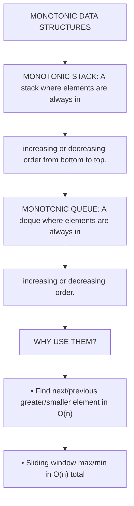

### Visual Comparison

```
Regular Stack:              Monotonic Decreasing Stack:
┌─────┐                     ┌─────┐
│  3  │ ← top               │  7  │ ← top (smallest)
├─────┤                     ├─────┤
│  7  │                     │  5  │
├─────┤                     ├─────┤
│  2  │                     │  3  │
├─────┤                     └─────┘   (largest at bottom)
│  5                              │
└─────┘  (random order)

Monotonic Increasing Stack:
┌─────┐
│  2  │ ← top (largest)
├─────┤
│  4  │
├─────┤
│  7  │
└─────┘   (smallest at bottom)
```

> **Flow**: 3 / 7 / 2 / 5 → 7 / 5 / 3 | 7 / 5 / 3 → 2 / 4 / 7

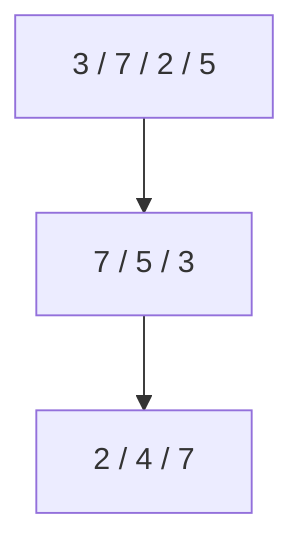

### The Key Insight

```
┌─────────────────────────────────────────────────────────────────┐
│              MONOTONIC STACK KEY INSIGHT                        │
├─────────────────────────────────────────────────────────────────┤
│                                                                 │
│  When we POP an element, we've found its answer!                │
│                                                                 │
│  For Next Greater Element:                                      │
│  - Use DECREASING stack (larger pops smaller)                   │
│  - When we pop: current element IS the next greater             │
│                                                                 │
│  For Next Smaller Element:                                      │
│  - Use INCREASING stack (smaller pops larger)                   │
│  - When we pop: current element IS the next smaller             │
│                                                                 │
│  "Pop = Found the answer for the popped element"                │
│                                                                 │
└─────────────────────────────────────────────────────────────────┘
```

> **Flow**: MONOTONIC STACK KEY INSIGHT → When we POP an element, we've found its answer! | When we POP an element, we've found its answer! → For Next Greater Element: | For Next Greater Element: → - Use DECREASING stack (larger pops smaller) | - Use DECREASING stack (larger pops smaller) → - When we pop: current element IS the next greater | - When we pop: current element IS the next greater → For Next Smaller Element: | For Next Smaller Element: → - Use INCREASING stack (smaller pops larger) | ...+1 more

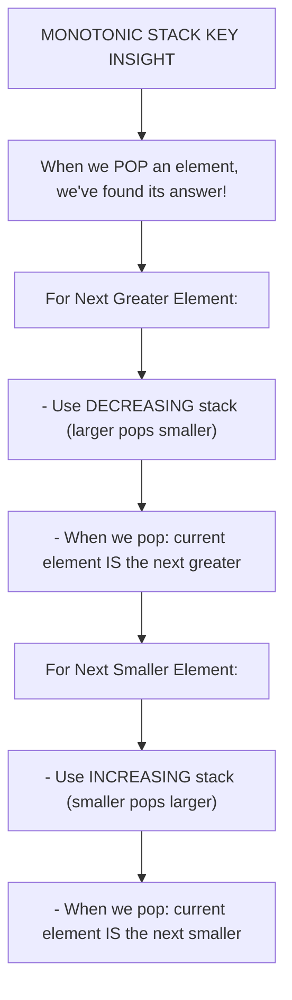

---

## Monotonic Stack Basics <a name="monotonic-stack"></a>

### Building a Monotonic Decreasing Stack

```java
/*
Maintain elements in decreasing order from bottom to top.
When a larger element comes, pop smaller ones.
*/

public void buildMonotonicDecreasing(int[] nums) {
    Deque<Integer> stack = new ArrayDeque<>();
    
    for (int num : nums) {
        // Pop elements smaller than current
        while (!stack.isEmpty() && stack.peek() < num) {
            int popped = stack.pop();
            System.out.println(popped + " has next greater: " + num);
        }
        stack.push(num);
    }
    
    // Remaining elements have no next greater
    while (!stack.isEmpty()) {
        System.out.println(stack.pop() + " has no next greater");
    }
}
```

### Visual: How Monotonic Stack Works

```
Array: [2, 1, 5, 6, 2, 3]
Finding: Next Greater Element

Process step by step:

i=0, num=2:
    Stack: []
    Push 2
    Stack: [2]

i=1, num=1:
    Stack: [2]
    1 < 2, just push
    Stack: [2, 1]

i=2, num=5:
    Stack: [2, 1]
    5 > 1, pop 1 → Next greater of 1 is 5
    5 > 2, pop 2 → Next greater of 2 is 5
    Stack: []
    Push 5
    Stack: [5]

i=3, num=6:
    Stack: [5]
    6 > 5, pop 5 → Next greater of 5 is 6
    Push 6
    Stack: [6]

i=4, num=2:
    Stack: [6]
    2 < 6, just push
    Stack: [6, 2]

i=5, num=3:
    Stack: [6, 2]
    3 > 2, pop 2 → Next greater of 2 is 3
    3 < 6, stop
    Push 3
    Stack: [6, 3]

Final: 6, 3 have no next greater → -1

Result: [5, 5, 6, -1, 3, -1]
```

> **Flow**: 5 &gt; 1, pop 1 → Next greater of 1 is 5 | 5 &gt; 2, pop 2 → Next greater of 2 is 5 | 6 &gt; 5, pop 5 → Next greater of 5 is 6 | 3 &gt; 2, pop 2 → Next greater of 2 is 3 | Final: 6, 3 have no next greater → -1

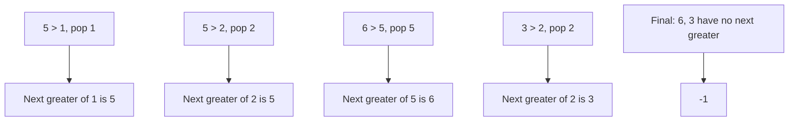

---

## Next Greater Element Pattern <a name="next-greater"></a>

### Template: Next Greater Element

```java
/*
For each element, find the next greater element to its right.
Use DECREASING stack (stores indices).
*/

public int[] nextGreaterElement(int[] nums) {
    int n = nums.length;
    int[] result = new int[n];
    Arrays.fill(result, -1);
    
    Deque<Integer> stack = new ArrayDeque<>();  // Store indices
    
    for (int i = 0; i < n; i++) {
        // Pop all elements smaller than current
        while (!stack.isEmpty() && nums[stack.peek()] < nums[i]) {
            int idx = stack.pop();
            result[idx] = nums[i];  // Current is next greater for popped
        }
        stack.push(i);
    }
    
    return result;
}
```

### Next Greater Element I (LeetCode 496)

```java
/*
nums1 is subset of nums2.
For each element in nums1, find its next greater in nums2.
*/

public int[] nextGreaterElement(int[] nums1, int[] nums2) {
    // Build next greater map for nums2
    Map<Integer, Integer> nextGreater = new HashMap<>();
    Deque<Integer> stack = new ArrayDeque<>();
    
    for (int num : nums2) {
        while (!stack.isEmpty() && stack.peek() < num) {
            nextGreater.put(stack.pop(), num);
        }
        stack.push(num);
    }
    
    // Answer for nums1
    int[] result = new int[nums1.length];
    for (int i = 0; i < nums1.length; i++) {
        result[i] = nextGreater.getOrDefault(nums1[i], -1);
    }
    return result;
}
```

### Next Greater Element II - Circular Array (LeetCode 503)

```java
/*
Circular array: After last element, wrap to first.
Trick: Iterate through array TWICE.
*/

public int[] nextGreaterElements(int[] nums) {
    int n = nums.length;
    int[] result = new int[n];
    Arrays.fill(result, -1);
    
    Deque<Integer> stack = new ArrayDeque<>();
    
    // Go through array twice for circular behavior
    for (int i = 0; i < 2 * n; i++) {
        int num = nums[i % n];
        
        while (!stack.isEmpty() && nums[stack.peek()] < num) {
            result[stack.pop()] = num;
        }
        
        // Only push indices in first pass
        if (i < n) {
            stack.push(i);
        }
    }
    
    return result;
}
```

### Visual: Circular Array Next Greater

```
Array: [1, 2, 1]  (circular)

Treating as: [1, 2, 1, 1, 2, 1]
                      ↑───────↑ (don't add to result, just for lookup)

i=0: push 0, stack=[0]
i=1: 2 > nums[0]=1, pop 0, result[0]=2, push 1
i=2: 1 < nums[1]=2, push 2, stack=[1,2]
i=3: 1 == nums[2]=1, no pop
i=4: 2 > nums[2]=1, pop 2, result[2]=2
     2 == nums[1]=2, no pop
i=5: done

result = [2, -1, 2]
```

> **Flow**: Array: [1, 2, 1] (circular) → Treating as: [1, 2, 1, 1, 2, 1] | Treating as: [1, 2, 1, 1, 2, 1] → ↑ ↑ (don't add to result, just for lookup) | ↑ ↑ (don't add to result, just for lookup) → i=0: push 0, stack=[0] | i=0: push 0, stack=[0] → i=5: done | i=5: done → result = [2, -1, 2]

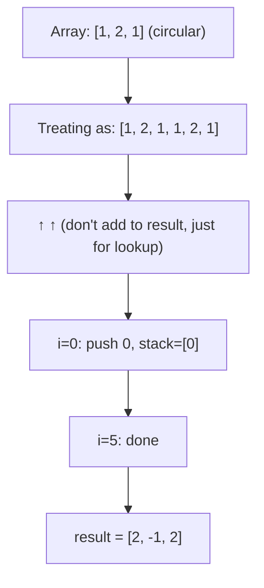

---

## Next Smaller Element Pattern <a name="next-smaller"></a>

### Template: Next Smaller Element

```java
/*
For each element, find the next smaller element to its right.
Use INCREASING stack (stores indices).
*/

public int[] nextSmallerElement(int[] nums) {
    int n = nums.length;
    int[] result = new int[n];
    Arrays.fill(result, -1);
    
    Deque<Integer> stack = new ArrayDeque<>();
    
    for (int i = 0; i < n; i++) {
        // Pop all elements LARGER than current
        while (!stack.isEmpty() && nums[stack.peek()] > nums[i]) {
            int idx = stack.pop();
            result[idx] = nums[i];  // Current is next smaller for popped
        }
        stack.push(i);
    }
    
    return result;
}
```

### Next Smaller vs Next Greater

```
┌─────────────────────────────────────────────────────────────────┐
│              COMPARISON: GREATER vs SMALLER                     │
├─────────────────────────────────────────────────────────────────┤
│                                                                 │
│  NEXT GREATER ELEMENT:                                          │
│  • Use DECREASING stack                                         │
│  • Pop when current > stack.top                                 │
│  • "Larger element kicks out smaller ones"                      │
│                                                                 │
│  NEXT SMALLER ELEMENT:                                          │
│  • Use INCREASING stack                                         │
│  • Pop when current < stack.top                                 │
│  • "Smaller element kicks out larger ones"                      │
│                                                                 │
│  Rule of thumb:                                                 │
│  • Looking for GREATER → maintain DECREASING                    │
│  • Looking for SMALLER → maintain INCREASING                    │
│                                                                 │
└─────────────────────────────────────────────────────────────────┘
```

> **Flow**: COMPARISON: GREATER vs SMALLER → NEXT GREATER ELEMENT: | NEXT GREATER ELEMENT: → • Use DECREASING stack | • Use DECREASING stack → • Pop when current &gt; stack.top | • Pop when current &gt; stack.top → • 'Larger element kicks out smaller ones' | • 'Larger element kicks out smaller ones' → NEXT SMALLER ELEMENT: | NEXT SMALLER ELEMENT: → • Use INCREASING stack | ...+1 more

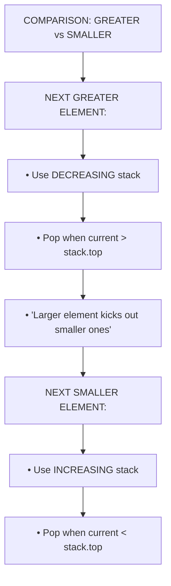

### Daily Temperatures (LeetCode 739)

```java
/*
For each day, find how many days until warmer temperature.
This is "Next Greater Element" but return INDEX DIFFERENCE.
*/

public int[] dailyTemperatures(int[] temperatures) {
    int n = temperatures.length;
    int[] result = new int[n];
    
    Deque<Integer> stack = new ArrayDeque<>();
    
    for (int i = 0; i < n; i++) {
        while (!stack.isEmpty() && temperatures[stack.peek()] < temperatures[i]) {
            int idx = stack.pop();
            result[idx] = i - idx;  // Days until warmer
        }
        stack.push(i);
    }
    
    return result;  // Unpopped days remain 0 (no warmer day)
}
```

---

## Previous Greater/Smaller <a name="previous"></a>

### Previous Greater Element

```java
/*
For each element, find the previous greater element (to its left).
Process left to right, answer when ADDING to stack.
*/

public int[] previousGreaterElement(int[] nums) {
    int n = nums.length;
    int[] result = new int[n];
    Arrays.fill(result, -1);
    
    Deque<Integer> stack = new ArrayDeque<>();  // Decreasing stack
    
    for (int i = 0; i < n; i++) {
        // Pop smaller elements (they won't be previous greater for future)
        while (!stack.isEmpty() && nums[stack.peek()] <= nums[i]) {
            stack.pop();
        }
        
        // If stack not empty, top is previous greater
        if (!stack.isEmpty()) {
            result[i] = nums[stack.peek()];
        }
        
        stack.push(i);
    }
    
    return result;
}
```

### Previous Smaller Element

```java
/*
For each element, find the previous smaller element.
Process left to right, use INCREASING stack.
*/

public int[] previousSmallerElement(int[] nums) {
    int n = nums.length;
    int[] result = new int[n];
    Arrays.fill(result, -1);
    
    Deque<Integer> stack = new ArrayDeque<>();  // Increasing stack
    
    for (int i = 0; i < n; i++) {
        // Pop larger elements
        while (!stack.isEmpty() && nums[stack.peek()] >= nums[i]) {
            stack.pop();
        }
        
        // If stack not empty, top is previous smaller
        if (!stack.isEmpty()) {
            result[i] = nums[stack.peek()];
        }
        
        stack.push(i);
    }
    
    return result;
}
```

### Four Relationships Summary

```
┌─────────────────────────────────────────────────────────────────┐
│              ALL FOUR PATTERNS                                  │
├─────────────────────────────────────────────────────────────────┤
│                                                                 │
│  NEXT GREATER (right):                                          │
│  • Direction: Left → Right                                      │
│  • Stack: Decreasing                                            │
│  • Answer: When POPPING                                         │
│                                                                 │
│  NEXT SMALLER (right):                                          │
│  • Direction: Left → Right                                      │
│  • Stack: Increasing                                            │
│  • Answer: When POPPING                                         │
│                                                                 │
│  PREVIOUS GREATER (left):                                       │
│  • Direction: Left → Right                                      │
│  • Stack: Decreasing                                            │
│  • Answer: When PUSHING (stack top is answer)                   │
│                                                                 │
│  PREVIOUS SMALLER (left):                                       │
│  • Direction: Left → Right                                      │
│  • Stack: Increasing                                            │
│  • Answer: When PUSHING (stack top is answer)                   │
│                                                                 │
└─────────────────────────────────────────────────────────────────┘
```

> **Flow**: ALL FOUR PATTERNS → NEXT GREATER (right): | NEXT GREATER (right): → • Direction: Left → Right | • Direction: Left → Right → • Stack: Decreasing | • Stack: Decreasing → • Answer: When POPPING | • Answer: When POPPING → NEXT SMALLER (right): | NEXT SMALLER (right): → • Stack: Increasing | ...+1 more

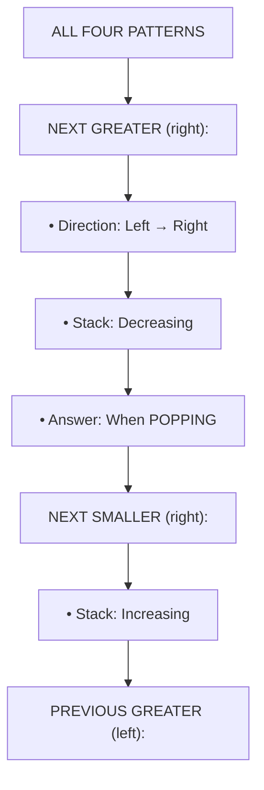

---

## Monotonic Queue <a name="monotonic-queue"></a>

### What is Monotonic Queue?

```
╔═══════════════════════════════════════════════════════════════╗
║              MONOTONIC QUEUE                                  ║
╠═══════════════════════════════════════════════════════════════╣
║                                                               ║
║  A queue (deque) maintaining monotonic order.                 ║
║                                                               ║
║  Key Operations:                                              ║
║  • Add from back (may pop existing elements)                  ║
║  • Remove from front (when element leaves window)             ║
║  • Get max/min: Front of deque                                ║
║                                                               ║
║  Use case: Sliding window max/min in O(n) total               ║
║                                                               ║
╚═══════════════════════════════════════════════════════════════╝
```

> **Flow**: MONOTONIC QUEUE → A queue (deque) maintaining monotonic order. | A queue (deque) maintaining monotonic order. → Key Operations: | Key Operations: → • Add from back (may pop existing elements) | • Add from back (may pop existing elements) → • Remove from front (when element leaves window) | • Remove from front (when element leaves window) → • Get max/min: Front of deque | • Get max/min: Front of deque → Use case: Sliding window max/min in O(n) total

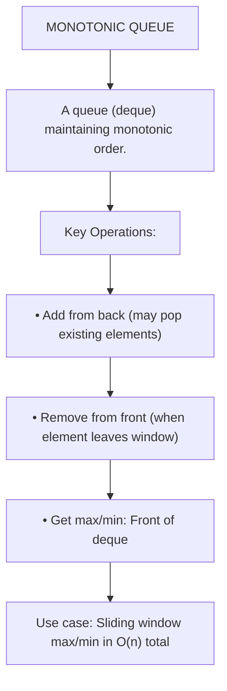

### Visual: Monotonic Queue for Max

```
Array: [1, 3, -1, -3, 5, 3, 6, 7], window size = 3

We maintain a DECREASING deque (max at front)

Window [1, 3, -1]:
  Add 1: deque = [1]
  Add 3: 3 > 1, pop 1, deque = [3]
  Add -1: -1 < 3, deque = [3, -1]
  Max = 3 (front)

Window [3, -1, -3]:
  Remove 1: 1 not at front, do nothing
  Add -3: -3 < -1, deque = [3, -1, -3]
  Max = 3 (front)

Window [-1, -3, 5]:
  Remove 3: 3 is at front, pop front
  deque = [-1, -3]
  Add 5: 5 > -3 and 5 > -1, pop all
  deque = [5]
  Max = 5 (front)

... and so on
```

---

## Sliding Window Maximum/Minimum <a name="sliding-window"></a>

### Sliding Window Maximum (LeetCode 239)

```java
/*
Find maximum in each sliding window of size k.
Use DECREASING deque to keep potential maximums.
*/

public int[] maxSlidingWindow(int[] nums, int k) {
    if (nums.length == 0) return new int[0];
    
    int[] result = new int[nums.length - k + 1];
    Deque<Integer> deque = new ArrayDeque<>();  // Store indices
    
    for (int i = 0; i < nums.length; i++) {
        // Remove indices outside current window
        while (!deque.isEmpty() && deque.peekFirst() < i - k + 1) {
            deque.pollFirst();
        }
        
        // Remove smaller elements (they can't be max)
        while (!deque.isEmpty() && nums[deque.peekLast()] < nums[i]) {
            deque.pollLast();
        }
        
        // Add current index
        deque.offerLast(i);
        
        // Record max when window is complete
        if (i >= k - 1) {
            result[i - k + 1] = nums[deque.peekFirst()];
        }
    }
    
    return result;
}
```

### Visual: Sliding Window Maximum

```
nums = [1, 3, -1, -3, 5, 3, 6, 7], k = 3

i=0: deque=[0], (1)                    window not complete
i=1: deque=[1], (3)                    window not complete
i=2: deque=[1,2], (3,-1)               result[0] = nums[1] = 3

i=3: deque=[1,2,3], check front: 1 >= 3-3+1=1 ✓
     deque=[1,2,3], (3,-1,-3)          result[1] = nums[1] = 3

i=4: deque=[1,2,3], check front: 1 < 4-3+1=2 ✗, pop
     deque=[2,3], check front: 2 >= 2 ✓
     nums[3]=-3 < 5, nums[2]=-1 < 5, pop all
     deque=[4], (5)                     result[2] = nums[4] = 5

i=5: deque=[4,5], nums[5]=3 < 5        result[3] = nums[4] = 5

i=6: check front: 4 < 6-3+1=4 ✗, pop
     deque=[5], nums[5]=3 < 6, pop
     deque=[6], (6)                     result[4] = nums[6] = 6

i=7: deque=[6,7], nums[7]=7 > 6, pop
     deque=[7], (7)                     result[5] = nums[7] = 7

Result: [3, 3, 5, 5, 6, 7]
```

### Sliding Window Minimum

```java
/*
Same as maximum but use INCREASING deque.
*/

public int[] minSlidingWindow(int[] nums, int k) {
    int[] result = new int[nums.length - k + 1];
    Deque<Integer> deque = new ArrayDeque<>();
    
    for (int i = 0; i < nums.length; i++) {
        // Remove indices outside window
        while (!deque.isEmpty() && deque.peekFirst() < i - k + 1) {
            deque.pollFirst();
        }
        
        // Remove LARGER elements (opposite of max)
        while (!deque.isEmpty() && nums[deque.peekLast()] > nums[i]) {
            deque.pollLast();
        }
        
        deque.offerLast(i);
        
        if (i >= k - 1) {
            result[i - k + 1] = nums[deque.peekFirst()];
        }
    }
    
    return result;
}
```

---

## Advanced Applications <a name="advanced"></a>

### Largest Rectangle in Histogram (LeetCode 84)

```java
/*
Find largest rectangle area in histogram.
For each bar, find left and right boundaries where it can extend.
Key: Bar can extend until it hits a SMALLER bar.
*/

public int largestRectangleArea(int[] heights) {
    int n = heights.length;
    int[] left = new int[n];   // Left boundary (first smaller)
    int[] right = new int[n];  // Right boundary (first smaller)
    
    // Find previous smaller element
    Deque<Integer> stack = new ArrayDeque<>();
    for (int i = 0; i < n; i++) {
        while (!stack.isEmpty() && heights[stack.peek()] >= heights[i]) {
            stack.pop();
        }
        left[i] = stack.isEmpty() ? -1 : stack.peek();
        stack.push(i);
    }
    
    // Find next smaller element
    stack.clear();
    for (int i = n - 1; i >= 0; i--) {
        while (!stack.isEmpty() && heights[stack.peek()] >= heights[i]) {
            stack.pop();
        }
        right[i] = stack.isEmpty() ? n : stack.peek();
        stack.push(i);
    }
    
    // Calculate max area
    int maxArea = 0;
    for (int i = 0; i < n; i++) {
        int width = right[i] - left[i] - 1;
        int area = heights[i] * width;
        maxArea = Math.max(maxArea, area);
    }
    
    return maxArea;
}

// One-pass solution
public int largestRectangleAreaOnePass(int[] heights) {
    int n = heights.length;
    Deque<Integer> stack = new ArrayDeque<>();
    int maxArea = 0;
    
    for (int i = 0; i <= n; i++) {
        int h = (i == n) ? 0 : heights[i];
        
        while (!stack.isEmpty() && heights[stack.peek()] > h) {
            int height = heights[stack.pop()];
            int width = stack.isEmpty() ? i : i - stack.peek() - 1;
            maxArea = Math.max(maxArea, height * width);
        }
        stack.push(i);
    }
    
    return maxArea;
}
```

### Visual: Largest Rectangle in Histogram

```
heights = [2, 1, 5, 6, 2, 3]

      ┌───┐
      │   │
  ┌───┼───┤
  │   │   │       ┌───┐
──┼───┤   │   ┌───┼───┤
  │   │   │   │   │   │
  │   │   │   │   │   │
──┴───┴───┴───┴───┴───┴──
  2   1   5   6   2   3

For bar at index 2 (height 5):
- Can extend left until bar at index 1 (height 1 < 5)
- Can extend right until bar at index 4 (height 2 < 5)
- Width = 4 - 1 - 1 = 2
- Area = 5 * 2 = 10

Maximum rectangle has area 10 (using bars at indices 2,3)
```

> **Flow**: heights = [2, 1, 5, 6, 2, 3] → For bar at index 2 (height 5): | For bar at index 2 (height 5): → - Can extend left until bar at index 1 (height 1 &lt; 5 | - Can extend left until bar at index 1 (height 1 &lt; 5 → - Can extend right until bar at index 4 (height 2 &lt;  | - Can extend right until bar at index 4 (height 2 &lt;  → - Width = 4 - 1 - 1 = 2 | - Width = 4 - 1 - 1 = 2 → - Area = 5 * 2 = 10 | - Area = 5 * 2 = 10 → Maximum rectangle has area 10 (using bars at indices 2,

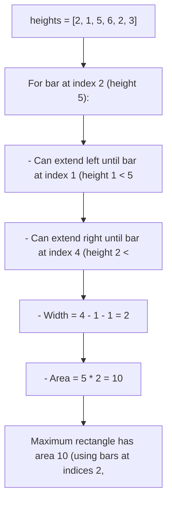

### Maximal Rectangle (LeetCode 85)

```java
/*
Find largest rectangle containing only 1s in binary matrix.
Treat each row as histogram base.
*/

public int maximalRectangle(char[][] matrix) {
    if (matrix.length == 0) return 0;
    
    int m = matrix.length, n = matrix[0].length;
    int[] heights = new int[n];
    int maxArea = 0;
    
    for (int i = 0; i < m; i++) {
        // Build histogram for row i
        for (int j = 0; j < n; j++) {
            if (matrix[i][j] == '1') {
                heights[j]++;
            } else {
                heights[j] = 0;
            }
        }
        
        // Find largest rectangle in this histogram
        maxArea = Math.max(maxArea, largestRectangleArea(heights));
    }
    
    return maxArea;
}
```

### Trapping Rain Water (LeetCode 42) - Monotonic Stack Solution

```java
/*
Alternative to two-pointer approach using monotonic stack.
*/

public int trap(int[] height) {
    Deque<Integer> stack = new ArrayDeque<>();
    int water = 0;
    
    for (int i = 0; i < height.length; i++) {
        while (!stack.isEmpty() && height[i] > height[stack.peek()]) {
            int bottom = height[stack.pop()];
            
            if (stack.isEmpty()) break;
            
            int left = stack.peek();
            int h = Math.min(height[left], height[i]) - bottom;
            int w = i - left - 1;
            water += h * w;
        }
        stack.push(i);
    }
    
    return water;
}
```

### Remove K Digits (LeetCode 402)

```java
/*
Remove k digits to make smallest number.
Use monotonic increasing stack.
*/

public String removeKdigits(String num, int k) {
    if (k >= num.length()) return "0";
    
    Deque<Character> stack = new ArrayDeque<>();
    
    for (char c : num.toCharArray()) {
        // Remove larger digits before adding smaller one
        while (k > 0 && !stack.isEmpty() && stack.peek() > c) {
            stack.pop();
            k--;
        }
        stack.push(c);
    }
    
    // If k still > 0, remove from end
    while (k > 0) {
        stack.pop();
        k--;
    }
    
    // Build result (stack is reversed)
    StringBuilder sb = new StringBuilder();
    while (!stack.isEmpty()) {
        sb.append(stack.pop());
    }
    sb.reverse();
    
    // Remove leading zeros
    while (sb.length() > 1 && sb.charAt(0) == '0') {
        sb.deleteCharAt(0);
    }
    
    return sb.toString();
}
```

### 132 Pattern (LeetCode 456)

```java
/*
Find i < j < k where nums[i] < nums[k] < nums[j].
Process from right, track "2" (nums[k]) using monotonic stack.
*/

public boolean find132pattern(int[] nums) {
    int n = nums.length;
    if (n < 3) return false;
    
    Deque<Integer> stack = new ArrayDeque<>();  // Decreasing
    int second = Integer.MIN_VALUE;  // The "2" in 132 (nums[k])
    
    // Process from right to left
    for (int i = n - 1; i >= 0; i--) {
        // nums[i] is candidate for "1"
        // second is "2", anything popped can be "2"
        if (nums[i] < second) {
            return true;  // Found 132 pattern!
        }
        
        // Pop elements smaller than current (they can be "2")
        while (!stack.isEmpty() && nums[i] > stack.peek()) {
            second = stack.pop();  // Update "2" to largest possible
        }
        
        stack.push(nums[i]);  // Push as potential "3"
    }
    
    return false;
}
```

---

## Interview Problems <a name="interview-problems"></a>

### Problem Categories

```
┌─────────────────────────────────────────────────────────────────┐
│              MONOTONIC STACK/QUEUE PROBLEMS                     │
├─────────────────────────────────────────────────────────────────┤
│                                                                 │
│  NEXT/PREVIOUS GREATER/SMALLER:                                 │
│  • Next Greater Element I/II                                    │
│  • Daily Temperatures                                           │
│  • Stock Span Problem                                           │
│                                                                 │
│  RECTANGLE PROBLEMS:                                            │
│  • Largest Rectangle in Histogram                               │
│  • Maximal Rectangle in Matrix                                  │
│  • Trapping Rain Water                                          │
│                                                                 │
│  SLIDING WINDOW:                                                │
│  • Sliding Window Maximum                                       │
│  • Shortest Subarray with Sum >= K                              │
│                                                                 │
│  STRING/NUMBER:                                                 │
│  • Remove K Digits                                              │
│  • Remove Duplicate Letters                                     │
│  • 132 Pattern                                                  │
│                                                                 │
└─────────────────────────────────────────────────────────────────┘
```

> **Flow**: MONOTONIC STACK/QUEUE PROBLEMS → NEXT/PREVIOUS GREATER/SMALLER: | NEXT/PREVIOUS GREATER/SMALLER: → • Next Greater Element I/II | • Next Greater Element I/II → • Daily Temperatures | • Daily Temperatures → • Stock Span Problem | • Stock Span Problem → RECTANGLE PROBLEMS: | RECTANGLE PROBLEMS: → • Largest Rectangle in Histogram | ...+1 more

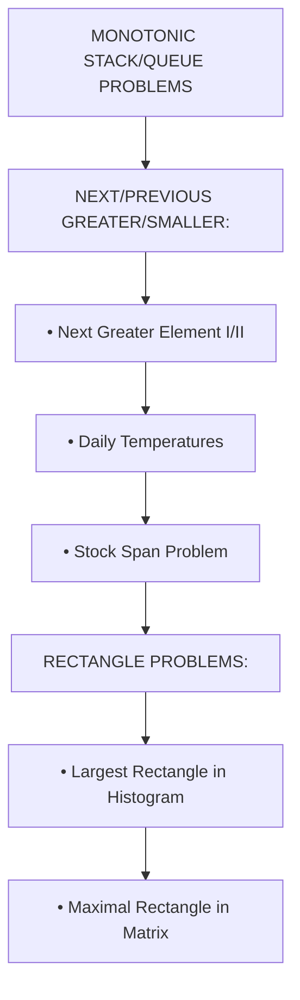

### Stock Span Problem (LeetCode 901)

```java
/*
Find how many consecutive days (including today) 
where price was <= today's price.
*/

class StockSpanner {
    Deque<int[]> stack;  // [price, span]
    
    public StockSpanner() {
        stack = new ArrayDeque<>();
    }
    
    public int next(int price) {
        int span = 1;
        
        // Pop days with lower price, accumulate their spans
        while (!stack.isEmpty() && stack.peek()[0] <= price) {
            span += stack.pop()[1];
        }
        
        stack.push(new int[]{price, span});
        return span;
    }
}
```

### Remove Duplicate Letters (LeetCode 316)

```java
/*
Remove duplicates to make smallest lexicographic string.
Must keep relative order. Each letter appears exactly once.
*/

public String removeDuplicateLetters(String s) {
    int[] count = new int[26];  // Remaining count
    boolean[] inStack = new boolean[26];
    
    for (char c : s.toCharArray()) {
        count[c - 'a']++;
    }
    
    Deque<Character> stack = new ArrayDeque<>();
    
    for (char c : s.toCharArray()) {
        count[c - 'a']--;
        
        if (inStack[c - 'a']) continue;  // Already in result
        
        // Pop larger chars if they appear later
        while (!stack.isEmpty() && stack.peek() > c && count[stack.peek() - 'a'] > 0) {
            inStack[stack.pop() - 'a'] = false;
        }
        
        stack.push(c);
        inStack[c - 'a'] = true;
    }
    
    StringBuilder sb = new StringBuilder();
    while (!stack.isEmpty()) {
        sb.append(stack.pop());
    }
    return sb.reverse().toString();
}
```

### Shortest Subarray with Sum >= K (LeetCode 862)

```java
/*
Find shortest subarray with sum >= k.
Use prefix sum + monotonic deque.
*/

public int shortestSubarray(int[] nums, int k) {
    int n = nums.length;
    long[] prefix = new long[n + 1];
    
    for (int i = 0; i < n; i++) {
        prefix[i + 1] = prefix[i] + nums[i];
    }
    
    Deque<Integer> deque = new ArrayDeque<>();
    int minLen = Integer.MAX_VALUE;
    
    for (int i = 0; i <= n; i++) {
        // Check if current prefix - front >= k
        while (!deque.isEmpty() && prefix[i] - prefix[deque.peekFirst()] >= k) {
            minLen = Math.min(minLen, i - deque.pollFirst());
        }
        
        // Maintain increasing deque (larger prefix won't help)
        while (!deque.isEmpty() && prefix[i] <= prefix[deque.peekLast()]) {
            deque.pollLast();
        }
        
        deque.offerLast(i);
    }
    
    return minLen == Integer.MAX_VALUE ? -1 : minLen;
}
```

### Sum of Subarray Minimums (LeetCode 907)

```java
/*
Find sum of minimum elements in all subarrays.
For each element, count how many subarrays it's the minimum of.
*/

public int sumSubarrayMins(int[] arr) {
    int n = arr.length;
    int MOD = 1_000_000_007;
    
    // For each element, find:
    // - left: how far left we can extend while being minimum
    // - right: how far right we can extend while being minimum
    int[] left = new int[n];   // Previous smaller or equal
    int[] right = new int[n];  // Next smaller
    
    Deque<Integer> stack = new ArrayDeque<>();
    
    // Previous smaller or equal
    for (int i = 0; i < n; i++) {
        while (!stack.isEmpty() && arr[stack.peek()] > arr[i]) {
            stack.pop();
        }
        left[i] = stack.isEmpty() ? i + 1 : i - stack.peek();
        stack.push(i);
    }
    
    stack.clear();
    
    // Next smaller (strictly)
    for (int i = n - 1; i >= 0; i--) {
        while (!stack.isEmpty() && arr[stack.peek()] >= arr[i]) {
            stack.pop();
        }
        right[i] = stack.isEmpty() ? n - i : stack.peek() - i;
        stack.push(i);
    }
    
    // Calculate contribution of each element
    long result = 0;
    for (int i = 0; i < n; i++) {
        result = (result + (long) arr[i] * left[i] * right[i]) % MOD;
    }
    
    return (int) result;
}
```

---

## Quick Reference <a name="quick-reference"></a>

### Which Stack Type to Use

```
┌─────────────────────────────────────────────────────────────────┐
│              STACK TYPE SELECTION                               │
├─────────────────────────────────────────────────────────────────┤
│                                                                 │
│  DECREASING STACK (larger at bottom):                           │
│  • Next/Previous GREATER element                                │
│  • Largest rectangle (find boundaries)                          │
│  • Stock span (count higher prices)                             │
│                                                                 │
│  INCREASING STACK (smaller at bottom):                          │
│  • Next/Previous SMALLER element                                │
│  • Sum of subarray minimums                                     │
│  • Remove K digits                                              │
│                                                                 │
│  MEMORY TRICK:                                                  │
│  • Finding GREATER → maintain DECREASING                        │
│  • Finding SMALLER → maintain INCREASING                        │
│  (The stack is the "opposite" of what you're looking for)       │
│                                                                 │
└─────────────────────────────────────────────────────────────────┘
```

> **Flow**: STACK TYPE SELECTION → DECREASING STACK (larger at bottom): | DECREASING STACK (larger at bottom): → • Next/Previous GREATER element | • Next/Previous GREATER element → • Largest rectangle (find boundaries) | • Largest rectangle (find boundaries) → • Stock span (count higher prices) | • Stock span (count higher prices) → INCREASING STACK (smaller at bottom): | INCREASING STACK (smaller at bottom): → • Next/Previous SMALLER element | ...+1 more

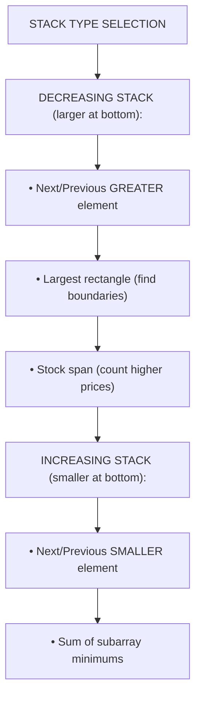

### Code Templates

```java
// TEMPLATE: Next Greater Element
public int[] nextGreater(int[] arr) {
    int n = arr.length;
    int[] result = new int[n];
    Arrays.fill(result, -1);
    Deque<Integer> stack = new ArrayDeque<>();  // Decreasing
    
    for (int i = 0; i < n; i++) {
        while (!stack.isEmpty() && arr[stack.peek()] < arr[i]) {
            result[stack.pop()] = arr[i];
        }
        stack.push(i);
    }
    return result;
}

// TEMPLATE: Previous Greater Element
public int[] prevGreater(int[] arr) {
    int n = arr.length;
    int[] result = new int[n];
    Arrays.fill(result, -1);
    Deque<Integer> stack = new ArrayDeque<>();
    
    for (int i = 0; i < n; i++) {
        while (!stack.isEmpty() && arr[stack.peek()] <= arr[i]) {
            stack.pop();
        }
        if (!stack.isEmpty()) result[i] = arr[stack.peek()];
        stack.push(i);
    }
    return result;
}

// TEMPLATE: Sliding Window Maximum
public int[] maxWindow(int[] arr, int k) {
    int[] result = new int[arr.length - k + 1];
    Deque<Integer> deque = new ArrayDeque<>();  // Decreasing
    
    for (int i = 0; i < arr.length; i++) {
        // Remove out-of-window
        if (!deque.isEmpty() && deque.peekFirst() < i - k + 1) {
            deque.pollFirst();
        }
        // Maintain decreasing
        while (!deque.isEmpty() && arr[deque.peekLast()] < arr[i]) {
            deque.pollLast();
        }
        deque.offerLast(i);
        // Record result
        if (i >= k - 1) {
            result[i - k + 1] = arr[deque.peekFirst()];
        }
    }
    return result;
}
```

### Complexity Summary

```
┌─────────────────────────────────────────────────────────────────┐
│              MONOTONIC STACK/QUEUE COMPLEXITIES                 │
├─────────────────────────────────────────────────────────────────┤
│                                                                 │
│  Next Greater Element:            O(n) time, O(n) space         │
│  Daily Temperatures:              O(n) time, O(n) space         │
│  Largest Rectangle Histogram:     O(n) time, O(n) space         │
│  Sliding Window Maximum:          O(n) time, O(k) space         │
│  Remove K Digits:                 O(n) time, O(n) space         │
│                                                                 │
│  KEY INSIGHT:                                                   │
│  Each element is pushed and popped at most ONCE.                │
│  Total operations = 2n → O(n)                                   │
│                                                                 │
└─────────────────────────────────────────────────────────────────┘
```

> **Flow**: MONOTONIC STACK/QUEUE COMPLEXITIES → Next Greater Element: O(n) time, O(n) space | Next Greater Element: O(n) time, O(n) space → Daily Temperatures: O(n) time, O(n) space | Daily Temperatures: O(n) time, O(n) space → Largest Rectangle Histogram: O(n) time, O(n) space | Largest Rectangle Histogram: O(n) time, O(n) space → Sliding Window Maximum: O(n) time, O(k) space | Sliding Window Maximum: O(n) time, O(k) space → Remove K Digits: O(n) time, O(n) space | Remove K Digits: O(n) time, O(n) space → KEY INSIGHT: | ...+1 more

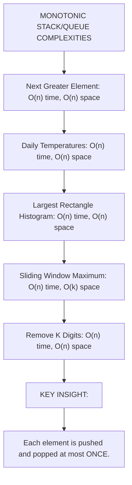

---

## Summary

```
╔═══════════════════════════════════════════════════════════════╗
║         MONOTONIC STACK/QUEUE - MASTER CHECKLIST              ║
╠═══════════════════════════════════════════════════════════════╣
║                                                               ║
║  1. IDENTIFY THE PATTERN                                      ║
║     • "Next greater/smaller" → Monotonic Stack                ║
║     • "Sliding window max/min" → Monotonic Queue              ║
║     • "Rectangle area" → Usually needs both boundaries        ║
║                                                               ║
║  2. CHOOSE STACK TYPE                                         ║
║     • Looking for GREATER → Decreasing stack                  ║
║     • Looking for SMALLER → Increasing stack                  ║
║                                                               ║
║  3. KNOW WHEN ANSWER IS FOUND                                 ║
║     • Next element: Answer when POPPING                       ║
║     • Previous element: Answer when PUSHING (check top)       ║
║                                                               ║
║  4. HANDLE EDGE CASES                                         ║
║     • No greater/smaller exists: default to -1 or n           ║
║     • Circular array: iterate 2n times                        ║
║     • Duplicates: decide on < vs ≤ carefully                  ║
║                                                               ║
║  5. COMMON APPLICATIONS                                       ║
║     • Histogram problems                                      ║
║     • Temperature/Stock problems                              ║
║     • String manipulation                                     ║
║     • Sliding window extremes                                 ║
║                                                               ║
╚═══════════════════════════════════════════════════════════════╝
```

> **Flow**: MONOTONIC STACK/QUEUE - MASTER CHECKLIST → 1. IDENTIFY THE PATTERN | 1. IDENTIFY THE PATTERN → • 'Next greater/smaller' → Monotonic Stack | • 'Next greater/smaller' → Monotonic Stack → • 'Sliding window max/min' → Monotonic Queue | • 'Sliding window max/min' → Monotonic Queue → • 'Rectangle area' → Usually needs both boundaries | • 'Rectangle area' → Usually needs both boundaries → 2. CHOOSE STACK TYPE | 2. CHOOSE STACK TYPE → • Looking for GREATER → Decreasing stack | ...+1 more

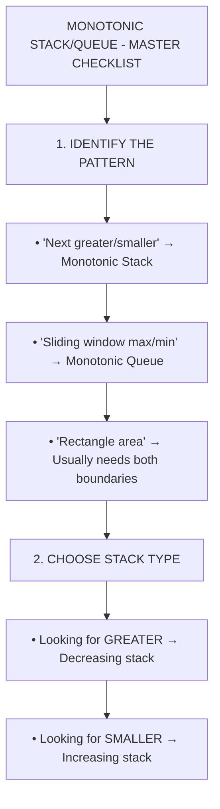

**Pro Tip:** When you see "next greater/smaller", "sliding window max/min", or problems involving "how far can we extend", think monotonic stack/queue!


---

> **Navigation**: [< Previous](14_Union_Find_DSU_Complete.md) | [Back to Index](../00_MASTER_INDEX.md) | [Next >](16_DSA_Deep_Reasoning.md)