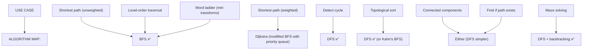
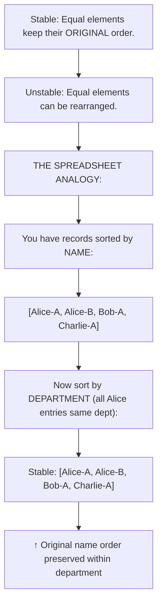
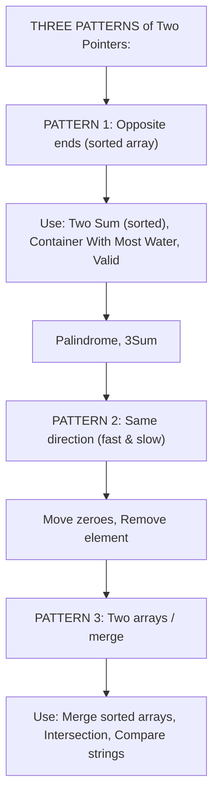
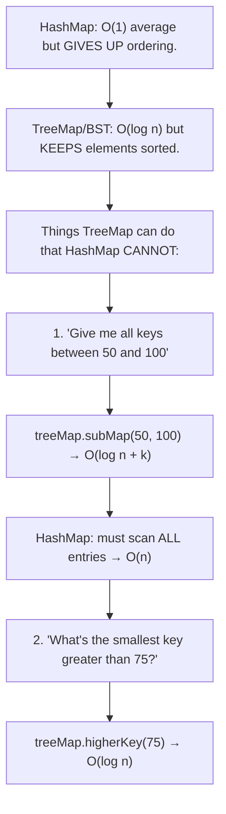
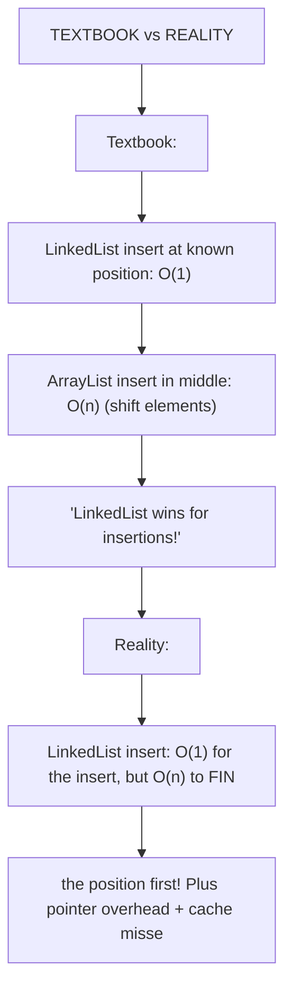

> **Navigation**: [< Previous](15_Monotonic_Stack_Queue_Complete.md) | [Back to Index](../00_MASTER_INDEX.md) | [Next >](17_DSA_Java_Implementation_Mastery.md)

# Chapter 16 — DSA Deep Reasoning: The Questions That Freeze People

> **"Anyone can say 'Binary search is O(log n).' The senior engineer explains WHY HashMap isn't always O(1), WHEN quicksort beats mergesort, and HOW to choose between BFS and DFS without memorizing."**

---

## Table of Contents

1. [Big O: Not Just "How Fast" — What It Actually Measures](#1-big-o-not-just-how-fast--what-it-actually-measures)
2. [Why HashMap Isn't Always O(1)](#2-why-hashmap-isnt-always-o1)
3. [Quicksort vs Mergesort: Why Quicksort Wins In Practice](#3-quicksort-vs-mergesort-why-quicksort-wins-in-practice)
4. [BFS vs DFS: The Decision Framework That Replaces Memorization](#4-bfs-vs-dfs-the-decision-framework-that-replaces-memorization)
5. [Dynamic Programming vs Greedy: How To Know Which One](#5-dynamic-programming-vs-greedy-how-to-know-which-one)
6. [Recursion: Why It Overflows and When To Convert To Iteration](#6-recursion-why-it-overflows-and-when-to-convert-to-iteration)
7. [Stable vs Unstable Sort: Why It Matters In Real Systems](#7-stable-vs-unstable-sort-why-it-matters-in-real-systems)
8. [Two Pointers: Not Just "Left and Right"](#8-two-pointers-not-just-left-and-right)
9. [Why Balanced BST When We Have HashMap](#9-why-balanced-bst-when-we-have-hashmap)
10. [The Array vs LinkedList Reality: Cache Lines Matter](#10-the-array-vs-linkedlist-reality-cache-lines-matter)

---

## 1. Big O: Not Just "How Fast" — What It Actually Measures

### The Freeze Question
> "What does O(n log n) actually mean? Is O(1) always fast?"

### Deep Reasoning


> Big O measures GROWTH RATE, not speed.
>
> THE RESTAURANT ANALOGY:
> O(1): Microwave — same time whether 1 item or party of 100.
> But that "constant" time could be 5 minutes!
> O(n): Grill — time grows linearly with order count.
> O(n²): Handshake — each person shakes hands with everyone.
> O(log n): Phone book — eliminate half each step.
> O(n log n): Sort each order, then serve in order.
>
> KEY INSIGHTS people miss:
> 1. O(1) can be SLOWER than O(n) for small n.
> HashMap O(1) with 10 items: compute hash, check bucket...
> Array scan O(n) with 10 items: just check 10 elements.
> Array scan wins! Overhead of hashing > scanning 10 items.
>
> 2. Constants matter in practice:
> O(n) with constant 1000 → 1000n
> O(n²) with constant 0.001 → 0.001n²
> Below n=1,000,000, the "slower" algorithm is faster!
>
> 3. Big O describes WORST CASE (usually). Average case exists:
> Quicksort: O(n²) worst, O(n log n) average
> HashMap: O(n) worst, O(1) average


---

## 2. Why HashMap Isn't Always O(1)

### The Freeze Question
> "HashMap is O(1) for get and put, right?"


> THE FILING CABINET (from Java chapter, deeper here):
>
> BEST CASE O(1): Each key goes to a unique bucket.
> hash("Alice") → bucket 3, hash("Bob") → bucket 7
> Direct access. No searching.
>
> WORST CASE O(n): All keys hash to SAME bucket.
> hash("Alice") → bucket 3, hash("Bob") → bucket 3,
> hash("Charlie") → bucket 3...
> Now bucket 3 is a linked list → must scan all entries.
> (Java 8: converts to tree at 8 entries → O(log n) worst case)
>
> WHEN THIS HAPPENS IN REAL LIFE:
> 1. Bad hashCode that returns same value for many keys
> 2. Hash collision attack (adversarial input)
> 3. Resizing threshold — when load factor > 0.75, all
> entries rehashed → O(n) for that one operation
>
> AMORTIZED O(1): Most operations are O(1). Occasionally O(n)
> for resize. Spread across all operations → amortized O(1).
>
> Like rent: You pay $12,000/year in one lump (O(n) resize).
> Amortized: $1,000/month (O(1) per operation).


---

## 3. Quicksort vs Mergesort: Why Quicksort Wins In Practice

### The Freeze Question
> "Mergesort is O(n log n) guaranteed. Quicksort is O(n²) worst case. Why do we use Quicksort?"


> THE MOVING HOUSE ANALOGY
>
> Mergesort: Hire a moving company with warehouses.
> → Always O(n log n) ✅
> → Needs O(n) extra space (the warehouse!) ❌
> → Lots of copying between warehouse and house
> → Cache-unfriendly (data jumps between locations)
>
> Quicksort: Sort everything IN your house.
> → O(n log n) average, O(n²) worst ⚠️
> → O(log n) extra space (just the recursion stack) ✅
> → IN-PLACE — data stays where it is
> → CACHE-FRIENDLY — sequential access patterns
> → Smaller constant factor (fewer swaps, less overhead)
>
> WHY CACHE MATTERS:
> CPU cache loads adjacent memory. Quicksort accesses elements
> near each other → cache hits. Mergesort copies between
> arrays → cache misses. This is 2-3x difference in practice!
>
> REAL-WORLD:
> Java Arrays.sort(primitives) → Dual-Pivot Quicksort
> Java Arrays.sort(objects) → TimSort (merge-based, stable)
> Why? Objects are references → cache doesn't matter as much.
> Stability matters for objects. Quicksort is unstable.


---

## 4. BFS vs DFS: The Decision Framework That Replaces Memorization

### The Freeze Question
> "When do you use BFS vs DFS?"


> THE BUILDING SEARCH ANALOGY
>
> BFS (Breadth-First) = Floor by floor
> → Check ALL rooms on floor 1, then ALL on floor 2, then 3...
> → Uses a QUEUE (FIFO)
> → Memory: O(width of widest level)
>
> DFS (Depth-First) = Follow one corridor to the end
> → Go down one hallway to the end, backtrack, try next
> → Uses a STACK (or recursion)
> → Memory: O(depth of deepest path)
>
> DECISION FRAMEWORK:
>
> "Is the answer CLOSE to the start?" → BFS
> (Shortest path, level-order, minimum steps)
>
> "Is the answer at the END/LEAF?" → DFS
> (Path exists?, all paths, backtracking, has cycle?)
>
> "Need SHORTEST path?" → BFS (always)
> "Need ALL possible paths?" → DFS (backtracking)
> "Tree is very DEEP?" → BFS (DFS might stack overflow)
> "Tree is very WIDE?" → DFS (BFS uses too much memory)
> "Need LEVEL-BY-LEVEL?" → BFS (naturally gives levels)


```
USE CASE → ALGORITHM MAP:

Shortest path (unweighted)    → BFS ✅
Shortest path (weighted)      → Dijkstra (modified BFS with priority queue)
Detect cycle                  → DFS ✅
Topological sort              → DFS ✅ (or Kahn's BFS)
Connected components          → Either (DFS simpler)
Level-order traversal         → BFS ✅
Find if path exists           → Either (DFS simpler)
Maze solving                  → DFS + backtracking ✅
Word ladder (min transforms)  → BFS ✅
```

> **Flow**: USE CASE → ALGORITHM MAP: | Shortest path (unweighted) → BFS ✅ | Shortest path (weighted) → Dijkstra (modified BFS with priority queue) | Detect cycle → DFS ✅ | Topological sort → DFS ✅ (or Kahn's BFS) | Connected components → Either (DFS simpler) | ...+4 more



---

## 5. Dynamic Programming vs Greedy: How To Know Which One

### The Freeze Question
> "When do I use DP vs greedy?"


> THE ROAD TRIP ANALOGY
>
> Greedy = GPS with "always take the fastest road NOW"
> → Makes the locally optimal choice at each step
> → NEVER reconsiders past decisions
> → Fast: usually O(n log n) or O(n)
> → Works ONLY when local optimum → global optimum
>
> DP = Exploring ALL routes and picking the overall best
> → Considers all options, remembers results (memoization)
> → CAN reconstruct the optimal path
> → Slower: usually O(n²) or O(n × m)
> → Works for OVERLAPPING subproblems + optimal substructure
>
> HOW TO TELL:
> 1. Can a greedy counterexample be found?
> Coin change: coins [1, 3, 4], target 6
> Greedy: 4+1+1 = 3 coins
> Optimal: 3+3 = 2 coins → Greedy FAILS → Use DP
>
> 2. Does the problem have optimal substructure?
> "Can I build the answer from answers to smaller problems?"
> YES + overlapping subproblems → DP
> YES + greedy choice property → Greedy
>
> GREEDY WORKS: Activity selection, Huffman, Kruskal, Dijkstra
> DP NEEDED: Knapsack, LCS, Edit distance, Matrix chain


---

## 6. Recursion: Why It Overflows and When To Convert To Iteration

### The Freeze Question
> "Why does my recursive solution get StackOverflowError?"


> THE STACK OF PLATES ANALOGY
>
> Each recursive call = a new plate on the stack
> Each plate holds: local variables, return address
> Stack has limited height (usually ~10,000 frames in Java)
>
> factorial(100000) → 100,000 plates → stack overflow!
>
> SOLUTIONS:
> 1. Convert to iteration (use explicit stack/loop)
> 2. Tail recursion (only works in languages that optimize it
> — Java does NOT optimize tail calls, Kotlin/Scala do)
> 3. Increase stack size (-Xss2m) — band-aid, not a fix
> 4. Use DP (memoization) to reduce redundant calls


```java
// Fibonacci: The classic "why recursion is slow" example
// Naive recursion: O(2^n) — exponential! Redundant calculations.
int fib(int n) {
    if (n <= 1) return n;
    return fib(n-1) + fib(n-2); // fib(3) computed millions of times
}

// Memoization (top-down DP): O(n) — each subproblem solved ONCE
int fib(int n, int[] memo) {
    if (n <= 1) return n;
    if (memo[n] != 0) return memo[n]; // Already computed? Return it!
    memo[n] = fib(n-1, memo) + fib(n-2, memo);
    return memo[n];
}

// Iteration (bottom-up DP): O(n), O(1) space — no stack at all
int fib(int n) {
    if (n <= 1) return n;
    int prev2 = 0, prev1 = 1;
    for (int i = 2; i <= n; i++) {
        int curr = prev1 + prev2;
        prev2 = prev1;
        prev1 = curr;
    }
    return prev1;
}
```

---

## 7. Stable vs Unstable Sort: Why It Matters In Real Systems

### The Freeze Question
> "What's a stable sort and when does it matter?"

```
╔══════════════════════════════════════════════════════════════════╗
║  Stable: Equal elements keep their ORIGINAL order.               ║
║  Unstable: Equal elements can be rearranged.                     ║
║                                                                  ║
║  THE SPREADSHEET ANALOGY:                                        ║
║                                                                  ║
║  You have records sorted by NAME:                                ║
║  [Alice-A, Alice-B, Bob-A, Charlie-A]                            ║
║                                                                  ║
║  Now sort by DEPARTMENT (all Alice entries same dept):           ║
║  Stable:   [Alice-A, Alice-B, Bob-A, Charlie-A]                  ║
║             ↑ Original name order preserved within department    ║
║  Unstable: [Alice-B, Alice-A, Bob-A, Charlie-A]                  ║
║             ↑ Alice's might swap — previous sort lost!           ║
║                                                                  ║
║  WHEN IT MATTERS:                                                ║
║  • Multi-column sorting (sort by city, then by name)             ║
║  • Database ORDER BY with ties                                   ║
║  • UI tables where user sorts by multiple columns                ║
║  • Any time relative order of "equal" elements has meaning       ║
║                                                                  ║
║  STABLE: Merge sort, Insertion sort, TimSort, Bubble sort        ║
║  UNSTABLE: Quicksort, Heap sort, Selection sort                  ║
╚══════════════════════════════════════════════════════════════════╝
```

> **Flow**: Stable: Equal elements keep their ORIGINAL order. → Unstable: Equal elements can be rearranged. | Unstable: Equal elements can be rearranged. → THE SPREADSHEET ANALOGY: | THE SPREADSHEET ANALOGY: → You have records sorted by NAME: | You have records sorted by NAME: → [Alice-A, Alice-B, Bob-A, Charlie-A] | [Alice-A, Alice-B, Bob-A, Charlie-A] → Now sort by DEPARTMENT (all Alice entries same dept): | Now sort by DEPARTMENT (all Alice entries same dept): → Stable: [Alice-A, Alice-B, Bob-A, Charlie-A] | ...+1 more



---

## 8. Two Pointers: Not Just "Left and Right"

### The Freeze Question
> "When and how to use the two-pointer technique?"

```
╔══════════════════════════════════════════════════════════════════╗
║  THREE PATTERNS of Two Pointers:                                 ║
║                                                                  ║
║  PATTERN 1: Opposite ends (sorted array)                         ║
║  [1, 3, 5, 7, 9]                                                 ║
║   L→          ←R                                                 ║
║  Use: Two Sum (sorted), Container With Most Water, Valid         ║
║       Palindrome, 3Sum                                           ║
║                                                                  ║
║  PATTERN 2: Same direction (fast & slow)                         ║
║  [1, 1, 2, 3, 3, 4]                                              ║
║   S  F→                                                          ║
║  Use: Remove duplicates, Linked list cycle detection (Floyd's),  ║
║       Move zeroes, Remove element                                ║
║                                                                  ║
║  PATTERN 3: Two arrays / merge                                   ║
║  [1, 3, 5]  [2, 4, 6]                                            ║
║   i→          j→                                                 ║
║  Use: Merge sorted arrays, Intersection, Compare strings         ║
║                                                                  ║
║  WHY IT WORKS: Reduces O(n²) brute force to O(n) by              ║
║  eliminating impossible pairs. Each pointer moves one direction  ║
║  → total work is O(n), not O(n²).                                ║
╚══════════════════════════════════════════════════════════════════╝
```

> **Flow**: THREE PATTERNS of Two Pointers: → PATTERN 1: Opposite ends (sorted array) | PATTERN 1: Opposite ends (sorted array) → Use: Two Sum (sorted), Container With Most Water, Valid | Use: Two Sum (sorted), Container With Most Water, Valid → Palindrome, 3Sum | Palindrome, 3Sum → PATTERN 2: Same direction (fast & slow) | PATTERN 2: Same direction (fast & slow) → Move zeroes, Remove element | Move zeroes, Remove element → PATTERN 3: Two arrays / merge | ...+1 more



---

## 9. Why Balanced BST When We Have HashMap

### The Freeze Question
> "If HashMap is O(1), why would anyone use a TreeMap/BST?"

```
╔══════════════════════════════════════════════════════════════════╗
║  HashMap: O(1) average but GIVES UP ordering.                    ║
║  TreeMap/BST: O(log n) but KEEPS elements sorted.                ║
║                                                                  ║
║  Things TreeMap can do that HashMap CANNOT:                      ║
║                                                                  ║
║  1. "Give me all keys between 50 and 100"                        ║
║     treeMap.subMap(50, 100)     → O(log n + k)                   ║
║     HashMap: must scan ALL entries → O(n)                        ║
║                                                                  ║
║  2. "What's the smallest key greater than 75?"                   ║
║     treeMap.higherKey(75)       → O(log n)                       ║
║     HashMap: scan all → O(n)                                     ║
║                                                                  ║
║  3. "What's the min/max key?"                                    ║
║     treeMap.firstKey() / lastKey() → O(log n)                    ║
║     HashMap: scan all → O(n)                                     ║
║                                                                  ║
║  4. "Iterate in sorted order"                                    ║
║     TreeMap: naturally sorted                                    ║
║     HashMap: random order, must sort separately O(n log n)       ║
║                                                                  ║
║  RULE: Need only lookup by key? → HashMap.                       ║
║        Need ordering, ranges, min/max? → TreeMap.                ║
╚══════════════════════════════════════════════════════════════════╝
```

> **Flow**: HashMap: O(1) average but GIVES UP ordering. → TreeMap/BST: O(log n) but KEEPS elements sorted. | TreeMap/BST: O(log n) but KEEPS elements sorted. → Things TreeMap can do that HashMap CANNOT: | Things TreeMap can do that HashMap CANNOT: → 1. 'Give me all keys between 50 and 100' | 1. 'Give me all keys between 50 and 100' → treeMap.subMap(50, 100) → O(log n + k) | treeMap.subMap(50, 100) → O(log n + k) → HashMap: must scan ALL entries → O(n) | HashMap: must scan ALL entries → O(n) → 2. 'What's the smallest key greater than 75?' | ...+1 more



---

## 10. The Array vs LinkedList Reality: Cache Lines Matter

### The Freeze Question
> "Textbook says LinkedList has O(1) insertion. Why does everyone use ArrayList?"

```
╔══════════════════════════════════════════════════════════════════╗
║  TEXTBOOK vs REALITY                                             ║
║                                                                  ║
║  Textbook:                                                       ║
║  LinkedList insert at known position: O(1)                       ║
║  ArrayList insert in middle: O(n) (shift elements)               ║
║  "LinkedList wins for insertions!"                               ║
║                                                                  ║
║  Reality:                                                        ║
║  LinkedList insert: O(1) for the insert, but O(n) to FIND        ║
║  the position first! Plus pointer overhead + cache misses.       ║
║                                                                  ║
║  THE SUPERMARKET SHELF ANALOGY:                                  ║
║  Array = Items on a shelf, side by side.                         ║
║  → To find item 50: grab from shelf position 50. Instant.        ║
║  → To insert in middle: shift everything right. Slow.            ║
║  → But CPU cache loads the whole shelf area. Traversal is FAST.  ║
║                                                                  ║
║  LinkedList = Items in boxes, each with a note saying            ║
║  "next box is in aisle 47, shelf 3."                             ║
║  → To insert: change one note. Fast.                             ║
║  → To find item 50: follow 50 notes. Slow.                       ║
║  → Each next pointer jumps to random memory. Cache MISSES.       ║
║                                                                  ║
║  BENCHMARK REALITY:                                              ║
║  ArrayList is faster than LinkedList for ALMOST everything       ║
║  in practice due to CPU cache efficiency. LinkedList only wins   ║
║  for frequent add/remove at BOTH ends (use ArrayDeque instead).  ║
║                                                                  ║
║  Java's own guidance: "Use ArrayList. Use LinkedList only if     ║
║  you specifically need a doubly-linked list."                    ║
╚══════════════════════════════════════════════════════════════════╝
```

> **Flow**: TEXTBOOK vs REALITY → Textbook: | Textbook: → LinkedList insert at known position: O(1) | LinkedList insert at known position: O(1) → ArrayList insert in middle: O(n) (shift elements) | ArrayList insert in middle: O(n) (shift elements) → 'LinkedList wins for insertions!' | 'LinkedList wins for insertions!' → Reality: | Reality: → LinkedList insert: O(1) for the insert, but O(n) to FIN | ...+1 more



---

## Interview Quick-Fire: DSA Freeze Busters

| Freeze Question | Senior-Level Answer |
|----------------|-------------------|
| "What's amortized O(1)?" | Most operations are O(1), but occasionally O(n) (like ArrayList resize). Spread that rare O(n) across all operations → averages to O(1) each. Like paying rent monthly vs annually — same total cost. |
| "Best sorting algorithm?" | Depends. General purpose: TimSort (Java's default). Nearly sorted: Insertion sort. Memory constrained: Heapsort (in-place, O(1) space). Small arrays (< 47 elements): Insertion sort (less overhead). |
| "What's a hash collision?" | Two different keys produce the same hash bucket index. Resolved by chaining (linked list/tree in bucket) or open addressing (probe next slot). Good hash functions minimize but can't eliminate collisions. |
| "Stack vs Queue use cases?" | Stack: undo/redo, function calls, DFS, parenthesis matching, back button. Queue: BFS, task scheduling, print queue, request buffering, message queues. |
| "When to use Heap/PriorityQueue?" | When you frequently need the min/max element: Top-K problems, Dijkstra, merge K sorted lists, median finding. O(log n) insert/extract vs O(n) for sorted array insert. |

---

← Previous: [Chapter 15 — Pattern Programs](09_Pattern_Programs_Complete.md)
| [📚 Index](../00_MASTER_INDEX.md)
| Next: [SQL Deep Reasoning →](../08_SQL/23_SQL_Deep_Reasoning.md)


---

> **Navigation**: [< Previous](15_Monotonic_Stack_Queue_Complete.md) | [Back to Index](../00_MASTER_INDEX.md) | [Next >](17_DSA_Java_Implementation_Mastery.md)