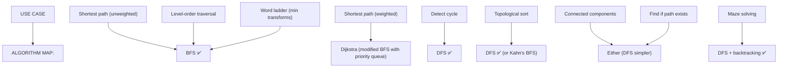
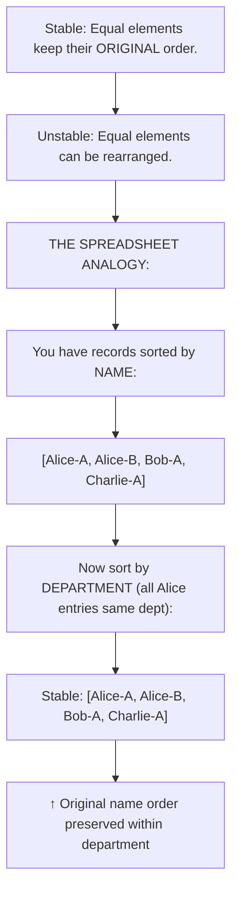
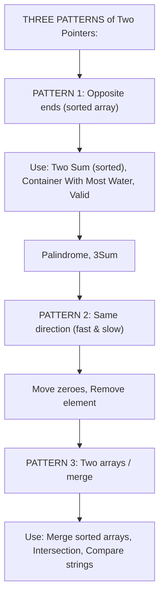
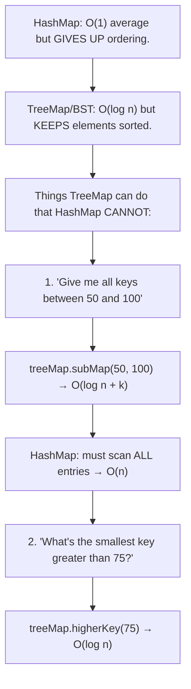
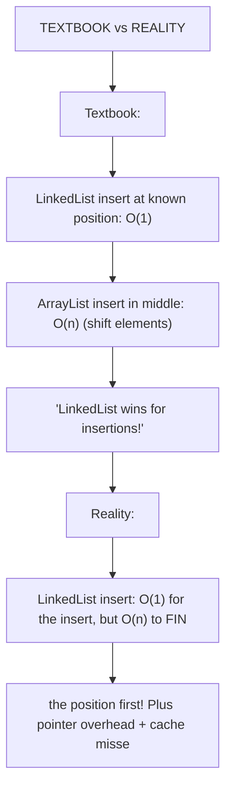

> **Navigation**: [< Previous](15_Monotonic_Stack_Queue_Complete.md) | [Back to Index](../00_MASTER_INDEX.md) | [Next >](17_DSA_Java_Implementation_Mastery.md)

# Chapter 16 — DSA Deep Reasoning: The Questions That Freeze People

> **"Anyone can say 'Binary search is O(log n).' The senior engineer explains WHY HashMap isn't always O(1), WHEN quicksort beats mergesort, and HOW to choose between BFS and DFS without memorizing."**

---

## Table of Contents

1. [Big O: Not Just "How Fast" — What It Actually Measures](#1-big-o-not-just-how-fast--what-it-actually-measures)
2. [Why HashMap Isn't Always O(1)](#2-why-hashmap-isnt-always-o1)
3. [Quicksort vs Mergesort: Why Quicksort Wins In Practice](#3-quicksort-vs-mergesort-why-quicksort-wins-in-practice)
4. [BFS vs DFS: The Decision Framework That Replaces Memorization](#4-bfs-vs-dfs-the-decision-framework-that-replaces-memorization)
5. [Dynamic Programming vs Greedy: How To Know Which One](#5-dynamic-programming-vs-greedy-how-to-know-which-one)
6. [Recursion: Why It Overflows and When To Convert To Iteration](#6-recursion-why-it-overflows-and-when-to-convert-to-iteration)
7. [Stable vs Unstable Sort: Why It Matters In Real Systems](#7-stable-vs-unstable-sort-why-it-matters-in-real-systems)
8. [Two Pointers: Not Just "Left and Right"](#8-two-pointers-not-just-left-and-right)
9. [Why Balanced BST When We Have HashMap](#9-why-balanced-bst-when-we-have-hashmap)
10. [The Array vs LinkedList Reality: Cache Lines Matter](#10-the-array-vs-linkedlist-reality-cache-lines-matter)

---

## 1. Big O: Not Just "How Fast" — What It Actually Measures

### The Freeze Question
> "What does O(n log n) actually mean? Is O(1) always fast?"

### Deep Reasoning


> Big O measures GROWTH RATE, not speed.
>
> THE RESTAURANT ANALOGY:
> O(1): Microwave — same time whether 1 item or party of 100.
> But that "constant" time could be 5 minutes!
> O(n): Grill — time grows linearly with order count.
> O(n²): Handshake — each person shakes hands with everyone.
> O(log n): Phone book — eliminate half each step.
> O(n log n): Sort each order, then serve in order.
>
> KEY INSIGHTS people miss:
> 1. O(1) can be SLOWER than O(n) for small n.
> HashMap O(1) with 10 items: compute hash, check bucket...
> Array scan O(n) with 10 items: just check 10 elements.
> Array scan wins! Overhead of hashing > scanning 10 items.
>
> 2. Constants matter in practice:
> O(n) with constant 1000 → 1000n
> O(n²) with constant 0.001 → 0.001n²
> Below n=1,000,000, the "slower" algorithm is faster!
>
> 3. Big O describes WORST CASE (usually). Average case exists:
> Quicksort: O(n²) worst, O(n log n) average
> HashMap: O(n) worst, O(1) average


---

## 2. Why HashMap Isn't Always O(1)

### The Freeze Question
> "HashMap is O(1) for get and put, right?"


> THE FILING CABINET (from Java chapter, deeper here):
>
> BEST CASE O(1): Each key goes to a unique bucket.
> hash("Alice") → bucket 3, hash("Bob") → bucket 7
> Direct access. No searching.
>
> WORST CASE O(n): All keys hash to SAME bucket.
> hash("Alice") → bucket 3, hash("Bob") → bucket 3,
> hash("Charlie") → bucket 3...
> Now bucket 3 is a linked list → must scan all entries.
> (Java 8: converts to tree at 8 entries → O(log n) worst case)
>
> WHEN THIS HAPPENS IN REAL LIFE:
> 1. Bad hashCode that returns same value for many keys
> 2. Hash collision attack (adversarial input)
> 3. Resizing threshold — when load factor > 0.75, all
> entries rehashed → O(n) for that one operation
>
> AMORTIZED O(1): Most operations are O(1). Occasionally O(n)
> for resize. Spread across all operations → amortized O(1).
>
> Like rent: You pay $12,000/year in one lump (O(n) resize).
> Amortized: $1,000/month (O(1) per operation).


---

## 3. Quicksort vs Mergesort: Why Quicksort Wins In Practice

### The Freeze Question
> "Mergesort is O(n log n) guaranteed. Quicksort is O(n²) worst case. Why do we use Quicksort?"


> THE MOVING HOUSE ANALOGY
>
> Mergesort: Hire a moving company with warehouses.
> → Always O(n log n) ✅
> → Needs O(n) extra space (the warehouse!) ❌
> → Lots of copying between warehouse and house
> → Cache-unfriendly (data jumps between locations)
>
> Quicksort: Sort everything IN your house.
> → O(n log n) average, O(n²) worst ⚠️
> → O(log n) extra space (just the recursion stack) ✅
> → IN-PLACE — data stays where it is
> → CACHE-FRIENDLY — sequential access patterns
> → Smaller constant factor (fewer swaps, less overhead)
>
> WHY CACHE MATTERS:
> CPU cache loads adjacent memory. Quicksort accesses elements
> near each other → cache hits. Mergesort copies between
> arrays → cache misses. This is 2-3x difference in practice!
>
> REAL-WORLD:
> Java Arrays.sort(primitives) → Dual-Pivot Quicksort
> Java Arrays.sort(objects) → TimSort (merge-based, stable)
> Why? Objects are references → cache doesn't matter as much.
> Stability matters for objects. Quicksort is unstable.


---

## 4. BFS vs DFS: The Decision Framework That Replaces Memorization

### The Freeze Question
> "When do you use BFS vs DFS?"


> THE BUILDING SEARCH ANALOGY
>
> BFS (Breadth-First) = Floor by floor
> → Check ALL rooms on floor 1, then ALL on floor 2, then 3...
> → Uses a QUEUE (FIFO)
> → Memory: O(width of widest level)
>
> DFS (Depth-First) = Follow one corridor to the end
> → Go down one hallway to the end, backtrack, try next
> → Uses a STACK (or recursion)
> → Memory: O(depth of deepest path)
>
> DECISION FRAMEWORK:
>
> "Is the answer CLOSE to the start?" → BFS
> (Shortest path, level-order, minimum steps)
>
> "Is the answer at the END/LEAF?" → DFS
> (Path exists?, all paths, backtracking, has cycle?)
>
> "Need SHORTEST path?" → BFS (always)
> "Need ALL possible paths?" → DFS (backtracking)
> "Tree is very DEEP?" → BFS (DFS might stack overflow)
> "Tree is very WIDE?" → DFS (BFS uses too much memory)
> "Need LEVEL-BY-LEVEL?" → BFS (naturally gives levels)


```
USE CASE → ALGORITHM MAP:

Shortest path (unweighted)    → BFS ✅
Shortest path (weighted)      → Dijkstra (modified BFS with priority queue)
Detect cycle                  → DFS ✅
Topological sort              → DFS ✅ (or Kahn's BFS)
Connected components          → Either (DFS simpler)
Level-order traversal         → BFS ✅
Find if path exists           → Either (DFS simpler)
Maze solving                  → DFS + backtracking ✅
Word ladder (min transforms)  → BFS ✅
```

> **Flow**: USE CASE → ALGORITHM MAP: | Shortest path (unweighted) → BFS ✅ | Shortest path (weighted) → Dijkstra (modified BFS with priority queue) | Detect cycle → DFS ✅ | Topological sort → DFS ✅ (or Kahn's BFS) | Connected components → Either (DFS simpler) | ...+4 more



---

## 5. Dynamic Programming vs Greedy: How To Know Which One

### The Freeze Question
> "When do I use DP vs greedy?"


> THE ROAD TRIP ANALOGY
>
> Greedy = GPS with "always take the fastest road NOW"
> → Makes the locally optimal choice at each step
> → NEVER reconsiders past decisions
> → Fast: usually O(n log n) or O(n)
> → Works ONLY when local optimum → global optimum
>
> DP = Exploring ALL routes and picking the overall best
> → Considers all options, remembers results (memoization)
> → CAN reconstruct the optimal path
> → Slower: usually O(n²) or O(n × m)
> → Works for OVERLAPPING subproblems + optimal substructure
>
> HOW TO TELL:
> 1. Can a greedy counterexample be found?
> Coin change: coins [1, 3, 4], target 6
> Greedy: 4+1+1 = 3 coins
> Optimal: 3+3 = 2 coins → Greedy FAILS → Use DP
>
> 2. Does the problem have optimal substructure?
> "Can I build the answer from answers to smaller problems?"
> YES + overlapping subproblems → DP
> YES + greedy choice property → Greedy
>
> GREEDY WORKS: Activity selection, Huffman, Kruskal, Dijkstra
> DP NEEDED: Knapsack, LCS, Edit distance, Matrix chain


---

## 6. Recursion: Why It Overflows and When To Convert To Iteration

### The Freeze Question
> "Why does my recursive solution get StackOverflowError?"


> THE STACK OF PLATES ANALOGY
>
> Each recursive call = a new plate on the stack
> Each plate holds: local variables, return address
> Stack has limited height (usually ~10,000 frames in Java)
>
> factorial(100000) → 100,000 plates → stack overflow!
>
> SOLUTIONS:
> 1. Convert to iteration (use explicit stack/loop)
> 2. Tail recursion (only works in languages that optimize it
> — Java does NOT optimize tail calls, Kotlin/Scala do)
> 3. Increase stack size (-Xss2m) — band-aid, not a fix
> 4. Use DP (memoization) to reduce redundant calls


```java
// Fibonacci: The classic "why recursion is slow" example
// Naive recursion: O(2^n) — exponential! Redundant calculations.
int fib(int n) {
    if (n <= 1) return n;
    return fib(n-1) + fib(n-2); // fib(3) computed millions of times
}

// Memoization (top-down DP): O(n) — each subproblem solved ONCE
int fib(int n, int[] memo) {
    if (n <= 1) return n;
    if (memo[n] != 0) return memo[n]; // Already computed? Return it!
    memo[n] = fib(n-1, memo) + fib(n-2, memo);
    return memo[n];
}

// Iteration (bottom-up DP): O(n), O(1) space — no stack at all
int fib(int n) {
    if (n <= 1) return n;
    int prev2 = 0, prev1 = 1;
    for (int i = 2; i <= n; i++) {
        int curr = prev1 + prev2;
        prev2 = prev1;
        prev1 = curr;
    }
    return prev1;
}
```

---

## 7. Stable vs Unstable Sort: Why It Matters In Real Systems

### The Freeze Question
> "What's a stable sort and when does it matter?"

```
╔══════════════════════════════════════════════════════════════════╗
║  Stable: Equal elements keep their ORIGINAL order.               ║
║  Unstable: Equal elements can be rearranged.                     ║
║                                                                  ║
║  THE SPREADSHEET ANALOGY:                                        ║
║                                                                  ║
║  You have records sorted by NAME:                                ║
║  [Alice-A, Alice-B, Bob-A, Charlie-A]                            ║
║                                                                  ║
║  Now sort by DEPARTMENT (all Alice entries same dept):           ║
║  Stable:   [Alice-A, Alice-B, Bob-A, Charlie-A]                  ║
║             ↑ Original name order preserved within department    ║
║  Unstable: [Alice-B, Alice-A, Bob-A, Charlie-A]                  ║
║             ↑ Alice's might swap — previous sort lost!           ║
║                                                                  ║
║  WHEN IT MATTERS:                                                ║
║  • Multi-column sorting (sort by city, then by name)             ║
║  • Database ORDER BY with ties                                   ║
║  • UI tables where user sorts by multiple columns                ║
║  • Any time relative order of "equal" elements has meaning       ║
║                                                                  ║
║  STABLE: Merge sort, Insertion sort, TimSort, Bubble sort        ║
║  UNSTABLE: Quicksort, Heap sort, Selection sort                  ║
╚══════════════════════════════════════════════════════════════════╝
```

> **Flow**: Stable: Equal elements keep their ORIGINAL order. → Unstable: Equal elements can be rearranged. | Unstable: Equal elements can be rearranged. → THE SPREADSHEET ANALOGY: | THE SPREADSHEET ANALOGY: → You have records sorted by NAME: | You have records sorted by NAME: → [Alice-A, Alice-B, Bob-A, Charlie-A] | [Alice-A, Alice-B, Bob-A, Charlie-A] → Now sort by DEPARTMENT (all Alice entries same dept): | Now sort by DEPARTMENT (all Alice entries same dept): → Stable: [Alice-A, Alice-B, Bob-A, Charlie-A] | ...+1 more



---

## 8. Two Pointers: Not Just "Left and Right"

### The Freeze Question
> "When and how to use the two-pointer technique?"

```
╔══════════════════════════════════════════════════════════════════╗
║  THREE PATTERNS of Two Pointers:                                 ║
║                                                                  ║
║  PATTERN 1: Opposite ends (sorted array)                         ║
║  [1, 3, 5, 7, 9]                                                 ║
║   L→          ←R                                                 ║
║  Use: Two Sum (sorted), Container With Most Water, Valid         ║
║       Palindrome, 3Sum                                           ║
║                                                                  ║
║  PATTERN 2: Same direction (fast & slow)                         ║
║  [1, 1, 2, 3, 3, 4]                                              ║
║   S  F→                                                          ║
║  Use: Remove duplicates, Linked list cycle detection (Floyd's),  ║
║       Move zeroes, Remove element                                ║
║                                                                  ║
║  PATTERN 3: Two arrays / merge                                   ║
║  [1, 3, 5]  [2, 4, 6]                                            ║
║   i→          j→                                                 ║
║  Use: Merge sorted arrays, Intersection, Compare strings         ║
║                                                                  ║
║  WHY IT WORKS: Reduces O(n²) brute force to O(n) by              ║
║  eliminating impossible pairs. Each pointer moves one direction  ║
║  → total work is O(n), not O(n²).                                ║
╚══════════════════════════════════════════════════════════════════╝
```

> **Flow**: THREE PATTERNS of Two Pointers: → PATTERN 1: Opposite ends (sorted array) | PATTERN 1: Opposite ends (sorted array) → Use: Two Sum (sorted), Container With Most Water, Valid | Use: Two Sum (sorted), Container With Most Water, Valid → Palindrome, 3Sum | Palindrome, 3Sum → PATTERN 2: Same direction (fast & slow) | PATTERN 2: Same direction (fast & slow) → Move zeroes, Remove element | Move zeroes, Remove element → PATTERN 3: Two arrays / merge | ...+1 more



---

## 9. Why Balanced BST When We Have HashMap

### The Freeze Question
> "If HashMap is O(1), why would anyone use a TreeMap/BST?"

```
╔══════════════════════════════════════════════════════════════════╗
║  HashMap: O(1) average but GIVES UP ordering.                    ║
║  TreeMap/BST: O(log n) but KEEPS elements sorted.                ║
║                                                                  ║
║  Things TreeMap can do that HashMap CANNOT:                      ║
║                                                                  ║
║  1. "Give me all keys between 50 and 100"                        ║
║     treeMap.subMap(50, 100)     → O(log n + k)                   ║
║     HashMap: must scan ALL entries → O(n)                        ║
║                                                                  ║
║  2. "What's the smallest key greater than 75?"                   ║
║     treeMap.higherKey(75)       → O(log n)                       ║
║     HashMap: scan all → O(n)                                     ║
║                                                                  ║
║  3. "What's the min/max key?"                                    ║
║     treeMap.firstKey() / lastKey() → O(log n)                    ║
║     HashMap: scan all → O(n)                                     ║
║                                                                  ║
║  4. "Iterate in sorted order"                                    ║
║     TreeMap: naturally sorted                                    ║
║     HashMap: random order, must sort separately O(n log n)       ║
║                                                                  ║
║  RULE: Need only lookup by key? → HashMap.                       ║
║        Need ordering, ranges, min/max? → TreeMap.                ║
╚══════════════════════════════════════════════════════════════════╝
```

> **Flow**: HashMap: O(1) average but GIVES UP ordering. → TreeMap/BST: O(log n) but KEEPS elements sorted. | TreeMap/BST: O(log n) but KEEPS elements sorted. → Things TreeMap can do that HashMap CANNOT: | Things TreeMap can do that HashMap CANNOT: → 1. 'Give me all keys between 50 and 100' | 1. 'Give me all keys between 50 and 100' → treeMap.subMap(50, 100) → O(log n + k) | treeMap.subMap(50, 100) → O(log n + k) → HashMap: must scan ALL entries → O(n) | HashMap: must scan ALL entries → O(n) → 2. 'What's the smallest key greater than 75?' | ...+1 more



---

## 10. The Array vs LinkedList Reality: Cache Lines Matter

### The Freeze Question
> "Textbook says LinkedList has O(1) insertion. Why does everyone use ArrayList?"

```
╔══════════════════════════════════════════════════════════════════╗
║  TEXTBOOK vs REALITY                                             ║
║                                                                  ║
║  Textbook:                                                       ║
║  LinkedList insert at known position: O(1)                       ║
║  ArrayList insert in middle: O(n) (shift elements)               ║
║  "LinkedList wins for insertions!"                               ║
║                                                                  ║
║  Reality:                                                        ║
║  LinkedList insert: O(1) for the insert, but O(n) to FIND        ║
║  the position first! Plus pointer overhead + cache misses.       ║
║                                                                  ║
║  THE SUPERMARKET SHELF ANALOGY:                                  ║
║  Array = Items on a shelf, side by side.                         ║
║  → To find item 50: grab from shelf position 50. Instant.        ║
║  → To insert in middle: shift everything right. Slow.            ║
║  → But CPU cache loads the whole shelf area. Traversal is FAST.  ║
║                                                                  ║
║  LinkedList = Items in boxes, each with a note saying            ║
║  "next box is in aisle 47, shelf 3."                             ║
║  → To insert: change one note. Fast.                             ║
║  → To find item 50: follow 50 notes. Slow.                       ║
║  → Each next pointer jumps to random memory. Cache MISSES.       ║
║                                                                  ║
║  BENCHMARK REALITY:                                              ║
║  ArrayList is faster than LinkedList for ALMOST everything       ║
║  in practice due to CPU cache efficiency. LinkedList only wins   ║
║  for frequent add/remove at BOTH ends (use ArrayDeque instead).  ║
║                                                                  ║
║  Java's own guidance: "Use ArrayList. Use LinkedList only if     ║
║  you specifically need a doubly-linked list."                    ║
╚══════════════════════════════════════════════════════════════════╝
```

> **Flow**: TEXTBOOK vs REALITY → Textbook: | Textbook: → LinkedList insert at known position: O(1) | LinkedList insert at known position: O(1) → ArrayList insert in middle: O(n) (shift elements) | ArrayList insert in middle: O(n) (shift elements) → 'LinkedList wins for insertions!' | 'LinkedList wins for insertions!' → Reality: | Reality: → LinkedList insert: O(1) for the insert, but O(n) to FIN | ...+1 more



---

## Interview Quick-Fire: DSA Freeze Busters

| Freeze Question | Senior-Level Answer |
|----------------|-------------------|
| "What's amortized O(1)?" | Most operations are O(1), but occasionally O(n) (like ArrayList resize). Spread that rare O(n) across all operations → averages to O(1) each. Like paying rent monthly vs annually — same total cost. |
| "Best sorting algorithm?" | Depends. General purpose: TimSort (Java's default). Nearly sorted: Insertion sort. Memory constrained: Heapsort (in-place, O(1) space). Small arrays (< 47 elements): Insertion sort (less overhead). |
| "What's a hash collision?" | Two different keys produce the same hash bucket index. Resolved by chaining (linked list/tree in bucket) or open addressing (probe next slot). Good hash functions minimize but can't eliminate collisions. |
| "Stack vs Queue use cases?" | Stack: undo/redo, function calls, DFS, parenthesis matching, back button. Queue: BFS, task scheduling, print queue, request buffering, message queues. |
| "When to use Heap/PriorityQueue?" | When you frequently need the min/max element: Top-K problems, Dijkstra, merge K sorted lists, median finding. O(log n) insert/extract vs O(n) for sorted array insert. |

---

## 11. DSA in Real-World Production Systems — What Companies Actually Use

### The Interview Angle
> "Give me a real-world example where you'd use [data structure/algorithm]."

This question tests whether you can bridge theory to practice. Here's a comprehensive map:

```
┌───────────────────────────────────────────────────────────────────────────────┐
│          DATA STRUCTURE → REAL-WORLD PRODUCTION USE CASES                     │
├────────────────┬──────────────────────────────────────────────────────────────┤
│ HashMap        │ • Session stores (sessionId → userData)                     │
│                │ • Database connection pooling (key → connection)            │
│                │ • API rate limiting (IP → request count per window)         │
│                │ • Feature flags (flagName → enabled/disabled)               │
│                │ • LRU Cache (HashMap + doubly-linked list)                  │
│                │ • Deduplication in event streaming (eventId → seen?)        │
├────────────────┼──────────────────────────────────────────────────────────────┤
│ TreeMap /      │ • Order books in trading systems (price → orders)           │
│ Balanced BST   │ • Time-series indexing (timestamp → data, range queries)   │
│                │ • Scheduling (start time → task, find next available)       │
│                │ • Autocomplete / prefix matching (via Trie, a tree variant)│
├────────────────┼──────────────────────────────────────────────────────────────┤
│ Heap /         │ • Task schedulers (OS, Kubernetes) — highest priority first│
│ PriorityQueue  │ • Top-K: "top 10 trending products" from millions          │
│                │ • Dijkstra's algorithm in GPS/map routing                   │
│                │ • Merge K sorted log streams in distributed systems        │
│                │ • Median maintenance in real-time analytics                │
├────────────────┼──────────────────────────────────────────────────────────────┤
│ Stack          │ • Call stack (every function call in every program)         │
│                │ • Undo/Redo (text editors, Photoshop, Git)                  │
│                │ • Expression parsing (compilers, calculators)               │
│                │ • Browser back/forward navigation                           │
│                │ • Syntax validation (HTML/XML tag matching, JSON parsing)   │
├────────────────┼──────────────────────────────────────────────────────────────┤
│ Queue          │ • Message queues (RabbitMQ, Kafka consumer groups)          │
│                │ • Request buffering in web servers                          │
│                │ • BFS in social network "People You May Know"              │
│                │ • Print job scheduling                                      │
│                │ • Task queues (Celery, Sidekiq)                             │
├────────────────┼──────────────────────────────────────────────────────────────┤
│ Graph          │ • Social networks (friend connections, followers)           │
│                │ • Google Maps (shortest path, traffic routing)              │
│                │ • Dependency resolution (Maven/Gradle, package managers)    │
│                │ • Recommendation engines (collaborative filtering)          │
│                │ • Network topology (routing, load balancing)                │
├────────────────┼──────────────────────────────────────────────────────────────┤
│ Trie           │ • Autocomplete in search bars (Google, IDE)                │
│                │ • Spell checkers                                            │
│                │ • IP routing tables (longest prefix match)                  │
│                │ • Dictionary implementations                                │
├────────────────┼──────────────────────────────────────────────────────────────┤
│ Bloom Filter   │ • "Has this user seen this ad?" (billions of checks)       │
│                │ • Database query optimization (is key possibly in table?)   │
│                │ • Malicious URL detection in browsers                       │
│                │ • Deduplication in web crawlers                              │
└────────────────┴──────────────────────────────────────────────────────────────┘

┌───────────────────────────────────────────────────────────────────────────────┐
│          ALGORITHM → REAL-WORLD PRODUCTION USE CASES                         │
├────────────────┬──────────────────────────────────────────────────────────────┤
│ Binary Search  │ • Database index lookups (B-Tree is generalized binary     │
│                │   search)                                                   │
│                │ • Git bisect (find the commit that introduced a bug)        │
│                │ • Version selection (find latest compatible version)        │
│                │ • Rate limiting (finding the right bucket in log-scale)     │
├────────────────┼──────────────────────────────────────────────────────────────┤
│ Sorting        │ • Database ORDER BY                                         │
│                │ • Rendering layers (z-index sorting in game engines)        │
│                │ • Leaderboards (ranking users by score)                     │
│                │ • Event processing (sort by timestamp before processing)   │
├────────────────┼──────────────────────────────────────────────────────────────┤
│ BFS / DFS      │ • Web crawlers (BFS: crawl breadth-first from seed URLs)   │
│                │ • Garbage collection (DFS: mark-and-sweep algorithm)        │
│                │ • File system traversal (find, du, ls -R)                   │
│                │ • Social network "degrees of separation" (BFS)             │
├────────────────┼──────────────────────────────────────────────────────────────┤
│ Dynamic Prog.  │ • Diff algorithms (computing file diffs — Edit Distance)   │
│                │ • Resource allocation (Knapsack: cloud cost optimization)   │
│                │ • Speech recognition (Viterbi algorithm)                    │
│                │ • DNA sequence alignment (LCS variant)                      │
├────────────────┼──────────────────────────────────────────────────────────────┤
│ Greedy         │ • Huffman encoding (data compression in ZIP, GZIP)          │
│                │ • Network routing (Dijkstra, Prim's MST for network design)│
│                │ • Job scheduling (earliest deadline first)                  │
│                │ • Coin change (when denominations are canonical, e.g., USD)│
├────────────────┼──────────────────────────────────────────────────────────────┤
│ Hashing        │ • Password storage (bcrypt/argon2 hash)                     │
│                │ • Data integrity (checksums: MD5, SHA-256)                  │
│                │ • Consistent hashing in distributed caches (Redis cluster)  │
│                │ • Load balancing (hash IP → server)                         │
├────────────────┼──────────────────────────────────────────────────────────────┤
│ Two Pointers   │ • Merge step in external sort (merging sorted file chunks) │
│                │ • Stream processing (sliding window on event streams)       │
│                │ • Network packet assembly (ordered reassembly)              │
├────────────────┼──────────────────────────────────────────────────────────────┤
│ Union-Find     │ • Network connectivity (are two computers connected?)      │
│                │ • Image processing (connected component labeling)           │
│                │ • Kruskal's MST for network cable minimization              │
└────────────────┴──────────────────────────────────────────────────────────────┘
```

---

## 12. How to Articulate DSA Solutions in Interviews — The Framework

### The #1 Mistake: Jumping to Code

Most candidates immediately start coding. Senior candidates **talk first, code last**. Here's the proven framework:

```
╔══════════════════════════════════════════════════════════════════╗
║  THE 5-STEP INTERVIEW ARTICULATION FRAMEWORK                     ║
║                                                                  ║
║  STEP 1 — CLARIFY (1-2 minutes)                                  ║
║  "Before I start, let me clarify the constraints..."              ║
║  • Input size? (determines acceptable complexity)                 ║
║  • Sorted? Unique? Negative numbers? Empty input?                 ║
║  • Return what exactly? Index, value, count, boolean?             ║
║  • In-place modification or new output?                           ║
║                                                                  ║
║  STEP 2 — BRUTE FORCE + COMPLEXITY (1 minute)                    ║
║  "The brute force approach would be..."                           ║
║  • State the obvious O(n²) or O(2^n) solution                    ║
║  • Explain WHY it's slow (nested loops, redundant work)           ║
║  • This shows you understand the baseline                         ║
║                                                                  ║
║  STEP 3 — OPTIMIZE with REASONING (2-3 minutes)                  ║
║  "We can do better because..." (THIS IS THE KEY MOMENT)           ║
║  • Identify the REDUNDANCY in brute force                         ║
║  • Explain the INSIGHT that eliminates it                         ║
║  • State the pattern: "This is a sliding window because..."       ║
║  • Give time/space complexity with JUSTIFICATION                  ║
║                                                                  ║
║  STEP 4 — WALK THROUGH EXAMPLE (1-2 minutes)                     ║
║  "Let me trace through an example..."                             ║
║  • Use a small, non-trivial example                               ║
║  • Show each step of your algorithm                               ║
║  • Prove it handles edge cases                                    ║
║                                                                  ║
║  STEP 5 — CODE + TEST (remaining time)                            ║
║  • Write clean, well-named code                                   ║
║  • Talk while coding: "I'm using a HashMap here because..."       ║
║  • Test with edge cases: empty input, single element, all same   ║
╚══════════════════════════════════════════════════════════════════╝
```

### How to Explain Complexity with Math Logic

Don't just say "it's O(n log n)." Explain **why**:

```
╔══════════════════════════════════════════════════════════════════╗
║  PATTERN: "It's O(X) BECAUSE..."                                 ║
║                                                                  ║
║  Two Pointers O(n):                                               ║
║  "Each pointer moves at most n steps total. Left pointer moves   ║
║   right, right pointer moves left, they meet in the middle.      ║
║   Total moves ≤ 2n = O(n)."                                      ║
║                                                                  ║
║  Sliding Window O(n):                                             ║
║  "Each element enters the window at most once (right pointer)    ║
║   and leaves at most once (left pointer). Total operations ≤ 2n  ║
║   = O(n). This is AMORTIZED — some iterations do more work,     ║
║   but averaged across all iterations, it's constant per element."║
║                                                                  ║
║  Binary Search O(log n):                                          ║
║  "Each comparison eliminates HALF the remaining search space.    ║
║   Starting from n elements: n → n/2 → n/4 → ... → 1.            ║
║   How many halvings to reach 1? log₂(n). So at most log₂(n)     ║
║   comparisons."                                                  ║
║                                                                  ║
║  Merge Sort O(n log n):                                           ║
║  "We divide the array in half (log n levels of recursion).       ║
║   At each level, we merge all elements = O(n) work per level.    ║
║   Total = n work × log n levels = O(n log n)."                   ║
║                                                                  ║
║  HashMap O(1) amortized:                                          ║
║  "Hash computation is O(1). With a good hash function and load   ║
║   factor < 0.75, each bucket has O(1) entries on average.        ║
║   Resizing is O(n) but happens every n insertions → amortized    ║
║   cost per insertion = O(n)/n = O(1)."                           ║
║                                                                  ║
║  DFS/BFS O(V + E):                                                ║
║  "We visit each vertex exactly once (O(V)) and examine each     ║
║   edge exactly once (O(E)). Total = O(V + E)."                   ║
║                                                                  ║
║  DP O(n × m):                                                     ║
║  "We fill an n × m table. Each cell requires O(1) to compute    ║
║   (lookup previously computed cells). Total = n × m cells ×      ║
║   O(1) per cell = O(n × m)."                                     ║
╚══════════════════════════════════════════════════════════════════╝
```

### How to Explain "WHY This Approach" — Not Just "What"

```
╔══════════════════════════════════════════════════════════════════╗
║  INSTEAD OF                → SAY THIS                            ║
║                                                                  ║
║  "I'll use a HashMap"      → "The brute force checks every pair ║
║                               O(n²). A HashMap lets me check    ║
║                               'have I seen the complement?'     ║
║                               in O(1), reducing to O(n)."       ║
║                                                                  ║
║  "I'll sort the array"     → "Sorting gives us a monotonic      ║
║                               property: if arr[i]+arr[j] is too ║
║                               large, we know arr[i]+arr[j+1]    ║
║                               is also too large. This lets us   ║
║                               eliminate candidates without      ║
║                               checking, giving O(n) after the   ║
║                               O(n log n) sort."                 ║
║                                                                  ║
║  "I'll use DP"             → "I notice overlapping subproblems: ║
║                               fib(5) computes fib(3) twice.     ║
║                               By storing results, each          ║
║                               subproblem is solved once. This   ║
║                               reduces from O(2^n) to O(n)."     ║
║                                                                  ║
║  "I'll use a stack"        → "This problem has a NESTING        ║
║                               structure — each open must match  ║
║                               its closest unmatched close. A    ║
║                               stack naturally tracks 'most      ║
║                               recent unmatched', giving O(n)."  ║
║                                                                  ║
║  "I'll use BFS"            → "We need the SHORTEST path in an   ║
║                               unweighted graph. BFS explores    ║
║                               level by level — the first time   ║
║                               we reach a node IS the shortest   ║
║                               path to it. DFS might find a      ║
║                               longer path first."               ║
║                                                                  ║
║  "I'll use a heap"         → "We need the K largest elements.   ║
║                               Sorting all n elements is         ║
║                               O(n log n). A min-heap of size K  ║
║                               keeps only the K largest: insert  ║
║                               each element and evict the min if ║
║                               heap size > K. Total: O(n log K)  ║
║                               which is better when K << n."     ║
╚══════════════════════════════════════════════════════════════════╝
```

---

## 13. Anti-Patterns — WHY NOT to Do Certain Things

### Common DSA Anti-Patterns That Lose Interviews

```
╔══════════════════════════════════════════════════════════════════╗
║  ANTI-PATTERN 1: Using HashMap When Sorting Is Simpler           ║
║                                                                  ║
║  Problem: "Find if array has duplicates"                          ║
║  ❌ Overkill: HashMap O(n) time, O(n) space                      ║
║  ✅ Better: Sort first O(n log n), then check adjacent O(n)      ║
║     → Same effective speed, O(1) extra space (in-place sort)     ║
║                                                                  ║
║  WHEN HashMap IS better: When you need the COUNT of each         ║
║  element, or when the original order matters (sorting destroys   ║
║  it), or when the data is streaming and you can't sort.          ║
╚══════════════════════════════════════════════════════════════════╝

╔══════════════════════════════════════════════════════════════════╗
║  ANTI-PATTERN 2: Premature Optimization                          ║
║                                                                  ║
║  Problem: Input size is ≤ 100                                     ║
║  ❌ Bad: "I'll use a Segment Tree for O(log n) range queries"     ║
║  ✅ Good: "n ≤ 100, so O(n²) brute force takes 10,000 ops —     ║
║     perfectly fine. Simpler code = fewer bugs = faster delivery." ║
║                                                                  ║
║  RULE: If n ≤ 1000, O(n²) is fine (~10⁶ ops).                   ║
║        If n ≤ 10⁶, need O(n log n) (~2×10⁷ ops).                ║
║        If n ≤ 10⁸, need O(n) (~10⁸ ops).                        ║
║        ~10⁸ operations per second is a safe estimate.             ║
╚══════════════════════════════════════════════════════════════════╝

╔══════════════════════════════════════════════════════════════════╗
║  ANTI-PATTERN 3: Using Recursion Without Considering Stack       ║
║                                                                  ║
║  Problem: Tree traversal on very deep tree (100,000+ nodes)      ║
║  ❌ Bad: Recursive DFS → StackOverflowError at ~10,000 depth     ║
║  ✅ Good: Iterative DFS with explicit stack (no depth limit)     ║
║                                                                  ║
║  WHEN recursion IS fine: Balanced trees (depth ≤ log₂(n) ≈ 20   ║
║  for 1 million nodes), problems with small n, or when the        ║
║  recursive solution is dramatically clearer.                     ║
╚══════════════════════════════════════════════════════════════════╝

╔══════════════════════════════════════════════════════════════════╗
║  ANTI-PATTERN 4: Greedy When DP Is Needed                        ║
║                                                                  ║
║  Problem: "Minimum coins to make change"                          ║
║  Coins = [1, 3, 4], target = 6                                   ║
║  ❌ Greedy: Take largest first → 4+1+1 = 3 coins                 ║
║  ✅ DP: Considers all options → 3+3 = 2 coins                    ║
║                                                                  ║
║  HOW TO DETECT: Try to find a counterexample. If "always take    ║
║  the locally best choice" fails for ANY input, you need DP.      ║
║  Greedy works ONLY when local optimum = global optimum, which    ║
║  requires mathematical proof (exchange argument or greedy stays  ║
║  ahead argument).                                                ║
╚══════════════════════════════════════════════════════════════════╝

╔══════════════════════════════════════════════════════════════════╗
║  ANTI-PATTERN 5: BFS When DFS Is Correct (and Vice Versa)        ║
║                                                                  ║
║  Problem: "Does a path exist from A to B?"                        ║
║  ❌ Using BFS: Correct but wastes O(width) memory on wide graphs ║
║  ✅ Using DFS: Same correctness, O(depth) memory — much less     ║
║                                                                  ║
║  Problem: "What's the shortest path from A to B?"                 ║
║  ❌ Using DFS: May find a path, but NOT guaranteed shortest!     ║
║  ✅ Using BFS: Level-by-level = first path found IS shortest     ║
║     (in unweighted graphs)                                       ║
║                                                                  ║
║  MATHEMATICAL PROOF — BFS gives shortest path:                    ║
║  BFS explores nodes in order of distance from source.            ║
║  At step k, all nodes at distance k are in the queue.            ║
║  If node v is first dequeued at step k, no shorter path exists   ║
║  (otherwise v would have been seen at step < k). □               ║
╚══════════════════════════════════════════════════════════════════╝

╔══════════════════════════════════════════════════════════════════╗
║  ANTI-PATTERN 6: Using Sets/Maps for Tiny Data                   ║
║                                                                  ║
║  Problem: "Check if char is a vowel"                              ║
║  ❌ Overkill: Set<Character> vowels = Set.of('a','e','i','o','u')║
║     → Hash computation + set lookup for 5 elements!              ║
║  ✅ Better: "aeiouAEIOU".indexOf(c) >= 0                         ║
║     → Simple string scan, faster for tiny sets                   ║
║  ✅ Best: switch/case or boolean array (O(1) lookup, no hash)    ║
║                                                                  ║
║  RULE OF THUMB: For < ~30 elements, a sorted array with binary   ║
║  search or even a linear scan beats HashMap due to overhead.     ║
╚══════════════════════════════════════════════════════════════════╝

╔══════════════════════════════════════════════════════════════════╗
║  ANTI-PATTERN 7: String Concatenation in Loops                   ║
║                                                                  ║
║  ❌ O(n²): String is immutable in Java. Each += creates a new    ║
║     String object and copies all previous characters.            ║
║     Loop of n iterations: 1+2+3+...+n = n(n+1)/2 = O(n²) chars  ║
║     copied total.                                                ║
║                                                                  ║
║     String result = "";                                           ║
║     for (String s : list) result += s;  // O(n²) !               ║
║                                                                  ║
║  ✅ O(n): StringBuilder uses a resizable char array. Appending   ║
║     is amortized O(1). Total: O(n).                              ║
║                                                                  ║
║     StringBuilder sb = new StringBuilder();                       ║
║     for (String s : list) sb.append(s);  // O(n)                 ║
╚══════════════════════════════════════════════════════════════════╝

╔══════════════════════════════════════════════════════════════════╗
║  ANTI-PATTERN 8: Not Considering Integer Overflow                ║
║                                                                  ║
║  ❌ Bug: int mid = (left + right) / 2;                            ║
║     If left + right > Integer.MAX_VALUE → negative number!       ║
║  ✅ Fix: int mid = left + (right - left) / 2;                    ║
║     Mathematically identical, but never overflows.               ║
║                                                                  ║
║  ❌ Bug: int product = a * b;  // may overflow                    ║
║  ✅ Fix: long product = (long) a * b;  // cast before multiply   ║
║                                                                  ║
║  INTERVIEW TIP: Mentioning overflow handling unprompted shows     ║
║  production experience — interviewers notice.                    ║
╚══════════════════════════════════════════════════════════════════╝
```

---

## 14. Mathematical Proof Techniques for Interviews

### You Don't Need Formal Proofs — But Proof Sketches Win Interviews

```
╔══════════════════════════════════════════════════════════════════╗
║  TECHNIQUE 1: LOOP INVARIANT — Prove Your Algorithm Is Correct   ║
║                                                                  ║
║  A loop invariant is a condition that is TRUE before and after   ║
║  every iteration of a loop. If you can state it, you've proven  ║
║  your algorithm is correct.                                      ║
║                                                                  ║
║  EXAMPLE: Binary Search                                           ║
║  Invariant: "If target exists, it is in arr[left..right]"        ║
║  • Before loop: left=0, right=n-1 → entire array. ✅             ║
║  • Each iteration: mid = (left+right)/2                          ║
║    - If arr[mid] < target → target must be in right half         ║
║      → set left = mid+1. Invariant preserved. ✅                 ║
║    - If arr[mid] > target → target must be in left half          ║
║      → set right = mid-1. Invariant preserved. ✅                ║
║  • Loop ends when left > right → search space is empty           ║
║    → target not found (or was found during loop). ✅             ║
║                                                                  ║
║  INTERVIEW PHRASE: "The invariant I'm maintaining is that        ║
║  [condition]. Each step preserves this by [reasoning]."          ║
╚══════════════════════════════════════════════════════════════════╝

╔══════════════════════════════════════════════════════════════════╗
║  TECHNIQUE 2: CONTRADICTION — Prove No Better Solution Exists    ║
║                                                                  ║
║  "Assume there exists a better solution S*. Show that S* leads  ║
║  to a contradiction, therefore our solution is optimal."          ║
║                                                                  ║
║  EXAMPLE: Two Sum with Sorted Array + Two Pointers               ║
║  Claim: We never skip a valid pair.                               ║
║  Proof: Suppose we skip pair (i,j) where arr[i]+arr[j]=target.  ║
║  • If left passed i: left moved right because                    ║
║    arr[left]+arr[right] < target. Since arr[left] ≤ arr[i]      ║
║    and arr[right] ≥ arr[j], we'd have                            ║
║    arr[i]+arr[j] ≤ arr[i]+arr[right], but arr[left]+arr[right]  ║
║    < target, and we moved left. This means arr[i]+arr[right] ≥  ║
║    target (since i ≥ left), contradiction with arr[left] < need. ║
║  • The monotonic property ensures no valid pair is skipped. □    ║
║                                                                  ║
║  INTERVIEW PHRASE: "This works because if we could skip a valid ║
║  answer, the monotonic property would be violated."              ║
╚══════════════════════════════════════════════════════════════════╝

╔══════════════════════════════════════════════════════════════════╗
║  TECHNIQUE 3: EXCHANGE ARGUMENT — Prove Greedy Works             ║
║                                                                  ║
║  "Take any optimal solution. Show that swapping one element for  ║
║  the greedy choice doesn't make it worse → greedy is optimal."   ║
║                                                                  ║
║  EXAMPLE: Activity Selection (pick max non-overlapping events)   ║
║  Greedy: Always pick the event that ends EARLIEST.                ║
║  Proof: Suppose optimal solution O picks event X first, but      ║
║  greedy picks event G first (G ends earlier or same as X).       ║
║  Replace X with G in O. Since G ends ≤ X, G doesn't conflict    ║
║  with any remaining events in O. So |O| remains the same.       ║
║  We didn't lose any events → greedy is at least as good. □       ║
║                                                                  ║
║  INTERVIEW PHRASE: "Greedy works here because swapping any       ║
║  choice for the greedy choice never reduces the solution quality."║
╚══════════════════════════════════════════════════════════════════╝

╔══════════════════════════════════════════════════════════════════╗
║  TECHNIQUE 4: AMORTIZED ANALYSIS — "Expensive Operations Are     ║
║  Rare, So It Averages Out"                                       ║
║                                                                  ║
║  EXAMPLE: Dynamic Array (ArrayList) resize                        ║
║  • Most append operations: O(1) — just place element             ║
║  • When array is full: O(n) — copy everything to new 2x array   ║
║                                                                  ║
║  "But resize is rare!" How rare?                                  ║
║  Array doubles: size 1→2→4→8→16→...→n                            ║
║  Copies: 1+2+4+8+...+n = 2n-1 total copies for n insertions     ║
║  Amortized cost per insertion: (2n-1)/n ≈ 2 = O(1)              ║
║                                                                  ║
║  EXAMPLE: Sliding Window with inner while-loop                    ║
║  "The while-loop inside the for-loop looks O(n²), but each      ║
║  element enters and leaves the window at most once.              ║
║  Total work across all iterations ≤ 2n = O(n)."                  ║
║                                                                  ║
║  INTERVIEW PHRASE: "This looks like it could be O(n²) because   ║
║  of the nested loop, but each element is processed at most       ║
║  twice (once added, once removed), so the total work across all  ║
║  iterations is O(n) — which is amortized O(1) per element."      ║
╚══════════════════════════════════════════════════════════════════╝
```

---

## 15. Pattern-to-Problem Mapping — The Interview Cheat Sheet

### "I see the problem. Which pattern do I use?"

```
┌───────────────────────────────────────────────────────────────────────────────┐
│  PROBLEM SIGNAL                     → PATTERN TO USE                          │
├─────────────────────────────────────┬─────────────────────────────────────────┤
│ "Find pair with target sum"         │ Two Pointers (sorted) / HashMap (unsorted)│
│ "Longest/shortest substring with X" │ Sliding Window                          │
│ "K-th largest/smallest"             │ Heap (PriorityQueue)                    │
│ "Top K frequent"                    │ HashMap + Heap                          │
│ "Detect cycle"                      │ Floyd's (slow+fast pointer) / DFS       │
│ "Shortest path (unweighted)"        │ BFS                                     │
│ "Shortest path (weighted)"          │ Dijkstra                                │
│ "Number of islands / connected"     │ DFS/BFS on grid / Union-Find            │
│ "All permutations/combinations"     │ Backtracking                            │
│ "Can/Cannot partition"              │ DP (usually knapsack variant)            │
│ "Minimum/Maximum cost/path"         │ DP                                      │
│ "Valid parentheses / nesting"       │ Stack                                   │
│ "Next greater element"              │ Monotonic Stack                         │
│ "Merge intervals / overlapping"     │ Sort by start + sweep                   │
│ "Binary matrix/grid traversal"      │ BFS/DFS with visited array              │
│ "Search in sorted array"            │ Binary Search                           │
│ "Prefix sum questions"              │ Prefix Sum Array / HashMap              │
│ "Find missing/duplicate in 1..n"    │ Cyclic Sort / XOR / Math               │
│ "Build order / task dependencies"   │ Topological Sort (DFS/Kahn's)           │
│ "Palindrome substring"              │ Expand around center / DP               │
│ "Linked list operations"            │ Two Pointers + Dummy Node              │
│ "Level-order / zigzag tree"         │ BFS with level tracking                 │
│ "Serialize/deserialize tree"        │ DFS preorder + delimiter                │
│ "Meeting rooms / intervals"         │ Sort + heap or sweep line               │
│ "Stock buy/sell"                    │ Kadane's / State Machine DP             │
│ "Word search in grid"               │ DFS + Backtracking                      │
│ "LRU/LFU Cache"                    │ HashMap + Doubly Linked List            │
│ "Range sum / update queries"        │ Segment Tree / BIT (Fenwick Tree)      │
│ "String matching"                   │ KMP / Rabin-Karp / Trie                │
└─────────────────────────────────────┴─────────────────────────────────────────┘
```

### Complexity Quick-Reference by Pattern

```
┌───────────────────────────────────────────────────────────────────────────────┐
│  PATTERN                  │ TIME           │ SPACE    │ WHEN TO USE          │
├───────────────────────────┼────────────────┼──────────┼──────────────────────┤
│ Two Pointers              │ O(n)           │ O(1)     │ Sorted or in-place   │
│ Sliding Window            │ O(n)           │ O(k)     │ Contiguous subarray  │
│ Binary Search             │ O(log n)       │ O(1)     │ Sorted, monotonic    │
│ HashMap lookup            │ O(n)           │ O(n)     │ Need fast lookups    │
│ Sorting + scan            │ O(n log n)     │ O(1)*    │ Order matters        │
│ Heap (top-K)              │ O(n log k)     │ O(k)     │ Stream / top-K       │
│ BFS                       │ O(V+E)         │ O(V)     │ Shortest path        │
│ DFS                       │ O(V+E)         │ O(V)     │ Explore all paths    │
│ Backtracking              │ O(k × nᵏ)     │ O(k)     │ All combinations     │
│ DP (1D)                   │ O(n)           │ O(n)*    │ Optimal substructure │
│ DP (2D)                   │ O(n×m)         │ O(n×m)*  │ Two sequences        │
│ Union-Find                │ O(α(n)) ≈ O(1)│ O(n)     │ Connectivity         │
│ Monotonic Stack           │ O(n)           │ O(n)     │ Next greater/smaller │
│ Trie                      │ O(m)           │ O(Σ×m)  │ Prefix matching      │
│ Segment Tree              │ O(log n)       │ O(n)     │ Range queries+update │
├───────────────────────────┴────────────────┴──────────┴──────────────────────┤
│  * Space can often be optimized with rolling array (O(n) → O(1) or O(n/row))│
└─────────────────────────────────────────────────────────────────────────────┘
```

---

## 16. Edge Cases That Break Solutions — The Interview Killer List

Every experienced interviewer tests these. Mention them **before** the interviewer asks:

```
╔══════════════════════════════════════════════════════════════════╗
║  CATEGORY           │ EDGE CASES TO ALWAYS CHECK                ║
╠═════════════════════╪═══════════════════════════════════════════╣
║  Array              │ Empty array []                             ║
║                     │ Single element [5]                         ║
║                     │ All elements same [3,3,3,3]                ║
║                     │ Already sorted / reverse sorted            ║
║                     │ Negative numbers, zeros                    ║
║                     │ Integer overflow (sum of two large ints)   ║
╠═════════════════════╪═══════════════════════════════════════════╣
║  String             │ Empty string ""                            ║
║                     │ Single character "a"                       ║
║                     │ All same characters "aaaa"                 ║
║                     │ Unicode / special characters               ║
║                     │ Case sensitivity ("A" vs "a")              ║
╠═════════════════════╪═══════════════════════════════════════════╣
║  Linked List        │ Empty list (head = null)                   ║
║                     │ Single node                                ║
║                     │ Cycle in the list                          ║
║                     │ Head needs to be removed                   ║
║                     │ → USE DUMMY NODE to avoid special cases    ║
╠═════════════════════╪═══════════════════════════════════════════╣
║  Tree               │ Empty tree (root = null)                   ║
║                     │ Single node (leaf)                         ║
║                     │ Skewed tree (all left or all right)        ║
║                     │ → Depth = n, not log n!                    ║
╠═════════════════════╪═══════════════════════════════════════════╣
║  Graph              │ Disconnected graph (multiple components)   ║
║                     │ Self-loops, parallel edges                 ║
║                     │ Single node, no edges                      ║
║                     │ Negative edge weights (Dijkstra fails!)    ║
╠═════════════════════╪═══════════════════════════════════════════╣
║  Binary Search      │ Empty array                                ║
║                     │ Target smaller than all elements            ║
║                     │ Target larger than all elements             ║
║                     │ Duplicates (leftmost vs rightmost vs any)  ║
║                     │ Off-by-one: left <= right vs left < right  ║
╠═════════════════════╪═══════════════════════════════════════════╣
║  DP                 │ Base cases (dp[0], dp[1])                  ║
║                     │ Negative values in input                   ║
║                     │ Very large n (can we optimize space?)      ║
╚═════════════════════╧═══════════════════════════════════════════╝
```

### The "Negative Numbers" Trap — Why It Breaks Common Algorithms

```
╔══════════════════════════════════════════════════════════════════╗
║  Sliding Window BREAKS with negative numbers:                    ║
║                                                                  ║
║  Problem: "Maximum subarray sum of length K"                      ║
║  [2, -3, 5, 1, -2, 4], K=3                                      ║
║  Sliding window works: just slide and track sum. ✅               ║
║                                                                  ║
║  Problem: "Smallest subarray with sum ≥ target"                   ║
║  [2, -3, 5, 1, -2, 4], target=5                                  ║
║  Sliding window FAILS: when right adds a negative number,        ║
║  shrinking from left may skip valid answers because the          ║
║  sum is no longer monotonically increasing with window size.     ║
║                                                                  ║
║  WHY: Sliding window relies on the invariant that expanding     ║
║  the window INCREASES the sum (or count). Negative numbers      ║
║  break this monotonicity.                                        ║
║                                                                  ║
║  SOLUTION: Use prefix sums + monotonic deque or binary search   ║
║  on prefix sums, which handle non-monotonic sums correctly.     ║
╚══════════════════════════════════════════════════════════════════╝

╔══════════════════════════════════════════════════════════════════╗
║  Dijkstra BREAKS with negative edges:                            ║
║                                                                  ║
║  Dijkstra assumes: once a node is "settled" (dequeued from       ║
║  priority queue), its shortest distance is final.                 ║
║                                                                  ║
║  With negative edge A→B (cost -5):                                ║
║  Node B may already be "settled" with distance 10.                ║
║  Then A is settled with distance 12. Path A→B = 12+(-5) = 7.    ║
║  But B was already finalized at 10! The shorter path (7) is      ║
║  never considered.                                               ║
║                                                                  ║
║  SOLUTION: Use Bellman-Ford O(V×E) for negative edges.           ║
║  For negative CYCLES (sum < 0), no shortest path exists.        ║
╚══════════════════════════════════════════════════════════════════╝
```

---

← Previous: [Chapter 15 — Pattern Programs](09_Pattern_Programs_Complete.md)
| [📚 Index](../00_MASTER_INDEX.md)
| Next: [SQL Deep Reasoning →](../08_SQL/23_SQL_Deep_Reasoning.md)


---

> **Navigation**: [< Previous](15_Monotonic_Stack_Queue_Complete.md) | [Back to Index](../00_MASTER_INDEX.md) | [Next >](17_DSA_Java_Implementation_Mastery.md)