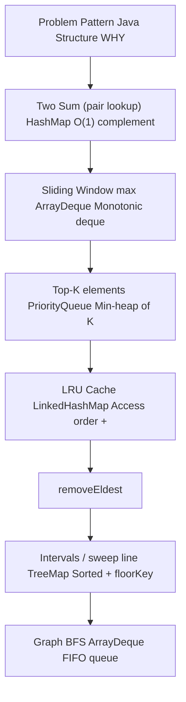
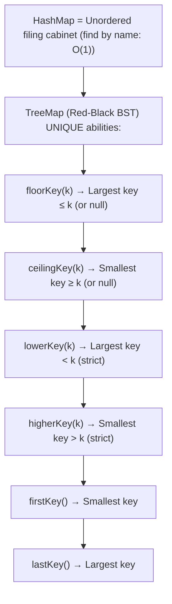
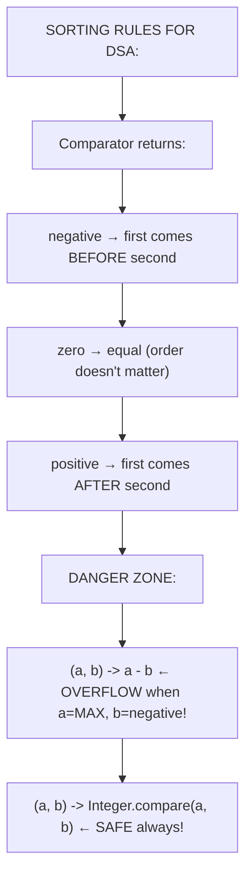
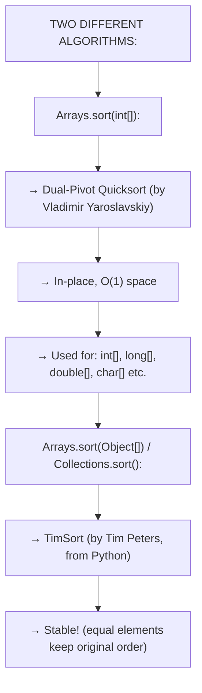
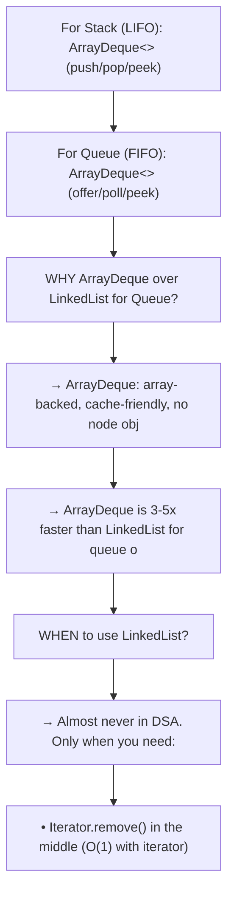
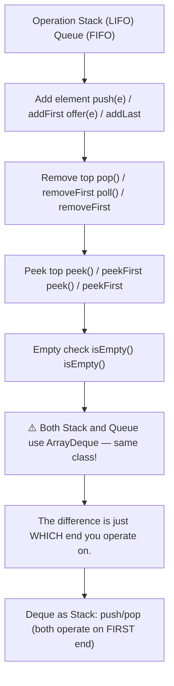
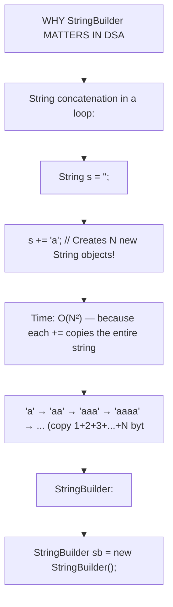

> **Navigation**: [< Previous](16_DSA_Deep_Reasoning.md) | [Back to Index](00_INDEX.md) | [Next >](18_Bitwise_Trie_Java_Complete.md)

# Chapter 17 — DSA Java Implementation Mastery: The Language-Specific Reasoning

> **"Knowing an algorithm is one thing. Implementing it in Java with the right collections, the right Comparator, the right edge-case handling — that's what separates the whiteboard from the real solution. This chapter fills the gap between algorithm theory and Java implementation."**

---

## Table of Contents

1. [Java Collections for DSA: Which Structure for Which Problem](#1-collections-for-dsa)
2. [PriorityQueue Deep Reasoning: The Gotchas That Bite](#2-priorityqueue-gotchas)
3. [TreeMap & TreeSet: Your BST in Disguise](#3-treemap-treeset)
4. [Comparator Mastery: Sorting Logic That Doesn't Break](#4-comparator-mastery)
5. [Arrays.sort vs Collections.sort: Internal Differences That Matter](#5-sort-internals)
6. [HashMap for DSA: Beyond Key-Value](#6-hashmap-for-dsa)
7. [Stack, Queue, Deque: The Java Way](#7-stack-queue-deque)
8. [String Manipulation for DSA: StringBuilder Reasoning](#8-string-manipulation)
9. [Bit Manipulation with Java Specifics](#9-bit-manipulation)
10. [Common Java DSA Anti-Patterns & Fixes](#10-anti-patterns)
11. [Quick-Fire Interview Table](#11-quick-fire-table)

---

## 1. Java Collections for DSA: Which Structure for Which Problem

### Deep Reasoning


> THE TOOLBOX ANALOGY
>
> You wouldn't use a hammer to screw in a bolt.
> Similarly, don't use ArrayList when you need O(1) lookup.
>
> Your DSA toolbox in Java:
>
> Need O(1) lookup by key?        → HashMap
> Need O(1) lookup + insertion order? → LinkedHashMap
> Need sorted keys + range queries?   → TreeMap
> Need O(1) add/remove + uniqueness?  → HashSet
> Need min/max quickly?               → PriorityQueue
> Need LIFO (stack)?                  → ArrayDeque (NOT Stack!)
> Need FIFO (queue)?                  → ArrayDeque or LinkedList
> Need both ends (deque)?             → ArrayDeque
> Need fast random access + growth?   → ArrayList
> Need fast insert/delete at ends?    → LinkedList (rare!)
>
> 90% of DSA problems need: HashMap + ArrayList + ArrayDeque


### Decision Matrix

```
┌──────────────────────────────────────────────────────────────────┐
│  Problem Pattern          │  Java Structure  │  WHY              │
│ ─────────────────────────┼──────────────────┼──────────────────  │
│  Two Sum (pair lookup)    │  HashMap         │  O(1) complement  │
│  Sliding Window max       │  ArrayDeque      │  Monotonic deque  │
│  Top-K elements           │  PriorityQueue   │  Min-heap of K    │
│  LRU Cache                │  LinkedHashMap   │  Access order +   │
│                           │                  │  removeEldest     │
│  Intervals / sweep line   │  TreeMap         │  Sorted + floorKey│
│  Graph BFS                │  ArrayDeque      │  FIFO queue       │
│  DFS (iterative)          │  ArrayDeque      │  LIFO stack       │
│  Frequency count          │  HashMap         │  Key→count        │
│  Union-Find               │  int[]           │  Parent array     │
│  Trie                     │  TrieNode class  │  Custom node      │
│  Prefix sum               │  int[]           │  Array accumulate │
│  Matrix traversal         │  int[][]         │  2D array         │
│  Sorted unique elements   │  TreeSet         │  BST under hood   │
│  Median stream            │  Two PQs         │  Max-heap + min   │
└──────────────────────────────────────────────────────────────────┘
```

**Flow:**
- Problem Pattern Java Structure WHY
- ↓
- Two Sum (pair lookup) HashMap O(1) complement
- ↓
- Sliding Window max ArrayDeque Monotonic deque
- ↓
- Top-K elements PriorityQueue Min-heap of K
- ↓
- LRU Cache LinkedHashMap Access order +
- ↓
- removeEldest
- ↓
- Intervals / sweep line TreeMap Sorted + floorKey



---

## 2. PriorityQueue Deep Reasoning: The Gotchas That Bite

### The Freeze Question
> "PriorityQueue — is it a min-heap or max-heap? Why does removing an element take O(n)?"

### Deep Reasoning


> PriorityQueue = MIN-HEAP by default (smallest first)
>
> GOTCHA #1: Natural order is MIN, not MAX!
> PriorityQueue<Integer> pq = new PriorityQueue<>();
> pq.addAll(List.of(5, 1, 3));
> pq.poll(); // Returns 1 (smallest!), not 5
>
> For MAX-HEAP:
> PriorityQueue<Integer> maxPQ = new PriorityQueue<>(
> Comparator.reverseOrder()   // or (a, b) -> b - a
> );
> ⚠️ NEVER use (a, b) -> b - a for large numbers (overflow!)
> ✅ Use Comparator.reverseOrder() or Integer::compare reversed
>
> GOTCHA #2: peek()/poll() = O(log n), but remove(Object) = O(n)
> pq.remove(3);  // Must scan ALL elements to find 3 → O(n)
> This kills performance in sliding window problems!
> FIX: Use lazy deletion (mark deleted, skip on poll)
>
> GOTCHA #3: Iteration order is NOT sorted!
> for (int x : pq) { ... }  // RANDOM heap order, NOT sorted!
> To get sorted: while (!pq.isEmpty()) { pq.poll(); }


### Code — Top-K Pattern (The Right Way)

```java
// "Find K largest elements" — use MIN-heap of size K
public int[] topKLargest(int[] nums, int k) {
    // MIN-heap: smallest of the K largest is at top
    PriorityQueue<Integer> minHeap = new PriorityQueue<>(k);
    
    for (int num : nums) {
        if (minHeap.size() < k) {
            minHeap.offer(num);           // Fill up to K
        } else if (num > minHeap.peek()) {
            minHeap.poll();               // Remove smallest of top-K
            minHeap.offer(num);           // Add new larger element
        }
    }
    
    return minHeap.stream().mapToInt(i -> i).toArray();
    // Time: O(n log k) — much better than O(n log n) sort when k << n
}

// WHY min-heap for top-K?
// The top of the min-heap is the SMALLEST among the K largest.
// When a new element comes:
//   If it's smaller than the top → it's not in top K, skip it
//   If it's larger → it replaces the smallest in our top K
// The heap maintains exactly K elements = O(k) space
```

### PriorityQueue with Custom Objects

```java
// Sort intervals by start time, then by end time
PriorityQueue<int[]> pq = new PriorityQueue<>(
    (a, b) -> a[0] != b[0] ? a[0] - b[0] : a[1] - b[1]
);

// ⚠️ OVERFLOW TRAP with (a, b) -> a - b:
// If a = Integer.MIN_VALUE and b = 1:
// a - b = Integer.MIN_VALUE - 1 = Integer.MAX_VALUE (overflow! wrong sign!)
// ✅ SAFE: Integer.compare(a, b) — never overflows
PriorityQueue<int[]> safe = new PriorityQueue<>(
    (a, b) -> a[0] != b[0] ? Integer.compare(a[0], b[0]) : Integer.compare(a[1], b[1])
);
```

---


## 3. TreeMap & TreeSet: Your BST in Disguise

### The Freeze Question
> "When would you use TreeMap instead of HashMap?"

### Deep Reasoning

```
╔══════════════════════════════════════════════════════════════════╗
║  HashMap = Unordered filing cabinet (find by name: O(1))         ║
║  TreeMap = Sorted dictionary (find by name AND range: O(log n))  ║
║                                                                  ║
║  TreeMap (Red-Black BST) UNIQUE abilities:                       ║
║                                                                  ║
║  floorKey(k)   → Largest key ≤ k  (or null)                      ║
║  ceilingKey(k) → Smallest key ≥ k (or null)                      ║
║  lowerKey(k)   → Largest key < k  (strict)                       ║
║  higherKey(k)  → Smallest key > k (strict)                       ║
║  firstKey()    → Smallest key                                    ║
║  lastKey()     → Largest key                                     ║
║  subMap(lo,hi) → View of keys in range [lo, hi)                  ║
║  headMap(k)    → View of keys < k                                ║
║  tailMap(k)    → View of keys ≥ k                                ║
║                                                                  ║
║  USE WHEN: You need SORTED ORDER or RANGE QUERIES                ║
║  COST: O(log n) per operation instead of O(1) for HashMap        ║
╚══════════════════════════════════════════════════════════════════╝
```

**Flow:**
- HashMap = Unordered filing cabinet (find by name: O(1))
- ↓
- TreeMap (Red-Black BST) UNIQUE abilities:
- ↓
- floorKey(k)
- ↓
- Largest key ≤ k (or null)
- ↓
- floorKey(k)
- ↓
- Largest key ≤ k (or null)
- ↓
- ceilingKey(k)
- ↓
- Smallest key ≥ k (or null)
- ↓
- ceilingKey(k)
- ↓
- Smallest key ≥ k (or null)
- ↓
- lowerKey(k)
- ↓
- Largest key < k (strict)
- ↓
- lowerKey(k)
- ↓
- Largest key < k (strict)
- ↓
- higherKey(k)
- ↓
- Smallest key > k (strict)
- ↓
- higherKey(k)
- ↓
- Smallest key > k (strict)
- ↓
- firstKey()
- ↓
- Smallest key



### Code — Real DSA Problems Solved by TreeMap

```java
// Problem: "My Calendar" — book intervals, detect overlaps
class MyCalendar {
    TreeMap<Integer, Integer> calendar = new TreeMap<>(); // start → end
    
    public boolean book(int start, int end) {
        // Find the event that starts just before our start
        Integer prevStart = calendar.floorKey(start);
        if (prevStart != null && calendar.get(prevStart) > start) 
            return false;  // Previous event overlaps with us
        
        // Find the event that starts just after our start
        Integer nextStart = calendar.ceilingKey(start);
        if (nextStart != null && nextStart < end) 
            return false;  // Next event starts before we end
        
        calendar.put(start, end);
        return true;
    }
    // O(log n) per booking — TreeMap handles sorted lookup!
}

// Problem: "Count number of intervals containing a point"
// (Sweep line with TreeMap)
TreeMap<Integer, Integer> sweep = new TreeMap<>();
for (int[] interval : intervals) {
    sweep.merge(interval[0], 1, Integer::sum);   // +1 at start
    sweep.merge(interval[1], -1, Integer::sum);  // -1 at end
}
int active = 0, maxOverlap = 0;
for (int delta : sweep.values()) {
    active += delta;
    maxOverlap = Math.max(maxOverlap, active);
}
```

### TreeSet for Sorted Unique Elements

```java
// "Find the closest value to target in a set"
TreeSet<Integer> set = new TreeSet<>(List.of(1, 5, 10, 15, 23));

int target = 12;
Integer floor = set.floor(target);     // 10 (largest ≤ 12)
Integer ceiling = set.ceiling(target); // 15 (smallest ≥ 12)

// Closest = min distance
int closest = (target - floor <= ceiling - target) ? floor : ceiling;
// closest = 10
```

---


> 🔬 **Section Challenge — 3. TreeMap & TreeSet: Your BST in Disguise**
>
> **Challenge 1 (Reasoning):** When should you use `TreeMap` over `HashMap`? What's the actual performance cost?
> <details><summary>Answer</summary>
>
> `TreeMap` use cases: range queries (`subMap`, `headMap`, `tailMap`), ordered iteration, `floorKey`/`ceilingKey`. Cost: every operation is O(log N) vs O(1) avg for HashMap. For 1M entries: HashMap ~1μs, TreeMap ~20μs per operation. Use TreeMap ONLY when sorted order is required — not as a default.
> </details>
>

## 4. Comparator Mastery: Sorting Logic That Doesn't Break

### Deep Reasoning

```
╔══════════════════════════════════════════════════════════════════╗
║  SORTING RULES FOR DSA:                                          ║
║                                                                  ║
║  Comparator returns:                                             ║
║    negative → first comes BEFORE second                          ║
║    zero     → equal (order doesn't matter)                       ║
║    positive → first comes AFTER second                           ║
║                                                                  ║
║  DANGER ZONE:                                                    ║
║  (a, b) -> a - b  ← OVERFLOW when a=MAX, b=negative!             ║
║  (a, b) -> Integer.compare(a, b)  ← SAFE always!                 ║
║                                                                  ║
║  The Comparator Composition Toolkit:                             ║
║  Comparator.comparingInt(x -> x[0])                              ║
║    .thenComparingInt(x -> x[1])                                  ║
║    .reversed()                                                   ║
║                                                                  ║
║  READ IT AS ENGLISH:                                             ║
║  "Compare by first element, then by second, then reverse"        ║
╚══════════════════════════════════════════════════════════════════╝
```

**Flow:**
- SORTING RULES FOR DSA:
- ↓
- Comparator returns:
- ↓
- negative
- ↓
- first comes BEFORE second
- ↓
- negative
- ↓
- first comes BEFORE second
- ↓
- zero
- ↓
- equal (order doesn't matter)
- ↓
- zero
- ↓
- equal (order doesn't matter)
- ↓
- positive
- ↓
- first comes AFTER second
- ↓
- positive
- ↓
- first comes AFTER second
- ↓
- DANGER ZONE:
- ↓
- (a, b) -> a - b ← OVERFLOW when a=MAX, b=negative!



### Code — Comparator Patterns for DSA

```java
// Sort intervals: by start ascending, then by end descending
int[][] intervals = {{1,5}, {1,3}, {2,6}, {2,4}};

Arrays.sort(intervals, (a, b) -> 
    a[0] != b[0] ? Integer.compare(a[0], b[0])      // start ascending
                  : Integer.compare(b[1], a[1])      // end descending (b before a!)
);
// Result: {1,5}, {1,3}, {2,6}, {2,4}

// Same with fluent API (cleaner):
Arrays.sort(intervals, 
    Comparator.<int[], Integer>comparingInt(x -> x[0])    // Renamed: comparingInt doesn't work on arrays directly
                                                           // Actually use Comparator.comparingInt:
);

// For objects — fluent style:
employees.sort(
    Comparator.comparing(Employee::getDepartment)           // primary: department
              .thenComparing(Employee::getSalary, Comparator.reverseOrder()) // secondary: salary DESC
              .thenComparing(Employee::getName)              // tertiary: name ASC
);

// Custom comparison with extraction:
// Sort strings by length, then alphabetically
words.sort(
    Comparator.comparingInt(String::length)
              .thenComparing(Comparator.naturalOrder())
);
```

### The Overflow Trap — Code Proof

```java
// ❌ BROKEN for edge cases:
Comparator<Integer> broken = (a, b) -> a - b;
System.out.println(broken.compare(Integer.MAX_VALUE, -1));
// Expected: positive (MAX > -1)
// Actual: Integer.MAX_VALUE - (-1) = Integer.MIN_VALUE (NEGATIVE! → WRONG ORDER)

// ✅ ALWAYS SAFE:
Comparator<Integer> safe = Integer::compare;
System.out.println(safe.compare(Integer.MAX_VALUE, -1));  // Positive (correct!)

// Integer.compare implementation:
// return (x < y) ? -1 : ((x == y) ? 0 : 1);
// No arithmetic, no overflow. ALWAYS use this.
```

---


> 🔬 **Section Challenge — 4. Comparator Mastery: Sorting Logic That Doesn't Break**
>
> **Challenge 1 (Reasoning):** QuickSort average O(N log N) but worst case O(N²). When exactly does the worst case happen and how do you prevent it?
> <details><summary>Answer</summary>
>
> Worst case: pivot always ends up at position 0 or N-1 (completely unbalanced partition). This happens when: (1) always picking first/last element as pivot on already-sorted or reverse-sorted data. (2) Pivot happens to be the minimum or maximum. Prevention: random pivot (randomized quicksort — expected O(N log N) even on adversarial input), or median-of-three (pick median of first/middle/last element as pivot). Java's dual-pivot quicksort uses careful pivot selection to avoid this.
> </details>
>

## 5. Arrays.sort vs Collections.sort: Internal Differences That Matter

### Deep Reasoning

```
╔══════════════════════════════════════════════════════════════════╗
║  TWO DIFFERENT ALGORITHMS:                                       ║
║                                                                  ║
║  Arrays.sort(int[]):                                             ║
║  → Dual-Pivot Quicksort (by Vladimir Yaroslavskiy)               ║
║  → In-place, O(1) space                                          ║
║  → Average O(n log n), worst case O(n²) for adversarial input    ║
║  → Switches to insertion sort for small arrays (< 47 elements)   ║
║  → Used for: int[], long[], double[], char[] etc.                ║
║                                                                  ║
║  Arrays.sort(Object[]) / Collections.sort():                     ║
║  → TimSort (by Tim Peters, from Python)                          ║
║  → Stable! (equal elements keep original order)                  ║
║  → O(n log n) worst case guaranteed                              ║
║  → O(n) extra space (merge sort based)                           ║
║  → Exploits existing runs (partially sorted = faster!)           ║
║  → Used for: Object[], List<T>                                   ║
║                                                                  ║
║  WHY DIFFERENT?                                                  ║
║  → Primitives have no identity → stability doesn't matter        ║
║  → Objects have identity → stability matters for user            ║
║  → Quicksort is faster on primitives (better cache behavior)     ║
╚══════════════════════════════════════════════════════════════════╝
```

**Flow:**
- TWO DIFFERENT ALGORITHMS:
- ↓
- Arrays.sort(int[]):
- ↓
- Dual-Pivot Quicksort (by Vladimir Yaroslavskiy)
- ↓
- In-place, O(1) space
- ↓
- Used for: int[], long[], double[], char[] etc.
- ↓
- Arrays.sort(Object[]) / Collections.sort():
- ↓
- TimSort (by Tim Peters, from Python)



### When This Matters in DSA

```java
// Stability matters when sorting by multiple criteria:
// Sort employees by department, then by salary within department

// ❌ If sort is UNSTABLE: salary ordering within same department = random!
// ✅ TimSort is STABLE: salary ordering preserved within group

// In DSA interviews:
// "Sort intervals by start time" → stable or unstable both work
// "Sort by custom criteria maintaining original order for ties" → need stable

// PERFORMANCE TIP for competitive programming:
// Arrays.sort(int[]) with adversarial input → O(n²)!
// Some online judges exploit this. Fix:
int[] arr = {3, 1, 4, 1, 5};
// Shuffle first to prevent worst case:
Random rand = new Random();
for (int i = arr.length - 1; i > 0; i--) {
    int j = rand.nextInt(i + 1);
    int temp = arr[i]; arr[i] = arr[j]; arr[j] = temp;
}
Arrays.sort(arr);  // Now worst case is astronomically unlikely
```

---


## 6. HashMap for DSA: Beyond Key-Value

### The Map Methods You MUST Know

```java
// getOrDefault — avoid null checks
int count = map.getOrDefault(key, 0);

// putIfAbsent — add only if not present
map.putIfAbsent(key, new ArrayList<>());

// merge — THE MOST POWERFUL method for frequency counting
// "If key exists: apply function. If not: put the value."
map.merge(key, 1, Integer::sum);  // count frequency in ONE line!
// Equivalent to:
// map.put(key, map.getOrDefault(key, 0) + 1);

// computeIfAbsent — lazy initialization for adjacency lists
Map<Integer, List<Integer>> graph = new HashMap<>();
graph.computeIfAbsent(node, k -> new ArrayList<>()).add(neighbor);
// Creates the list only if absent, then immediately adds to it

// compute — modify existing value
map.compute(key, (k, v) -> v == null ? 1 : v + 1);

// replaceAll — transform all values
map.replaceAll((k, v) -> v * 2);
```

### HashMap DSA Patterns

```java
// Pattern 1: Two Sum — classic O(n)
public int[] twoSum(int[] nums, int target) {
    Map<Integer, Integer> seen = new HashMap<>();  // value → index
    for (int i = 0; i < nums.length; i++) {
        int complement = target - nums[i];
        if (seen.containsKey(complement)) {
            return new int[]{seen.get(complement), i};
        }
        seen.put(nums[i], i);
    }
    return new int[]{};
}

// Pattern 2: Group Anagrams — sorted key trick
public List<List<String>> groupAnagrams(String[] strs) {
    Map<String, List<String>> map = new HashMap<>();
    for (String s : strs) {
        char[] chars = s.toCharArray();
        Arrays.sort(chars);
        String key = new String(chars);  // "eat" → "aet", "tea" → "aet"
        map.computeIfAbsent(key, k -> new ArrayList<>()).add(s);
    }
    return new ArrayList<>(map.values());
}

// Pattern 3: Subarray Sum Equals K — prefix sum + HashMap
public int subarraySum(int[] nums, int k) {
    Map<Integer, Integer> prefixCount = new HashMap<>();
    prefixCount.put(0, 1);  // Empty prefix has sum 0
    int sum = 0, count = 0;
    for (int num : nums) {
        sum += num;
        count += prefixCount.getOrDefault(sum - k, 0);
        prefixCount.merge(sum, 1, Integer::sum);
    }
    return count;
}
```

---


> 🔬 **Section Challenge — 6. HashMap for DSA: Beyond Key-Value**
>
> **Challenge 1 (Reasoning):** You insert 1000 entries into a HashMap with default capacity 16. How many resize operations happen?
> <details><summary>Answer</summary>
>
> Resize threshold = capacity × 0.75. Resizes at: 12 (16→32), 24 (32→64), 48 (64→128), 96 (128→256), 192 (256→512), 384 (512→1024). Total: 6 resizes. Each resize copies all entries to new bucket array. Pre-sizing: `new HashMap<>(1334)` (1000/0.75 ≈ 1334 → next power of 2 = 2048) avoids all resizes.
> </details>
>
> **Challenge 2 (Bug Hunt):** Two `Person` objects with same name and age. You override `equals()` to return true but not `hashCode()`. What happens when used as `HashMap` keys?
> <details><summary>Answer</summary>
>
> Both objects land in DIFFERENT buckets (different hashCodes → different bucket index). The HashMap doesn't check `equals()` across buckets — it goes straight to one bucket. So `map.get(person2)` returns NULL even though `person1.equals(person2)`. Overriding `equals` without `hashCode` violates the contract and breaks all hash-based collections. Always override both together.
> </details>
>

## 7. Stack, Queue, Deque: The Java Way

### Deep Reasoning

```
╔══════════════════════════════════════════════════════════════════╗
║  DON'T USE java.util.Stack! (It's legacy, synchronized, slow)    ║
║                                                                  ║
║  For Stack (LIFO):  ArrayDeque<> (push/pop/peek)                 ║
║  For Queue (FIFO):  ArrayDeque<> (offer/poll/peek)               ║
║  For Deque (both):  ArrayDeque<> (offerFirst, offerLast, etc.)   ║
║                                                                  ║
║  WHY ArrayDeque over LinkedList for Queue?                       ║
║  → ArrayDeque: array-backed, cache-friendly, no node objects     ║
║  → LinkedList: pointer-chasing, cache-misses, extra 24 bytes/node║
║  → ArrayDeque is 3-5x faster than LinkedList for queue ops!      ║
║                                                                  ║
║  WHEN to use LinkedList?                                         ║
║  → Almost never in DSA. Only when you need:                      ║
║    • Iterator.remove() in the middle (O(1) with iterator)        ║
║    • Null elements (ArrayDeque can't store null)                 ║
╚══════════════════════════════════════════════════════════════════╝
```

**Flow:**
- For Stack (LIFO): ArrayDeque<> (push/pop/peek)
- ↓
- For Queue (FIFO): ArrayDeque<> (offer/poll/peek)
- ↓
- WHY ArrayDeque over LinkedList for Queue?
- ↓
- ArrayDeque: array-backed, cache-friendly, no node obj
- ↓
- ArrayDeque is 3-5x faster than LinkedList for queue o
- ↓
- WHEN to use LinkedList?
- ↓
- Almost never in DSA. Only when you need:



### Stack/Queue Method Mapping

```
┌──────────────────────────────────────────────────────────────────┐
│  Operation     │ Stack (LIFO)        │ Queue (FIFO)              │
│ ───────────────┼─────────────────────┼────────────────────────   │
│  Add element   │ push(e) / addFirst  │ offer(e) / addLast        │
│  Remove top    │ pop() / removeFirst │ poll() / removeFirst      │
│  Peek top      │ peek() / peekFirst  │ peek() / peekFirst        │
│  Empty check   │ isEmpty()           │ isEmpty()                 │
│                                                                  │
│  ⚠️ Both Stack and Queue use ArrayDeque — same class!            │
│  The difference is just WHICH end you operate on.                │
│                                                                  │
│  Deque as Stack: push/pop (both operate on FIRST end)            │
│  Deque as Queue: offer (LAST end) / poll (FIRST end)             │
└──────────────────────────────────────────────────────────────────┘
```

**Flow:**
- Operation Stack (LIFO) Queue (FIFO)
- ↓
- Add element push(e) / addFirst offer(e) / addLast
- ↓
- Remove top pop() / removeFirst poll() / removeFirst
- ↓
- Peek top peek() / peekFirst peek() / peekFirst
- ↓
- Empty check isEmpty() isEmpty()
- ↓
- ⚠️ Both Stack and Queue use ArrayDeque — same class!
- ↓
- The difference is just WHICH end you operate on.



### Monotonic Stack Pattern

```java
// "Next Greater Element" — classic monotonic stack
public int[] nextGreaterElement(int[] nums) {
    int n = nums.length;
    int[] result = new int[n];
    Arrays.fill(result, -1);
    Deque<Integer> stack = new ArrayDeque<>();  // Stores INDICES
    
    for (int i = 0; i < n; i++) {
        // While current element is greater than top of stack
        while (!stack.isEmpty() && nums[i] > nums[stack.peek()]) {
            result[stack.pop()] = nums[i];  // Found next greater!
        }
        stack.push(i);
    }
    return result;
}
// Time: O(n) — each element pushed and popped at most once
```

### Monotonic Deque Pattern

```java
// "Sliding Window Maximum" — monotonic deque
public int[] maxSlidingWindow(int[] nums, int k) {
    int n = nums.length;
    int[] result = new int[n - k + 1];
    Deque<Integer> deque = new ArrayDeque<>();  // Stores indices, decreasing values
    
    for (int i = 0; i < n; i++) {
        // Remove elements outside window
        while (!deque.isEmpty() && deque.peekFirst() < i - k + 1) {
            deque.pollFirst();
        }
        // Remove smaller elements (they'll never be the max)
        while (!deque.isEmpty() && nums[deque.peekLast()] < nums[i]) {
            deque.pollLast();
        }
        deque.offerLast(i);
        
        if (i >= k - 1) {
            result[i - k + 1] = nums[deque.peekFirst()];
        }
    }
    return result;
}
// Time: O(n) — each element enters and leaves deque at most once
```

---


> 🔬 **Section Challenge — 7. Stack, Queue, Deque: The Java Way**
>
> **Challenge 1 (Reasoning):** Monotonic DECREASING stack — when you push a new element, which existing elements are popped and what information do those pops tell you?
> <details><summary>Answer</summary>
>
> In a decreasing stack (top is smallest), pushing element `x`: all elements smaller than `x` are popped. For each popped element `y`: `x` is the NEXT GREATER ELEMENT of `y`. This is the key insight: the pop event = answer event. Application: Daily Temperatures (next warmer day), Largest Rectangle in Histogram (right boundary), Next Greater Element. Each element is pushed and popped exactly once → O(N) total.
> </details>
>

## 8. String Manipulation for DSA: StringBuilder Reasoning

### Deep Reasoning

```
╔══════════════════════════════════════════════════════════════════╗
║  WHY StringBuilder MATTERS IN DSA                                ║
║                                                                  ║
║  String concatenation in a loop:                                 ║
║  String s = "";                                                  ║
║  for (int i = 0; i < N; i++) {                                   ║
║      s += "a";  // Creates N new String objects!                 ║
║  }                                                               ║
║  Time: O(N²) — because each += copies the entire string          ║
║  "a" → "aa" → "aaa" → "aaaa" → ... (copy 1+2+3+...+N bytes)      ║
║                                                                  ║
║  StringBuilder:                                                  ║
║  StringBuilder sb = new StringBuilder();                         ║
║  for (int i = 0; i < N; i++) {                                   ║
║      sb.append("a");  // Appends to internal char array          ║
║  }                                                               ║
║  String result = sb.toString();                                  ║
║  Time: O(N) — amortized O(1) per append (like ArrayList)         ║
║                                                                  ║
║  For N=10,000: String concat = 50ms, StringBuilder = 0.1ms       ║
║  500x difference!                                                ║
╚══════════════════════════════════════════════════════════════════╝
```

**Flow:**
- WHY StringBuilder MATTERS IN DSA
- ↓
- String concatenation in a loop:
- ↓
- String s = '';
- ↓
- s += 'a'; // Creates N new String objects!
- ↓
- Time: O(N²) — because each += copies the entire string
- ↓
- 'a'
- ↓
- 'aa'
- ↓
- 'aaa'
- ↓
- 'aaaa'
- ↓
- ... (copy 1+2+3+...+N byt
- ↓
- 'a'
- ↓
- 'aa'
- ↓
- 'aaa'
- ↓
- 'aaaa'
- ↓
- ... (copy 1+2+3+...+N byt
- ↓
- StringBuilder:



### Essential String DSA Methods

```java
// char[] ↔ String conversions (KNOW THESE):
char[] chars = s.toCharArray();        // String → char[] (for in-place modification)
String back = new String(chars);        // char[] → String
String fromRange = new String(chars, start, length);  // Substring from char[]

// charAt vs toCharArray:
s.charAt(i);           // O(1) but NO modification
char[] arr = s.toCharArray();  // O(n) copy, but CAN modify in place

// Substring: O(n) in modern Java (creates new char array!)
s.substring(start, end);  // Java 7+: copies the chars (NOT just a view!)

// String comparison:
s1.equals(s2);             // Content comparison (O(n))
s1.compareTo(s2);          // Lexicographic comparison (returns int)
s1 == s2;                  // ❌ Reference comparison (wrong for content!)

// Character checks:
Character.isLetterOrDigit(c);
Character.toLowerCase(c);
Character.isDigit(c);

// StringBuilder tricks:
sb.reverse();              // In-place reverse
sb.deleteCharAt(index);    // Remove specific char
sb.insert(index, "str");   // Insert at position
sb.charAt(index);          // Read without conversion
sb.setCharAt(index, 'c');  // Modify in-place
```

---


> 🔬 **Section Challenge — 8. String Manipulation for DSA: StringBuilder Reasoning**
>
> **Challenge 1 (Reasoning):** Why is `String str = ""; for(int i=0;i<1000;i++) str += i;` O(N²) and how does StringBuilder fix it?
> <details><summary>Answer</summary>
>
> Each `+=` creates a NEW String object: copies all existing chars + appends new char. Iteration 1: copy 1 char. Iteration 2: copy 2 chars. ... Iteration N: copy N chars. Total: 1+2+...+N = N(N+1)/2 = O(N²) character copies. StringBuilder uses a resizable internal array. `append()` adds to the end: O(1) amortized. Final `toString()`: O(N) once. Total: O(N).
> </details>
>

## 9. Bit Manipulation with Java Specifics

### Java-Specific Bit Operations

```java
// Java integers are SIGNED 32-bit (two's complement)
// This affects right shift behavior:

int x = -8;  // binary: 11111111_11111111_11111111_11111000
x >> 1;      // Arithmetic right shift: 11111111...11111100 = -4 (sign preserved)
x >>> 1;     // Logical right shift: 01111111...11111100 = 2147483644 (zero-filled)

// ⚠️ Java has NO unsigned integer type!
// Use >>> for unsigned behavior
// Use Integer.toUnsignedLong() for unsigned comparison

// Essential bit tricks for DSA:
int n = 42;
Integer.bitCount(n);          // Count set bits (popcount) = 3
Integer.highestOneBit(n);     // 32 (highest power of 2 ≤ n)
Integer.lowestOneBit(n);      // 2 (lowest set bit)
Integer.numberOfLeadingZeros(n);   // 26
Integer.numberOfTrailingZeros(n);  // 1
Integer.reverse(n);           // Reverse all 32 bits
Integer.toBinaryString(n);   // "101010" (for debugging)

// XOR tricks:
// a ^ a = 0 (cancel identical values)
// a ^ 0 = a (identity)
// Single number: XOR all elements — duplicate pairs cancel out
int single = 0;
for (int num : nums) single ^= num;  // O(n), O(1) space
```

---

## 10. Common Java DSA Anti-Patterns & Fixes

### Anti-Pattern 1: Integer Comparison with ==

```java
// ❌ BROKEN for values outside [-128, 127]:
Integer a = 128, b = 128;
System.out.println(a == b);        // false! (different objects)
System.out.println(a.equals(b));   // true!

// WHY? Integer cache only covers -128 to 127.
// Outside that range, Integer.valueOf(128) creates NEW objects.
// ALWAYS use .equals() for Integer/Long/etc. comparison.
```

### Anti-Pattern 2: ArrayList as Stack/Queue

```java
// ❌ SLOW: ArrayList as stack with remove at beginning
list.remove(0);  // O(n) — shifts all elements!

// ✅ FAST: ArrayDeque for both stack and queue
Deque<Integer> stack = new ArrayDeque<>();
stack.push(1); stack.pop();  // O(1)
```

### Anti-Pattern 3: Modifying Collection While Iterating

```java
// ❌ ConcurrentModificationException:
for (String s : list) {
    if (s.startsWith("a")) list.remove(s);  // 💥
}

// ✅ Use Iterator.remove():
Iterator<String> it = list.iterator();
while (it.hasNext()) {
    if (it.next().startsWith("a")) it.remove();  // Safe!
}

// ✅ Or removeIf (Java 8+):
list.removeIf(s -> s.startsWith("a"));
```

### Anti-Pattern 4: Boxing in Hot Loops

```java
// ❌ BOXING OVERHEAD: int ↔ Integer for every operation
Map<Integer, Integer> map = new HashMap<>();
for (int i = 0; i < 1_000_000; i++) {
    map.put(i, map.getOrDefault(i, 0) + 1);  // Autoboxing on EVERY call!
}

// ✅ For competitive programming, consider:
// • int[] array-based map when keys are bounded (0 to MAX)
// • Direct int[] for frequency counting
int[] freq = new int[MAX_VALUE + 1];
for (int num : nums) freq[num]++;  // Zero boxing, zero hashing
```

### Anti-Pattern 5: Not Pre-allocating Collections

```java
// ❌ ArrayList grows and copies internally:
List<Integer> list = new ArrayList<>();  // Default capacity: 10
// Adding 10,000 elements → ~13 resizes and array copies!

// ✅ Pre-allocate when you know the size:
List<Integer> list = new ArrayList<>(10_000);  // One allocation
Map<String, Integer> map = new HashMap<>(capacity, 0.75f);  // Avoid rehashing

// For HashMap, optimal initial capacity:
// expectedSize / loadFactor + 1
// For 100 entries: 100/0.75 + 1 = 135
```

---


## 11. Quick-Fire Table

| Interview Question | One-Line Senior Answer |
|---|---|
| "Why ArrayDeque over Stack?" | java.util.Stack extends Vector (synchronized on every op = slow). ArrayDeque is unsynchronized, cache-friendly, and 3-5x faster. |
| "PriorityQueue poll order?" | Min-heap by default (smallest first). For max-heap: `new PriorityQueue<>(Comparator.reverseOrder())`. |
| "Why not (a,b) -> a-b?" | Integer overflow: MAX_VALUE - (-1) = MIN_VALUE (wrong sign). Use `Integer.compare(a, b)` always. |
| "Arrays.sort vs Collections.sort?" | Arrays.sort(primitives) = Dual-Pivot Quicksort (unstable, in-place). Arrays.sort(Objects) = TimSort (stable, O(n) space). |
| "HashMap O(1)?" | Average O(1), worst O(n) before Java 8, worst O(log n) in Java 8+ (tree bins when bucket > 8). Load factor 0.75 triggers resize. |
| "TreeMap use case in DSA?" | When you need sorted order + range queries: floorKey/ceilingKey for interval problems, sweep line, calendar booking. |
| "String += in loop?" | O(n²) — creates new String object each iteration. Use StringBuilder.append() for O(n) total. |
| "merge() vs put()?" | merge(key, 1, Integer::sum) = increment counter in one call. put() requires getOrDefault + put = two hash lookups. |
| "When LinkedList over ArrayList?" | Almost never. Only when you need Iterator.remove() in middle during traversal, or need null elements in a deque. |
| "int[] vs Integer[] for DSA?" | int[] when possible — no boxing overhead, better cache locality. Integer[] only when you need null values or Object-based APIs. |

---

> **Navigation**: [< Previous](16_DSA_Deep_Reasoning.md) | [Back to Index](00_INDEX.md) | [Next >](18_Bitwise_Trie_Java_Complete.md)
