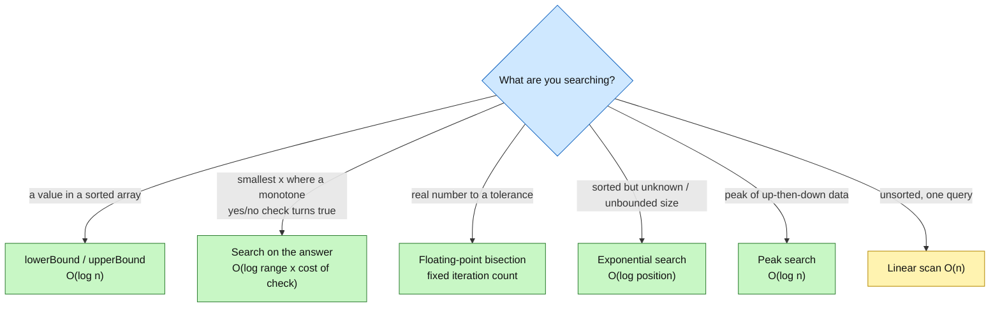

# 🔎 Searching & Binary Search — Complete Guide

> **Navigation**: [← Sorting Advanced](02b_Sorting_Advanced.md) | [Back to Index](00_INDEX.md) | [Next: Divide & Conquer →](02c_Divide_And_Conquer.md) | [Learning Path](00_LEARNING_PATH.md)

## 🔗 Bridge — Where This Chapter Fits

| Dimension | This chapter |
| --- | --- |
| **Builds on** | [Algorithm Thinking](01_Algorithm_Thinking.md) (invariants), [Sorting](02a_Sorting_Fundamentals.md) (sorted order is what makes searching cheap) |
| **You will learn** | Linear vs binary search, the two canonical templates (`lowerBound`, `upperBound`), search **on the answer**, floating-point search, exponential and ternary-style search |
| **Leads to** | [Divide & Conquer](02c_Divide_And_Conquer.md) (halving as a paradigm), [DP](04b_DP_Fundamentals.md) (binary search on a DP answer), [Graphs](05d_Graphs_Advanced_Algos.md) (parametric search) |
| **Abstraction level** | Concrete → **abstract**: first "find a value in a sorted array", finally "find the smallest `x` where a monotone predicate flips" |

> [!NOTE]
> This chapter closes a gap in the curriculum: binary search was used everywhere but never taught as one reusable idea. Read it before Divide & Conquer.

---

## 💬 Explain It Like a Study Partner — Binary Search

> [!TIP]
> **Ask yourself first:** *"If I can answer a yes/no question about any guess, how many guesses do I need to pin down a number between 1 and a billion?"*

### 1. The bottom line

Binary search finds a boundary by always looking at the middle and throwing away the half that cannot contain it, so a billion possibilities take about 30 looks.

### 2. The textbook core

- **Precondition:** the search space is ordered and the predicate is **monotone** (`false … false true … true`).
- **Invariant:** the answer always lies in the half-open range `[lo, hi)`.
- **Cost:** `⌈log₂ n⌉` predicate evaluations; space O(1) iteratively.
- **Two canonical results:** `lowerBound(x)` = first index with `a[i] >= x`; `upperBound(x)` = first index with `a[i] > x`. Everything else (exists, count, insert position) is built from these.

### 3. The real-world analogy

Finding a word in a **printed dictionary**: open to the middle, see whether your word comes before or after, and repeat on the half that remains. You never read the whole book.

### 4. Walkthrough: `lowerBound` of 5 in `[1, 3, 5, 5, 8, 9]`

1. `lo = 0`, `hi = 6` → `mid = 3`, `a[3] = 5`, not `< 5` → `hi = 3`.
2. `mid = 1`, `a[1] = 3 < 5` → `lo = 2`.
3. `mid = 2`, `a[2] = 5`, not `< 5` → `hi = 2`.
4. `lo == hi == 2` → the first 5 is at index **2**. The invariant "answer is in `[lo, hi)`" held at every step.

> [!NOTE]
> **Quick check:** how do you count occurrences of 5? *`upperBound(5) - lowerBound(5)` = 4 - 2 = 2.*

---

## ⚡ At a Glance



**How to read this diagram.** Start from what you are searching and follow the edge to the technique; green ones are logarithmic, yellow is the fallback when nothing is ordered.

| Technique | Time | Space | Needs |
| --------- | ---- | ----- | ----- |
| Linear search | O(n) | O(1) | nothing |
| `lowerBound` / `upperBound` | O(log n) | O(1) | sorted array |
| Search on the answer | O(log R · C) | O(1) | monotone predicate, cost `C` per check |
| Floating-point bisection | O(iterations · C) | O(1) | continuous monotone function |
| Exponential search | O(log p) | O(1) | sorted, `p` = target position |
| Peak search | O(log n) | O(1) | strictly increasing then strictly decreasing |

---

## 1. The Two Canonical Templates

```java
// First index i with a[i] >= target   (n if none)
static int lowerBound(int[] a, int target) {
    int lo = 0, hi = a.length;              // search space [lo, hi)
    while (lo < hi) {
        int mid = lo + (hi - lo) / 2;       // never (lo + hi) / 2: that can overflow
        if (a[mid] < target) lo = mid + 1; else hi = mid;
    }
    return lo;
}

// First index i with a[i] > target    (n if none)
static int upperBound(int[] a, int target) {
    int lo = 0, hi = a.length;
    while (lo < hi) {
        int mid = lo + (hi - lo) / 2;
        if (a[mid] <= target) lo = mid + 1; else hi = mid;
    }
    return lo;
}
```

**Why `lo < hi` with `hi = mid`?** The half-open range `[lo, hi)` shrinks strictly each step (`lo = mid + 1` or `hi = mid`), so the loop terminates, and when `lo == hi` the range is empty and `lo` is the boundary. This template has no off-by-one decisions to remember.

| Question | Answer from the templates |
| -------- | ------------------------- |
| Does `x` exist? | `i = lowerBound(x); i < n && a[i] == x` |
| How many `x`? | `upperBound(x) - lowerBound(x)` |
| Where to insert `x` keeping order? | `lowerBound(x)` |
| Largest element `< x`? | `lowerBound(x) - 1` |
| Smallest element `> x`? | `upperBound(x)` |

## 2. Search on the Answer (the abstraction jump)

If you cannot index into an array but you **can test** a candidate answer with a monotone yes/no check, binary search the answer itself.

**Example — Ship packages within D days.** Find the smallest ship capacity so all packages ship in order within `days`.

```java
static int shipWithinDays(int[] w, int days) {
    int lo = 0, hi = 0;
    for (int x : w) { lo = Math.max(lo, x); hi += x; }   // answer is in [max weight, total weight]
    while (lo < hi) {
        int mid = lo + (hi - lo) / 2;
        if (feasible(w, days, mid)) hi = mid; else lo = mid + 1;
    }
    return lo;
}

static boolean feasible(int[] w, int days, int cap) {    // greedy O(n) check
    int d = 1, cur = 0;
    for (int x : w) { if (cur + x > cap) { d++; cur = 0; } cur += x; }
    return d <= days;
}
```

**Why it works:** if capacity `c` is enough, any larger capacity is also enough (monotone). The invariant is "the smallest feasible capacity is in `[lo, hi]`".

> [!IMPORTANT]
> **Checklist before using search-on-answer:** (1) the answer lives in a known integer range, (2) `feasible(x)` is monotone, (3) `feasible` costs `C` ≤ the budget (total `O(C log R)`).

## 3. Floating-Point Bisection

```java
static double sqrtBinary(double x) {
    double lo = 0, hi = Math.max(1, x);
    for (int i = 0; i < 100; i++) {          // fixed iterations: no "lo == hi" test on doubles
        double mid = (lo + hi) / 2;
        if (mid * mid < x) lo = mid; else hi = mid;
    }
    return lo;
}
```

> [!WARNING]
> Never loop on `while (hi - lo > eps)` with an `eps` below the spacing of doubles near `hi`: the loop may never end. Use a fixed iteration count (60–100 halves the interval beyond double precision).

## 4. Exponential Search (unknown or huge size)

```java
static int exponentialSearch(int[] a, int target) {
    if (a.length == 0) return -1;
    int bound = 1;
    while (bound < a.length && a[bound] < target) bound *= 2;      // gallop
    int lo = bound / 2, hi = Math.min(bound, a.length - 1);
    while (lo <= hi) {                                             // then binary search in [lo, hi]
        int mid = lo + (hi - lo) / 2;
        if (a[mid] == target) return mid;
        if (a[mid] < target) lo = mid + 1; else hi = mid - 1;
    }
    return -1;
}
```

Cost `O(log p)` where `p` is the target's position: ideal when the target is usually near the front, or when the length is unknown (infinite streams, paged APIs).

## 5. Peak Finding (Unimodal Data)

```java
static int peakIndex(int[] a) {                 // strictly increasing, then strictly decreasing
    int lo = 0, hi = a.length - 1;
    while (lo < hi) {
        int mid = lo + (hi - lo) / 2;
        if (a[mid] < a[mid + 1]) lo = mid + 1; else hi = mid;
    }
    return lo;
}
```

The predicate "`a[mid] < a[mid + 1]`" is monotone (true on the rising slope, false after the peak), so the same boundary-finding skeleton applies.

---

## 🏢 Enterprise Lens

| Area | What top-tier engineering looks like |
| ---- | ------------------------------------ |
| **Where it runs in production** | Index lookups in B-tree pages and SSTable blocks, `Collections.binarySearch`, `Arrays.binarySearch`, capacity planning ("smallest instance count meeting SLO"), `git bisect` (search on commit history), rate-limit tuning, autoscaler threshold search |
| **Failure modes** | `(lo + hi) / 2` overflow; non-monotone predicate (silent wrong answers); infinite loop on `double` tolerance; duplicates (use the templates, not "find any"); searching an array that is not actually sorted (e.g. mixed comparator) |
| **Testing strategy** | Property tests against a linear scan on random sorted arrays (including empty, single element, all-equal, and values below/above the range); assert the invariant in debug builds |
| **Verification done for this chapter** | The Java above was compiled and cross-checked against brute force on 2,000 random arrays (`lowerBound`/`upperBound`) plus fixed cases for the other routines |
| **Performance note** | Binary search is cache-unfriendly on huge arrays (each probe is a likely miss). For hot paths consider Eytzinger layout or a B-tree with fan-out matched to the cache line |

## 🧪 Practice Ladder

| Level | Problem | Idea |
| ----- | ------- | ---- |
| 1 | Search insert position | `lowerBound` |
| 2 | First and last position of an element | `lowerBound` + `upperBound - 1` |
| 3 | Find peak element | Peak search |
| 4 | Capacity to ship packages in D days | Search on the answer |
| 5 | Koko eating bananas, split array largest sum | Search on the answer + greedy check |
| 6 | Median of two sorted arrays | Binary search on the partition |

> [!CAUTION]
> **Reality check — "Binary search is only for sorted arrays."** It works on **any monotone predicate**. Sorted arrays are just the simplest example.

---

[← Sorting Advanced](02b_Sorting_Advanced.md) | [Index](00_INDEX.md) | [Divide & Conquer →](02c_Divide_And_Conquer.md)
