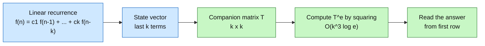

# 🧮 Matrix Exponentiation & Linear Recurrences — Complete Guide

> **Navigation**: [← NumberTheory Advanced](08b_NumberTheory_Advanced.md) | [Chapter index](00_INDEX.md) | [FFT, NTT & Fast Polynomial… →](26_FFT_NTT_Polynomial_Multiplication.md)

## 🔗 Bridge — Where This Chapter Fits

| Dimension | This chapter |
| --- | --- |
| **Builds on** | [Number Theory Core](08a_NumberTheory_Core.md) (modular arithmetic, fast exponentiation), [DP Fundamentals](04b_DP_Fundamentals.md) (recurrences) |
| **You will learn** | Squaring-based exponentiation generalised from numbers to **matrices**, turning an O(n) linear recurrence into O(k³ log n), counting walks in a graph |
| **Leads to** | [FFT / NTT](26_FFT_NTT_Polynomial_Multiplication.md) (faster algebra), [Graphs](05e_Graphs_Patterns.md) (path counting), [Algorithms in Production](13_Algorithms_In_Production.md) (state-machine transition matrices) |
| **Abstraction level** | A DP step is a *function*; a linear DP step is a *matrix*; repeating the step `n` times is *matrix power* |

---

## 💬 Explain It Like a Study Partner — Matrix Exponentiation

> [!TIP]
> **Ask yourself first:** *"The 10¹²-th Fibonacci number: do I really have to add a trillion times?"*

### 1. The bottom line

If each step of a recurrence is the same linear operation, you can apply it `n` times by **squaring** the operation `log n` times instead of repeating it `n` times.

### 2. The textbook core

- A linear recurrence `f(n) = c₁f(n−1) + … + c_k f(n−k)` can be written as `v(n) = T · v(n−1)` where `v(n)` is the vector of the last `k` terms and `T` is a `k×k` **companion matrix**.
- Therefore `v(n) = Tⁿ⁻ᵏ⁺¹ · v(k−1)`.
- **Exponentiation by squaring** computes `Tᵉ` in `O(log e)` matrix multiplications; each is `O(k³)`. Total **`O(k³ log n)`**.
- All arithmetic is done **modulo a prime** (commonly 10⁹+7) so numbers stay in `long`.

### 3. The real-world analogy

**Folding a long rope in half repeatedly** instead of measuring it metre by metre. To reach 1000 steps, you double 10 times (1, 2, 4, …, 512) and combine a few of the doublings.

### 4. Walkthrough: Fibonacci via a 2×2 matrix

1. `[F(n+1), F(n)]ᵀ = [[1,1],[1,0]] · [F(n), F(n−1)]ᵀ`.
2. So `[[1,1],[1,0]]ⁿ` holds `F(n+1)`, `F(n)`, `F(n)`, `F(n−1)`.
3. To get `F(10)`: compute `M⁹` with squarings `M, M², M⁴, M⁸` and multiply `M⁸·M`.
4. Entry `[0][0]` of `M⁹` is `F(10) = 55`. For `n = 10¹²` you need only ~40 squarings.

> [!NOTE]
> **Quick check:** what is the cost to compute the n-th term of a tribonacci sequence? *`k = 3`, so `O(27 · log n)`.*

---

## ⚡ At a Glance



**How to read this diagram.** Convert the recurrence into a matrix, raise the matrix to a power by repeated squaring, and read off the term.

| Approach | Time for term `n` | When to use |
| -------- | ----------------- | ----------- |
| Plain loop / DP | O(n·k) | n ≤ ~10⁷ |
| Matrix exponentiation | O(k³ log n) | huge `n`, small `k` (≤ ~50) |
| Berlekamp–Massey + Kitamasa | O(k² log n) | larger `k` (specialised) |
| Closed form (Binet) | O(1) but inexact | never for exact modular answers |

---

## 1. Modular Fast Power (the 1-D ancestor)

```java
static long modPow(long b, long e, long m) {
    long r = 1; b %= m;
    while (e > 0) {
        if ((e & 1) == 1) r = r * b % m;     // current bit set: multiply it in
        b = b * b % m;                        // square the base for the next bit
        e >>= 1;
    }
    return r;
}
```

**Invariant:** `result · base^e` equals the original power at every iteration.

## 2. Matrix Multiplication and Power

```java
static final long MOD = 1_000_000_007L;

static long[][] mul(long[][] a, long[][] b) {
    int n = a.length, m = b[0].length, k = b.length;
    long[][] c = new long[n][m];
    for (int i = 0; i < n; i++)
        for (int t = 0; t < k; t++) {
            if (a[i][t] == 0) continue;                       // sparse shortcut
            for (int j = 0; j < m; j++)
                c[i][j] = (c[i][j] + a[i][t] * b[t][j]) % MOD;
        }
    return c;
}

static long[][] matPow(long[][] base, long e) {
    int n = base.length;
    long[][] r = new long[n][n];
    for (int i = 0; i < n; i++) r[i][i] = 1;                  // identity
    while (e > 0) {
        if ((e & 1) == 1) r = mul(r, base);
        base = mul(base, base);
        e >>= 1;
    }
    return r;
}
```

> [!WARNING]
> `a[i][t] * b[t][j]` can reach (10⁹)² = 10¹⁸, which fits in a signed 64-bit `long` (max ≈ 9.2·10¹⁸) **only** for a single product. Reduce `% MOD` after **every** addition as above; never accumulate several products before reducing.

## 3. Fibonacci

```java
static long fib(long n) {                       // F(0)=0, F(1)=1
    if (n == 0) return 0;
    long[][] m = matPow(new long[][]{{1, 1}, {1, 0}}, n - 1);
    return m[0][0];
}
```

## 4. General Linear Recurrences

```java
// f(n) = coef[0]*f(n-1) + coef[1]*f(n-2) + ... + coef[k-1]*f(n-k), with f(0..k-1) = init
static long linearRecurrence(long[] coef, long[] init, long n) {
    int k = coef.length;
    if (n < k) return init[(int) n] % MOD;
    long[][] t = new long[k][k];
    for (int j = 0; j < k; j++) t[0][j] = coef[j] % MOD;       // first row: coefficients
    for (int i = 1; i < k; i++) t[i][i - 1] = 1;               // shift the window down
    long[][] p = matPow(t, n - k + 1);
    long res = 0;
    for (int j = 0; j < k; j++) res = (res + p[0][j] * init[k - 1 - j]) % MOD;
    return res;
}
```

**Recipe to model a problem:** (1) define the state as the last `k` values, (2) write the transition as a matrix, (3) raise to the power, (4) multiply by the initial vector.

## 5. Counting Walks in a Graph

If `A` is the adjacency matrix, `(Aᵏ)[i][j]` is the number of walks of length `k` from `i` to `j`. With `matPow(A, k)` you count length-`k` walks in `O(V³ log k)`.

---

## 🏢 Enterprise Lens

| Area | What top-tier engineering looks like |
| ---- | ------------------------------------ |
| **Where it runs in production** | Markov-chain steady-state and n-step transition probabilities, graph walk counting for reachability analytics, fast evaluation of linear-feedback shift registers, financial schedule recurrences, game-state counting |
| **Failure modes** | Overflow from skipping the per-step `% MOD`; negative coefficients not normalised (`(c % MOD + MOD) % MOD`); using it when `k` is large (cubic blow-up); modulus not prime when you also need inverses |
| **Testing strategy** | Compare against the O(n) DP for all `n ≤ 90`; test `n < k`, `n = 0`, very large `n`; fuzz random coefficients |
| **Verification done for this chapter** | `fib` was checked against an iterative implementation up to `n = 90` and a tribonacci recurrence at `n = 30`; the huge-`n` call was run to confirm it terminates quickly |
| **Performance note** | `k` is the cost driver. For `k` in the hundreds use Kitamasa/Berlekamp–Massey; for dense large matrices use blocked, cache-aware multiplication |

## 🧪 Practice Ladder

| Level | Problem | Idea |
| ----- | ------- | ---- |
| 1 | Fibonacci number mod 10⁹+7 for huge `n` | 2×2 matrix |
| 2 | Climbing stairs with `n` up to 10¹⁸ | Same recurrence |
| 3 | Count binary strings of length `n` with no two adjacent 1s | Companion matrix |
| 4 | Number of walks of length `k` in a graph | `Aᵏ` |
| 5 | Linear recurrence with `k = 5` and `n = 10¹⁸` | General `linearRecurrence` |

> [!CAUTION]
> **Reality check — "Matrix exponentiation is always faster."** It only wins when `n` is huge and `k` is small. For `n ≤ 10⁶` a simple loop is faster and simpler.

---

[← Number Theory Advanced](08b_NumberTheory_Advanced.md) | [Index](00_INDEX.md) | [Game Theory →](24_Game_Theory_Nim_Sprague_Grundy.md)
