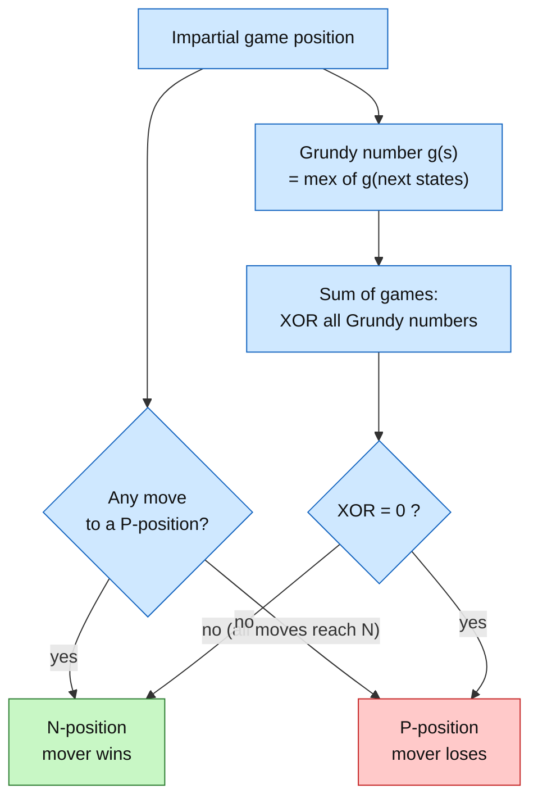

# 🎲 Game Theory — Nim, Grundy Numbers & Sprague–Grundy — Complete Guide

> **Navigation**: [← Combinatorics & Counting Toolkit…](27_Combinatorics_Counting_Toolkit.md) | [Chapter index](00_INDEX.md) | [Chapter 06 - Math & Geometry… →](06_Math_Geometry_Java_Complete.md)

## 🔗 Bridge — Where This Chapter Fits

| Dimension | This chapter |
| --- | --- |
| **Builds on** | [Bit Manipulation](10_Bit_Manipulation_Complete.md) (XOR), [DP Fundamentals](04b_DP_Fundamentals.md) (states and memoization), [Backtracking](11_Backtracking_Complete.md) (game-tree search) |
| **You will learn** | Winning/losing positions, Nim and the XOR rule, `mex`, Grundy numbers, Sprague–Grundy theorem for sums of games |
| **Leads to** | [Lower Bounds & NP](A3_Lower_Bounds_And_NP.md) (adversary arguments), [Randomized Algorithms](A4_Randomized_Algorithms.md) (game-theoretic view of algorithms) |
| **Abstraction level** | Concrete game states → **a number per state** (Grundy value) → **XOR to combine independent games** |

---

## 💬 Explain It Like a Study Partner — Impartial Games

> [!TIP]
> **Ask yourself first:** *"Two players alternately take stones from piles and the one who cannot move loses. Can I decide who wins without playing it out?"*

### 1. The bottom line

Every position of a fair two-player game can be summarised by one number; positions with number 0 are lost for the player to move, and separate games combine by XOR-ing their numbers.

### 2. The textbook core

- **Impartial game:** both players have the same moves from any position; the last player able to move wins (normal play).
- A position is **P** (previous player wins) if every move leads to an **N** position; **N** (next player wins) if some move leads to a P position.
- **Nim:** piles `p₁…pₙ`; first player wins iff `p₁ ⊕ p₂ ⊕ … ⊕ pₙ ≠ 0` (Bouton, 1901).
- **Grundy number** `g(s) = mex{ g(t) : t reachable from s }` where `mex` = smallest non-negative integer not in the set.
- **Sprague–Grundy theorem:** every impartial game is equivalent to a Nim pile of size `g(s)`; for a sum of independent games, `g = g₁ ⊕ g₂ ⊕ …`, and the position is lost for the mover iff `g = 0`.

### 3. The real-world analogy

A **scoreboard that distils any game position into one number**. Two boards that show 5 and 5 cancel out (5 ⊕ 5 = 0): whatever you do in one, your opponent can mirror in the other.

### 4. Walkthrough: Nim with piles 3, 4, 5

1. XOR: `3 ⊕ 4 = 7`, `7 ⊕ 5 = 2` → non-zero, so the **first player wins**.
2. To win, make the XOR zero: find a pile `p` with `p ⊕ 2 < p`. `3 ⊕ 2 = 1 < 3` ✓.
3. Reduce the pile of 3 to 1. Now `1 ⊕ 4 ⊕ 5 = 0`: the opponent is in a losing position.
4. Whatever they take, you can restore XOR to 0 on your next move, until they cannot move.

> [!NOTE]
> **Quick check:** piles 1, 2, 3: who wins? *`1 ⊕ 2 ⊕ 3 = 0`, so the player to move loses.*

---

## ⚡ At a Glance



**How to read this diagram.** Either classify a position directly by looking at its moves, or compute its Grundy number and combine independent games by XOR; zero means the player to move loses.

| Concept | Formula | Cost |
| ------- | ------- | ---- |
| Nim winner | XOR of pile sizes ≠ 0 | O(n) |
| Grundy number of a state | `mex` over reachable states | O(moves) per state |
| Subtraction game up to `n` | DP over `0..n` | O(n · \|moves\|) |
| Sum of games | XOR of Grundy numbers | O(#games) |

---

## 1. Nim

```java
static boolean nimFirstPlayerWins(int[] piles) {
    int x = 0;
    for (int p : piles) x ^= p;
    return x != 0;
}
```

**Proof sketch.** If the XOR is 0, any move changes exactly one pile, so the XOR becomes non-zero. If the XOR `s` is non-zero, pick a pile `p` whose highest bit of `s` is set; replacing `p` with `p ⊕ s` (which is smaller) makes the XOR 0. Terminal position (all piles 0) has XOR 0 and is lost for the mover, so the invariant "mover loses iff XOR = 0" holds by induction.

## 2. Grundy Numbers by DP

```java
static int mex(Set<Integer> s) { int m = 0; while (s.contains(m)) m++; return m; }

// Subtraction game: a move removes one of `moves` stones
static int[] grundySubtraction(int n, int[] moves) {
    int[] g = new int[n + 1];
    for (int i = 1; i <= n; i++) {
        Set<Integer> s = new HashSet<>();
        for (int m : moves) if (i - m >= 0) s.add(g[i - m]);
        g[i] = mex(s);
    }
    return g;
}
```

For `moves = {1, 3, 4}` the values for `n = 0..10` are `0, 1, 0, 1, 2, 3, 2, 0, 1, 0, 1`. Positions with value 0 (n = 0, 2, 7, 9) are lost for the mover.

## 3. Sums of Games

If a game decomposes into independent components (separate boards, piles, graph components), compute each component's Grundy number and XOR them. The mover wins iff the XOR is non-zero. To find a winning move, find a component where changing its Grundy number to `(its value) ⊕ (total XOR)` is possible.

## 4. When It Does Not Apply

- **Partisan games** (players have different moves; e.g. chess) need combinatorial game theory beyond Sprague–Grundy.
- **Misère play** (last mover loses) differs from normal play in general (Nim is a special case with a small tweak).
- **Games with cycles** need extra care (loopy games).

---

## 🏢 Enterprise Lens

| Area | What top-tier engineering looks like |
| ---- | ------------------------------------ |
| **Where it appears** | Game AI and puzzle solvers, adversarial analysis in security and auctions, "who wins" feasibility checks in matchmaking and tournament design, interview/competitive programming |
| **Failure modes** | Treating a partisan game as impartial; forgetting the terminal state has Grundy value 0; Grundy values blowing up (state space too large without symmetry); misusing normal vs misère rules |
| **Testing strategy** | Verify the Grundy DP by brute-force game-tree search for small `n`; assert `g(s) = 0` iff all successor values are non-zero |
| **Verification done for this chapter** | `nimFirstPlayerWins` was checked on known positions (1,2,3 → loses; 3,4,5 → wins) and the subtraction-game Grundy table above was reproduced by running the code |
| **Scalability note** | State count is the limit. Exploit independence (sum of games) and symmetry to avoid enumerating the product of component state spaces |

## 🧪 Practice Ladder

| Level | Problem | Idea |
| ----- | ------- | ---- |
| 1 | Nim game (LeetCode 292 variant) | Winning/losing by parity or modulus |
| 2 | Nim with several piles | XOR of sizes |
| 3 | Subtraction game with a move set | Grundy DP |
| 4 | Stone game on multiple independent boards | XOR of Grundy numbers |
| 5 | Take-from-graph games | Grundy numbers on a DAG |

> [!CAUTION]
> **Reality check — "Game theory means minimax search."** Minimax explores the tree; Sprague–Grundy collapses independent sub-games into numbers and avoids the product explosion.

---

[← Matrix Exponentiation](23_Matrix_Exponentiation_And_Linear_Recurrences.md) | [Index](00_INDEX.md) | [Online, Approximation & LP →](25_Online_Approximation_And_Linear_Programming.md)
