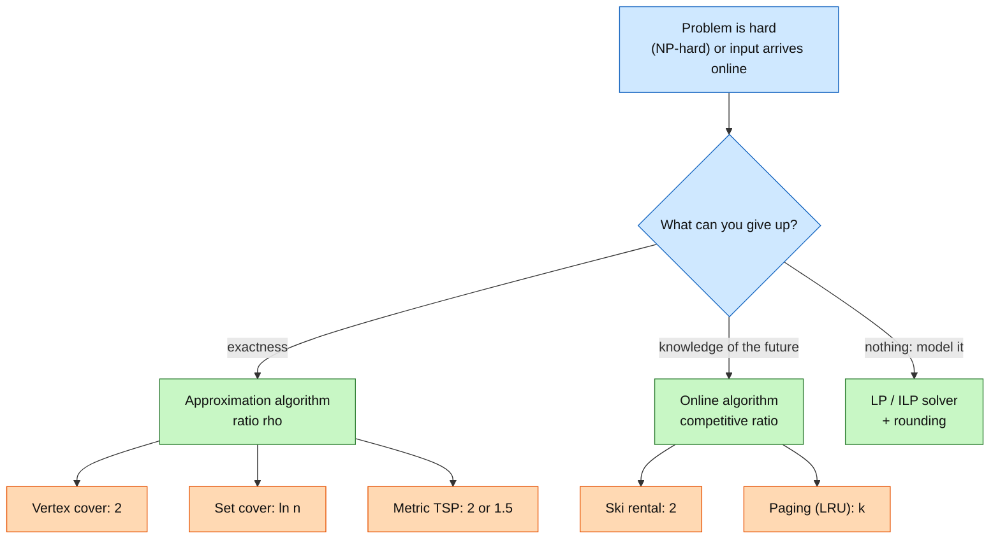

# 📐 Online, Approximation & Linear-Programming Algorithms — Complete Guide

> **Navigation**: [← Game Theory](24_Game_Theory_Nim_Sprague_Grundy.md) | [Back to Index](00_INDEX.md) | [Next: FFT & NTT →](26_FFT_NTT_Polynomial_Multiplication.md) | [Learning Path](00_LEARNING_PATH.md)

## 🔗 Bridge — Where This Chapter Fits

| Dimension | This chapter |
| --- | --- |
| **Builds on** | [Lower Bounds & NP-Completeness](A3_Lower_Bounds_And_NP.md) (why exact answers can be impossible), [Greedy](12_Greedy_Algorithms_Complete.md) (many approximations are greedy), [Graphs](05d_Graphs_Advanced_Algos.md) (MST, matching) |
| **You will learn** | What to do **after** a problem is NP-hard: approximation ratios, three classic approximation algorithms, the competitive ratio for online decisions, and linear programming as a modelling tool |
| **Leads to** | [Randomized Algorithms](A4_Randomized_Algorithms.md) (randomized rounding), [Algorithms in Production](13_Algorithms_In_Production.md) (heuristics in schedulers and routing) |
| **Abstraction level** | "Exact optimum" → "provably within a factor of optimum" → "no future knowledge, still within a factor" |

> [!NOTE]
> Curriculum gap closed: the repo taught how to *prove* hardness ([A3](A3_Lower_Bounds_And_NP.md)) but not how to *respond* to it.

---

## 💬 Explain It Like a Study Partner — Approximation & Online Algorithms

> [!TIP]
> **Ask yourself first:** *"The perfect answer takes years to compute. Is a provably-almost-perfect answer in milliseconds good enough?"*

### 1. The bottom line

When the best answer is too expensive (NP-hard) or the future is unknown (online), aim for an answer with a **guaranteed worst-case distance from the best**.

### 2. The textbook core

- **Approximation ratio ρ** (minimisation): algorithm cost ≤ ρ · OPT for every input. An algorithm with ρ = 2 is a **2-approximation**.
- **Online algorithm:** decisions must be made without knowing future inputs. Its **competitive ratio** is `max over inputs of ALG / OPT_offline`.
- **Linear programming (LP):** optimise a linear objective subject to linear constraints; solvable in polynomial time. Rounding LP solutions yields many approximation algorithms.
- Classic results: vertex cover 2-approx (maximal matching); set cover `H(n) ≈ ln n` greedy; metric TSP 2-approx (MST doubling) and 1.5-approx (Christofides); ski rental 2-competitive.

### 3. The real-world analogy

**Renting skis vs buying them** when you do not know how many days you will ski: a "rent until the rentals add up to the purchase price, then buy" rule never costs more than twice what a fortune-teller would have paid.

### 4. Walkthrough: vertex cover 2-approximation

1. Edges: `A–B`, `B–C`, `C–D`. Optimal cover is `{B, C}` (size 2).
2. Pick an uncovered edge `A–B`; put **both** endpoints in the cover: `{A, B}`.
3. Next uncovered edge is `C–D`; add both: `{A, B, C, D}`.
4. Cover size 4 ≤ 2 · OPT. Why? The chosen edges form a matching; any cover must contain at least one endpoint of each, so `OPT ≥ #edges chosen`, while we used `2 ×` that many vertices.

> [!NOTE]
> **Quick check:** what is the competitive ratio of "always rent"? *Unbounded: if the season is very long you pay far more than buying once.*

---

## ⚡ At a Glance



**How to read this diagram.** Decide what you can sacrifice (exactness, future knowledge, or neither), pick the family, then the classic example with its guaranteed ratio.

| Problem | Algorithm | Guarantee | Time |
| ------- | --------- | --------- | ---- |
| Vertex cover | Take both ends of a maximal matching | ≤ 2·OPT | O(E) |
| Set cover | Greedy: pick the set covering most uncovered | ≤ H(n)·OPT ≈ ln n | O(S · n) |
| Metric TSP | MST + preorder shortcut | ≤ 2·OPT | O(E log V) |
| Ski rental | Rent until cost = buy price, then buy | 2-competitive | O(1) |
| Paging with cache size `k` | LRU / FIFO | `k`-competitive | O(1) amortized |

---

## 1. Vertex Cover — 2-Approximation

```java
static int vertexCover2Approx(int n, int[][] edges) {
    boolean[] in = new boolean[n];
    int size = 0;
    for (int[] e : edges)
        if (!in[e[0]] && !in[e[1]]) {      // edge still uncovered
            in[e[0]] = in[e[1]] = true;    // take BOTH endpoints
            size += 2;
        }
    return size;
}
```

**Proof.** The edges chosen are pairwise disjoint (a *maximal matching* `M`). Any cover needs one distinct vertex per matching edge, so `OPT ≥ |M|`. We output `2|M| ≤ 2·OPT`.

## 2. Greedy Set Cover — `ln n` Approximation

```java
static List<Integer> greedySetCover(int universe, List<Set<Integer>> sets) {
    Set<Integer> covered = new HashSet<>();
    List<Integer> chosen = new ArrayList<>();
    while (covered.size() < universe) {
        int bestI = -1, bestGain = 0;
        for (int i = 0; i < sets.size(); i++) {
            int gain = 0;
            for (int x : sets.get(i)) if (!covered.contains(x)) gain++;
            if (gain > bestGain) { bestGain = gain; bestI = i; }
        }
        if (bestI < 0) break;               // remaining elements cannot be covered
        covered.addAll(sets.get(bestI));
        chosen.add(bestI);
    }
    return chosen;
}
```

The guarantee `ln n + 1` is essentially **tight**: unless P = NP, no polynomial algorithm does asymptotically better.

## 3. Metric TSP — MST Doubling (2-approx)

1. Build an MST (cost ≤ OPT, since deleting an edge from the optimal tour leaves a spanning tree).
2. Traverse the MST in preorder, visiting each vertex once (shortcutting repeated vertices).
3. By the **triangle inequality**, shortcuts never increase length, so the tour costs ≤ 2·MST ≤ 2·OPT.

Christofides improves this to **1.5·OPT** by adding a minimum-weight perfect matching on odd-degree MST vertices.

## 4. Online Algorithms — Ski Rental

```java
// Rent for days 1..(buyAtDay-1); on day buyAtDay buy. Cost for a season of `days` days:
static int skiRentalCost(int buyPrice, int days, int buyAtDay) {
    if (days < buyAtDay) return days;               // never bought
    return (buyAtDay - 1) + buyPrice;               // rented, then bought
}
```

With `buyAtDay = buyPrice` (rent for `buyPrice − 1` days, then buy) the cost is at most `2·buyPrice − 1`, while the offline optimum is `min(days, buyPrice)`; so the competitive ratio is below 2. For `buyPrice = 10`: a 3-day season costs 3 (optimal), a 50-day season costs 19 versus the optimum of 10.

**Paging.** For a cache of size `k`, LRU and FIFO are `k`-competitive and no deterministic online algorithm does better than `k`; randomized marking achieves `O(log k)`.

## 5. Linear Programming in One Page

A diet/capacity example: maximise `3x + 2y` subject to `x + y ≤ 4`, `x + 3y ≤ 6`, `x, y ≥ 0`.

| Corner point | `3x + 2y` |
| ------------ | --------- |
| (0, 0) | 0 |
| (4, 0) | 12 |
| (3, 1) | 11 |
| (0, 2) | 4 |

The optimum of a bounded LP lies at a **corner (vertex) of the feasible region**, here `(4, 0)` with value 12. The **simplex** method walks from corner to corner; **interior-point** methods run in polynomial time. In practice you model the problem and call a solver (HiGHS, OR-Tools, CPLEX, Gurobi) rather than writing simplex yourself.

**Integer programs (ILP)** add integrality (NP-hard in general); **LP relaxation + rounding** gives approximation algorithms (e.g. 2-approx weighted vertex cover).

---

## 🏢 Enterprise Lens

| Area | What top-tier engineering looks like |
| ---- | ------------------------------------ |
| **Where it runs in production** | Cluster schedulers and bin packing (first-fit-decreasing, 11/9·OPT + 6/9), CDN/cache eviction (competitive analysis of LRU), route planning and delivery (TSP heuristics), network design (set cover/vertex cover), capacity and budget planning (LP solvers), ad allocation (online matching) |
| **Failure modes** | Quoting a ratio without checking its assumptions (e.g. metric TSP needs the triangle inequality); worst-case guarantee ≠ typical quality (heuristics often beat the bound); solver timeouts on ILP; numerical tolerance issues in LP |
| **Testing strategy** | Compare against an exact brute force on small instances and assert `ALG ≤ ρ · OPT`; log the achieved ratio in production against an LP lower bound |
| **Verification done for this chapter** | The vertex-cover routine was checked against exhaustive search on 200 random graphs (ratio ≤ 2 held every time); set cover and ski-rental values quoted above were reproduced by running the code |
| **Operational note** | Always keep a *certificate* of quality: a lower bound (from LP duality or a matching) lets you tell stakeholders how far from optimal you can be |

## 🧪 Practice Ladder

| Level | Problem | Idea |
| ----- | ------- | ---- |
| 1 | Prove the 2-approximation for vertex cover | Maximal matching lower bound |
| 2 | Bin packing with first-fit decreasing | Greedy bound |
| 3 | Set cover instance by hand | Greedy picks, compare to optimum |
| 4 | Ski rental with randomized threshold | Expected competitive ratio `e/(e−1)` |
| 5 | Model a scheduling problem as an LP | Variables, constraints, objective |

> [!CAUTION]
> **Reality check — "An approximation is a hack."** It is a *proof*: for **every** input the answer is within a stated factor of the optimum, which a heuristic alone cannot promise.

---

[← Game Theory](24_Game_Theory_Nim_Sprague_Grundy.md) | [Index](00_INDEX.md) | [FFT & NTT →](26_FFT_NTT_Polynomial_Multiplication.md)
