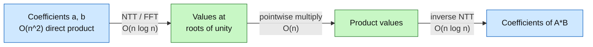

# 🌊 FFT, NTT & Fast Polynomial Multiplication — Complete Guide

> **Navigation**: [← Online, Approximation & LP](25_Online_Approximation_And_Linear_Programming.md) | [Back to Index](00_INDEX.md) | [Learning Path](00_LEARNING_PATH.md)

## 🔗 Bridge — Where This Chapter Fits

| Dimension | This chapter |
| --- | --- |
| **Builds on** | [Divide & Conquer](02c_Divide_And_Conquer.md) (Karatsuba, recurrences), [Number Theory](08a_NumberTheory_Core.md) (modular arithmetic, primitive roots), [Matrix Exponentiation](23_Matrix_Exponentiation_And_Linear_Recurrences.md) (fast power) |
| **You will learn** | Polynomial multiplication as **convolution**, the evaluate–multiply–interpolate idea, an iterative **NTT** modulo 998 244 353, applications to big-integer multiplication and counting |
| **Leads to** | String matching with wildcards, subset-sum counting, signal processing in production systems |
| **Abstraction level** | Coefficients ↔ **values at roots of unity**: a change of representation turns O(n²) multiplication into O(n log n) |

---

## 💬 Explain It Like a Study Partner — FFT / NTT

> [!TIP]
> **Ask yourself first:** *"Multiplying two numbers with a million digits by hand-method takes 10¹² steps. Is there a smarter representation?"*

### 1. The bottom line

Multiplication is slow in coefficient form but trivial in "values at points" form, and the FFT/NTT converts between the two in `O(n log n)`.

### 2. The textbook core

- A polynomial of degree `< n` is determined by its values at `n` distinct points.
- **Convolution:** `c[k] = Σ a[i]·b[k−i]` equals the coefficients of the product polynomial `A(x)·B(x)`.
- Multiplying values **pointwise** costs `O(n)`.
- Choosing the points as the `n`-th **roots of unity** makes conversion (the **DFT**) divide-and-conquer: `T(n) = 2T(n/2) + O(n)` → **`O(n log n)`**.
- The **NTT** is the same algorithm in the field `ℤ_p` with `p = 998244353 = 119·2²³ + 1` and primitive root `g = 3`, so everything stays **exact** (no floating-point error) for sizes up to 2²³.

### 3. The real-world analogy

Describing a curve either by its **formula** (coefficients) or by **points on it** (values). Adding two curves' heights at the same x is easy with points; the FFT is the fast translator between the two descriptions.

### 4. Walkthrough: `(1 + 2x)(3 + 4x)`

1. Coefficients `a = [1, 2]`, `b = [3, 4]`. The product has degree 2, so we need ≥ 3 points; round up to 4 (a power of two).
2. NTT of `a` and `b` (length 4, padded with zeros): values at the 4th roots of unity.
3. Multiply pointwise.
4. Inverse NTT gives `[3, 10, 8, 0]` → `3 + 10x + 8x²`. Check: `1·3 = 3`, `1·4 + 2·3 = 10`, `2·4 = 8` ✓.

> [!NOTE]
> **Quick check:** why pad to a power of two? *The recursive halving needs even lengths at every level.*

---

## ⚡ At a Glance



**How to read this diagram.** Go up one lane (coefficients to values), do the cheap pointwise step, then come back. The two conversions are the only `O(n log n)` parts.

| Method | Time | Exact? | Use when |
| ------ | ---- | ------ | -------- |
| Schoolbook | O(n²) | yes | n ≤ ~64 |
| Karatsuba | O(n^1.585) | yes | medium n, no modulus |
| FFT (complex doubles) | O(n log n) | no (rounding) | audio/signal work, small coefficients |
| NTT (mod 998244353) | O(n log n) | yes | competitive programming, counting mod p |
| NTT + CRT with several primes | O(n log n) | yes | exact big results |

---

## 1. Modular Power (helper)

```java
static long modPow(long b, long e, long m) {
    long r = 1; b %= m;
    while (e > 0) { if ((e & 1) == 1) r = r * b % m; b = b * b % m; e >>= 1; }
    return r;
}
```

## 2. Iterative NTT

```java
static final long P = 998_244_353L, G = 3;

static void ntt(long[] a, boolean invert) {
    int n = a.length;
    // bit-reversal permutation
    for (int i = 1, j = 0; i < n; i++) {
        int bit = n >> 1;
        for (; (j & bit) != 0; bit >>= 1) j ^= bit;
        j ^= bit;
        if (i < j) { long t = a[i]; a[i] = a[j]; a[j] = t; }
    }
    // butterfly passes
    for (int len = 2; len <= n; len <<= 1) {
        long w = modPow(G, (P - 1) / len, P);          // primitive len-th root of unity
        if (invert) w = modPow(w, P - 2, P);           // use its inverse for the inverse transform
        for (int i = 0; i < n; i += len) {
            long wn = 1;
            for (int j = 0; j < len / 2; j++) {
                long u = a[i + j], v = a[i + j + len / 2] * wn % P;
                a[i + j] = (u + v) % P;
                a[i + j + len / 2] = (u - v + P) % P;
                wn = wn * w % P;
            }
        }
    }
    if (invert) {                                       // divide by n
        long inv = modPow(n, P - 2, P);
        for (int i = 0; i < n; i++) a[i] = a[i] * inv % P;
    }
}
```

## 3. Polynomial Multiplication

```java
static long[] multiply(long[] x, long[] y) {
    int need = x.length + y.length - 1, n = 1;
    while (n < need) n <<= 1;                           // next power of two
    long[] fa = Arrays.copyOf(x, n), fb = Arrays.copyOf(y, n);
    ntt(fa, false); ntt(fb, false);
    for (int i = 0; i < n; i++) fa[i] = fa[i] * fb[i] % P;
    ntt(fa, true);
    return Arrays.copyOf(fa, need);
}
```

**Invariant:** after the forward transform, `fa[k]` equals `A(ωᵏ)`; pointwise product gives `(A·B)(ωᵏ)`; the inverse transform recovers coefficients because the DFT matrix has inverse `(1/n)·(conjugate)`.

## 4. Applications

| Application | How |
| ----------- | --- |
| Big-integer multiplication | Digits as coefficients, multiply, carry |
| Counting pairs with a given sum | Indicator polynomials, coefficient of `x^s` |
| Wildcard string matching | Sum of `(p−t)²·p·t` expressed as convolutions |
| Subset-sum / knapsack counting | Polynomial product of `(1 + x^wᵢ)` |

---

## 🏢 Enterprise Lens

| Area | What top-tier engineering looks like |
| ---- | ------------------------------------ |
| **Where it runs in production** | Signal and image processing (filters are convolutions), audio codecs, big-number libraries (GMP uses FFT-based Schönhage–Strassen multiplication for huge operands; Java's `BigInteger` uses schoolbook, Karatsuba and Toom-Cook only), polynomial arithmetic in cryptography (lattice schemes), large-scale counting in analytics |
| **Failure modes** | Result length exceeds `2²³` for this prime; forgetting to pad to a power of two; coefficients ≥ P (reduce first); floating-point FFT rounding for large coefficients; mixing the forward/inverse root |
| **Testing strategy** | Differential test against the O(n²) product on random inputs of many sizes (including length 1); round-trip test `inverse(forward(a)) == a`; boundary sizes at powers of two |
| **Verification done for this chapter** | The NTT multiplication above was compiled and compared with the naive convolution on 200 random polynomial pairs (lengths 1–20, coefficients < 1000) and matched every time |
| **Performance note** | Precompute roots once, use primitive `long[]`/`int[]` buffers, and switch to schoolbook below ~64 elements; for huge sizes consider multithreaded or SIMD libraries |

## 🧪 Practice Ladder

| Level | Problem | Idea |
| ----- | ------- | ---- |
| 1 | Multiply two polynomials of degree 10⁵ mod 998244353 | NTT |
| 2 | Multiply two 10⁵-digit integers | Digits as coefficients + carry |
| 3 | Number of pairs `(i, j)` with `a[i] + b[j] = s` | Indicator convolution |
| 4 | Wildcard pattern matching | Three convolutions |
| 5 | Count ways to reach each sum with items of given weights | Product of polynomials |

> [!CAUTION]
> **Reality check — "FFT is just for signals."** It is a general algebra tool: any problem that reduces to a convolution can use it.

---

[← Online, Approximation & LP](25_Online_Approximation_And_Linear_Programming.md) | [Index](00_INDEX.md) | [Learning Path](00_LEARNING_PATH.md)
