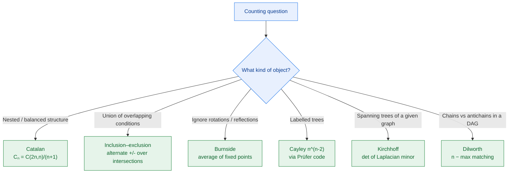
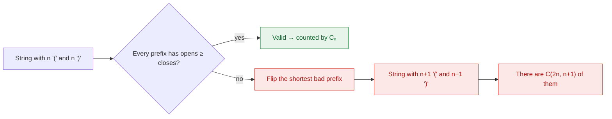

# 🧮 Combinatorics & Counting Toolkit — Catalan, Inclusion–Exclusion, Burnside, Cayley, Kirchhoff — Complete Guide

> **Navigation**: [← FFT, NTT & Fast Polynomial…](26_FFT_NTT_Polynomial_Multiplication.md) | [Chapter index](00_INDEX.md) | [Game Theory — Nim, Grundy Numbers… →](24_Game_Theory_Nim_Sprague_Grundy.md)

## 🔗 Bridge — Where This Chapter Fits

| Dimension | This chapter |
| --- | --- |
| **Builds on** | [Number Theory Core](08a_NumberTheory_Core.md) (modular inverse, `nCr mod p`), [DP Fundamentals](04b_DP_Fundamentals.md) (counting recurrences), [Graphs Fundamentals](05c_Graphs_Fundamentals.md) (spanning trees), [Matrix Exponentiation](23_Matrix_Exponentiation_And_Linear_Recurrences.md) |
| **You will learn** | Catalan numbers, derangements, inclusion–exclusion, Burnside's lemma, Cayley's formula and Prüfer codes, Kirchhoff's matrix-tree theorem, Wilson's theorem, Pick's theorem, Dilworth's theorem, the Josephus recurrence, linear Diophantine equations, the Stern–Brocot tree |
| **Leads to** | [Randomized Algorithms](A4_Randomized_Algorithms.md) (probability on counted spaces), [Lower Bounds & NP](A3_Lower_Bounds_And_NP.md) (counting arguments), [Backtracking](11_Backtracking_Complete.md) (when you must *list* what you counted) |
| **Abstraction level** | Concrete enumeration → **a formula that counts without enumerating** → a **bijection** that proves the formula |

> [!NOTE]
> **Source note.** The selection of topics in this chapter was guided by two books that live in this repository: *Competitive Programmer's Handbook* (Antti Laaksonen, 2018 draft — chapters on combinatorics, spanning trees, flows, number theory and geometry) and *Programming Challenges* (Skiena & Revilla, 2003 — combinatorics and number-theory chapters). Explanations and code here are written independently and every program was run against brute force. See the [Book Companion](00_BOOK_COMPANION.md) for the full chapter map.

---

## 💬 Explain It Like a Study Partner — Counting Without Listing

> [!TIP]
> **Ask yourself first:** *"The answer is a huge number (or 'mod 1 000 000 007'). Do I need to see every object, or only how many there are?"*

### 1. The bottom line

When you only need *how many*, find a structure (a recurrence, a symmetry, a bijection) that lets you count without ever building the objects.

### 2. The textbook core

- **Catalan number** `Cₙ = (1/(n+1))·C(2n, n)`, with `C₀ = 1` and `Cₙ = Σ Cᵢ·Cₙ₋₁₋ᵢ`. It counts balanced parenthesisations of `n` pairs, binary trees with `n` nodes, and rooted ordered trees with `n+1` nodes.
- **Inclusion–exclusion:** `|A₁ ∪ … ∪ Aₙ| = Σ|Aᵢ| − Σ|Aᵢ∩Aⱼ| + Σ|Aᵢ∩Aⱼ∩Aₖ| − …` (odd-sized intersections are added, even-sized subtracted).
- **Derangements** (permutations with no fixed point): `D(n) = (n−1)(D(n−1) + D(n−2))`, `D(0)=1, D(1)=0`.
- **Burnside's lemma:** the number of distinct objects up to symmetry equals the **average number of objects fixed by each symmetry**. For `n`-bead necklaces with `m` colours under rotation: `(1/n)·Σ m^gcd(k, n)`.
- **Cayley's formula:** there are `n^(n−2)` labelled trees on `n` vertices (proved by **Prüfer codes**, a bijection with sequences of length `n−2`).
- **Kirchhoff's matrix-tree theorem:** the number of spanning trees of a graph equals any cofactor of its Laplacian `L = D − A` (delete one row and the same column, take the determinant). Cayley's formula is the special case of the complete graph.
- **Wilson's theorem:** `n` is prime iff `(n−1)! ≡ −1 (mod n)` — elegant, but too slow to be a practical primality test.
- **Pick's theorem:** for a lattice polygon, `Area = I + B/2 − 1` (`I` interior lattice points, `B` boundary lattice points).
- **Dilworth's theorem:** in a partial order (DAG), the size of the largest *antichain* equals the minimum number of paths needed to cover every element when paths may share vertices (a *general* path cover).

### 3. The real-world analogy

Counting seats in a stadium: you do not walk to each seat — you multiply *rows × seats per row*, then fix the double-counted VIP boxes (inclusion–exclusion) and treat seats that are mirror images of each other as one design (Burnside).

### 4. Walkthrough: how many necklaces of 4 beads and 3 colours?

1. Rotations: `k = 0, 1, 2, 3` (4 symmetries).
2. A rotation by `k` fixes a necklace only if beads repeat every `gcd(k, 4)` positions, so it fixes `3^gcd(k,4)` colourings: `3⁴ = 81`, `3¹ = 3`, `3² = 9`, `3¹ = 3`.
3. Average: `(81 + 3 + 9 + 3) / 4 = 96 / 4 = 24`.
4. Check by brute force (canonical form under rotation) → also `24`. ✅

> [!NOTE]
> **Quick check:** why is the answer *not* `81 / 4`? Because most colourings have fewer than 4 rotations that leave them unchanged — dividing by the group size only works when every object has a trivial stabiliser. Burnside's lemma corrects for the exceptions.

---

## ⚡ At a Glance



**How to read this diagram.** Start at the question and pick the branch that matches the *shape* of what you are counting. Each green box is a tool from this chapter; the label under it is the formula you reach for.

---

## 1. Binomials and Catalan Numbers

`C(n, r) mod p` uses factorials and Fermat inverses (see [Number Theory Core](08a_NumberTheory_Core.md)). Catalan numbers reuse it:

```java
static final long MOD = 1_000_000_007L;

static long pow(long b, long e, long m) {
    long r = 1; b %= m;
    while (e > 0) { if ((e & 1) == 1) r = r * b % m; b = b * b % m; e >>= 1; }
    return r;
}

// O(n^2): C[k] = sum_{i<k} C[i] * C[k-1-i]
static long[] catalanDp(int n) {
    long[] c = new long[n + 1];
    c[0] = 1;
    for (int k = 1; k <= n; k++)
        for (int i = 0; i < k; i++)
            c[k] = (c[k] + c[i] * c[k - 1 - i]) % MOD;
    return c;
}

// O(n): C(2n,n)/(n+1) with modular inverses
static long catalanClosed(int n) {
    long[] f = new long[2 * n + 2];
    f[0] = 1;
    for (int i = 1; i < f.length; i++) f[i] = f[i - 1] * i % MOD;
    long binom = f[2 * n] * pow(f[n], MOD - 2, MOD) % MOD * pow(f[n], MOD - 2, MOD) % MOD;
    return binom * pow(n + 1, MOD - 2, MOD) % MOD;
}
```

First values: `1, 1, 2, 5, 14, 42, 132, 429, 1430`.

**Why the closed form works (reflection argument).** There are `C(2n, n)` strings with `n` opens and `n` closes. A bad string has a first prefix where closes exceed opens; flip every bracket in that prefix and you get a string with `n+1` opens and `n−1` closes — and this is a bijection onto all such strings. So `#valid = C(2n,n) − C(2n, n+1) = C(2n,n)/(n+1)`.



**How to read this diagram.** Every invalid string maps to exactly one string with `n+1` opens (and back), so the invalid ones are counted by `C(2n, n+1)`; subtracting them from all `C(2n, n)` strings leaves the Catalan count.

> [!TIP]
> **Pattern trigger.** "Number of ways to parenthesise", "number of BSTs with `n` keys", "monotone lattice paths that never cross the diagonal", "triangulations of an `(n+2)`-gon" → Catalan.

---

## 2. Inclusion–Exclusion and Derangements

Count permutations with **no** fixed point. Let `Xₖ` be the permutations fixing position `k`. Then `D(n) = n! − |X₁ ∪ … ∪ Xₙ|`, and every `j`-wise intersection has size `(n−j)!`, giving

`D(n) = Σₖ (−1)ᵏ · n!/k!`.

```java
// D(n) = (n-1) * (D(n-1) + D(n-2))
static long[] derangements(int n) {
    long[] d = new long[Math.max(3, n + 1)];
    d[0] = 1; d[1] = 0; d[2] = 1;
    for (int i = 3; i <= n; i++) d[i] = (long) (i - 1) * (d[i - 1] + d[i - 2]);
    return d;
}

// Same value via inclusion-exclusion: sum (-1)^k n!/k!
static long derangementsIE(int n) {
    long fact = 1;
    for (int i = 2; i <= n; i++) fact *= i;
    long total = 0, term = fact;
    for (int k = 0; k <= n; k++) { total += (k % 2 == 0 ? 1 : -1) * term; term /= (k + 1); }
    return total;
}
```

First values: `D(0..8) = 1, 0, 1, 2, 9, 44, 265, 1854, 14833` (`long` is safe up to `n = 20`).

**General recipe.** To count objects satisfying *none* of `m` bad properties: `total − |A₁ ∪ … ∪ Aₘ|`, then expand the union with alternating signs. If `m ≤ ~20`, enumerate subsets with a bitmask (`2ᵐ` terms); if the intersection size depends only on how many properties you chose, collapse to a single sum.

---

## 3. Burnside's Lemma — Counting Up to Symmetry

```java
static int gcd(int a, int b) { return b == 0 ? a : gcd(b, a % b); }

// Necklaces of n beads, m colours, rotations only
static long necklaces(int n, int m) {
    long sum = 0;
    for (int k = 0; k < n; k++) {
        long fixed = 1;
        for (int j = 0; j < gcd(k, n); j++) fixed *= m;   // m^gcd(k,n)
        sum += fixed;
    }
    return sum / n;
}
```

`necklaces(4, 3) = 24`. For reflections too, use the dihedral group of `2n` symmetries and average over all `2n`.

> [!WARNING]
> **Common trap.** Burnside counts *orbits*, not objects. Make sure the question really treats rotated copies as the same. If the problem fixes the starting bead, there is no symmetry to divide out.

---

## 4. Cayley's Formula and Prüfer Codes

A **Prüfer code** of a labelled tree on `n` vertices is built by repeatedly deleting the smallest-labelled leaf and writing down *its neighbour*, `n−2` times. The tree can be rebuilt from the code alone, so labelled trees ↔ sequences of length `n−2` over `n` labels: exactly `n^(n−2)`.

```java
// Tree -> code (labels 0..n-1, adj lists)
static int[] pruferEncode(List<Integer>[] adj) {
    int n = adj.length;
    int[] deg = new int[n];
    for (int i = 0; i < n; i++) deg[i] = adj[i].size();
    boolean[] removed = new boolean[n];
    int[] code = new int[n - 2];
    PriorityQueue<Integer> leaves = new PriorityQueue<>();
    for (int i = 0; i < n; i++) if (deg[i] == 1) leaves.add(i);
    for (int k = 0; k < n - 2; k++) {
        int leaf = leaves.poll();
        removed[leaf] = true;
        for (int v : adj[leaf]) if (!removed[v]) { code[k] = v; if (--deg[v] == 1) leaves.add(v); }
    }
    return code;
}

// Code -> edges
static int[][] pruferDecode(int[] code) {
    int n = code.length + 2;
    int[] deg = new int[n];
    Arrays.fill(deg, 1);
    for (int c : code) deg[c]++;
    PriorityQueue<Integer> leaves = new PriorityQueue<>();
    for (int i = 0; i < n; i++) if (deg[i] == 1) leaves.add(i);
    int[][] edges = new int[n - 1][];
    int e = 0;
    for (int c : code) {
        int leaf = leaves.poll();
        edges[e++] = new int[]{leaf, c};
        if (--deg[c] == 1) leaves.add(c);
    }
    edges[e] = new int[]{leaves.poll(), leaves.poll()};
    return edges;
}
```

Both run in `O(n log n)`. A vertex of degree `d` appears exactly `d − 1` times in the code — useful for "count trees with prescribed degrees".

---

## 5. Kirchhoff's Matrix-Tree Theorem

Build the Laplacian `L` (degree on the diagonal, `−1` for every edge), delete one row and column, and take the determinant. Use **exact** arithmetic (Bareiss fraction-free elimination in `BigInteger`) or a modular determinant — never floating point for large graphs.

```java
static BigInteger countSpanningTrees(int n, int[][] edges) {
    long[][] L = new long[n][n];
    for (int[] e : edges) { L[e[0]][e[0]]++; L[e[1]][e[1]]++; L[e[0]][e[1]]--; L[e[1]][e[0]]--; }
    int m = n - 1;
    BigInteger[][] a = new BigInteger[m][m];
    for (int i = 0; i < m; i++) for (int j = 0; j < m; j++) a[i][j] = BigInteger.valueOf(L[i + 1][j + 1]);
    BigInteger prev = BigInteger.ONE;
    int sign = 1;
    for (int k = 0; k < m - 1; k++) {
        if (a[k][k].signum() == 0) {
            int sw = -1;
            for (int i = k + 1; i < m; i++) if (a[i][k].signum() != 0) { sw = i; break; }
            if (sw < 0) return BigInteger.ZERO;
            BigInteger[] t = a[k]; a[k] = a[sw]; a[sw] = t; sign = -sign;
        }
        for (int i = k + 1; i < m; i++)
            for (int j = k + 1; j < m; j++)
                a[i][j] = a[i][j].multiply(a[k][k]).subtract(a[i][k].multiply(a[k][j])).divide(prev);
        prev = a[k][k];
    }
    BigInteger det = m == 0 ? BigInteger.ONE : a[m - 1][m - 1];
    return sign == 1 ? det : det.negate();
}
```

On the 4-vertex graph with edges `1-2, 1-3, 1-4, 3-4` it returns `3`; on complete graphs `Kₙ` it returns `n^(n−2)`, matching Cayley.

---

## 6. Four Small Theorems You Will Meet

| Theorem | Statement | Practical use | Caveat |
| --- | --- | --- | --- |
| **Wilson** | `n` prime ⇔ `(n−1)! ≡ −1 (mod n)` | Elegant proofs, modular identities | `O(n)` multiplications — use Miller–Rabin ([08b](08b_NumberTheory_Advanced.md)) for real primality tests |
| **Pick** | `A = I + B/2 − 1` for lattice polygons | Count interior lattice points: `I = A − B/2 + 1`, with `B = Σ gcd(\|Δx\|, \|Δy\|)` over edges and `2A` from the shoelace formula | Vertices must be lattice points; the polygon must be simple |
| **Dilworth** | Max antichain = min chain cover | Scheduling: minimum number of workers = largest set of mutually conflicting jobs | For the "minimum *general* path cover" compute the transitive closure first, then `n − maximum bipartite matching` |
| **Josephus** | `J(1)=0`, `J(i) = (J(i−1) + k) mod i` (0-indexed survivor) | Elimination games, circular-list simulation in `O(n)` instead of `O(nk)` | Add 1 for 1-indexed answers; `J(7,3) = 3` (0-indexed) |

```java
static int josephus(int n, int k) {
    int r = 0;
    for (int i = 2; i <= n; i++) r = (r + k) % i;
    return r;                                  // 0-indexed survivor
}

// Lattice points strictly inside a lattice polygon (Pick), vertices in order
static long interiorPoints(long[][] p) {
    int n = p.length;
    long twiceArea = 0, boundary = 0;
    for (int i = 0; i < n; i++) {
        long[] u = p[i], v = p[(i + 1) % n];
        twiceArea += u[0] * v[1] - v[0] * u[1];
        boundary += gcd((int) Math.abs(u[0] - v[0]), (int) Math.abs(u[1] - v[1]));
    }
    twiceArea = Math.abs(twiceArea);
    return (twiceArea - boundary + 2) / 2;     // I = A - B/2 + 1
}
```

Example: the 3-4-5 right triangle `(0,0), (4,0), (0,3)` has `A = 6`, `B = 8`, so `I = 6 − 4 + 1 = 3`.

---

## 7. Bonus: Linear Diophantine Equations and the Stern–Brocot Tree

**Linear Diophantine equation** `a·x + b·y = c` (integer `x, y`) has a solution **iff `gcd(a, b)` divides `c`**. Extended Euclid gives one solution; every other is `(x + k·b/g, y − k·a/g)`.

```java
static long[] extGcd(long a, long b) {                 // {g, x, y} with a*x + b*y = g
    if (b == 0) return new long[]{a, 1, 0};
    long[] r = extGcd(b, a % b);
    return new long[]{r[0], r[2], r[1] - (a / b) * r[2]};
}

static long[] diophantine(long a, long b, long c) {    // one solution or null
    long[] r = extGcd(a, b);
    if (c % r[0] != 0) return null;
    long k = c / r[0];
    return new long[]{r[1] * k, r[2] * k};
}
```

`diophantine(12, 18, 30)` returns `(-5, 5)`: `12·(−5) + 18·5 = 30`. The same routine solves linear congruences `a·x ≡ c (mod m)` (rewrite as `a·x + m·y = c`).

The **Stern–Brocot tree** lists *every* positive fraction in lowest terms exactly once. Start with the bounds `0/1` and `1/0`; the mediant of `a/b` and `c/d` is `(a+c)/(b+d)`. Going left or right at each mediant spells out a unique `L`/`R` path to any fraction.

```java
static String sbPath(long p, long q) {                 // p/q in lowest terms
    StringBuilder sb = new StringBuilder();
    long lp = 0, lq = 1, rp = 1, rq = 0;
    while (true) {
        long mp = lp + rp, mq = lq + rq;
        if (mp * q == p * mq) break;
        if (p * mq < mp * q) { sb.append('L'); rp = mp; rq = mq; }
        else                 { sb.append('R'); lp = mp; lq = mq; }
    }
    return sb.toString();
}
```

`sbPath(5, 7) = "LRRL"`, `sbPath(3, 2) = "RL"`. Use it for best rational approximations and for problems that ask you to locate a fraction in the tree.

---

## 🏢 Enterprise Lens

| Area | What top-tier engineering looks like |
| ---- | ------------------------------------ |
| **Where it appears** | Capacity and test-case counting (how many configurations?), combinatorial testing of feature flags, network reliability (spanning-tree counts as redundancy measures), scheduling lower bounds (Dilworth), cryptographic parameter counting, compiler grammar ambiguity counts (Catalan) |
| **Failure modes** | Overflow before taking the modulus; dividing by `(n+1)` without a modular inverse; floating-point determinants for Kirchhoff; applying Burnside when symmetries are not a group; off-by-one between 0- and 1-indexed Josephus |
| **Testing strategy** | Every formula here has a brute-force twin for small inputs; keep both and assert equality in randomized tests |
| **Verification done for this chapter** | Catalan DP vs closed form (`n ≤ 30`) and vs brute-force valid-parentheses count (`n ≤ 8`); derangement recurrence vs inclusion–exclusion (`n ≤ 15`); Burnside vs canonical-form brute force (`n ≤ 6, m ≤ 4`); Prüfer round trip on 300 random codes plus 16 distinct trees for `n = 4`; Kirchhoff vs brute force on 200 random graphs and `Kₙ → nⁿ⁻²` for `n ≤ 6`; Wilson vs trial division (`n ≤ 200`); Josephus recurrence vs simulation; Diophantine existence rule and solutions on 5 000 random cases; Stern–Brocot path round trip on 3 000 fractions; Dilworth (`n − matching`) vs brute-force antichain on 300 random DAGs |
| **Scalability note** | Catalan/binomials need `O(n)` precomputed factorials; determinants are `O(n³)`; Burnside over a group of size `g` costs `g × (cost of counting fixed points)` |

## 🧪 Practice Ladder

| Level | Problem | Idea |
| ----- | ------- | ---- |
| 1 | Unique Binary Search Trees (LeetCode 96) | Catalan DP |
| 2 | Generate Parentheses (LeetCode 22) | Catalan count, backtracking to list |
| 3 | Derangement / "hat check" counting | Recurrence or inclusion–exclusion |
| 4 | Count necklaces / bracelets with `k` colours | Burnside with rotations (and reflections) |
| 5 | Number of spanning trees of a small graph | Kirchhoff with exact determinant |
| 6 | Minimum number of chains covering a poset | Dilworth + bipartite matching |
| 7 | Water-jug / "can you measure `c` litres?" | Linear Diophantine: `gcd(a, b) \| c` |

> [!CAUTION]
> **Reality check — "Counting problems need a clever trick each time."** Most reduce to four moves: find a recurrence, find a bijection, add/subtract overlaps (inclusion–exclusion), or divide out symmetry (Burnside). Name which move you are making before you start coding.

---

[← FFT / NTT](26_FFT_NTT_Polynomial_Multiplication.md) | [Index](00_INDEX.md) | [Book Companion →](00_BOOK_COMPANION.md)
