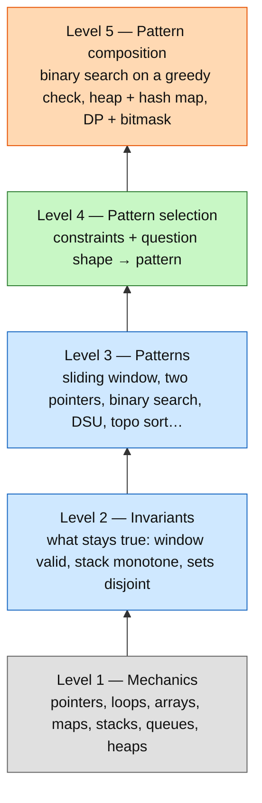
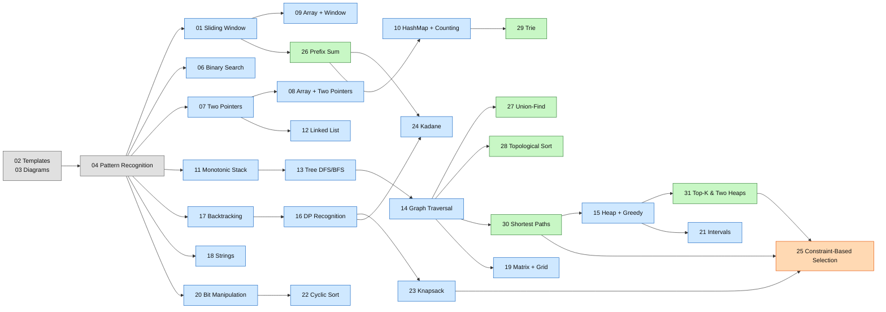

# 🧭 Learning Path — Patterns & Templates

> **Navigation**: [Back to Index](00_INDEX.md) | [Pattern Master Guide](00_PATTERN_MASTER_GUIDE.md) | [Constraint-Based Selection](25_Constraint_Based_Pattern_Selection.md)

This page answers three questions: **what do I read first, what does each chapter assume, and where do the gaps between patterns get bridged?**

---

## 1. The Abstraction Ladder

Patterns are the middle layer between *data structures* and *problems*. Each rung hides detail from the one below.

**How to read this diagram.** Read bottom to top. Beginners often jump to Level 3 (memorising patterns) without Level 2 (the invariant), which is why patterns break on unfamiliar variants.

---

## 2. Dependency Graph

**How to read this diagram.** Arrows mean "read before". Green boxes are the pattern pages added after the curriculum audit; orange is the capstone that ties everything together.

---

## 3. Recommended Reading Order with Bridges

Each row says what you **carry in**, what **new problem** forces the chapter, and what it **hands to** the next.

| # | Chapter | Carry in | New problem it solves | Hands off to |
| - | ------- | -------- | --------------------- | ------------ |
| 1 | [Code Templates](02_Code_Templates.md) · [Visual Diagrams](03_Visual_Diagrams.md) | Basic loops and arrays | What does a clean reusable skeleton look like, and how does state move? | Recognition |
| 2 | [Pattern Recognition](04_Pattern_Recognition.md) | Templates | Which pattern does this problem want? | Every pattern chapter |
| 3 | [Sliding Window](01_Sliding_Window.md) → [Array + Window](09_Array_Plus_SlidingWindow.md) | Arrays, loops | Re-scanning overlapping ranges | Prefix sums |
| 4 | [Two Pointers](07_Two_Pointers_Complete.md) → [Array + Two Pointers](08_Array_Plus_TwoPointers.md) → [Linked List](12_LinkedList_Plus_TwoPointers.md) | Sorted arrays | Pair search without nested loops; cycles in lists | Binary search |
| 5 | [Binary Search](06_Binary_Search_Patterns.md) | Monotone predicates | Halving a search space, including the answer space | Constraint thinking |
| 6 | [Prefix Sum & Difference Array](26_Prefix_Sum_And_Difference_Array.md) 🆕 | Windows, arrays | Range queries and range updates in `O(1)`; windows that fail on negatives | Kadane, hash counting |
| 7 | [HashMap + Counting](10_HashMap_Plus_Counting.md) | Prefix sums | Remembering what you have seen | Tries, DSU |
| 8 | [Kadane](24_Kadanes_Subarray_Patterns.md) | Prefix sums, DP idea | Best subarray in one pass | DP |
| 9 | [Stack + Monotonic](11_Stack_Plus_MonotonicPattern.md) | Stacks | "Next greater" and histogram problems | Trees |
| 10 | [Tree DFS/BFS](13_Tree_Plus_DFS_BFS.md) | Recursion, stacks, queues | What each call returns up and passes down | Graphs |
| 11 | [Graph Traversal](14_Graph_Plus_Traversal.md) → [Matrix + Grid](19_Matrix_Plus_Grid_Traversal.md) | Trees | Cycles and implicit graphs | DSU, topo sort, shortest paths |
| 12 | [Union-Find](27_Union_Find_Pattern.md) 🆕 | Graph components | Connectivity under merges | MST, clustering |
| 13 | [Topological Sort](28_Topological_Sort_Pattern.md) 🆕 | DFS/BFS | Ordering under prerequisites | DAG DP |
| 14 | [Shortest Paths](30_Shortest_Path_Pattern.md) 🆕 | BFS, heaps | Weighted routes | Heaps |
| 15 | [Heap + Greedy](15_Heap_Plus_GreedySelection.md) → [Top-K & Two Heaps](31_Top_K_And_Two_Heaps_Pattern.md) 🆕 → [Intervals](21_Intervals_Pattern.md) | Priority queues | Always take the best available; running medians; sorted sweeps | DP |
| 16 | [Backtracking](17_Backtracking_Plus_Pruning.md) | Recursion | Enumerating with pruning | DP |
| 17 | [DP Recognition](16_DP_Pattern_Recognition.md) → [Knapsack](23_Knapsack_Family.md) | Backtracking, recursion | Overlapping subproblems | Constraint thinking |
| 18 | [Strings](18_String_Plus_Advanced.md) → [Trie](29_Trie_Pattern.md) 🆕 | Hashing, trees | Prefixes and canonical forms | Algorithms folder |
| 19 | [Bit Manipulation](20_BitManipulation_Plus_Tricks.md) → [Cyclic Sort](22_Cyclic_Sort_Pattern.md) | Binary numbers | Constant-space tricks | Capstone |
| 20 | [Constraint-Based Selection](25_Constraint_Based_Pattern_Selection.md) · [Master Guide](00_PATTERN_MASTER_GUIDE.md) · [LeetCode ↔ Real World](05_LeetCode_RealWorld_Map.md) | Everything | Choosing and justifying the pattern | [Problem Solving](../05_Problem_Solving/00_INDEX.md) |

---

## 4. Coverage Matrix — Question Shape → Pattern

| If the question asks… | Pattern | Chapter |
| --- | --- | --- |
| best/longest/shortest *contiguous* range | Window or prefix sum | [01](01_Sliding_Window.md), [26](26_Prefix_Sum_And_Difference_Array.md) |
| pair/triple with a property in sorted data | Two pointers | [07](07_Two_Pointers_Complete.md), [08](08_Array_Plus_TwoPointers.md) |
| smallest value such that something holds | Binary search on the answer | [06](06_Binary_Search_Patterns.md) |
| have I seen this? how many times? | Hash map | [10](10_HashMap_Plus_Counting.md) |
| next greater / histogram | Monotonic stack | [11](11_Stack_Plus_MonotonicPattern.md) |
| cycle / middle of a list | Fast and slow pointers | [12](12_LinkedList_Plus_TwoPointers.md) |
| tree path, depth, validation | DFS/BFS on trees | [13](13_Tree_Plus_DFS_BFS.md) |
| connected? components? | Graph search / union-find | [14](14_Graph_Plus_Traversal.md), [27](27_Union_Find_Pattern.md) |
| order with prerequisites | Topological sort | [28](28_Topological_Sort_Pattern.md) |
| cheapest route | BFS / 0-1 BFS / Dijkstra / Bellman–Ford | [30](30_Shortest_Path_Pattern.md) |
| K-th, top K, median of a stream | Heap / two heaps | [15](15_Heap_Plus_GreedySelection.md), [31](31_Top_K_And_Two_Heaps_Pattern.md) |
| merge/insert/overlap of ranges | Intervals | [21](21_Intervals_Pattern.md) |
| all combinations with constraints | Backtracking | [17](17_Backtracking_Plus_Pruning.md) |
| optimal count/min/max with repeated subproblems | DP / knapsack / Kadane | [16](16_DP_Pattern_Recognition.md), [23](23_Knapsack_Family.md), [24](24_Kadanes_Subarray_Patterns.md) |
| prefix search in a word list | Trie | [29](29_Trie_Pattern.md) |
| values in `1..n`, find missing/duplicate | Cyclic sort | [22](22_Cyclic_Sort_Pattern.md) |
| single/missing number, subsets of ≤ 20 items | Bit manipulation | [20](20_BitManipulation_Plus_Tricks.md) |

---

## 5. Gaps Found by the Audit and How They Were Closed

| Gap found | Resolution |
| --- | --- |
| Prefix sums, union-find, topological sort and tries existed only as short sections inside [Pattern Recognition](04_Pattern_Recognition.md) | New dedicated pages [26](26_Prefix_Sum_And_Difference_Array.md), [27](27_Union_Find_Pattern.md), [28](28_Topological_Sort_Pattern.md), [29](29_Trie_Pattern.md) with tested Java |
| No page that compares BFS, 0-1 BFS, Dijkstra and Bellman–Ford | New [Shortest Paths](30_Shortest_Path_Pattern.md) |
| Two-heaps median and top-K lived inside one walkthrough | New [Top-K & Two Heaps](31_Top_K_And_Two_Heaps_Pattern.md) |
| Index table for patterns 6–25 had no header row, so it did not render | [00_INDEX](00_INDEX.md) rewritten |
| Encoding damage (`0x97` bytes, `** ?`, replacement characters) in 18 files | Repaired |
| Fabricated or wrong history (e.g. "Knuth Algorithm 245", invented authors and dates) in every chapter's *Historical Evolution* | Rewritten from verifiable sources |
| Chapters had no explicit bridge to what comes before and after | Bridge box, study-partner explainer and Enterprise Lens added to every pattern chapter |
| Three broken cross-links (`07_Two_Pointers_Complete.md`, `07_Binary_Search_Patterns.md`, `03_TwoPointers.md`) | Pointed to the real files |

---

## 6. Quality Standard Every Chapter Is Held To

| Dimension | Standard |
| --------- | -------- |
| **Structure** | Bridge → study-partner explainer → (history) → signals and template → walkthrough → edge cases → complexity → enterprise lens → practice → reality check |
| **Correctness** | Every program has been compiled and compared with a brute force; history claims are limited to what can be attributed |
| **Constraints** | Each pattern states when it works and when it breaks |
| **Navigation** | Every chapter says what it builds on and what it leads to |

---

[Index](00_INDEX.md) | [Pattern Master Guide](00_PATTERN_MASTER_GUIDE.md) | [Constraint-Based Selection](25_Constraint_Based_Pattern_Selection.md)
