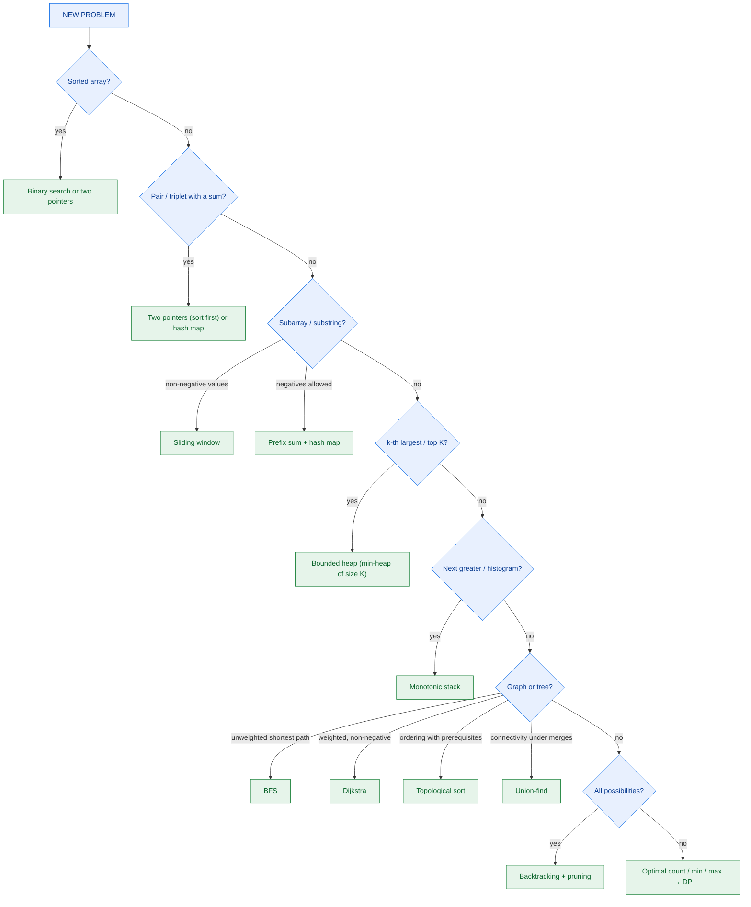

> **Navigation**: [Back to Index](00_INDEX.md) | [Learning Path](00_LEARNING_PATH.md) | [Pattern Recognition](04_Pattern_Recognition.md) | [Sliding Window](01_Sliding_Window.md)

---

# 🗺️ Pattern Master Guide — The Complete DSA Keyword → Pattern Map

> **This is your cheat sheet.** When you see a problem and feel stuck, open this file.
> Follow: Keywords → Pattern → DS → Study File → Solve.

---

## 🔗 Bridge — Where This Chapter Fits

| Dimension | This chapter |
| --- | --- |
| **Builds on** | [Pattern Recognition](04_Pattern_Recognition.md) and the individual pattern chapters |
| **You will learn** | A one-page route from problem keywords to pattern, data structure and study file, guarded by a constraint lens |
| **Leads to** | [Constraint-Based Selection](25_Constraint_Based_Pattern_Selection.md), [Problem Solving](../05_Problem_Solving/00_INDEX.md) |
| **Abstraction level** | Keywords → **constraints** → pattern → data structure → practice |

> [!NOTE]
> The full gap-free reading order and dependency graph are in the [Learning Path](00_LEARNING_PATH.md).

---

## 💬 Explain It Like a Study Partner — the Pattern Master Guide

### 1. The bottom line

Use this page as a map: read the constraints, follow the decision flowchart to a pattern, then open the chapter that teaches it.

### 2. The textbook core

- Keywords suggest candidates; constraints decide.
- Every row of the quick-navigation table links the data structure, the pattern chapter and practice problems.
- The flowchart is a filter, not a proof: confirm with a small example.

### 3. The real-world analogy

A **subway map**: it does not show every street, but it tells you which line to take and where to change.

### 4. Walkthrough

1. Problem: "longest substring without repeating characters".
2. "Substring" + a validity condition → sliding window.
3. Characters can be counted → hash map or 128-slot array.
4. Open [Sliding Window](01_Sliding_Window.md), apply the variable-window template.

> [!NOTE]
> **Quick check:** What do you check before trusting a keyword match? *The constraints (size, sortedness, sign of values).*

---

## ⚠️ Constraint Lens Before Pattern Lens

Do not choose a pattern from keywords alone. First check constraints:

| If the problem says...              | Do this                          |
| ----------------------------------- | -------------------------------- |
| `subarray sum` + positives only     | sliding window can work          |
| `subarray sum` + negatives allowed  | prefix sum + hashmap/tree/deque  |
| static range queries                | prefix/sparse table              |
| range queries with updates          | Fenwick/segment tree             |
| unweighted shortest path            | BFS                              |
| weighted non-negative shortest path | Dijkstra                         |
| negative edge weights               | Bellman-Ford / potentials        |
| `N <= 20`                           | bitmask/backtracking is possible |
| `N <= 2e5`                          | aim for `O(N log N)` or better   |

Full decision guide: [Constraint-Based Pattern Selection](25_Constraint_Based_Pattern_Selection.md).

---

## 🔗 How This Connects to the Rest of Your Repo

```
You encounter a problem
        ↓
Read this file → identify pattern
        ↓
GO LEARN the pattern if needed
  ├── DS file: 02_Data_Structures/
  ├── Pattern file: 04_Patterns_Templates/
  └── Algo file: 03_Algorithms/
        ↓
RETURN to problem → apply pattern
        ↓
Practice more: 05_Problem_Solving/
```

---

## 📋 Complete Pattern Index

### 1. Sliding Window

**Keywords:** `subarray/substring`, `window`, `consecutive`, `maximum/minimum in range`, `at most k distinct`

**DS Used:** Two pointers (left, right) on array  
**Time:** O(n) | **Space:** O(1) or O(k)

**Identify it:** "Find smallest/largest subarray satisfying a condition"

```java
// Variable window template
int left = 0, result = 0;
for (int right = 0; right < n; right++) {
    // add arr[right] to window state
    while (/* window invalid */) { /* remove arr[left] */ left++; }
    result = Math.max(result, right - left + 1);
}
```

| Problem                                    | Difficulty  |
| ------------------------------------------ | ----------- |
| LC 3 — Longest Substring Without Repeating | ⭐⭐ Med    |
| LC 76 — Minimum Window Substring           | ⭐⭐⭐ Hard |
| LC 209 — Minimum Size Subarray Sum         | ⭐⭐ Med    |
| LC 1004 — Max Consecutive Ones III         | ⭐⭐ Med    |

📖 **Study:** [01_Sliding_Window.md](01_Sliding_Window.md) | Returns from: [01b_Arrays.md](../02_Data_Structures/01b_Arrays.md)

---

### 2. Two Pointers

**Keywords:** `sorted array`, `pairs`, `triplets`, `sum`, `palindrome`, `remove duplicates in-place`

**DS Used:** Two indices on array or two references on LL  
**Time:** O(n) to O(n log n) (sort first) | **Space:** O(1)

**Identify it:** "Sorted input, find pairs/count satisfying condition"

```java
// Opposite ends template
Arrays.sort(arr);
int left = 0, right = arr.length - 1;
while (left < right) {
    int sum = arr[left] + arr[right];
    if (sum == target) { /* found */ left++; right--; }
    else if (sum < target) left++;
    else right--;
}
```

| Problem                           | Difficulty  |
| --------------------------------- | ----------- |
| LC 167 — Two Sum II (sorted)      | ⭐ Easy     |
| LC 15 — 3Sum                      | ⭐⭐ Med    |
| LC 11 — Container with Most Water | ⭐⭐ Med    |
| LC 42 — Trapping Rain Water       | ⭐⭐⭐ Hard |

📖 **Study:** [07_Two_Pointers_Complete.md](07_Two_Pointers_Complete.md) | [08_Array_Plus_TwoPointers.md](08_Array_Plus_TwoPointers.md)

---

### 3. Prefix Sum

**Keywords:** `range sum query`, `subarray sum equals K`, `count subarrays`, `running total`

**DS Used:** Array + HashMap  
**Time:** O(n) build, O(1) query | **Space:** O(n)

**Identify it:** "Sum of elements between indices i and j, asked many times"

```java
// Build
int[] prefix = new int[n + 1];
for (int i = 0; i < n; i++) prefix[i+1] = prefix[i] + arr[i];
// Query [l, r]:  prefix[r+1] - prefix[l]

// Count subarrays with sum K:
Map<Integer,Integer> freq = new HashMap<>();
freq.put(0, 1);
int sum = 0, count = 0;
for (int x : arr) {
    sum += x;
    count += freq.getOrDefault(sum - k, 0);
    freq.merge(sum, 1, Integer::sum);
}
```

| Problem                        | Difficulty |
| ------------------------------ | ---------- |
| LC 303 — Range Sum Query       | ⭐ Easy    |
| LC 560 — Subarray Sum Equals K | ⭐⭐ Med   |
| LC 525 — Contiguous Array      | ⭐⭐ Med   |
| LC 304 — Range Sum Query 2D    | ⭐⭐ Med   |

📖 **Study:** [04_Pattern_Recognition.md — Pattern 1](04_Pattern_Recognition.md)

---

### 4. HashMap / HashSet

**Keywords:** `two sum`, `frequency`, `group`, `anagram`, `seen before`, `O(1) lookup`

**DS Used:** HashMap<K,V> or HashSet<K>  
**Time:** O(n) | **Space:** O(n)

**Identify it:** "Need to look up by value (not index)"

```java
// Complement lookup
Map<Integer,Integer> seen = new HashMap<>();
for (int i = 0; i < nums.length; i++) {
    if (seen.containsKey(target - nums[i]))
        return new int[]{seen.get(target - nums[i]), i};
    seen.put(nums[i], i);
}
```

📖 **Study:** [01e_HashTable.md](../02_Data_Structures/01e_HashTable.md) | [10_HashMap_Plus_Counting.md](10_HashMap_Plus_Counting.md)

---

### 5. Binary Search

**Keywords:** `sorted`, `search`, `find minimum satisfying`, `koko eating`, `ship packages`, `rotated`

**DS Used:** Array (sorted) + two pointers  
**Time:** O(log n) | **Space:** O(1)

**Identify it:** "Can I binary search on the ANSWER (not just the array)?"

```java
// Classic
int left = 0, right = n - 1;
while (left <= right) {
    int mid = left + (right - left) / 2;
    if (arr[mid] == target) return mid;
    else if (arr[mid] < target) left = mid + 1;
    else right = mid - 1;
}

// Binary search on ANSWER SPACE
int lo = MIN_POSSIBLE, hi = MAX_POSSIBLE;
while (lo < hi) {
    int mid = lo + (hi - lo) / 2;
    if (canAchieve(mid)) hi = mid;    // try smaller
    else lo = mid + 1;               // need bigger
}
```

| Problem                             | Difficulty |
| ----------------------------------- | ---------- |
| LC 704 — Binary Search              | ⭐ Easy    |
| LC 33 — Search in Rotated Array     | ⭐⭐ Med   |
| LC 875 — Koko Eating Bananas        | ⭐⭐ Med   |
| LC 1011 — Capacity to Ship Packages | ⭐⭐ Med   |

📖 **Study:** [06_Binary_Search_Patterns.md](06_Binary_Search_Patterns.md)

---

### 6. Kadane's Algorithm

**Keywords:** `maximum subarray`, `maximum sum contiguous`, `minimum subarray`

**DS Used:** Variables (currentMax, maxSoFar)  
**Time:** O(n) | **Space:** O(1)

```java
int maxSum = arr[0], current = arr[0];
for (int i = 1; i < arr.length; i++) {
    current = Math.max(arr[i], current + arr[i]);
    maxSum  = Math.max(maxSum, current);
}
```

📖 **Study:** [04_Pattern_Recognition.md — Pattern 2](04_Pattern_Recognition.md)

---

### 7. Fast & Slow Pointers (Floyd's)

**Keywords:** `linked list cycle`, `middle of list`, `nth from end`, `palindrome list`

**DS Used:** Linked List with two pointers  
**Time:** O(n) | **Space:** O(1)

📖 **Study:** [01c_LinkedList.md](../02_Data_Structures/01c_LinkedList.md) | [12_LinkedList_Plus_TwoPointers.md](12_LinkedList_Plus_TwoPointers.md)

---

### 8. Monotonic Stack

**Keywords:** `next greater element`, `next smaller`, `largest rectangle`, `trapping rain water`, `span`

**DS Used:** Stack (stores indices)  
**Time:** O(n) | **Space:** O(n)

```java
Deque<Integer> stack = new ArrayDeque<>();
int[] result = new int[n];
Arrays.fill(result, -1);
for (int i = 0; i < n; i++) {
    while (!stack.isEmpty() && arr[stack.peek()] < arr[i])
        result[stack.pop()] = arr[i];   // arr[i] is next greater
    stack.push(i);
}
```

📖 **Study:** [11_Stack_Plus_MonotonicPattern.md](11_Stack_Plus_MonotonicPattern.md)

---

### 9. BFS (Breadth First Search)

**Keywords:** `shortest path`, `level order`, `minimum steps`, `connected components`

**DS Used:** Queue + visited set  
**Time:** O(V + E) | **Space:** O(V)

📖 **Study:** [14_Graph_Plus_Traversal.md](14_Graph_Plus_Traversal.md) | [13_Tree_Plus_DFS_BFS.md](13_Tree_Plus_DFS_BFS.md)

---

### 10. DFS / Backtracking

**Keywords:** `all possible`, `generate`, `paths`, `permutations`, `combinations`, `subsets`

**DS Used:** Recursion stack + visited  
**Time:** O(2ⁿ) or O(n!) | **Space:** O(n) depth

```java
void backtrack(int start, List<Integer> current, List<List<Integer>> result) {
    result.add(new ArrayList<>(current));   // record state
    for (int i = start; i < n; i++) {
        current.add(nums[i]);               // choose
        backtrack(i + 1, current, result);  // explore
        current.remove(current.size() - 1); // unchoose
    }
}
```

📖 **Study:** [17_Backtracking_Plus_Pruning.md](17_Backtracking_Plus_Pruning.md)

---

### 11. Dynamic Programming

**Keywords:** `minimum/maximum`, `ways to`, `longest`, `count paths`, `overlapping subproblems`

**DS Used:** 1D or 2D array  
**Time:** O(n²) or O(n) | **Space:** O(n²) → O(n) with optimization

**Identify it:** "Can I break this into overlapping subproblems?"

📖 **Study:** [16_DP_Pattern_Recognition.md](16_DP_Pattern_Recognition.md) | [23_Knapsack_Family.md](23_Knapsack_Family.md)

---

### 12. Heap / Priority Queue

**Keywords:** `k-th largest`, `top K`, `merge K sorted`, `median in stream`, `task scheduler`

**DS Used:** PriorityQueue (min-heap by default in Java)  
**Time:** O(n log k) | **Space:** O(k)

```java
// Top K largest elements
PriorityQueue<Integer> minHeap = new PriorityQueue<>();
for (int num : arr) {
    minHeap.offer(num);
    if (minHeap.size() > k) minHeap.poll();
}
```

📖 **Study:** [15_Heap_Plus_GreedySelection.md](15_Heap_Plus_GreedySelection.md) | [01f_Trees_Heaps.md](../02_Data_Structures/01f_Trees_Heaps.md)

---

## 📊 Decision Flowchart



**How to read this diagram.** Answer the blue questions from top to bottom; the first "yes" lands on a green pattern. Then confirm it with the constraint table above before coding.

---

## 🔗 Quick Navigation

| Pattern        | DS File                                                     | Pattern File                                                        | Practice File                                                             |
| -------------- | ----------------------------------------------------------- | ------------------------------------------------------------------- | ------------------------------------------------------------------------- |
| Arrays         | [01b_Arrays](../02_Data_Structures/01b_Arrays.md)           | [08_Array_Plus_TwoPointers](08_Array_Plus_TwoPointers.md)           | [04_Arrays](../05_Problem_Solving/04_Arrays.md)                           |
| Sliding Window | —                                                           | [01_Sliding_Window](01_Sliding_Window.md)                           | [05_Sliding_Window](../05_Problem_Solving/05_Sliding_Window.md)           |
| Two Pointers   | —                                                           | [07_Two_Pointers_Complete](07_Two_Pointers_Complete.md)             | [06_Two_Pointers](../05_Problem_Solving/06_Two_Pointers.md)               |
| Binary Search  | —                                                           | [06_Binary_Search_Patterns](06_Binary_Search_Patterns.md)           | [07_Binary_Search](../05_Problem_Solving/07_Binary_Search.md)             |
| HashMap        | [01e_HashTable](../02_Data_Structures/01e_HashTable.md)     | [10_HashMap_Plus_Counting](10_HashMap_Plus_Counting.md)             | [17_HashMap_Hashing](../05_Problem_Solving/17_HashMap_Hashing.md)         |
| Stack/Queue    | [01d_Stack_Queue](../02_Data_Structures/01d_Stack_Queue.md) | [11_Stack_Plus_Monotonic](11_Stack_Plus_MonotonicPattern.md)        | [08_Stack_Queue](../05_Problem_Solving/08_Stack_Queue.md)                 |
| Trees          | [01f_Trees_Heaps](../02_Data_Structures/01f_Trees_Heaps.md) | [13_Tree_Plus_DFS_BFS](13_Tree_Plus_DFS_BFS.md)                     | [09_Trees](../05_Problem_Solving/09_Trees.md)                             |
| Graphs         | —                                                           | [14_Graph_Plus_Traversal](14_Graph_Plus_Traversal.md)               | [10_Graphs](../05_Problem_Solving/10_Graphs.md)                           |
| DP             | —                                                           | [16_DP_Pattern_Recognition](16_DP_Pattern_Recognition.md)           | [11_Dynamic_Programming](../05_Problem_Solving/11_Dynamic_Programming.md) |
| Backtracking   | —                                                           | [17_Backtracking_Plus_Pruning](17_Backtracking_Plus_Pruning.md)     | [12_Backtracking](../05_Problem_Solving/12_Backtracking.md)               |
| Heap           | [01f_Trees_Heaps](../02_Data_Structures/01f_Trees_Heaps.md) | [15_Heap_Plus_GreedySelection](15_Heap_Plus_GreedySelection.md)     | [16_Heap](../05_Problem_Solving/16_Heap.md)                               |
| LinkedList     | [01c_LinkedList](../02_Data_Structures/01c_LinkedList.md)   | [12_LinkedList_Plus_TwoPointers](12_LinkedList_Plus_TwoPointers.md) | [15_LinkedList](../05_Problem_Solving/15_LinkedList.md)                   |
| Prefix Sum     | —                                                           | [26_Prefix_Sum_And_Difference_Array](26_Prefix_Sum_And_Difference_Array.md) | [05_Problem_Solving](../05_Problem_Solving/00_INDEX.md) |
| Union-Find     | —                                                           | [27_Union_Find_Pattern](27_Union_Find_Pattern.md)                   | [05_Problem_Solving](../05_Problem_Solving/00_INDEX.md) |
| Topological Sort | —                                                         | [28_Topological_Sort_Pattern](28_Topological_Sort_Pattern.md)       | [05_Problem_Solving](../05_Problem_Solving/00_INDEX.md) |
| Trie           | —                                                           | [29_Trie_Pattern](29_Trie_Pattern.md)                               | [05_Problem_Solving](../05_Problem_Solving/00_INDEX.md) |
| Shortest Paths | —                                                           | [30_Shortest_Path_Pattern](30_Shortest_Path_Pattern.md)             | [05_Problem_Solving](../05_Problem_Solving/00_INDEX.md) |
| Top-K / Two Heaps | [01f_Trees_Heaps](../02_Data_Structures/01f_Trees_Heaps.md) | [31_Top_K_And_Two_Heaps_Pattern](31_Top_K_And_Two_Heaps_Pattern.md) | [05_Problem_Solving](../05_Problem_Solving/00_INDEX.md) |


---

## Reality Check

**"There are exactly N patterns and they cover everything"** — Pattern catalogs (14, 20, 27 — every course counts differently) cover roughly 80 percent of interview problems. The remaining 20 percent are deliberately pattern-resistant: ad-hoc simulation, clever observations, or hybrid problems where the pattern only solves one phase. Treating the catalog as complete produces the worst interview failure mode: forcing the nearest pattern onto a problem that needed a direct observation.

**"Identify the pattern first, then solve"** — Real solving is a loop, not a pipeline: read constraints → shortlist 2-3 patterns → try the strongest against a small example → the failure of that attempt reveals the real structure → re-shortlist. Experts are faster not because they pick right the first time, but because each failed fit teaches them more — a wrong sliding-window attempt that breaks on negatives points straight at prefix sums.

**"Patterns are about the data structure in the problem"** — Patterns attach to the QUESTION SHAPE, not the nouns. "Array" problems split across two pointers, windows, prefix sums, binary search on answer, and DP depending on whether the question asks existence, count, optimum, or construction. Classifying by noun ("it is an array problem") is the beginner move the master guide exists to break.

**"Combining patterns is advanced and rare"** — Half of medium-hard problems are two patterns composed: binary search ON a greedy feasibility check, DFS WITH memoization, heap INSIDE interval sweep. The composition is usually one pattern providing the outer loop and another providing the decision inside it. If a single pattern only solves half the problem, the right response is to look for the second pattern, not to abandon the first.

**"Once learned, pattern recognition stays sharp"** — Pattern recognition decays like any perceptual skill — after months away, everything looks like the three patterns you used most recently at work. The maintenance dose is small (a few mixed problems weekly, unlabeled) but it must be MIXED: practicing by chapter re-teaches the label, practicing unlabeled re-teaches the recognition, and only the second one is the interview skill.
