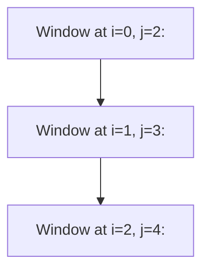
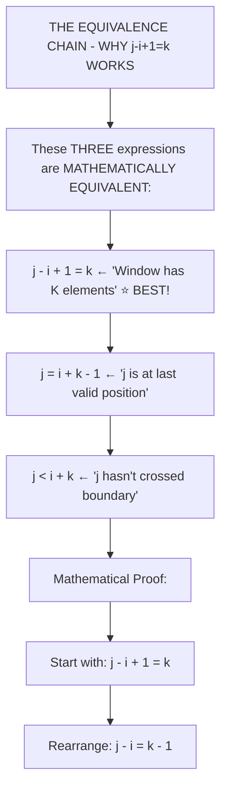
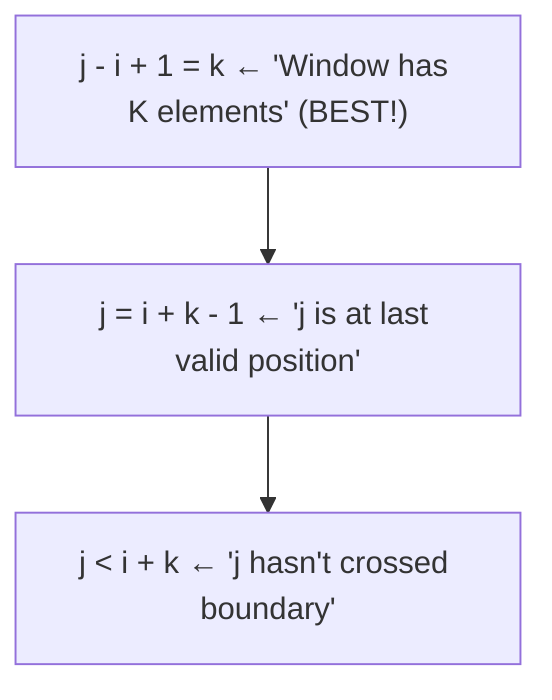
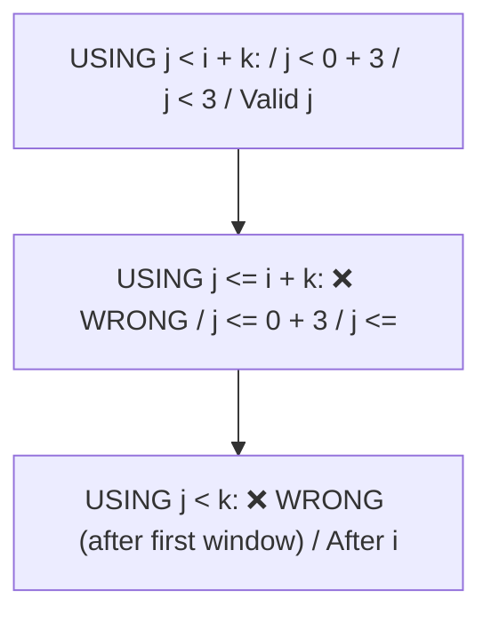
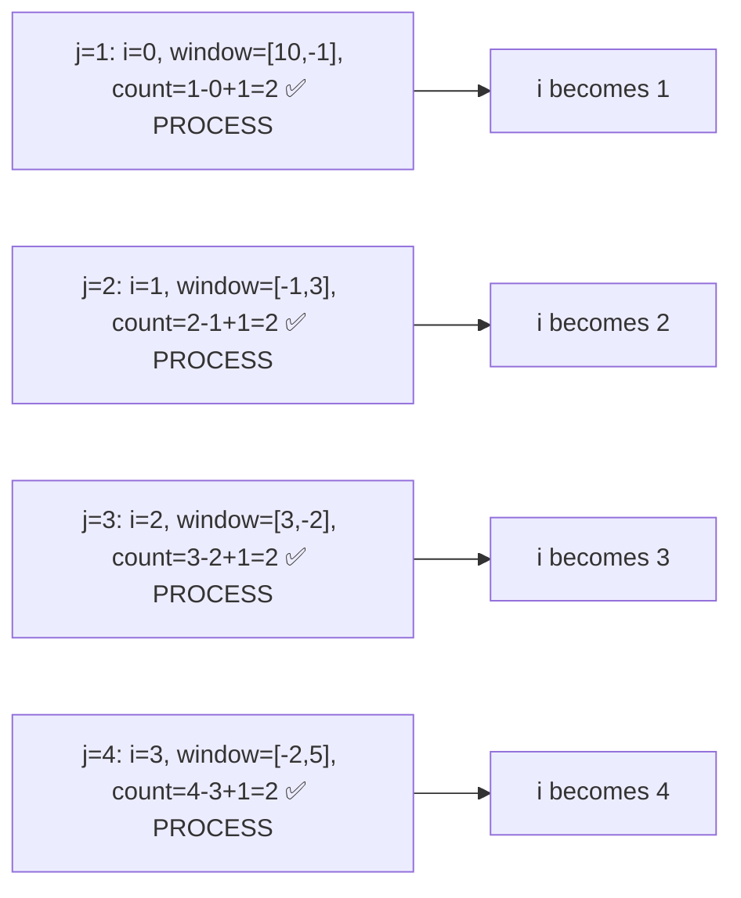
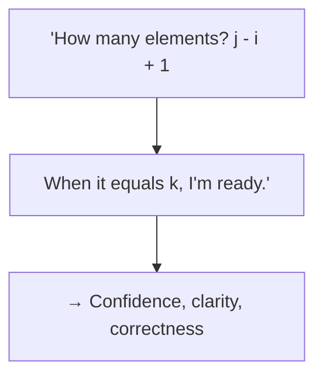

> **Navigation**: [Back to Index](../00_MASTER_INDEX.md) | [Next >](02_Code_Templates.md)

# 🎯 SLIDING WINDOW MASTERY - THE COMPLETE MENTAL MODEL

---

## 📚 Part 0: Complete Understanding

```
┌──────────────────────────────────────────────────────────────────────────────┐
│                    SLIDING WINDOW - COMPLETE UNDERSTANDING                   │
└──────────────────────────────────────────────────────────────────────────────┘

┌──────────────────────────────────────────────────────────────────────────────┐
│ WHAT IS SLIDING WINDOW?                                                      │
├──────────────────────────────────────────────────────────────────────────────┤
│ A technique that maintains a "window" (subarray/substring) that "slides"     │
│ across the data structure, processing elements as the window moves.          │
│                                                                              │
│ Instead of recomputing everything for each window position, we:              │
│ • ADD the new element entering the window                                    │
│ • REMOVE the old element leaving the window                                  │
│ • UPDATE our answer                                                          │
│                                                                              │
│ This avoids redundant work!                                                  │
└──────────────────────────────────────────────────────────────────────────────┘

┌──────────────────────────────────────────────────────────────────────────────┐
│ WHAT PROBLEM DOES IT SOLVE?                                                  │
├──────────────────────────────────────────────────────────────────────────────┤
│ CORE PROBLEM: Efficiently computing something over all contiguous subarrays  │
│                                                                              │
│ EXAMPLE: "Find maximum sum of any 3 consecutive elements"                    │
│ Array: [1, 4, 2, 10, 2, 3, 1, 0, 20]                                         │
│                                                                              │
│ BRUTE FORCE: For each starting position i, sum arr[i] to arr[i+2]            │
│ • Window 0-2: 1+4+2 = 7                                                      │
│ • Window 1-3: 4+2+10 = 16                                                    │
│ • Window 2-4: 2+10+2 = 14 ... and so on                                      │
│ Time: O(n × k) where k = window size                                         │
│                                                                              │
│ SLIDING WINDOW: Reuse previous sum!                                          │
│ • Window 0-2: sum = 1+4+2 = 7                                                │
│ • Window 1-3: sum = 7 - arr[0] + arr[3] = 7 - 1 + 10 = 16                    │
│ • Window 2-4: sum = 16 - arr[1] + arr[4] = 16 - 4 + 2 = 14                   │
│ Time: O(n) - each element added and removed exactly ONCE!                    │
│                                                                              │
│ REAL-WORLD APPLICATIONS:                                                     │
│ • Network: "Average packets per second over last 5 seconds"                  │
│ • Finance: "Moving average of stock price over 20 days"                      │
│ • DNA: "Find all substrings of length 10 with pattern X"                     │
│ • Streaming: "Process data chunks efficiently"                               │
└──────────────────────────────────────────────────────────────────────────────┘

┌──────────────────────────────────────────────────────────────────────────────┐
│ WHY IS SLIDING WINDOW EFFICIENT?                                             │
├──────────────────────────────────────────────────────────────────────────────┤
│ THE KEY INSIGHT: Consecutive windows OVERLAP!                                │
│                                                                              │
│ Window 1: [a, b, c] d, e, f                                                  │
│ Window 2:  a [b, c, d] e, f                                                  │
│               ↑  ↑                                                           │
│          SHARED! Don't recompute!                                            │
│                                                                              │
│ BRUTE FORCE WASTE:                                                           │
│ Window 1: compute(a) + compute(b) + compute(c)                               │
│ Window 2: compute(b) + compute(c) + compute(d)  ← b,c computed AGAIN!        │
│                                                                              │
│ SLIDING WINDOW EFFICIENCY:                                                   │
│ Window 1: result = f(a) + f(b) + f(c)                                        │
│ Window 2: result = result - f(a) + f(d)   ← Only compute what's NEW!         │
│                                                                              │
│ n elements, k window size:                                                   │
│ • Brute force: O(n×k) - recompute k elements for each of n windows           │
│ • Sliding window: O(n) - each element processed exactly twice (add+remove)   │
└──────────────────────────────────────────────────────────────────────────────┘

┌──────────────────────────────────────────────────────────────────────────────┐
│ WHEN TO USE SLIDING WINDOW?                                                  │
├──────────────────────────────────────────────────────────────────────────────┤
│ ✅ USE SLIDING WINDOW WHEN (Signals in problem):                             │
│    • "Contiguous subarray/substring"                                         │
│    • "Of size k" or "at most k"                                              │
│    • "Maximum/minimum sum/length"                                            │
│    • "Contains all/distinct/at most k unique"                                │
│    • Data structure is linear (array, string)                                │
│    • Window moves in ONE direction (left to right)                           │
│                                                                              │
│ TWO TYPES:                                                                   │
│ 1. FIXED SIZE WINDOW: "subarray of size k"                                   │
│    → Window always has exactly k elements                                    │
│    → Simpler: just slide both pointers together                              │
│                                                                              │
│ 2. VARIABLE SIZE WINDOW: "longest/shortest subarray with condition"          │
│    → Window size changes based on condition                                  │
│    → Expand right pointer, shrink left pointer when condition violated       │
│                                                                              │
│ ❌ DON'T USE SLIDING WINDOW WHEN:                                             │
│    • Problem asks about non-contiguous elements                              │
│    • Order doesn't matter (use sorting/hashmap)                              │
│    • Need to find subarrays that aren't consecutive                          │
│    • Problem involves negative numbers with sum conditions (can be tricky)   │
└──────────────────────────────────────────────────────────────────────────────┘

┌──────────────────────────────────────────────────────────────────────────────┐
│ HOW DOES SLIDING WINDOW WORK?                                                │
├──────────────────────────────────────────────────────────────────────────────┤
│                                                                              │
│ FIXED SIZE WINDOW TEMPLATE:                                                  │
│ ┌────────────────────────────────────────────────────────────────┐           │
│ │ 1. Initialize: Process first k elements (build first window)  │            │
│ │ 2. Slide: For each new position:                               │           │
│ │    a. Add new element (entering from right)                    │           │
│ │    b. Remove old element (leaving from left)                   │           │
│ │    c. Update answer                                            │           │
│ │ 3. Return answer                                               │           │
│ └────────────────────────────────────────────────────────────────┘           │
│                                                                              │
│ VARIABLE SIZE WINDOW TEMPLATE:                                               │
│ ┌────────────────────────────────────────────────────────────────┐           │
│ │ 1. left = 0, right = 0                                         │           │
│ │ 2. Expand right until condition met or window too big          │           │
│ │ 3. While condition violated:                                    │          │
│ │    a. Remove arr[left] from window                             │           │
│ │    b. Move left++                                              │           │
│ │ 4. Update answer if valid window                               │           │
│ │ 5. Move right++                                                │           │
│ │ 6. Repeat until right reaches end                              │           │
│ └────────────────────────────────────────────────────────────────┘           │
└──────────────────────────────────────────────────────────────────────────────┘

┌──────────────────────────────────────────────────────────────────────────────┐
│ DIFFICULTIES & COMMON MISTAKES                                               │
├──────────────────────────────────────────────────────────────────────────────┤
│ 1. OFF-BY-ONE ERRORS (Most Common!):                                         │
│    "Window has k elements" = j - i + 1 == k (NOT j - i == k!)                │
│    Solution: Count = rightIndex - leftIndex + 1                              │
│                                                                              │
│ 2. FORGETTING TO REMOVE WHEN SHRINKING:                                      │
│    Must undo the effect of element leaving window                            │
│    Sum window: sum -= arr[left]                                              │
│    Freq map: map[arr[left]]-- and remove if 0                                │
│                                                                              │
│ 3. VARIABLE WINDOW TERMINATION:                                              │
│    When to shrink? When to stop expanding?                                   │
│    Solution: Clear condition check before/after each operation               │
│                                                                              │
│ 4. NEGATIVE NUMBERS:                                                         │
│    "Max sum subarray" with negatives - sliding window doesn't work directly  │
│    Solution: Use Kadane's algorithm for that specific problem                │
│                                                                              │
│ 5. EDGE CASES:                                                               │
│    Empty array, k > array length, single element                             │
│    Solution: Always validate input first                                     │
└──────────────────────────────────────────────────────────────────────────────┘

┌──────────────────────────────────────────────────────────────────────────────┐
│ EXPECTED OUTPUTS & COMPLEXITY                                                │
├──────────────────────────────────────────────────────────────────────────────┤
│ TIME COMPLEXITY: O(n)                                                        │
│ • Each element is added to window exactly ONCE                               │
│ • Each element is removed from window at most ONCE                           │
│ • Total operations ≤ 2n → O(n)                                               │
│                                                                              │
│ SPACE COMPLEXITY:                                                            │
│ • Basic sliding window: O(1) - just pointers and running total               │
│ • With frequency map: O(k) or O(alphabet) for character problems             │
│                                                                              │
│ TYPICAL OUTPUT TYPES:                                                        │
│ • Single value: max/min sum, max/min length                                  │
│ • All windows: list of valid windows or their properties                     │
│ • Count: number of valid subarrays                                           │
└──────────────────────────────────────────────────────────────────────────────┘
```

---

## 🔥 THE CRITICAL CONFUSION (And How To Never Have It Again)

**This is the #1 confusion that stops 90% of students from mastering sliding window.**

---

## 🧠 THE WRONG WAY (How You Were Thinking Before)

```
"Should I use j < i + k or j <= i + k?"
"What about i + k - 1?"
"Why does the boundary keep confusing me?"
```

**Problem:** You're doing **index gymnastics** — trying to remember formulas.

---

## ✅ THE RIGHT WAY (How You Think Now)

```
"How many elements are currently in my window?"
```

**Solution:** Think in **element counts**, not indices.

---

## 🎨 VISUAL PROOF (The Moment It Clicks)

```
            SLIDING WINDOW - THE COMPLETE VISUAL GUIDE
──────────────────────────────────────────────────

Array: [2, 1, 5, 1, 3, 2]    Window Size K = 3
Index:  0  1  2  3  4  5

═══════════════════════════════════════════════════════════════════════

WINDOW 1: i=0, j=2
┌───┬───┬───┬───┬───┬───┐
│ 2 │ 1 │ 5 │ 1 │ 3 │ 2 │
└───┴───┴───┴───┴───┴───┘
  ↑       ↑
  i       j
├─────────┤
 window [2,1,5]

Count = j - i + 1 = 2 - 0 + 1 = 3 ✅ (equals k, process window!)

═══════════════════════════════════════════════════════════════════════

WINDOW 2: i=1, j=3 (after sliding)
┌───┬───┬───┬───┬───┬───┐
│ 2 │ 1 │ 5 │ 1 │ 3 │ 2 │
└───┴───┴───┴───┴───┴───┘
      ↑       ↑
      i       j
    ├─────────┤
     window [1,5,1]

Count = j - i + 1 = 3 - 1 + 1 = 3 ✅

═══════════════════════════════════════════════════════════════════════

WINDOW 3: i=2, j=4
┌───┬───┬───┬───┬───┬───┐
│ 2 │ 1 │ 5 │ 1 │ 3 │ 2 │
└───┴───┴───┴───┴───┴───┘
          ↑       ↑
          i       j
        ├─────────┤
         window [5,1,3]

Count = j - i + 1 = 4 - 2 + 1 = 3 ✅

═══════════════════════════════════════════════════════════════════════

WINDOW 4: i=3, j=5 (FINAL)
┌───┬───┬───┬───┬───┬───┐
│ 2 │ 1 │ 5 │ 1 │ 3 │ 2 │
└───┴───┴───┴───┴───┴───┘
              ↑       ↑
              i       j
            ├─────────┤
             window [1,3,2]

Count = j - i + 1 = 5 - 3 + 1 = 3 ✅

═══════════════════════════════════════════════════════════════════════

KEY INSIGHT: We NEVER thought about i+k or i+k-1!
Just: "Does my window have k elements? Check j-i+1 == k"

```

### Setup:

```
Array: [2, 1, 5, 1, 3, 2]
Index:  0  1  2  3  4  5

Window Size K = 3
```

### Count Elements, Not Indices:

```
Window at i=0, j=2:
[2, 1, 5] | _, _, _
 ↑     ↑
 i     j

Count = j - i + 1 = 2 - 0 + 1 = 3 ✅

Window at i=1, j=3:
_, [1, 5, 1] | _, _
    ↑     ↑
    i     j

Count = j - i + 1 = 3 - 1 + 1 = 3 ✅

Window at i=2, j=4:
_, _, [5, 1, 3] | _
       ↑     ↑
       i     j

Count = j - i + 1 = 4 - 2 + 1 = 3 ✅
```

**Flow:**
- Window at i=0, j=2:
- ↓
- Window at i=1, j=3:
- ↓
- Window at i=2, j=4:



**Notice:** We never had to think about `i + k` or `i + k - 1`!

---

## 🔗 THE EQUIVALENCE CHAIN (Memorize This)

```
            THE EQUIVALENCE CHAIN - WHY j-i+1=k WORKS
──────────────────────────────────────────────────

These THREE expressions are MATHEMATICALLY EQUIVALENT:

┌─────────────────────────────────────────────────────────────────────┐
│                                                                     │
│     j - i + 1 = k       ← "Window has K elements" ⭐ BEST!           │
│           ↕                                                         │
│     j = i + k - 1       ← "j is at last valid position"             │
│           ↕                                                         │
│     j < i + k           ← "j hasn't crossed boundary"               │
│                                                                     │
└─────────────────────────────────────────────────────────────────────┘

Mathematical Proof:
──────────────────

Start with:      j - i + 1 = k

Rearrange:       j - i = k - 1
                 j = i + k - 1          (second form)

For loop condition, we want j to go from i to i+k-1:
That means:      j < i + k              (third form)

WHY THE FIRST IS BEST:
─────────────────────

❌ "j < i + k" → You think: "Wait, is it < or <=?"
❌ "j = i + k - 1" → You think: "Should I subtract 1?"
✅ "j - i + 1 = k" → You think: "Do I have k elements? Simple!"

The first form is a QUESTION, not a FORMULA.
Questions are easier to remember than formulas!
```

**Flow:**
- THE EQUIVALENCE CHAIN - WHY j-i+1=k WORKS
- ↓
- These THREE expressions are MATHEMATICALLY EQUIVALENT:
- ↓
- j - i + 1 = k ← 'Window has K elements' ⭐ BEST!
- ↓
- j = i + k - 1 ← 'j is at last valid position'
- ↓
- j < i + k ← 'j hasn't crossed boundary'
- ↓
- Mathematical Proof:
- ↓
- Start with: j - i + 1 = k



These three expressions mean **exactly** the same thing:

```
j - i + 1 = k          ← "Window has K elements" (BEST!)
     ⇕
j = i + k - 1          ← "j is at last valid position"
     ⇕
j < i + k              ← "j hasn't crossed boundary"
```

**Flow:**
- j - i + 1 = k ← 'Window has K elements' (BEST!)
- ↓
- j = i + k - 1 ← 'j is at last valid position'
- ↓
- j < i + k ← 'j hasn't crossed boundary'



**Why the first is best:** You're counting, not calculating indices.

---

## 🧪 WHY THE OTHER FORMS CONFUSE YOU

```
            WHY OTHER FORMS ARE CONFUSING
──────────────────────────────────────────────────

Test Case: i = 0, k = 3
We want elements at indices: 0, 1, 2 (3 elements)

┌──────────────────────────────────────────────────────────────────────┐
│ USING j < i + k:                                                     │
│                                                                      │
│   j < 0 + 3                                                          │
│   j < 3                                                              │
│                                                                      │
│   Valid j: 0, 1, 2  ✅ (3 elements — CORRECT!)                        │
└──────────────────────────────────────────────────────────────────────┘

┌──────────────────────────────────────────────────────────────────────┐
│ USING j <= i + k:  ❌ WRONG                                           │
│                                                                      │
│   j <= 0 + 3                                                         │
│   j <= 3                                                             │
│                                                                      │
│   Valid j: 0, 1, 2, 3  ❌ (4 elements — TOO MANY!)                    │
└──────────────────────────────────────────────────────────────────────┘

┌──────────────────────────────────────────────────────────────────────┐
│ USING j < k:  ❌ WRONG (after first window)                           │
│                                                                      │
│   After i moves to 1:                                                │
│   j < 3                                                              │
│                                                                      │
│   Valid j: 0, 1, 2  ❌ (We need 1, 2, 3 now!)                         │
└──────────────────────────────────────────────────────────────────────┘

CONCLUSION: Only "j < i + k" works, but it's HARD to remember!
SOLUTION: Use "j - i + 1 == k" and NEVER think about it again!
```

**Flow:**
- USING j < i + k: / j < 0 + 3 / j < 3 / Valid j
- ↓
- USING j <= i + k: ❌ WRONG / j <= 0 + 3 / j <=
- ↓
- USING j < k: ❌ WRONG (after first window) / After i



### Test Case: i = 0, k = 3

#### 1. Using `j < i + k`:

```
j < 0 + 3
j < 3

Valid j: 0, 1, 2  ✅ (3 elements — correct!)
```

#### 2. Using `j <= i + k`: ❌ WRONG

```
j <= 0 + 3
j <= 3

Valid j: 0, 1, 2, 3  ❌ (4 elements — too many!)
```

#### 3. Using `j < k`: ❌ WRONG after first window

```
After i moves to 1:
j < 3

Valid j: 0, 1, 2  ❌ (We need 1, 2, 3!)
```

**Lesson:** Only `j < i + k` works, but it's hard to remember.

**Better:** Use `j - i + 1 == k` and never think about it again.

---

## ✅ THE EXAM-SAFE PATTERN


> EXAM-SAFE SLIDING WINDOW TEMPLATE
>
> int i = 0;  // Window start (left pointer)
>
> for (int j = 0; j < n; j++) {  // j expands window (right pointer)
>
> // STEP 1: EXPAND - Include arr[j] in window
> // (add to sum, add to hashmap, etc.)
>
> if (j - i + 1 == k) {  // STEP 2: CHECK - "Do I have K elements?"
>
> // STEP 3: PROCESS - Window is ready, do something
> // (compare max, print result, etc.)
>
> // STEP 4: SHRINK - Remove arr[i] from window
> // (subtract from sum, remove from hashmap, etc.)
>
> i++;  // STEP 5: SLIDE - Move window forward
> }
> }
>
> ─────────────────────────────────────────────────────────────────────
>
> WHY THIS IS PERFECT:
>
> ✅ You count elements (j - i + 1), not indices
> ✅ No confusion about < vs <=
> ✅ Clear 5-step process: EXPAND → CHECK → PROCESS → SHRINK → SLIDE
> ✅ Works for ANY window problem with small modifications
>


### Pattern 1: Count-Based (Recommended)

```java
int i = 0;  // Window start

for (int j = 0; j < n; j++) {  // j expands window

    // Include arr[j] in window

    if (j - i + 1 == k) {  // "Do I have K elements?"
        // Window is ready — process it

        // Example: print first element
        System.out.println(arr[i]);

        // Slide window forward
        i++;
    }
}
```

**Why This Is Perfect:**

1. ✅ You count elements (`j - i + 1`), not indices
2. ✅ No confusion about `<` vs `<=`
3. ✅ Works for any K
4. ✅ Window automatically slides when size reaches K
5. ✅ Matches how you think naturally

---

## 🎨 DRY RUN (Do This On Paper)

```
Array: [10, -1, 3, -2, 5], K=2

j=0: i=0, window=[10], count=0-0+1=1 (not ready)
j=1: i=0, window=[10,-1], count=1-0+1=2 ✅ PROCESS → i becomes 1
j=2: i=1, window=[-1,3], count=2-1+1=2 ✅ PROCESS → i becomes 2
j=3: i=2, window=[3,-2], count=3-2+1=2 ✅ PROCESS → i becomes 3
j=4: i=3, window=[-2,5], count=4-3+1=2 ✅ PROCESS → i becomes 4

Total windows processed: 4 = n - k + 1 = 5 - 2 + 1 ✅
```

**Flow:**
- j=1: i=0, window=[10,-1], count=1-0+1=2 ✅ PROCESS
- ↓
- i becomes 1
- ↓
- j=2: i=1, window=[-1,3], count=2-1+1=2 ✅ PROCESS
- ↓
- i becomes 2
- ↓
- j=3: i=2, window=[3,-2], count=3-2+1=2 ✅ PROCESS
- ↓
- i becomes 3
- ↓
- j=4: i=3, window=[-2,5], count=4-3+1=2 ✅ PROCESS
- ↓
- i becomes 4



---

## 🔧 OTHER VALID PATTERNS (Once You Understand)

### Pattern 2: Index-Based (Works but harder)

```java
// Time: O(N × K)
for (int i = 0; i <= n - k; i++) {

    for (int j = i; j < i + k; j++) {  // Note: j < i + k
        // Process arr[j]
    }
}
```

**When to use:** When problem explicitly needs nested loops.

### Pattern 3: Pre-Calculate + Slide

```java
// Time: O(N) - Optimal for sum/product
int sum = 0;

// First window
for (int i = 0; i < k; i++) {
    sum += arr[i];
}
System.out.println(sum);

// Slide window
for (int i = k; i < n; i++) {
    sum = sum - arr[i - k] + arr[i];  // Remove left, add right
    System.out.println(sum);
}
```

**When to use:** When you can optimize by reusing previous calculation.

---

## 🎯 EXAMPLE PROBLEMS USING COUNT-BASED THINKING

### Problem 1: First Negative in Each Window

```java
public static void firstNegativeInWindow(int[] arr, int k) {
    int n = arr.length;
    int i = 0;

    for (int j = 0; j < n; j++) {

        // Window ready?
        if (j - i + 1 == k) {

            // Find first negative
            boolean found = false;
            for (int idx = i; idx <= j; idx++) {
                if (arr[idx] < 0) {
                    System.out.println(arr[idx]);
                    found = true;
                    break;
                }
            }

            if (!found) {
                System.out.println("0");
            }

            i++;  // Slide
        }
    }
}

// Test: [12, -1, -7, 8, -15, 30, 16, 28], K=3
// Output: -1, -1, -7, -15, -15, 0
```

### Problem 2: Maximum in Each Window

```java
public static void maxInWindow(int[] arr, int k) {
    int i = 0;

    for (int j = 0; j < arr.length; j++) {

        if (j - i + 1 == k) {

            int max = Integer.MIN_VALUE;
            for (int idx = i; idx <= j; idx++) {
                max = Math.max(max, arr[idx]);
            }
            System.out.println(max);

            i++;
        }
    }
}

// Test: [1, 3, -1, -3, 5, 3, 6, 7], K=3
// Output: 3, 3, 5, 5, 6, 7
```

### Problem 3: Count Positives in Each Window

```java
public static void countPositivesInWindow(int[] arr, int k) {
    int i = 0;

    for (int j = 0; j < arr.length; j++) {

        if (j - i + 1 == k) {

            int count = 0;
            for (int idx = i; idx <= j; idx++) {
                if (arr[idx] > 0) count++;
            }
            System.out.println(count);

            i++;
        }
    }
}
```

---

## 🧠 THE MENTAL MODEL (Final Summary)

### Before Your Breakthrough:

```
"Let me remember... is it j < i+k or j <= i+k?"
→ Stress, confusion, mistakes
```

### After Your Breakthrough:

```
"How many elements? j - i + 1
When it equals k, I'm ready."
→ Confidence, clarity, correctness
```

**Flow:**
- 'How many elements? j - i + 1
- ↓
- When it equals k, I'm ready.'
- ↓
- Confidence, clarity, correctness



---

## 🎓 PRACTICE CHECKLIST

Do these to lock in your understanding:

### ✅ Step 1: Dry Run These Arrays

```
Array: [5, 2, -1, 0, 3], K=3
Array: [1, -2, 3, -4, 5, 6], K=2
Array: [10, 20, 30, 40, 50], K=4
```

For each:

- Track `i`, `j`, and `j - i + 1`
- Note when window becomes ready
- Verify window slides correctly

### ✅ Step 2: Solve These Problems

1. Print sum of each window
2. Print first even number in each window
3. Count zeros in each window
4. Find minimum in each window

### ✅ Step 3: Challenge Yourself

- Can you convert the nested loop pattern to count-based?
- Can you explain why `j - i + 1 = k` works to a friend?
- Can you spot the mistake in code using `j <= i + k`?

---

## 🏆 SUCCESS INDICATORS

You've truly mastered sliding window when:

✅ You automatically think "How many elements?" instead of index bounds  
✅ You can dry-run any window problem in under 2 minutes  
✅ You feel confident during exams, not stressed  
✅ You can explain the pattern to others clearly  
✅ Level 4+ problems feel natural, not intimidating

---

## 🔥 FINAL WISDOM

**The formula `j < i + k` is correct, but it makes you think wrong.**

**The pattern `j - i + 1 == k` is also correct, and makes you think right.**

**Use the one that keeps your brain calm.**

---

## 📚 WHAT'S NEXT?

Now that sliding window is mastered, move to:

1. **Variable-size sliding window** (subarray sum = K)
2. **Two pointers** (pair sum, sorted arrays)
3. **Sliding window + HashMaps** (longest substring problems)

You're ready. 🚀

---

# 💪 Curated Practice Problems — Sliding Window & Two Pointers

> **HOW TO USE**: Section 1 = fixed window (easiest). Section 2 = variable window. Section 3 = two pointers.
> Master each section before moving to the next.

---

## Section 1: Fixed-Size Sliding Window

| # | Problem | Platform | Difficulty | Key Technique |
|---|---------|----------|------------|---------------|
| 1 | Maximum Average Subarray I (LC 643) | LeetCode | Easy | Sum of window k, slide |
| 2 | Find All Anagrams in a String (LC 438) | LeetCode | Medium | Frequency map window = k |
| 3 | Permutation in String (LC 567) | LeetCode | Medium | Fixed window = len(s1) |
| 4 | Maximum of All Subarrays of Size K | GFG | Medium | Deque for sliding max |
| 5 | Sliding Window Maximum (LC 239) | LeetCode | Hard | Monotonic deque |

---

## Section 2: Variable-Size Sliding Window

| # | Problem | Platform | Difficulty | Key Technique |
|---|---------|----------|------------|---------------|
| 1 | Longest Substring Without Repeating (LC 3) | LeetCode | Medium | HashSet + shrink on duplicate |
| 2 | Minimum Size Subarray Sum (LC 209) | LeetCode | Medium | Shrink while sum >= target |
| 3 | Longest Repeating Character Replacement (LC 424) | LeetCode | Medium | Window - maxFreq <= k |
| 4 | Max Consecutive Ones III (LC 1004) | LeetCode | Medium | Flip at most k zeros |
| 5 | Fruit Into Baskets (LC 904) | LeetCode | Medium | At most 2 distinct fruits |
| 6 | Minimum Window Substring (LC 76) | LeetCode | Hard | Shrink to find minimum valid |
| 7 | Subarrays with K Different Integers (LC 992) | LeetCode | Hard | atMost(k) - atMost(k-1) trick |
| 8 | Longest Substring with At Most K Distinct (LC 340) | LeetCode | Medium | HashMap count distinct |

---

## Section 3: Two Pointers

| # | Problem | Platform | Difficulty | Key Technique |
|---|---------|----------|------------|---------------|
| 1 | Two Sum II - Sorted (LC 167) | LeetCode | Medium | Left+right converge |
| 2 | 3Sum (LC 15) | LeetCode | Medium | Fix one + two-pointer on rest |
| 3 | Container With Most Water (LC 11) | LeetCode | Medium | Move shorter pointer inward |
| 4 | Trapping Rain Water (LC 42) | LeetCode | Hard | Two pointer with leftMax/rightMax |
| 5 | Sort Colors (LC 75) | LeetCode | Medium | Dutch National Flag 3-way |
| 6 | Remove Duplicates from Sorted Array (LC 26) | LeetCode | Easy | Slow/fast pointer |
| 7 | Move Zeroes (LC 283) | LeetCode | Easy | Partition pointer |
| 8 | Squares of a Sorted Array (LC 977) | LeetCode | Easy | Two pointers from both ends |

---

## HIDDEN GEMS — Sliding Window & Two Pointers

| # | Problem | Platform | Why It's Valuable |
|---|---------|----------|-------------------|
| 1 | Count Number of Nice Subarrays (LC 1248) | LeetCode | atMost trick with odd numbers |
| 2 | Replace the Substring for Balanced String (LC 1234) | LeetCode | Min window where outside is balanced |
| 3 | Grumpy Bookstore Owner (LC 1052) | LeetCode | Fixed window on top of prefix sum |
| 4 | Longest Turbulent Subarray (LC 978) | LeetCode | Alternating comparison window |
| 5 | Maximum Points You Can Obtain from Cards (LC 1423) | LeetCode | Min subarray trick (complement) |
| 6 | Get Equal Substrings Within Budget (LC 1208) | LeetCode | Variable window with cost constraint |

---

_Created: January 24, 2026_  
_Based on your breakthrough understanding_


### 🔗 Cross-References — Navigate the Ecosystem

| Topic | Related Content |
|---|---|
| Sliding window practice | [Problem Solving — Sliding Window](../05_Problem_Solving/05_Sliding_Window.md) |
| Arrays (underlying DS) | [Arrays](../02_Data_Structures/01b_Arrays.md) |
| Two Pointers (related) | [Two Pointers Patterns](../04_Patterns_Templates/07_TwoPointers.md) |
| HashMaps in variable window | [HashTable](../02_Data_Structures/01e_HashTable.md) |
| Sliding window in ML (mini-batch) | [ML Fundamentals](../21_Python_ML_DL_NLP/05_ML_Fundamentals.md) |

---

> **Navigation**: [Back to Index](../00_MASTER_INDEX.md) | [Next >](02_Code_Templates.md)