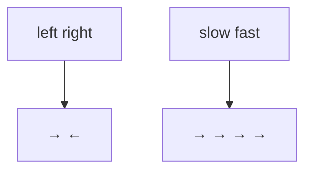
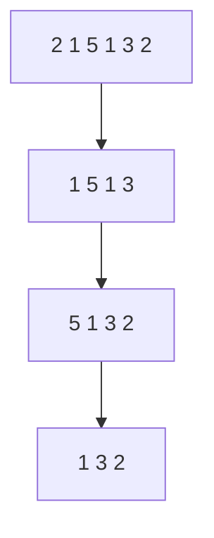
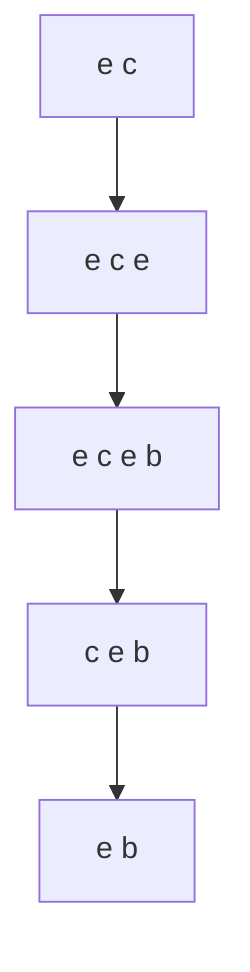
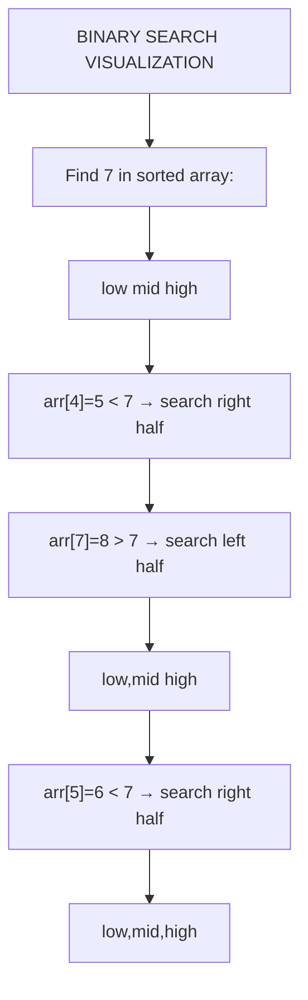
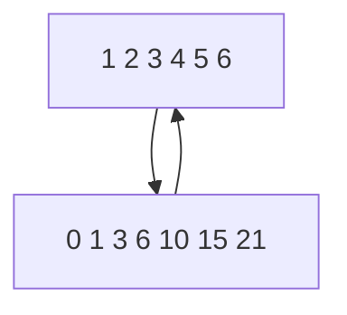
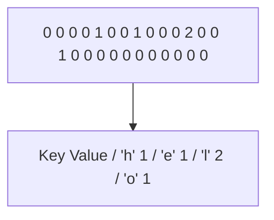
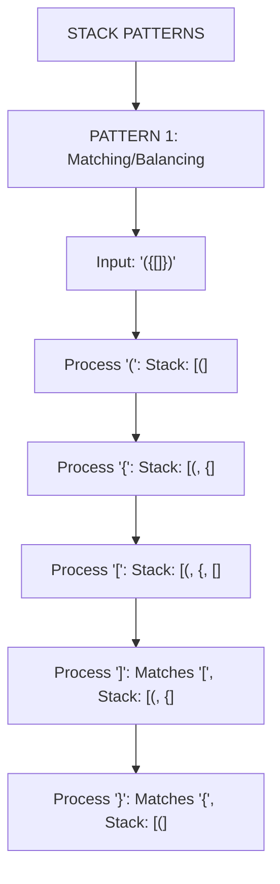
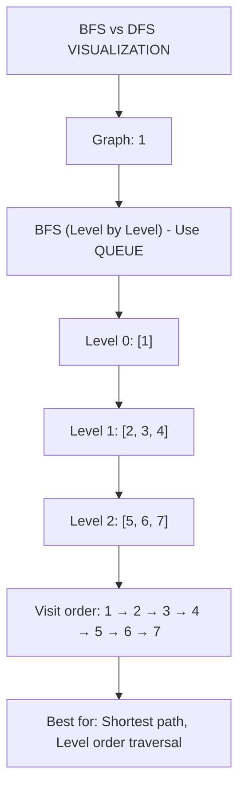
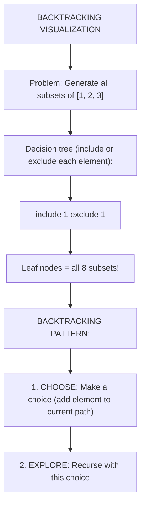
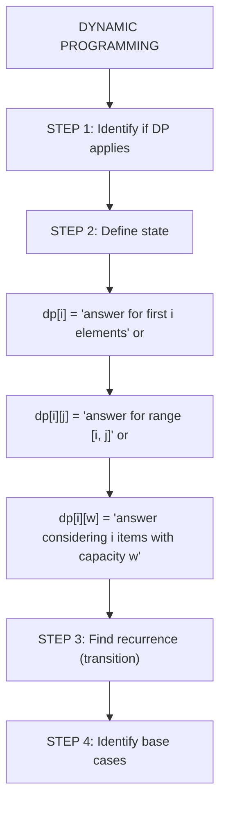

**Navigation**: [< Previous](01_Sliding_Window.md) | [Back to Index](../00_MASTER_INDEX.md) | [Next >](03_Visual_Diagrams.md)

# 🎨 COMPLETE CODE TEMPLATES WITH VISUAL EXPLANATIONS

## Ready-to-use templates with step-by-step visual diagrams

> Constraint first: before copying a template, confirm the input size, value signs, update behavior, and graph weights. Use [Constraint-Based Pattern Selection](25_Constraint_Based_Pattern_Selection.md) when a template seems tempting but the constraints feel different.

---

## 📖 TABLE OF CONTENTS

1. [Two Pointers](#1-two-pointers)
2. [Sliding Window - Fixed](#2-sliding-window---fixed)
3. [Sliding Window - Variable](#3-sliding-window---variable)
4. [Binary Search](#4-binary-search)
5. [Prefix Sum](#5-prefix-sum)
6. [Frequency Count](#6-frequency-count)
7. [Stack Problems](#7-stack-problems)
8. [BFS/DFS](#8-bfsdfs)
9. [Recursion & Backtracking](#9-recursion--backtracking)
10. [Dynamic Programming](#10-dynamic-programming)

---

## 📌 1. Two Pointers

### Visual Concept

```
                  TWO POINTERS VISUALIZATION
──────────────────────────────────────────────────

TYPE 1: OPPOSITE ENDS (converging)
───────────────────────────────────
Use for: Two Sum (sorted), Palindrome check, Container with water

[1, 2, 3, 4, 5, 6, 7, 8, 9]
 ↑                       ↑
left                   right
 └─────────→   ←─────────┘
      Move towards each other

─────────────────────────────────────────────────────────────────────

TYPE 2: SAME DIRECTION (fast/slow)
───────────────────────────────────
Use for: Remove duplicates, Partition, Cycle detection

[1, 1, 2, 2, 2, 3, 4, 4, 5]
 ↑  ↑
slow fast
 └──→──→──→──→
      Both move same direction

─────────────────────────────────────────────────────────────────────

TYPE 3: TWO ARRAYS
─────────────────
Use for: Merge sorted arrays, Find intersection

Array1: [1, 3, 5, 7]     Array2: [2, 3, 6, 8]
         ↑                        ↑
        i                        j
 Compare arr1[i] vs arr2[j], move smaller pointer
```

**Flow:**
1. left right
2. ←
3. slow fast



### Template: Two Sum (Sorted Array)

```java
/**
 * VISUAL: Two pointers from opposite ends
 *
 * Array: [1, 2, 3, 5, 7, 10]  Target: 8
 *         ↑              ↑
 *        left          right
 *
 * 1+10=11 > 8 → right--
 * 1+7=8 == 8 → FOUND!
 */
public int[] twoSum(int[] arr, int target) {
    int left = 0;
    int right = arr.length - 1;

    while (left < right) {
        int sum = arr[left] + arr[right];

        if (sum == target) {
            return new int[]{left, right};
        } else if (sum < target) {
            left++;   // Need bigger sum, move left forward
        } else {
            right--;  // Need smaller sum, move right backward
        }
    }
    return new int[]{-1, -1};  // Not found
}
```

### Template: Remove Duplicates In-Place

```java
/**
 * VISUAL: Fast pointer finds unique, slow marks position
 *
 * [1, 1, 2, 2, 2, 3, 4]
 *  ↑  ↑
 * slow fast
 *
 * fast=1: arr[1]==arr[0], skip
 * fast=2: arr[2]!=arr[0], slow++, arr[1]=arr[2]
 * [1, 2, 2, 2, 2, 3, 4]
 *     ↑     ↑
 *    slow  fast
 */
public int removeDuplicates(int[] arr) {
    if (arr.length == 0) return 0;

    int slow = 0;  // Position to place next unique element

    for (int fast = 1; fast < arr.length; fast++) {
        if (arr[fast] != arr[slow]) {
            slow++;
            arr[slow] = arr[fast];
        }
    }
    return slow + 1;  // Length of unique array
}
```

### Template: Palindrome Check

```java
/**
 * VISUAL: Check from both ends toward middle
 *
 * "racecar"
 *  ↑     ↑
 * left  right
 *
 * r==r ✓, left++, right--
 * a==a ✓, left++, right--
 * c==c ✓, left++, right--
 * e (middle) → PALINDROME!
 */
public boolean isPalindrome(String s) {
    int left = 0;
    int right = s.length() - 1;

    while (left < right) {
        if (s.charAt(left) != s.charAt(right)) {
            return false;
        }
        left++;
        right--;
    }
    return true;
}
```

---


🔬 **Section Challenge — 📌 1. Two Pointers**

**Challenge 1 (Reasoning):** Two-pointer pattern reduces O(N²) brute force to O(N). What is the KEY invariant that makes this safe?
<details><summary>Answer</summary>

The invariant: all pairs we SKIP are guaranteed to not contain the answer. In 3Sum: once we fix `nums[i]` and use l/r pointers, we can safely skip because the array is sorted. If `sum > 0`: decreasing r decreases the sum (smaller right value). If `sum < 0`: increasing l increases the sum (larger left value). We never skip a valid pair because monotonicity guarantees it.
</details>


## 📌 2. Sliding Window — Fixed

### Visual Concept

```
                  FIXED SLIDING WINDOW
──────────────────────────────────────────────────

Problem: Find max sum of any subarray of size K=3
Array: [2, 1, 5, 1, 3, 2]

Step 1: Build first window of size K
┌───────────────────────┐
│ 2 │ 1 │ 5 │ 1 │ 3 │ 2 │
└───────────────────────┘
└─────────┘
 window sum = 8

Step 2: Slide - Remove leftmost, Add rightmost
    ┌─────────────┐
│ 2 │ 1 │ 5 │ 1 │ 3 │ 2 │
    └─────────────┘
    └─────────┘
 -2        +1
 window sum = 8 - 2 + 1 = 7

Step 3: Continue sliding
        ┌─────────────┐
│ 2 │ 1 │ 5 │ 1 │ 3 │ 2 │
        └─────────────┘
 window sum = 7 - 1 + 3 = 9 ⭐ MAX

Step 4: Continue
            ┌─────────────┐
│ 2 │ 1 │ 5 │ 1 │ 3 │ 2 │
            └─────────────┘
 window sum = 9 - 5 + 2 = 6

Answer: Maximum sum = 9
```

**Flow:**
1. 2 1 5 1 3 2
2. 1 5 1 3
3. 5 1 3 2
4. 1 3 2



### Template: Max Sum of Size K Subarray

```java
/**
 * FIXED WINDOW TEMPLATE
 * Time: O(N), Space: O(1)
 *
 * Key formula: windowSize = j - i + 1
 * When windowSize == k, we have a valid window
 */
public int maxSumSubarray(int[] arr, int k) {
    int maxSum = Integer.MIN_VALUE;
    int windowSum = 0;

    for (int j = 0; j < arr.length; j++) {
        // Expand: Add current element to window
        windowSum += arr[j];

        // Check: Do we have K elements?
        int windowSize = j + 1;  // Since i starts at 0

        if (windowSize == k) {
            // Update answer
            maxSum = Math.max(maxSum, windowSum);

            // Slide: Remove leftmost element
            windowSum -= arr[j - k + 1];  // Remove element at (j - k + 1)
        }
    }
    return maxSum;
}

// Alternative with explicit left pointer (easier to understand):
public int maxSumSubarrayV2(int[] arr, int k) {
    int maxSum = Integer.MIN_VALUE;
    int windowSum = 0;
    int left = 0;

    for (int right = 0; right < arr.length; right++) {
        // Expand: Add right element
        windowSum += arr[right];

        // Count elements in window
        int windowSize = right - left + 1;

        if (windowSize == k) {
            // Update answer
            maxSum = Math.max(maxSum, windowSum);

            // Slide: Remove left element, move left pointer
            windowSum -= arr[left];
            left++;
        }
    }
    return maxSum;
}
```

---


🔬 **Section Challenge — 📌 2. Sliding Window — Fixed**

**Challenge 1 (Reasoning):** Sliding window guarantees O(N). How? Each element is added and removed exactly how many times?
<details><summary>Answer</summary>

Each element enters the window exactly ONCE (right pointer advances past it) and leaves exactly ONCE (left pointer advances past it). Total operations: 2N regardless of window size changes. Compare to brute force: for each ending position, scan back to find optimal start = O(N²). The window's state (sum, freq map, etc.) is maintained INCREMENTALLY — O(1) per pointer move.
</details>

**Challenge 2 (Bug Hunt):** Minimum Window Substring: the while loop to shrink the window runs `while(valid) { shrink; }`. What's wrong with this logic?
<details><summary>Answer</summary>

Should shrink `while(valid)` to find the minimum window — this is correct! But the common bug: not updating `left++` BEFORE rechecking validity, or forgetting to update the answer BEFORE shrinking. The answer should be captured at the moment the window first becomes valid, then kept updated as we shrink to find smaller valid windows.
</details>


## 📌 3. Sliding Window — Variable

### Visual Concept

```
                  VARIABLE SLIDING WINDOW
──────────────────────────────────────────────────

Problem: Find longest substring with at most K=2 distinct characters
String: "eceba"

Step 1: Expand while valid (≤2 distinct)
┌───┐
│ e │ c │ e │ b │ a │  distinct: {e}=1 ≤2 ✓
└───┘

Step 2: Keep expanding
┌───────┐
│ e │ c │ e │ b │ a │  distinct: {e,c}=2 ≤2 ✓
└───────┘

Step 3: Keep expanding
┌───────────┐
│ e │ c │ e │ b │ a │  distinct: {e,c}=2 ≤2 ✓  maxLen=3
└───────────┘

Step 4: Expand - becomes invalid
┌───────────────┐
│ e │ c │ e │ b │ a │  distinct: {e,c,b}=3 >2 ✗
└───────────────┘

Step 5: SHRINK from left until valid
    ┌───────────┐
│ e │ c │ e │ b │ a │  distinct: {c,e,b}=3 >2 ✗ (shrink more)
    └───────────┘

        ┌───────┐
│ e │ c │ e │ b │ a │  distinct: {e,b}=2 ≤2 ✓
        └───────┘

Answer: Maximum length = 3 ("ece")
```

**Flow:**
1. e c
2. e c e
3. e c e b
4. c e b
5. e b



### Template: Longest Substring with At Most K Distinct

```java
/**
 * VARIABLE WINDOW TEMPLATE
 * Time: O(N), Space: O(K)
 *
 * Pattern:
 * 1. Expand right pointer
 * 2. While invalid, shrink left pointer
 * 3. Update answer when valid
 */
public int longestSubstringKDistinct(String s, int k) {
    if (s == null || s.length() == 0 || k == 0) return 0;

    Map<Character, Integer> charCount = new HashMap<>();
    int maxLength = 0;
    int left = 0;

    for (int right = 0; right < s.length(); right++) {
        // Expand: Add right character to window
        char rightChar = s.charAt(right);
        charCount.put(rightChar, charCount.getOrDefault(rightChar, 0) + 1);

        // Shrink: While window is invalid (more than K distinct)
        while (charCount.size() > k) {
            char leftChar = s.charAt(left);
            charCount.put(leftChar, charCount.get(leftChar) - 1);
            if (charCount.get(leftChar) == 0) {
                charCount.remove(leftChar);  // Remove when count hits 0
            }
            left++;  // Shrink window
        }

        // Update: Window is now valid
        int windowSize = right - left + 1;
        maxLength = Math.max(maxLength, windowSize);
    }
    return maxLength;
}
```

### Template: Minimum Window Substring

```java
/**
 * VISUAL: Find smallest window containing all target characters
 *
 * s = "ADOBECODEBANC", t = "ABC"
 *
 * Need: A=1, B=1, C=1
 *
 *  A D O B E C O D E B A  N  C
 *  0 1 2 3 4 5 6 7 8 9 10 11 12
 *
 *  Window [0,5] "ADOBEC" contains ABC → valid, length=6
 *  Window [9,12] "BANC" contains ABC → valid, length=4 ⭐
 */
public String minWindow(String s, String t) {
    if (s.length() < t.length()) return "";

    // Count characters needed
    Map<Character, Integer> need = new HashMap<>();
    for (char c : t.toCharArray()) {
        need.put(c, need.getOrDefault(c, 0) + 1);
    }

    Map<Character, Integer> window = new HashMap<>();
    int have = 0;          // How many unique chars we have enough of
    int required = need.size();  // How many unique chars we need

    int[] result = {-1, 0, 0};  // length, left, right
    int left = 0;

    for (int right = 0; right < s.length(); right++) {
        // Expand: Add right character
        char c = s.charAt(right);
        window.put(c, window.getOrDefault(c, 0) + 1);

        // Check if this char now satisfies requirement
        if (need.containsKey(c) && window.get(c).equals(need.get(c))) {
            have++;
        }

        // Shrink: While we have all required characters
        while (have == required) {
            // Update result if smaller
            int windowLen = right - left + 1;
            if (result[0] == -1 || windowLen < result[0]) {
                result[0] = windowLen;
                result[1] = left;
                result[2] = right;
            }

            // Shrink from left
            char leftChar = s.charAt(left);
            window.put(leftChar, window.get(leftChar) - 1);
            if (need.containsKey(leftChar) && window.get(leftChar) < need.get(leftChar)) {
                have--;  // No longer satisfy this character
            }
            left++;
        }
    }
    return result[0] == -1 ? "" : s.substring(result[1], result[2] + 1);
}
```

---


🔬 **Section Challenge — 📌 3. Sliding Window — Variable**

**Challenge 1 (Reasoning):** Sliding window guarantees O(N). How? Each element is added and removed exactly how many times?
<details><summary>Answer</summary>

Each element enters the window exactly ONCE (right pointer advances past it) and leaves exactly ONCE (left pointer advances past it). Total operations: 2N regardless of window size changes. Compare to brute force: for each ending position, scan back to find optimal start = O(N²). The window's state (sum, freq map, etc.) is maintained INCREMENTALLY — O(1) per pointer move.
</details>

**Challenge 2 (Bug Hunt):** Minimum Window Substring: the while loop to shrink the window runs `while(valid) { shrink; }`. What's wrong with this logic?
<details><summary>Answer</summary>

Should shrink `while(valid)` to find the minimum window — this is correct! But the common bug: not updating `left++` BEFORE rechecking validity, or forgetting to update the answer BEFORE shrinking. The answer should be captured at the moment the window first becomes valid, then kept updated as we shrink to find smaller valid windows.
</details>


## 🔍 4. Binary Search

### Visual Concept

```
┌───────────────────────────────────────────────────────────────────────────┐
│                    BINARY SEARCH VISUALIZATION                            │
├───────────────────────────────────────────────────────────────────────────┤
║                                                                           ║
║  Find 7 in sorted array:                                                  ║
║                                                                           ║
║  [1, 2, 3, 4, 5, 6, 7, 8, 9, 10]                                          ║
║   0  1  2  3  4  5  6  7  8   9                                           ║
║                                                                           ║
║  Step 1: low=0, high=9, mid=4                                             ║
║  [1, 2, 3, 4, 5, 6, 7, 8, 9, 10]                                          ║
║   ↑           ↑              ↑                                            ║
║  low         mid           high                                           ║
║  arr[4]=5 < 7 → search right half                                         ║
║                                                                           ║
║  Step 2: low=5, high=9, mid=7                                             ║
║  [1, 2, 3, 4, 5, 6, 7, 8, 9, 10]                                          ║
║                  ↑     ↑      ↑                                           ║
║                 low   mid   high                                          ║
║  arr[7]=8 > 7 → search left half                                          ║
║                                                                           ║
║  Step 3: low=5, high=6, mid=5                                             ║
║  [1, 2, 3, 4, 5, 6, 7, 8, 9, 10]                                          ║
║                  ↑  ↑                                                     ║
║               low,mid high                                                ║
║  arr[5]=6 < 7 → search right half                                         ║
║                                                                           ║
║  Step 4: low=6, high=6, mid=6                                             ║
║  [1, 2, 3, 4, 5, 6, 7, 8, 9, 10]                                          ║
║                     ↑                                                     ║
║                 low,mid,high                                              ║
║  arr[6]=7 == 7 → FOUND! Return 6                                          ║
└───────────────────────────────────────────────────────────────────────────┘
```

**Flow:**
1. BINARY SEARCH VISUALIZATION
2. Find 7 in sorted array:
3. low mid high
4. arr[4]=5 < 7
5. search right half
6. arr[4]=5 < 7
7. search right half
8. arr[7]=8 > 7
9. search left half
10. arr[7]=8 > 7
11. search left half
12. low,mid high
13. arr[5]=6 < 7
14. search right half



### Template: Standard Binary Search

```java
/**
 * BINARY SEARCH - Standard Template
 * Time: O(log N)
 *
 * CRITICAL: Use low + (high - low) / 2 to avoid overflow!
 */
public int binarySearch(int[] arr, int target) {
    int low = 0;
    int high = arr.length - 1;

    while (low <= high) {  // <=, not <
        int mid = low + (high - low) / 2;  // Avoid overflow

        if (arr[mid] == target) {
            return mid;           // Found!
        } else if (arr[mid] < target) {
            low = mid + 1;        // Search right half
        } else {
            high = mid - 1;       // Search left half
        }
    }
    return -1;  // Not found
}
```

### Template: Find First/Last Occurrence

```java
/**
 * VISUAL: Finding FIRST occurrence of 5
 *
 * [1, 2, 5, 5, 5, 5, 8, 9]
 *        ↑  ↑  ↑  ↑
 *        First one (index 2)
 *
 * When we find target, DON'T return!
 * Save position and continue searching LEFT
 */
public int findFirstOccurrence(int[] arr, int target) {
    int low = 0, high = arr.length - 1;
    int result = -1;

    while (low <= high) {
        int mid = low + (high - low) / 2;

        if (arr[mid] == target) {
            result = mid;       // Save this position
            high = mid - 1;     // But keep searching LEFT
        } else if (arr[mid] < target) {
            low = mid + 1;
        } else {
            high = mid - 1;
        }
    }
    return result;
}

/**
 * Finding LAST occurrence:
 * When we find target, search RIGHT instead
 */
public int findLastOccurrence(int[] arr, int target) {
    int low = 0, high = arr.length - 1;
    int result = -1;

    while (low <= high) {
        int mid = low + (high - low) / 2;

        if (arr[mid] == target) {
            result = mid;       // Save this position
            low = mid + 1;      // But keep searching RIGHT
        } else if (arr[mid] < target) {
            low = mid + 1;
        } else {
            high = mid - 1;
        }
    }
    return result;
}

// Count occurrences = lastOccurrence - firstOccurrence + 1
```

---


🔬 **Section Challenge — 🔍 4. Binary Search**

**Challenge 1 (Reasoning):** Binary search on `[1,3,5,7,9]` with `target=6`. Trace `lo`, `hi`, `mid` at each step and explain the final state.
<details><summary>Answer</summary>

lo=0,hi=4 → mid=2(val=5): 5<6 → lo=3. lo=3,hi=4 → mid=3(val=7): 7>6 → hi=2. lo(3)>hi(2): loop ends, return -1 (not found). Key insight: lo overtakes hi — this is the standard termination condition. `lo` ends at the insertion point where 6 would go.
</details>

**Challenge 2 (Design):** Binary search on a rotated array `[4,5,6,7,0,1,2]`. How do you determine which half is sorted?
<details><summary>Answer</summary>

Compare `nums[lo]` and `nums[mid]`. If `nums[lo] <= nums[mid]`: left half is sorted. Check if target is in `[nums[lo], nums[mid])` — if yes, search left; else search right. Otherwise right half is sorted. Check if target is in `(nums[mid], nums[hi]]` — if yes, search right; else search left. This always works because at least one half of a rotated sorted array is always sorted.
</details>


## 📌 5. Prefix Sum

### Visual Concept

```
                  PREFIX SUM VISUALIZATION
──────────────────────────────────────────────────

Original Array:
┌───┬───┬───┬───┬───┬───┐
│ 1 │ 2 │ 3 │ 4 │ 5 │ 6 │
└───┴───┴───┴───┴───┴───┘
  0   1   2   3   4   5

Prefix Sum Array:
prefix[i] = sum of arr[0] to arr[i-1]
┌───┬───┬───┬───┬───┬────┬────┐
│ 0 │ 1 │ 3 │ 6 │ 10│ 15 │ 21 │
└───┴───┴───┴───┴───┴────┴────┘
  0   1   2   3   4    5    6
  ↑
Extra 0 at start!

prefix[0] = 0                 (empty prefix)
prefix[1] = 1                 (sum of arr[0])
prefix[2] = 1+2 = 3           (sum of arr[0..1])
prefix[3] = 1+2+3 = 6         (sum of arr[0..2])
prefix[4] = 1+2+3+4 = 10      (sum of arr[0..3])
prefix[5] = 1+2+3+4+5 = 15    (sum of arr[0..4])
prefix[6] = 1+2+3+4+5+6 = 21  (sum of arr[0..5])

═══════════════════════════════════════════════════════════════════════

Range sum [i, j] = prefix[j+1] - prefix[i]

Example: Sum of arr[2..4] = sum(3,4,5) = 12
         = prefix[5] - prefix[2] = 15 - 3 = 12 ✓

┌───┬───┬───┬───┬───┬───┐
│ 1 │ 2 │ 3 │ 4 │ 5 │ 6 │
└───┴───┴───┴───┴───┴───┘
          └───────────┘
          i=2      j=4
          sum = 3+4+5 = 12
```

**Flow:**
1. 1 2 3 4 5 6
2. 0 1 3 6 10 15 21
3. 1 2 3 4 5 6



### Template: Build Prefix Sum

```java
/**
 * PREFIX SUM - Build and Query
 * Build: O(N), Query: O(1)
 */
public class PrefixSum {
    private int[] prefix;

    // Build prefix sum array
    public PrefixSum(int[] arr) {
        int n = arr.length;
        prefix = new int[n + 1];  // Extra element at start
        prefix[0] = 0;

        for (int i = 0; i < n; i++) {
            prefix[i + 1] = prefix[i] + arr[i];
        }
    }

    // Query sum in range [left, right] (inclusive)
    public int rangeSum(int left, int right) {
        return prefix[right + 1] - prefix[left];
    }
}

// Usage:
// int[] arr = {1, 2, 3, 4, 5, 6};
// PrefixSum ps = new PrefixSum(arr);
// ps.rangeSum(2, 4)  // Returns 12 (3+4+5)
```

### Template: Subarray Sum Equals K

```java
/**
 * VISUAL: Count subarrays with sum = K
 *
 * Key insight:
 * If prefix[j] - prefix[i] = K
 * Then subarray [i+1, j] has sum K
 *
 * So we look for: prefix[j] - K = prefix[i]
 * "How many prefix sums equal (current_prefix - K)?"
 */
public int subarraySum(int[] arr, int k) {
    Map<Integer, Integer> prefixCount = new HashMap<>();
    prefixCount.put(0, 1);  // Empty prefix has sum 0

    int count = 0;
    int currentSum = 0;

    for (int num : arr) {
        currentSum += num;  // Update running prefix sum

        // How many prefix sums equal (currentSum - k)?
        // Each such prefix means there's a subarray summing to k
        int complement = currentSum - k;
        count += prefixCount.getOrDefault(complement, 0);

        // Record this prefix sum
        prefixCount.put(currentSum, prefixCount.getOrDefault(currentSum, 0) + 1);
    }
    return count;
}
```

---


🔬 **Section Challenge — 📌 5. Prefix Sum**

**Challenge 1 (Reasoning):** Prefix sum initialized as `prefix[0] = 0` — why the leading zero and not `prefix[0] = arr[0]`?
<details><summary>Answer</summary>

`prefix[0] = 0` (empty prefix) makes range sum formula uniform: `sum(l,r) = prefix[r+1] - prefix[l]`. Without the 0: `sum(0,r) = prefix[r] - 0` (special case needed). With it: `sum(0,r) = prefix[r+1] - prefix[0] = prefix[r+1]`. Same formula everywhere. This is the 'sentinel' pattern — adding a dummy initial value to eliminate special cases. Same trick used in dummy linked list nodes.
</details>


## 📌 6. Frequency Count

### Visual Concept

```
                  FREQUENCY COUNT PATTERNS
──────────────────────────────────────────────────

PATTERN 1: Array of 26 (lowercase letters only)
────────────────────────────────────────────────
Use when: Only lowercase a-z characters

String: "hello"

freq[ch - 'a']  ← Maps 'a'→0, 'b'→1, ..., 'z'→25

┌─┬─┬─┬─┬─┬─┬─┬─┬─┬─┬─┬─┬─┬─┬─┬─┬─┬─┬─┬─┬─┬─┬─┬─┬─┬─┐
│0│0│0│0│1│0│0│1│0│0│0│2│0│0│1│0│0│0│0│0│0│0│0│0│0│0│
└─┴─┴─┴─┴─┴─┴─┴─┴─┴─┴─┴─┴─┴─┴─┴─┴─┴─┴─┴─┴─┴─┴─┴─┴─┴─┘
 a b c d e f g h i j k l m n o p q r s t u v w x y z
           ↑     ↑       ↑     ↑
          e:1   h:1     l:2   o:1

════════════════════════════════════════════════════════════════════

PATTERN 2: HashMap (any characters, large range)
─────────────────────────────────────────────────
Use when: Unicode characters, numbers, or large range

Map<Character, Integer> freq = new HashMap<>();
for (char c : str.toCharArray()) {
    freq.put(c, freq.getOrDefault(c, 0) + 1);
}

┌─────────────────────────────────────────────────────────────────────┐
│  Key   │  Value                                                     │
├────────┼────────────────────────────────────────────────────────────┤
│  'h'   │    1                                                       │
│  'e'   │    1                                                       │
│  'l'   │    2                                                       │
│  'o'   │    1                                                       │
└─────────────────────────────────────────────────────────────────────┘
```

**Flow:**
1. 0 0 0 0 1 0 0 1 0 0 0 2 0 0 1 0 0 0 0 0 0 0 0 0 0 0
2. Key Value / 'h' 1 / 'e' 1 / 'l' 2 / 'o' 1



### Template: Check Anagram

```java
/**
 * VISUAL: Anagrams have same character frequencies
 *
 * "listen" and "silent"
 * Both have: e:1, i:1, l:1, n:1, s:1, t:1
 */

// Method 1: Using array (if only lowercase)
public boolean isAnagram(String s1, String s2) {
    if (s1.length() != s2.length()) return false;

    int[] freq = new int[26];

    for (int i = 0; i < s1.length(); i++) {
        freq[s1.charAt(i) - 'a']++;  // Add from s1
        freq[s2.charAt(i) - 'a']--;  // Subtract from s2
    }

    for (int count : freq) {
        if (count != 0) return false;  // All should be 0
    }
    return true;
}

// Method 2: Using HashMap (any characters)
public boolean isAnagramGeneral(String s1, String s2) {
    if (s1.length() != s2.length()) return false;

    Map<Character, Integer> freq = new HashMap<>();

    for (char c : s1.toCharArray()) {
        freq.put(c, freq.getOrDefault(c, 0) + 1);
    }

    for (char c : s2.toCharArray()) {
        if (!freq.containsKey(c)) return false;
        freq.put(c, freq.get(c) - 1);
        if (freq.get(c) == 0) freq.remove(c);
    }

    return freq.isEmpty();
}
```

### Template: Find First Non-Repeating Character

```java
/**
 * VISUAL: First character with count = 1
 *
 * "leetcode"
 * l:1, e:3, t:1, c:1, o:1, d:1
 *
 * First with count=1: 'l' at index 0
 */
public int firstUniqChar(String s) {
    int[] freq = new int[26];

    // Count frequencies
    for (char c : s.toCharArray()) {
        freq[c - 'a']++;
    }

    // Find first with count 1
    for (int i = 0; i < s.length(); i++) {
        if (freq[s.charAt(i) - 'a'] == 1) {
            return i;
        }
    }
    return -1;
}
```

---

## 📚 7. Stack Problems

### Visual Concept

```
┌───────────────────────────────────────────────────────────────────────────┐
│                    STACK PATTERNS                                         │
├───────────────────────────────────────────────────────────────────────────┤
│                                                                           │
│  PATTERN 1: Matching/Balancing                                            │
│  ─────────────────────────────                                            │
│                                                                           │
│  Input: "({[]})"                                                          │
│                                                                           │
│  Process '(':  Stack: [(]                                                 │
│  Process '{':  Stack: [(, {]                                              │
│  Process '[':  Stack: [(, {, []                                           │
│  Process ']':  Matches '[', Stack: [(, {]                                 │
│  Process '}':  Matches '{', Stack: [(]                                    │
│  Process ')':  Matches '(', Stack: []                                     │
│                                                                           │
│  Stack empty at end → BALANCED! ✓                                         │
│                                                                           │
│  ────────────────────────────────────────────────────────────────────     │
│                                                                           │
│  PATTERN 2: Monotonic Stack (Next Greater Element)                        │
│  ──────────────────────────────────────────────────                       │
│                                                                           │
│  Input: [2, 1, 2, 4, 3]                                                   │
│  Output: [4, 2, 4, -1, -1]  (next greater for each)                       │
│                                                                           │
│  Process 2: Stack: [2]                                                    │
│  Process 1: Stack: [2, 1]  (1 < 2, can't pop)                             │
│  Process 2: Pop 1 (next greater of 1 is 2), Stack: [2, 2]                 │
│  Process 4: Pop all (4 > everyone), next greater of 2,2 is 4              │
│             Stack: [4]                                                    │
│  Process 3: Stack: [4, 3]  (3 < 4, can't pop)                             │
│                                                                           │
│  Stack maintains DECREASING order from bottom to top                      │
└───────────────────────────────────────────────────────────────────────────┘
```

**Flow:**
1. STACK PATTERNS
2. PATTERN 1: Matching/Balancing
3. Input: '({[]})'
4. Process '(': Stack: [(]
5. Process '{': Stack: [(, {]
6. Process '[': Stack: [(, {, []
7. Process ']': Matches '[', Stack: [(, {]



### Template: Valid Parentheses

```java
/**
 * Check if brackets are balanced
 * Time: O(N), Space: O(N)
 */
public boolean isValid(String s) {
    Deque<Character> stack = new ArrayDeque<>();
    Map<Character, Character> pairs = Map.of(
        ')', '(',
        '}', '{',
        ']', '['
    );

    for (char c : s.toCharArray()) {
        if (c == '(' || c == '{' || c == '[') {
            stack.push(c);  // Opening bracket: push
        } else {
            // Closing bracket: must match top of stack
            if (stack.isEmpty() || stack.pop() != pairs.get(c)) {
                return false;
            }
        }
    }
    return stack.isEmpty();  // Must be empty at end
}
```

### Template: Next Greater Element

```java
/**
 * For each element, find the next element that is greater
 * Returns -1 if no greater element exists to the right
 *
 * Time: O(N), Space: O(N)
 */
public int[] nextGreaterElement(int[] arr) {
    int n = arr.length;
    int[] result = new int[n];
    Arrays.fill(result, -1);  // Default: no greater element

    Deque<Integer> stack = new ArrayDeque<>();  // Store indices

    for (int i = 0; i < n; i++) {
        // While current element is greater than stack top
        while (!stack.isEmpty() && arr[i] > arr[stack.peek()]) {
            int idx = stack.pop();
            result[idx] = arr[i];  // arr[i] is next greater for arr[idx]
        }
        stack.push(i);
    }
    return result;
}
```

---


🔬 **Section Challenge — 📚 7. Stack Problems**

**Challenge 1 (Reasoning):** Monotonic DECREASING stack — when you push a new element, which existing elements are popped and what information do those pops tell you?
<details><summary>Answer</summary>

In a decreasing stack (top is smallest), pushing element `x`: all elements smaller than `x` are popped. For each popped element `y`: `x` is the NEXT GREATER ELEMENT of `y`. This is the key insight: the pop event = answer event. Application: Daily Temperatures (next warmer day), Largest Rectangle in Histogram (right boundary), Next Greater Element. Each element is pushed and popped exactly once → O(N) total.
</details>


## 📌 8. Bfs/dfs

### Visual Concept

```
                  BFS vs DFS VISUALIZATION
──────────────────────────────────────────────────

Graph:        1
             /|\
            2 3 4
           /|   |
          5 6   7

BFS (Level by Level) - Use QUEUE
────────────────────────────────
Level 0: [1]
Level 1: [2, 3, 4]
Level 2: [5, 6, 7]

Visit order: 1 → 2 → 3 → 4 → 5 → 6 → 7
Best for: Shortest path, Level order traversal

════════════════════════════════════════════════════════════════════

DFS (Go Deep First) - Use STACK (or recursion)
───────────────────────────────────────────────

Path 1: 1 → 2 → 5 (dead end, backtrack)
Path 2: 1 → 2 → 6 (dead end, backtrack)
Path 3: 1 → 3 (dead end, backtrack)
Path 4: 1 → 4 → 7 (dead end, done!)

Visit order: 1 → 2 → 5 → 6 → 3 → 4 → 7 (depends on order)
Best for: Find any path, Detect cycle, Topological sort

════════════════════════════════════════════════════════════════════

WHEN TO USE WHAT:
┌────────────────────────────────────────────────────────────────────┐
│ BFS: Shortest path (unweighted), Level order, Nearest neighbors    │
│ DFS: All paths, Cycle detection, Connected components, Backtrack   │
└────────────────────────────────────────────────────────────────────┘
```

**Flow:**
1. BFS vs DFS VISUALIZATION
2. Graph: 1
3. BFS (Level by Level) - Use QUEUE
4. Level 0: [1]
5. Level 1: [2, 3, 4]
6. Level 2: [5, 6, 7]
7. Visit order: 1
8. 2
9. 3
10. 4
11. 5
12. 6
13. 7



### Template: BFS Level Order Traversal

```java
/**
 * BFS Template - Process level by level
 * Time: O(V + E), Space: O(V)
 */
public List<List<Integer>> levelOrder(TreeNode root) {
    List<List<Integer>> result = new ArrayList<>();
    if (root == null) return result;

    Queue<TreeNode> queue = new LinkedList<>();
    queue.offer(root);

    while (!queue.isEmpty()) {
        int levelSize = queue.size();  // Nodes at current level
        List<Integer> currentLevel = new ArrayList<>();

        for (int i = 0; i < levelSize; i++) {
            TreeNode node = queue.poll();
            currentLevel.add(node.val);

            // Add children for next level
            if (node.left != null) queue.offer(node.left);
            if (node.right != null) queue.offer(node.right);
        }
        result.add(currentLevel);
    }
    return result;
}

// BFS for Graph (with visited set)
public void bfsGraph(int start, List<List<Integer>> adjList) {
    Queue<Integer> queue = new LinkedList<>();
    Set<Integer> visited = new HashSet<>();

    queue.offer(start);
    visited.add(start);

    while (!queue.isEmpty()) {
        int node = queue.poll();
        System.out.println("Visit: " + node);

        for (int neighbor : adjList.get(node)) {
            if (!visited.contains(neighbor)) {
                visited.add(neighbor);
                queue.offer(neighbor);
            }
        }
    }
}
```

### Template: DFS (Recursive and Iterative)

```java
/**
 * DFS Recursive Template
 */
public void dfsRecursive(int node, List<List<Integer>> adjList, boolean[] visited) {
    visited[node] = true;
    System.out.println("Visit: " + node);

    for (int neighbor : adjList.get(node)) {
        if (!visited[neighbor]) {
            dfsRecursive(neighbor, adjList, visited);
        }
    }
}

/**
 * DFS Iterative Template (using Stack)
 */
public void dfsIterative(int start, List<List<Integer>> adjList) {
    Deque<Integer> stack = new ArrayDeque<>();
    Set<Integer> visited = new HashSet<>();

    stack.push(start);

    while (!stack.isEmpty()) {
        int node = stack.pop();

        if (visited.contains(node)) continue;
        visited.add(node);
        System.out.println("Visit: " + node);

        for (int neighbor : adjList.get(node)) {
            if (!visited.contains(neighbor)) {
                stack.push(neighbor);
            }
        }
    }
}
```

---

## 🔁 9. Recursion & Backtracking

### Visual Concept

```
                  BACKTRACKING VISUALIZATION
──────────────────────────────────────────────────

Problem: Generate all subsets of [1, 2, 3]

Decision tree (include or exclude each element):

                          []
                         /  \
                 include 1   exclude 1
                       /       \
                    [1]        []
                   /   \      /   \
                 +2    -2   +2    -2
                /       \   /       \
             [1,2]     [1] [2]      []
            /    \     / \  / \    / \
          +3    -3  +3 -3 +3 -3 +3 -3
         /        \
    [1,2,3]    [1,2]  [1,3] [1] [2,3] [2] [3] []

Leaf nodes = all 8 subsets!

BACKTRACKING PATTERN:
┌────────────────────────────────────────────────────────────────────┐
│ 1. CHOOSE: Make a choice (add element to current path)             │
│ 2. EXPLORE: Recurse with this choice                               │
│ 3. UNCHOOSE: Remove the choice (backtrack) to try other options    │
└────────────────────────────────────────────────────────────────────┘
```

**Flow:**
1. BACKTRACKING VISUALIZATION
2. Problem: Generate all subsets of [1, 2, 3]
3. Decision tree (include or exclude each element):
4. include 1 exclude 1
5. Leaf nodes = all 8 subsets!
6. BACKTRACKING PATTERN:
7. 1. CHOOSE: Make a choice (add element to current path)



### Template: Generate All Subsets

```java
/**
 * Generate all subsets (power set)
 * Time: O(2^N * N), Space: O(N) for recursion
 */
public List<List<Integer>> subsets(int[] nums) {
    List<List<Integer>> result = new ArrayList<>();
    backtrack(nums, 0, new ArrayList<>(), result);
    return result;
}

private void backtrack(int[] nums, int start, List<Integer> current, List<List<Integer>> result) {
    // Add current subset to result
    result.add(new ArrayList<>(current));  // Make a copy!

    // Try adding each remaining element
    for (int i = start; i < nums.length; i++) {
        // CHOOSE
        current.add(nums[i]);

        // EXPLORE
        backtrack(nums, i + 1, current, result);

        // UNCHOOSE (backtrack)
        current.remove(current.size() - 1);
    }
}
```

### Template: Generate Permutations

```java
/**
 * Generate all permutations
 * Time: O(N! * N), Space: O(N)
 */
public List<List<Integer>> permute(int[] nums) {
    List<List<Integer>> result = new ArrayList<>();
    boolean[] used = new boolean[nums.length];
    backtrack(nums, new ArrayList<>(), used, result);
    return result;
}

private void backtrack(int[] nums, List<Integer> current, boolean[] used, List<List<Integer>> result) {
    // Base case: permutation complete
    if (current.size() == nums.length) {
        result.add(new ArrayList<>(current));
        return;
    }

    // Try each unused number
    for (int i = 0; i < nums.length; i++) {
        if (used[i]) continue;  // Skip if already used

        // CHOOSE
        used[i] = true;
        current.add(nums[i]);

        // EXPLORE
        backtrack(nums, current, used, result);

        // UNCHOOSE
        current.remove(current.size() - 1);
        used[i] = false;
    }
}
```

---


🔬 **Section Challenge — 🔁 9. Recursion & Backtracking**

**Challenge 1 (Reasoning):** Every recursive algorithm can be converted to iterative. What data structure replaces the call stack?
<details><summary>Answer</summary>

An explicit `Stack<State>` where State holds what the stack frame would hold (current node, remaining work, partial results). DFS → explicit stack. Factorial → accumulator variable (tail recursion → loop). Tree traversal → stack with nodes + 'visited' flag. When to use recursion vs iteration: recursion = cleaner code when tree/graph depth is bounded. Iteration = necessary when depth is unbounded (stack overflow risk) or when performance is critical.
</details>

**Challenge 2 (Bug Hunt):** ```java
void fib(int n) { return n<=1 ? n : fib(n-1) + fib(n-2); }
fib(50) // takes forever
```
Why and what are the 3 fixes?
<details><summary>Answer</summary>

Exponential time O(2^N) — `fib(n-1)` and `fib(n-2)` each recursively recompute the same subproblems billions of times. Fix 1: Memoization — `Map<Integer,Long> memo`, return early if computed. O(N) time, O(N) space. Fix 2: Bottom-up DP — array `dp[i] = dp[i-1] + dp[i-2]`. O(N) time, O(N) space. Fix 3: O(1) space — just track last two values with two variables. O(N) time, O(1) space.
</details>


## 💎 10. Dynamic Programming

### Visual Concept

```
                  DYNAMIC PROGRAMMING
──────────────────────────────────────────────────

STEP 1: Identify if DP applies
─────────────────────────────────
✓ Optimal substructure (optimal solution uses optimal sub-solutions)
✓ Overlapping subproblems (same subproblems solved multiple times)

STEP 2: Define state
────────────────────────
dp[i] = "answer for first i elements" or
dp[i][j] = "answer for range [i, j]" or
dp[i][w] = "answer considering i items with capacity w"

STEP 3: Find recurrence (transition)
────────────────────────────────────
dp[i] = f(dp[i-1], dp[i-2], ...)  "How to build from smaller problems"

STEP 4: Identify base cases
───────────────────────────
dp[0] = ?, dp[1] = ?  "Smallest problems with known answers"

STEP 5: Determine order of computation
─────────────────────────────────────
Usually: smaller subproblems first (bottom-up)

════════════════════════════════════════════════════════════════════

Example: Climbing Stairs (n steps, can take 1 or 2 at a time)

State:    dp[i] = number of ways to reach step i
Recurrence: dp[i] = dp[i-1] + dp[i-2]
            (ways from step i-1 + ways from step i-2)
Base:    dp[0] = 1, dp[1] = 1

┌───┬───┬───┬───┬───┬───┐
│ 1 │ 1 │ 2 │ 3 │ 5 │ 8 │
└───┴───┴───┴───┴───┴───┘
 0   1   2   3   4   5

Answer: dp[5] = 8 ways to climb 5 stairs
```

**Flow:**
1. DYNAMIC PROGRAMMING
2. STEP 1: Identify if DP applies
3. STEP 2: Define state
4. dp[i] = 'answer for first i elements' or
5. dp[i][j] = 'answer for range [i, j]' or
6. dp[i][w] = 'answer considering i items with capacity w'
7. STEP 3: Find recurrence (transition)



### Template: 1D DP (Climbing Stairs)

```java
/**
 * Climbing Stairs - Ways to reach top
 * Time: O(N), Space: O(1)
 */
public int climbStairs(int n) {
    if (n <= 2) return n;

    // Only need last two values
    int prev2 = 1;  // dp[i-2]
    int prev1 = 2;  // dp[i-1]

    for (int i = 3; i <= n; i++) {
        int current = prev1 + prev2;
        prev2 = prev1;
        prev1 = current;
    }
    return prev1;
}

// Alternative with array (clearer but more space)
public int climbStairsArray(int n) {
    if (n <= 2) return n;

    int[] dp = new int[n + 1];
    dp[1] = 1;
    dp[2] = 2;

    for (int i = 3; i <= n; i++) {
        dp[i] = dp[i-1] + dp[i-2];
    }
    return dp[n];
}
```

### Template: 2D DP (Grid Paths)

```java
/**
 * Unique Paths in Grid - Count ways from top-left to bottom-right
 * Can only move right or down
 *
 * Time: O(M*N), Space: O(M*N)
 */
public int uniquePaths(int m, int n) {
    int[][] dp = new int[m][n];

    // Base case: First row (only one way - keep going right)
    for (int j = 0; j < n; j++) dp[0][j] = 1;

    // Base case: First column (only one way - keep going down)
    for (int i = 0; i < m; i++) dp[i][0] = 1;

    // Fill rest of grid
    for (int i = 1; i < m; i++) {
        for (int j = 1; j < n; j++) {
            dp[i][j] = dp[i-1][j] + dp[i][j-1];  // From top + from left
        }
    }
    return dp[m-1][n-1];
}

/**
 * VISUAL:
 *   ┌───┬───┬───┬───┐
 *   │ 1 │ 1 │ 1 │ 1 │
 *   ├───┼───┼───┼───┤
 *   │ 1 │ 2 │ 3 │ 4 │
 *   ├───┼───┼───┼───┤
 *   │ 1 │ 3 │ 6 │ 10│  ← Answer = 10
 *   └───┴───┴───┴───┘
 */
```

### Template: House Robber (Cannot Rob Adjacent)

```java
/**
 * House Robber - Max money, can't rob adjacent houses
 *
 * dp[i] = max money robbing houses 0..i
 * dp[i] = max(dp[i-1], dp[i-2] + nums[i])
 *         ↑ skip this house, ↑ rob this house
 */
public int rob(int[] nums) {
    if (nums.length == 0) return 0;
    if (nums.length == 1) return nums[0];

    int prev2 = 0;          // dp[i-2]
    int prev1 = nums[0];    // dp[i-1]

    for (int i = 1; i < nums.length; i++) {
        int current = Math.max(prev1, prev2 + nums[i]);
        prev2 = prev1;
        prev1 = current;
    }
    return prev1;
}

/**
 * VISUAL: nums = [2, 7, 9, 3, 1]
 *
 * i=0: prev2=0, prev1=2
 * i=1: current = max(2, 0+7) = 7, prev2=2, prev1=7
 * i=2: current = max(7, 2+9) = 11, prev2=7, prev1=11
 * i=3: current = max(11, 7+3) = 11, prev2=11, prev1=11
 * i=4: current = max(11, 11+1) = 12, prev2=11, prev1=12
 *
 * Answer: 12 (rob houses 0, 2, 4 = 2+9+1=12)
 */
```

---


🔬 **Section Challenge — 💎 10. Dynamic Programming**

**Challenge 1 (Reasoning):** How do you identify that a problem requires DP vs Greedy? What's the key test?
<details><summary>Answer</summary>

Greedy test: does the locally optimal choice always lead to the globally optimal solution? (Prove via exchange argument.) If yes → greedy. If making a local choice requires knowing future choices → DP. Example: Coin Change with standard coins [1,5,10,25] → greedy works (always pick largest). Coin Change with coins [1,3,4] and amount 6 → greedy picks 4+1+1=3 coins, optimal is 3+3=2 coins. Greedy fails → DP.
</details>

**Challenge 2 (Design):** You need to find the number of ways to climb N stairs taking 1 or 2 steps at a time. Define the DP state and recurrence.
<details><summary>Answer</summary>

State: `dp[i]` = number of ways to reach step i. Recurrence: `dp[i] = dp[i-1] + dp[i-2]` (come from step i-1 via 1 step, or from step i-2 via 2 steps). Base: `dp[0]=1` (one way: don't move), `dp[1]=1`. This is exactly Fibonacci. Space optimization: only need last 2 values → O(1) space.
</details>


## 📝 MASTER CHECKLIST

Before writing code for any problem:

1. **Identify the pattern** from the problem description
2. **Write the base template** (don't reinvent from scratch)
3. **Customize for specific problem** requirements
4. **Test with examples** before submitting
5. **Handle edge cases** (empty, single element, all same)

---

# 💪 Curated Practice Problems — Template Application Drill

**HOW TO USE**: Each problem maps to a specific template from this guide.
Practice: open the template, then adapt it to solve the problem.

---

## Template → Problem Mapping

| Template | Problem | Platform | Difficulty | Adaptation Needed |
|----------|---------|----------|------------|------------------|
| Binary Search | Search in Rotated Sorted Array (LC 33) | LeetCode | Medium | Modified condition in while loop |
| Binary Search | Find Minimum in Rotated Sorted Array (LC 153) | LeetCode | Medium | Compare mid with right |
| Sliding Window (Fixed) | Maximum Average Subarray I (LC 643) | LeetCode | Easy | Direct template application |
| Sliding Window (Variable) | Minimum Window Substring (LC 76) | LeetCode | Hard | Shrink condition = all chars covered |
| Two Pointers | 3Sum (LC 15) | LeetCode | Medium | Fix one + two-pointer template |
| BFS Template | Word Ladder (LC 127) | LeetCode | Hard | String transformation as neighbors |
| DFS Template | Number of Islands (LC 200) | LeetCode | Medium | Grid DFS with flood fill |
| Backtracking | Combination Sum (LC 39) | LeetCode | Medium | Reuse allowed, target decreasing |
| Merge Sort | Sort an Array (LC 912) | LeetCode | Medium | Direct template application |
| Trie Template | Implement Trie (LC 208) | LeetCode | Medium | Direct template application |
| Union-Find | Number of Provinces (LC 547) | LeetCode | Medium | Union adjacency matrix entries |
| Topological Sort | Course Schedule II (LC 210) | LeetCode | Medium | Kahn's BFS template |

---

**You've got this!**


---

**Navigation**: [< Previous](01_Sliding_Window.md) | [Back to Index](../00_MASTER_INDEX.md) | [Next >](03_Visual_Diagrams.md)


