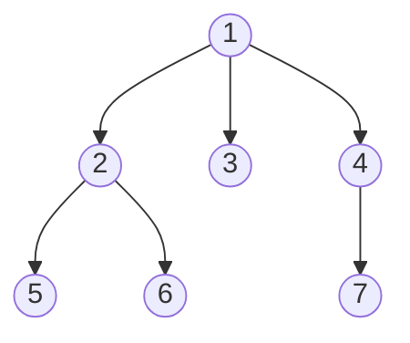

# 📌 8. Bfs/dfs

> **Navigation**: [← 6. Frequency Count](05_frequency_count.md) | [Chapter overview](../02_Code_Templates.md) | [9. Recursion & Backtracking →](07_recursion_backtracking.md)
> Page 6 of 8 in **Code Templates — Pattern Guide**


## Visual Concept

### BFS versus DFS visualisation



**How to read this diagram.** The graph used in both traversals below: node 1 is the root, with children 2, 3 and 4; node 2 has children 5 and 6; node 4 has child 7.

**BFS (level by level), using a queue**

| Level | Nodes |
| --- | --- |
| 0 | `[1]` |
| 1 | `[2, 3, 4]` |
| 2 | `[5, 6, 7]` |

Visit order: 1 → 2 → 3 → 4 → 5 → 6 → 7. Best for shortest path and level-order traversal.

**DFS (go deep first), using a stack or recursion**

- Path 1: 1 → 2 → 5 (dead end, backtrack)
- Path 2: 1 → 2 → 6 (dead end, backtrack)
- Path 3: 1 → 3 (dead end, backtrack)
- Path 4: 1 → 4 → 7 (dead end, done)

Visit order: 1 → 2 → 5 → 6 → 3 → 4 → 7 (depends on neighbour order). Best for finding any path, cycle detection and topological sort.

**When to use what**

| Traversal | Best for |
| --- | --- |
| **BFS** | Shortest path (unweighted), level order, nearest neighbours |
| **DFS** | All paths, cycle detection, connected components, backtracking |

## Template: BFS Level Order Traversal

```java
/**
 * BFS Template - Process level by level
 * Time: O(V + E), Space: O(V)
 */
public List<List<Integer>> levelOrder(TreeNode root) {
    List<List<Integer>> result = new ArrayList<>();
    if (root == null) return result;

    Queue<TreeNode> queue = new LinkedList<>();
    queue.offer(root);

    while (!queue.isEmpty()) {
        int levelSize = queue.size();  // Nodes at current level
        List<Integer> currentLevel = new ArrayList<>();

        for (int i = 0; i < levelSize; i++) {
            TreeNode node = queue.poll();
            currentLevel.add(node.val);

            // Add children for next level
            if (node.left != null) queue.offer(node.left);
            if (node.right != null) queue.offer(node.right);
        }
        result.add(currentLevel);
    }
    return result;
}

// BFS for Graph (with visited set)
public void bfsGraph(int start, List<List<Integer>> adjList) {
    Queue<Integer> queue = new LinkedList<>();
    Set<Integer> visited = new HashSet<>();

    queue.offer(start);
    visited.add(start);

    while (!queue.isEmpty()) {
        int node = queue.poll();
        System.out.println("Visit: " + node);

        for (int neighbor : adjList.get(node)) {
            if (!visited.contains(neighbor)) {
                visited.add(neighbor);
                queue.offer(neighbor);
            }
        }
    }
}
```

## Template: DFS (Recursive and Iterative)

```java
/**
 * DFS Recursive Template
 */
public void dfsRecursive(int node, List<List<Integer>> adjList, boolean[] visited) {
    visited[node] = true;
    System.out.println("Visit: " + node);

    for (int neighbor : adjList.get(node)) {
        if (!visited[neighbor]) {
            dfsRecursive(neighbor, adjList, visited);
        }
    }
}

/**
 * DFS Iterative Template (using Stack)
 */
public void dfsIterative(int start, List<List<Integer>> adjList) {
    Deque<Integer> stack = new ArrayDeque<>();
    Set<Integer> visited = new HashSet<>();

    stack.push(start);

    while (!stack.isEmpty()) {
        int node = stack.pop();

        if (visited.contains(node)) continue;
        visited.add(node);
        System.out.println("Visit: " + node);

        for (int neighbor : adjList.get(node)) {
            if (!visited.contains(neighbor)) {
                stack.push(neighbor);
            }
        }
    }
}
```

---

[← 6. Frequency Count](05_frequency_count.md) | [Chapter overview](../02_Code_Templates.md) | [9. Recursion & Backtracking →](07_recursion_backtracking.md)
