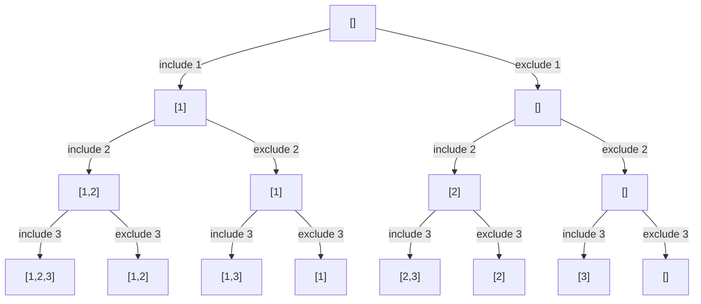

# 🔁 9. Recursion & Backtracking

> **Navigation**: [← 8. Bfs/dfs](06_bfs_dfs.md) | [Chapter overview](../02_Code_Templates.md) | [10. Dynamic Programming →](08_dynamic_programming.md)
> Page 7 of 8 in **Code Templates — Pattern Guide**


## Visual Concept

### Backtracking visualisation

Problem: generate all subsets of `[1, 2, 3]`. The decision tree includes or excludes each element in turn.



**How to read this diagram.** The leaves are all 8 subsets.

**The backtracking pattern**

1. **Choose:** make a choice (add an element to the current path).
2. **Explore:** recurse with this choice.
3. **Unchoose:** remove the choice (backtrack) to try the other options.

## Template: Generate All Subsets

```java
/**
 * Generate all subsets (power set)
 * Time: O(2^N * N), Space: O(N) for recursion
 */
public List<List<Integer>> subsets(int[] nums) {
    List<List<Integer>> result = new ArrayList<>();
    backtrack(nums, 0, new ArrayList<>(), result);
    return result;
}

private void backtrack(int[] nums, int start, List<Integer> current, List<List<Integer>> result) {
    // Add current subset to result
    result.add(new ArrayList<>(current));  // Make a copy!

    // Try adding each remaining element
    for (int i = start; i < nums.length; i++) {
        // CHOOSE
        current.add(nums[i]);

        // EXPLORE
        backtrack(nums, i + 1, current, result);

        // UNCHOOSE (backtrack)
        current.remove(current.size() - 1);
    }
}
```

## Template: Generate Permutations

```java
/**
 * Generate all permutations
 * Time: O(N! * N), Space: O(N)
 */
public List<List<Integer>> permute(int[] nums) {
    List<List<Integer>> result = new ArrayList<>();
    boolean[] used = new boolean[nums.length];
    backtrack(nums, new ArrayList<>(), used, result);
    return result;
}

private void backtrack(int[] nums, List<Integer> current, boolean[] used, List<List<Integer>> result) {
    // Base case: permutation complete
    if (current.size() == nums.length) {
        result.add(new ArrayList<>(current));
        return;
    }

    // Try each unused number
    for (int i = 0; i < nums.length; i++) {
        if (used[i]) continue;  // Skip if already used

        // CHOOSE
        used[i] = true;
        current.add(nums[i]);

        // EXPLORE
        backtrack(nums, current, used, result);

        // UNCHOOSE
        current.remove(current.size() - 1);
        used[i] = false;
    }
}
```

---

---

[← 8. Bfs/dfs](06_bfs_dfs.md) | [Chapter overview](../02_Code_Templates.md) | [10. Dynamic Programming →](08_dynamic_programming.md)
