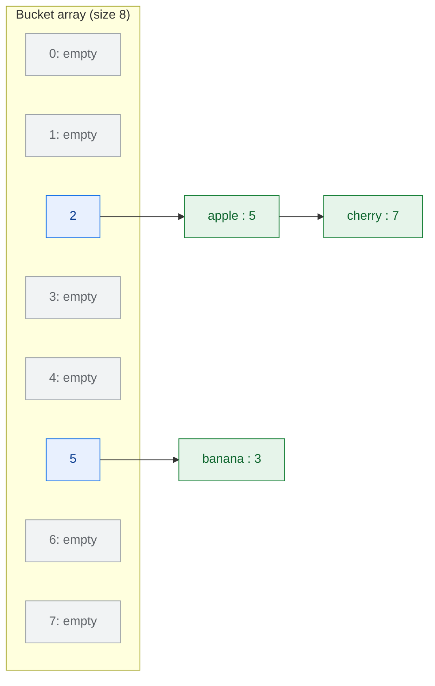
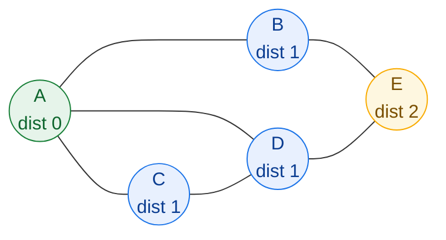
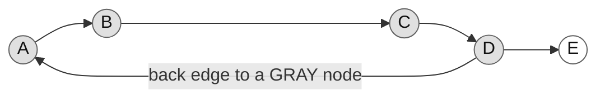
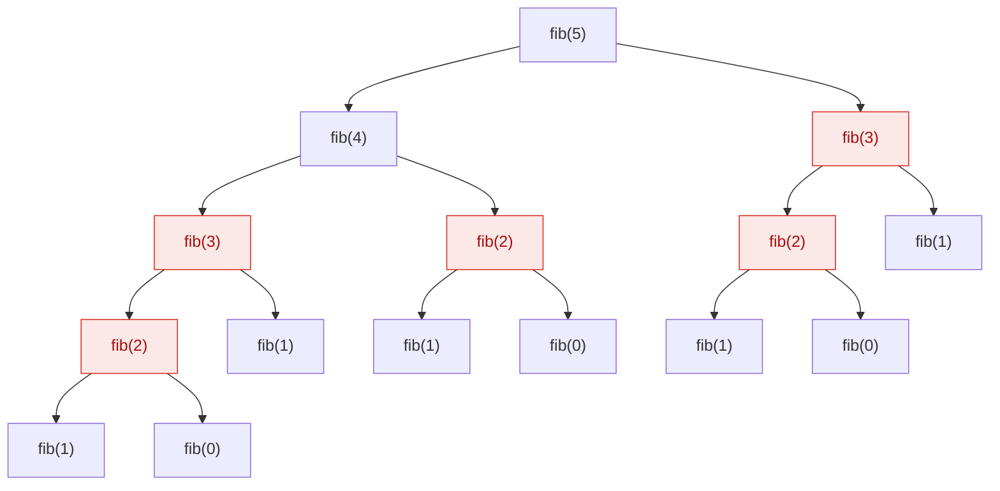

# 🧩 Visual Diagrams — Pattern Guide

> **Navigation**: [← Code Templates](02_Code_Templates.md) | [Chapter index](00_INDEX.md) | [Pattern Recognition →](04_Pattern_Recognition.md)

## 🎨 VISUAL ALGORITHM DIAGRAMS - COMPLETE REFERENCE

### This file contains VISUAL diagrams for ALL algorithm patterns

> Constraint first: a diagram explains how a pattern moves, but constraints decide whether that movement is legal. Check [Constraint-Based Pattern Selection](25_Constraint_Based_Pattern_Selection.md) for cases like negative numbers breaking sliding window or weighted edges breaking BFS.

---

### 📚 TABLE OF CONTENTS

1. [Array Operations](#-array-operations)
2. [String Operations](#-string-operations)
3. [Sorting Algorithms](#-sorting-algorithms)
4. [Searching Algorithms](#-searching-algorithms)
5. [Data Structures](#-data-structures)
6. [Graph Algorithms](#-graph-algorithms)
7. [Dynamic Programming](#-dynamic-programming)
8. [Math & Bit Manipulation](#-math--bit-manipulation)

---

## 🔗 Bridge — Where This Chapter Fits

| Dimension | This chapter |
| --- | --- |
| **Builds on** | [Code Templates](02_Code_Templates.md), basic arrays and strings |
| **You will learn** | How pointers, windows, stacks, queues, trees and DP tables evolve step by step |
| **Leads to** | [Pattern Recognition](04_Pattern_Recognition.md), per-pattern chapters |
| **Abstraction level** | Code → **picture of state over time** → intuition for the invariant |

> [!NOTE]
> The full gap-free reading order and dependency graph are in the [Learning Path](00_LEARNING_PATH.md).

---

## 💬 Explain It Like a Study Partner — Visual Diagrams

### 1. The bottom line

A good diagram shows how state changes from step to step, which is exactly what code hides.

### 2. The textbook core

- Draw the data structure, mark the pointers, then redraw after every step.
- Write the invariant next to the picture.
- Use a table for DP and a tree for recursion.
- Always say in words what the reader should notice.

### 3. The real-world analogy

A **flip-book**: each page is one step; flipping shows the algorithm moving.

### 4. Walkthrough

1. Take the two-pointer sum `[1,2,4,7]`, target 6.
2. Draw `L` at 1 and `R` at 7: sum 8 > 6 → move `R`.
3. Redraw: `1 + 4 = 5 < 6` → move `L`.
4. Redraw: `2 + 4 = 6` → found.

> [!NOTE]
> **Quick check:** What belongs in every diagram? *The state after each step and the invariant that holds.*


### 5. Check yourself

**Q1.** Trace two pointers on sorted `[1,2,4,7]` with target 6. What moves?

<details><summary>Answer</summary>

`L=1, R=7`: sum 8 > 6 → move `R`. `1 + 4 = 5 < 6` → move `L`. `2 + 4 = 6` → found.

</details>

**Q2.** Name the two things every algorithm diagram should show.

<details><summary>Answer</summary>

The state after each step (pointer positions, stack contents, window bounds) and the invariant that holds at that step.

</details>

**Q3.** In a chained hash table, why do long chains slow lookups?

<details><summary>Answer</summary>

A lookup walks the chain comparing keys, so cost grows with chain length. A good hash function and resizing keep chains short, giving `O(1)` on average.

</details>

---

## Historical Evolution

**Inventor / Originator:** Algorithm diagrams descend from the **flow diagrams** of Goldstine and von Neumann (1947). Ronald Baecker's film *Sorting Out Sorting* (1981) pioneered algorithm animation, and David Harel's *Algorithmics: The Spirit of Computing* (1987) made the case for visual and structured reasoning about algorithms.

**Predecessor context:** Algorithms were explained in prose or code alone, which hides how pointers, windows and stacks *move* over time.

**Evolution narrative:** Textbooks added figures, then animations; web tools such as VisuAlgo (Steven Halim, National University of Singapore, 2011) made interactive visualisation free. Plain-text and Mermaid diagrams remain popular because they live next to the code and diff cleanly in version control.

**Modern practice:** Use a diagram to show state *changing* (pointer positions, stack contents, window bounds), and always add a sentence that says how to read it.

- **Goldstine & von Neumann — 1947**: Flow diagrams for planning programs
- **Baecker — 1981**: *Sorting Out Sorting*, an early algorithm-animation film
- **Harel — 1987**: *Algorithmics: The Spirit of Computing*
- **VisuAlgo — 2011**: Interactive algorithm visualisations for students

---

## Production Reality

> [!TIP]
> **Solution fails or is too slow?** Run the five-step [Pattern Mis-Selection Debug Workflow](00_PATTERN_MASTER_GUIDE.md#pattern-mis-selection-debug-workflow) before changing code: the bug is often the pattern, not the implementation.

**Pattern-Specific Failure Modes:**

- **Visual diagram shows correct execution but algorithm has wrong invariant** — A diagram can be hand-crafted to show the happy path while the actual code implements the wrong invariant. Detection: generate diagrams from actual code execution (logging, visualization tools), not from expected behavior. Compare step-by-step.

- **Diagrams are static snapshots — runtime state may diverge** — Diagrams capture one moment in execution; actual code may have different state transitions due to off-by-one errors, boundary condition mishandling, or incorrect loop termination. Detection: instrument code with state logging at each iteration and compare to diagram expectations.

- **Diagram complexity hides algorithmic flaws** — Complex diagrams with multiple data structures (e.g., hash map + sliding window + frequency counter) make it hard to trace which component is failing. Detection: simplify by isolating each component; test each piece independently.

**Production Selection Heuristic:** Use diagrams for initial understanding and algorithm design, but always verify against actual code execution with logging. Never trust a diagram that wasn't generated from the actual implementation.

---

## 📊 ARRAY OPERATIONS

### Two Sum (Two Pointers on Sorted Array)

```
                  TWO SUM - TWO POINTERS
──────────────────────────────────────────────────

Sorted Array: [1, 2, 3, 5, 7, 10, 11]    Target: 9

Step 1:
┌───┬───┬───┬───┬───┬────┬────┐
│ 1 │ 2 │ 3 │ 5 │ 7 │ 10 │ 11 │
└───┴───┴───┴───┴───┴────┴────┘
  ↑                        ↑
 left                    right

sum = 1 + 11 = 12 > 9  → Move right LEFT

Step 2:
┌───┬───┬───┬───┬───┬────┬────┐
│ 1 │ 2 │ 3 │ 5 │ 7 │ 10 │ 11 │
└───┴───┴───┴───┴───┴────┴────┘
  ↑                  ↑
 left              right

sum = 1 + 10 = 11 > 9  → Move right LEFT

Step 3:
┌───┬───┬───┬───┬───┬────┬────┐
│ 1 │ 2 │ 3 │ 5 │ 7 │ 10 │ 11 │
└───┴───┴───┴───┴───┴────┴────┘
  ↑              ↑
 left          right

sum = 1 + 7 = 8 < 9  → Move left RIGHT

Step 4:
┌───┬───┬───┬───┬───┬────┬────┐
│ 1 │ 2 │ 3 │ 5 │ 7 │ 10 │ 11 │
└───┴───┴───┴───┴───┴────┴────┘
      ↑          ↑
     left      right

sum = 2 + 7 = 9 == 9  ✓ FOUND!
```

### Kadane's Algorithm (Maximum Subarray Sum)

```
                  KADANE'S ALGORITHM
──────────────────────────────────────────────────

Array: [-2, 1, -3, 4, -1, 2, 1, -5, 4]

KEY IDEA: At each position, decide:
"Should I start fresh here, or extend previous subarray?"

Index 0: arr[0] = -2
         current = max(-2, 0 + (-2)) = max(-2, -2) = -2
         maxSum = -2
         ├───┤
         [-2]

Index 1: arr[1] = 1
         current = max(1, -2 + 1) = max(1, -1) = 1  ← Start fresh!
         maxSum = 1
             ├───┤
             [1]

Index 2: arr[2] = -3
         current = max(-3, 1 + (-3)) = max(-3, -2) = -2  ← Extend
         maxSum = 1
             ├───────┤
             [1, -3]

Index 3: arr[3] = 4
         current = max(4, -2 + 4) = max(4, 2) = 4  ← Start fresh!
         maxSum = 4
                     ├───┤
                     [4]

Index 4: arr[4] = -1
         current = max(-1, 4 + (-1)) = max(-1, 3) = 3  ← Extend
         maxSum = 4
                     ├───────┤
                     [4, -1]

Index 5: arr[5] = 2
         current = max(2, 3 + 2) = max(2, 5) = 5  ← Extend
         maxSum = 5
                     ├───────────┤
                     [4, -1, 2]

Index 6: arr[6] = 1
         current = max(1, 5 + 1) = max(1, 6) = 6  ← Extend
         maxSum = 6 ⭐
                     ├───────────────┤
                     [4, -1, 2, 1]    ← MAXIMUM SUBARRAY

Continue... Final Answer: 6 (subarray [4, -1, 2, 1])
```

### Dutch National Flag (Sort 0s, 1s, 2s)

```
                  DUTCH NATIONAL FLAG
──────────────────────────────────────────────────

Array: [2, 0, 2, 1, 1, 0]

Three pointers: low (0s boundary), mid (scanning), high (2s boundary)

Initial:
┌───┬───┬───┬───┬───┬───┐
│ 2 │ 0 │ 2 │ 1 │ 1 │ 0 │
└───┴───┴───┴───┴───┴───┘
  ↑                   ↑
low,mid              high

arr[mid]=2: Swap with high, high--
┌───┬───┬───┬───┬───┬───┐
│ 0 │ 0 │ 2 │ 1 │ 1 │ 2 │
└───┴───┴───┴───┴───┴───┘
  ↑               ↑   ↑
low,mid          high (2s zone)

arr[mid]=0: Swap with low, low++, mid++
┌───┬───┬───┬───┬───┬───┐
│ 0 │ 0 │ 2 │ 1 │ 1 │ 2 │
└───┴───┴───┴───┴───┴───┘
  ↑   ↑           ↑   ↑
 (0s) low,mid    high (2s)

arr[mid]=0: Swap with low, low++, mid++
┌───┬───┬───┬───┬───┬───┐
│ 0 │ 0 │ 2 │ 1 │ 1 │ 2 │
└───┴───┴───┴───┴───┴───┘
 (0s)  ↑   ↑      ↑   ↑
      low mid    high (2s)

arr[mid]=2: Swap with high, high--
┌───┬───┬───┬───┬───┬───┐
│ 0 │ 0 │ 1 │ 1 │ 2 │ 2 │
└───┴───┴───┴───┴───┴───┘
 (0s)  ↑   ↑   ↑  (2s zone)
      low mid high

arr[mid]=1: Just mid++
┌───┬───┬───┬───┬───┬───┐
│ 0 │ 0 │ 1 │ 1 │ 2 │ 2 │
└───┴───┴───┴───┴───┴───┘
 (0s)  ↑      ↑↑  (2s zone)
      low   mid,high

arr[mid]=1: mid++
mid > high → DONE! ✓

Result: [0, 0, 1, 1, 2, 2]
```

---

## 📝 STRING OPERATIONS

### Anagram Check

```
                  ANAGRAM CHECK VISUALIZATION
──────────────────────────────────────────────────

String 1: "listen"        String 2: "silent"

METHOD 1: Frequency Count

Count for "listen":       Count for "silent":
┌───┬───┐                 ┌───┬───┐
│ l │ 1 │                 │ s │ 1 │
│ i │ 1 │                 │ i │ 1 │
│ s │ 1 │                 │ l │ 1 │
│ t │ 1 │                 │ e │ 1 │
│ e │ 1 │                 │ n │ 1 │
│ n │ 1 │                 │ t │ 1 │
└───┴───┘                 └───┴───┘

Both have same characters with same frequencies → ANAGRAM ✓

METHOD 2: Single Frequency Array

Start: freq[26] = all zeros

Process "listen": +1 for each char
┌─┬─┬─┬─┬─┬─┬─┬─┬─┬─┬─┬─┬─┬─┬─┬─┬─┬─┬─┬─┬─┬─┬─┬─┬─┬─┐
│0│0│0│0│1│0│0│0│1│0│0│1│0│1│0│0│0│0│1│1│0│0│0│0│0│0│
└─┴─┴─┴─┴─┴─┴─┴─┴─┴─┴─┴─┴─┴─┴─┴─┴─┴─┴─┴─┴─┴─┴─┴─┴─┴─┘
 a b c d e f g h i j k l m n o p q r s t u v w x y z

Process "silent": -1 for each char
┌─┬─┬─┬─┬─┬─┬─┬─┬─┬─┬─┬─┬─┬─┬─┬─┬─┬─┬─┬─┬─┬─┬─┬─┬─┬─┐
│0│0│0│0│0│0│0│0│0│0│0│0│0│0│0│0│0│0│0│0│0│0│0│0│0│0│
└─┴─┴─┴─┴─┴─┴─┴─┴─┴─┴─┴─┴─┴─┴─┴─┴─┴─┴─┴─┴─┴─┴─┴─┴─┴─┘

All zeros → ANAGRAM ✓
```

### KMP String Matching (Pattern Search)

KMP STRING MATCHING

Text: "ABABDABACDABABCABAB"
Pattern: "ABABCABAB"

Step 1: Build LPS (Longest Proper Prefix which is also Suffix)

Pattern: A B A B C A B A B
Index: 0 1 2 3 4 5 6 7 8
LPS: [0,0,1,2,0,1,2,3,4]

LPS meaning:

- At index 3 (ABAB), LPS=2 means "AB" is both prefix and suffix
- At index 8 (ABABCABAB), LPS=4 means "ABAB" is prefix and suffix

Step 2: Search using LPS

Text: A B A B D A B A C D A B A B C A B A B
Pattern: A B A B C
↑ mismatch at index 4

LPS[3] = 2, so pattern can shift to reuse matched "AB":

Text: A B A B D A B A C D A B A B C A B A B
Pattern: A B A B C
↑ continue from here (saved 2 comparisons!)

Without KMP: Would start from beginning each time → O(N×M)
With KMP: Reuse matched portion → O(N+M)

---

## 🔢 SORTING ALGORITHMS

### Heap Sort Visualization

```
HEAP SORT VISUALIZATION

Array: [4, 10, 3, 5, 1]

PHASE 1: Build Max Heap (heapify from bottom-up)

Initial tree:              After heapify:
4                          10
/ \                        /  \
10  3          →           5    3
/ \                        / \
5   1                      4   1

Max Heap Property: Parent ≥ Children

PHASE 2: Extract max repeatedly

Step 1: Swap root(10) with last(1), remove 10
1
/ \                 Heapify →        5
5   3                                / \
/                                    4   3
4                                    /
1
Sorted: [..., 10]

Step 2: Swap root(5) with last(1), remove 5
1
/ \                 Heapify →        4
4   3                                / \
1   3
Sorted: [..., 5, 10]

Step 3: Swap root(4) with last(3), remove 4
3
/                   Heapify →        3
1                                    /
1
Sorted: [..., 4, 5, 10]

Continue... Final: [1, 3, 4, 5, 10]

```

### Counting Sort Visualization

```
                  COUNTING SORT VISUALIZATION
──────────────────────────────────────────────────

Array: [4, 2, 2, 8, 3, 3, 1]    (values range 0-9)

STEP 1: Count occurrences

Count array (index = value):
┌───┬───┬───┬───┬───┬───┬───┬───┬───┬───┐
│ 0 │ 1 │ 2 │ 1 │ 1 │ 0 │ 0 │ 0 │ 1 │ 0 │
└───┴───┴───┴───┴───┴───┴───┴───┴───┴───┘
  0   1   2   3   4   5   6   7   8   9
      ↑   ↑   ↑   ↑               ↑
     one two two one             one
      1   2s  3s  4               8

STEP 2: Cumulative sum (for stable sort)

┌───┬───┬───┬───┬───┬───┬───┬───┬───┬───┐
│ 0 │ 1 │ 3 │ 4 │ 5 │ 5 │ 5 │ 5 │ 6 │ 6 │
└───┴───┴───┴───┴───┴───┴───┴───┴───┴───┘
  0   1   2   3   4   5   6   7   8   9

Meaning: count[i] = number of elements ≤ i

STEP 3: Build output (right to left for stability)

Input:  [4, 2, 2, 8, 3, 3, 1]
                          ↑ Process 1 first (from right)

1 goes to position count[1]-1 = 0
Output: [1, _, _, _, _, _, _]

Continue... Final: [1, 2, 2, 3, 3, 4, 8]

Time: O(N + K) where K = range of values
Best when: K is small (like sorting ages 0-100)
```

---

🔬 **Section Challenge — 🔢 SORTING ALGORITHMS**

**Challenge 1 (Reasoning):** QuickSort average O(N log N) but worst case O(N²). When exactly does the worst case happen and how do you prevent it?

<details><summary>Answer</summary>

Worst case: pivot always ends up at position 0 or N-1 (completely unbalanced partition). This happens when: (1) always picking first/last element as pivot on already-sorted or reverse-sorted data. (2) Pivot happens to be the minimum or maximum. Prevention: random pivot (randomized quicksort — expected O(N log N) even on adversarial input), or median-of-three (pick median of first/middle/last element as pivot). Java's dual-pivot quicksort uses careful pivot selection to avoid this.

</details>

## 🔍 SEARCHING ALGORITHMS

### Binary Search Variants

```
                  BINARY SEARCH VARIANTS
──────────────────────────────────────────────────

Array: [1, 2, 2, 2, 2, 3, 5, 7]    Find: 2
Index:  0  1  2  3  4  5  6  7

═══════════════════════════════════════════════════════════════════════

VARIANT 1: Find ANY occurrence
┌───┬───┬───┬───┬───┬───┬───┬───┐
│ 1 │ 2 │ 2 │ 2 │ 2 │ 3 │ 5 │ 7 │
└───┴───┴───┴───┴───┴───┴───┴───┘
            ↑
         returns 2 or 3 (any match)

═══════════════════════════════════════════════════════════════════════

VARIANT 2: Find FIRST occurrence
┌───┬───┬───┬───┬───┬───┬───┬───┐
│ 1 │ 2 │ 2 │ 2 │ 2 │ 3 │ 5 │ 7 │
└───┴───┴───┴───┴───┴───┴───┴───┘
      ↑
   returns 1 (leftmost 2)

Logic: When found, don't return! Save and go LEFT
       if (arr[mid] == target) { result = mid; high = mid - 1; }

═══════════════════════════════════════════════════════════════════════

VARIANT 3: Find LAST occurrence
┌───┬───┬───┬───┬───┬───┬───┬───┐
│ 1 │ 2 │ 2 │ 2 │ 2 │ 3 │ 5 │ 7 │
└───┴───┴───┴───┴───┴───┴───┴───┘
                ↑
            returns 4 (rightmost 2)

Logic: When found, don't return! Save and go RIGHT
       if (arr[mid] == target) { result = mid; low = mid + 1; }

═══════════════════════════════════════════════════════════════════════

VARIANT 4: Lower Bound (first >= target)
Target: 2
┌───┬───┬───┬───┬───┬───┬───┬───┐
│ 1 │ 2 │ 2 │ 2 │ 2 │ 3 │ 5 │ 7 │
└───┴───┴───┴───┴───┴───┴───┴───┘
      ↑
   returns 1 (first element ≥ 2)

═══════════════════════════════════════════════════════════════════════

VARIANT 5: Upper Bound (first > target)
Target: 2
┌───┬───┬───┬───┬───┬───┬───┬───┐
│ 1 │ 2 │ 2 │ 2 │ 2 │ 3 │ 5 │ 7 │
└───┴───┴───┴───┴───┴───┴───┴───┘
                    ↑
                returns 5 (first element > 2)

Count of 2s = Upper Bound - Lower Bound = 5 - 1 = 4
```

---

## 📦 DATA STRUCTURES

### HashMap Internal Working



**How to read this diagram.** The key's hash picks a bucket. Bucket 2 holds two entries chained together (a collision: `apple` and `cherry` hash to the same bucket), bucket 5 holds one, and the grey buckets are empty. Lookups walk the chain, so a good hash function keeps chains short.

### Stack vs Queue

```
                  STACK vs QUEUE
──────────────────────────────────────────────────

STACK (LIFO - Last In First Out)
─────────────────────────────────
Think: Stack of plates

Push 1, Push 2, Push 3:          Pop:
┌─────┐                          ┌─────┐
│  3  │ ← top                    │  3  │ ← comes out first
├─────┤                          └─────┘
│  2  │                          Then:
├─────┤                          ┌─────┐
│  1  │                          │  2  │ ← next out
└─────┘                          └─────┘

Use cases: Undo, Recursion, Balanced brackets

═══════════════════════════════════════════════════════════════════════

QUEUE (FIFO - First In First Out)
─────────────────────────────────
Think: Line at store

Enqueue 1, 2, 3:                 Dequeue:
┌───┬───┬───┐                    ┌───┬───┬───┐
│ 1 │ 2 │ 3 │                    │ 1 │ 2 │ 3 │
└───┴───┴───┘                    └───┴───┴───┘
  ↑       ↑                        ↑
front    rear                    comes out first

Use cases: BFS, Level-order traversal, Task scheduling

═══════════════════════════════════════════════════════════════════════

DEQUE (Double-Ended Queue)
─────────────────────────────
Can add/remove from BOTH ends!

┌───┬───┬───┬───┬───┐
│ A │ B │ C │ D │ E │
└───┴───┴───┴───┴───┘
  ↑               ↑
addFirst/      addLast/
removeFirst    removeLast

Use cases: Sliding window max, BFS variations
```

---

## 🌐 GRAPH ALGORITHMS

### BFS Shortest Path

Find the shortest path from `A` to `E` in this unweighted, undirected graph.



**How to read this diagram.** Colours show BFS levels: green is the start, blue nodes are one edge away, yellow is two edges away. The number under each name is its shortest distance from `A`.

| Level | Queue after processing | Visited | Distances |
| --- | --- | --- | --- |
| 0 | `[A]` | `{A}` | `A:0` |
| 1 | `[B, C, D]` (neighbours of A) | `{A,B,C,D}` | `B:1, C:1, D:1` |
| 2 | `[E]` (from B or D; C and D already seen) | `{A,B,C,D,E}` | `E:2` |

The shortest path `A → E` has **2 edges** (`A→B→E` or `A→D→E`).

> [!TIP]
> BFS finds shortest paths in **unweighted** graphs. For weighted graphs use Dijkstra's algorithm ([Shortest Paths](30_Shortest_Path_Pattern.md)).

### DFS - Detecting Cycle

Directed graph with edges `A→B`, `B→C`, `C→D`, `D→A`, `D→E`. The cycle is `A → B → C → D → A`.



**How to read this diagram.** Grey nodes are on the current DFS path (state GRAY) when `D` is reached. The edge `D → A` points back to a node that is still on the path — a **back edge** — which proves a cycle. `E` has not been visited yet (WHITE).

DFS uses three states:

| State | Meaning |
| --- | --- |
| WHITE (0) | Not visited |
| GRAY (1) | Currently on the DFS stack (being processed) |
| BLACK (2) | Completely processed |

Walk-through from `A`:

1. Visit `A` → GRAY.
2. Visit `B` (child of `A`) → GRAY.
3. Visit `C` (child of `B`) → GRAY.
4. Visit `D` (child of `C`) → GRAY. `D` points to `A`, and `A` is GRAY (in the current path) → **cycle detected**.

**Rule:** an edge to a GRAY node is a back edge, and a back edge means a cycle.

---

🔬 **Section Challenge — 🌐 GRAPH ALGORITHMS**

**Challenge 1 (Reasoning):** BFS finds shortest path in unweighted graphs but not in weighted graphs. Why exactly?

<details><summary>Answer</summary>

BFS explores by 'hop count' (number of edges). Each level = one more edge away from source. All edges are treated as weight=1. In a weighted graph, the 'shortest by hop count' path may not be 'shortest by weight sum'. Example: A→B (weight 1, 1 hop) vs A→C→B (weight 0.1+0.1=0.2, 2 hops). BFS finds A→B (1 hop), Dijkstra finds A→C→B (lower total weight). BFS is optimal ONLY when all edges have equal weight.

</details>

**Challenge 2 (Design):** Detect if a directed graph has a cycle. Write the algorithm and explain why we need 3 states (not 2).

<details><summary>Answer</summary>

3 states: UNVISITED, IN_PROGRESS (currently in DFS path), DONE. DFS: mark node IN_PROGRESS before visiting neighbors. If we reach an IN_PROGRESS node → cycle found. Mark DONE when all neighbors processed. Why 3 states: with 2 (visited/unvisited), we'd get false positives — reaching a VISITED node that was processed in a DIFFERENT DFS subtree is not a cycle. IN_PROGRESS specifically marks nodes in the CURRENT DFS path (potential back edge).

</details>

## 🧮 DYNAMIC PROGRAMMING

### Fibonacci with Memoization

Without memoization, `fib(5)` recomputes the same subproblems:



**How to read this diagram.** Red nodes are repeated work: `fib(3)` is computed twice and `fib(2)` three times. This is why the naive recursion takes `O(2ⁿ)` time.

**With memoization (linear time).** Store each result once:

| index | 0 | 1 | 2 | 3 | 4 | 5 |
| --- | --- | --- | --- | --- | --- | --- |
| `memo` | 0 | 1 | 1 | 2 | 3 | 5 |

`fib(5) = memo[4] + memo[3] = 3 + 2 = 5` — look the values up instead of recomputing. Time `O(n)`, space `O(n)`.

**Bottom-up (tabulation).** Only the last two values are needed:

| step | `a` | `b` |
| --- | --- | --- |
| start | 0 | 1 |
| i = 2 | 1 | 1 |
| i = 3 | 1 | 2 |
| i = 4 | 2 | 3 |
| i = 5 | 3 | 5 |

Answer `fib(5) = 5` in `O(n)` time and `O(1)` space.

### Longest Common Subsequence (LCS)

`X = "ABCDGH"`, `Y = "AEDFHR"`. Let `dp[i][j]` be the LCS length of `X[0..i-1]` and `Y[0..j-1]`.

| | "" | A | E | D | F | H | R |
| --- | --- | --- | --- | --- | --- | --- | --- |
| **""** | 0 | 0 | 0 | 0 | 0 | 0 | 0 |
| **A** | 0 | **1** | 1 | 1 | 1 | 1 | 1 |
| **B** | 0 | 1 | 1 | 1 | 1 | 1 | 1 |
| **C** | 0 | 1 | 1 | 1 | 1 | 1 | 1 |
| **D** | 0 | 1 | 1 | **2** | 2 | 2 | 2 |
| **G** | 0 | 1 | 1 | 2 | 2 | 2 | 2 |
| **H** | 0 | 1 | 1 | 2 | 2 | **3** | 3 |

Bold cells are where the characters match (`A`, `D`, `H`).

**Recurrence**

- If `X[i-1] == Y[j-1]`: `dp[i][j] = dp[i-1][j-1] + 1` (match, extend the diagonal).
- Otherwise: `dp[i][j] = max(dp[i-1][j], dp[i][j-1])` (take the better of up and left).

The LCS is **"ADH"** (length 3). To recover it, start at `dp[6][6]` and trace back: move diagonally on a match, otherwise move toward the larger neighbour.

## 🔢 MATH & BIT MANIPULATION

### Bit Operations Visual

BIT MANIPULATION VISUAL

CHECKING IF POWER OF 2:
────────────────────────

n = 8: 1000 (binary)
n-1 = 7: 0111 (binary)
────
n & (n-1): 0000 ← All zeros! Power of 2 ✓

n = 6: 0110 (binary)
n-1 = 5: 0101 (binary)
────
n & (n-1): 0100 ← Not zero! Not power of 2 ✗

Rule: Power of 2 has exactly ONE bit set
n & (n-1) removes rightmost set bit
If result is 0, it was power of 2

═══════════════════════════════════════════════════════════════════════

COUNTING SET BITS:
──────────────────

n = 13: 1101 (binary) → 3 set bits

Iteration 1:
n = 1101
n-1 = 1100
n & (n-1) = 1100 → count = 1 (removed rightmost 1)

Iteration 2:
n = 1100
n-1 = 1011
n & (n-1) = 1000 → count = 2

Iteration 3:
n = 1000
n-1 = 0111
n & (n-1) = 0000 → count = 3

n = 0, stop. Answer: 3 set bits ✓

═══════════════════════════════════════════════════════════════════════

XOR PROPERTIES:
───────────────

a ^ a = 0 (same numbers cancel)
a ^ 0 = a (XOR with 0 gives same number)
a ^ b ^ a = b (a cancels out)

Example: Find single number in [4, 1, 2, 1, 2]

4 ^ 1 ^ 2 ^ 1 ^ 2
= 4 ^ (1 ^ 1) ^ (2 ^ 2)
= 4 ^ 0 ^ 0
= 4 ← The single number!

### GCD Euclidean Algorithm

```
                  GCD - EUCLIDEAN ALGORITHM
──────────────────────────────────────────────────

Find GCD(48, 18):

Step 1: 48 = 18 × 2 + 12
        a    b        remainder

        48 ÷ 18 = 2 remainder 12
        Now: GCD(48, 18) = GCD(18, 12)

Step 2: 18 = 12 × 1 + 6
        18 ÷ 12 = 1 remainder 6
        Now: GCD(18, 12) = GCD(12, 6)

Step 3: 12 = 6 × 2 + 0
        12 ÷ 6 = 2 remainder 0
        Remainder is 0 → GCD = 6 ✓

Visual:
┌──────────────────────────────────────────────────────────────────────┐
│ GCD(48, 18)                                                          │
│    ↓                                                                 │
│ GCD(18, 48 % 18) = GCD(18, 12)                                       │
│    ↓                                                                 │
│ GCD(12, 18 % 12) = GCD(12, 6)                                        │
│    ↓                                                                 │
│ GCD(6, 12 % 6) = GCD(6, 0)                                           │
│    ↓                                                                 │
│ return 6  ← When b becomes 0, a is the GCD                           │
└──────────────────────────────────────────────────────────────────────┘

Code:
int gcd(int a, int b) {
    while (b != 0) {
        int temp = b;
        b = a % b;
        a = temp;
    }
    return a;
}

Time Complexity: O(log(min(a, b)))
```

---

## 🎯 QUICK REFERENCE TABLE

**ALGORITHM QUICK REFERENCE**

**SORTING**

| Algorithm      | Best     | Average  | Worst    | When to Use        |
| -------------- | -------- | -------- | -------- | ------------------ |
| Quick Sort     | O(NlogN) | O(NlogN) | O(N²)    | General purpose    |
| Merge Sort     | O(NlogN) | O(NlogN) | O(NlogN) | Stable needed      |
| Heap Sort      | O(NlogN) | O(NlogN) | O(NlogN) | Memory constrained |
| Counting Sort  | O(N+K)   | O(N+K)   | O(N+K)   | Small range values |
| Insertion Sort | O(N)     | O(N²)    | O(N²)    | Nearly sorted      |

**SEARCHING**

| Algorithm     | Time    | When to Use                  |
| ------------- | ------- | ---------------------------- |
| Linear Search | O(N)    | Unsorted data                |
| Binary Search | O(logN) | Sorted array                 |
| Hash Lookup   | O(1)    | When O(1) lookup needed      |
| BFS           | O(V+E)  | Shortest path (unweighted)   |
| DFS           | O(V+E)  | Path exists, cycle detection |

**DATA STRUCTURES**

| Structure      | Access  | Search  | Insert  | Delete  |
| -------------- | ------- | ------- | ------- | ------- |
| Array          | O(1)    | O(N)    | O(N)    | O(N)    |
| Linked List    | O(N)    | O(N)    | O(1)    | O(1)    |
| HashMap        | -       | O(1)    | O(1)    | O(1)    |
| Stack          | O(N)    | O(N)    | O(1)    | O(1)    |
| Queue          | O(N)    | O(N)    | O(1)    | O(1)    |
| Heap           | -       | O(N)    | O(logN) | O(logN) |
| BST (balanced) | O(logN) | O(logN) | O(logN) | O(logN) |

---

## 📝 STUDY TIP

**How to use these diagrams:**

1. **Before coding**: Draw the diagram on paper first
2. **While coding**: Keep the visual in mind, code matches diagram
3. **After coding**: Trace through your code with the diagram
4. **If stuck**: Go back to the diagram, not the code

Remember: **Visual thinking → Clearer code!**

---

> **Navigation**: [< Previous](02_Code_Templates.md) | [Back to Index](../00_MASTER_INDEX.md) | [Next >](04_Pattern_Recognition.md)


---

## 🏢 Enterprise Lens — Visual Diagrams

| Area | What top-tier engineering looks like |
| ---- | ------------------------------------ |
| **Where it runs in production** | Design documents, runbooks and code-review descriptions where a sketch is faster than prose |
| **Failure modes** | Diagrams that show the final result but not the transitions; text art that breaks when fonts change |
| **Testing and verification** | Re-trace each diagram by hand against the code; keep diagrams next to the code they illustrate |

---

## Reality Check

**"Diagrams are for beginners; experts think in code"** → Experts think in STRUCTURES and compile to code at the end. Whiteboard studies of senior engineers show they draw state transitions and array snapshots before writing a line. The difference from beginners is not skipping the picture — it is that the expert's picture captures the invariant (what stays true), not just one example (what happens once).

**"One worked example proves the algorithm"** → A diagram of one input is an EXISTENCE proof, not correctness. The example that fits in a diagram is almost always the friendly case: distinct values, no ties, size 5-8. The discipline: after diagramming the happy path, redraw with the adversarial input — duplicates everywhere, already sorted, all equal. If the picture still tells the same story, you have evidence; if not, you found the bug before the compiler did.

**"Drawing during an interview wastes time"** → A 30-second array-with-pointers sketch prevents the 5-minute silent debugging spiral, and it keeps the interviewer INSIDE your reasoning — they can redirect you the moment your picture diverges from their intent. The candidates who fail on communication are overwhelmingly the ones who went silent into code, not the ones who narrated a diagram.

**"Recursion trees are just for computing complexity"** → The recursion tree IS the execution: each node a call, each edge a return path. Drawing it reveals what complexity formulas hide — which subproblems repeat (memoization candidates), how deep the stack grows (overflow risk), and in what ORDER results combine (the difference between preorder and postorder logic). Most recursion bugs are order-of-combination bugs, visible in the tree, invisible in the code.

**"Memory diagrams are only for C programmers"** → Java and Python hide pointers, not the consequences of pointers. Why does modifying a list inside a function change the caller's list? Why does a two-dimensional array built with the multiplication idiom in Python alias all rows? Why does substring in old Java leak the parent string? Every one of these is a one-box-two-arrows diagram. If you cannot draw where the references point, the language's abstraction is doing your thinking for you — until it does not.
