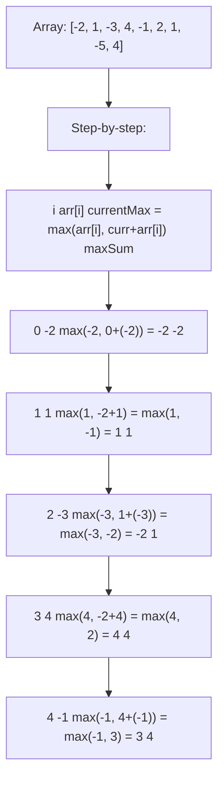
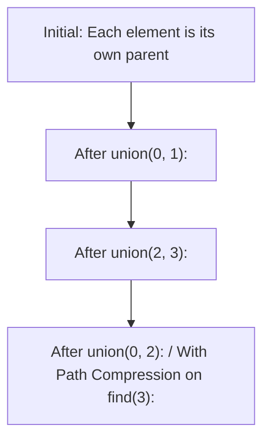
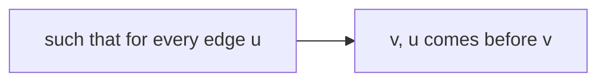
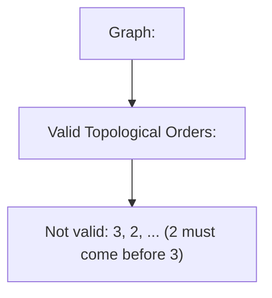
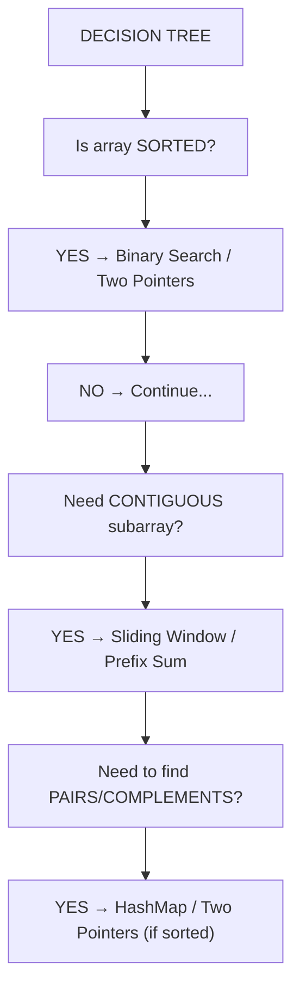

**Navigation**: [< Previous](03_Visual_Diagrams.md) | [Back to Index](../00_MASTER_INDEX.md) | [Next >](05_LeetCode_RealWorld_Map.md)

---

## 🗺️ MASTER PATTERN GUIDE — How to Identify Any Pattern From a Problem

**Read this FIRST. Use this every time you see a new problem.**
The fastest skill you can build is: see a problem → immediately know which pattern to use.

> Constraint override: keywords suggest patterns, but constraints confirm them. If values may be negative, updates exist, graph weights differ, or `N` is huge, switch using [Constraint-Based Pattern Selection](25_Constraint_Based_Pattern_Selection.md).
> Rewrite method: when you only have brute force, use [Brute Force to Optimal](../14_Mental_Models/22_Brute_Force_To_Optimal_Playbook.md) to identify which DS/Algo replaces the slow loop.

### 🔑 Step 1: Read the Problem. Look for These Keywords

| If you see... | First think... | Then verify with... |
|---|---|---|
| `subarray`, `contiguous`, `consecutive` | Sliding Window or Prefix Sum | Is it max/min sum? → Kadane's. Count? → Prefix+HashMap |
| `substring` of size constraints | Sliding Window | Fixed size? Fixed window. Variable? Variable window |
| `subsequence`, `not necessarily contiguous` | Recursion / DP | LIS? Binary Search. LCS? 2D DP |
| `pairs`, `two numbers sum to target` | Two Pointers (sorted) or HashMap | Sorted input? Two Pointers. Unsorted? HashMap |
| `triplets / k-sum` | Sort + Two Pointers | Fix one, two-pointer the rest |
| `sorted` + `find` / `search` | Binary Search | On data? Classic BS. On answer? BS on answer space |
| `rotated sorted array` | Modified Binary Search | One half always sorted |
| `frequency`, `count occurrences` | HashMap | Char? `int[26]`. General? `HashMap` |
| `group by`, `anagrams`, `bucket` | HashMap groups | Key = sorted string or signature |
| `k-th largest / smallest` | Heap | Min-Heap of size k O(n log k) |
| `top K` elements | Heap + Freq | Freq map → Heap |
| `matching brackets / nesting` | Stack | LIFO maps nesting perfectly |
| `next greater / smaller element` | Monotonic Stack | Decreasing for NGE, increasing for NSE |
| `level by level`, `BFS` | Queue | Level-order traversal |
| `all possible`, `generate all`, `enumerate` | Recursion / Backtracking | Include/Exclude paradigm |
| `minimum cost / maximum profit` globally | Greedy or DP | Greedy if local optimal = global. DP if overlapping subproblems |
| `connected components`, `path`, `graph` | BFS/DFS | BFS = shortest path unweighted. DFS = explore all |
| `cycle detection` | Fast/Slow Pointers (LL) or DFS (graph) | LL? Floyd's. Graph? DFS color |
| `intervals`, `overlapping ranges` | Sort by start + merge | Sort → scan linearly |
| `prefix` / `range sum query` | Prefix Sum | Build O(n), query O(1) |

### 🔑 Step 2: Check the Input Type

```
Input is ARRAY?
  ├── Sorted? → Binary Search / Two Pointers
  ├── Unsorted, find pairs? → HashMap O(n) or Sort+TwoPtr O(n log n)
  ├── Window problem? → Sliding Window
  └── Max/min subarray? → Kadane's

Input is STRING?
  ├── Substring constraints? → Sliding Window
  ├── Frequency? → int[26] or HashMap
  ├── Prefix/suffix? → String DP
  └── Pattern matching? → KMP / Rolling Hash

Input is TREE?
  ├── Path problems? → DFS
  ├── Level problems? → BFS
  └── BST + ordered? → Inorder traversal

Input is GRAPH?
  ├── Shortest path (unweighted)? → BFS
  ├── All paths / connected? → DFS
  ├── Shortest path (weighted)? → Dijkstra's (Heap)
  └── No cycles guaranteed? → Topological Sort

Input is LINKED LIST?
  ├── Cycle? → Fast/Slow Pointers
  ├── Nth from end? → Gap of N (Fast/Slow)
  ├── Middle? → Fast/Slow
  └── Reverse? → 3-pointer iterative
```

### 🔑 Step 3: Check the Constraints

```
n ≤ 20        → O(2ⁿ) or O(n!) OK → Backtracking / Brute Force
n ≤ 100       → O(n³) OK           → 3 nested loops
n ≤ 1,000     → O(n²) OK           → 2 nested loops / DP
n ≤ 100,000   → O(n log n) needed  → Sort / Binary Search / Heap
n ≤ 1,000,000 → O(n) needed        → HashMap / Sliding Window / Kadane's
n ≤ 10^9      → O(log n) or O(1)   → Math / Binary Search
```

---


# 🔥 Advanced DSA Patterns & Templates

## Beyond the Basics - Level Up Your Problem Solving

---


# 🎨 Pattern 1: Prefix Sum

## Concept

```
Original Array:    [1,  2,  3,  4,  5]
Prefix Sum Array:  [1,  3,  6, 10, 15]

prefix[i] = sum of all elements from index 0 to i

Range Sum Query:
Sum(i, j) = prefix[j] - prefix[i-1]

Example: Sum(1, 3) = prefix[3] - prefix[0] = 10 - 1 = 9
Check: arr[1] + arr[2] + arr[3] = 2 + 3 + 4 = 9 ✓
```

## Template

```java
// Build prefix sum
int[] prefix = new int[n + 1];  // Extra space for edge case
for (int i = 0; i < n; i++) {
    prefix[i + 1] = prefix[i] + arr[i];
}

// Query range sum [left, right] (0-indexed)
int rangeSum = prefix[right + 1] - prefix[left];
```

## Problems

| Problem                      | Difficulty | Key Insight                 |
| ---------------------------- | ---------- | --------------------------- |
| Range Sum Query - Immutable  | Easy       | Direct prefix sum           |
| Subarray Sum Equals K        | Medium     | prefix[j] - prefix[i] = k   |
| Contiguous Array (0s and 1s) | Medium     | Treat 0 as -1, find sum = 0 |
| Product of Array Except Self | Medium     | Prefix and Suffix products  |

---

# 🎨 Pattern 2: Kadane's Algorithm

## Concept

```
Find maximum subarray sum

Key Insight: At each position, decide:
1. Extend previous subarray (currMax + arr[i])
2. Start new subarray (arr[i])

Take the MAX of both choices!
```

## Visual

```
Array: [-2, 1, -3, 4, -1, 2, 1, -5, 4]

Step-by-step:
┌─────┬──────┬──────────────────────────────────────┬────────┐
│  i  │arr[i]│ currentMax = max(arr[i], curr+arr[i])│ maxSum │
├─────┼──────┼──────────────────────────────────────┼────────┤
│  0  │  -2  │ max(-2, 0+(-2)) = -2                 │   -2   │
│  1  │   1  │ max(1, -2+1) = max(1, -1) = 1        │    1   │
│  2  │  -3  │ max(-3, 1+(-3)) = max(-3, -2) = -2   │    1   │
│  3  │   4  │ max(4, -2+4) = max(4, 2) = 4         │    4   │
│  4  │  -1  │ max(-1, 4+(-1)) = max(-1, 3) = 3     │    4   │
│  5  │   2  │ max(2, 3+2) = max(2, 5) = 5          │    5   │
│  6  │   1  │ max(1, 5+1) = max(1, 6) = 6          │    6   │
│  7  │  -5  │ max(-5, 6+(-5)) = max(-5, 1) = 1     │    6   │
│  8  │   4  │ max(4, 1+4) = max(4, 5) = 5          │    6   │
└─────┴──────┴──────────────────────────────────────┴────────┘

Maximum Subarray Sum = 6 (subarray [4, -1, 2, 1])
```

**Flow:**
1. Array: [-2, 1, -3, 4, -1, 2, 1, -5, 4]
2. Step-by-step:
3. i arr[i] currentMax = max(arr[i], curr+arr[i]) maxSum
4. 0 -2 max(-2, 0+(-2)) = -2 -2
5. 1 1 max(1, -2+1) = max(1, -1) = 1 1
6. 2 -3 max(-3, 1+(-3)) = max(-3, -2) = -2 1
7. 3 4 max(4, -2+4) = max(4, 2) = 4 4



## Template

```java
public int maxSubArray(int[] arr) {
    int maxSum = arr[0];
    int currentSum = arr[0];

    for (int i = 1; i < arr.length; i++) {
        // Extend or start new?
        currentSum = Math.max(arr[i], currentSum + arr[i]);
        maxSum = Math.max(maxSum, currentSum);
    }

    return maxSum;
}

// Variant: Track indices of max subarray
public int[] maxSubArrayWithIndices(int[] arr) {
    int maxSum = arr[0], currentSum = arr[0];
    int start = 0, end = 0, tempStart = 0;

    for (int i = 1; i < arr.length; i++) {
        if (arr[i] > currentSum + arr[i]) {
            currentSum = arr[i];
            tempStart = i;  // Start new subarray
        } else {
            currentSum = currentSum + arr[i];
        }

        if (currentSum > maxSum) {
            maxSum = currentSum;
            start = tempStart;
            end = i;
        }
    }

    return new int[]{start, end, maxSum};
}
```

---

# 📚 Pattern 3: Monotonic Stack

## Concept

```
Maintain a stack with elements in increasing/decreasing order

Use Cases:
- Next Greater Element
- Next Smaller Element
- Largest Rectangle in Histogram
- Trapping Rain Water
```

## Template: Next Greater Element

```java
public int[] nextGreaterElement(int[] arr) {
    int n = arr.length;
    int[] result = new int[n];
    Arrays.fill(result, -1);
    Stack<Integer> stack = new Stack<>();  // Store indices

    for (int i = 0; i < n; i++) {
        // Pop all smaller elements
        while (!stack.isEmpty() && arr[stack.peek()] < arr[i]) {
            result[stack.pop()] = arr[i];
        }
        stack.push(i);
    }

    return result;
}
```

## Template: Largest Rectangle in Histogram

```java
public int largestRectangleArea(int[] heights) {
    Stack<Integer> stack = new Stack<>();
    int maxArea = 0;
    int n = heights.length;

    for (int i = 0; i <= n; i++) {
        int h = (i == n) ? 0 : heights[i];

        while (!stack.isEmpty() && h < heights[stack.peek()]) {
            int height = heights[stack.pop()];
            int width = stack.isEmpty() ? i : i - stack.peek() - 1;
            maxArea = Math.max(maxArea, height * width);
        }

        stack.push(i);
    }

    return maxArea;
}
```

---


# 🎨 Pattern 4: Union — Find (disjoint Set)

## Concept

```
Track connected components efficiently

Operations:
- find(x): Find root/representative of x's set
- union(x, y): Merge sets containing x and y

Optimizations:
- Path Compression: Flatten tree on find
- Union by Rank: Attach smaller tree under larger
```

## Visual

```
Initial: Each element is its own parent
   0    1    2    3    4
   ↓    ↓    ↓    ↓    ↓
   0    1    2    3    4

After union(0, 1):
   0    2    3    4
   ↓    ↓    ↓    ↓
   0    2    3    4
   ↑
   1

After union(2, 3):
   0    2    4
   ↓    ↓    ↓
   0    2    4
   ↑    ↑
   1    3

After union(0, 2):
        0
       /|\
      1 2 4
        |
        3

With Path Compression on find(3):
        0
      /|\ \
     1 2 3 4

Now find(3) = 0 directly!
```

**Flow:**
1. Initial: Each element is its own parent
2. After union(0, 1):
3. After union(2, 3):
4. After union(0, 2): / With Path Compression on find(3):



## Template

```java
class UnionFind {
    int[] parent;
    int[] rank;
    int count;  // Number of components

    public UnionFind(int n) {
        parent = new int[n];
        rank = new int[n];
        count = n;
        for (int i = 0; i < n; i++) {
            parent[i] = i;
            rank[i] = 0;
        }
    }

    // Find with path compression
    public int find(int x) {
        if (parent[x] != x) {
            parent[x] = find(parent[x]);  // Path compression
        }
        return parent[x];
    }

    // Union by rank
    public boolean union(int x, int y) {
        int rootX = find(x);
        int rootY = find(y);

        if (rootX == rootY) return false;  // Already connected

        if (rank[rootX] < rank[rootY]) {
            parent[rootX] = rootY;
        } else if (rank[rootX] > rank[rootY]) {
            parent[rootY] = rootX;
        } else {
            parent[rootY] = rootX;
            rank[rootX]++;
        }

        count--;  // Merged two components
        return true;
    }

    public boolean connected(int x, int y) {
        return find(x) == find(y);
    }
}
```

## Problems

| Problem                      | Key Insight                    |
| ---------------------------- | ------------------------------ |
| Number of Provinces          | Union cities, count components |
| Redundant Connection         | Union edges until cycle found  |
| Accounts Merge               | Union emails with same owner   |
| Longest Consecutive Sequence | Union consecutive numbers      |

---

# 🌳 Pattern 5: Trie (prefix Tree)

## Concept

```
Tree structure for efficient string operations

       root
      / | \
     a  b  c
     |  |
     p  a
     |  |
     p  t
    /|
   l e
   |
   e

Words: "apple", "app", "bat"

Each node can have up to 26 children (for lowercase letters)
```

## Template

```java
class TrieNode {
    TrieNode[] children = new TrieNode[26];
    boolean isEndOfWord = false;
}

class Trie {
    TrieNode root = new TrieNode();

    // Insert word: O(m) where m = word length
    public void insert(String word) {
        TrieNode node = root;
        for (char c : word.toCharArray()) {
            int index = c - 'a';
            if (node.children[index] == null) {
                node.children[index] = new TrieNode();
            }
            node = node.children[index];
        }
        node.isEndOfWord = true;
    }

    // Search exact word: O(m)
    public boolean search(String word) {
        TrieNode node = findNode(word);
        return node != null && node.isEndOfWord;
    }

    // Search prefix: O(m)
    public boolean startsWith(String prefix) {
        return findNode(prefix) != null;
    }

    private TrieNode findNode(String s) {
        TrieNode node = root;
        for (char c : s.toCharArray()) {
            int index = c - 'a';
            if (node.children[index] == null) {
                return null;
            }
            node = node.children[index];
        }
        return node;
    }
}
```

## Problems

| Problem                    | Key Insight                        |
| -------------------------- | ---------------------------------- |
| Implement Trie             | Basic implementation               |
| Word Search II             | Trie + Backtracking                |
| Design Search Autocomplete | Trie + Frequency map               |
| Replace Words              | Find shortest prefix in dictionary |

---

# 🔄 Pattern 6: Topological Sort

## Concept

```
Linear ordering of vertices in a DAG (Directed Acyclic Graph)
such that for every edge u→v, u comes before v

Use Case: Task scheduling, course prerequisites, build systems
```

**Flow:**
1. such that for every edge u
2. v, u comes before v



## Visual

```
Graph:
  5 → 0 ← 4
  ↓       ↓
  2 → 3 → 1

Valid Topological Orders:
- 5, 4, 2, 3, 1, 0
- 4, 5, 2, 3, 1, 0
- 5, 4, 0, 2, 3, 1

Not valid: 3, 2, ... (2 must come before 3)
```

**Flow:**
1. Graph:
2. Valid Topological Orders:
3. Not valid: 3, 2, ... (2 must come before 3)



## Template: Kahn's Algorithm (BFS)

```java
public int[] topologicalSort(int numCourses, int[][] prerequisites) {
    // Build adjacency list and in-degree array
    List<List<Integer>> adj = new ArrayList<>();
    int[] inDegree = new int[numCourses];

    for (int i = 0; i < numCourses; i++) {
        adj.add(new ArrayList<>());
    }

    for (int[] pre : prerequisites) {
        adj.get(pre[1]).add(pre[0]);  // pre[1] → pre[0]
        inDegree[pre[0]]++;
    }

    // Start with nodes having no prerequisites
    Queue<Integer> queue = new LinkedList<>();
    for (int i = 0; i < numCourses; i++) {
        if (inDegree[i] == 0) {
            queue.offer(i);
        }
    }

    // Process in topological order
    int[] order = new int[numCourses];
    int index = 0;

    while (!queue.isEmpty()) {
        int curr = queue.poll();
        order[index++] = curr;

        for (int next : adj.get(curr)) {
            inDegree[next]--;
            if (inDegree[next] == 0) {
                queue.offer(next);
            }
        }
    }

    // Check for cycle
    if (index != numCourses) {
        return new int[0];  // Cycle detected
    }

    return order;
}
```

## Template: DFS Approach

```java
public int[] topologicalSortDFS(int n, int[][] edges) {
    List<List<Integer>> adj = new ArrayList<>();
    for (int i = 0; i < n; i++) adj.add(new ArrayList<>());
    for (int[] e : edges) adj.get(e[1]).add(e[0]);

    int[] visited = new int[n];  // 0=unvisited, 1=visiting, 2=visited
    Stack<Integer> stack = new Stack<>();

    for (int i = 0; i < n; i++) {
        if (visited[i] == 0) {
            if (!dfs(i, adj, visited, stack)) {
                return new int[0];  // Cycle
            }
        }
    }

    int[] result = new int[n];
    for (int i = 0; i < n; i++) {
        result[i] = stack.pop();
    }
    return result;
}

private boolean dfs(int node, List<List<Integer>> adj,
                    int[] visited, Stack<Integer> stack) {
    visited[node] = 1;  // Visiting

    for (int next : adj.get(node)) {
        if (visited[next] == 1) return false;  // Cycle
        if (visited[next] == 0 && !dfs(next, adj, visited, stack)) {
            return false;
        }
    }

    visited[node] = 2;  // Visited
    stack.push(node);
    return true;
}
```

---

# 🔍 Pattern 7: Binary Search Variants

## Variant 1: Find First True (Lower Bound)

```
Condition: [F, F, F, T, T, T]
Find: First index where condition is TRUE

Use: First position >= target
```

```java
public int lowerBound(int[] arr, int target) {
    int left = 0, right = arr.length;

    while (left < right) {
        int mid = left + (right - left) / 2;
        if (arr[mid] >= target) {
            right = mid;
        } else {
            left = mid + 1;
        }
    }
    return left;
}
```


## Variant 2: Find Last True (Upper Bound)

```
Condition: [T, T, T, F, F, F]
Find: Last index where condition is TRUE

Use: Last position <= target
```

```java
public int lastLessOrEqual(int[] arr, int target) {
    int left = 0, right = arr.length - 1;

    while (left < right) {
        int mid = left + (right - left + 1) / 2;  // Note: +1 to avoid infinite loop
        if (arr[mid] <= target) {
            left = mid;
        } else {
            right = mid - 1;
        }
    }
    return arr[left] <= target ? left : -1;
}
```


## Variant 3: Search in Rotated Array

```
Array: [4, 5, 6, 7, 0, 1, 2]

Key Insight: One half is always sorted!
```

```java
public int searchRotated(int[] arr, int target) {
    int left = 0, right = arr.length - 1;

    while (left <= right) {
        int mid = left + (right - left) / 2;

        if (arr[mid] == target) return mid;

        // Check which half is sorted
        if (arr[left] <= arr[mid]) {
            // Left half is sorted
            if (arr[left] <= target && target < arr[mid]) {
                right = mid - 1;
            } else {
                left = mid + 1;
            }
        } else {
            // Right half is sorted
            if (arr[mid] < target && target <= arr[right]) {
                left = mid + 1;
            } else {
                right = mid - 1;
            }
        }
    }
    return -1;
}
```


## Variant 4: Binary Search on Answer

```
Problem: Minimum capacity to ship within D days
Key: Binary search on the capacity value itself!
```

```java
public int shipWithinDays(int[] weights, int days) {
    int left = Arrays.stream(weights).max().getAsInt();
    int right = Arrays.stream(weights).sum();

    while (left < right) {
        int mid = left + (right - left) / 2;
        if (canShip(weights, days, mid)) {
            right = mid;  // Try smaller capacity
        } else {
            left = mid + 1;  // Need more capacity
        }
    }
    return left;
}

private boolean canShip(int[] weights, int days, int capacity) {
    int daysNeeded = 1, currentLoad = 0;
    for (int w : weights) {
        if (currentLoad + w > capacity) {
            daysNeeded++;
            currentLoad = 0;
        }
        currentLoad += w;
    }
    return daysNeeded <= days;
}
```

---


🔬 **Section Challenge — Variant 4: Binary Search on Answer**

**Challenge 1 (Reasoning):** Binary search on `[1,3,5,7,9]` with `target=6`. Trace `lo`, `hi`, `mid` at each step and explain the final state.
<details><summary>Answer</summary>

lo=0,hi=4 → mid=2(val=5): 5<6 → lo=3. lo=3,hi=4 → mid=3(val=7): 7>6 → hi=2. lo(3)>hi(2): loop ends, return -1 (not found). Key insight: lo overtakes hi — this is the standard termination condition. `lo` ends at the insertion point where 6 would go.
</details>

**Challenge 2 (Design):** Binary search on a rotated array `[4,5,6,7,0,1,2]`. How do you determine which half is sorted?
<details><summary>Answer</summary>

Compare `nums[lo]` and `nums[mid]`. If `nums[lo] <= nums[mid]`: left half is sorted. Check if target is in `[nums[lo], nums[mid])` — if yes, search left; else search right. Otherwise right half is sorted. Check if target is in `(nums[mid], nums[hi]]` — if yes, search right; else search left. This always works because at least one half of a rotated sorted array is always sorted.
</details>


# 🧩 Pattern 8: Interval Problems

## Common Operations

```
1. Merge Overlapping Intervals
2. Insert Interval
3. Find Non-overlapping Intervals to Remove
4. Meeting Rooms (Conflict Detection)
```

## Key Insight: Sort by Start Time

```
Intervals: [[1,3], [2,6], [8,10], [15,18]]
After Sort: Already sorted by start

Merge Logic:
- If current.start <= prev.end: Overlap! Merge them
- Else: No overlap, add to result
```


## Template: Merge Intervals

```java
public int[][] merge(int[][] intervals) {
    if (intervals.length <= 1) return intervals;

    // Sort by start time
    Arrays.sort(intervals, (a, b) -> a[0] - b[0]);

    List<int[]> result = new ArrayList<>();
    int[] current = intervals[0];
    result.add(current);

    for (int[] interval : intervals) {
        if (interval[0] <= current[1]) {
            // Overlapping - extend end time
            current[1] = Math.max(current[1], interval[1]);
        } else {
            // Non-overlapping - add new interval
            current = interval;
            result.add(current);
        }
    }

    return result.toArray(new int[result.size()][]);
}
```


## Template: Meeting Rooms II (Min Rooms Needed)

```java
public int minMeetingRooms(int[][] intervals) {
    int n = intervals.length;
    int[] starts = new int[n];
    int[] ends = new int[n];

    for (int i = 0; i < n; i++) {
        starts[i] = intervals[i][0];
        ends[i] = intervals[i][1];
    }

    Arrays.sort(starts);
    Arrays.sort(ends);

    int rooms = 0, maxRooms = 0;
    int i = 0, j = 0;  // Pointers for starts and ends

    while (i < n) {
        if (starts[i] < ends[j]) {
            rooms++;  // New meeting starts
            i++;
        } else {
            rooms--;  // Meeting ends
            j++;
        }
        maxRooms = Math.max(maxRooms, rooms);
    }

    return maxRooms;
}
```

---


# 🕸️ Pattern 9: Graph Algorithms

## Dijkstra's Algorithm (Shortest Path with Weights)

```java
public int[] dijkstra(int n, List<int[]>[] adj, int source) {
    int[] dist = new int[n];
    Arrays.fill(dist, Integer.MAX_VALUE);
    dist[source] = 0;

    // Min-heap: [distance, node]
    PriorityQueue<int[]> pq = new PriorityQueue<>((a, b) -> a[0] - b[0]);
    pq.offer(new int[]{0, source});

    while (!pq.isEmpty()) {
        int[] curr = pq.poll();
        int d = curr[0], u = curr[1];

        if (d > dist[u]) continue;  // Already found better path

        for (int[] edge : adj[u]) {
            int v = edge[0], weight = edge[1];
            if (dist[u] + weight < dist[v]) {
                dist[v] = dist[u] + weight;
                pq.offer(new int[]{dist[v], v});
            }
        }
    }

    return dist;
}
```

## Floyd-Warshall (All Pairs Shortest Path)

```java
public int[][] floydWarshall(int[][] graph) {
    int n = graph.length;
    int[][] dist = new int[n][n];

    // Initialize
    for (int i = 0; i < n; i++) {
        for (int j = 0; j < n; j++) {
            dist[i][j] = graph[i][j];
        }
    }

    // DP: Try each vertex as intermediate
    for (int k = 0; k < n; k++) {
        for (int i = 0; i < n; i++) {
            for (int j = 0; j < n; j++) {
                if (dist[i][k] != Integer.MAX_VALUE &&
                    dist[k][j] != Integer.MAX_VALUE &&
                    dist[i][k] + dist[k][j] < dist[i][j]) {
                    dist[i][j] = dist[i][k] + dist[k][j];
                }
            }
        }
    }

    return dist;
}
```

---

# ⚡ Pattern 10: Bit Manipulation

## Common Operations

```java
// Check if bit is set
boolean isSet = (n & (1 << i)) != 0;

// Set bit
n = n | (1 << i);

// Clear bit
n = n & ~(1 << i);

// Toggle bit
n = n ^ (1 << i);

// Check if power of 2
boolean isPowerOf2 = (n & (n - 1)) == 0;

// Count set bits
int count = Integer.bitCount(n);

// Get rightmost set bit
int rightmost = n & (-n);

// Clear rightmost set bit
n = n & (n - 1);
```

## XOR Tricks

```java
// Swap without temp
a = a ^ b;
b = a ^ b;  // b = (a^b) ^ b = a
a = a ^ b;  // a = (a^b) ^ a = b

// Find single number (others appear twice)
int single = 0;
for (int num : arr) single ^= num;

// Find missing number in 0 to n
int missing = n;
for (int i = 0; i < arr.length; i++) {
    missing ^= i ^ arr[i];
}
```

## Generate All Subsets using Bits

```java
public List<List<Integer>> subsets(int[] nums) {
    List<List<Integer>> result = new ArrayList<>();
    int n = nums.length;

    // 2^n subsets
    for (int mask = 0; mask < (1 << n); mask++) {
        List<Integer> subset = new ArrayList<>();
        for (int i = 0; i < n; i++) {
            if ((mask & (1 << i)) != 0) {
                subset.add(nums[i]);
            }
        }
        result.add(subset);
    }

    return result;
}
```

---


# 📖 Quick Complexity Reference

| Pattern          | Time                    | Space        |
| ---------------- | ----------------------- | ------------ |
| Two Pointers     | O(n)                    | O(1)         |
| Sliding Window   | O(n)                    | O(1) or O(k) |
| Binary Search    | O(log n)                | O(1)         |
| HashMap          | O(n)                    | O(n)         |
| DFS/BFS          | O(V+E)                  | O(V)         |
| Topological Sort | O(V+E)                  | O(V)         |
| Union-Find       | O(α(n)) ≈ O(1)          | O(n)         |
| Dijkstra         | O(E log V)              | O(V)         |
| DP               | O(states × transitions) | O(states)    |
| Backtracking     | O(branches^depth)       | O(depth)     |

---

# 🎯 WHEN TO USE WHAT

```
┌────────────────────────────────────────────────────────────┐
│                    DECISION TREE                           │
├────────────────────────────────────────────────────────────┤
│                                                            │
│  Is array SORTED?                                          │
│  ├── YES → Binary Search / Two Pointers                    │
│  └── NO → Continue...                                      │
│                                                            │
│  Need CONTIGUOUS subarray?                                 │
│  ├── YES → Sliding Window / Prefix Sum                     │
│  └── NO → Continue...                                      │
│                                                            │
│  Need to find PAIRS/COMPLEMENTS?                           │
│  ├── YES → HashMap / Two Pointers (if sorted)              │
│  └── NO → Continue...                                      │
│                                                            │
│  Is it a GRAPH problem?                                    │
│  ├── YES:                                                  │
│  │   ├── Shortest path → BFS (unweighted) / Dijkstra       │
│  │   ├── Connected components → DFS / Union-Find           │
│  │   ├── Cycle detection → DFS                             │
│  │   └── Dependency order → Topological Sort               │
│  └── NO → Continue...                                      │
│                                                            │
│  Need ALL possibilities?                                   │
│  ├── YES → Backtracking                                    │
│  └── NO → Continue...                                      │
│                                                            │
│  Ask for OPTIMAL (min/max/count)?                          │
│  ├── YES → Dynamic Programming                             │
│  └── NO → Try brute force first, then optimize             │
│                                                            │
└────────────────────────────────────────────────────────────┘
```

**Flow:**
1. DECISION TREE
2. Is array SORTED?
3. YES
4. Binary Search / Two Pointers
5. YES
6. Binary Search / Two Pointers
7. NO
8. Continue...
9. NO
10. Continue...
11. Need CONTIGUOUS subarray?
12. YES
13. Sliding Window / Prefix Sum
14. YES
15. Sliding Window / Prefix Sum
16. Need to find PAIRS/COMPLEMENTS?



---

# 💪 Curated Practice Problems — Pattern Recognition Drill

**HOW TO USE**: For each problem below, FIRST identify the pattern BEFORE coding.
Write down: "This is a [pattern] problem because [reason]."

---

## Pattern Identification Drill (Mixed)

| # | Problem | Platform | Difficulty | Pattern to Identify |
|---|---------|----------|------------|--------------------|
| 1 | Best Time to Buy and Sell Stock (LC 121) | LeetCode | Easy | Kadane's / Track min so far |
| 2 | Product of Array Except Self (LC 238) | LeetCode | Medium | Prefix/Suffix products |
| 3 | Longest Consecutive Sequence (LC 128) | LeetCode | Medium | HashSet + sequence start |
| 4 | Find All Duplicates in Array (LC 442) | LeetCode | Medium | Index marking (negate trick) |
| 5 | Subarray Sum Equals K (LC 560) | LeetCode | Medium | Prefix sum + HashMap |
| 6 | Next Permutation (LC 31) | LeetCode | Medium | Right-to-left scan pattern |
| 7 | Longest Palindromic Substring (LC 5) | LeetCode | Medium | Expand around center |
| 8 | Median of Two Sorted Arrays (LC 4) | LeetCode | Hard | Binary search on partition |
| 9 | Coin Change (LC 322) | LeetCode | Medium | Unbounded knapsack DP |
| 10 | Word Break (LC 139) | LeetCode | Medium | DP + HashSet dictionary |
| 11 | House Robber (LC 198) | LeetCode | Medium | Linear DP: take or skip |
| 12 | Decode Ways (LC 91) | LeetCode | Medium | Linear DP: 1-digit or 2-digit |

---

**Master these patterns, and you'll solve 90% of interview problems!**


