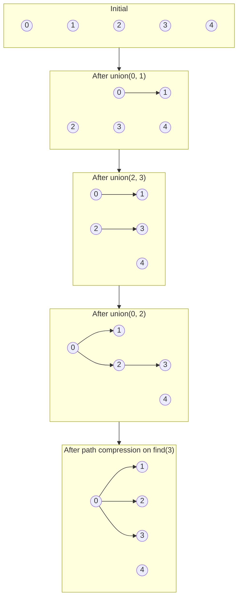

# 🎨 Pattern 1: Prefix Sum

> **Navigation**: [← MASTER PATTERN GUIDE — How to Identify Any…](01_master_pattern_guide_how_to_identify.md) | [Chapter overview](../04_Pattern_Recognition.md) | [Pattern 6: Topological Sort →](03_topological_sort.md)
> Page 2 of 4 in **Pattern Recognition — Pattern Guide**


## Concept

```
Original Array:    [1,  2,  3,  4,  5]
Prefix Sum Array:  [1,  3,  6, 10, 15]

prefix[i] = sum of all elements from index 0 to i

Range Sum Query:
Sum(i, j) = prefix[j] - prefix[i-1]

Example: Sum(1, 3) = prefix[3] - prefix[0] = 10 - 1 = 9
Check: arr[1] + arr[2] + arr[3] = 2 + 3 + 4 = 9 ✓
```

## Template

```java
// Build prefix sum
int[] prefix = new int[n + 1];  // Extra space for edge case
for (int i = 0; i < n; i++) {
    prefix[i + 1] = prefix[i] + arr[i];
}

// Query range sum [left, right] (0-indexed)
int rangeSum = prefix[right + 1] - prefix[left];
```

## Problems

| Problem                      | Difficulty | Key Insight                 |
| ---------------------------- | ---------- | --------------------------- |
| Range Sum Query - Immutable  | Easy       | Direct prefix sum           |
| Subarray Sum Equals K        | Medium     | prefix[j] - prefix[i] = k   |
| Contiguous Array (0s and 1s) | Medium     | Treat 0 as -1, find sum = 0 |
| Product of Array Except Self | Medium     | Prefix and Suffix products  |

---

## 🎨 Pattern 2: Kadane's Algorithm

### Concept

```
Find maximum subarray sum

Key Insight: At each position, decide:
1. Extend previous subarray (currMax + arr[i])
2. Start new subarray (arr[i])

Take the MAX of both choices!
```

### Visual

```
Array: [-2, 1, -3, 4, -1, 2, 1, -5, 4]

Step-by-step:
```

| i | arr[i] | currentMax = max(arr[i], curr+arr[i]) | maxSum |
| --- | --- | --- | --- |
| 0 | -2 | max(-2, 0+(-2)) = -2 | -2 |
| 1 | 1 | max(1, -2+1) = max(1, -1) = 1 | 1 |
| 2 | -3 | max(-3, 1+(-3)) = max(-3, -2) = -2 | 1 |
| 3 | 4 | max(4, -2+4) = max(4, 2) = 4 | 4 |
| 4 | -1 | max(-1, 4+(-1)) = max(-1, 3) = 3 | 4 |
| 5 | 2 | max(2, 3+2) = max(2, 5) = 5 | 5 |
| 6 | 1 | max(1, 5+1) = max(1, 6) = 6 | 6 |
| 7 | -5 | max(-5, 6+(-5)) = max(-5, 1) = 1 | 6 |
| 8 | 4 | max(4, 1+4) = max(4, 5) = 5 | 6 |

```
Maximum Subarray Sum = 6 (subarray [4, -1, 2, 1])
```

### Template

```java
public int maxSubArray(int[] arr) {
    int maxSum = arr[0];
    int currentSum = arr[0];

    for (int i = 1; i < arr.length; i++) {
        // Extend or start new?
        currentSum = Math.max(arr[i], currentSum + arr[i]);
        maxSum = Math.max(maxSum, currentSum);
    }

    return maxSum;
}

// Variant: Track indices of max subarray
public int[] maxSubArrayWithIndices(int[] arr) {
    int maxSum = arr[0], currentSum = arr[0];
    int start = 0, end = 0, tempStart = 0;

    for (int i = 1; i < arr.length; i++) {
        if (arr[i] > currentSum + arr[i]) {
            currentSum = arr[i];
            tempStart = i;  // Start new subarray
        } else {
            currentSum = currentSum + arr[i];
        }

        if (currentSum > maxSum) {
            maxSum = currentSum;
            start = tempStart;
            end = i;
        }
    }

    return new int[]{start, end, maxSum};
}
```

---

## 📚 Pattern 3: Monotonic Stack

### Concept

```
Maintain a stack with elements in increasing/decreasing order

Use Cases:
- Next Greater Element
- Next Smaller Element
- Largest Rectangle in Histogram
- Trapping Rain Water
```

### Template: Next Greater Element

```java
public int[] nextGreaterElement(int[] arr) {
    int n = arr.length;
    int[] result = new int[n];
    Arrays.fill(result, -1);
    Stack<Integer> stack = new Stack<>();  // Store indices

    for (int i = 0; i < n; i++) {
        // Pop all smaller elements
        while (!stack.isEmpty() && arr[stack.peek()] < arr[i]) {
            result[stack.pop()] = arr[i];
        }
        stack.push(i);
    }

    return result;
}
```

### Template: Largest Rectangle in Histogram

```java
public int largestRectangleArea(int[] heights) {
    Stack<Integer> stack = new Stack<>();
    int maxArea = 0;
    int n = heights.length;

    for (int i = 0; i <= n; i++) {
        int h = (i == n) ? 0 : heights[i];

        while (!stack.isEmpty() && h < heights[stack.peek()]) {
            int height = heights[stack.pop()];
            int width = stack.isEmpty() ? i : i - stack.peek() - 1;
            maxArea = Math.max(maxArea, height * width);
        }

        stack.push(i);
    }

    return maxArea;
}
```

---

## 🎨 Pattern 4: Union — Find (disjoint Set)

### Concept

```
Track connected components efficiently

Operations:
- find(x): Find root/representative of x's set
- union(x, y): Merge sets containing x and y

Optimizations:
- Path Compression: Flatten tree on find
- Union by Rank: Attach smaller tree under larger
```

### Visual

**Initial:** each element is its own parent.



**How to read this diagram.** Each arrow points from a root to a child that hangs below it. `union` joins two trees under one root. After `find(3)` compresses the path, 3 hangs directly under 0, so `find(3) = 0` takes one step. Node 4 was never unioned, so it stays alone.

### Template

```java
class UnionFind {
    int[] parent;
    int[] rank;
    int count;  // Number of components

    public UnionFind(int n) {
        parent = new int[n];
        rank = new int[n];
        count = n;
        for (int i = 0; i < n; i++) {
            parent[i] = i;
            rank[i] = 0;
        }
    }

    // Find with path compression
    public int find(int x) {
        if (parent[x] != x) {
            parent[x] = find(parent[x]);  // Path compression
        }
        return parent[x];
    }

    // Union by rank
    public boolean union(int x, int y) {
        int rootX = find(x);
        int rootY = find(y);

        if (rootX == rootY) return false;  // Already connected

        if (rank[rootX] < rank[rootY]) {
            parent[rootX] = rootY;
        } else if (rank[rootX] > rank[rootY]) {
            parent[rootY] = rootX;
        } else {
            parent[rootY] = rootX;
            rank[rootX]++;
        }

        count--;  // Merged two components
        return true;
    }

    public boolean connected(int x, int y) {
        return find(x) == find(y);
    }
}
```

### Problems

| Problem                      | Key Insight                    |
| ---------------------------- | ------------------------------ |
| Number of Provinces          | Union cities, count components |
| Redundant Connection         | Union edges until cycle found  |
| Accounts Merge               | Union emails with same owner   |
| Longest Consecutive Sequence | Union consecutive numbers      |

---

## 🌳 Pattern 5: Trie (prefix Tree)

### Concept

```
Tree structure for efficient string operations

       root
      / | \
     a  b  c
     |  |
     p  a
     |  |
     p  t
    /|
   l e
   |
   e

Words: "apple", "app", "bat"

Each node can have up to 26 children (for lowercase letters)
```

### Template

```java
class TrieNode {
    TrieNode[] children = new TrieNode[26];
    boolean isEndOfWord = false;
}

class Trie {
    TrieNode root = new TrieNode();

    // Insert word: O(m) where m = word length
    public void insert(String word) {
        TrieNode node = root;
        for (char c : word.toCharArray()) {
            int index = c - 'a';
            if (node.children[index] == null) {
                node.children[index] = new TrieNode();
            }
            node = node.children[index];
        }
        node.isEndOfWord = true;
    }

    // Search exact word: O(m)
    public boolean search(String word) {
        TrieNode node = findNode(word);
        return node != null && node.isEndOfWord;
    }

    // Search prefix: O(m)
    public boolean startsWith(String prefix) {
        return findNode(prefix) != null;
    }

    private TrieNode findNode(String s) {
        TrieNode node = root;
        for (char c : s.toCharArray()) {
            int index = c - 'a';
            if (node.children[index] == null) {
                return null;
            }
            node = node.children[index];
        }
        return node;
    }
}
```

### Problems

| Problem                    | Key Insight                        |
| -------------------------- | ---------------------------------- |
| Implement Trie             | Basic implementation               |
| Word Search II             | Trie + Backtracking                |
| Design Search Autocomplete | Trie + Frequency map               |
| Replace Words              | Find shortest prefix in dictionary |

---

[← MASTER PATTERN GUIDE — How to Identify Any…](01_master_pattern_guide_how_to_identify.md) | [Chapter overview](../04_Pattern_Recognition.md) | [Pattern 6: Topological Sort →](03_topological_sort.md)
