**Navigation**: [< Previous](05_LeetCode_RealWorld_Map.md) | [Back to Index](../00_MASTER_INDEX.md) | [Next >](07_Two_Pointers_Complete.md)

---

## 🗺️ Pattern Recognition Header — Binary Search

**How do I know this requires Binary Search?**


| Signal in problem | BS Type | Search Space |
|---|---|---|
| `sorted array + find value` | **Classic BS** | `[0, n-1]` on data |
| `first/last occurrence`, `count` | **Lower/Upper Bound** | `[0, n]` on data |
| `rotated sorted array` | **BS on rotated data** | Determine sorted half |
| `"minimum possible maximum"` or `"minimum X to achieve Y"` | **BS on Answer** | `[minAns, maxAns]` on answer space |
| `find peak`, `mountain array` | **BS on slope direction** | Move toward ascending |
| `Kth smallest in matrix / sorted list` | **BS on value range** | `[min, max]` in value space |


**The 3 BS Templates — which to use:**
```
T1: left <= right, left = mid+1, right = mid-1   → Exact match
T2: left <  right, right = mid                    → First pos >= target (Lower Bound)
T3: left <  right, left  = mid+1                  → First pos >  target (Upper Bound)

⚠️ MID overflow: ALWAYS use left + (right - left) / 2
⚠️ BS on Answer: think "can I achieve X?" → monotonic Yes/No function
```

🔗 **Practice problems:** [Binary Search PS](../05_Problem_Solving/07_Binary_Search_Patterns.md)
📋 **All Patterns Hub:** [00_PATTERN_MASTER_GUIDE.md](00_PATTERN_MASTER_GUIDE.md)

---


🔬 **Section Challenge — 🗺️ Pattern Recognition Header — Binary Search**

**Challenge 1 (Reasoning):** Binary search on `[1,3,5,7,9]` with `target=6`. Trace `lo`, `hi`, `mid` at each step and explain the final state.
<details><summary>Answer</summary>

lo=0,hi=4 → mid=2(val=5): 5<6 → lo=3. lo=3,hi=4 → mid=3(val=7): 7>6 → hi=2. lo(3)>hi(2): loop ends, return -1 (not found). Key insight: lo overtakes hi — this is the standard termination condition. `lo` ends at the insertion point where 6 would go.
</details>

**Challenge 2 (Design):** Binary search on a rotated array `[4,5,6,7,0,1,2]`. How do you determine which half is sorted?
<details><summary>Answer</summary>

Compare `nums[lo]` and `nums[mid]`. If `nums[lo] <= nums[mid]`: left half is sorted. Check if target is in `[nums[lo], nums[mid])` — if yes, search left; else search right. Otherwise right half is sorted. Check if target is in `(nums[mid], nums[hi]]` — if yes, search right; else search left. This always works because at least one half of a rotated sorted array is always sorted.
</details>


# 🔍 Binary Search Patterns Complete Guide

Master Every Variation of the Most Powerful Search Technique

## Table of Contents

1. [Binary Search Fundamentals](#fundamentals)
2. [The 3 Templates (MEMORIZE!)](#templates)
3. [Lower Bound & Upper Bound](#bounds)
4. [Search in Rotated Array](#rotated)
5. [Peak Finding Patterns](#peak-finding)
6. [Binary Search on Answer](#binary-answer)
7. [2D Binary Search](#2d-search)
8. [Advanced Patterns](#advanced)
9. [Common Mistakes](#mistakes)
10. [Interview Problems](#interview-problems)
11. [Quick Reference](#quick-reference)

---

## Binary Search Fundamentals <a name="fundamentals"></a>

### The Core Idea


BINARY SEARCH IN ONE SENTENCE

"If the search space is MONOTONIC (sorted/ordered),
eliminate HALF of it each step."

Time: O(log n)  —  From 1 billion → 30 comparisons


### Visual: Why Binary Search is Fast

```
Linear Search on 1,000,000 elements:
┌────────────────────────────────────────────────────┐
│ Worst case: 1,000,000 comparisons                  │
│ Average: 500,000 comparisons                       │
└────────────────────────────────────────────────────┘

Binary Search on 1,000,000 elements:
┌────────────────────────────────────────────────────┐
│ 1,000,000 → 500,000 → 250,000 → 125,000 →          │
│ 62,500 → 31,250 → 15,625 → 7,812 → 3,906 →         │
│ 1,953 → 976 → 488 → 244 → 122 → 61 →               │
│ 30 → 15 → 7 → 3 → 1                                │
│                                                    │
│ Only ~20 comparisons! (log₂(1,000,000) ≈ 20)       │
└────────────────────────────────────────────────────┘
```

**Flow:**
1. Worst case: 1,000,000 comparisons / Average: 500,000 co
2. 1,000,000
3. 500,000
4. 250,000
5. 125,000
6. / 62,500
7. 31

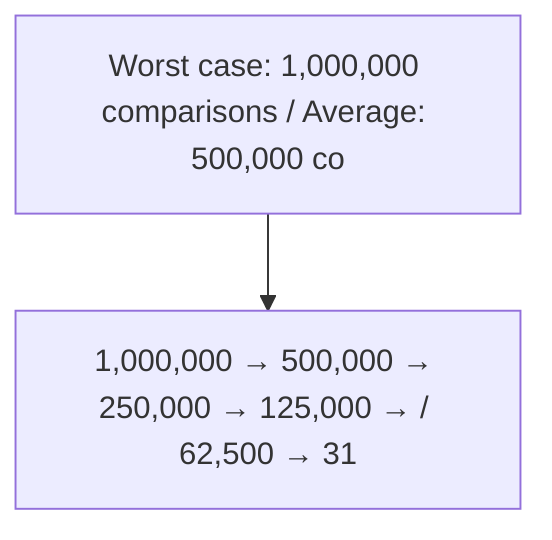

### Prerequisites for Binary Search

```
┌─────────────────────────────────────────────────────────────────┐
│           BINARY SEARCH APPLICABILITY                           │
├─────────────────────────────────────────────────────────────────┤
│                                                                 │
│  You need ONE of these properties:                              │
│                                                                 │
│  1. SORTED ARRAY                                                │
│     - Ascending or descending                                   │
│     - Search for specific value or boundary                     │
│                                                                 │
│  2. MONOTONIC FUNCTION                                          │
│     - f(x) is always increasing or always decreasing            │
│     - Search for value where f(x) crosses threshold             │
│                                                                 │
│  3. SEARCH SPACE WITH BINARY PROPERTY                           │
│     - Can eliminate half based on some condition                │
│     - "Binary search on answer"                                 │
│                                                                 │
└─────────────────────────────────────────────────────────────────┘
```

**Flow:**
1. BINARY SEARCH APPLICABILITY
2. You need ONE of these properties:
3. 1. SORTED ARRAY
4. - Ascending or descending
5. - Search for specific value or boundary
6. 2. MONOTONIC FUNCTION
7. - f(x) is always increasing or always decreasing

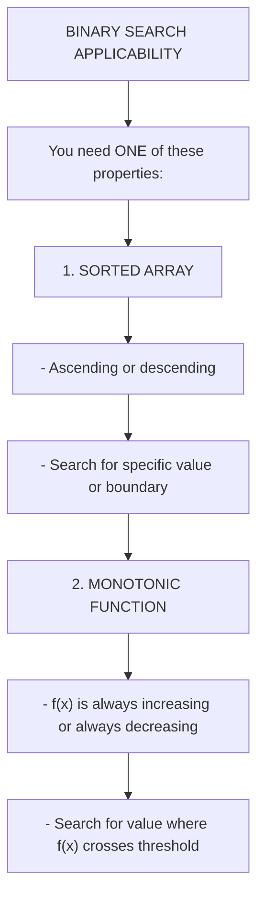

---


🔬 **Section Challenge — Binary Search Fundamentals <a name="fundamentals"></a>**

**Challenge 1 (Reasoning):** Binary search on `[1,3,5,7,9]` with `target=6`. Trace `lo`, `hi`, `mid` at each step and explain the final state.
<details><summary>Answer</summary>

lo=0,hi=4 → mid=2(val=5): 5<6 → lo=3. lo=3,hi=4 → mid=3(val=7): 7>6 → hi=2. lo(3)>hi(2): loop ends, return -1 (not found). Key insight: lo overtakes hi — this is the standard termination condition. `lo` ends at the insertion point where 6 would go.
</details>

**Challenge 2 (Design):** Binary search on a rotated array `[4,5,6,7,0,1,2]`. How do you determine which half is sorted?
<details><summary>Answer</summary>

Compare `nums[lo]` and `nums[mid]`. If `nums[lo] <= nums[mid]`: left half is sorted. Check if target is in `[nums[lo], nums[mid])` — if yes, search left; else search right. Otherwise right half is sorted. Check if target is in `(nums[mid], nums[hi]]` — if yes, search right; else search left. This always works because at least one half of a rotated sorted array is always sorted.
</details>


## The 3 Templates (MEMORIZE!) <a name="templates"></a>

### Template 1: Basic Binary Search (Exact Match)

```java
/*
Find exact element. Returns index or -1.
Use when: Looking for EXACT match in sorted array.
*/

public int binarySearch(int[] nums, int target) {
    int left = 0, right = nums.length - 1;

    while (left <= right) {  // Note: <=
        int mid = left + (right - left) / 2;  // Avoid overflow

        if (nums[mid] == target) {
            return mid;  // Found!
        } else if (nums[mid] < target) {
            left = mid + 1;
        } else {
            right = mid - 1;
        }
    }
    return -1;  // Not found
}
```

### Template 2: Lower Bound (First Position ≥ target)

```java
/*
Find first element >= target. Returns insert position if not found.
Use when: Finding leftmost position, insertion point.
*/

public int lowerBound(int[] nums, int target) {
    int left = 0, right = nums.length;  // Note: right = length (not length-1)

    while (left < right) {  // Note: <
        int mid = left + (right - left) / 2;

        if (nums[mid] < target) {
            left = mid + 1;
        } else {
            right = mid;  // Note: mid (not mid-1)
        }
    }
    return left;  // First position where nums[i] >= target
}
```

### Template 3: Upper Bound (First Position > target)

```java
/*
Find first element > target.
Use when: Finding rightmost occurrence (upperBound - 1).
*/

public int upperBound(int[] nums, int target) {
    int left = 0, right = nums.length;

    while (left < right) {
        int mid = left + (right - left) / 2;

        if (nums[mid] <= target) {  // Note: <=
            left = mid + 1;
        } else {
            right = mid;
        }
    }
    return left;  // First position where nums[i] > target
}
```

### Visual: Template Differences

```
Array: [1, 2, 2, 2, 3, 4, 5], target = 2

Template 1 (Exact): Returns any 2 → index 1, 2, or 3
Template 2 (Lower): First >= 2 → index 1
Template 3 (Upper): First > 2  → index 4

Uses:
- First occurrence of 2: lowerBound(2) → 1
- Last occurrence of 2:  upperBound(2) - 1 → 3
- Count of 2s: upperBound(2) - lowerBound(2) → 3
- Insert position for 2.5: lowerBound(2.5) → 4
```

**Flow:**
1. Template 1 (Exact): Returns any 2
2. index 1, 2, or 3
3. Template 2 (Lower): First >= 2
4. index 1
5. Template 3 (Upper): First > 2
6. index 4

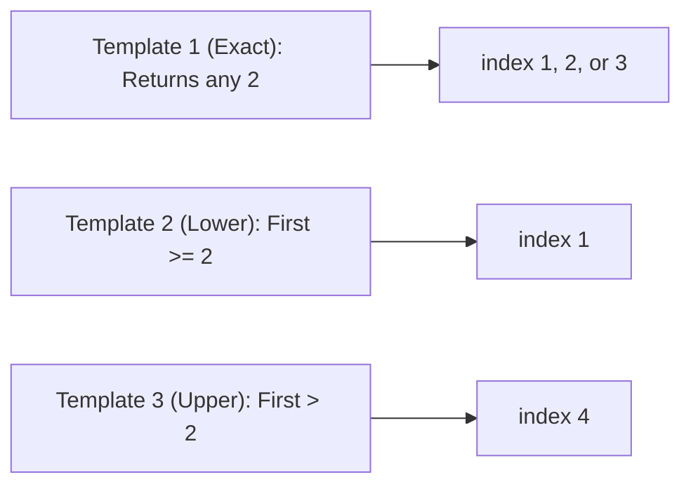

### Template Cheat Sheet

```
┌─────────────────────────────────────────────────────────────────┐
│              TEMPLATE QUICK REFERENCE                           │
├─────────────────────────────────────────────────────────────────┤
│                                                                 │
│  TEMPLATE 1: left <= right, left/right = mid ± 1                │
│  Use for: Exact match                                           │
│  Returns: Index of element or -1                                │
│                                                                 │
│  TEMPLATE 2: left < right, right = mid                          │
│  Use for: First position >= target                              │
│  Returns: Insert position (0 to n)                              │
│                                                                 │
│  TEMPLATE 3: left < right, left = mid + 1                       │
│  Use for: First position > target                               │
│  Returns: Insert position (0 to n)                              │
│                                                                 │
│  KEY DIFFERENCES:                                               │
│  • while condition: <= for T1, < for T2/T3                      │
│  • right init: length-1 for T1, length for T2/T3                │
│  • mid assignment: right = mid for T2, left = mid+1 for T3      │
│                                                                 │
└─────────────────────────────────────────────────────────────────┘
```

**Flow:**
1. TEMPLATE QUICK REFERENCE
2. TEMPLATE 1: left <= right, left/right = mid ± 1
3. Use for: Exact match
4. Returns: Index of element or -1
5. TEMPLATE 2: left < right, right = mid
6. Use for: First position >= target
7. Returns: Insert position (0 to n)

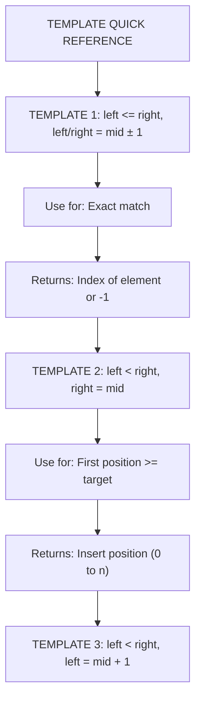

---

## Lower Bound & Upper Bound <a name="bounds"></a>

### Find First and Last Position (LeetCode 34)

```java
public int[] searchRange(int[] nums, int target) {
    int first = lowerBound(nums, target);

    // Check if target exists
    if (first == nums.length || nums[first] != target) {
        return new int[]{-1, -1};
    }

    int last = upperBound(nums, target) - 1;
    return new int[]{first, last};
}

// Count occurrences
public int countOccurrences(int[] nums, int target) {
    return upperBound(nums, target) - lowerBound(nums, target);
}
```

### Visual: Finding Range

```
Array: [5, 7, 7, 8, 8, 8, 10], target = 8

lowerBound(8): First >= 8
Index: 0  1  2  3  4  5  6
Value: 5  7  7  8  8  8  10
                ↑
           Returns 3

upperBound(8): First > 8
Index: 0  1  2  3  4  5  6
Value: 5  7  7  8  8  8  10
                         ↑
                    Returns 6

Range: [3, 6-1] = [3, 5]
Count: 6 - 3 = 3 occurrences
```

**Flow:**
1. Array: [5, 7, 7, 8, 8, 8, 10], target = 8
2. lowerBound(8): First >= 8
3. Index: 0 1 2 3 4 5 6
4. Value: 5 7 7 8 8 8 10
5. Returns 3
6. upperBound(8): First > 8
7. Returns 6

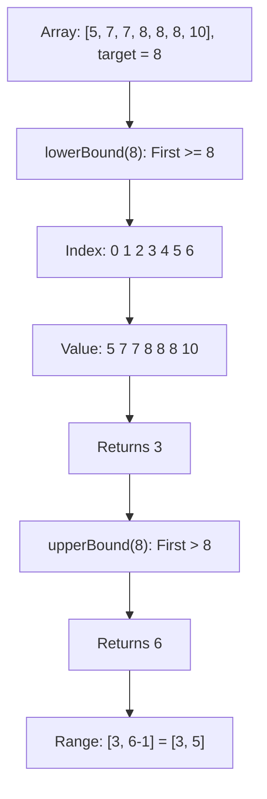

### Find Insert Position (LeetCode 35)

```java
public int searchInsert(int[] nums, int target) {
    return lowerBound(nums, target);
}

// Equivalent manual implementation:
public int searchInsert(int[] nums, int target) {
    int left = 0, right = nums.length;

    while (left < right) {
        int mid = left + (right - left) / 2;
        if (nums[mid] < target) {
            left = mid + 1;
        } else {
            right = mid;
        }
    }
    return left;
}
```

---

## Search in Rotated Array <a name="rotated"></a>

### Understanding Rotated Arrays

```
Original Sorted: [0, 1, 2, 4, 5, 6, 7]

Rotated by 3:    [4, 5, 6, 7, 0, 1, 2]
                        ↑
                   Pivot point

Key insight: One half is ALWAYS sorted!

[4, 5, 6, 7, 0, 1, 2], mid = 3 (value 7)
 ↑        ↑        ↑
left     mid     right

Left half [4,5,6,7] is sorted (nums[left] <= nums[mid])
Right half [0,1,2] is NOT sorted in normal order
```

**Flow:**
1. Original Sorted: [0, 1, 2, 4, 5, 6, 7]
2. Rotated by 3: [4, 5, 6, 7, 0, 1, 2]
3. Pivot point
4. Key insight: One half is ALWAYS sorted!
5. [4, 5, 6, 7, 0, 1, 2], mid = 3 (value 7)
6. left mid right
7. Left half [4,5,6,7] is sorted (nums[left] <= nums[mi

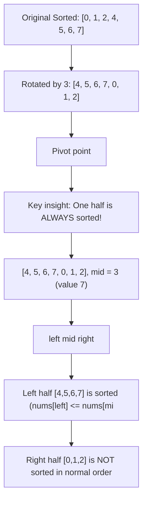

### Search in Rotated Sorted Array (LeetCode 33)

```java
/*
No duplicates. Find target index or -1.
Key: Determine which half is sorted, then decide where to search.
*/

public int search(int[] nums, int target) {
    int left = 0, right = nums.length - 1;

    while (left <= right) {
        int mid = left + (right - left) / 2;

        if (nums[mid] == target) {
            return mid;
        }

        // Determine which half is sorted
        if (nums[left] <= nums[mid]) {
            // Left half is sorted
            if (target >= nums[left] && target < nums[mid]) {
                right = mid - 1;  // Target in left half
            } else {
                left = mid + 1;   // Target in right half
            }
        } else {
            // Right half is sorted
            if (target > nums[mid] && target <= nums[right]) {
                left = mid + 1;   // Target in right half
            } else {
                right = mid - 1;  // Target in left half
            }
        }
    }
    return -1;
}
```

### Rotated Array WITH Duplicates (LeetCode 81)

```java
/*
With duplicates, we might not know which half is sorted.
Worst case O(n), but usually still O(log n).
*/

public boolean search(int[] nums, int target) {
    int left = 0, right = nums.length - 1;

    while (left <= right) {
        int mid = left + (right - left) / 2;

        if (nums[mid] == target) {
            return true;
        }

        // Handle duplicates: nums[left] == nums[mid] == nums[right]
        if (nums[left] == nums[mid] && nums[mid] == nums[right]) {
            left++;
            right--;
        } else if (nums[left] <= nums[mid]) {
            // Left half is sorted
            if (target >= nums[left] && target < nums[mid]) {
                right = mid - 1;
            } else {
                left = mid + 1;
            }
        } else {
            // Right half is sorted
            if (target > nums[mid] && target <= nums[right]) {
                left = mid + 1;
            } else {
                right = mid - 1;
            }
        }
    }
    return false;
}
```

### Find Minimum in Rotated Array (LeetCode 153)

```java
/*
Find the minimum element (pivot point).
The minimum is where the rotation happened.
*/

public int findMin(int[] nums) {
    int left = 0, right = nums.length - 1;

    while (left < right) {
        int mid = left + (right - left) / 2;

        if (nums[mid] > nums[right]) {
            // Minimum is in right half (after mid)
            left = mid + 1;
        } else {
            // Minimum is in left half (including mid)
            right = mid;
        }
    }
    return nums[left];
}

// With duplicates (LeetCode 154)
public int findMinWithDup(int[] nums) {
    int left = 0, right = nums.length - 1;

    while (left < right) {
        int mid = left + (right - left) / 2;

        if (nums[mid] > nums[right]) {
            left = mid + 1;
        } else if (nums[mid] < nums[right]) {
            right = mid;
        } else {
            // nums[mid] == nums[right], can't decide
            right--;  // Safe to shrink
        }
    }
    return nums[left];
}
```

---


## Peak Finding Patterns <a name="peak-finding"></a>

### Find Peak Element (LeetCode 162)

```java
/*
A peak is greater than its neighbors.
nums[-1] = nums[n] = -∞
Find ANY peak in O(log n).
*/

public int findPeakElement(int[] nums) {
    int left = 0, right = nums.length - 1;

    while (left < right) {
        int mid = left + (right - left) / 2;

        if (nums[mid] > nums[mid + 1]) {
            // Descending: peak is at mid or left
            right = mid;
        } else {
            // Ascending: peak is on right
            left = mid + 1;
        }
    }
    return left;
}
```

### Visual: Peak Finding Logic

```
Array: [1, 2, 3, 1]
        ↑     ↑
       asc  desc

mid = 1, nums[1]=2, nums[2]=3
2 < 3: Ascending → move right

mid = 2, nums[2]=3, nums[3]=1
3 > 1: Descending → peak at mid or left

Result: index 2 (value 3)

---

Array: [1, 2, 1, 3, 5, 6, 4]

Multiple peaks exist: index 1 (value 2) and index 5 (value 6)
Binary search finds ONE of them.
```

**Flow:**
1. 2 < 3: Ascending
2. move right
3. 3 > 1: Descending
4. peak at mid or left

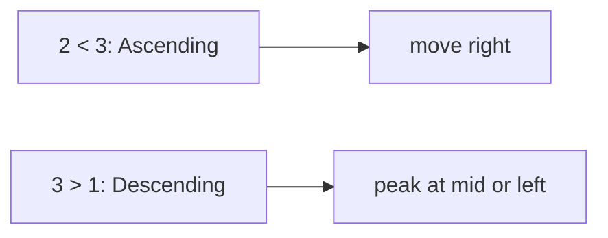

### Peak Index in Mountain Array (LeetCode 852)

```java
/*
Mountain: strictly increasing then strictly decreasing.
Exactly one peak. Find it.
*/

public int peakIndexInMountainArray(int[] arr) {
    int left = 0, right = arr.length - 1;

    while (left < right) {
        int mid = left + (right - left) / 2;

        if (arr[mid] < arr[mid + 1]) {
            left = mid + 1;  // Peak is on right
        } else {
            right = mid;     // Peak is at mid or left
        }
    }
    return left;
}
```

---


## Binary Search on Answer <a name="binary-answer"></a>

### The Concept

```
┌─────────────────────────────────────────────────────────────────┐
│           BINARY SEARCH ON ANSWER PATTERN                       │
├─────────────────────────────────────────────────────────────────┤
│                                                                 │
│  When: You're not searching IN an array, but searching FOR      │
│        an optimal value in a range.                             │
│                                                                 │
│  Pattern:                                                       │
│  1. Define search space: [min_possible, max_possible]           │
│  2. Define feasibility function: canAchieve(answer)             │
│  3. Binary search for boundary where answer becomes feasible    │
│                                                                 │
│  Examples:                                                      │
│  • Minimum capacity to ship packages in D days                  │
│  • Maximum minimum distance between elements                    │
│  • Kth smallest element in sorted matrix                        │
│                                                                 │
└─────────────────────────────────────────────────────────────────┘
```

**Flow:**
1. BINARY SEARCH ON ANSWER PATTERN
2. When: You're not searching IN an array, but searching F
3. an optimal value in a range.
4. Pattern:
5. 1. Define search space: [min_possible, max_possible]
6. 2. Define feasibility function: canAchieve(answer)
7. 3. Binary search for boundary where answer becomes feas

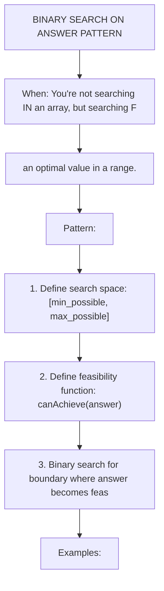

### Template: Binary Search on Answer

```java
public int binarySearchOnAnswer(int[] data, int constraint) {
    int left = minPossibleAnswer;
    int right = maxPossibleAnswer;

    while (left < right) {
        int mid = left + (right - left) / 2;

        if (canAchieve(data, mid, constraint)) {
            right = mid;      // Try smaller answer
        } else {
            left = mid + 1;   // Need larger answer
        }
    }
    return left;
}

// If maximizing instead of minimizing:
public int binarySearchMax(int[] data, int constraint) {
    int left = minPossibleAnswer;
    int right = maxPossibleAnswer;

    while (left < right) {
        int mid = left + (right - left + 1) / 2;  // Note: +1 for upper mid

        if (canAchieve(data, mid, constraint)) {
            left = mid;       // Try larger answer
        } else {
            right = mid - 1;  // Need smaller answer
        }
    }
    return left;
}
```

### Problem: Ship Packages in D Days (LeetCode 1011)

```java
/*
Weights must be shipped in order, within D days.
Find minimum ship capacity.
*/

public int shipWithinDays(int[] weights, int days) {
    // Min capacity = max single weight (or can't ship it)
    // Max capacity = sum of all weights (ship all in 1 day)
    int left = 0, right = 0;
    for (int w : weights) {
        left = Math.max(left, w);
        right += w;
    }

    while (left < right) {
        int mid = left + (right - left) / 2;

        if (canShip(weights, mid, days)) {
            right = mid;      // Try smaller capacity
        } else {
            left = mid + 1;   // Need more capacity
        }
    }
    return left;
}

private boolean canShip(int[] weights, int capacity, int days) {
    int daysNeeded = 1;
    int currentLoad = 0;

    for (int w : weights) {
        if (currentLoad + w > capacity) {
            daysNeeded++;
            currentLoad = 0;
        }
        currentLoad += w;
    }
    return daysNeeded <= days;
}
```

### Problem: Koko Eating Bananas (LeetCode 875)

```java
/*
Koko eats at speed k bananas/hour.
Find minimum k to finish all piles in h hours.
*/

public int minEatingSpeed(int[] piles, int h) {
    int left = 1;
    int right = 0;
    for (int p : piles) right = Math.max(right, p);

    while (left < right) {
        int mid = left + (right - left) / 2;

        if (canFinish(piles, mid, h)) {
            right = mid;
        } else {
            left = mid + 1;
        }
    }
    return left;
}

private boolean canFinish(int[] piles, int speed, int hours) {
    int hoursNeeded = 0;
    for (int pile : piles) {
        hoursNeeded += (pile + speed - 1) / speed;  // Ceiling division
    }
    return hoursNeeded <= hours;
}
```

### Problem: Split Array Largest Sum (LeetCode 410)

```java
/*
Split array into m subarrays.
Minimize the maximum sum among subarrays.
*/

public int splitArray(int[] nums, int m) {
    int left = 0, right = 0;
    for (int num : nums) {
        left = Math.max(left, num);
        right += num;
    }

    while (left < right) {
        int mid = left + (right - left) / 2;

        if (canSplit(nums, mid, m)) {
            right = mid;      // Try smaller max sum
        } else {
            left = mid + 1;   // Need larger max sum
        }
    }
    return left;
}

private boolean canSplit(int[] nums, int maxSum, int m) {
    int count = 1;
    int currentSum = 0;

    for (int num : nums) {
        if (currentSum + num > maxSum) {
            count++;
            currentSum = num;
        } else {
            currentSum += num;
        }
    }
    return count <= m;
}
```

### Problem: Magnetic Force Between Balls (LeetCode 1552)

```java
/*
Place m balls in positions to MAXIMIZE minimum distance.
Classic "maximize the minimum" problem.
*/

public int maxDistance(int[] positions, int m) {
    Arrays.sort(positions);
    int n = positions.length;

    int left = 1;  // Min possible distance
    int right = positions[n-1] - positions[0];  // Max possible

    while (left < right) {
        int mid = left + (right - left + 1) / 2;  // Upper mid for maximize

        if (canPlace(positions, mid, m)) {
            left = mid;       // Try larger distance
        } else {
            right = mid - 1;  // Need smaller distance
        }
    }
    return left;
}

private boolean canPlace(int[] positions, int minDist, int m) {
    int count = 1;
    int lastPos = positions[0];

    for (int i = 1; i < positions.length; i++) {
        if (positions[i] - lastPos >= minDist) {
            count++;
            lastPos = positions[i];
        }
    }
    return count >= m;
}
```

---


🔬 **Section Challenge — Binary Search on Answer <a name="binary-answer"></a>**

**Challenge 1 (Reasoning):** Binary search on `[1,3,5,7,9]` with `target=6`. Trace `lo`, `hi`, `mid` at each step and explain the final state.
<details><summary>Answer</summary>

lo=0,hi=4 → mid=2(val=5): 5<6 → lo=3. lo=3,hi=4 → mid=3(val=7): 7>6 → hi=2. lo(3)>hi(2): loop ends, return -1 (not found). Key insight: lo overtakes hi — this is the standard termination condition. `lo` ends at the insertion point where 6 would go.
</details>

**Challenge 2 (Design):** Binary search on a rotated array `[4,5,6,7,0,1,2]`. How do you determine which half is sorted?
<details><summary>Answer</summary>

Compare `nums[lo]` and `nums[mid]`. If `nums[lo] <= nums[mid]`: left half is sorted. Check if target is in `[nums[lo], nums[mid])` — if yes, search left; else search right. Otherwise right half is sorted. Check if target is in `(nums[mid], nums[hi]]` — if yes, search right; else search left. This always works because at least one half of a rotated sorted array is always sorted.
</details>


## 2D Binary Search <a name="2d-search"></a>

### Search 2D Matrix (LeetCode 74)

```java
/*
Matrix: each row sorted, first element > last of previous row.
Treat as 1D sorted array.
*/

public boolean searchMatrix(int[][] matrix, int target) {
    int m = matrix.length, n = matrix[0].length;
    int left = 0, right = m * n - 1;

    while (left <= right) {
        int mid = left + (right - left) / 2;
        int value = matrix[mid / n][mid % n];  // Convert to 2D indices

        if (value == target) {
            return true;
        } else if (value < target) {
            left = mid + 1;
        } else {
            right = mid - 1;
        }
    }
    return false;
}
```

### Search 2D Matrix II (LeetCode 240)

```java
/*
Matrix: rows sorted, columns sorted, but NOT like matrix I.
Use staircase search: start from top-right or bottom-left.
*/

public boolean searchMatrix(int[][] matrix, int target) {
    int m = matrix.length, n = matrix[0].length;
    int row = 0, col = n - 1;  // Start top-right

    while (row < m && col >= 0) {
        if (matrix[row][col] == target) {
            return true;
        } else if (matrix[row][col] > target) {
            col--;  // Eliminate column
        } else {
            row++;  // Eliminate row
        }
    }
    return false;
}
// Time: O(m + n)
```

### Kth Smallest in Sorted Matrix (LeetCode 378)

```java
/*
Matrix with sorted rows and columns.
Find kth smallest element.
Binary search on VALUE, count elements <= mid.
*/

public int kthSmallest(int[][] matrix, int k) {
    int n = matrix.length;
    int left = matrix[0][0];
    int right = matrix[n-1][n-1];

    while (left < right) {
        int mid = left + (right - left) / 2;

        if (countLessOrEqual(matrix, mid) >= k) {
            right = mid;
        } else {
            left = mid + 1;
        }
    }
    return left;
}

private int countLessOrEqual(int[][] matrix, int target) {
    int n = matrix.length;
    int count = 0;
    int row = n - 1, col = 0;  // Start bottom-left

    while (row >= 0 && col < n) {
        if (matrix[row][col] <= target) {
            count += row + 1;  // All elements in this column up to row
            col++;
        } else {
            row--;
        }
    }
    return count;
}
```

---


🔬 **Section Challenge — 2D Binary Search <a name="2d-search"></a>**

**Challenge 1 (Reasoning):** Binary search on `[1,3,5,7,9]` with `target=6`. Trace `lo`, `hi`, `mid` at each step and explain the final state.
<details><summary>Answer</summary>

lo=0,hi=4 → mid=2(val=5): 5<6 → lo=3. lo=3,hi=4 → mid=3(val=7): 7>6 → hi=2. lo(3)>hi(2): loop ends, return -1 (not found). Key insight: lo overtakes hi — this is the standard termination condition. `lo` ends at the insertion point where 6 would go.
</details>

**Challenge 2 (Design):** Binary search on a rotated array `[4,5,6,7,0,1,2]`. How do you determine which half is sorted?
<details><summary>Answer</summary>

Compare `nums[lo]` and `nums[mid]`. If `nums[lo] <= nums[mid]`: left half is sorted. Check if target is in `[nums[lo], nums[mid])` — if yes, search left; else search right. Otherwise right half is sorted. Check if target is in `(nums[mid], nums[hi]]` — if yes, search right; else search left. This always works because at least one half of a rotated sorted array is always sorted.
</details>


## Advanced Patterns <a name="advanced"></a>

### Find Median of Two Sorted Arrays (LeetCode 4)

```java
/*
O(log(min(m,n))) solution using binary search partition.
*/

public double findMedianSortedArrays(int[] nums1, int[] nums2) {
    // Ensure nums1 is smaller
    if (nums1.length > nums2.length) {
        return findMedianSortedArrays(nums2, nums1);
    }

    int m = nums1.length, n = nums2.length;
    int left = 0, right = m;

    while (left <= right) {
        int partition1 = (left + right) / 2;
        int partition2 = (m + n + 1) / 2 - partition1;

        int maxLeft1 = (partition1 == 0) ? Integer.MIN_VALUE : nums1[partition1 - 1];
        int minRight1 = (partition1 == m) ? Integer.MAX_VALUE : nums1[partition1];

        int maxLeft2 = (partition2 == 0) ? Integer.MIN_VALUE : nums2[partition2 - 1];
        int minRight2 = (partition2 == n) ? Integer.MAX_VALUE : nums2[partition2];

        if (maxLeft1 <= minRight2 && maxLeft2 <= minRight1) {
            // Found correct partition
            if ((m + n) % 2 == 0) {
                return (Math.max(maxLeft1, maxLeft2) +
                        Math.min(minRight1, minRight2)) / 2.0;
            } else {
                return Math.max(maxLeft1, maxLeft2);
            }
        } else if (maxLeft1 > minRight2) {
            right = partition1 - 1;
        } else {
            left = partition1 + 1;
        }
    }
    throw new IllegalArgumentException("Input arrays not sorted");
}
```

### Find Kth Element of Two Sorted Arrays

```java
/*
Generalization of median problem.
*/

public int findKth(int[] nums1, int[] nums2, int k) {
    return findKth(nums1, 0, nums2, 0, k);
}

private int findKth(int[] a, int aStart, int[] b, int bStart, int k) {
    if (aStart >= a.length) return b[bStart + k - 1];
    if (bStart >= b.length) return a[aStart + k - 1];
    if (k == 1) return Math.min(a[aStart], b[bStart]);

    int aMid = aStart + k/2 - 1 < a.length ? a[aStart + k/2 - 1] : Integer.MAX_VALUE;
    int bMid = bStart + k/2 - 1 < b.length ? b[bStart + k/2 - 1] : Integer.MAX_VALUE;

    if (aMid < bMid) {
        return findKth(a, aStart + k/2, b, bStart, k - k/2);
    } else {
        return findKth(a, aStart, b, bStart + k/2, k - k/2);
    }
}
```

### Binary Search with Floating Point

```java
/*
When answer can be floating point, use precision-based termination.
*/

public double squareRoot(double x) {
    double left = 0, right = Math.max(1, x);
    double eps = 1e-10;  // Precision

    while (right - left > eps) {
        double mid = left + (right - left) / 2;
        if (mid * mid <= x) {
            left = mid;
        } else {
            right = mid;
        }
    }
    return left;
}

// Alternative: fixed iterations (100 iterations ≈ 2^100 precision)
public double squareRootFixed(double x) {
    double left = 0, right = Math.max(1, x);

    for (int i = 0; i < 100; i++) {
        double mid = left + (right - left) / 2;
        if (mid * mid <= x) {
            left = mid;
        } else {
            right = mid;
        }
    }
    return left;
}
```

---


## Common Mistakes <a name="mistakes"></a>

### Mistake 1: Infinite Loop

```java
// WRONG: Can cause infinite loop
while (left < right) {
    int mid = (left + right) / 2;
    if (condition) {
        left = mid;      // ❌ If left = mid = right - 1, loops forever
    } else {
        right = mid;
    }
}

// FIX 1: Use mid + 1 when assigning to left
while (left < right) {
    int mid = (left + right) / 2;
    if (condition) {
        left = mid + 1;  // ✓
    } else {
        right = mid;
    }
}

// FIX 2: Or use upper mid when moving left
while (left < right) {
    int mid = (left + right + 1) / 2;  // Upper mid
    if (condition) {
        left = mid;      // ✓ Now safe
    } else {
        right = mid - 1;
    }
}
```

### Mistake 2: Integer Overflow

```java
// WRONG: Can overflow if left + right > Integer.MAX_VALUE
int mid = (left + right) / 2;

// CORRECT: Subtract first
int mid = left + (right - left) / 2;
```

### Mistake 3: Off-by-One in Right Boundary

```java
// Template 1: right = length - 1
int right = nums.length - 1;
while (left <= right) { ... }

// Template 2/3: right = length
int right = nums.length;
while (left < right) { ... }

// Common bug: mixing them up
```

### Mistake 4: Wrong Condition in Rotated Array

```java
// WRONG: Using < instead of <= for sorted check
if (nums[left] < nums[mid])  // ❌ Misses case where left == mid

// CORRECT
if (nums[left] <= nums[mid])  // ✓
```

---

## Interview Problems <a name="interview-problems"></a>

### Quick Problem Classification

```
┌─────────────────────────────────────────────────────────────────┐
│              BINARY SEARCH PROBLEM TYPES                        │
├─────────────────────────────────────────────────────────────────┤
│                                                                 │
│  BASIC (Template 1):                                            │
│  - Binary Search, Search Insert Position                        │
│                                                                 │
│  BOUNDARY FINDING (Template 2/3):                               │
│  - First/Last Position of Element                               │
│  - First Bad Version, Find Smallest Letter                      │
│                                                                 │
│  ROTATED ARRAY:                                                 │
│  - Search in Rotated Array I/II                                 │
│  - Find Minimum in Rotated Array I/II                           │
│                                                                 │
│  PEAK FINDING:                                                  │
│  - Find Peak Element, Mountain Array                            │
│                                                                 │
│  BINARY SEARCH ON ANSWER:                                       │
│  - Ship Packages, Koko Bananas, Split Array                     │
│  - Magnetic Force, Capacity to Ship                             │
│                                                                 │
│  2D MATRIX:                                                     │
│  - Search 2D Matrix I/II                                        │
│  - Kth Smallest in Sorted Matrix                                │
│                                                                 │
│  ADVANCED:                                                      │
│  - Median of Two Sorted Arrays                                  │
│  - Longest Increasing Subsequence (with BS)                     │
│                                                                 │
└─────────────────────────────────────────────────────────────────┘
```

**Flow:**
1. BINARY SEARCH PROBLEM TYPES
2. BASIC (Template 1):
3. - Binary Search, Search Insert Position
4. BOUNDARY FINDING (Template 2/3):
5. - First/Last Position of Element
6. - First Bad Version, Find Smallest Letter
7. ROTATED ARRAY:

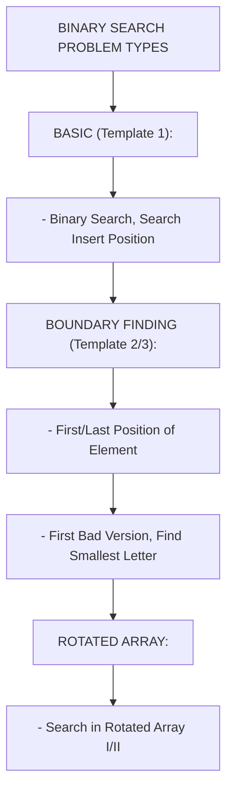

### First Bad Version (LeetCode 278)

```java
public int firstBadVersion(int n) {
    int left = 1, right = n;

    while (left < right) {
        int mid = left + (right - left) / 2;

        if (isBadVersion(mid)) {
            right = mid;      // First bad is at mid or left
        } else {
            left = mid + 1;   // First bad is on right
        }
    }
    return left;
}
```

### Sqrt(x) (LeetCode 69)

```java
public int mySqrt(int x) {
    if (x < 2) return x;

    long left = 1, right = x / 2;

    while (left < right) {
        long mid = left + (right - left + 1) / 2;  // Upper mid for maximize

        if (mid * mid <= x) {
            left = mid;
        } else {
            right = mid - 1;
        }
    }
    return (int) left;
}
```

### Find Smallest Letter Greater Than Target (LeetCode 744)

```java
public char nextGreatestLetter(char[] letters, char target) {
    int left = 0, right = letters.length;

    while (left < right) {
        int mid = left + (right - left) / 2;

        if (letters[mid] <= target) {
            left = mid + 1;
        } else {
            right = mid;
        }
    }
    // Wrap around if needed
    return letters[left % letters.length];
}
```

---

## Quick Reference <a name="quick-reference"></a>

### Template Selection Guide

```
┌─────────────────────────────────────────────────────────────────┐
│              WHICH TEMPLATE TO USE?                             │
├─────────────────────────────────────────────────────────────────┤
│                                                                 │
│  "Find exact element"                                           │
│    → Template 1: left <= right                                  │
│                                                                 │
│  "Find first position where condition is true"                  │
│    → Template 2: left < right, right = mid                      │
│                                                                 │
│  "Find last position where condition is true"                   │
│    → Template 3: left < right, left = mid, upper mid            │
│                                                                 │
│  "Minimize answer" (find smallest valid)                        │
│    → Template 2 style                                           │
│                                                                 │
│  "Maximize answer" (find largest valid)                         │
│    → Template 3 style (use upper mid)                           │
│                                                                 │
└─────────────────────────────────────────────────────────────────┘
```

**Flow:**
1. WHICH TEMPLATE TO USE?
2. 'Find exact element'
3. Template 1: left <= right
4. 'Find first position where condition is true'
5. Template 2: left < right, right = mid
6. 'Find last position where condition is true'
7. Template 3: left < right, left = mid, upper mid

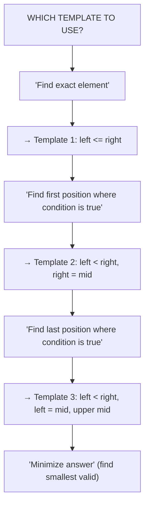

### Binary Search Checklist

```
Before coding:
□ Is the search space monotonic/sorted?
□ What are the boundaries? (inclusive/exclusive?)
□ What should be returned if not found?

While coding:
□ Use left + (right - left) / 2 to avoid overflow
□ Match while condition with boundary updates
□ Handle the mid boundary case (mid or mid ± 1?)

After coding:
□ Test with empty input
□ Test with single element
□ Test with target at boundaries
□ Test with target not present
□ Test with duplicates (if applicable)
```

**Flow:**
1. Before coding:
2. □ Is the search space monotonic/sorted?
3. □ What are the boundaries? (inclusive/exclusive?)
4. □ What should be returned if not found?
5. While coding:
6. □ Use left + (right - left) / 2 to avoid overflow
7. □ Match while condition with boundary updates

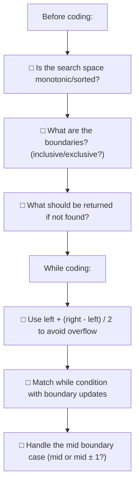

### Complexity Summary

```
┌─────────────────────────────────────────────────────────────────┐
│              BINARY SEARCH COMPLEXITIES                         │
├─────────────────────────────────────────────────────────────────┤
│                                                                 │
│  Basic Binary Search:        O(log n) time, O(1) space          │
│  Rotated Array Search:       O(log n) time, O(1) space          │
│  Rotated Array w/ Dups:      O(n) worst, O(log n) average       │
│  Binary Search on Answer:    O(log R × f(n)) where R = range    │
│  2D Matrix (sorted):         O(log(m×n))                        │
│  2D Matrix (row/col sorted): O(m + n)                           │
│  Median of Two Arrays:       O(log min(m, n))                   │
│                                                                 │
└─────────────────────────────────────────────────────────────────┘
```

**Flow:**
1. BINARY SEARCH COMPLEXITIES
2. Basic Binary Search: O(log n) time, O(1) space
3. Rotated Array Search: O(log n) time, O(1) space
4. Rotated Array w/ Dups: O(n) worst, O(log n) average
5. Binary Search on Answer: O(log R × f(n)) where R = rang
6. 2D Matrix (sorted): O(log(m×n))
7. 2D Matrix (row/col sorted): O(m + n)

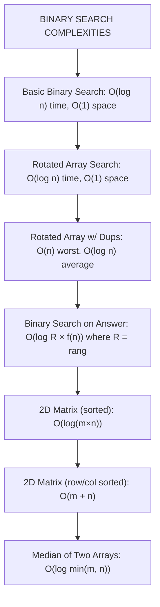

---

## Summary

```
┌───────────────────────────────────────────────────────────────┐
│            BINARY SEARCH - MASTER CHECKLIST                   │
├───────────────────────────────────────────────────────────────┤
│                                                               │
│  1. MEMORIZE THE 3 TEMPLATES                                  │
│     - T1: Exact match (left <= right)                         │
│     - T2: First true (left < right, right = mid)              │
│     - T3: Last true (left < right, left = mid, upper mid)     │
│                                                               │
│  2. BINARY SEARCH ON ANSWER                                   │
│     - Define search space [min, max]                          │
│     - Define feasibility check                                │
│     - Binary search for optimal boundary                      │
│                                                               │
│  3. ROTATED ARRAY                                             │
│     - One half is always sorted                               │
│     - Check which half, then decide direction                 │
│                                                               │
│  4. AVOID COMMON BUGS                                         │
│     - Overflow: Use left + (right - left) / 2                 │
│     - Infinite loop: Match update with while condition        │
│     - Off-by-one: right = length vs length - 1                │
│                                                               │
└───────────────────────────────────────────────────────────────┘
```

**Flow:**
1. BINARY SEARCH - MASTER CHECKLIST
2. 1. MEMORIZE THE 3 TEMPLATES
3. - T1: Exact match (left <= right)
4. - T2: First true (left < right, right = mid)
5. - T3: Last true (left < right, left = mid, upper mid
6. 2. BINARY SEARCH ON ANSWER
7. - Define search space [min, max]

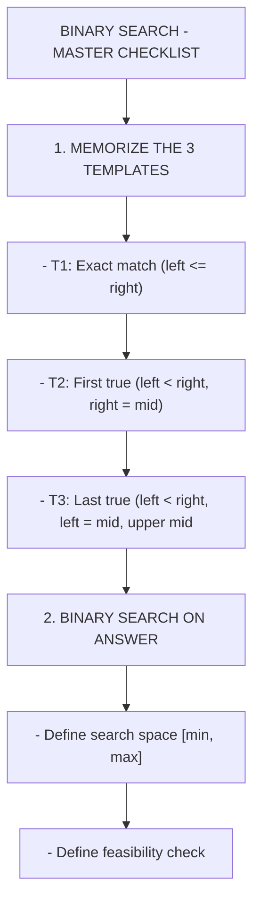

**Pro Tip:** When stuck, ask yourself: "At each step, can I eliminate half of the remaining possibilities?" If yes, binary search applies!


---


---


🔬 **Section Challenge — Summary**

**Challenge 1 (Reasoning):** Prefix sum initialized as `prefix[0] = 0` — why the leading zero and not `prefix[0] = arr[0]`?
<details><summary>Answer</summary>

`prefix[0] = 0` (empty prefix) makes range sum formula uniform: `sum(l,r) = prefix[r+1] - prefix[l]`. Without the 0: `sum(0,r) = prefix[r] - 0` (special case needed). With it: `sum(0,r) = prefix[r+1] - prefix[0] = prefix[r+1]`. Same formula everywhere. This is the 'sentinel' pattern — adding a dummy initial value to eliminate special cases. Same trick used in dummy linked list nodes.
</details>


## 🏋️ Practice & Interview Questions — Algorithms

### Sorting
**Q1.** Which sorting algorithm does Java use for `Arrays.sort(int[])`? Why not MergeSort?
<details><summary>Answer</summary>

**Dual-Pivot QuickSort** — for primitives. MergeSort requires O(N) extra space. QuickSort is in-place and cache-friendly. Stability doesn't matter for primitives (equal ints are indistinguishable). For objects (`Arrays.sort(Object[])`), Java uses **TimSort** (stable, O(N log N) worst).
</details>

**Q2.** Trace Merge Sort on `[4,2,7,1]`.
<details><summary>Answer</summary>

Split: `[4,2]` `[7,1]` → Split: `[4]` `[2]` `[7]` `[1]` → Merge: `[2,4]` `[1,7]` → Merge: `[1,2,4,7]`
</details>

**Q3.** ⭐⭐ Sort Colors (Dutch National Flag — 3-way partition).
<details><summary>Solution</summary>

```java
int lo=0, mid=0, hi=n-1;
while(mid<=hi){
    if(nums[mid]==0) swap(nums,lo++,mid++);
    else if(nums[mid]==1) mid++;
    else swap(nums,mid,hi--);
}
```
</details>

### Binary Search
**Q4.** ⭐ Search in Rotated Sorted Array.
<details><summary>Solution</summary>

```java
int lo=0, hi=n-1;
while(lo<=hi){
    int mid=(lo+hi)/2;
    if(nums[mid]==target) return mid;
    if(nums[lo]<=nums[mid]){ // left half sorted
        if(nums[lo]<=target&&target<nums[mid]) hi=mid-1; else lo=mid+1;
    } else { // right half sorted
        if(nums[mid]<target&&target<=nums[hi]) lo=mid+1; else hi=mid-1;
    }
}
return -1;
```
</details>

**Q5.** ⭐ Find First and Last Position (binary search twice).
<details><summary>Solution</summary>

```java
// First: find leftmost with while(lo<hi){ if arr[mid]>=target hi=mid else lo=mid+1 }
// Last: find rightmost with while(lo<hi){ if arr[mid]<=target lo=mid+1 else hi=mid } return lo-1
```
</details>

**Q6.** ⭐⭐ Koko Eating Bananas — binary search on answer.
<details><summary>Key insight</summary>

Binary search the eating speed k in range [1, max(piles)]. For each k, calculate hours needed. Find minimum k where hours ≤ H.
</details>

### Dynamic Programming
**Q7.** ⭐ Climbing Stairs — n steps, 1 or 2 at a time. How many ways?
<details><summary>Solution</summary>

```java
// Fibonacci sequence! dp[i] = dp[i-1] + dp[i-2]
int a=1, b=1;
for(int i=2;i<=n;i++){ int c=a+b; a=b; b=c; }
return b;
```
</details>

**Q8.** ⭐ Coin Change — minimum coins for amount.
<details><summary>Solution</summary>

```java
int[] dp = new int[amount+1]; Arrays.fill(dp, amount+1);
dp[0]=0;
for(int i=1;i<=amount;i++)
    for(int c:coins) if(c<=i) dp[i]=Math.min(dp[i],dp[i-c]+1);
return dp[amount]>amount?-1:dp[amount];
```
</details>

**Q9.** ⭐⭐ Longest Common Subsequence.
<details><summary>Solution</summary>

```java
int[][] dp=new int[m+1][n+1];
for(int i=1;i<=m;i++) for(int j=1;j<=n;j++){
    if(text1.charAt(i-1)==text2.charAt(j-1)) dp[i][j]=dp[i-1][j-1]+1;
    else dp[i][j]=Math.max(dp[i-1][j],dp[i][j-1]);
}
return dp[m][n];
```
</details>

**Q10.** ⭐⭐ Word Break — can string be segmented using dictionary words?
<details><summary>Solution</summary>

```java
boolean[] dp=new boolean[n+1]; dp[0]=true;
for(int i=1;i<=n;i++) for(String w:wordDict)
    if(i>=w.length()&&dp[i-w.length()]&&s.substring(i-w.length(),i).equals(w)) dp[i]=true;
return dp[n];
```
</details>

**Q11.** ⭐⭐⭐ Edit Distance (Levenshtein).
<details><summary>Solution</summary>

```java
int[][] dp=new int[m+1][n+1];
for(int i=0;i<=m;i++) dp[i][0]=i;
for(int j=0;j<=n;j++) dp[0][j]=j;
for(int i=1;i<=m;i++) for(int j=1;j<=n;j++){
    if(word1.charAt(i-1)==word2.charAt(j-1)) dp[i][j]=dp[i-1][j-1];
    else dp[i][j]=1+Math.min(dp[i-1][j-1],Math.min(dp[i-1][j],dp[i][j-1]));
}
```
</details>

### Graph Algorithms
**Q12.** ⭐ Number of Islands (BFS/DFS grid traversal).
<details><summary>Solution</summary>

```java
for each cell (i,j) if grid[i][j]=='1': count++; BFS/DFS to mark all connected land as visited
```
</details>

**Q13.** ⭐⭐ Course Schedule — detect cycle in directed graph (Topological sort).
<details><summary>Solution</summary>

```java
// Kahn's algorithm: indegree array + BFS queue
// If result size == numCourses → no cycle → can finish
```
</details>

**Q14.** ⭐⭐ Dijkstra's Shortest Path.
<details><summary>Solution</summary>

```java
PriorityQueue<int[]> pq=new PriorityQueue<>((a,b)->a[1]-b[1]); // [node, dist]
pq.offer(new int[]{src,0}); dist[src]=0;
while(!pq.isEmpty()){
    int[] curr=pq.poll(); int u=curr[0],d=curr[1];
    if(d>dist[u]) continue; // stale
    for(int[] neighbor:graph[u]) if(dist[u]+neighbor[1]<dist[neighbor[0]]){
        dist[neighbor[0]]=dist[u]+neighbor[1]; pq.offer(new int[]{neighbor[0],dist[neighbor[0]]});
    }
}
```
</details>

### MCQ Rapid Fire
| # | Question | Answer |
|---|---|---|
| 1 | QuickSort avg/worst | O(N log N) avg, O(N²) worst |
| 2 | MergeSort space complexity | O(N) |
| 3 | HeapSort space complexity | O(1) (in-place) |
| 4 | Binary search precondition | Sorted array |
| 5 | BFS time complexity on graph | O(V+E) |
| 6 | DFS space complexity | O(V) (recursion stack) |
| 7 | Dijkstra fails on | Negative weight edges |
| 8 | Bellman-Ford handles | Negative weights, detects negative cycles |
| 9 | Floyd-Warshall use case | All-pairs shortest path, O(V³) |
| 10 | Topological sort requires | Directed Acyclic Graph (DAG) |


---

## 🧠 Deep Conceptual Questions — OOP, SOLID & Design Patterns

**C1. What is the difference between an interface and an abstract class — when to use each?**
<details><summary>Deep Answer</summary>

**Abstract class**: can have fields, constructors, concrete method implementations. Models IS-A with shared state and behavior. Use when: you have partial implementation to share (template method pattern). Single inheritance: if you extend an abstract class, you can't extend another. **Interface**: pure contract, no state (Java 8+: default methods allowed). Models CAN-DO / role capability. A class can implement unlimited interfaces. Use when: defining a capability across unrelated classes (`Comparable`, `Serializable`, `Runnable`). Rule: prefer interfaces for type definitions. Use abstract class when you need to share implementation code AND all subtypes share the same "IS-A" relationship. In practice: interfaces + composition > abstract class + inheritance.
</details>

**C2. Liskov Substitution Principle: what does it actually mean and how do you violate it?**
<details><summary>Deep Answer</summary>

LSP: if `S extends P`, anywhere you use `P`, you should be able to use `S` without breaking correctness. Violation example: `Square extends Rectangle`. Rectangle behavior: setWidth and setHeight are independent. Square invariant: width must equal height. `Square s = new Square(5); s.setWidth(10);` — now `s.getHeight() == 10` (Square enforced equality) but Rectangle contract says height should still be 5. Code using Rectangle is surprised. Better: Square and Rectangle as siblings under a Shape hierarchy. Another classic: override a method and throw exception for a case the parent method handled → violates LSP. Test: can you run the parent's test suite against the child and pass?
</details>

**C3. Strategy pattern vs. if-else chains: the OCP argument.**
<details><summary>Deep Answer</summary>

```java
// BAD: add new payment type = modify this method = Open for modification (violates OCP)
if(type == "credit") { } else if(type == "paypal") { } else if(type == "crypto") { }

// GOOD: add new payment = new class, zero modification of existing code
interface PaymentStrategy { void pay(int amount); }
// Add Crypto: new CryptoPayment implements PaymentStrategy — no other file touched
```
Open/Closed Principle: open for extension, closed for modification. Each `else if` = a modification to an existing method = risk of breaking existing behavior, requires re-testing the entire method. Strategy = extension by new class = old code untouched = zero regression risk. When if-else is fine: 2-3 fixed cases that never change. When strategy shines: extensible behaviors that vary at runtime.
</details>

**C4. What is the Dependency Inversion Principle and how does it enable testability?**
<details><summary>Deep Answer</summary>

DIP: high-level modules should not depend on low-level modules — both should depend on abstractions. Without DIP: `OrderService` directly creates `MySQLOrderRepository`. To test OrderService: must have MySQL running. With DIP: `OrderService` depends on `OrderRepository` interface. In production: inject `MySQLOrderRepository`. In tests: inject `MockOrderRepository`. The high-level business logic (OrderService) has zero knowledge of the database layer. This makes: unit testing trivial (mock the interface), swapping implementations easy (SQLite, PostgreSQL, in-memory), layer boundaries clear. Dependency INJECTION (DI framework like Spring) is the mechanism that enables DIP at runtime.
</details>

**C5. Observer pattern vs. Event Bus: when does one become the other?**
<details><summary>Deep Answer</summary>

**Observer**: subject holds direct references to observer objects. Subject explicitly notifies each one. Tightly coupled (subject knows about observers). Fine for: small systems, known observers at compile time. Breaks when: observers span different modules, dynamic subscription needed, observers need to be remote. **Event Bus / Message Queue**: publishers and subscribers decoupled. Publisher sends event with a TYPE to the bus. Subscribers register for event types — publisher doesn't know who's listening. De-facto standard in large systems: Spring ApplicationEventPublisher, Kafka, RabbitMQ are all event buses. Rule: Observer for in-process tightly-coupled notification. Event bus for loose coupling, cross-module, or distributed communication.
</details>


> **Navigation**: [< Previous](05_LeetCode_RealWorld_Map.md) | [Back to Index](../00_MASTER_INDEX.md) | [Next >](07_Two_Pointers_Complete.md)