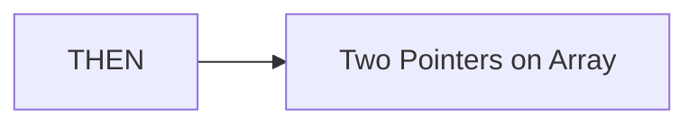
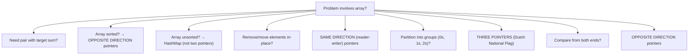
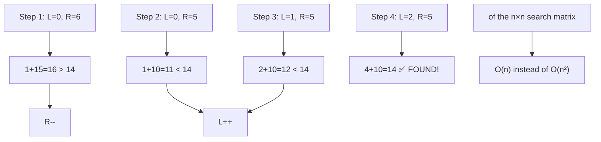
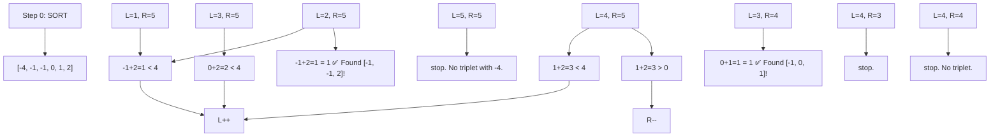
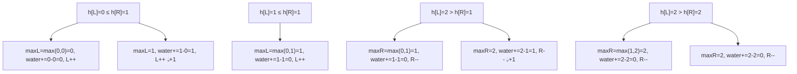
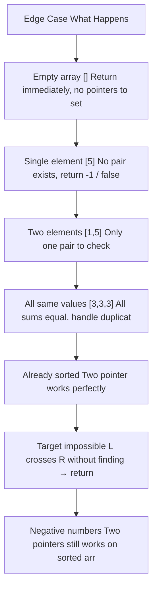

> **Navigation**: [< Previous](07_Two_Pointers_Complete.md) | [Back to Index](../00_MASTER_INDEX.md) | [Next >](09_Array_Plus_SlidingWindow.md)

# Array + Two Pointers — Combined Pattern Guide

> **WHY this combination?** Arrays provide O(1) random access. Two pointers exploit **sorted order** or **structural constraints** to avoid nested loops, reducing O(n²) → O(n).

### 🧠 Deep Intuition — Why Two Pointers Works

The key insight behind two pointers isn't just "it's faster" — it's about **systematically eliminating search space without missing valid answers**.

#### Opposite-Direction Pointers (e.g., Two Sum on Sorted Array)

When you have a sorted array and want pairs summing to a target, the brute force checks all O(n²) pairs. Two pointers checks at most O(n) by exploiting an **invariant**:

- Start with `left = 0` (smallest), `right = n-1` (largest)
- If `arr[left] + arr[right] < target` → the smallest element is too small, move `left` right (no other element paired with `arr[left]` can sum to target either, because all remaining right elements are ≤ current `arr[right]`)
- If `arr[left] + arr[right] > target` → the largest element is too large, move `right` left
- Each step eliminates an entire row or column of the pair matrix, which is why **no valid pair is ever skipped**

This is provably correct because sorted order guarantees that moving `left` right **always increases the sum** and moving `right` left **always decreases it** — a monotonic relationship.

#### Same-Direction Pointers (Reader-Writer Pattern)

Used for in-place modifications (remove duplicates, move zeroes). The idea: one pointer (`reader`) scans every element; another pointer (`writer`) tracks where to place the next valid element. Elements before `writer` are the "clean" result; elements between `writer` and `reader` are garbage to be overwritten.

This works because we never need to go backwards — each element is examined exactly once, giving O(n) time and O(1) space.

#### When NOT to Use Two Pointers
- **Unsorted array + looking for a target sum** → HashMap is better (O(n) without sorting)
- **Need ALL pairs, not just one** → Two pointers can miss combinations (depends on problem)
- **Non-monotonic condition** → If moving a pointer doesn't reliably increase/decrease the constraint, two pointers can skip valid answers

---

## 🧠 WHEN TO RECOGNIZE THIS PATTERN

```
IF input is:
  ✅ Sorted array (or can be sorted)
  ✅ Looking for pair/triplet with a target sum
  ✅ Removing/partitioning elements in-place
  ✅ Merging two sorted arrays
  ✅ Palindrome checking
THEN → Two Pointers on Array
```

**Flow:**
- THEN
- ↓
- Two Pointers on Array



### Decision Tree
```
Problem involves array?
├── Need pair with target sum?
│   ├── Array sorted? → OPPOSITE DIRECTION pointers
│   └── Array unsorted? → HashMap (not two pointers)
├── Remove/move elements in-place?
│   └── SAME DIRECTION (reader-writer) pointers
├── Partition into groups (0s, 1s, 2s)?
│   └── THREE POINTERS (Dutch National Flag)
└── Compare from both ends?
    └── OPPOSITE DIRECTION pointers
```

**Flow:**
- Problem involves array?
- ↓
- Need pair with target sum?
- ↓
- Problem involves array?
- ↓
- Array sorted?
- ↓
- OPPOSITE DIRECTION pointers
- ↓
- Problem involves array?
- ↓
- Array unsorted?
- ↓
- HashMap (not two pointers)
- ↓
- Problem involves array?
- ↓
- Remove/move elements in-place?
- ↓
- Problem involves array?
- ↓
- SAME DIRECTION (reader-writer) pointers
- ↓
- Problem involves array?
- ↓
- Partition into groups (0s, 1s, 2s)?



---

## 📐 CORE TEMPLATES

### Template 1: Opposite Direction (Sorted Array)
```java
// USE: Pair sum, Container with most water, Palindrome
int left = 0, right = arr.length - 1;
while (left < right) {
    int current = compute(arr[left], arr[right]);
    if (current == target) {
        // Found answer
        left++; right--;
    } else if (current < target) {
        left++;   // Need bigger value
    } else {
        right--;  // Need smaller value
    }
}
```

### Template 2: Same Direction (Reader-Writer)
```java
// USE: Remove duplicates, Move zeroes, Remove element
int writer = 0;
for (int reader = 0; reader < arr.length; reader++) {
    if (shouldKeep(arr[reader])) {
        arr[writer] = arr[reader];
        writer++;
    }
}
// writer = new length
```

### Template 3: Dutch National Flag (Three Pointers)
```java
// USE: Sort Colors, Partition around pivot
int lo = 0, mid = 0, hi = arr.length - 1;
while (mid <= hi) {
    if (arr[mid] == 0) {
        swap(arr, lo, mid);
        lo++; mid++;
    } else if (arr[mid] == 1) {
        mid++;
    } else { // arr[mid] == 2
        swap(arr, mid, hi);
        hi--;
    }
}
```

---

## 🔬 VISUAL: How Two Pointers Shrinks Search Space

```
Sorted Array: [1, 2, 4, 6, 8, 10, 15]   Target = 14

Step 1: L=0, R=6 → 1+15=16 > 14 → R--
        [1, 2, 4, 6, 8, 10, 15]
         L                  R

Step 2: L=0, R=5 → 1+10=11 < 14 → L++
        [1, 2, 4, 6, 8, 10, 15]
         L              R

Step 3: L=1, R=5 → 2+10=12 < 14 → L++
            L           R

Step 4: L=2, R=5 → 4+10=14 ✅ FOUND!
               L        R

WHY it works: Each step eliminates an entire row or column
of the n×n search matrix → O(n) instead of O(n²)
```

**Flow:**
- Step 1: L=0, R=6
- ↓
- 1+15=16 > 14
- ↓
- R--
- ↓
- Step 2: L=0, R=5
- ↓
- 1+10=11 < 14
- ↓
- L++
- ↓
- Step 3: L=1, R=5
- ↓
- 2+10=12 < 14
- ↓
- L++



---

## 🔬 FULL WALKTHROUGH: 3Sum — Fix One + Two Pointers

```
Problem: Find all unique triplets that sum to zero.
         nums = [-1, 0, 1, 2, -1, -4]

Step 0: SORT → [-4, -1, -1, 0, 1, 2]

Step 1: Fix i=0, nums[i]=-4. Target = 4.
        L=1, R=5 → -1+2=1 < 4 → L++
        L=2, R=5 → -1+2=1 < 4 → L++
        L=3, R=5 → 0+2=2 < 4 → L++
        L=4, R=5 → 1+2=3 < 4 → L++
        L=5, R=5 → stop. No triplet with -4.

Step 2: Fix i=1, nums[i]=-1. Target = 1.
        L=2, R=5 → -1+2=1 = 1 ✅ Found [-1, -1, 2]!
        L=3, R=4 → 0+1=1 = 1 ✅ Found [-1, 0, 1]!
        L=4, R=3 → stop.

Step 3: Fix i=2, nums[i]=-1. SKIP! Same as nums[1]. (Duplicate!)

Step 4: Fix i=3, nums[i]=0. Target = 0.
        L=4, R=5 → 1+2=3 > 0 → R--
        L=4, R=4 → stop. No triplet.

Result: [[-1,-1,2], [-1,0,1]] ✅

DUPLICATE HANDLING (critical!):
  1. Skip duplicate i:  if (i > 0 && nums[i] == nums[i-1]) continue;
  2. Skip duplicate L:  while (L < R && nums[L] == nums[L-1]) L++;
  3. Skip duplicate R:  while (L < R && nums[R] == nums[R+1]) R--;

Time: O(n²) | Space: O(1) (excluding output)
```

**Flow:**
- Step 0: SORT
- ↓
- [-4, -1, -1, 0, 1, 2]
- ↓
- L=1, R=5
- ↓
- -1+2=1 < 4
- ↓
- L++
- ↓
- L=2, R=5
- ↓
- -1+2=1 < 4
- ↓
- L++
- ↓
- L=3, R=5
- ↓
- 0+2=2 < 4



---

## 🔬 FULL WALKTHROUGH: Trapping Rain Water — Two Boundary Pointers

```
Problem: Calculate trapped rainwater.
         height = [0, 1, 0, 2, 1, 0, 1, 3, 2, 1, 2, 1]

Key Insight: Water at position i = min(maxLeft, maxRight) - height[i]
Instead of precomputing arrays, use TWO POINTERS from both ends.

Step-by-step (showing key moments):
  L=0, R=11, maxL=0, maxR=0, water=0

  h[L]=0 ≤ h[R]=1 → maxL=max(0,0)=0, water+=0-0=0, L++
  h[L]=1 ≤ h[R]=1 → maxL=max(0,1)=1, water+=1-1=0, L++
  h[L]=0 ≤ h[R]=1 → maxL=1, water+=1-0=1, L++           💧+1
  h[L]=2 > h[R]=1  → maxR=max(0,1)=1, water+=1-1=0, R--
  h[L]=2 > h[R]=2  → maxR=max(1,2)=2, water+=2-2=0, R--
  h[L]=2 > h[R]=1  → maxR=2, water+=2-1=1, R--           💧+1
  h[L]=2 > h[R]=2  → maxR=2, water+=2-2=0, R--
  ... continues until L meets R

  Answer: 6 units of water ✅

WHY two pointers work: The trapped water depends on the SHORTER side.
By always processing the shorter side, we guarantee min(maxL,maxR)
is correctly computed without needing the full array.

Time: O(n) | Space: O(1) — better than prefix array O(n) space
```

**Flow:**
- h[L]=0 ≤ h[R]=1
- ↓
- maxL=max(0,0)=0, water+=0-0=0, L++
- ↓
- h[L]=1 ≤ h[R]=1
- ↓
- maxL=max(0,1)=1, water+=1-1=0, L++
- ↓
- h[L]=0 ≤ h[R]=1
- ↓
- maxL=1, water+=1-0=1, L++ 💧+1
- ↓
- h[L]=2 > h[R]=1
- ↓
- maxR=max(0,1)=1, water+=1-1=0, R--
- ↓
- h[L]=2 > h[R]=2
- ↓
- maxR=max(1,2)=2, water+=2-2=0, R--
- ↓
- h[L]=2 > h[R]=1
- ↓
- maxR=2, water+=2-1=1, R-- 💧+1



---

## 🛡️ EDGE CASES TO WATCH

```
┌────────────────────────┬───────────────────────────────────────────┐
│ Edge Case              │ What Happens                              │
├────────────────────────┼───────────────────────────────────────────┤
│ Empty array []         │ Return immediately, no pointers to set    │
│ Single element [5]     │ No pair exists, return -1 / false         │
│ Two elements [1,5]     │ Only one pair to check                    │
│ All same values [3,3,3]│ All sums equal, handle duplicates!        │
│ Already sorted         │ Two pointer works perfectly               │
│ Target impossible      │ L crosses R without finding → return []   │
│ Negative numbers       │ Two pointers still works on sorted array  │
│ Overflow (a[L]+a[R])   │ Use long for sum if values near INT_MAX   │
└────────────────────────┴───────────────────────────────────────────┘
```

**Flow:**
- Edge Case What Happens
- ↓
- Empty array [] Return immediately, no pointers to set
- ↓
- Single element [5] No pair exists, return -1 / false
- ↓
- Two elements [1,5] Only one pair to check
- ↓
- All same values [3,3,3] All sums equal, handle duplicat
- ↓
- Already sorted Two pointer works perfectly
- ↓
- Target impossible L crosses R without finding
- ↓
- return



---

## 🔥 KEY TRICKS

| Trick | When | Example |
|-------|------|---------|
| Sort first | When order doesn't matter | 3Sum, 4Sum |
| Skip duplicates | Need unique results | `while (left < right && nums[left] == nums[left-1]) left++` |
| Fix one, sweep rest | k-Sum problems | 3Sum: fix i, two-pointer on [i+1, n-1] |
| Opposite ends | Max/min pairing | Container With Most Water |
| Writer pointer | In-place modification | Remove Duplicates, Move Zeroes |

---

## 📋 PRACTICE PROBLEMS — From Your Excel Sheet

### Easy
| # | Problem | Companies | Key Insight |
|---|---------|-----------|-------------|
| 1 | [Move Zeroes](https://leetcode.com/problems/move-zeroes/) | Amazon, Salesforce, Microsoft | Same-direction reader-writer |
| 2 | [Two Sum](https://leetcode.com/problems/two-sum/) | — | HashMap approach (unsorted), Two Pointers if sorted |
| 3 | [Remove Duplicates from Sorted Array](https://leetcode.com/problems/remove-duplicates-from-sorted-array/) | — | Same-direction writer pointer |
| 4 | [Sort Colors](https://leetcode.com/problems/sort-colors/) | Salesforce | Dutch National Flag 3-pointer |
| 5 | [Find the Duplicate Number](https://leetcode.com/problems/find-the-duplicate-number/) | Amazon | Floyd's cycle detection (fast/slow) |
| 6 | [Best Time to Buy and Sell Stock](https://leetcode.com/problems/best-time-to-buy-and-sell-stock/) | Amazon | Track min so far, compute max profit |

### Medium
| # | Problem | Companies | Key Insight |
|---|---------|-----------|-------------|
| 7 | [Container With Most Water](https://leetcode.com/problems/container-with-most-water/) | Walmart | Opposite direction, move shorter |
| 8 | [3Sum](https://leetcode.com/problems/3sum/) | Amazon | Fix one + two pointers, skip duplicates |
| 9 | [4Sum](https://leetcode.com/problems/4sum/) | Walmart | Fix two + two pointers |
| 10 | [Merge Sorted Array](https://leetcode.com/problems/merge-sorted-array/) | — | Start from END (reverse two pointers) |
| 11 | [Majority Element](https://leetcode.com/problems/majority-element/) | — | Boyer-Moore Voting (clever pointer logic) |

### Hard
| # | Problem | Companies | Key Insight |
|---|---------|-----------|-------------|
| 12 | [Trapping Rain Water](https://leetcode.com/problems/trapping-rain-water/) | Amazon | Two pointers from both ends, track maxLeft/maxRight |

### Additional from Excel — Two Pointer Section
| # | Problem | Key Insight |
|---|---------|-------------|
| 13 | [Sort Colors](https://leetcode.com/problems/sort-colors/) | Dutch National Flag |
| 14 | [Longest Repeating Character Replacement](https://leetcode.com/problems/longest-repeating-character-replacement/) | Sliding window + char frequency |
| 15 | [Maximum Number of Visible Points](https://leetcode.com/problems/maximum-number-of-visible-points/) | Angle sorting + sliding window |

---

## ⚠️ COMMON MISTAKES

1. **Forgetting to sort** — Two pointers only works on sorted arrays for sum problems
2. **Off-by-one on skip duplicates** — Compare `nums[i] == nums[i-1]` not `nums[i] == nums[i+1]`
3. **Not handling empty/single element** — Always check `if (arr.length < 2) return`
4. **Moving wrong pointer** — In opposite direction: move the pointer that helps approach target

---

## 📊 COMPLEXITY SUMMARY

| Pattern | Time | Space | When |
|---------|------|-------|------|
| Opposite direction | O(n) | O(1) | Sorted + target |
| Same direction | O(n) | O(1) | In-place filter |
| Dutch National Flag | O(n) | O(1) | 3-way partition |
| k-Sum (fix + sweep) | O(n^(k-1)) | O(1) | Multi-target |

---

## 🎯 INTERVIEW ARTICULATION — How to Explain Two Pointers

**When the interviewer gives you a Two Pointer problem, say this:**

> "The brute force checks all O(n²) pairs. But because the array is sorted, we can use two pointers from opposite ends. If the sum is too small, moving the left pointer right increases it; if too large, moving the right pointer left decreases it. Each pointer moves at most n steps, so total work is O(n)."

**Key mathematical justification to mention:**
- "No valid pair is skipped because the sorted order creates a monotonic relationship — increasing left *always* increases the sum, decreasing right *always* decreases it."
- "The invariant is: if a valid pair exists, it must be within `[left, right]`."

**Common mistakes to proactively mention:**
- ❌ "Don't forget: Two Pointers requires sorted input. If unsorted, the O(n log n) sort is the bottleneck, not the O(n) scan."
- ❌ "For unsorted arrays with target sum, HashMap is O(n) without sorting — better if you need original indices."

**Real-world applications:**
- Merge step in external sort (merging sorted file chunks from disk)
- Database merge joins (combining two sorted index scans)
- Network packet reassembly (ordered sequence numbers)

---

📖 **Related Chapters:**
- [02_Data_Structures/01b_Arrays.md](../02_Data_Structures/01b_Arrays.md) — Array fundamentals
- [04_Patterns_Templates/07_Two_Pointers_Complete.md](07_Two_Pointers_Complete.md) — Two Pointers deep dive
- [05_Problem_Solving/06_Two_Pointers.md](../05_Problem_Solving/06_Two_Pointers.md) — More two pointer problems

---
[← 07 Two Pointers](07_Two_Pointers_Complete.md) | [09 Array + Sliding Window →](09_Array_Plus_SlidingWindow.md)


---

> **Navigation**: [< Previous](07_Two_Pointers_Complete.md) | [Back to Index](../00_MASTER_INDEX.md) | [Next >](09_Array_Plus_SlidingWindow.md)