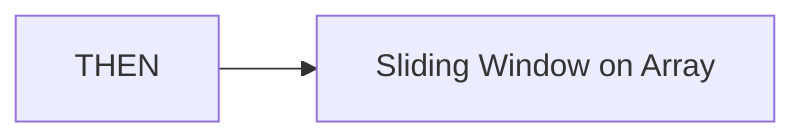
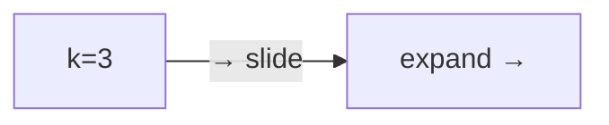
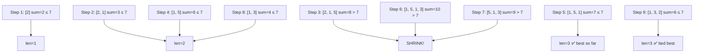
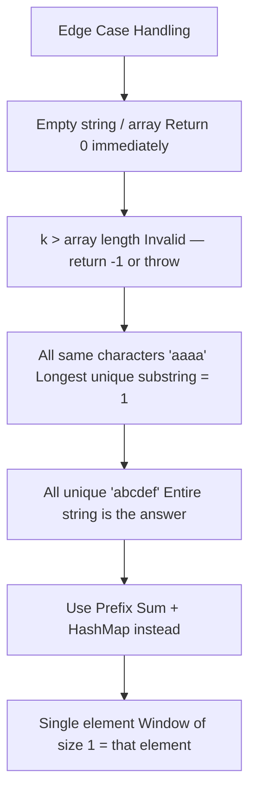

> **Navigation**: [< Previous](08_Array_Plus_TwoPointers.md) | [Back to Index](../00_MASTER_INDEX.md) | [Next >](10_HashMap_Plus_Counting.md)

# Array + Sliding Window — Combined Pattern Guide

> **WHY this combination?** When you need to find optimal **contiguous subarrays** or **substrings**, the sliding window maintains a running computation as it moves across the array. Reduces O(n²) brute force → O(n).

### 🧠 Deep Intuition — Why Sliding Window Is O(n)

The brute force for "best contiguous subarray" problems checks all O(n²) subarrays (each starting point × each ending point) and evaluates each one. Sliding window reduces this to O(n) by making a crucial observation: **you don't need to recompute the entire subarray when you shift by one position.**

#### The Amortized Analysis — Why It's Truly O(n)

Despite the nested `while (shrink)` loop inside the `for` loop, sliding window is NOT O(n²). Here's the rigorous argument:

- The `right` pointer advances from 0 to n-1: exactly **n increments**
- The `left` pointer also advances from 0 to at most n-1: at most **n increments total** (across all iterations of the outer loop, not per iteration)
- Therefore, the total work is O(n + n) = **O(n)**

Think of it this way: each element enters the window exactly once (when `right` reaches it) and leaves the window at most once (when `left` passes it). Total operations = 2n.

#### Why Sliding Window FAILS With Negative Numbers

Sliding window for sum problems relies on a **monotonicity assumption**: expanding the window (moving `right`) always increases the sum, and shrinking (moving `left`) always decreases it. With negative numbers, adding an element might *decrease* the sum, which breaks the invariant that "if the current window exceeds the target, we should shrink."

For problems with negative numbers, use **Prefix Sum + HashMap** instead: compute `prefix[i] = sum(arr[0..i])`, then `subarray_sum(i,j) = prefix[j] - prefix[i-1]`. Store prefix sums in a HashMap to find target differences in O(1).

---

## 🧠 WHEN TO RECOGNIZE THIS PATTERN

```
IF the problem says:
  ✅ "Contiguous subarray" or "substring"
  ✅ "Maximum/minimum sum of size k"
  ✅ "Longest/shortest subarray with condition"
  ✅ "Count of subarrays with property"
  ✅ "Subarray sum equals/divisible by K"
THEN → Sliding Window on Array
```

**Flow:**
- THEN
- ↓
- Sliding Window on Array



### Fixed vs Variable Window
```
Fixed Window (size k):          Variable Window:
┌─────┐                        ┌──────────────┐
│ k=3 │→ slide                 │   expand →   │
└─────┘                        └──────────────┘
                                ← shrink │
Use when: size is given         Use when: find optimal size
```

**Flow:**
- k=3 --(
- ↓
- slide)--> expand



---

## 📐 CORE TEMPLATES

### Template 1: Fixed-Size Window
```java
// Max sum of k consecutive elements
int windowSum = 0;
// Build first window
for (int i = 0; i < k; i++) windowSum += arr[i];
int maxSum = windowSum;

// Slide: add right, remove left
for (int i = k; i < arr.length; i++) {
    windowSum += arr[i] - arr[i - k];   // add new, remove old
    maxSum = Math.max(maxSum, windowSum);
}
```

### Template 2: Variable-Size Window (Expand + Shrink)
```java
// Longest subarray with sum ≤ target
int left = 0, windowSum = 0, maxLen = 0;
for (int right = 0; right < arr.length; right++) {
    windowSum += arr[right];          // EXPAND

    while (windowSum > target) {      // SHRINK until valid
        windowSum -= arr[left];
        left++;
    }

    maxLen = Math.max(maxLen, right - left + 1);  // UPDATE answer
}
```

### Template 3: Window with HashMap (Frequency)
```java
// Longest substring with at most K distinct characters
Map<Character, Integer> freq = new HashMap<>();
int left = 0, maxLen = 0;
for (int right = 0; right < s.length(); right++) {
    char c = s.charAt(right);
    freq.merge(c, 1, Integer::sum);         // EXPAND

    while (freq.size() > k) {               // SHRINK
        char leftChar = s.charAt(left);
        freq.merge(leftChar, -1, Integer::sum);
        if (freq.get(leftChar) == 0) freq.remove(leftChar);
        left++;
    }

    maxLen = Math.max(maxLen, right - left + 1);
}
```

---

## 🔬 VISUAL: Variable Window in Action

```
Array: [2, 1, 5, 1, 3, 2]   Target: max subarray sum ≤ 7

Step 1: [2] sum=2 ≤ 7 → len=1
        L,R

Step 2: [2, 1] sum=3 ≤ 7 → len=2
        L  R

Step 3: [2, 1, 5] sum=8 > 7 → SHRINK!
        L     R

Step 4: [1, 5] sum=6 ≤ 7 → len=2
           L  R

Step 5: [1, 5, 1] sum=7 ≤ 7 → len=3 ✅ best so far
           L     R

Step 6: [1, 5, 1, 3] sum=10 > 7 → SHRINK!
           L        R

Step 7: [5, 1, 3] sum=9 > 7 → SHRINK!
              L     R

Step 8: [1, 3] sum=4 ≤ 7 → len=2
                 L  R

Step 9: [1, 3, 2] sum=6 ≤ 7 → len=3 ✅ tied best
                 L     R

Answer: 3
```

**Flow:**
- Step 1: [2] sum=2 ≤ 7
- ↓
- len=1
- ↓
- Step 2: [2, 1] sum=3 ≤ 7
- ↓
- len=2
- ↓
- Step 3: [2, 1, 5] sum=8 > 7
- ↓
- SHRINK!
- ↓
- Step 4: [1, 5] sum=6 ≤ 7
- ↓
- len=2
- ↓
- Step 5: [1, 5, 1] sum=7 ≤ 7
- ↓
- len=3 ✅ best so far
- ↓
- Step 6: [1, 5, 1, 3] sum=10 > 7
- ↓
- SHRINK!



---

## 🔥 KEY TRICKS

| Trick | When | Example |
|-------|------|---------|
| HashMap in window | Track frequencies | Longest substring without repeating |
| Deque for min/max | Sliding window max/min | Sliding Window Maximum |
| Prefix sum alternative | When window has negatives | Subarray Sum Equals K (use HashMap) |
| Fixed → Variable | When "at most k" | Most k distinct = atMost(k) - atMost(k-1) |
| Count subarrays | Ending at right | Count += (right - left + 1) at each step |

---

## � FULL WALKTHROUGH: Longest Substring Without Repeating Characters

```
Problem: Find length of longest substring without repeating chars.
         s = "abcabcbb"

Approach: Variable-size sliding window + HashSet.
  Expand right until duplicate found. Shrink left until duplicate removed.

Step-by-step:
  Window       Set          Length  Max
  [a]bcabcbb   {a}          1       1
  [ab]cabcbb   {a,b}        2       2
  [abc]abcbb   {a,b,c}      3       3
  [abca]bcbb   'a' repeats! shrink:
   [bca]bcbb   {b,c,a}      3       3
   [bcab]cbb   'b' repeats! shrink:
    [cab]cbb   {c,a,b}      3       3
    [cabc]bb   'c' repeats! shrink:
     [abc]bb   {a,b,c}      3       3
     [abcb]b   'b' repeats! shrink:
      [cb]b    {c,b}        2       3
      [cbb]    'b' repeats! shrink:
       [b]b    shrink again:
        [b]    {b}          1       3

  Answer: 3 ✅ ("abc")

Time: O(n) | Space: O(min(n, 26))
WHY O(n)? Each char is added and removed from set at most once.
```

---

## 🔬 FULL WALKTHROUGH 2: Maximum Sum Subarray of Size K (Fixed Window)

```
Problem: Find the maximum sum of any contiguous subarray of size k=3.
         nums = [2, 1, 5, 1, 3, 2]

Approach: Fixed-size sliding window — add right, subtract left.

Step-by-step:
  Build initial window (first k elements):
    sum = 2 + 1 + 5 = 8, maxSum = 8

  Slide:
    i=3: sum = 8 - nums[0] + nums[3] = 8 - 2 + 1 = 7, maxSum = 8
         Window: [1, 5, 1]
    i=4: sum = 7 - nums[1] + nums[4] = 7 - 1 + 3 = 9, maxSum = 9 ✅
         Window: [5, 1, 3]
    i=5: sum = 9 - nums[2] + nums[5] = 9 - 5 + 2 = 6, maxSum = 9
         Window: [1, 3, 2]

  Answer: 9 ✅ (subarray [5, 1, 3])

Time: O(n) | Space: O(1)
WHY fixed window? Size is given (k=3), so just slide it.
```

---

## 🛡️ EDGE CASES

```
┌───────────────────────────────┬──────────────────────────────────────┐
│ Edge Case                     │ Handling                             │
├───────────────────────────────┼──────────────────────────────────────┤
│ Empty string / array          │ Return 0 immediately                 │
│ k > array length              │ Invalid — return -1 or throw         │
│ All same characters "aaaa"    │ Longest unique substring = 1         │
│ All unique "abcdef"           │ Entire string is the answer          │
│ Negative numbers in subarray  │ DON'T use sliding window for sum!    │
│                               │ Use Prefix Sum + HashMap instead     │
│ Single element                │ Window of size 1 = that element      │
└───────────────────────────────┴──────────────────────────────────────┘
```

**Flow:**
- Edge Case Handling
- ↓
- Empty string / array Return 0 immediately
- ↓
- k > array length Invalid — return -1 or throw
- ↓
- All same characters 'aaaa' Longest unique substring = 1
- ↓
- All unique 'abcdef' Entire string is the answer
- ↓
- Use Prefix Sum + HashMap instead
- ↓
- Single element Window of size 1 = that element



---

## 📋 PRACTICE PROBLEMS — From Your Excel Sheet
| # | Problem | Companies | Key Insight |
|---|---------|-----------|-------------|
| 1 | [Best Time to Buy and Sell Stock](https://leetcode.com/problems/best-time-to-buy-and-sell-stock/) | Amazon | Track min price, expand window |
| 2 | [Best Time to Buy and Sell Stock II](https://leetcode.com/problems/best-time-to-buy-and-sell-stock-ii/) | Salesforce | Greedy: take every uphill |

### Medium
| # | Problem | Companies | Key Insight |
|---|---------|-----------|-------------|
| 3 | [Subarray Sums Divisible by K](https://leetcode.com/problems/subarray-sums-divisible-by-k/) | — | Prefix sum + modulo HashMap |
| 4 | [Subarray Sum Equals K](https://leetcode.com/problems/subarray-sum-equals-k/) | Microsoft | Prefix sum + HashMap (NOT sliding window — has negatives!) |
| 5 | [Maximum Points from Cards](https://leetcode.com/problems/maximum-points-you-can-obtain-from-cards/) | Walmart | Reverse: minimize middle window |
| 6 | [Longest Repeating Character Replacement](https://leetcode.com/problems/longest-repeating-character-replacement/) | — | Window with max freq char tracking |

### Hard
| # | Problem | Companies | Key Insight |
|---|---------|-----------|-------------|
| 7 | [Sliding Window Maximum](https://leetcode.com/problems/sliding-window-maximum/) | — | Monotonic deque |
| 8 | [Minimum Window Substring](https://leetcode.com/problems/minimum-window-substring/) | Salesforce | HashMap + variable window, shrink to minimum |
| 9 | [Max Value of Equation](https://leetcode.com/problems/max-value-of-equation/) | Salesforce, Walmart | Sliding window + deque |

---

## ⚠️ COMMON MISTAKES

1. **Using sliding window with negatives** — Shrinking doesn't help! Use Prefix Sum + HashMap instead
2. **Not checking window validity** — Always verify `left <= right` after shrinking
3. **Forgetting to update answer** — Update AFTER shrinking, not before
4. **Fixed vs variable confusion** — If problem gives size → fixed. If asks "longest/shortest" → variable

---

## 📊 COMPLEXITY

| Pattern | Time | Space |
|---------|------|-------|
| Fixed window | O(n) | O(1) |
| Variable window | O(n) | O(1) |
| Window + HashMap | O(n) | O(k) where k = distinct elements |
| Window + Deque | O(n) | O(k) |

---

## 🎯 INTERVIEW ARTICULATION — How to Explain Sliding Window

**When the interviewer gives you a Sliding Window problem, say this:**

> "The brute force checks all O(n²) subarrays. Sliding window reduces to O(n) because instead of recomputing from scratch, we add the new right element and remove the old left element — maintaining a running result. Each element enters the window once and leaves once, so total operations are 2n = O(n). This is amortized O(1) per element."

**Key mathematical justification:**
- "The inner while-loop looks O(n²), but each element is pushed at most once and popped at most once across ALL iterations. Total work = 2n."
- "This only works when expanding the window monotonically changes the constraint (e.g., sum increases). With negative numbers, this invariant breaks — use prefix sums + HashMap instead."

**Common mistakes to proactively mention:**
- ❌ "Don't use sliding window for sum problems with negative numbers — the monotonicity assumption breaks."
- ❌ "Fixed window vs variable window: if the problem gives you K, it's fixed. If it says 'longest' or 'shortest,' it's variable."
- ❌ "Update your answer AFTER shrinking, not before — otherwise you report an invalid window state."

**Real-world applications:**
- Network throughput monitoring (requests per rolling time window)
- Rate limiting (max N requests per T seconds — sliding window counter)
- Stream processing (rolling averages in real-time analytics, e.g., stock price moving average)
- Log analysis (error rate in the last 5 minutes)

---

📖 **Related Chapters:**
- [04_Patterns_Templates/01_Sliding_Window.md](01_Sliding_Window.md) — Sliding Window deep dive
- [05_Problem_Solving/05_Sliding_Window.md](../05_Problem_Solving/05_Sliding_Window.md) — More window problems

---
[← 08 Array+TwoPointers](08_Array_Plus_TwoPointers.md) | [10 HashMap+Counting →](10_HashMap_Plus_Counting.md)


---

> **Navigation**: [< Previous](08_Array_Plus_TwoPointers.md) | [Back to Index](../00_MASTER_INDEX.md) | [Next >](10_HashMap_Plus_Counting.md)