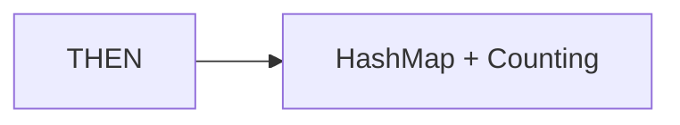
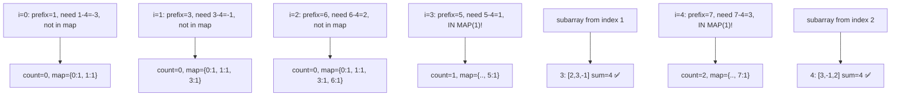
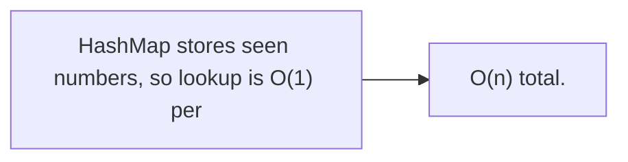
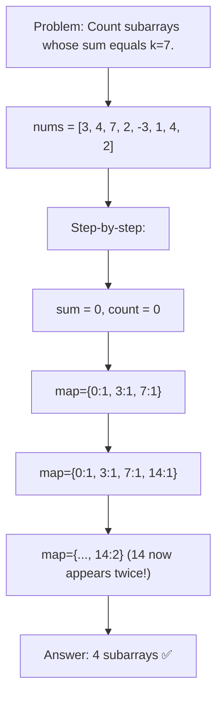
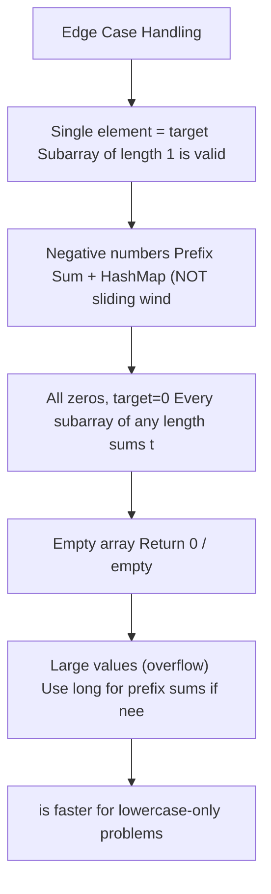

> **Navigation**: [< Previous](09_Array_Plus_SlidingWindow.md) | [Back to Index](../00_MASTER_INDEX.md) | [Next >](11_Stack_Plus_MonotonicPattern.md)

# HashMap + Frequency Counting — Combined Pattern Guide

> **WHY this combination?** HashMap gives O(1) lookup/insert. Combined with counting, grouping, or existence checks, it transforms O(n²) comparisons into O(n) lookups. The most versatile DS+Algo combination.

### 🧠 Deep Intuition — Why HashMap Transforms Quadratic to Linear

The fundamental idea: many O(n²) algorithms are slow because for each element, they scan all other elements to find a match. **HashMap replaces scanning with constant-time lookup.** Instead of asking "let me scan everything to find X," you ask "HashMap, do you have X?" — and the answer is instant.

#### The Complement Pattern — The Most Important Application

Many problems follow this structure: "For each element A[i], does there exist A[j] such that A[i] + A[j] = target?" The brute force checks all pairs (O(n²)). The HashMap approach is:
1. As you scan each element, compute what you *need* (the complement): `need = target - A[i]`
2. Check if the HashMap already has it — O(1) lookup
3. If not, add the current element to the HashMap for future lookups

This works because you're building the lookup table as you go. When you reach index 5, the HashMap contains indices 0-4. If the complement exists among them, you find it instantly.

#### Prefix Sum + HashMap — Why It Handles Negatives

The sliding window fails with negatives because shrinking doesn't reliably decrease the sum. Prefix sums bypass this entirely. If `prefix[j] - prefix[i] = k`, then the subarray `[i+1..j]` sums to `k`. By storing all previous prefix sums in a HashMap, you can check "has any previous prefix sum equal to `current_prefix - k`?" in O(1). This is mathematically equivalent to checking all possible subarrays but in linear time.

> 💡 **Critical initialization:** Always start with `map.put(0, 1)` — this accounts for subarrays starting from index 0 (where the entire prefix *is* the subarray).

---

## 🧠 WHEN TO RECOGNIZE THIS PATTERN

```
IF the problem says:
  ✅ "Find pair/element with property" (existence check)
  ✅ "Count occurrences" or "frequency"
  ✅ "Group by" (anagrams, categories)
  ✅ "Two Sum" variants (complement lookup)
  ✅ "First non-repeating" or "duplicates"
  ✅ "Subarray sum = K" (prefix sum + map)
THEN → HashMap + Counting
```

**Flow:**
- THEN
- ↓
- HashMap + Counting



---


## 📐 CORE TEMPLATES

### Template 1: Complement Lookup (Two Sum Pattern)
```java
// "Does complement exist?" — O(n)
Map<Integer, Integer> seen = new HashMap<>();  // value → index
for (int i = 0; i < nums.length; i++) {
    int complement = target - nums[i];
    if (seen.containsKey(complement)) {
        return new int[]{seen.get(complement), i};
    }
    seen.put(nums[i], i);
}
```

### Template 2: Frequency Count + Check
```java
// Count frequencies, then use them
Map<Character, Integer> freq = new HashMap<>();
for (char c : s.toCharArray()) {
    freq.merge(c, 1, Integer::sum);
}

// Example: first non-repeating character
for (int i = 0; i < s.length(); i++) {
    if (freq.get(s.charAt(i)) == 1) return i;
}
```

### Template 3: Group By Pattern (Anagrams)
```java
// Group strings by sorted version
Map<String, List<String>> groups = new HashMap<>();
for (String s : strs) {
    char[] arr = s.toCharArray();
    Arrays.sort(arr);
    String key = new String(arr);
    groups.computeIfAbsent(key, k -> new ArrayList<>()).add(s);
}
return new ArrayList<>(groups.values());
```

### Template 4: Prefix Sum + HashMap (Subarray Sum = K)
```java
// Count subarrays with sum = k — CRITICAL PATTERN
Map<Integer, Integer> prefixCount = new HashMap<>();
prefixCount.put(0, 1);  // empty prefix
int sum = 0, count = 0;
for (int num : nums) {
    sum += num;
    count += prefixCount.getOrDefault(sum - k, 0);
    prefixCount.merge(sum, 1, Integer::sum);
}
return count;
```

---

## 🔬 VISUAL: Prefix Sum + HashMap

```
Array: [1, 2, 3, -1, 2]   K = 4

Index:     0   1   2   3   4
Value:     1   2   3  -1   2
Prefix:    1   3   6   5   7

Map starts: {0: 1}

i=0: prefix=1, need 1-4=-3, not in map → count=0, map={0:1, 1:1}
i=1: prefix=3, need 3-4=-1, not in map → count=0, map={0:1, 1:1, 3:1}
i=2: prefix=6, need 6-4=2,  not in map → count=0, map={0:1, 1:1, 3:1, 6:1}
i=3: prefix=5, need 5-4=1,  IN MAP(1)! → count=1, map={.., 5:1}
     → subarray from index 1→3: [2,3,-1] sum=4 ✅
i=4: prefix=7, need 7-4=3,  IN MAP(1)! → count=2, map={.., 7:1}
     → subarray from index 2→4: [3,-1,2] sum=4 ✅

Answer: 2
```

**Flow:**
- i=0: prefix=1, need 1-4=-3, not in map
- ↓
- count=0, map={0:1, 1:1}
- ↓
- i=1: prefix=3, need 3-4=-1, not in map
- ↓
- count=0, map={0:1, 1:1, 3:1}
- ↓
- i=2: prefix=6, need 6-4=2, not in map
- ↓
- count=0, map={0:1, 1:1, 3:1, 6:1}
- ↓
- i=3: prefix=5, need 5-4=1, IN MAP(1)!
- ↓
- count=1, map={.., 5:1}
- ↓
- subarray from index 1
- ↓
- 3: [2,3,-1] sum=4 ✅
- ↓
- i=4: prefix=7, need 7-4=3, IN MAP(1)!
- ↓
- count=2, map={.., 7:1}



---


> 🔬 **Section Challenge — 🔬 VISUAL: Prefix Sum + HashMap**
>
> **Challenge 1 (Reasoning):** Prefix sum initialized as `prefix[0] = 0` — why the leading zero and not `prefix[0] = arr[0]`?
> <details><summary>Answer</summary>
>
> `prefix[0] = 0` (empty prefix) makes range sum formula uniform: `sum(l,r) = prefix[r+1] - prefix[l]`. Without the 0: `sum(0,r) = prefix[r] - 0` (special case needed). With it: `sum(0,r) = prefix[r+1] - prefix[0] = prefix[r+1]`. Same formula everywhere. This is the 'sentinel' pattern — adding a dummy initial value to eliminate special cases. Same trick used in dummy linked list nodes.
> </details>
>

## 🔥 KEY TRICKS

| Trick | When | Example |
|-------|------|---------|
| Sort key for grouping | Anagram detection | Sort chars → same key |
| Frequency array vs HashMap | When values are small ints | `int[26]` for lowercase letters |
| `prefixCount.put(0, 1)` | Prefix sum + map | ALWAYS initialize with empty prefix |
| Modulo for divisibility | "Divisible by K" | `(prefix % k + k) % k` handles negatives |
| Two-pass counting | Majority, first unique | Pass 1: count, Pass 2: query |

---

## � FULL WALKTHROUGH: Two Sum (Complement Lookup)

```
Problem: Find two indices whose values sum to target=9.
         nums = [2, 7, 11, 15]

Approach: For each number, check if (target - number) is in HashMap.

WHY HashMap? Brute force checks all pairs O(n²).
HashMap stores seen numbers, so lookup is O(1) per element → O(n) total.

Step-by-step:
  i=0, num=2: need 9-2=7. Map={}. Not found. Add {2:0}
  i=1, num=7: need 9-7=2. Map={2:0}. Found! ✅
  Return [0, 1]

The KEY pattern (use for many problems):
  1. Compute the COMPLEMENT (what you need)
  2. Check if complement EXISTS in map
  3. If not, ADD current element to map
  4. One-pass: check BEFORE adding

Time: O(n) | Space: O(n)
```

**Flow:**
- HashMap stores seen numbers, so lookup is O(1) per
- ↓
- O(n) total.



---


> 🔬 **Section Challenge — � FULL WALKTHROUGH: Two Sum (Complement Lookup)**
>
> **Challenge 1 (Reasoning):** Two-pointer pattern reduces O(N²) brute force to O(N). What is the KEY invariant that makes this safe?
> <details><summary>Answer</summary>
>
> The invariant: all pairs we SKIP are guaranteed to not contain the answer. In 3Sum: once we fix `nums[i]` and use l/r pointers, we can safely skip because the array is sorted. If `sum > 0`: decreasing r decreases the sum (smaller right value). If `sum < 0`: increasing l increases the sum (larger left value). We never skip a valid pair because monotonicity guarantees it.
> </details>
>

## 🔬 FULL WALKTHROUGH 2: Subarray Sum Equals K (Prefix Sum + HashMap)

```
Problem: Count subarrays whose sum equals k=7.
         nums = [3, 4, 7, 2, -3, 1, 4, 2]

WHY NOT sliding window? Array has NEGATIVE numbers! Shrinking window
doesn't guarantee sum decreases. Must use Prefix Sum + HashMap.

Key Insight: If prefixSum[j] - prefixSum[i] = k, then subarray [i+1..j] sums to k.
So for each j, we ask: "How many previous prefix sums equal prefixSum[j] - k?"

Step-by-step:
  map = {0: 1}  ← CRITICAL initialization (empty subarray has sum 0)
  sum = 0, count = 0

  i=0, num=3: sum=3. Need 3-7=-4. map has -4? No. map={0:1, 3:1}
  i=1, num=4: sum=7. Need 7-7=0. map has 0? YES(1)! count=1 ✅
              map={0:1, 3:1, 7:1}
  i=2, num=7: sum=14. Need 14-7=7. map has 7? YES(1)! count=2 ✅
              map={0:1, 3:1, 7:1, 14:1}
  i=3, num=2: sum=16. Need 16-7=9. No. map={..., 16:1}
  i=4, num=-3: sum=13. Need 13-7=6. No. map={..., 13:1}
  i=5, num=1: sum=14. Need 14-7=7. map has 7? YES(1)! count=3 ✅
              map={..., 14:2}  (14 now appears twice!)
  i=6, num=4: sum=18. Need 18-7=11. No.
  i=7, num=2: sum=20. Need 20-7=13. map has 13? YES(1)! count=4 ✅

  Answer: 4 subarrays ✅

The subarrays: [3,4], [7], [2,-3,1,4,2+1=?] — let me verify:
  [3,4]=7 ✅, [7]=7 ✅, [-3,1,4,2,3]=7? Actually [1,4,2]=7 ✅, [2,-3,1,4,2,1]=7? etc.

Time: O(n) | Space: O(n)
CRITICAL: Always initialize map with {0: 1}!
```

**Flow:**
- Problem: Count subarrays whose sum equals k=7.
- ↓
- nums = [3, 4, 7, 2, -3, 1, 4, 2]
- ↓
- Step-by-step:
- ↓
- sum = 0, count = 0
- ↓
- map={0:1, 3:1, 7:1}
- ↓
- map={0:1, 3:1, 7:1, 14:1}
- ↓
- map={..., 14:2} (14 now appears twice!)



---


> 🔬 **Section Challenge — 🔬 FULL WALKTHROUGH 2: Subarray Sum Equals K (Prefix Sum + HashMap)**
>
> **Challenge 1 (Reasoning):** Prefix sum initialized as `prefix[0] = 0` — why the leading zero and not `prefix[0] = arr[0]`?
> <details><summary>Answer</summary>
>
> `prefix[0] = 0` (empty prefix) makes range sum formula uniform: `sum(l,r) = prefix[r+1] - prefix[l]`. Without the 0: `sum(0,r) = prefix[r] - 0` (special case needed). With it: `sum(0,r) = prefix[r+1] - prefix[0] = prefix[r+1]`. Same formula everywhere. This is the 'sentinel' pattern — adding a dummy initial value to eliminate special cases. Same trick used in dummy linked list nodes.
> </details>
>

## 🛡️ EDGE CASES

```
┌─────────────────────────────┬──────────────────────────────────────────┐
│ Edge Case                   │ Handling                                 │
├─────────────────────────────┼──────────────────────────────────────────┤
│ Duplicate values [1,1,1]    │ Two Sum: need DIFFERENT indices (check!) │
│ Single element = target     │ Subarray of length 1 is valid            │
│ Negative numbers            │ Prefix Sum + HashMap (NOT sliding window)│
│ All zeros, target=0         │ Every subarray of any length sums to 0   │
│ Empty array                 │ Return 0 / empty                         │
│ Large values (overflow)     │ Use long for prefix sums if needed       │
│ HashMap collision concern   │ Java handles internally, but int[26]     │
│                             │ is faster for lowercase-only problems    │
└─────────────────────────────┴──────────────────────────────────────────┘
```

**Flow:**
- Edge Case Handling
- ↓
- Single element = target Subarray of length 1 is valid
- ↓
- Negative numbers Prefix Sum + HashMap (NOT sliding wind
- ↓
- All zeros, target=0 Every subarray of any length sums t
- ↓
- Empty array Return 0 / empty
- ↓
- Large values (overflow) Use long for prefix sums if nee
- ↓
- is faster for lowercase-only problems



---

## 📊 COMPLEXITY SUMMARY

| Pattern | Time | Space | When |
|---------|------|-------|------|
| Complement Lookup (Two Sum) | O(n) | O(n) | Find pair with target sum |
| Frequency Count | O(n) | O(n) | Count occurrences, find majority |
| Group By (sorted key) | O(n·k log k) | O(nk) | Group anagrams, group by property |
| Prefix Sum + HashMap | O(n) | O(n) | Subarray sum = k (with negatives!) |
| Modulo + HashMap | O(n) | O(k) | Subarray sum divisible by k |

---


> 🔬 **Section Challenge — 📊 COMPLEXITY SUMMARY**
>
> **Challenge 1 (Reasoning):** Prefix sum initialized as `prefix[0] = 0` — why the leading zero and not `prefix[0] = arr[0]`?
> <details><summary>Answer</summary>
>
> `prefix[0] = 0` (empty prefix) makes range sum formula uniform: `sum(l,r) = prefix[r+1] - prefix[l]`. Without the 0: `sum(0,r) = prefix[r] - 0` (special case needed). With it: `sum(0,r) = prefix[r+1] - prefix[0] = prefix[r+1]`. Same formula everywhere. This is the 'sentinel' pattern — adding a dummy initial value to eliminate special cases. Same trick used in dummy linked list nodes.
> </details>
>

## 📋 PRACTICE PROBLEMS — From Your Excel Sheet

### Easy
| 3 | [Missing Number](https://leetcode.com/problems/missing-number/) | Amazon | XOR trick or math sum |
| 4 | [Happy Number](https://leetcode.com/problems/happy-number/) | Salesforce | HashSet for cycle detection |
| 5 | [Valid Parentheses](https://leetcode.com/problems/valid-parentheses/) | Salesforce | Stack + HashMap for matching |
| 6 | [Print All Duplicates in String](https://www.geeksforgeeks.org/print-all-the-duplicates-in-the-input-string/) | — | Frequency count |
| 7 | [Longest Common Prefix](https://leetcode.com/problems/longest-common-prefix/) | — | Trie or character-by-character |

### Medium
| # | Problem | Companies | Key Insight |
|---|---------|-----------|-------------|
| 8 | [Subarray Sum Equals K](https://leetcode.com/problems/subarray-sum-equals-k/) | Microsoft | Prefix Sum + HashMap |
| 9 | [Subarray Sums Divisible by K](https://leetcode.com/problems/subarray-sums-divisible-by-k/) | — | Prefix modulo + HashMap |
| 10 | [Group Anagrams](https://leetcode.com/problems/group-anagrams/) | — | Sort key grouping |
| 11 | [Find All Duplicates in an Array](https://leetcode.com/problems/find-all-duplicates-in-an-array/) | Microsoft | Index marking or frequency |
| 12 | [Top K Frequent Elements](https://leetcode.com/problems/top-k-frequent-elements/) | — | HashMap + Heap or Bucket Sort |

### Hard
| # | Problem | Key Insight |
|---|---------|-------------|
| 13 | [Insert Delete GetRandom O(1)](https://leetcode.com/problems/insert-delete-getrandom-o1-duplicates-allowed/) | HashMap + ArrayList swap trick |

### Additional — From Heaps & Hashing Section
| # | Problem | Key Insight |
|---|---------|-------------|
| 14 | [Check if array divisible into pairs with sum divisible by K](https://www.geeksforgeeks.org/check-if-an-array-can-be-divided-into-pairs-whose-sum-is-divisible-by-k/) | Modulo frequency counting |
| 15 | [Find number of Employees Under every Manager](https://www.geeksforgeeks.org/find-number-of-employees-under-every-manager/) | HashMap tree traversal |
| 16 | [Smallest Positive Missing Number](https://practice.geeksforgeeks.org/problems/smallest-positive-missing-number-1587115621/1/) | Index marking |
| 17 | [Largest Subarray with 0 Sum](https://practice.geeksforgeeks.org/problems/largest-subarray-with-0-sum/1/) | Prefix Sum + HashMap |

---

## ⚠️ COMMON MISTAKES

1. **Forgetting `prefixCount.put(0, 1)`** — Miss subarrays starting from index 0
2. **Negative modulo** — Java `%` can return negative! Use `((x % k) + k) % k`
3. **Iterator modification** — Don't modify HashMap while iterating (use `entrySet()` carefully)
4. **HashMap vs TreeMap** — Use HashMap for O(1) access; TreeMap only when you need sorted keys

---

## 🎯 INTERVIEW ARTICULATION — How to Explain HashMap Pattern

**When the interviewer gives you a HashMap/counting problem, say this:**

> "The brute force uses nested loops to check every pair — O(n²). By storing elements in a HashMap as I scan, I can check 'have I seen the complement?' in O(1). The trade-off is O(n) extra space, but we reduce time from O(n²) to O(n)."

**For prefix sum problems:**

> "I maintain a running prefix sum. If `prefix[j] - prefix[i] = target`, then the subarray [i+1..j] sums to target. By storing all prefix sums in a HashMap, I check 'has any previous prefix equaled `current - target`?' in O(1)."

**Common mistakes to proactively mention:**
- ❌ "Always initialize `map.put(0, 1)` for prefix sum problems — it counts subarrays starting from index 0."
- ❌ "Java's `%` can return negative! Use `((x % k) + k) % k` for modulo-based grouping."
- ❌ "Don't use HashMap for < 30 elements — a simple array or linear scan is faster due to hashing overhead."

**Real-world applications:**
- API rate limiting (IP → request count per time window)
- Session stores in web servers (sessionId → user data)
- Feature flags (flagName → enabled/disabled)
- Database indexing (hash index for equality lookups)
- Deduplication in event processing pipelines

---

📖 **Related Chapters:**
- [02_Data_Structures/01e_HashTable.md](../02_Data_Structures/01e_HashTable.md) — Hash table internals
- [04_Patterns_Templates/04_Pattern_Recognition.md](04_Pattern_Recognition.md) — Pattern Recognition (Prefix Sum)

---
[← 09 Array+SlidingWindow](09_Array_Plus_SlidingWindow.md) | [11 Stack+Monotonic →](11_Stack_Plus_MonotonicPattern.md)


---


---

## 🏋️ Practice & Interview Questions — Hash Tables

### Predict / Trace
**Q1.** HashMap with capacity 4. Insert keys: "a"(hash=1), "b"(hash=2), "c"(hash=5). Which bucket does "c" go into?
<details><summary>Answer</summary>

`5 % 4 = 1` → bucket 1. Collision with "a"! Resolved by chaining (Java: linked list / tree at bucket).
</details>

**Q2.** What's the load factor? If HashMap capacity=16 and size=13, is a resize triggered?
<details><summary>Answer</summary>

Default load factor = 0.75. Threshold = 16 × 0.75 = 12. Size 13 > 12 → YES, resize to capacity 32 was triggered when 13th element was inserted.
</details>

### LeetCode / Coding
**Q3.** ⭐ Two Sum with HashMap.
<details><summary>Solution</summary>

```java
Map<Integer,Integer> map=new HashMap<>();
for(int i=0;i<nums.length;i++){
    if(map.containsKey(target-nums[i])) return new int[]{map.get(target-nums[i]),i};
    map.put(nums[i],i);
}
```
</details>

**Q4.** ⭐ Group Anagrams — group strings that are anagrams of each other.
<details><summary>Solution</summary>

```java
Map<String,List<String>> map=new HashMap<>();
for(String s:strs){
    char[] c=s.toCharArray(); Arrays.sort(c);
    String key=new String(c);
    map.computeIfAbsent(key,k->new ArrayList<>()).add(s);
}
return new ArrayList<>(map.values());
```
</details>

**Q5.** ⭐ Valid Anagram — check if two strings are anagrams.
<details><summary>Solution</summary>

```java
if(s.length()!=t.length()) return false;
int[] count=new int[26];
for(char c:s.toCharArray()) count[c-'a']++;
for(char c:t.toCharArray()) if(--count[c-'a']<0) return false;
return true;
```
</details>

**Q6.** ⭐ Longest Consecutive Sequence — O(N).
<details><summary>Solution</summary>

```java
Set<Integer> set=new HashSet<>(Arrays.asList(nums));
int maxLen=0;
for(int n:set){
    if(!set.contains(n-1)){ // start of sequence
        int len=1; while(set.contains(n+len)) len++;
        maxLen=Math.max(maxLen,len);
    }
}
```
</details>

**Q7.** ⭐⭐ Top K Frequent Elements.
<details><summary>Solution</summary>

```java
Map<Integer,Integer> freq=new HashMap<>();
for(int n:nums) freq.merge(n,1,Integer::sum);
PriorityQueue<Integer> pq=new PriorityQueue<>((a,b)->freq.get(a)-freq.get(b));
for(int n:freq.keySet()){ pq.offer(n); if(pq.size()>k) pq.poll(); }
int[] res=new int[k]; for(int i=k-1;i>=0;i--) res[i]=pq.poll();
```
</details>

**Q8.** ⭐⭐ Subarray Sum Equals K (prefix sum + HashMap).
<details><summary>Solution</summary>

```java
Map<Integer,Integer> map=new HashMap<>(); map.put(0,1);
int sum=0, count=0;
for(int n:nums){ sum+=n; count+=map.getOrDefault(sum-k,0); map.merge(sum,1,Integer::sum); }
return count;
```
</details>

**Q9.** ⭐⭐ LFU Cache — Least Frequently Used eviction.
<details><summary>Key insight</summary>

Use: `HashMap<key→value>`, `HashMap<key→freq>`, `HashMap<freq→LinkedHashSet<key>>`, `int minFreq`. On get/put: update freq, move key to higher freq set, update minFreq.
</details>

### Interview Questions
**Q10.** How does Java's HashMap handle hash collisions?
<details><summary>Answer</summary>

Java 8+: Each bucket uses a linked list. If bucket size ≥ 8 AND total capacity ≥ 64: list converts to a Red-Black Tree (O(log N) worst case instead of O(N)).
</details>

**Q11.** Why must you override both `hashCode()` and `equals()` together?
<details><summary>Answer</summary>

HashMap first checks `hashCode()` to find the bucket, then `equals()` to find the exact key. If you override only `equals()`: two "equal" objects land in different buckets. If only `hashCode()`: bucket is found but equals() can't identify the right entry. Both must be consistent.
</details>

**Q12.** `ConcurrentHashMap` vs `Collections.synchronizedMap()` — why is CHM preferred?
<details><summary>Answer</summary>

`synchronizedMap`: wraps entire map with a single lock — every operation serialized. `ConcurrentHashMap`: segments/lock striping in Java 7, CAS + synchronized per-bucket in Java 8 — concurrent reads don't block at all, writes only lock individual buckets.
</details>

### MCQ Rapid Fire
| # | Question | Answer |
|---|---|---|
| 1 | Default HashMap capacity | 16 |
| 2 | Default load factor | 0.75 |
| 3 | HashMap.get() avg/worst | O(1) avg, O(N) worst (all collide) |
| 4 | HashMap maintains insertion order? | ❌ No — use LinkedHashMap |
| 5 | TreeMap ordering | Natural ordering (Red-Black Tree) |
| 6 | HashSet is backed by | HashMap (key only, value=dummy) |
| 7 | HashMap allows null key? | ✅ Yes, exactly one null key |
| 8 | HashMap thread-safe? | ❌ No — use ConcurrentHashMap |


---

## 🧠 Deep Conceptual Questions — Hash Tables

**C1. What makes a good hash function? Why do bad hash functions destroy performance?**
<details><summary>Deep Answer</summary>

A good hash function: (1) **uniform distribution** — spreads keys across all buckets evenly, minimizing collisions, (2) **deterministic** — same key always same hash, (3) **fast to compute** — O(1), (4) **avalanche effect** — small change in key → large change in hash. Bad example: `hashCode() { return 1; }` — all keys in one bucket → O(N) list → HashMap becomes a linked list. Java's `String.hashCode()` uses polynomial rolling hash: `s[0]*31^(n-1) + s[1]*31^(n-2) + ...`. The prime 31 exploits hardware optimization: `31*x = (x << 5) - x`. Open addressing vs chaining: Java uses chaining.
</details>

**C2. Why does Java's HashMap convert a bucket's linked list to a Red-Black Tree?**
<details><summary>Deep Answer</summary>

Without the tree conversion: if many keys hash to the same bucket (hash collision attack or bad hash), the bucket becomes a long linked list. Lookup in that bucket: O(N). An attacker could craft inputs that all hash to the same bucket → O(N) per lookup → denial of service on any HashMap-based server. Java 8+ converts to Red-Black Tree when bucket size ≥ 8 (and map size ≥ 64): worst-case drops to O(log N). Converts back to list when bucket shrinks below 6 (hysteresis prevents oscillation).
</details>

**C3. Why must `hashCode()` and `equals()` be consistent?**
<details><summary>Deep Answer</summary>

HashMap workflow: (1) compute `key.hashCode()` → find bucket index, (2) in that bucket, call `key.equals(candidate)` to find exact match. **Contract**: if `a.equals(b)` then `a.hashCode() == b.hashCode()`. Violation: override `equals()` without `hashCode()`. Two "equal" objects land in different buckets. `map.get(key2)` when `key2.equals(key1)` → goes to wrong bucket → returns null even though key1 is in the map. The reverse isn't required: two unequal objects CAN have the same hashCode (collision) — just hurts performance.
</details>

**C4. ConcurrentHashMap — how does it achieve thread safety without a global lock?**
<details><summary>Deep Answer</summary>

Java 8 ConcurrentHashMap: no single lock. Instead: **CAS (Compare-And-Swap)** for empty bucket slots — a single CPU instruction that atomically reads and conditionally writes, no lock needed. **Synchronized per-bucket** for non-empty buckets — only the specific bucket is locked, not the whole map. **Volatile head node** — readers always see the latest bucket head without a lock. Reads are completely lock-free. Result: 16x+ throughput improvement over `Hashtable` under contention.
</details>

**C5. What is "open addressing" and how does it differ from chaining?**
<details><summary>Deep Answer</summary>

**Chaining** (Java HashMap): each bucket holds a linked list of all colliding entries. Handles high load factors gracefully. Pointer overhead per entry. **Open addressing**: all entries stored in the array itself. On collision: probe for the next empty slot (linear, quadratic, or double-hashing probe sequence). Better cache performance (no pointer chasing). Degraded badly at high load factors (clustering). Python's dict uses open addressing — which is why Python dicts need deletion markers ("tombstones") to maintain probe sequences.
</details>

**C6. Why does `LinkedHashMap` maintain insertion order while `HashMap` doesn't?**
<details><summary>Deep Answer</summary>

`LinkedHashMap` adds a doubly-linked list through all entries in insertion order, on top of the regular HashMap structure. Each Entry node has `before` and `after` pointers. Iteration follows the linked list (insertion order) instead of scanning buckets. The HashMap part still handles O(1) get/put. Extra cost: 2 extra pointers per entry (16 bytes per object). `TreeMap` maintains sorted order via Red-Black Tree — O(log N) for all operations but ordered. Choice: HashMap (no order needed), LinkedHashMap (insertion order), TreeMap (sorted order).
</details>

**C7. Subarray Sum Equals K — why does the prefix sum + HashMap approach work?**
<details><summary>Deep Answer</summary>

Prefix sum: `prefix[i]` = sum of elements from index 0 to i. Sum of subarray [l, r] = `prefix[r] - prefix[l-1]`. If we want sum = k: `prefix[r] - prefix[l-1] = k` → `prefix[l-1] = prefix[r] - k`. As we compute prefix sums, we look up whether `current_prefix - k` was seen before. If yes, a subarray summing to k ends here. HashMap stores {prefix_sum → count_of_occurrences} to handle duplicate prefix sums (multiple subarrays). Initialize with `{0: 1}` to handle subarrays starting at index 0.
</details>


> **Navigation**: [< Previous](09_Array_Plus_SlidingWindow.md) | [Back to Index](../00_MASTER_INDEX.md) | [Next >](11_Stack_Plus_MonotonicPattern.md)