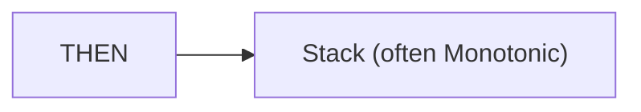
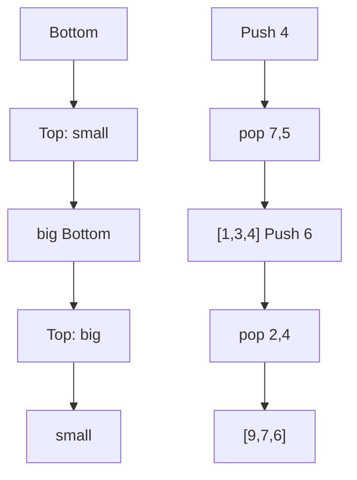
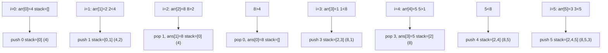
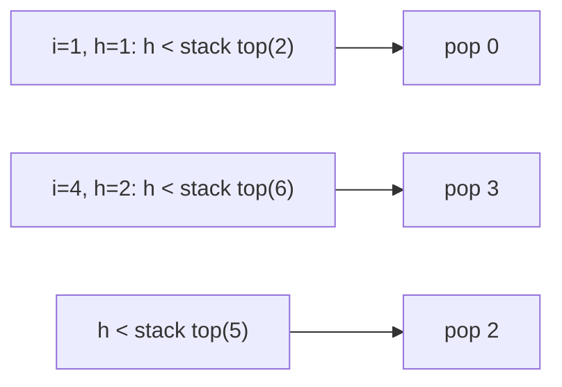
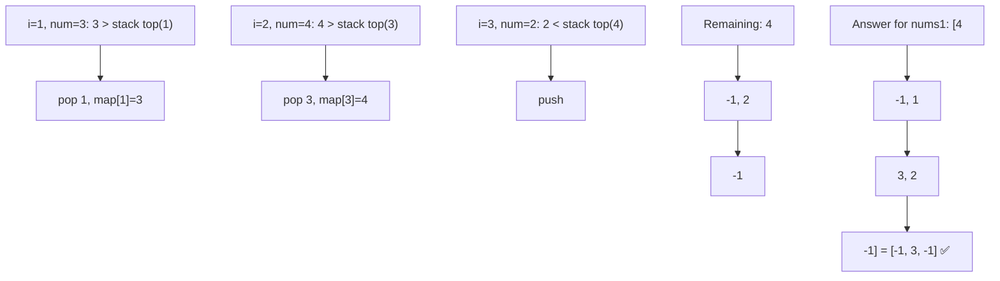
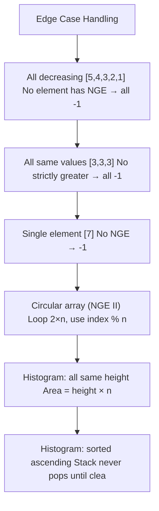

> **Navigation**: [< Previous](10_HashMap_Plus_Counting.md) | [Back to Index](../00_MASTER_INDEX.md) | [Next >](12_LinkedList_Plus_TwoPointers.md)

# Stack + Monotonic Pattern — Combined Pattern Guide

> **WHY this combination?** A stack processes elements in LIFO order. A **monotonic stack** maintains elements in sorted order, enabling O(n) solutions for "next greater/smaller element" problems that seem to need O(n²).

### 🧠 Deep Intuition — Why Monotonic Stack Is O(n)

The brute force for "next greater element" checks every element to the right for each position — nested loops, O(n²). The monotonic stack solves this in O(n) through a key insight: **elements that get "answered" can be permanently discarded.**

#### The Invariant — Why This Is Correct

A monotonic decreasing stack (for next greater element) maintains this invariant: all elements on the stack are **still waiting for their answer** (next greater element). When a new element comes that is larger than the stack top, **it is the answer** for the top element. We pop the top (it's answered), and check again — repeatedly until the stack top is larger or the stack is empty.

#### The Amortized O(n) Proof

The proof is elegant: each element is pushed onto the stack **exactly once** and popped **at most once**. Across all n elements, that's at most n pushes + n pops = **2n total operations = O(n).** The inner `while` loop doesn't make it O(n²) because the total pops across all iterations is bounded by n.

#### Increasing vs Decreasing — The Key Distinction
- **Monotonic Decreasing** stack (big → small from bottom to top): finds **next GREATER** element. New elements that are larger "answer" and pop smaller elements.
- **Monotonic Increasing** stack (small → big from bottom to top): finds **next SMALLER** element. New elements that are smaller "answer" and pop larger elements.

---

## 🧠 WHEN TO RECOGNIZE THIS PATTERN

```
IF the problem says:
  ✅ "Next greater/smaller element"
  ✅ "Previous greater/smaller element"
  ✅ "Largest rectangle" / "Maximal area"
  ✅ "Stock span" / "Days until warmer"
  ✅ "Remove digits to make smallest/largest"
  ✅ "Expression evaluation" / Parentheses
THEN → Stack (often Monotonic)
```

**Flow:**
- THEN
- ↓
- Stack (often Monotonic)



### Monotonic Stack Types
```
Monotonic INCREASING stack:     Monotonic DECREASING stack:
Bottom → Top: small → big      Bottom → Top: big → small
Pop when: new < top             Pop when: new > top
Use for: NEXT SMALLER           Use for: NEXT GREATER

Stack: [1, 3, 5, 7]            Stack: [9, 7, 4, 2]
Push 4 → pop 7,5 → [1,3,4]    Push 6 → pop 2,4 → [9,7,6]
```

**Flow:**
- Bottom
- ↓
- Top: small
- ↓
- big Bottom
- ↓
- Top: big
- ↓
- small
- ↓
- Push 4
- ↓
- pop 7,5
- ↓
- [1,3,4] Push 6



---


## 📐 CORE TEMPLATES

### Template 1: Next Greater Element
```java
// For each element, find next greater to the right
int[] nextGreater = new int[n];
Arrays.fill(nextGreater, -1);
Deque<Integer> stack = new ArrayDeque<>();  // stores INDICES

for (int i = 0; i < n; i++) {
    while (!stack.isEmpty() && arr[stack.peek()] < arr[i]) {
        nextGreater[stack.pop()] = arr[i];  // arr[i] is the answer
    }
    stack.push(i);
}
```

### Template 2: Largest Rectangle in Histogram
```java
// Classic monotonic stack problem
Deque<Integer> stack = new ArrayDeque<>();
int maxArea = 0;

for (int i = 0; i <= heights.length; i++) {
    int h = (i == heights.length) ? 0 : heights[i];
    while (!stack.isEmpty() && heights[stack.peek()] > h) {
        int height = heights[stack.pop()];
        int width = stack.isEmpty() ? i : i - stack.peek() - 1;
        maxArea = Math.max(maxArea, height * width);
    }
    stack.push(i);
}
```

### Template 3: Stock Span / Online Processing
```java
// Consecutive days before with price ≤ today
Deque<int[]> stack = new ArrayDeque<>();  // [price, span]
int span = 1;
while (!stack.isEmpty() && stack.peek()[0] <= price) {
    span += stack.pop()[1];
}
stack.push(new int[]{price, span});
return span;
```

---

## 🔬 VISUAL: Monotonic Stack for Next Greater

```
Array: [4, 2, 8, 1, 5, 3]

Processing left to right, decreasing stack (for next greater):

i=0: arr[0]=4  stack=[] → push 0           stack=[0]       (4)
i=1: arr[1]=2  2<4 → push 1                stack=[0,1]     (4,2)
i=2: arr[2]=8  8>2 → pop 1, ans[1]=8       stack=[0]       (4)
                8>4 → pop 0, ans[0]=8       stack=[]
                push 2                      stack=[2]       (8)
i=3: arr[3]=1  1<8 → push 3                stack=[2,3]     (8,1)
i=4: arr[4]=5  5>1 → pop 3, ans[3]=5       stack=[2]       (8)
                5<8 → push 4                stack=[2,4]     (8,5)
i=5: arr[5]=3  3<5 → push 5                stack=[2,4,5]   (8,5,3)

Remaining: ans[2]=-1, ans[4]=-1, ans[5]=-1

Result: [8, 8, -1, 5, -1, -1]
```

**Flow:**
- i=0: arr[0]=4 stack=[]
- ↓
- push 0 stack=[0] (4)
- ↓
- i=1: arr[1]=2 2<4
- ↓
- push 1 stack=[0,1] (4,2)
- ↓
- i=2: arr[2]=8 8>2
- ↓
- pop 1, ans[1]=8 stack=[0] (4)
- ↓
- 8>4
- ↓
- pop 0, ans[0]=8 stack=[]
- ↓
- i=3: arr[3]=1 1<8
- ↓
- push 3 stack=[2,3] (8,1)
- ↓
- i=4: arr[4]=5 5>1
- ↓
- pop 3, ans[3]=5 stack=[2] (8)



---


> 🔬 **Section Challenge — 🔬 VISUAL: Monotonic Stack for Next Greater**
>
> **Challenge 1 (Reasoning):** Monotonic DECREASING stack — when you push a new element, which existing elements are popped and what information do those pops tell you?
> <details><summary>Answer</summary>
>
> In a decreasing stack (top is smallest), pushing element `x`: all elements smaller than `x` are popped. For each popped element `y`: `x` is the NEXT GREATER ELEMENT of `y`. This is the key insight: the pop event = answer event. Application: Daily Temperatures (next warmer day), Largest Rectangle in Histogram (right boundary), Next Greater Element. Each element is pushed and popped exactly once → O(N) total.
> </details>
>

## � FULL WALKTHROUGH: Largest Rectangle in Histogram

```
Problem: Find the largest rectangle area in a histogram.
         heights = [2, 1, 5, 6, 2, 3]

Approach: Monotonic INCREASING stack. When a shorter bar appears,
          pop taller bars and compute their max rectangle.

WHY monotonic stack? Each bar needs to know "how far left and right
can I extend?" = "nearest shorter bar on each side." That's exactly
what a monotonic stack gives us in O(n).

Step-by-step (stack stores INDICES):
  i=0, h=2: stack=[0]
  i=1, h=1: h < stack top(2) → pop 0
            width = 1 (no left bound), area = 2×1 = 2
            stack=[1]
  i=2, h=5: stack=[1,2]
  i=3, h=6: stack=[1,2,3]
  i=4, h=2: h < stack top(6) → pop 3
            width = 4-2-1 = 1, area = 6×1 = 6
            h < stack top(5) → pop 2
            width = 4-1-1 = 2, area = 5×2 = 10 ← MAX!
            stack=[1,4]
  i=5, h=3: stack=[1,4,5]
  Cleanup: pop remaining, compute areas.

  Answer: 10 ✅ (bars at index 2-3, height 5, width 2)

Time: O(n) | Space: O(n)
Trick: Add sentinel 0 at end to auto-trigger final cleanup.
```

**Flow:**
- i=1, h=1: h < stack top(2)
- ↓
- pop 0
- ↓
- i=4, h=2: h < stack top(6)
- ↓
- pop 3
- ↓
- h < stack top(5)
- ↓
- pop 2



---


## 🔬 FULL WALKTHROUGH 2: Next Greater Element I — Core Monotonic Template

```
Problem: For each element in nums1, find the Next Greater Element in nums2.
         nums1 = [4, 1, 2], nums2 = [1, 3, 4, 2]

Approach: Process nums2 with monotonic DECREASING stack.
          Map each element to its NGE. Then look up nums1 answers.

Step-by-step (build NGE map from nums2):
  stack = [], map = {}

  i=0, num=1: stack=[1]
  i=1, num=3: 3 > stack top(1) → pop 1, map[1]=3
              stack=[3]
  i=2, num=4: 4 > stack top(3) → pop 3, map[3]=4
              stack=[4]
  i=3, num=2: 2 < stack top(4) → push
              stack=[4, 2]
  Remaining: 4→-1, 2→-1

  NGE map: {1:3, 3:4, 4:-1, 2:-1}

  Answer for nums1: [4→-1, 1→3, 2→-1] = [-1, 3, -1] ✅

Time: O(n + m) | Space: O(n)
KEY: Stack stores elements waiting for their NGE.
     When a larger element arrives, it's the answer for all smaller ones on stack.
```

**Flow:**
- i=1, num=3: 3 > stack top(1)
- ↓
- pop 1, map[1]=3
- ↓
- i=2, num=4: 4 > stack top(3)
- ↓
- pop 3, map[3]=4
- ↓
- i=3, num=2: 2 < stack top(4)
- ↓
- push
- ↓
- Remaining: 4
- ↓
- -1, 2
- ↓
- -1
- ↓
- Answer for nums1: [4
- ↓
- -1, 1



---


> 🔬 **Section Challenge — 🔬 FULL WALKTHROUGH 2: Next Greater Element I — Core Monotonic Template**
>
> **Challenge 1 (Reasoning):** Monotonic DECREASING stack — when you push a new element, which existing elements are popped and what information do those pops tell you?
> <details><summary>Answer</summary>
>
> In a decreasing stack (top is smallest), pushing element `x`: all elements smaller than `x` are popped. For each popped element `y`: `x` is the NEXT GREATER ELEMENT of `y`. This is the key insight: the pop event = answer event. Application: Daily Temperatures (next warmer day), Largest Rectangle in Histogram (right boundary), Next Greater Element. Each element is pushed and popped exactly once → O(N) total.
> </details>
>

## 🛡️ EDGE CASES

```
┌────────────────────────────────┬─────────────────────────────────────────┐
│ Edge Case                      │ Handling                                │
├────────────────────────────────┼─────────────────────────────────────────┤
│ All decreasing [5,4,3,2,1]    │ No element has NGE → all -1              │
│ All increasing [1,2,3,4,5]    │ Every element except last has NGE        │
│ All same values [3,3,3]       │ No strictly greater → all -1             │
│ Single element [7]            │ No NGE → -1                              │
│ Circular array (NGE II)       │ Loop 2×n, use index % n                  │
│ Histogram: all same height    │ Area = height × n                        │
│ Histogram: sorted ascending   │ Stack never pops until cleanup           │
└────────────────────────────────┴─────────────────────────────────────────┘
```

**Flow:**
- Edge Case Handling
- ↓
- All decreasing [5,4,3,2,1] No element has NGE
- ↓
- all -1
- ↓
- All decreasing [5,4,3,2,1] No element has NGE
- ↓
- all -1
- ↓
- All same values [3,3,3] No strictly greater
- ↓
- all -1
- ↓
- All same values [3,3,3] No strictly greater
- ↓
- all -1
- ↓
- Single element [7] No NGE
- ↓
- -1
- ↓
- Single element [7] No NGE
- ↓
- -1
- ↓
- Circular array (NGE II) Loop 2×n, use index % n
- ↓
- Histogram: all same height Area = height × n
- ↓
- Histogram: sorted ascending Stack never pops until clea



---

## 📊 COMPLEXITY SUMMARY

| Problem | Time | Space | Key Detail |
|---------|------|-------|------------|
| Next Greater Element | O(n) | O(n) | Each element pushed/popped once |
| Largest Rectangle | O(n) | O(n) | Sentinel simplifies cleanup |
| Stock Span | O(n) amortized | O(n) | Monotonic decreasing |
| Sum of Subarray Mins | O(n) | O(n) | Contribution technique |
| Daily Temperatures | O(n) | O(n) | Store indices, not values |

---


> 🔬 **Section Challenge — 📊 COMPLEXITY SUMMARY**
>
> **Challenge 1 (Reasoning):** Prefix sum initialized as `prefix[0] = 0` — why the leading zero and not `prefix[0] = arr[0]`?
> <details><summary>Answer</summary>
>
> `prefix[0] = 0` (empty prefix) makes range sum formula uniform: `sum(l,r) = prefix[r+1] - prefix[l]`. Without the 0: `sum(0,r) = prefix[r] - 0` (special case needed). With it: `sum(0,r) = prefix[r+1] - prefix[0] = prefix[r+1]`. Same formula everywhere. This is the 'sentinel' pattern — adding a dummy initial value to eliminate special cases. Same trick used in dummy linked list nodes.
> </details>
>

## 📋 PRACTICE PROBLEMS — From Your Excel Sheet
| # | Problem | Companies | Key Insight |
|---|---------|-----------|-------------|
| 1 | [Implement Queue using Stacks](https://leetcode.com/problems/implement-queue-using-stacks/) | — | Two stacks for amortized O(1) |
| 2 | [Implement Stack using Queues](https://leetcode.com/problems/implement-stack-using-queues/) | Amazon | Push expensive or pop expensive |
| 3 | [Next Greater Element I](https://leetcode.com/problems/next-greater-element-i/) | — | Monotonic stack + HashMap |
| 4 | [Evaluate Postfix Expression](https://www.geeksforgeeks.org/stack-set-4-evaluation-postfix-expression/) | Salesforce | Classic stack evaluation |
| 5 | [Implement Deque](https://www.geeksforgeeks.org/implement-stack-queue-using-deque/) | Salesforce, Microsoft | Deque supports both ends |

### Medium
| # | Problem | Companies | Key Insight |
|---|---------|-----------|-------------|
| 6 | [Online Stock Span](https://leetcode.com/problems/online-stock-span/) | Amazon | Monotonic decreasing + span merge |
| 7 | [Sum of Subarray Minimums](https://leetcode.com/problems/sum-of-subarray-minimums/) | Salesforce | Monotonic stack + contribution counting |
| 8 | [Remove All Adjacent Duplicates II](https://leetcode.com/problems/remove-all-adjacent-duplicates-in-string-ii/) | Amazon | Stack with count tracking |
| 9 | [Rotten Oranges](https://practice.geeksforgeeks.org/problems/rotten-oranges2536/1) | Salesforce | Multi-source BFS (not stack, but queue!) |
| 10 | [Minimum Cost Tree From Leaf Values](https://leetcode.com/problems/minimum-cost-tree-from-leaf-values/) | — | Monotonic decreasing stack |
| 11 | [Flatten Nested List Iterator](https://leetcode.com/problems/flatten-nested-list-iterator/) | — | Stack for recursive flattening |
| 12 | [Circular Tour](https://practice.geeksforgeeks.org/problems/circular-tour/1) | — | Greedy (or stack simulation) |

### Hard
| # | Problem | Companies | Key Insight |
|---|---------|-----------|-------------|
| 13 | [Largest Rectangle in Histogram](https://leetcode.com/problems/largest-rectangle-in-histogram/) | — | Classic monotonic stack |
| 14 | [Max of Minimums for Every Window Size](https://www.geeksforgeeks.org/find-the-maximum-of-minimums-for-every-window-size-in-a-given-array/) | Salesforce, Microsoft | Monotonic stack + fill technique |
| 15 | [LRU Cache](https://www.geeksforgeeks.org/lru-cache-implementation/) | Microsoft | HashMap + Doubly Linked List |
| 16 | [The Celebrity Problem](http://geeksforgeeks.org/the-celebrity-problem/) | — | Stack elimination |

### Additional — Stacks & Queues from Excel
| # | Problem | Key Insight |
|---|---------|-------------|
| 17 | [Distance of Nearest Cell Having 1](https://practice.geeksforgeeks.org/problems/distance-of-nearest-cell-having-1-1587115620/1) | Multi-source BFS |
| 18 | [Implement Two Stacks in Array](https://www.geeksforgeeks.org/implement-two-stacks-in-an-array/) | Start from opposite ends |
| 19 | Sum of min-max elements of subarrays of size k | Monotonic deque |
| 20 | Efficiently implement k-queues in single array | Array segmentation |

---

## ⚠️ COMMON MISTAKES

1. **Using Stack class** — Use `Deque<Integer> stack = new ArrayDeque<>()` (Stack is legacy)
2. **Forgetting boundary element** — Add sentinel value (0) at end for histogram problems
3. **Increasing vs Decreasing confusion** — Draw it out! Increasing finds next SMALLER, Decreasing finds next GREATER
4. **Off-by-one in width** — In histogram: `width = stack.isEmpty() ? i : i - stack.peek() - 1`

---

## 🎯 INTERVIEW ARTICULATION — How to Explain Monotonic Stack

**When the interviewer gives you a "next greater element" type problem, say this:**

> "The brute force checks every element to the right for each position — O(n²). A monotonic stack solves it in O(n) because each element is pushed once and popped at most once. When a new element is larger than the stack top, it's the 'next greater' for all smaller elements on the stack — we pop and record answers. Total operations: at most n pushes + n pops = O(n)."

**Key mathematical justification:**
- "It looks O(n²) due to the inner while-loop, but each element participates in at most 2 operations (push + pop) across the entire run. Amortized O(1) per element."
- "The invariant is: the stack always contains elements that are still waiting for their 'next greater' answer, in decreasing order."

**Common mistakes to proactively mention:**
- ❌ "Use `ArrayDeque` not `Stack` class — Stack is legacy, synchronized, and slower."
- ❌ "For histogram problems, add a sentinel value (height 0) at the end to flush remaining stack elements."
- ❌ "Increasing stack finds next SMALLER; decreasing finds next GREATER — draw it out to be sure."

**Real-world applications:**
- Stock span problem (how many consecutive days was the price ≤ today's price)
- Temperature monitoring systems (days until warmer weather)
- Expression parsing in compilers (operator precedence)
- Undo/redo in text editors (backtracking to most recent state)

---

📖 **Related Chapters:**
- [02_Data_Structures/01d_Stack_Queue.md](../02_Data_Structures/01d_Stack_Queue.md) — Stack/Queue fundamentals
- [03_Algorithms/15_Monotonic_Stack_Queue_Complete.md](../03_Algorithms/15_Monotonic_Stack_Queue_Complete.md) — Deep dive

---
[← 10 HashMap+Counting](10_HashMap_Plus_Counting.md) | [12 LinkedList+TwoPointers →](12_LinkedList_Plus_TwoPointers.md)


---


---

## 🏋️ Practice & Interview Questions — Stack & Queue

### Predict / Trace
**Q1.** Stack has [1,2,3] (3 is top). After pop(), pop(), push(5) — what's the stack?
<details><summary>Answer</summary>

[1, 5] — popped 3 and 2, pushed 5 on top of 1.
</details>

**Q2.** Evaluate postfix `3 4 + 2 *` using a stack — trace each step.
<details><summary>Answer</summary>

push 3 → [3]; push 4 → [3,4]; + → pop 3,4, push 7 → [7]; push 2 → [7,2]; * → pop 7,2, push 14 → [14]. Result: 14
</details>

### LeetCode / Coding
**Q3.** ⭐ Valid Parentheses — O(N).
<details><summary>Solution</summary>

```java
Deque<Character> stack = new ArrayDeque<>();
for(char c : s.toCharArray()){
    if(c=='('||c=='{'||c=='[') stack.push(c);
    else {
        if(stack.isEmpty()) return false;
        char top = stack.pop();
        if(c==')'&&top!='('||c=='}'&&top!='{'||c==']'&&top!='[') return false;
    }
}
return stack.isEmpty();
```
</details>

**Q4.** ⭐ Min Stack — O(1) getMin().
<details><summary>Solution</summary>

```java
Deque<Integer> stack=new ArrayDeque<>(), minStack=new ArrayDeque<>();
void push(int v){ stack.push(v); if(minStack.isEmpty()||v<=minStack.peek()) minStack.push(v); }
void pop(){ if(stack.pop().equals(minStack.peek())) minStack.pop(); }
int getMin(){ return minStack.peek(); }
```
</details>

**Q5.** ⭐⭐ Daily Temperatures — next warmer day for each day (monotonic stack).
<details><summary>Solution</summary>

```java
int[] res = new int[n]; Deque<Integer> stack = new ArrayDeque<>();
for(int i=0;i<n;i++){
    while(!stack.isEmpty()&&temperatures[i]>temperatures[stack.peek()])
        res[stack.peek()] = i - stack.pop();
    stack.push(i);
}
```
</details>

**Q6.** ⭐⭐ Largest Rectangle in Histogram (monotonic stack).
<details><summary>Solution</summary>

```java
Deque<Integer> stack = new ArrayDeque<>();
int maxArea = 0;
for(int i=0;i<=n;i++){
    int h = (i==n)?0:heights[i];
    while(!stack.isEmpty()&&h<heights[stack.peek()]){
        int height=heights[stack.pop()];
        int width=stack.isEmpty()?i:(i-stack.peek()-1);
        maxArea=Math.max(maxArea,height*width);
    }
    stack.push(i);
}
```
</details>

**Q7.** ⭐⭐ Implement Queue using 2 Stacks.
<details><summary>Solution</summary>

```java
// Two stacks: inbox (for push), outbox (for pop)
// Move inbox→outbox only when outbox is empty
void push(int x){ inbox.push(x); }
int pop(){ if(outbox.isEmpty()) while(!inbox.isEmpty()) outbox.push(inbox.pop()); return outbox.pop(); }
```
</details>

**Q8.** ⭐⭐ Decode String — `3[a2[bc]]` → `abcbcabcbcabcbc`.
<details><summary>Solution</summary>

```java
Deque<Integer> counts=new ArrayDeque<>();
Deque<StringBuilder> builders=new ArrayDeque<>();
StringBuilder curr=new StringBuilder(); int k=0;
for(char c:s.toCharArray()){
    if(Character.isDigit(c)) k=k*10+(c-'0');
    else if(c=='['){ counts.push(k); builders.push(curr); curr=new StringBuilder(); k=0; }
    else if(c==']'){ int times=counts.pop(); StringBuilder prev=builders.pop(); while(times-->0) prev.append(curr); curr=prev; }
    else curr.append(c);
}
return curr.toString();
```
</details>

### MCQ Rapid Fire
| # | Question | Answer |
|---|---|---|
| 1 | Stack LIFO/FIFO? | LIFO |
| 2 | Queue LIFO/FIFO? | FIFO |
| 3 | Java Stack class — recommended alternative? | Deque / ArrayDeque |
| 4 | ArrayDeque vs LinkedList for stack/queue | ArrayDeque (no boxing, cache-friendly) |
| 5 | Monotonic stack usage | Next greater/smaller element problems |
| 6 | BFS uses which data structure? | Queue |
| 7 | DFS (iterative) uses which structure? | Stack |
| 8 | peek() vs poll() on empty queue | peek()=null, poll()=null (no exception) |


---

## 🧠 Deep Conceptual Questions — Stack & Queue

**C1. Why is a monotonic stack called "monotonic" and what property does it maintain?**
<details><summary>Deep Answer</summary>

A monotonic stack maintains elements in **strictly increasing or decreasing order** from bottom to top. When a new element arrives that violates the monotonicity (e.g., a larger element in a decreasing stack), elements are popped until the property is restored, THEN the new element is pushed. The pop events are the answer events: when element X is popped because Y is larger, Y is the "next greater element" of X. This processes each element exactly once (each is pushed and popped at most once) → O(N) total.
</details>

**C2. Why use `ArrayDeque` instead of `Stack` class in Java?**
<details><summary>Deep Answer</summary>

Java's `Stack` extends `Vector` (legacy, synchronized). Every push/pop acquires a mutex lock — unnecessary for single-threaded stack use. `ArrayDeque` has zero synchronization overhead, pure array-backed, cache-friendly. Also: `Stack`'s interface allows index-based access and `insertElementAt` which shouldn't exist on a stack (breaks the abstraction). `ArrayDeque` implements `Deque` — clean stack interface (`push`, `pop`, `peek`). **Never use `Stack` in modern Java.**
</details>

**C3. BFS uses a Queue — what property of queues makes BFS work correctly?**
<details><summary>Deep Answer</summary>

BFS needs to process nodes **level by level** — explore all nodes at distance D before any node at distance D+1. Queue's FIFO property guarantees this: nodes enqueued at distance D are dequeued and processed before nodes at distance D+1 (which are enqueued during processing D). If you used a Stack (DFS): you'd go depth-first — immediately explore children of the first node before its siblings. The FIFO vs LIFO distinction is the entire algorithmic difference between BFS and DFS.
</details>

**C4. Why is the "largest rectangle in histogram" problem solved with a monotonic stack?**
<details><summary>Deep Answer</summary>

For each bar, the rectangle it forms extends left/right until a shorter bar is hit. A monotonic increasing stack maintains bars in increasing height. When a shorter bar arrives (say height 3 comes after [2,5,7]):
- Pop 7: rectangle with height 7, width determined by current index and stack top
- Pop 5: rectangle with height 5, wider width

The stack tells us: bars still in the stack haven't found their "right boundary" yet (no shorter bar has come). When they're finally popped, we know both their left and right boundaries. This is the key geometric insight: the stack holds "potential rectangles still growing."
</details>

**C5. Implement a Queue with O(1) amortized enqueue and dequeue — why is amortized important?**
<details><summary>Deep Answer</summary>

Two-stack queue: transfer from stack1 to stack2 only when stack2 is empty. Individual dequeue can be O(N) (transfer cost). But each element is transferred at most once. Over N operations: total transfer cost = N. Average = O(1). This is amortized O(1). Real-world relevance: Python's `queue.Queue` uses this pattern. Java's `ArrayDeque` achieves true O(1) with a circular array — amortized O(1) when resizing without transfer cost.
</details>

**C6. What is the call stack and how do recursive algorithms relate to it?**
<details><summary>Deep Answer</summary>

The **call stack** is a stack of stack frames. Each function call pushes a frame (local variables, return address, parameters). Return pops the frame. Recursive DFS naturally uses the call stack AS its traversal stack. Iterative DFS explicitly manages a stack in heap memory. Iterative is often preferred for: (1) avoiding stack overflow on deep recursion (JVM default: ~500-1000 frames), (2) more control over traversal order, (3) ability to pause/resume traversal.
</details>


> **Navigation**: [< Previous](10_HashMap_Plus_Counting.md) | [Back to Index](../00_MASTER_INDEX.md) | [Next >](12_LinkedList_Plus_TwoPointers.md)