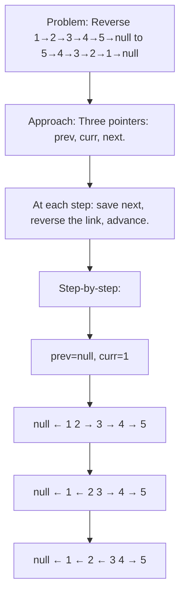
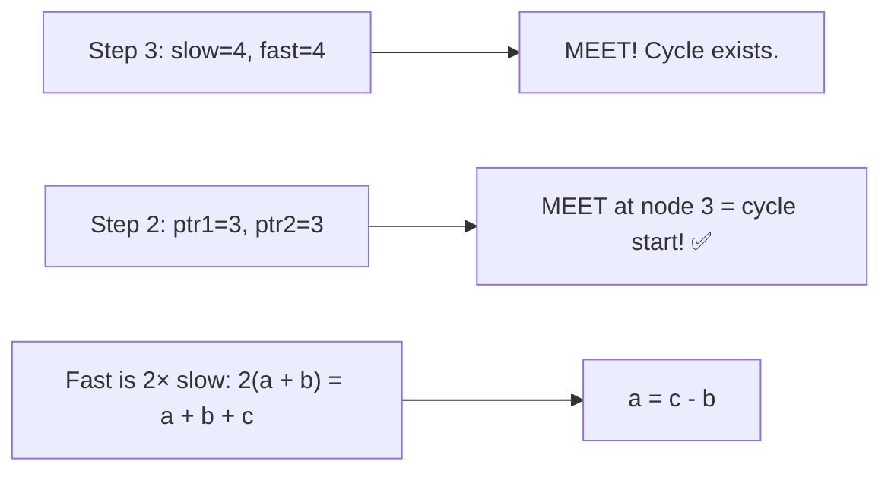
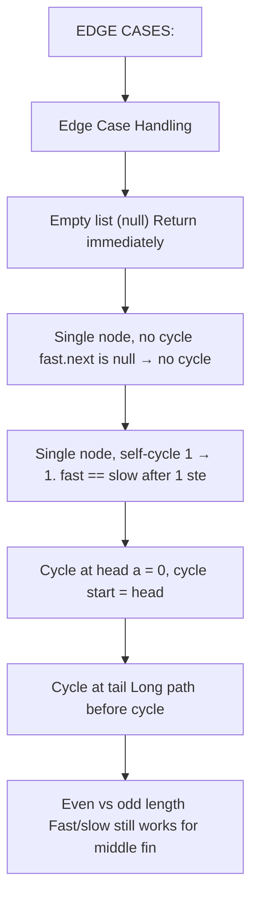

**Navigation**: [< Previous](11_Stack_Plus_MonotonicPattern.md) | [Back to Index](../00_MASTER_INDEX.md) | [Next >](13_Tree_Plus_DFS_BFS.md)

# LinkedList + Two Pointers — Combined Pattern Guide

**WHY this combination?** LinkedLists have no random access — you can't use indices. Two pointers (fast/slow) let you find midpoints, detect cycles, and locate k-th from end in a single pass.

### ⚠️ Constraint Lens

| Given Constraints | Do This |
|-------------------|---------|
| no random access | use pointers, not indexing |
| find middle/cycle | fast + slow |
| kth from end | maintain `k` gap |
| many repeated queries | consider converting to array if mutation is not needed |
| recursion over long list | avoid recursion; use iterative reversal/traversal |

Full map: [Constraint-Based Pattern Selection](25_Constraint_Based_Pattern_Selection.md).

### 🧠 Deep Intuition — Why Pointer Techniques Are Essential for Linked Lists

With arrays, finding the middle element is trivial: `arr[arr.length / 2]` — O(1). With linked lists, you can't do this because there's no index. You don't even know the length without traversing the entire list first. Fast/slow pointers solve this **without needing to know the length**.

#### The Fast/Slow Pointer Proof — Why Slow Lands on the Middle

When `fast` moves 2 nodes per step and `slow` moves 1 node per step, by the time `fast` reaches the end (having traveled `n` nodes), `slow` has traveled `n/2` nodes — exactly the middle. This is essentially using two counters where one counts at twice the speed.

#### Floyd's Cycle Detection — The Mathematical Proof

This is one of the most elegant algorithms in computer science. Here's why the "reset to head" trick finds the cycle start:

Let `a` = distance from head to cycle start, `b` = distance from cycle start to meeting point, and `c` = cycle length.

- **Slow** traveled: `a + b` steps
- **Fast** traveled: `a + b + c` steps (one extra loop around the cycle)
- Since fast moves at 2× speed: `2(a + b) = a + b + c`
- Simplifying: **`a = c - b`**

This means: the distance from **head to cycle start** equals the distance from **meeting point to cycle start** (going forward in the cycle). So if you reset one pointer to head and advance both at the same speed, they'll meet at the cycle start.

#### The Dummy Node Pattern — Why It Eliminates Edge Cases

When building or modifying a linked list, the head can change (e.g., inserting before the head, removing the head). Without a dummy, you need special `if (head == null)` checks everywhere. A dummy node (`new ListNode(0); dummy.next = head`) acts as a permanent "anchor" — the result is always `dummy.next`, regardless of what happened to the original head.

---

## 🧠 WHEN TO RECOGNIZE THIS PATTERN

```
IF the problem involves:
  ✅ Finding middle of linked list
  ✅ Detecting cycle
  ✅ Finding k-th from end
  ✅ Merging two sorted lists
  ✅ Checking palindrome (with reversal)
  ✅ Intersection point of two lists
THEN → LinkedList + Two Pointers
```

**Flow:**
1. THEN
2. LinkedList + Two Pointers


---


## 📐 CORE TEMPLATES

### Template 1: Fast/Slow (Floyd's) — Find Middle
```java
ListNode slow = head, fast = head;
while (fast != null && fast.next != null) {
    slow = slow.next;
    fast = fast.next.next;
}
// slow is at the middle (second middle if even length)
```

### Template 2: Cycle Detection
```java
ListNode slow = head, fast = head;
while (fast != null && fast.next != null) {
    slow = slow.next;
    fast = fast.next.next;
    if (slow == fast) {
        // CYCLE FOUND! Find start:
        ListNode start = head;
        while (start != slow) {
            start = start.next;
            slow = slow.next;
        }
        return start;  // cycle start node
    }
}
return null;  // no cycle
```

### Template 3: K-th From End
```java
ListNode first = head, second = head;
for (int i = 0; i < k; i++) first = first.next;  // advance first by k
while (first != null) {
    first = first.next;
    second = second.next;
}
return second;  // k-th from end
```

### Template 4: Reverse a Linked List
```java
ListNode prev = null, curr = head;
while (curr != null) {
    ListNode next = curr.next;
    curr.next = prev;
    prev = curr;
    curr = next;
}
return prev;  // new head
```

### Template 5: Merge Two Sorted Lists
```java
ListNode dummy = new ListNode(0);
ListNode curr = dummy;
while (l1 != null && l2 != null) {
    if (l1.val <= l2.val) {
        curr.next = l1; l1 = l1.next;
    } else {
        curr.next = l2; l2 = l2.next;
    }
    curr = curr.next;
}
curr.next = (l1 != null) ? l1 : l2;
return dummy.next;
```

---

## 🔬 VISUAL: Floyd's Cycle Detection

```
List: 1 → 2 → 3 → 4 → 5 → 3 (cycle back to 3)

Step  slow  fast
 0     1     1
 1     2     3
 2     3     5
 3     4     4*   ← fast went 5→3→4
 4     5     3*
 5     3     5
 6     4     4    ← MEET at 4!

Find cycle start:
  start=head(1), meet=4
  1→2→3  start moves 3 steps
  4→5→3  meet moves 3 steps
  Both at 3! → Cycle starts at 3 ✅
```

**Flow:**
1. Both at 3!
2. Cycle starts at 3 ✅


---

## � FULL WALKTHROUGH: Reverse a Linked List (3-Pointer Technique)

```
Problem: Reverse 1→2→3→4→5→null  to  5→4→3→2→1→null

Approach: Three pointers: prev, curr, next.
  At each step: save next, reverse the link, advance.

Step-by-step:
  prev=null, curr=1

  Step 1: next=2, 1.next=null, prev=1, curr=2
    null ← 1   2 → 3 → 4 → 5

  Step 2: next=3, 2.next=1, prev=2, curr=3
    null ← 1 ← 2   3 → 4 → 5

  Step 3: next=4, 3.next=2, prev=3, curr=4
    null ← 1 ← 2 ← 3   4 → 5

  Step 4: next=5, 4.next=3, prev=4, curr=5
    null ← 1 ← 2 ← 3 ← 4   5

  Step 5: next=null, 5.next=4, prev=5, curr=null
    null ← 1 ← 2 ← 3 ← 4 ← 5

  Return prev (5) = new head ✅

Time: O(n) | Space: O(1)
WHY 3 pointers? You need `next` because once you reverse curr.next,
you lose the reference to the rest of the list.
```

**Flow:**
1. Problem: Reverse 1
2. 2
3. 3
4. 4
5. 5
6. null to 5
7. 4
8. 3
9. 2
10. 1
11. null
12. Approach: Three pointers: prev, curr, next.
13. At each step: save next, reverse the link, advance.
14. Step-by-step:
15. prev=null, curr=1
16. null ← 1 2
17. 3
18. 4
19. 5
20. null ← 1 2
21. 3
22. 4
23. 5
24. null ← 1 ← 2 3
25. 4
26. 5



---


## 🔬 FULL WALKTHROUGH 2: Floyd's Cycle Detection — Find Where Cycle Begins

```
Problem: Detect if linked list has a cycle. If yes, find the start node.
         1 → 2 → 3 → 4 → 5 → 3 (cycle to node 3)

Phase 1: DETECT cycle (fast/slow pointers).
  slow=1, fast=1

  Step 1: slow=2, fast=3
  Step 2: slow=3, fast=5
  Step 3: slow=4, fast=4 → MEET! Cycle exists.

Phase 2: FIND cycle start (reset one pointer to head).
  Mathematical proof: When slow and fast meet, the distance from
  HEAD to cycle-start = distance from MEETING POINT to cycle-start.

  ptr1=head(1), ptr2=meeting(4)
  Step 1: ptr1=2, ptr2=5
  Step 2: ptr1=3, ptr2=3 → MEET at node 3 = cycle start! ✅

WHY does the math work?
  Let a = distance from head to cycle start.
  Let b = distance from cycle start to meeting point.
  Let c = cycle length.
  
  Slow traveled: a + b
  Fast traveled: a + b + c (one extra loop)
  Fast is 2× slow: 2(a + b) = a + b + c → a = c - b
  So: head to cycle-start = meeting-point to cycle-start!

Time: O(n) | Space: O(1)
```

**Flow:**
1. Step 3: slow=4, fast=4
2. MEET! Cycle exists.
3. Step 2: ptr1=3, ptr2=3
4. MEET at node 3 = cycle start! ✅
5. Fast is 2× slow: 2(a + b) = a + b + c
6. a = c - b



---


## 🛡️ EDGE CASES & COMMON MISTAKES

```
EDGE CASES:
┌────────────────────────────┬─────────────────────────────────────────────┐
│ Edge Case                  │ Handling                                    │
├────────────────────────────┼─────────────────────────────────────────────┤
│ Empty list (null)          │ Return immediately                          │
│ Single node, no cycle      │ fast.next is null → no cycle                │
│ Single node, self-cycle    │ 1 → 1. fast == slow after 1 step            │
│ Cycle at head              │ a = 0, cycle start = head                   │
│ Cycle at tail              │ Long path before cycle                      │
│ Even vs odd length         │ Fast/slow still works for middle finding    │
└────────────────────────────┴─────────────────────────────────────────────┘

COMMON MISTAKES:
1. Forgetting NULL check: while (fast != null && fast.next != null)
   Missing fast.next check → NullPointerException
2. Not using DUMMY node for merge/partition problems
   Without dummy: must handle "which node becomes new head?" separately
3. Losing reference during reversal — always save next before modifying
4. Off-by-one in "k-th from end" — advance first pointer EXACTLY k steps
5. Modifying the original list when problem says "don't modify"
   Palindrome check: reverse second half, check, then REVERSE BACK
```

**Flow:**
1. EDGE CASES:
2. Edge Case Handling
3. Empty list (null) Return immediately
4. Single node, no cycle fast.next is null
5. no cycle
6. Single node, no cycle fast.next is null
7. no cycle
8. Single node, self-cycle 1
9. 1. fast == slow after 1 ste
10. Single node, self-cycle 1
11. 1. fast == slow after 1 ste
12. Cycle at head a = 0, cycle start = head
13. Cycle at tail Long path before cycle



---

## 📊 COMPLEXITY SUMMARY

| Pattern | Time | Space | When |
|---------|------|-------|------|
| Reverse (iterative) | O(n) | O(1) | In-place reversal |
| Reverse (recursive) | O(n) | O(n) stack | Cleaner code, more space |
| Fast/Slow middle | O(n) | O(1) | Find middle in 1 pass |
| Floyd's cycle detect | O(n) | O(1) | Detect + find cycle start |
| K-th from end | O(n) | O(1) | Single pass with gap |
| Merge two sorted | O(n+m) | O(1) | Dummy node technique |
| Merge K sorted | O(n log k) | O(k) | Min-heap of k heads |

---


🔬 **Section Challenge — 📊 COMPLEXITY SUMMARY**

**Challenge 1 (Reasoning):** Prefix sum initialized as `prefix[0] = 0` — why the leading zero and not `prefix[0] = arr[0]`?
<details><summary>Answer</summary>

`prefix[0] = 0` (empty prefix) makes range sum formula uniform: `sum(l,r) = prefix[r+1] - prefix[l]`. Without the 0: `sum(0,r) = prefix[r] - 0` (special case needed). With it: `sum(0,r) = prefix[r+1] - prefix[0] = prefix[r+1]`. Same formula everywhere. This is the 'sentinel' pattern — adding a dummy initial value to eliminate special cases. Same trick used in dummy linked list nodes.
</details>


## 📋 PRACTICE PROBLEMS — From Your Excel Sheet
| # | Problem | Companies | Key Insight |
|---|---------|-----------|-------------|
| 1 | [Middle of Linked List](https://leetcode.com/problems/middle-of-the-linked-list/) | — | Fast/slow pointers |
| 2 | [Linked List Cycle](https://leetcode.com/problems/linked-list-cycle/) | Amazon | Fast/slow detect |
| 3 | [Reverse Linked List](https://leetcode.com/problems/reverse-linked-list/) | Salesforce | Three-pointer reversal |
| 4 | [Merge Two Sorted Lists](https://leetcode.com/problems/merge-two-sorted-lists/) | Salesforce, Microsoft | Dummy node + merge |
| 5 | [Intersection of Two Linked Lists](https://leetcode.com/problems/intersection-of-two-linked-lists/) | Salesforce | Two-pass length equalization |
| 6 | [Palindrome Linked List](https://leetcode.com/problems/palindrome-linked-list/) | Salesforce, Microsoft | Find mid → reverse second half → compare |
| 7 | [Remove Duplicates from Sorted List](https://leetcode.com/problems/remove-duplicates-from-sorted-list/) | — | Single pointer scan |
| 8 | [Convert Binary to Integer](https://leetcode.com/problems/convert-binary-number-in-a-linked-list-to-integer/) | Microsoft | `result = result * 2 + node.val` |
| 9 | [Sort 0s, 1s, 2s](https://www.geeksforgeeks.org/sort-a-linked-list-of-0s-1s-or-2s/) | — | Count or Dutch flag |
| 10 | [Delete Node (pointer only)](https://www.geeksforgeeks.org/given-only-a-pointer-to-a-node-to-be-deleted-in-a-singly-linked-list-how-do-you-delete-it/) | — | Copy next node's data |
| 11 | [Multiply Two Numbers as LL](https://www.geeksforgeeks.org/multiply-two-numbers-represented-linked-lists/) | — | Traverse + multiply |

### Medium
| # | Problem | Companies | Key Insight |
|---|---------|-----------|-------------|
| 12 | [Copy List with Random Pointer](https://leetcode.com/problems/copy-list-with-random-pointer/) | — | HashMap clone OR interleave trick |
| 13 | [Add Two Numbers II](https://leetcode.com/problems/add-two-numbers-ii/) | — | Stack or reverse first |
| 14 | [Reverse Linked List II](https://leetcode.com/problems/reverse-linked-list-ii/) | Walmart | Reverse sublist between positions |
| 15 | [Remove Nth from End](https://leetcode.com/problems/remove-nth-node-from-end-of-list/) | — | Two pointers, k gap |
| 16 | [Flatten Multilevel DLL](https://leetcode.com/problems/flatten-a-multilevel-doubly-linked-list/) | — | Stack or recursion |
| 17 | [Partition List](https://leetcode.com/problems/partition-list/) | Microsoft | Two dummy lists |
| 18 | [Remove Duplicates II](https://leetcode.com/problems/remove-duplicates-from-sorted-list-ii/) | Salesforce | Skip all nodes with duplicate value |
| 19 | [Linked List Zig-Zag](https://www.geeksforgeeks.org/linked-list-in-zig-zag-fashion/) | — | Alternate comparison direction |
| 20 | [Segregate Even/Odd](https://www.geeksforgeeks.org/segregate-even-and-odd-elements-in-a-linked-list/) | — | Two-list partition |
| 21 | [Rearrange In-Place](https://www.geeksforgeeks.org/rearrange-a-given-linked-list-in-place/) | — | Mid split + reverse + merge |

### Hard
| # | Problem | Companies | Key Insight |
|---|---------|-----------|-------------|
| 22 | [Merge K Sorted Lists](https://leetcode.com/problems/merge-k-sorted-lists/) | — | Min-Heap of k heads |
| 23 | [Reverse Nodes in K-Group](https://leetcode.com/problems/reverse-nodes-in-k-group/) | Walmart | Count k + reverse + recurse |
| 24 | [Merge Sort for Linked List](https://www.geeksforgeeks.org/merge-sort-for-linked-list/) | Microsoft | Find mid + split + merge |
| 25 | [Flatten a Linked List](https://www.geeksforgeeks.org/flattening-a-linked-list/) | — | Merge sublists |
| 26 | [Subtract Two Numbers as LL](https://www.geeksforgeeks.org/subtract-two-numbers-represented-as-linked-lists/) | — | Reverse + subtract + handle borrow |

### Additional — From Bonus Section
| # | Problem | Key Insight |
|---|---------|-------------|
| 27 | Josephus Circle using STL list | Circular list simulation |
| 28 | Find triplet from 3 linked lists with given sum | Sort + two pointer per list |
| 29 | Pair with given sum in sorted DLL | Two pointers from head & tail |
| 30 | Select random node (reservoir sampling) | Probability 1/n at step n |
| 31 | First non-repeating character in stream | Queue + HashMap |

---

## 🔥 KEY TRICKS

| Trick | When | Example |
|-------|------|---------|
| Dummy node | Simplify edge cases | `new ListNode(0); dummy.next = head` |
| Fast/slow | Find middle, cycle | 2x speed difference |
| Reverse + compare | Palindrome check | Reverse second half |
| K-gap advance | K-th from end | Advance one pointer by k first |
| Interleave clone | Copy with random ptr | Insert clones between originals |

---

📖 **Related Chapters:**
- [02_Data_Structures/01c_LinkedList.md](../02_Data_Structures/01c_LinkedList.md) — LinkedList internals

---
[← 11 Stack+Monotonic](11_Stack_Plus_MonotonicPattern.md) | [13 Tree+DFS/BFS →](13_Tree_Plus_DFS_BFS.md)


