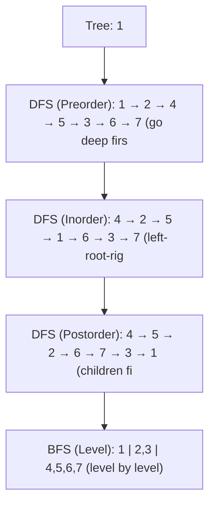
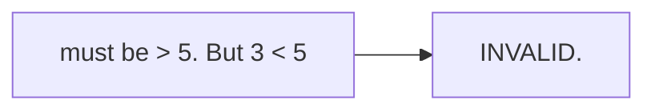
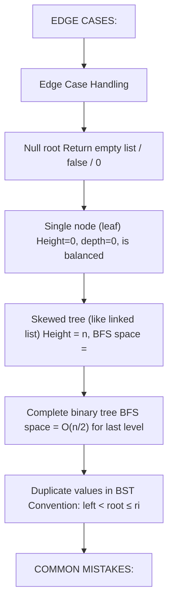

> **Navigation**: [< Previous](12_LinkedList_Plus_TwoPointers.md) | [Back to Index](../00_MASTER_INDEX.md) | [Next >](14_Graph_Plus_Traversal.md)

# Tree + DFS/BFS — Combined Pattern Guide

> **WHY this combination?** Trees are hierarchical. DFS explores depth-first (recursion/stack) — ideal for path problems. BFS explores level-by-level (queue) — ideal for shortest path and level-order problems.

---

## 🧠 WHEN TO RECOGNIZE

```
Use DFS when:                    Use BFS when:
✅ Path from root to leaf        ✅ Level-order traversal
✅ Check if tree has property    ✅ Shortest path in tree
✅ Construct tree from traversal ✅ Connect nodes at same level
✅ Subtree operations            ✅ Zigzag traversal
✅ LCA (Lowest Common Ancestor)  ✅ Right-side view
```

---

## 📐 CORE TEMPLATES

### Template 1: DFS — Recursive (Most Common)
```java
// Pattern: process root, then children
int dfs(TreeNode node) {
    if (node == null) return 0;  // BASE CASE

    int left = dfs(node.left);   // RECURSE left
    int right = dfs(node.right); // RECURSE right

    // PROCESS: combine results
    return 1 + Math.max(left, right);  // Example: max depth
}
```

### Template 2: BFS — Level Order
```java
Queue<TreeNode> queue = new LinkedList<>();
queue.offer(root);
List<List<Integer>> levels = new ArrayList<>();

while (!queue.isEmpty()) {
    int size = queue.size();  // CRITICAL: snapshot size
    List<Integer> level = new ArrayList<>();
    for (int i = 0; i < size; i++) {
        TreeNode node = queue.poll();
        level.add(node.val);
        if (node.left != null) queue.offer(node.left);
        if (node.right != null) queue.offer(node.right);
    }
    levels.add(level);
}
```

### Template 3: DFS with Path Tracking
```java
void dfs(TreeNode node, int target, List<Integer> path, List<List<Integer>> result) {
    if (node == null) return;
    path.add(node.val);

    if (node.left == null && node.right == null && target == node.val) {
        result.add(new ArrayList<>(path));  // COPY path!
    }

    dfs(node.left, target - node.val, path, result);
    dfs(node.right, target - node.val, path, result);
    path.remove(path.size() - 1);  // BACKTRACK
}
```

### Template 4: BST Operations
```java
// Search in BST — O(log n) average
TreeNode search(TreeNode root, int val) {
    if (root == null || root.val == val) return root;
    return val < root.val ? search(root.left, val) : search(root.right, val);
}

// Validate BST — inorder must be sorted
boolean isValid(TreeNode node, long min, long max) {
    if (node == null) return true;
    if (node.val <= min || node.val >= max) return false;
    return isValid(node.left, min, node.val) && isValid(node.right, node.val, max);
}
```

---

## 🔬 VISUAL: DFS vs BFS Traversal Order

```
Tree:        1
           /   \
          2     3
         / \   / \
        4   5 6   7

DFS (Preorder):  1 → 2 → 4 → 5 → 3 → 6 → 7  (go deep first)
DFS (Inorder):   4 → 2 → 5 → 1 → 6 → 3 → 7  (left-root-right)
DFS (Postorder): 4 → 5 → 2 → 6 → 7 → 3 → 1  (children first)
BFS (Level):     1 | 2,3 | 4,5,6,7             (level by level)
```

> **Flow**: Tree: 1 → DFS (Preorder): 1 → 2 → 4 → 5 → 3 → 6 → 7 (go deep firs | DFS (Preorder): 1 → 2 → 4 → 5 → 3 → 6 → 7 (go deep firs → DFS (Inorder): 4 → 2 → 5 → 1 → 6 → 3 → 7 (left-root-rig | DFS (Inorder): 4 → 2 → 5 → 1 → 6 → 3 → 7 (left-root-rig → DFS (Postorder): 4 → 5 → 2 → 6 → 7 → 3 → 1 (children fi | DFS (Postorder): 4 → 5 → 2 → 6 → 7 → 3 → 1 (children fi → BFS (Level): 1 | 2,3 | 4,5,6,7 (level by level)



---

## � FULL WALKTHROUGH: Validate BST (Range Propagation)

```
Problem: Check if a binary tree is a valid BST.
         5
        / \
       1   4       Valid? NO! (4 < 5 but is in RIGHT subtree)
          / \
         3   6

Approach: Top-down range check. Pass (min, max) bounds DOWN.
  Each node must satisfy: min < node.val < max

WHY range propagation? Just checking node > left && node < right
is NOT enough. Node 3 (under 4) is in 5's RIGHT subtree, so it
must be > 5. But 3 < 5 → INVALID.

Step-by-step:
  validate(5, -∞, +∞): 5 in (-∞, +∞) ✅
    validate(1, -∞, 5): 1 in (-∞, 5) ✅
    validate(4, 5, +∞): 4 in (5, +∞) ❌ (4 < 5!)
  → Return false

Time: O(n) | Space: O(h)
```

> **Flow**: must be &gt; 5. But 3 &lt; 5 → INVALID.



---

## 🔬 FULL WALKTHROUGH 2: BFS Level Order Traversal

```
Problem: Return node values level by level.
         3
        / \
       9  20
          / \
         15  7

Approach: BFS with Queue. Process level by level using queue size.

Step-by-step:
  queue = [3]

  Level 0: size=1
    Dequeue 3, add to level list. Enqueue children: 9, 20.
    result = [[3]]
    queue = [9, 20]

  Level 1: size=2
    Dequeue 9, add to level list. No children.
    Dequeue 20, add to level list. Enqueue children: 15, 7.
    result = [[3], [9, 20]]
    queue = [15, 7]

  Level 2: size=2
    Dequeue 15, add to level list. No children.
    Dequeue 7, add to level list. No children.
    result = [[3], [9, 20], [15, 7]]
    queue = [] → done!

  Answer: [[3], [9, 20], [15, 7]] ✅

KEY: The "level snapshot" trick = process exactly queue.size() nodes per level.
     int size = queue.size();  // snapshot BEFORE adding children
     for (int i = 0; i < size; i++) { ... }

Time: O(n) | Space: O(w) where w = max width of tree
```

> **Flow**: queue = [] → done!


---

## 🛡️ EDGE CASES & COMMON MISTAKES

```
EDGE CASES:
┌──────────────────────────────┬────────────────────────────────────────┐
│ Edge Case                    │ Handling                               │
├──────────────────────────────┼────────────────────────────────────────┤
│ Null root                    │ Return empty list / false / 0          │
│ Single node (leaf)           │ Height=0, depth=0, is balanced         │
│ Skewed tree (like linked list)│ Height = n, BFS space = O(1)          │
│ Complete binary tree          │ BFS space = O(n/2) for last level     │
│ Duplicate values in BST      │ Convention: left < root ≤ right        │
│ Integer.MIN/MAX in BST ranges│ Use Long.MIN/MAX for range bounds      │
└──────────────────────────────┴────────────────────────────────────────┘

COMMON MISTAKES:
1. BST validation: checking only parent, not full ancestor range
   Node must be within (min, max) inherited from ALL ancestors above!
2. Forgetting to snapshot queue size in BFS level order
   Without snapshot: children mix into the same level
3. Confusing preorder/inorder/postorder — draw the tree and trace!
   Pre: root-left-right. In: left-root-right. Post: left-right-root.
4. Max path sum: returning path-through-node but answer needs turn
   The function returns max single-path, but updates global with turn.
5. Using == instead of .equals() for TreeNode values (rare but tricky)
```

> **Flow**: EDGE CASES: → Edge Case Handling | Edge Case Handling → Null root Return empty list / false / 0 | Null root Return empty list / false / 0 → Single node (leaf) Height=0, depth=0, is balanced | Single node (leaf) Height=0, depth=0, is balanced → Skewed tree (like linked list) Height = n, BFS space = | Skewed tree (like linked list) Height = n, BFS space = → Complete binary tree BFS space = O(n/2) for last level | Complete binary tree BFS space = O(n/2) for last level → Duplicate values in BST Convention: left &lt; root ≤ ri | ...+1 more



---

## 📊 COMPLEXITY SUMMARY

| Operation | Time | Space | Notes |
|-----------|------|-------|-------|
| DFS traversals (any) | O(n) | O(h) | h = log n balanced, n skewed |
| BFS level order | O(n) | O(w) | w = max width ≈ n/2 bottom level |
| BST search/insert | O(h) | O(1) | O(log n) balanced, O(n) skewed |
| Validate BST | O(n) | O(h) | Must visit every node |
| LCA (binary tree) | O(n) | O(h) | LCA (BST) = O(h) |
| Construct from traversals | O(n) | O(n) | Need HashMap for index lookup |

---

## 📋 PRACTICE PROBLEMS — From Your Excel Sheet
| 1 | [Maximum Depth](https://leetcode.com/problems/maximum-depth-of-binary-tree/) | — | DFS: 1 + max(left, right) |
| 2 | [Diameter of Binary Tree](https://leetcode.com/problems/diameter-of-binary-tree/) | — | DFS: track leftH + rightH at each node |
| 3 | [Invert Binary Tree](https://leetcode.com/problems/invert-binary-tree/) | Amazon, Walmart | DFS: swap left and right |
| 4 | [Subtree of Another Tree](https://leetcode.com/problems/subtree-of-another-tree/) | Amazon, Walmart, Microsoft | DFS: isSameTree at each node |
| 5 | [Symmetric Tree](https://leetcode.com/problems/symmetric-tree/) | Goldman Sachs, Walmart | Mirror DFS: left.left↔right.right |
| 6 | [Same Tree](https://leetcode.com/problems/same-tree/) | — | DFS: compare value + structure |
| 7 | [Path Sum](https://leetcode.com/problems/path-sum/) | — | DFS: subtract node value, check leaf |
| 8 | [Merge Two Binary Trees](https://leetcode.com/problems/merge-two-binary-trees/) | — | DFS: sum values, recurse both |
| 9 | [Range Sum of BST](https://leetcode.com/problems/range-sum-of-bst/) | — | BST pruning DFS |
| 10 | [Balanced Binary Tree](https://leetcode.com/problems/balanced-binary-tree/) | Microsoft | DFS: check height diff ≤ 1 |
| 11 | [Sum of Left Leaves](https://leetcode.com/problems/sum-of-left-leaves/) | Salesforce, Microsoft | DFS: track if node is left child |
| 12 | [Binary Tree Paths](https://leetcode.com/problems/binary-tree-paths/) | Salesforce, Microsoft | DFS with path string |
| 13 | [LCA of BST](https://leetcode.com/problems/lowest-common-ancestor-of-a-binary-search-tree/) | Goldman Sachs | BST split point |
| 14 | [Convert Sorted Array to BST](https://leetcode.com/problems/convert-sorted-array-to-binary-search-tree/) | — | Mid-point recursion |
| 15 | [Min Absolute Difference in BST](https://leetcode.com/problems/minimum-absolute-difference-in-bst/) | — | Inorder traversal = sorted |
| 16 | [Predecessor and Successor](https://practice.geeksforgeeks.org/problems/predecessor-and-successor/1) | — | BST property navigation |
| 17 | [Inorder Traversal](https://leetcode.com/problems/binary-tree-inorder-traversal/) | — | Recursion or Morris traversal |
| 18 | [Dead End in BST](https://practice.geeksforgeeks.org/problems/check-whether-bst-contains-dead-end/1) | — | Track min/max range |

### Medium
| # | Problem | Companies | Key Insight |
|---|---------|-----------|-------------|
| 19 | [BST Iterator](https://leetcode.com/problems/binary-search-tree-iterator/) | — | Stack-based inorder |
| 20 | [LCA of Binary Tree](https://leetcode.com/problems/lowest-common-ancestor-of-a-binary-tree/) | — | DFS: return non-null from subtrees |
| 21 | [Validate BST](https://leetcode.com/problems/validate-binary-search-tree/) | Amazon | Min/max range propagation |
| 22 | [Level Order Traversal](https://leetcode.com/problems/binary-tree-level-order-traversal/) | — | BFS with level snapshot |
| 23 | [Right Side View](https://leetcode.com/problems/binary-tree-right-side-view/) | — | BFS: last node per level |
| 24 | [Zigzag Level Order](https://leetcode.com/problems/binary-tree-zigzag-level-order-traversal/) | Salesforce | BFS + alternating direction |
| 25 | [Kth Smallest in BST](https://leetcode.com/problems/kth-smallest-element-in-a-bst/) | Amazon | Inorder, count to k |
| 26 | [All Nodes Distance K](https://leetcode.com/problems/all-nodes-distance-k-in-binary-tree/) | Microsoft | Convert to graph + BFS |
| 27 | [Unique BSTs II](https://leetcode.com/problems/unique-binary-search-trees-ii/) | — | DFS: enumerate all structures |
| 28 | [Unique BSTs Count](https://leetcode.com/problems/unique-binary-search-trees/) | Amazon, Salesforce, Microsoft | Catalan number / DP |
| 29 | [Path Sum III](https://leetcode.com/problems/path-sum-iii/) | Microsoft | Prefix sum + DFS |
| 30 | [Construct from Preorder+Postorder](https://leetcode.com/problems/construct-binary-tree-from-preorder-and-postorder-traversal/) | Amazon, Salesforce | Index lookup |
| 31 | [Flatten to Linked List](https://leetcode.com/problems/flatten-binary-tree-to-linked-list/) | — | Reverse postorder |
| 32 | [Maximum Width](https://leetcode.com/problems/maximum-width-of-binary-tree/) | — | BFS + position indexing |
| 33 | [Populating Next Right Pointers](https://leetcode.com/problems/populating-next-right-pointers-in-each-node/) | Salesforce, Microsoft, Walmart | BFS or constant space traversal |
| 34 | [Recover BST](https://leetcode.com/problems/recover-binary-search-tree/) | Salesforce | Inorder: find two swapped |
| 35 | [Min Distance Between Nodes](https://practice.geeksforgeeks.org/problems/min-distance-between-two-given-nodes-of-a-binary-tree/1) | Amazon | LCA + distance from LCA |
| 36 | [Count BST Nodes in Range](https://practice.geeksforgeeks.org/problems/count-bst-nodes-that-lie-in-a-given-range/1) | — | Pruned DFS |
| 37 | [Preorder to Postorder](https://practice.geeksforgeeks.org/problems/preorder-to-postorder4423/1) | Amazon, Microsoft | Reconstruct BST then traverse |
| 38 | [Redundant Connection](https://leetcode.com/problems/redundant-connection/) | — | Union-Find (not pure tree) |

### Hard
| # | Problem | Companies | Key Insight |
|---|---------|-----------|-------------|
| 39 | [Binary Tree to DLL](https://practice.geeksforgeeks.org/problems/binary-tree-to-dll/1) | — | Inorder with prev pointer |
| 40 | [Max Path Sum](https://leetcode.com/problems/binary-tree-maximum-path-sum/) | Salesforce | DFS: consider path through node |
| 41 | [Sum of Distances in Tree](https://leetcode.com/problems/sum-of-distances-in-tree/) | Salesforce | Rerooting technique |
| 42 | [Binary Tree Cameras](https://leetcode.com/problems/binary-tree-cameras/) | Amazon, Salesforce | Greedy DFS: 3 states |
| 43 | [Vertical Order Traversal](https://leetcode.com/problems/vertical-order-traversal-of-a-binary-tree/) | Amazon | BFS/DFS + column tracking |
| 44 | [K Sum Paths](https://www.geeksforgeeks.org/print-k-sum-paths-binary-tree/) | Amazon | DFS + prefix sum |
| 45 | [Serialize/Deserialize](https://leetcode.com/problems/serialize-and-deserialize-binary-tree/) | Amazon | Preorder + queue |
| 46 | [Find Median in BST O(1) Space](https://www.geeksforgeeks.org/find-median-bst-time-o1-space/) | — | Morris inorder traversal |
| 47 | [Largest BST in Binary Tree](https://www.geeksforgeeks.org/largest-bst-binary-tree-set-2/) | Microsoft | Post-order: propagate min/max/size |
| 48 | [Construct BST from Preorder](https://www.geeksforgeeks.org/construct-bst-from-given-preorder-traversa/) | — | Upper-bound approach |

### Additional — From Bonus Section
| # | Problem | Key Insight |
|---|---------|-------------|
| 49 | Check Mirror in N-ary Tree | Compare children in reverse |
| 50 | Max Sum No Two Adjacent | House Robber on tree (DFS + DP) |
| 51 | Brothers From Different Roots | Pair sum between two BSTs |

---

## 🔥 KEY TRICKS

| Trick | When | Example |
|-------|------|---------|
| Return multiple values | Need height + answer | Use class variable or int[] |
| Inorder = sorted | BST validation, kth smallest | Inorder traversal |
| Level size snapshot | BFS level processing | `int size = queue.size()` |
| Morris traversal | O(1) space inorder | Threading tree nodes |
| Rerooting | Change root problems | Two-pass DFS |

---

📖 **Related Chapters:**
- [03_Algorithms/05_Trees.md](../03_Algorithms/05_Trees.md) — Tree algorithms deep dive
- [09_Career_Reference/07_DSA_Guide_Foundations.md](../09_Career_Reference/07_DSA_Guide_Foundations.md) — DSA fundamentals

---
[← 12 LinkedList+TwoPointers](12_LinkedList_Plus_TwoPointers.md) | [14 Graph+Traversal →](14_Graph_Plus_Traversal.md)


---

> **Navigation**: [< Previous](12_LinkedList_Plus_TwoPointers.md) | [Back to Index](../00_MASTER_INDEX.md) | [Next >](14_Graph_Plus_Traversal.md)