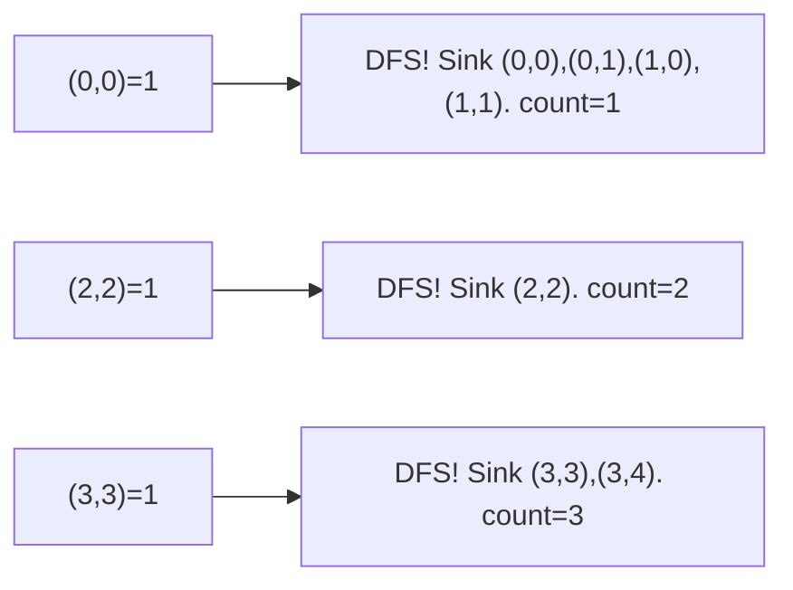
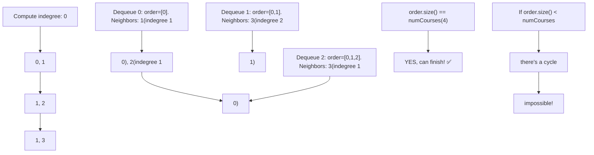
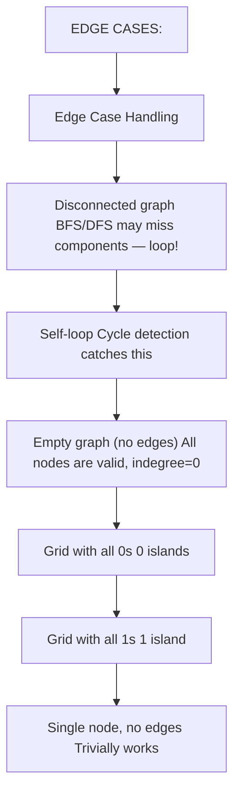

> **Navigation**: [< Previous](13_Tree_Plus_DFS_BFS.md) | [Back to Index](../00_MASTER_INDEX.md) | [Next >](15_Heap_Plus_GreedySelection.md)

# Graph + Traversal Patterns — Combined Pattern Guide

> **WHY this combination?** Graphs model relationships. BFS gives shortest unweighted path. DFS explores all reachable nodes. Dijkstra handles weighted graphs. Union-Find manages connected components. Choosing the right traversal is THE key skill.

### 🧠 Deep Intuition — Choosing the Right Graph Algorithm

#### Graph Representation — The First Decision

Before choosing an algorithm, you must decide how to represent the graph. This decision affects both code complexity and performance:

| Representation | Space | Edge Lookup | Iterate Neighbors | Best When |
|---------------|-------|-------------|-------------------|-----------|
| **Adjacency List** | O(V + E) | O(degree) | O(degree) | Sparse graphs (most real-world graphs) |
| **Adjacency Matrix** | O(V²) | O(1) | O(V) | Dense graphs, need fast edge queries |

Most interview problems use adjacency lists because real-world graphs are sparse (each node has few connections relative to total nodes).

#### Why BFS Guarantees Shortest Path (Unweighted)

BFS explores nodes in **order of increasing distance from the source**. All nodes at distance 1 are explored before any node at distance 2. So the **first time you reach any node, you've reached it via the shortest path**. This is why BFS is the correct algorithm for unweighted shortest paths — it's a direct consequence of the level-by-level exploration.

This does NOT work for weighted graphs — a path with more edges might have a lower total weight, and BFS doesn't account for edge weights.

#### Why Dijkstra Is Correct — The Greedy Proof Sketch

Dijkstra always processes the unvisited node with the **smallest known distance**. Its correctness relies on one assumption: **all edge weights are non-negative.** When you process a node, you know its distance is final because any other path would go through an unprocessed node with a *larger* distance, and since all edges are non-negative, that alternative path can only be *longer*.

With negative edges, this assumption breaks — a longer path through a negative edge might turn out shorter. This is why Dijkstra fails on negative-weight graphs and you must use Bellman-Ford instead.

#### Union-Find — The Power of Amortized O(1) Operations

Union-Find achieves near-constant time per operation through two optimizations:
- **Path compression**: When you call `find(x)`, make every node along the path point directly to the root. Future operations on these nodes are O(1).
- **Union by rank**: Always attach the shorter tree under the taller tree, keeping the tree balanced. Without this, unions could create a long chain (O(n) per find).

Together, these give **O(α(n))** amortized time per operation, where α is the inverse Ackermann function — so slow-growing that it's effectively ≤ 4 for any practical input size. This is essentially O(1).

---

## 🧠 WHEN TO RECOGNIZE

```
Problem type → Algorithm:
├── "Shortest path" (unweighted) → BFS
├── "Shortest path" (weighted, no negative) → Dijkstra
├── "Shortest path" (negative edges) → Bellman-Ford
├── "All pairs shortest path" → Floyd-Warshall
├── "Connected components" → BFS/DFS or Union-Find
├── "Cycle detection" → DFS (directed) or Union-Find (undirected)
├── "Topological ordering" → Kahn's BFS or DFS
├── "Minimum spanning tree" → Prim's or Kruskal's
├── "Bridges/Articulation points" → Tarjan's DFS
└── "Bipartite check" → BFS/DFS with 2-coloring
```

**Flow:**
- Problem type
- ↓
- Algorithm:
- ↓
- 'Shortest path' (unweighted)
- ↓
- BFS
- ↓
- 'Shortest path' (weighted, no negative)
- ↓
- Dijkstra
- ↓
- 'Shortest path' (negative edges)
- ↓
- Bellman-Ford
- ↓
- 'All pairs shortest path'
- ↓
- Floyd-Warshall
- ↓
- 'Connected components'
- ↓
- BFS/DFS or Union-Find

```mermaid
flowchart TD
    N1["Problem type"]
    N2["Algorithm:"]
    N3["'Shortest path' (unweighted)"]
    N4["BFS"]
    N5["'Shortest path' (weighted, no negative)"]
    N6["Dijkstra"]
    N7["'Shortest path' (negative edges)"]
    N8["Bellman-Ford"]
    N9["'All pairs shortest path'"]
    N10["Floyd-Warshall"]
    N11["'Connected components'"]
    N12["BFS/DFS or Union-Find"]
    N13["'Cycle detection'"]
    N14["DFS (directed) or Union-Find (undirected)"]
    N15["'Topological ordering'"]
    N16["Kahn's BFS or DFS"]
    N17["'Minimum spanning tree'"]
    N18["Prim's or Kruskal's"]
    N19["'Bridges/Articulation points'"]
    N20["Tarjan's DFS"]
    N1 --> N2
    N3 --> N4
    N5 --> N6
    N7 --> N8
    N9 --> N10
    N11 --> N12
    N13 --> N14
    N15 --> N16
    N17 --> N18
    N19 --> N20
```



---

## 📐 CORE TEMPLATES

### Template 1: BFS (Shortest Path Unweighted)
```java
int bfs(int[][] graph, int start, int end) {
    Queue<Integer> queue = new LinkedList<>();
    boolean[] visited = new boolean[n];
    queue.offer(start);
    visited[start] = true;
    int distance = 0;

    while (!queue.isEmpty()) {
        int size = queue.size();
        for (int i = 0; i < size; i++) {
            int node = queue.poll();
            if (node == end) return distance;
            for (int neighbor : graph[node]) {
                if (!visited[neighbor]) {
                    visited[neighbor] = true;
                    queue.offer(neighbor);
                }
            }
        }
        distance++;
    }
    return -1;
}
```

### Template 2: DFS (Cycle Detection + Topological Sort)
```java
// States: 0=unvisited, 1=in-progress, 2=completed
boolean hasCycle(int node, List<List<Integer>> adj, int[] state, List<Integer> topo) {
    state[node] = 1;  // VISITING
    for (int next : adj.get(node)) {
        if (state[next] == 1) return true;       // CYCLE! Back edge
        if (state[next] == 0 && hasCycle(next, adj, state, topo)) return true;
    }
    state[node] = 2;  // DONE
    topo.add(0, node);  // Add to beginning for topological order
    return false;
}
```

### Template 3: Dijkstra
```java
int[] dijkstra(List<int[]>[] graph, int start, int n) {
    int[] dist = new int[n];
    Arrays.fill(dist, Integer.MAX_VALUE);
    dist[start] = 0;
    PriorityQueue<int[]> pq = new PriorityQueue<>((a, b) -> a[1] - b[1]);
    pq.offer(new int[]{start, 0});

    while (!pq.isEmpty()) {
        int[] curr = pq.poll();
        int u = curr[0], d = curr[1];
        if (d > dist[u]) continue;  // skip stale entries
        for (int[] edge : graph[u]) {
            int v = edge[0], w = edge[1];
            if (dist[u] + w < dist[v]) {
                dist[v] = dist[u] + w;
                pq.offer(new int[]{v, dist[v]});
            }
        }
    }
    return dist;
}
```

### Template 4: Union-Find
```java
int[] parent, rank;
int find(int x) {
    if (parent[x] != x) parent[x] = find(parent[x]);  // path compression
    return parent[x];
}
boolean union(int x, int y) {
    int px = find(x), py = find(y);
    if (px == py) return false;  // already connected (cycle in undirected!)
    if (rank[px] < rank[py]) { parent[px] = py; }
    else if (rank[px] > rank[py]) { parent[py] = px; }
    else { parent[py] = px; rank[px]++; }
    return true;
}
```

---

## � FULL WALKTHROUGH: Number of Islands (Grid DFS)

```
Problem: Count number of islands in a grid.
  grid = [
    [1,1,0,0,0],
    [1,1,0,0,0],
    [0,0,1,0,0],
    [0,0,0,1,1]
  ]

Approach: Scan grid. When we find a '1', DFS to "sink" the
entire island (mark all connected 1s as 0), then increment count.

WHY DFS/sink? After sinking, we won't count the same island twice.

Step-by-step:
  (0,0)=1 → DFS! Sink (0,0),(0,1),(1,0),(1,1). count=1
  (0,1)=0 (sunk), skip.
  (2,2)=1 → DFS! Sink (2,2). count=2
  (3,3)=1 → DFS! Sink (3,3),(3,4). count=3

  Answer: 3 islands ✅

Time: O(R×C) | Space: O(R×C) recursion stack worst case
```

**Flow:**
- (0,0)=1
- ↓
- DFS! Sink (0,0),(0,1),(1,0),(1,1). count=1
- ↓
- (2,2)=1
- ↓
- DFS! Sink (2,2). count=2
- ↓
- (3,3)=1
- ↓
- DFS! Sink (3,3),(3,4). count=3



---

## 🔬 FULL WALKTHROUGH 2: Topological Sort (Course Schedule)

```
Problem: Can you finish all courses? Prerequisites: [[1,0],[2,0],[3,1],[3,2]]
         (0 must come before 1, 0 before 2, 1 before 3, 2 before 3)

         0 → 1 → 3
         0 → 2 → 3

Approach: Kahn's Algorithm (BFS-based topological sort using indegree).

Step-by-step:
  Compute indegree: 0→0, 1→1, 2→1, 3→2
  Queue = nodes with indegree 0 = [0]
  order = []

  Dequeue 0: order=[0]. Neighbors: 1(indegree 1→0), 2(indegree 1→0)
             Queue = [1, 2]
  Dequeue 1: order=[0,1]. Neighbors: 3(indegree 2→1)
             Queue = [2]
  Dequeue 2: order=[0,1,2]. Neighbors: 3(indegree 1→0)
             Queue = [3]
  Dequeue 3: order=[0,1,2,3]. No neighbors.
             Queue = []

  order.size() == numCourses(4) → YES, can finish! ✅
  Topological order: [0, 1, 2, 3]

  If order.size() < numCourses → there's a cycle → impossible!

Time: O(V + E) | Space: O(V + E)
```

**Flow:**
- Compute indegree: 0
- ↓
- 0, 1
- ↓
- 1, 2
- ↓
- 1, 3
- ↓
- Dequeue 0: order=[0]. Neighbors: 1(indegree 1
- ↓
- 0), 2(indegree 1
- ↓
- 0)
- ↓
- Dequeue 1: order=[0,1]. Neighbors: 3(indegree 2
- ↓
- 1)



---

## 🛡️ EDGE CASES & COMMON MISTAKES

```
EDGE CASES:
┌──────────────────────────────────┬──────────────────────────────────────┐
│ Edge Case                        │ Handling                             │
├──────────────────────────────────┼──────────────────────────────────────┤
│ Disconnected graph               │ BFS/DFS may miss components — loop!  │
│ Self-loop                        │ Cycle detection catches this         │
│ Empty graph (no edges)           │ All nodes are valid, indegree=0      │
│ Grid with all 0s                 │ 0 islands                            │
│ Grid with all 1s                 │ 1 island                             │
│ Single node, no edges            │ Trivially works                      │
│ Negative weights (Dijkstra)      │ Dijkstra FAILS! Use Bellman-Ford     │
└──────────────────────────────────┴──────────────────────────────────────┘

COMMON MISTAKES:
1. BFS: Adding to visited AFTER dequeue instead of WHEN enqueueing
   Result: same node enqueued multiple times → TLE or wrong answer
2. Directed vs undirected cycle detection — DIFFERENT algorithms!
   Undirected: parent tracking. Directed: 3-state coloring (white/gray/black)
3. Dijkstra: Not using "skip stale" pattern (if dist[u] < curr_dist: skip)
4. Topological sort: Forgetting to check order.size() vs numNodes for cycle
5. Grid DFS: Forgetting to mark visited BEFORE recursing into neighbors
```

**Flow:**
- EDGE CASES:
- ↓
- Edge Case Handling
- ↓
- Disconnected graph BFS/DFS may miss components — loop!
- ↓
- Self-loop Cycle detection catches this
- ↓
- Empty graph (no edges) All nodes are valid, indegree=0
- ↓
- Grid with all 0s 0 islands
- ↓
- Grid with all 1s 1 island



---

## 📊 COMPLEXITY SUMMARY

| Algorithm | Time | Space | When |
|-----------|------|-------|------|
| BFS/DFS traversal | O(V+E) | O(V) | Reachability, components |
| Grid BFS/DFS | O(R×C) | O(R×C) | Islands, flood fill |
| Topological Sort | O(V+E) | O(V+E) | DAG ordering, scheduling |
| Dijkstra | O(E log V) | O(V) | Shortest path, positive weights |
| Union-Find | O(α(n)) ≈ O(1) | O(n) | Connectivity, MST |

---


> 🔬 **Section Challenge — 📊 COMPLEXITY SUMMARY**
>
> **Challenge 1 (Reasoning):** Prefix sum initialized as `prefix[0] = 0` — why the leading zero and not `prefix[0] = arr[0]`?
> <details><summary>Answer</summary>
>
> `prefix[0] = 0` (empty prefix) makes range sum formula uniform: `sum(l,r) = prefix[r+1] - prefix[l]`. Without the 0: `sum(0,r) = prefix[r] - 0` (special case needed). With it: `sum(0,r) = prefix[r+1] - prefix[0] = prefix[r+1]`. Same formula everywhere. This is the 'sentinel' pattern — adding a dummy initial value to eliminate special cases. Same trick used in dummy linked list nodes.
> </details>
>

## 📋 PRACTICE PROBLEMS — From Your Excel Sheet

### Easy
| # | Problem | Companies | Key Insight |
|---|---------|-----------|-------------|
| 2 | [DFS of Graph](https://www.geeksforgeeks.org/depth-first-search-or-dfs-for-a-graph/) | Amazon | Standard DFS template |
| 3 | [Number of Islands](https://leetcode.com/problems/number-of-islands/) | — | DFS/BFS flood fill on grid |
| 4 | [Flood Fill](https://leetcode.com/problems/flood-fill/) | Salesforce | BFS/DFS from source |
| 5 | [Rat in a Maze](https://practice.geeksforgeeks.org/problems/rat-in-a-maze-problem/1) | — | Backtracking DFS |
| 6 | [Detect Cycle Undirected](https://practice.geeksforgeeks.org/problems/detect-cycle-in-an-undirected-graph/1) | — | BFS/DFS or Union-Find |
| 7 | [Detect Cycle Directed](https://www.geeksforgeeks.org/detect-cycle-in-a-graph/) | — | DFS with 3 states |

### Medium
| # | Problem | Companies | Key Insight |
|---|---------|-----------|-------------|
| 8 | [Steps by Knight](https://practice.geeksforgeeks.org/problems/steps-by-knight5927/1) | Amazon | BFS shortest path |
| 9 | [Decode String](https://leetcode.com/problems/decode-string/) | Amazon | Stack + DFS |
| 10 | [Shortest Bridge](https://leetcode.com/problems/shortest-bridge/) | Amazon | DFS to find island + BFS to expand |
| 11 | [Network Connected](https://leetcode.com/problems/number-of-operations-to-make-network-connected/) | Amazon, Salesforce | Union-Find: edges - components |
| 12 | [Eventual Safe States](https://leetcode.com/problems/find-eventual-safe-states/) | — | Reverse DFS / topo sort |
| 13 | [Kosaraju's SCC](https://practice.geeksforgeeks.org/problems/strongly-connected-components-kosarajus-algo/1) | — | Two-pass DFS |
| 14 | [Time to Inform Employees](https://leetcode.com/problems/time-needed-to-inform-all-employees/) | Amazon | DFS/BFS on tree |
| 15 | [Graph Coloring](https://www.geeksforgeeks.org/graph-coloring-applications/) | — | Backtracking |
| 16 | [Most Stones Removed](https://leetcode.com/problems/most-stones-removed-with-same-row-or-column/) | — | Union-Find on row/col |
| 17 | [As Far from Land](https://leetcode.com/problems/as-far-from-land-as-possible/) | — | Multi-source BFS |
| 18 | [Smallest City at Threshold](https://leetcode.com/problems/find-the-city-with-the-smallest-number-of-neighbors-at-a-threshold-distance/) | — | Floyd-Warshall or Dijkstra |
| 19 | [Course Schedule](https://www.geeksforgeeks.org/find-whether-it-is-possible-to-finish-all-tasks-or-not-from-given-dependencies/) | — | Topological sort cycle check |
| 20 | [Prim's MST](https://www.geeksforgeeks.org/prims-minimum-spanning-tree-mst-greedy-algo-5/) | Salesforce | PQ-based Prim's |
| 21 | [Floyd-Warshall](https://practice.geeksforgeeks.org/problems/implementing-floyd-warshall2042/1) | — | All-pairs DP |
| 22 | [Evaluate Division](https://leetcode.com/problems/evaluate-division/) | — | Weighted graph DFS |
| 23 | [Snakes and Ladders](https://leetcode.com/problems/snakes-and-ladders/) | — | BFS shortest path |
| 24 | [Topological Sort](https://practice.geeksforgeeks.org/problems/topological-sort/1) | Microsoft | Kahn's or DFS |
| 25 | [Cheapest Flights K Stops](https://leetcode.com/problems/cheapest-flights-within-k-stops/description/) | Amazon, Salesforce | Modified Dijkstra or Bellman-Ford |
| 26 | [Bellman-Ford Negative Cycle](https://www.geeksforgeeks.org/detect-negative-cycle-graph-bellman-ford/) | — | V-1 iterations + check |
| 27 | [Bipartite Graph](https://www.geeksforgeeks.org/bipartite-graph/) | — | BFS 2-coloring |

### Hard
| # | Problem | Companies | Key Insight |
|---|---------|-----------|-------------|
| 28 | [Longest Increasing Path in Matrix](https://leetcode.com/problems/longest-increasing-path-in-a-matrix/) | Amazon | DFS + memoization on grid |
| 29 | [Making a Large Island](https://leetcode.com/problems/making-a-large-island/) | — | Union-Find + try flipping each 0 |
| 30 | [Critical Connections](https://leetcode.com/problems/critical-connections-in-a-network/) | Salesforce | Tarjan's bridge finding |
| 31 | [Alien Dictionary](https://practice.geeksforgeeks.org/problems/alien-dictionary/1) | Salesforce | Build graph + topological sort |
| 32 | [Water Jug BFS](https://www.geeksforgeeks.org/water-jug-problem-using-bfs/) | — | State-space BFS |
| 33 | [Travelling Salesman](https://www.geeksforgeeks.org/travelling-salesman-problem-set-1/) | Salesforce, Microsoft | DP + bitmask |
| 34 | [Spanning Trees Count](https://www.geeksforgeeks.org/total-number-spanning-trees-graph/) | — | Kirchhoff's theorem |
| 35 | [Word Ladder](https://leetcode.com/problems/word-ladder/) | — | BFS with word transformation |
| 36 | [Minimize Cash Flow](https://www.geeksforgeeks.org/minimize-cash-flow-among-given-set-friends-borrowed-money/) | — | Net amounts + greedy |
| 37 | [Remove Boxes](https://leetcode.com/problems/remove-boxes/) | Salesforce, Microsoft | Interval DP |

### Additional — From Bonus Section
| # | Problem | Key Insight |
|---|---------|-------------|
| 38 | Bridge in a Graph | Tarjan's algorithm |
| 39 | Seven Bridges of Königsberg | Euler path existence |
| 40 | Minimum edges to reverse for path | 0-1 BFS |

---

## 🎯 INTERVIEW ARTICULATION — How to Explain Graph Algorithms

**When the interviewer gives you a graph problem, say this:**

> "First, I'll represent this as a graph — [adjacency list/matrix]. Then I'll choose the right traversal: BFS for shortest unweighted path, DFS for exploring all paths or detecting cycles, Dijkstra for weighted shortest path, or Union-Find for connectivity queries."

**How to justify your choice:**
- "BFS guarantees shortest path in unweighted graphs because it explores nodes in order of increasing distance from the source. The first time we reach any node IS the shortest path."
- "Dijkstra is correct because all edge weights are non-negative. When we settle a node (dequeue from priority queue), any alternative path goes through unsettled nodes with larger distances — so it can only be longer."
- "Union-Find with path compression + union by rank gives amortized O(α(n)) ≈ O(1) per operation, where α is the inverse Ackermann function — practically constant."

**Key anti-pattern:**
- ❌ "NEVER use Dijkstra with negative edge weights — it will give wrong answers because a node marked 'settled' might later be reachable via a cheaper path through a negative edge. Use Bellman-Ford O(V×E) instead."
- ❌ "For cycle detection in directed graphs, use DFS with 3-color marking (white/gray/black), not just visited/unvisited."
- ❌ "Don't forget: grids ARE graphs! Each cell is a node, each adjacent cell is an edge. Apply standard BFS/DFS."

**Real-world applications:**
- Google Maps / GPS navigation (Dijkstra for weighted shortest path)
- Social networks ("People You May Know" — BFS for degrees of separation)
- Package managers (Maven, npm — topological sort for dependency resolution)
- Network routing (BGP, OSPF — shortest path algorithms)
- Image segmentation (connected components — Union-Find)
- Web crawlers (BFS from seed URLs to discover pages)

---

📖 **Related Chapters:**
- [03_Algorithms/05c_Graphs_Fundamentals.md](../03_Algorithms/05c_Graphs_Fundamentals.md) — Graph fundamentals
- [03_Algorithms/05d_Graphs_Advanced_Algos.md](../03_Algorithms/05d_Graphs_Advanced_Algos.md) — Advanced graph algorithms
- [03_Algorithms/14_Union_Find_DSU_Complete.md](../03_Algorithms/14_Union_Find_DSU_Complete.md) — Union-Find deep dive

---
[← 13 Tree+DFS/BFS](13_Tree_Plus_DFS_BFS.md) | [15 Heap+Greedy →](15_Heap_Plus_GreedySelection.md)


---


---

## 🏋️ Practice & Interview Questions — Algorithms

### Sorting
**Q1.** Which sorting algorithm does Java use for `Arrays.sort(int[])`? Why not MergeSort?
<details><summary>Answer</summary>

**Dual-Pivot QuickSort** — for primitives. MergeSort requires O(N) extra space. QuickSort is in-place and cache-friendly. Stability doesn't matter for primitives (equal ints are indistinguishable). For objects (`Arrays.sort(Object[])`), Java uses **TimSort** (stable, O(N log N) worst).
</details>

**Q2.** Trace Merge Sort on `[4,2,7,1]`.
<details><summary>Answer</summary>

Split: `[4,2]` `[7,1]` → Split: `[4]` `[2]` `[7]` `[1]` → Merge: `[2,4]` `[1,7]` → Merge: `[1,2,4,7]`
</details>

**Q3.** ⭐⭐ Sort Colors (Dutch National Flag — 3-way partition).
<details><summary>Solution</summary>

```java
int lo=0, mid=0, hi=n-1;
while(mid<=hi){
    if(nums[mid]==0) swap(nums,lo++,mid++);
    else if(nums[mid]==1) mid++;
    else swap(nums,mid,hi--);
}
```
</details>

### Binary Search
**Q4.** ⭐ Search in Rotated Sorted Array.
<details><summary>Solution</summary>

```java
int lo=0, hi=n-1;
while(lo<=hi){
    int mid=(lo+hi)/2;
    if(nums[mid]==target) return mid;
    if(nums[lo]<=nums[mid]){ // left half sorted
        if(nums[lo]<=target&&target<nums[mid]) hi=mid-1; else lo=mid+1;
    } else { // right half sorted
        if(nums[mid]<target&&target<=nums[hi]) lo=mid+1; else hi=mid-1;
    }
}
return -1;
```
</details>

**Q5.** ⭐ Find First and Last Position (binary search twice).
<details><summary>Solution</summary>

```java
// First: find leftmost with while(lo<hi){ if arr[mid]>=target hi=mid else lo=mid+1 }
// Last: find rightmost with while(lo<hi){ if arr[mid]<=target lo=mid+1 else hi=mid } return lo-1
```
</details>

**Q6.** ⭐⭐ Koko Eating Bananas — binary search on answer.
<details><summary>Key insight</summary>

Binary search the eating speed k in range [1, max(piles)]. For each k, calculate hours needed. Find minimum k where hours ≤ H.
</details>

### Dynamic Programming
**Q7.** ⭐ Climbing Stairs — n steps, 1 or 2 at a time. How many ways?
<details><summary>Solution</summary>

```java
// Fibonacci sequence! dp[i] = dp[i-1] + dp[i-2]
int a=1, b=1;
for(int i=2;i<=n;i++){ int c=a+b; a=b; b=c; }
return b;
```
</details>

**Q8.** ⭐ Coin Change — minimum coins for amount.
<details><summary>Solution</summary>

```java
int[] dp = new int[amount+1]; Arrays.fill(dp, amount+1);
dp[0]=0;
for(int i=1;i<=amount;i++)
    for(int c:coins) if(c<=i) dp[i]=Math.min(dp[i],dp[i-c]+1);
return dp[amount]>amount?-1:dp[amount];
```
</details>

**Q9.** ⭐⭐ Longest Common Subsequence.
<details><summary>Solution</summary>

```java
int[][] dp=new int[m+1][n+1];
for(int i=1;i<=m;i++) for(int j=1;j<=n;j++){
    if(text1.charAt(i-1)==text2.charAt(j-1)) dp[i][j]=dp[i-1][j-1]+1;
    else dp[i][j]=Math.max(dp[i-1][j],dp[i][j-1]);
}
return dp[m][n];
```
</details>

**Q10.** ⭐⭐ Word Break — can string be segmented using dictionary words?
<details><summary>Solution</summary>

```java
boolean[] dp=new boolean[n+1]; dp[0]=true;
for(int i=1;i<=n;i++) for(String w:wordDict)
    if(i>=w.length()&&dp[i-w.length()]&&s.substring(i-w.length(),i).equals(w)) dp[i]=true;
return dp[n];
```
</details>

**Q11.** ⭐⭐⭐ Edit Distance (Levenshtein).
<details><summary>Solution</summary>

```java
int[][] dp=new int[m+1][n+1];
for(int i=0;i<=m;i++) dp[i][0]=i;
for(int j=0;j<=n;j++) dp[0][j]=j;
for(int i=1;i<=m;i++) for(int j=1;j<=n;j++){
    if(word1.charAt(i-1)==word2.charAt(j-1)) dp[i][j]=dp[i-1][j-1];
    else dp[i][j]=1+Math.min(dp[i-1][j-1],Math.min(dp[i-1][j],dp[i][j-1]));
}
```
</details>

### Graph Algorithms
**Q12.** ⭐ Number of Islands (BFS/DFS grid traversal).
<details><summary>Solution</summary>

```java
for each cell (i,j) if grid[i][j]=='1': count++; BFS/DFS to mark all connected land as visited
```
</details>

**Q13.** ⭐⭐ Course Schedule — detect cycle in directed graph (Topological sort).
<details><summary>Solution</summary>

```java
// Kahn's algorithm: indegree array + BFS queue
// If result size == numCourses → no cycle → can finish
```
</details>

**Q14.** ⭐⭐ Dijkstra's Shortest Path.
<details><summary>Solution</summary>

```java
PriorityQueue<int[]> pq=new PriorityQueue<>((a,b)->a[1]-b[1]); // [node, dist]
pq.offer(new int[]{src,0}); dist[src]=0;
while(!pq.isEmpty()){
    int[] curr=pq.poll(); int u=curr[0],d=curr[1];
    if(d>dist[u]) continue; // stale
    for(int[] neighbor:graph[u]) if(dist[u]+neighbor[1]<dist[neighbor[0]]){
        dist[neighbor[0]]=dist[u]+neighbor[1]; pq.offer(new int[]{neighbor[0],dist[neighbor[0]]});
    }
}
```
</details>

### MCQ Rapid Fire
| # | Question | Answer |
|---|---|---|
| 1 | QuickSort avg/worst | O(N log N) avg, O(N²) worst |
| 2 | MergeSort space complexity | O(N) |
| 3 | HeapSort space complexity | O(1) (in-place) |
| 4 | Binary search precondition | Sorted array |
| 5 | BFS time complexity on graph | O(V+E) |
| 6 | DFS space complexity | O(V) (recursion stack) |
| 7 | Dijkstra fails on | Negative weight edges |
| 8 | Bellman-Ford handles | Negative weights, detects negative cycles |
| 9 | Floyd-Warshall use case | All-pairs shortest path, O(V³) |
| 10 | Topological sort requires | Directed Acyclic Graph (DAG) |


---

## 🧠 Deep Conceptual Questions — Algorithm Design & Analysis

**C1. What does O(N log N) "feel like" and why is it the complexity barrier for comparison-based sorting?**
<details><summary>Deep Answer</summary>

O(N log N) for N=1M ≈ 20M operations. O(N²) ≈ 1 trillion. The difference is 50,000x. **Comparison sort lower bound**: any comparison-based sort must distinguish between N! possible orderings. Each comparison has 2 outcomes. A decision tree with N! leaves needs ≥ log₂(N!) height ≈ N log N (Stirling's approximation). Therefore NO comparison sort can beat O(N log N) in the worst case. Non-comparison sorts (counting sort, radix sort, bucket sort) break this bound by using non-comparison operations — but require constraints on input (e.g., integer range bounded by N).
</details>

**C2. Greedy algorithms: when do they work and what must be proven?**
<details><summary>Deep Answer</summary>

A greedy algorithm makes the locally optimal choice at each step. Works when problem has: (1) **Greedy choice property**: local optimal leads to global optimal — the choice never needs to be revised. (2) **Optimal substructure**: optimal solution to the problem contains optimal solutions to subproblems. To PROVE greedy is correct: use "exchange argument" — assume optimal solution differs from greedy, show you can swap greedy's choice in without making it worse, contradiction. Greedy FAILS when: future choices depend on current choice in complex ways (use DP instead). Classic works: interval scheduling, Huffman coding, Dijkstra. Classic fails: 0-1 knapsack (use DP).
</details>

**C3. Dynamic Programming: what is "overlapping subproblems" and why does it matter?**
<details><summary>Deep Answer</summary>

Overlapping subproblems: the same sub-computation appears multiple times. Fibonacci: `fib(5)` calls `fib(4)` and `fib(3)`. `fib(4)` also calls `fib(3)`. Without memoization: `fib(3)` computed exponentially many times → O(2^N). With memoization: each sub-result computed once and stored → O(N). DP is valuable SPECIFICALLY when: (1) problem has optimal substructure AND (2) subproblems overlap. If no overlap: just use divide-and-conquer (merge sort's subproblems don't overlap → no DP needed). DP = "smart recursion" = avoid recomputing.
</details>

**C4. Top-down (memoization) vs Bottom-up (tabulation) DP — when to choose each?**
<details><summary>Deep Answer</summary>

**Top-down (memoization)**: Write natural recursion + cache results. Easy to implement, only computes needed subproblems (sparse computation). Cons: recursion overhead and stack depth risk. Use when: problem is naturally recursive, only a fraction of subproblems needed. **Bottom-up (tabulation)**: Fill DP table iteratively from base cases. No recursion overhead, better cache performance, easier space optimization. Use when: need all subproblems (or most of them), want to optimize space (can often reduce to 1D from 2D). Rule: start with top-down for correctness verification, optimize to bottom-up for performance.
</details>

**C5. Dijkstra's Algorithm: why does it fail on negative weights?**
<details><summary>Deep Answer</summary>

Dijkstra assumes: once a node is "settled" (extracted from the priority queue with its final shortest distance), that distance is optimal. With negative weights: settling node A at distance 5 might not be final — a path through B (distance 7) → C (edge -10) → A gives distance -3. But A was already settled! Dijkstra doesn't revisit settled nodes. Bellman-Ford handles negatives by relaxing ALL edges N-1 times — no "settled" assumption. For graphs with negative cycles: Bellman-Ford detects them (if distances still decrease after N-1 rounds, there's a negative cycle).
</details>

**C6. Union-Find: why is path compression + union by rank/size nearly O(1)?**
<details><summary>Deep Answer</summary>

**Path compression**: when finding the root of element x, make every node on the path point directly to the root. Flattens the tree. Future finds on those paths: O(1). **Union by rank**: always attach the smaller tree under the larger → limits tree height to O(log N). Combined: inverse Ackermann function α(N) amortized — so slow-growing it's practically constant (α(10^80) = 4). Neither alone is optimal: path compression without union by rank → O(log N) amortized. Union by rank without path compression → O(log N). Together → α(N) ≈ O(1) amortized. Used in: Kruskal's MST, cycle detection, connected components.
</details>

**C7. Binary Search on the Answer — what types of problems does it apply to?**
<details><summary>Deep Answer</summary>

When the answer space is **monotone**: "if X is achievable, then all values less extreme than X are also achievable." Problems: minimize the maximum (aggressive cows, split array), find minimum valid threshold (Koko bananas, minimum days to bloom), divide-and-conquer feasibility. Template: binary search on the answer range [lo, hi], for each mid check `isFeasible(mid)` in O(N) or O(N log N). Total: O(N log(answer_range)). Key insight: reframe "find optimal value" as "find smallest X where condition holds" → enables binary search on a non-array space.
</details>

**C8. Why does merge sort guarantee stability while quicksort doesn't?**
<details><summary>Deep Answer</summary>

**Merge sort stability**: during merge, when two elements are equal, we always take from the LEFT array first → preserves original relative order. **QuickSort instability**: the partition step swaps elements across the pivot without regard to original order. Two equal elements may be placed on opposite sides of the pivot, reversing their order. QuickSort CAN be made stable (Lomuto partition with careful implementation) but loses performance. Java uses TimSort for objects (stable), dual-pivot quicksort for primitives (stability irrelevant since primitives without fields).
</details>

**C9. Backtracking: what's the difference from plain DFS and when to use vs DP?**
<details><summary>Deep Answer</summary>

**Backtracking vs DFS**: DFS visits every path. Backtracking prunes paths early when a constraint is violated — avoids exploring infeasible branches. Same asymptotic but drastically different practical performance with good pruning. **Backtracking vs DP**: backtracking for **combinatorial/enumeration** problems (find all solutions, permutations, subsets). DP for **optimization** problems (find optimal single solution). Backtracking produces exponential solutions in worst case but is necessary when you need ALL solutions. DP finds the optimal in polynomial time when overlapping subproblems exist.
</details>

**C10. What is amortized analysis and how does it differ from average-case analysis?**
<details><summary>Deep Answer</summary>

**Amortized**: analyzes the average cost per operation over a SEQUENCE of operations — in the worst case. No probability involved. Guarantees: N operations ALWAYS take O(N·T) total, even if some individual operations are O(N·T). Example: ArrayList append is O(N) when resizing, but amortized O(1) because resizing is rare. **Average-case**: analyzes expected cost of a SINGLE operation assuming random input. QuickSort is O(N log N) average-case (random pivot). Amortized is a stronger guarantee — it holds even for adversarial input sequences.
</details>


> **Navigation**: [< Previous](13_Tree_Plus_DFS_BFS.md) | [Back to Index](../00_MASTER_INDEX.md) | [Next >](15_Heap_Plus_GreedySelection.md)