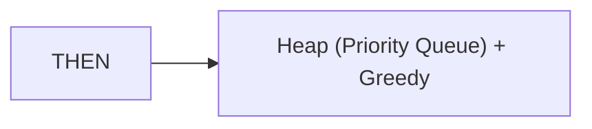
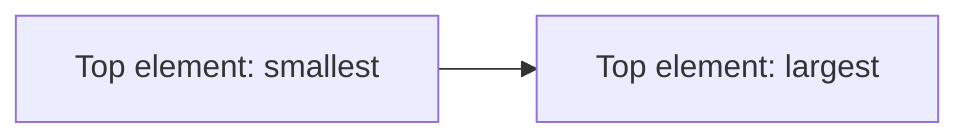
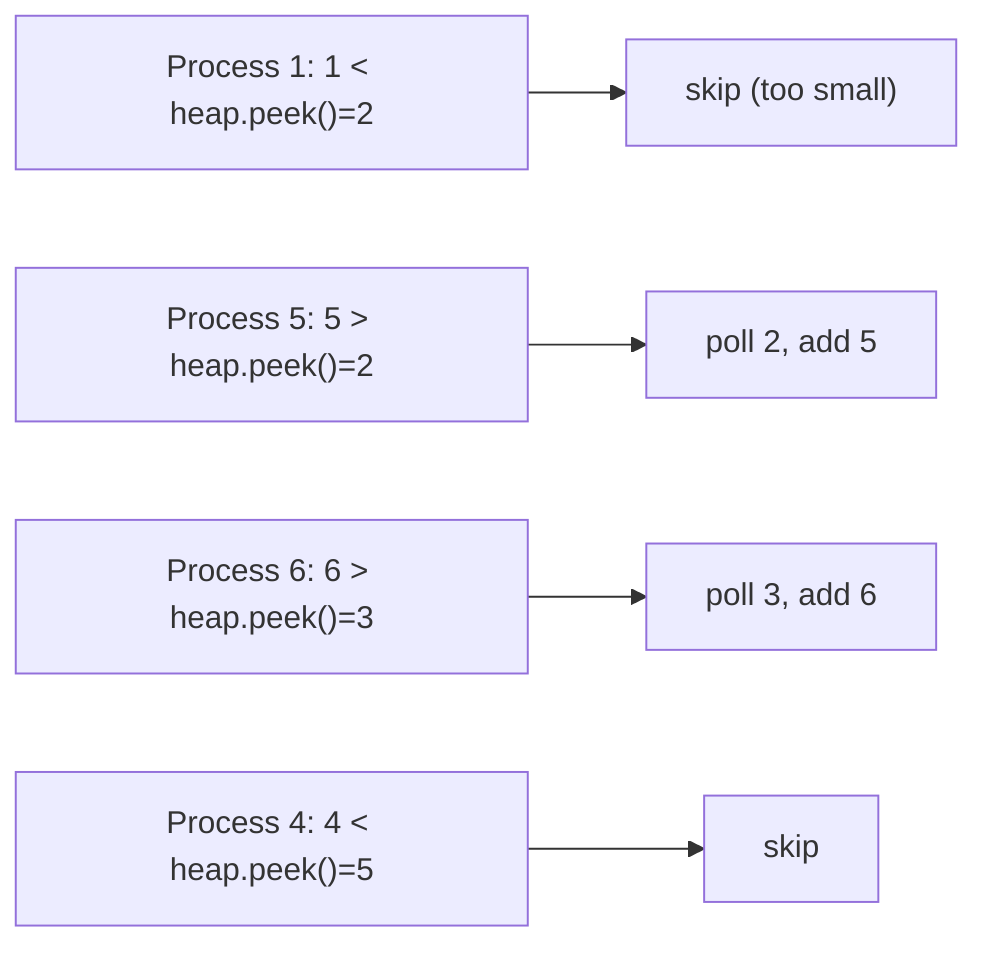
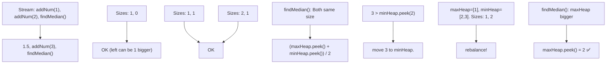
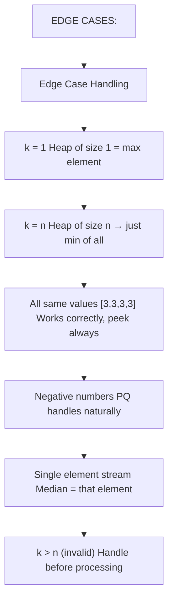

> **Navigation**: [< Previous](14_Graph_Plus_Traversal.md) | [Back to Index](../00_MASTER_INDEX.md) | [Next >](16_DP_Pattern_Recognition.md)

# Heap + Greedy Selection — Combined Pattern Guide

> **WHY this combination?** Heaps give O(log n) access to the min/max element. Combined with greedy strategy (always pick the best available), they solve "Top K", "merge K sorted", and scheduling problems efficiently.

### 🧠 Deep Intuition — Heaps and Greedy Correctness

#### Why Heaps Give O(log n) Insert/Extract

A heap is a **complete binary tree** stored in an array. "Complete" means every level is fully filled except possibly the last, which is filled left-to-right. The heap property (min-heap: parent ≤ children; max-heap: parent ≥ children) means the root always holds the extreme value. Insert and extract require "bubbling" up or down through the tree height, which is O(log n) since a complete binary tree has height ⌊log₂ n⌋.

#### Why Min-Heap for K-Largest (The Counterintuitive Trick)

This confuses everyone at first. To find the K largest elements, you maintain a **min-heap of size K**. Why? Because the min-heap's top is the smallest of the K elements you've kept. When a new element arrives:
- If it's **larger** than the heap top → it belongs in the top K; evict the current minimum
- If it's **smaller** → it certainly doesn't belong in the top K; skip it

At the end, the heap contains exactly the K largest elements, and `heap.peek()` is the Kth largest. The alternative (max-heap of everything) uses O(n) space and O(n log n) time to build, while this approach uses only O(k) space and O(n log k) time.

#### When Is Greedy Correct?

Greedy algorithms make the locally optimal choice at each step, hoping to reach the globally optimal solution. They're correct when two conditions hold:
1. **Greedy choice property**: A locally optimal choice leads to a globally optimal solution (you never need to "undo" a choice)
2. **Optimal substructure**: After making the greedy choice, the remaining problem is a smaller instance of the same problem

For many heap-based problems, the heap enables the greedy selection: "always pick the best available option." In merge K sorted lists, "best" means the smallest current head. In task scheduling, "best" means the most frequent task.

---

## 🧠 WHEN TO RECOGNIZE

```
IF the problem says:
  ✅ "K largest/smallest" elements
  ✅ "Merge K sorted" lists/arrays
  ✅ "Median of stream"
  ✅ "Schedule tasks" / "Minimize cost"
  ✅ "K closest" / "K most frequent"
  ✅ "Continuous minimum/maximum"
THEN → Heap (Priority Queue) + Greedy
```

**Flow:**
- THEN
- ↓
- Heap (Priority Queue) + Greedy



### Min-Heap vs Max-Heap
```
Min-Heap (default PQ):          Max-Heap:
   1                               9
  / \                             / \
 3   2                           7   8
→ Top element: smallest         → Top element: largest
Use for: K largest              Use for: K smallest
(keep K largest, smallest       (keep K smallest, largest
 gets popped)                    gets popped)
```

**Flow:**
- Top element: smallest
- ↓
- Top element: largest



---

## 📐 CORE TEMPLATES

### Template 1: Top K Elements
```java
// K largest elements → use MIN-heap of size k
PriorityQueue<Integer> minHeap = new PriorityQueue<>();
for (int num : nums) {
    minHeap.offer(num);
    if (minHeap.size() > k) {
        minHeap.poll();  // remove smallest → only k largest remain
    }
}
return minHeap.peek();  // kth largest
```

### Template 2: Merge K Sorted Lists
```java
PriorityQueue<ListNode> pq = new PriorityQueue<>((a, b) -> a.val - b.val);
for (ListNode head : lists) {
    if (head != null) pq.offer(head);
}
ListNode dummy = new ListNode(0), curr = dummy;
while (!pq.isEmpty()) {
    ListNode min = pq.poll();
    curr.next = min;
    curr = curr.next;
    if (min.next != null) pq.offer(min.next);
}
return dummy.next;
```

### Template 3: Running Median (Two Heaps)
```java
PriorityQueue<Integer> maxHeap = new PriorityQueue<>(Collections.reverseOrder()); // left half
PriorityQueue<Integer> minHeap = new PriorityQueue<>();                            // right half

void addNum(int num) {
    maxHeap.offer(num);
    minHeap.offer(maxHeap.poll());  // balance
    if (minHeap.size() > maxHeap.size()) {
        maxHeap.offer(minHeap.poll());
    }
}

double findMedian() {
    return maxHeap.size() > minHeap.size() ? maxHeap.peek()
        : (maxHeap.peek() + minHeap.peek()) / 2.0;
}
```

---

## � FULL WALKTHROUGH: Kth Largest Element in an Array

```
Problem: Find the kth largest element. nums = [3,2,1,5,6,4], k = 2
Answer: 5 (sorted: [1,2,3,4,5,6], 2nd largest = 5)

Approach: Min-heap of size k. After processing all elements,
          the heap's top = kth largest.

WHY min-heap? We keep the k LARGEST elements. The smallest of
those k (the heap's top) is the kth largest overall.

Step-by-step (k=2):
  Process 3: heap = [3]           (size < k, just add)
  Process 2: heap = [2, 3]        (size = k)
  Process 1: 1 < heap.peek()=2    → skip (too small)
             heap = [2, 3]
  Process 5: 5 > heap.peek()=2    → poll 2, add 5
             heap = [3, 5]
  Process 6: 6 > heap.peek()=3    → poll 3, add 6
             heap = [5, 6]
  Process 4: 4 < heap.peek()=5    → skip
             heap = [5, 6]

  Answer: heap.peek() = 5 ✅

Time: O(n log k) | Space: O(k)
Why not sort? Sorting is O(n log n). Heap is O(n log k) — better when k << n.
```

**Flow:**
- Process 1: 1 < heap.peek()=2
- ↓
- skip (too small)
- ↓
- Process 5: 5 > heap.peek()=2
- ↓
- poll 2, add 5
- ↓
- Process 6: 6 > heap.peek()=3
- ↓
- poll 3, add 6
- ↓
- Process 4: 4 < heap.peek()=5
- ↓
- skip



---


## 🔬 FULL WALKTHROUGH 2: Find Median from Data Stream (Two Heaps)

```
Problem: Design a class that supports addNum(int) and findMedian().
         Stream: addNum(1), addNum(2), findMedian()→1.5, addNum(3), findMedian()→2

Approach: Two heaps.
  maxHeap (left half): stores the SMALLER half. Top = max of left.
  minHeap (right half): stores the LARGER half. Top = min of right.

  Invariant: maxHeap.size() == minHeap.size()  OR  maxHeap.size() == minHeap.size() + 1

Step-by-step:
  addNum(1): maxHeap=[1], minHeap=[]
             Sizes: 1, 0 → OK (left can be 1 bigger)

  addNum(2): maxHeap=[1,2]? No, rebalance.
             Add to maxHeap: [2,1]. maxHeap.top=2 > minHeap? Needs balance.
             Move max to minHeap: maxHeap=[1], minHeap=[2]
             Sizes: 1, 1 → OK

  findMedian(): Both same size → (maxHeap.peek() + minHeap.peek()) / 2
                = (1 + 2) / 2 = 1.5 ✅

  addNum(3): Add to maxHeap first: maxHeap=[3,1], top=3.
             3 > minHeap.peek(2) → move 3 to minHeap.
             maxHeap=[1], minHeap=[2,3]. Sizes: 1, 2 → rebalance!
             Move minHeap top to maxHeap: maxHeap=[2,1], minHeap=[3]
             Sizes: 2, 1 → OK

  findMedian(): maxHeap bigger → maxHeap.peek() = 2 ✅

Time: addNum O(log n), findMedian O(1) | Space: O(n)
```

**Flow:**
- Stream: addNum(1), addNum(2), findMedian()
- ↓
- 1.5, addNum(3), findMedian()
- ↓
- Sizes: 1, 0
- ↓
- OK (left can be 1 bigger)
- ↓
- Sizes: 1, 1
- ↓
- OK
- ↓
- findMedian(): Both same size
- ↓
- (maxHeap.peek() + minHeap.peek()) / 2
- ↓
- 3 > minHeap.peek(2)
- ↓
- move 3 to minHeap.
- ↓
- maxHeap=[1], minHeap=[2,3]. Sizes: 1, 2
- ↓
- rebalance!



---


> 🔬 **Section Challenge — 🔬 FULL WALKTHROUGH 2: Find Median from Data Stream (Two Heaps)**
>
> **Challenge 1 (Reasoning):** `list.stream().filter().map().collect()` — at which point does data actually start flowing through the pipeline?
> <details><summary>Answer</summary>
>
> Not until `collect()` (or any terminal operation). `filter()` and `map()` are LAZY — they build a pipeline description but process nothing. When the terminal operation is called, the pipeline pulls elements through lazily: one element passes through the entire pipeline before the next is processed. This means: early termination with `findFirst()` is O(1) if the first element matches, not O(N).
> </details>
>
> **Challenge 2 (Bug Hunt):** You call `stream.filter(...).collect(...)` twice on the same stream. What happens?
> <details><summary>Answer</summary>
>
> `IllegalStateException: stream has already been operated upon or closed`. Streams are single-use. Once a terminal operation is called, the stream is consumed. Fix: create a new stream from the source each time, or collect to a `List` first and stream the list repeatedly.
> </details>
>

## 🛡️ EDGE CASES & COMMON MISTAKES

```
EDGE CASES:
┌──────────────────────────────┬─────────────────────────────────────────┐
│ Edge Case                    │ Handling                                │
├──────────────────────────────┼─────────────────────────────────────────┤
│ k = 1                        │ Heap of size 1 = max element            │
│ k = n                        │ Heap of size n → just min of all        │
│ All same values [3,3,3,3]    │ Works correctly, peek always = 3        │
│ Negative numbers             │ PQ handles naturally                    │
│ Single element stream        │ Median = that element                   │
│ k > n (invalid)              │ Handle before processing                │
└──────────────────────────────┴─────────────────────────────────────────┘

COMMON MISTAKES:
1. Min-heap vs Max-heap confusion for Kth Largest
   Kth LARGEST uses Min-heap (evict smallest). Kth SMALLEST uses Max-heap.
2. Java PQ is MIN-heap by default
   For max-heap: new PriorityQueue<>(Collections.reverseOrder())
3. Two Heaps: forgetting to rebalance after every insertion
4. Lazy deletion: poll() might return a stale element — always verify!
5. Using heap when monotonic stack suffices (e.g., sliding window max)
   Deque = O(n) total. Heap = O(n log n). Big difference!
```

**Flow:**
- EDGE CASES:
- ↓
- Edge Case Handling
- ↓
- k = 1 Heap of size 1 = max element
- ↓
- k = n Heap of size n
- ↓
- just min of all
- ↓
- k = n Heap of size n
- ↓
- just min of all
- ↓
- All same values [3,3,3,3] Works correctly, peek always
- ↓
- Negative numbers PQ handles naturally
- ↓
- Single element stream Median = that element



---

## 📊 COMPLEXITY SUMMARY

| Problem | Approach | Time | Space |
|---------|----------|------|-------|
| Kth Largest | Min-heap size k | O(n log k) | O(k) |
| Kth Largest | Quickselect | O(n) avg, O(n²) worst | O(1) |
| Top K Frequent | HashMap + heap | O(n log k) | O(n) |
| Find Median | Two heaps | O(log n) per add, O(1) median | O(n) |
| Merge K Sorted | Min-heap of k heads | O(n log k) | O(k) |
| Sliding Window Max | Monotonic DEQUE (not heap!) | O(n) | O(k) |

---


> 🔬 **Section Challenge — 📊 COMPLEXITY SUMMARY**
>
> **Challenge 1 (Reasoning):** Prefix sum initialized as `prefix[0] = 0` — why the leading zero and not `prefix[0] = arr[0]`?
> <details><summary>Answer</summary>
>
> `prefix[0] = 0` (empty prefix) makes range sum formula uniform: `sum(l,r) = prefix[r+1] - prefix[l]`. Without the 0: `sum(0,r) = prefix[r] - 0` (special case needed). With it: `sum(0,r) = prefix[r+1] - prefix[0] = prefix[r+1]`. Same formula everywhere. This is the 'sentinel' pattern — adding a dummy initial value to eliminate special cases. Same trick used in dummy linked list nodes.
> </details>
>

## 📋 PRACTICE PROBLEMS — From Your Excel Sheet
| # | Problem | Key Insight |
|---|---------|-------------|
| 1 | [Top K Frequent Elements](https://leetcode.com/problems/top-k-frequent-elements/) | HashMap freq + Min-heap of size k |
| 2 | [Kth Largest Element](https://leetcode.com/problems/kth-largest-element-in-an-array/) | Min-heap of size k OR Quickselect |
| 3 | [Ugly Number II](https://leetcode.com/problems/ugly-number-ii/) | Min-heap generate next ugly |
| 4 | [Furthest Building](https://leetcode.com/problems/furthest-building-you-can-reach/) | Min-heap: ladders for biggest, bricks for rest |
| 5 | [Kth Smallest in Sorted Matrix](https://leetcode.com/problems/kth-smallest-element-in-a-sorted-matrix/) | Min-heap BFS from [0,0] |
| 6 | [Reorganize String](https://leetcode.com/problems/reorganize-string/) | Max-heap: pick most frequent, alternate |
| 7 | [Most Competitive Subsequence](https://leetcode.com/problems/find-the-most-competitive-subsequence/) | Monotonic stack (not heap) |
| 8 | [K Closest Points to Origin](https://leetcode.com/problems/k-closest-points-to-origin/) | Max-heap of size k by distance |
| 9 | [Smallest Positive Missing](https://practice.geeksforgeeks.org/problems/smallest-positive-missing-number-1587115621/1/) | Index marking (no heap needed) |
| 10 | [Largest Subarray 0 Sum](https://practice.geeksforgeeks.org/problems/largest-subarray-with-0-sum/1/) | Prefix sum + HashMap |

### Hard
| # | Problem | Key Insight |
|---|---------|-------------|
| 11 | [Minimum Refueling Stops](https://leetcode.com/problems/minimum-number-of-refueling-stops/) | Max-heap: greedily use best stations |
| 12 | [Minimum Cost to Hire K Workers](https://leetcode.com/problems/minimum-cost-to-hire-k-workers/) | Sort by ratio + max-heap |
| 13 | [Swim in Rising Water](https://leetcode.com/problems/swim-in-rising-water/) | Min-heap BFS (Dijkstra on grid) |
| 14 | [Sliding Window Maximum](https://leetcode.com/problems/sliding-window-maximum/) | Monotonic deque (heap is O(n log n)) |

### Additional — Greedy Problems from Excel
| # | Problem | Key Insight |
|---|---------|-------------|
| 15 | [Gas Station](https://leetcode.com/problems/gas-station/) | Greedy: track deficit |
| 16 | [Task Scheduler](https://leetcode.com/problems/task-scheduler/) | Greedy: most frequent first |
| 17 | [Remove K Digits](https://leetcode.com/problems/remove-k-digits/) | Monotonic stack greedy |
| 18 | [Non-Overlapping Intervals](https://leetcode.com/problems/non-overlapping-intervals/) | Sort by end, greedy pick |
| 19 | [Minimum Deletion Cost](https://leetcode.com/problems/minimum-deletion-cost-to-avoid-repeating-letters/) | Greedy: keep max cost in group |
| 20 | [Minimum Coins](https://www.geeksforgeeks.org/minimum-cost-for-acquiring-all-coins-with-k-extra-coins-allowed-with-every-coin/) | Sort + pick cheapest |
| 21 | [Chocola (Cutting Board)](https://www.spoj.com/problems/CHOCOLA/) | Greedy: most expensive cuts first |
| 22 | [Pancake Sorting](https://www.geeksforgeeks.org/pancake-sorting/) | Greedy: find max, flip |
| 23 | Maximize array sum after k-negation | Sort + flip most negatives |
| 24 | SJF CPU Scheduling | Min-heap by burst time |

---

## 🔥 KEY TRICKS

| Trick | When | Why |
|-------|------|-----|
| Min-heap for K largest | Seems counterintuitive | Smallest of the k-largest gets evicted |
| Two heaps for median | Stream median | Max-heap(left) + Min-heap(right) |
| Custom comparator | Complex objects | `new PQ<>((a,b) -> a.cost - b.cost)` |
| Lazy deletion | When can't easily remove | Mark deleted, skip on poll |
| Heap + HashMap | Frequency-aware | Count freq → heap by freq |

---

## 🎯 INTERVIEW ARTICULATION — How to Explain Heap + Greedy

**When the interviewer gives you a top-K or scheduling problem, say this:**

> "Sorting all n elements would be O(n log n), but we only need the K largest/smallest. A min-heap of size K keeps only the K largest: for each new element, compare with heap top (the smallest of our K). If larger, swap it in. Total: O(n log K), and only O(K) space — optimal for streaming data."

**For greedy problems:**
> "At each step, I make the locally optimal choice. This works here because the greedy choice property holds — swapping any decision for the greedy decision never makes the solution worse. I can show this with an exchange argument."

**Key mathematical justification:**
- "Min-heap for K-largest is counterintuitive. The heap top is the *smallest* of the K we kept. If a new element beats the smallest, it replaces it. At the end, heap contains exactly the K largest."
- "Greedy correctness requires proof. The *exchange argument*: take any optimal solution, swap one element for the greedy choice, show it doesn't get worse."
- "Heap insert/extract is O(log n) because the heap is a complete binary tree of height ⌊log₂ n⌋. Bubbling up/down traverses at most h levels."

**Common mistakes to proactively mention:**
- ❌ "Min-heap for K-largest, Max-heap for K-smallest — it's always the *opposite* of what you're finding."
- ❌ "Greedy fails for many problems (e.g., 0/1 Knapsack, coin change with arbitrary denominations). Always check with a counterexample first."
- ❌ "PriorityQueue in Java is a min-heap by default. For max-heap: `new PriorityQueue<>(Comparator.reverseOrder())`."

**Real-world applications:**
- OS/Kubernetes task schedulers (process priority queue)
- Dijkstra's algorithm in GPS/map routing
- Merge K sorted log streams in distributed systems
- Real-time analytics (top-K trending products, running median)
- Huffman encoding in data compression (ZIP, GZIP)

---

📖 **Related Chapters:**
- [02_Data_Structures/01f_Trees_Heaps.md](../02_Data_Structures/01f_Trees_Heaps.md) — Heap internals
- [03_Algorithms/12_Greedy_Algorithms_Complete.md](../03_Algorithms/12_Greedy_Algorithms_Complete.md) — Greedy deep dive

---
[← 14 Graph+Traversal](14_Graph_Plus_Traversal.md) | [16 DP Patterns →](16_DP_Pattern_Recognition.md)


---


---

## 🏋️ Practice & Interview Questions — Trees & Heaps

### Predict / Trace
**Q1.** BST insert 5,3,7,1,4. Draw the tree. What is inorder traversal?
<details><summary>Answer</summary>

```
      5
     / \
    3   7
   / \
  1   4
```
Inorder: 1, 3, 4, 5, 7 (always sorted for BST!)
</details>

**Q2.** PriorityQueue in Java — is it a min-heap or max-heap by default?
<details><summary>Answer</summary>

**Min-heap** by default (`poll()` returns the minimum). For max-heap: `new PriorityQueue<>(Comparator.reverseOrder())`.
</details>

### LeetCode / Coding
**Q3.** ⭐ Maximum Depth of Binary Tree.
<details><summary>Solution</summary>

```java
int maxDepth(TreeNode root){
    if(root==null) return 0;
    return 1 + Math.max(maxDepth(root.left), maxDepth(root.right));
}
```
</details>

**Q4.** ⭐ Invert Binary Tree.
<details><summary>Solution</summary>

```java
TreeNode invertTree(TreeNode root){
    if(root==null) return null;
    TreeNode tmp=root.left; root.left=root.right; root.right=tmp;
    invertTree(root.left); invertTree(root.right);
    return root;
}
```
</details>

**Q5.** ⭐ Validate Binary Search Tree.
<details><summary>Solution</summary>

```java
boolean validate(TreeNode node, long min, long max){
    if(node==null) return true;
    if(node.val<=min||node.val>=max) return false;
    return validate(node.left,min,node.val)&&validate(node.right,node.val,max);
}
// call: validate(root, Long.MIN_VALUE, Long.MAX_VALUE)
```
</details>

**Q6.** ⭐ Level Order Traversal (BFS with Queue).
<details><summary>Solution</summary>

```java
Queue<TreeNode> q=new LinkedList<>(); q.offer(root);
while(!q.isEmpty()){
    int size=q.size();
    for(int i=0;i<size;i++){
        TreeNode n=q.poll(); process(n);
        if(n.left!=null) q.offer(n.left);
        if(n.right!=null) q.offer(n.right);
    }
}
```
</details>

**Q7.** ⭐ Lowest Common Ancestor of BST.
<details><summary>Solution</summary>

```java
TreeNode lca(TreeNode root, TreeNode p, TreeNode q){
    if(p.val<root.val&&q.val<root.val) return lca(root.left,p,q);
    if(p.val>root.val&&q.val>root.val) return lca(root.right,p,q);
    return root; // split point = LCA
}
```
</details>

**Q8.** ⭐⭐ Binary Tree Right Side View.
<details><summary>Solution</summary>

```java
// BFS, take last element of each level
// or DFS: track level, add to result only when level==result.size()
void dfs(TreeNode node, int level){
    if(node==null) return;
    if(level==res.size()) res.add(node.val);
    dfs(node.right,level+1); dfs(node.left,level+1);
}
```
</details>

**Q9.** ⭐⭐ Kth Smallest Element in BST.
<details><summary>Solution</summary>

```java
// Inorder traversal is sorted — take kth element
int k, result;
void inorder(TreeNode node){
    if(node==null) return;
    inorder(node.left);
    if(--k==0){ result=node.val; return; }
    inorder(node.right);
}
```
</details>

**Q10.** ⭐⭐ Serialize and Deserialize Binary Tree.
<details><summary>Key approach</summary>

BFS level-order with null markers. Serialize: `1,2,3,null,null,4,5`. Deserialize: queue-based reconstruction level by level.
</details>

**Q11.** ⭐⭐⭐ Binary Tree Maximum Path Sum.
<details><summary>Solution</summary>

```java
int maxSum = Integer.MIN_VALUE;
int dfs(TreeNode node){
    if(node==null) return 0;
    int left=Math.max(0,dfs(node.left)), right=Math.max(0,dfs(node.right));
    maxSum=Math.max(maxSum, node.val+left+right); // path through this node
    return node.val+Math.max(left,right); // return single path
}
```
</details>

### Heap / Priority Queue Problems
**Q12.** ⭐ Kth Largest Element in Array.
<details><summary>Solution</summary>

```java
PriorityQueue<Integer> minHeap=new PriorityQueue<>();
for(int n:nums){ minHeap.offer(n); if(minHeap.size()>k) minHeap.poll(); }
return minHeap.peek(); // kth largest
```
</details>

**Q13.** ⭐⭐ Median from Data Stream (two heaps).
<details><summary>Solution</summary>

```java
PriorityQueue<Integer> lo=new PriorityQueue<>(Comparator.reverseOrder()); // max-heap
PriorityQueue<Integer> hi=new PriorityQueue<>(); // min-heap
void addNum(int n){
    lo.offer(n);
    hi.offer(lo.poll());
    if(lo.size()<hi.size()) lo.offer(hi.poll());
}
double findMedian(){ return lo.size()>hi.size()?lo.peek():(lo.peek()+hi.peek())/2.0; }
```
</details>

### MCQ Rapid Fire
| # | Question | Answer |
|---|---|---|
| 1 | BST search avg/worst | O(log N) avg, O(N) worst (degenerate) |
| 2 | Complete binary tree with N nodes height | O(log N) |
| 3 | Heap insertHeapify direction | Bubble up |
| 4 | Heap extractMin direction | Bubble down (sift down) |
| 5 | Java PriorityQueue poll() time | O(log N) |
| 6 | Tree DFS pre/in/post order uses | Stack (or recursion) |
| 7 | Tree BFS uses | Queue |
| 8 | Red-Black Tree guarantee | O(log N) worst case for search/insert/delete |


---

## 🧠 Deep Conceptual Questions — Trees & Heaps

**C1. Why is the inorder traversal of a BST always sorted?**
<details><summary>Deep Answer</summary>

BST invariant: every node's left subtree contains ONLY values less than the node, right subtree ONLY values greater. Inorder traversal visits: left subtree (all smaller) → root → right subtree (all larger). Applied recursively at every node, this produces values in ascending order. This is the defining property that makes BST useful: O(log N) search because at each step, half the tree is eliminated. Broken BST (invariant violated) → inorder not sorted → BST operations return wrong results. That's why "Validate BST" is a fundamental problem.
</details>

**C2. Why does heap not support O(log N) arbitrary deletion (only min/max removal)?**
<details><summary>Deep Answer</summary>

Heap invariant: parent ≤ children (min-heap). When you remove the minimum (root): replace with last element, sift down — O(log N). But for an arbitrary element: you'd need to FIND it first (O(N) scan — heap has no lookup index), then restore the heap property. Without indexing, you can't efficiently locate an element. **d-ary heaps** exist, and indexed heaps (priority queues with decrease-key, like Fibonacci heap) support O(log N) arbitrary deletion — but Java's PriorityQueue doesn't. Dijkstra's with "lazy deletion" (add stale entries, skip when popped) works around this.
</details>

**C3. Why is tree height critical for BST operations?**
<details><summary>Deep Answer</summary>

BST search = walk from root to target, one comparison per level. Operations: O(height). **Balanced BST** (AVL, Red-Black): height = O(log N) → operations O(log N). **Degenerate BST** (insert sorted data: 1,2,3,4,5): each node has only right child → height = N → operations O(N) = linked list performance! This is why TreeMap uses Red-Black Tree (self-balancing): guarantees height ≤ 2*log(N) regardless of insertion order. Red-Black Tree balance condition is weaker than AVL (allows "approximately balanced") but cheaper to maintain: at most 3 rotations per insert (AVL: potentially O(log N)).
</details>

**C4. Why does BFS on a tree need a Queue but DFS needs a Stack (or recursion)?**
<details><summary>Deep Answer</summary>

BFS explores level by level: all children of current nodes must be processed before their children. Queue's FIFO ensures: nodes added to queue at level L are processed before level L+1 nodes (which are added during L's processing). DFS explores as deep as possible before backtracking. Stack's LIFO ensures: the most recently discovered (deepest) node is explored next. Recursive DFS implicitly uses the call stack — each recursive call IS a stack frame push. Iterative DFS when chosen over recursive: avoids stack overflow for very deep trees (N deep right-skewed tree → N recursion levels → StackOverflowError).
</details>

**C5. Lowest Common Ancestor — why does the recursive approach work in O(N)?**
<details><summary>Deep Answer</summary>

The recursive logic: `lca(node, p, q)` returns the LCA if it exists in the subtree of `node`, or p/q if one is found but not the other, or null if neither found. At each node: check left subtree and right subtree results. If BOTH return non-null: this node is the LCA (p is in one subtree, q in another — this is the split point). If only one: that subtree contains both (one is ancestor of the other). The algorithm visits each node once → O(N). For BST: we can do O(log N) by comparing values (if both < node: go left; both > node: go right; one each side: node is LCA).
</details>

**C6. Why is heap built in O(N) time but inserting N elements one-by-one takes O(N log N)?**
<details><summary>Deep Answer</summary>

**Bottom-up `heapify`**: Only nodes with children need sifting-down. Bottom half are leaves (no children) — zero work. Next level: height-1 sift-down each. Total work = Σ(height * nodes at that height) = O(N) (geometric series). **N individual inserts**: each can trigger O(log N) sift-up. Total = O(N log N). The bottom-up approach is 2x faster in practice. Java's `PriorityQueue(Collection)` constructor uses O(N) heapify. `Arrays.stream().forEach(pq::add)` is O(N log N). When converting an array to a heap, always prefer the constructor form.
</details>

**C7. Binary Tree Maximum Path Sum — why can a node contribute ONE branch to its parent but TWO internally?**
<details><summary>Deep Answer</summary>

A path cannot branch twice — if you go left and right from a node, the path "bends" at that node and can't continue upward (a path is a sequence of nodes with edges between them, no branching). So: **to a parent**: this node contributes max(left_gain, right_gain, 0) + node.val — choose the better single branch. **For the global answer**: the path could USE this node as the "bend" — include left_gain + node.val + right_gain. This might be the overall maximum even if it can't be passed upward. The DFS returns the single-branch value to parent but updates the global max with the bend value at each node.
</details>

**C8. Two-heap approach for median — why one max-heap and one min-heap?**
<details><summary>Deep Answer</summary>

Maintain two properties: (1) bottom half of numbers in a max-heap (quick access to max of lower half), (2) top half in a min-heap (quick access to min of upper half). Median = either the top of one heap (odd total) or average of both tops (even total). Invariant: max-heap size ≥ min-heap size, and max-heap.top ≤ min-heap.top. Adding a number: if > min-heap.top → it's in the top half → add to min-heap; else bottom half → add to max-heap. Then rebalance if sizes differ by 2. Both heaps stay O(log N) operations per insert. This pattern generalizes: ANY running statistic that needs the "boundary" between two halves uses this two-heap technique.
</details>


> **Navigation**: [< Previous](14_Graph_Plus_Traversal.md) | [Back to Index](../00_MASTER_INDEX.md) | [Next >](16_DP_Pattern_Recognition.md)