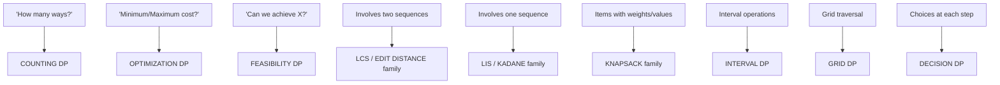
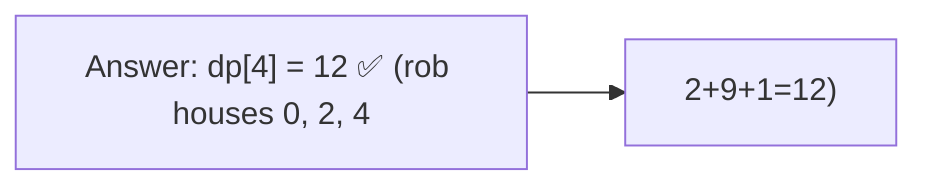
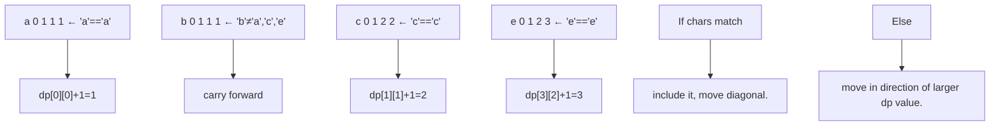

**Navigation**: [< Previous](15_Heap_Plus_GreedySelection.md) | [Back to Index](../00_MASTER_INDEX.md) | [Next >](17_Backtracking_Plus_Pruning.md)

# DP Pattern Recognition — Combined Pattern Guide

**WHY this matters?** DP problems look overwhelming because there are hundreds of them. But they ALL fall into ~8 pattern families. Recognize the family → apply the template → solve.

### 🧠 Deep Intuition — What Makes a Problem DP?

Two conditions must BOTH be present for DP to be applicable:

1. **Optimal substructure**: The optimal solution to the problem contains optimal solutions to subproblems. For example, the shortest path from A to C through B requires the shortest path from A to B *and* the shortest path from B to C. If a problem doesn't have this property (e.g., longest simple path in a general graph), DP won't work.

2. **Overlapping subproblems**: The same subproblem is computed multiple times. Fibonacci is the classic example: `fib(5)` calls `fib(4)` and `fib(3)`, but `fib(4)` also calls `fib(3)` — so `fib(3)` is computed twice. Memoization or tabulation eliminates this redundancy.

If a problem has optimal substructure but NO overlapping subproblems, use **greedy** or **divide-and-conquer** instead (e.g., merge sort has optimal substructure but each subarray is only solved once).

#### The DP Thinking Framework — 4 Steps

Every DP solution follows the same mental process:

1. **Define the state**: What does `dp[i]` (or `dp[i][j]`) represent? This is the hardest step. A good state definition makes the recurrence obvious; a bad one makes the problem unsolvable.
2. **Find the transition (recurrence)**: How does `dp[i]` relate to smaller subproblems? For House Robber: at house `i`, you either rob it (`dp[i-2] + val[i]`) or skip it (`dp[i-1]`).
3. **Identify base cases**: What are the trivially known values? `dp[0]`, `dp[1]`, or empty string/array cases.
4. **Determine build order**: Fill dp table so that dependencies are computed first. This is why bottom-up fills left-to-right (linear DP) or row-by-row (grid DP).

#### Top-Down vs Bottom-Up — When to Use Which

- **Top-down (memoization)**: Write the natural recursive solution, add a cache. Easier to think about, only computes needed states. Use when the state space is large but sparsely visited.
- **Bottom-up (tabulation)**: Fill the table iteratively. Slightly faster (no recursion overhead), easier to optimize space (rolling array). Use when all states are needed.

Both have the same time complexity. Top-down is better for **thinking**; bottom-up is better for **optimizing**.

---

## 🧠 THE DP DECISION TREE

```
Does the problem have:
├── Optimal substructure? (optimal solution uses optimal sub-solutions)
├── Overlapping subproblems? (same sub-problem solved multiple times)
└── YES to both → USE DP

Which family?
├── "How many ways?" → COUNTING DP
├── "Minimum/Maximum cost?" → OPTIMIZATION DP
├── "Can we achieve X?" → FEASIBILITY DP
├── Involves two sequences → LCS / EDIT DISTANCE family
├── Involves one sequence → LIS / KADANE family
├── Items with weights/values → KNAPSACK family
├── Interval operations → INTERVAL DP
├── Grid traversal → GRID DP
├── Choices at each step → DECISION DP
└── String palindrome → PALINDROME DP
```

**Flow:**
1. 'How many ways?'
2. COUNTING DP
3. 'Minimum/Maximum cost?'
4. OPTIMIZATION DP
5. 'Can we achieve X?'
6. FEASIBILITY DP
7. Involves two sequences
8. LCS / EDIT DISTANCE family
9. Involves one sequence
10. LIS / KADANE family
11. Items with weights/values
12. KNAPSACK family



---

## 📐 THE 8 DP PATTERN FAMILIES

### Family 1: Linear DP (Single Sequence)
```java
// LIS, Climbing Stairs, House Robber, Decode Ways
dp[i] = best answer considering elements 0..i

// Climbing Stairs
dp[i] = dp[i-1] + dp[i-2]

// House Robber
dp[i] = max(dp[i-1], dp[i-2] + nums[i])

// LIS
dp[i] = max(dp[j] + 1) for all j < i where nums[j] < nums[i]
```

### Family 2: Two-Sequence DP (LCS Family)
```java
// LCS, Edit Distance, Longest Common Substring
dp[i][j] = answer for first[0..i-1] and second[0..j-1]

// LCS
if (s1[i-1] == s2[j-1]) dp[i][j] = dp[i-1][j-1] + 1
else dp[i][j] = max(dp[i-1][j], dp[i][j-1])
```

### Family 3: Knapsack Family
```java
// 0/1 Knapsack, Coin Change, Subset Sum
// 0/1 (each item once):
dp[i][w] = max(dp[i-1][w], dp[i-1][w-wt[i]] + val[i])

// Unbounded (unlimited items):
dp[w] = min(dp[w], dp[w-coin] + 1)  // Coin Change
```

### Family 4: Grid DP
```java
// Unique Paths, Minimum Path Sum
dp[i][j] = dp[i-1][j] + dp[i][j-1]           // paths
dp[i][j] = grid[i][j] + min(dp[i-1][j], dp[i][j-1])  // min cost
```

### Family 5: Interval DP
```java
// Burst Balloons, Matrix Chain, Palindrome Partitioning
for (int len = 2; len <= n; len++) {
    for (int i = 0; i <= n - len; i++) {
        int j = i + len - 1;
        for (int k = i; k < j; k++) {
            dp[i][j] = min(dp[i][j], dp[i][k] + dp[k+1][j] + cost(i,k,j));
        }
    }
}
```

### Family 6: String Palindrome DP
```java
// Longest Palindromic Subsequence, Palindrome Partitioning
dp[i][j] = is s[i..j] palindrome?
// Expand from center or interval DP approach
```

### Family 7: State Machine DP
```java
// Buy/Sell Stock with cooldown, constraints
// States: hold, not-hold, cooldown
hold[i] = max(hold[i-1], notHold[i-1] - price[i])
notHold[i] = max(notHold[i-1], cool[i-1])
cool[i] = hold[i-1] + price[i]
```

### Family 8: Bitmask DP
```java
// TSP, Assignment Problem
dp[mask][i] = best cost with visited set=mask, currently at i
for each unvisited j:
    dp[mask | (1<<j)][j] = min(dp[mask][i] + cost[i][j])
```

---


## � FULL WALKTHROUGH: House Robber (Linear DP Decision)

```
Problem: Rob houses for max money. Can't rob adjacent houses.
         nums = [2, 7, 9, 3, 1]

Step 1: DEFINE STATE
  dp[i] = max money from houses 0..i

Step 2: RECURRENCE
  At house i: Rob it (dp[i-2] + nums[i]) or Skip it (dp[i-1])
  dp[i] = max(dp[i-1], dp[i-2] + nums[i])

Step 3: BASE CASE
  dp[0] = 2, dp[1] = max(2, 7) = 7

Step 4: BUILD (left to right)
  dp[0] = 2
  dp[1] = max(2, 7) = 7
  dp[2] = max(dp[1], dp[0]+9) = max(7, 11) = 11
  dp[3] = max(dp[2], dp[1]+3) = max(11, 10) = 11
  dp[4] = max(dp[3], dp[2]+1) = max(11, 12) = 12

  Answer: dp[4] = 12 ✅ (rob houses 0, 2, 4 → 2+9+1=12)

Time: O(n) | Space: O(1) using two variables
```

**Flow:**
1. Answer: dp[4] = 12 ✅ (rob houses 0, 2, 4
2. 2+9+1=12)



---


## 🔬 FULL WALKTHROUGH 2: Longest Common Subsequence (Two-Sequence DP)

```
Problem: Find the LCS of "abcde" and "ace".
         Answer: "ace" (length 3)

State: dp[i][j] = LCS length of text1[0..i-1] and text2[0..j-1]

Recurrence:
  If text1[i-1] == text2[j-1]: dp[i][j] = dp[i-1][j-1] + 1  (both match!)
  Else: dp[i][j] = max(dp[i-1][j], dp[i][j-1])  (skip one character)

Build the table:
       ""  a  c  e
  ""    0  0  0  0
   a    0  1  1  1     ← 'a'=='a' → dp[0][0]+1=1
   b    0  1  1  1     ← 'b'≠'a','c','e' → carry forward
   c    0  1  2  2     ← 'c'=='c' → dp[1][1]+1=2
   d    0  1  2  2     ← 'd'≠anything new
   e    0  1  2  3     ← 'e'=='e' → dp[3][2]+1=3

Answer: dp[5][3] = 3 ✅

To recover the actual subsequence: backtrack from dp[m][n].
  If chars match → include it, move diagonal.
  Else → move in direction of larger dp value.

Time: O(m×n) | Space: O(m×n), optimizable to O(min(m,n))
```

**Flow:**
1. a 0 1 1 1 ← 'a'=='a'
2. dp[0][0]+1=1
3. b 0 1 1 1 ← 'b'≠'a','c','e'
4. carry forward
5. c 0 1 2 2 ← 'c'=='c'
6. dp[1][1]+1=2
7. e 0 1 2 3 ← 'e'=='e'
8. dp[3][2]+1=3
9. If chars match
10. include it, move diagonal.
11. Else
12. move in direction of larger dp value.



---


🔬 **Section Challenge — 🔬 FULL WALKTHROUGH 2: Longest Common Subsequence (Two-Sequence DP)**

**Challenge 1 (Reasoning):** Two-pointer pattern reduces O(N²) brute force to O(N). What is the KEY invariant that makes this safe?
<details><summary>Answer</summary>

The invariant: all pairs we SKIP are guaranteed to not contain the answer. In 3Sum: once we fix `nums[i]` and use l/r pointers, we can safely skip because the array is sorted. If `sum > 0`: decreasing r decreases the sum (smaller right value). If `sum < 0`: increasing l increases the sum (larger left value). We never skip a valid pair because monotonicity guarantees it.
</details>


## 🔬 FULL WALKTHROUGH 3: 0/1 Knapsack (The Classic)

```
Problem: Maximize value with weight limit W=7.
  Items: value=[1, 4, 5, 7], weight=[1, 3, 4, 5]

State: dp[i][w] = max value using first i items with capacity w

Recurrence:
  Skip item i: dp[i-1][w]
  Take item i (if weight[i] ≤ w): dp[i-1][w-weight[i]] + value[i]
  dp[i][w] = max(skip, take)

Build (key cells):
       w= 0  1  2  3  4  5  6  7
  i=0:    0  1  1  1  1  1  1  1    (item: val=1, wt=1)
  i=1:    0  1  1  4  5  5  5  5    (item: val=4, wt=3)
  i=2:    0  1  1  4  5  6  6  9    (item: val=5, wt=4)
  i=3:    0  1  1  4  5  7  8  9    (item: val=7, wt=5)

Answer: dp[4][7] = 9 ✅ (take items 2 and 3: value 4+5=9, weight 3+4=7)

Space optimization: Since we only need previous row, use 1D array.
  TRICK: iterate w from RIGHT TO LEFT to avoid using updated values!

Time: O(n×W) | Space: O(W) after optimization
```

---

## 🛡️ EDGE CASES & COMMON MISTAKES

```
COMMON MISTAKES:
1. Wrong build order: bottom-up must fill dependencies FIRST
   Grid DP: fill top-to-bottom, left-to-right (needs dp[i-1][j] and dp[i][j-1])
   Knapsack 1D: iterate capacity RIGHT to LEFT (to avoid using current row)
   Unbounded knapsack: iterate capacity LEFT to RIGHT (reuse IS allowed)

2. Confusing subsequence vs substring
   Subsequence [a,c,e] from "abcde" — can skip elements
   Substring "abc" from "abcde" — must be contiguous
   LCS: take max when mismatch. LCSubstring: RESET to 0 when mismatch.

3. Off-by-one in DP table dimensions
   dp table is (m+1) × (n+1) for two-sequence problems
   Row 0 and col 0 represent empty string/sequence

4. Forgetting negative products in Maximum Product Subarray
   Must track BOTH maxSoFar AND minSoFar (negative × negative = positive!)

5. State machine DP: wrong transition order
   Stock problems: compute ALL states for day i before moving to day i+1
```

---

## 📊 COMPLEXITY SUMMARY

| DP Family | Time | Space | Optimize To |
|-----------|------|-------|-------------|
| Linear (House Robber) | O(n) | O(n) | O(1) two vars |
| Two-Sequence (LCS) | O(m×n) | O(m×n) | O(min(m,n)) |
| Knapsack 0/1 | O(n×W) | O(n×W) | O(W) 1D |
| Grid (Unique Paths) | O(m×n) | O(m×n) | O(n) 1D |
| Interval (Burst Balloons) | O(n³) | O(n²) | — |
| Palindrome | O(n²) | O(n²) | O(n) for some |
| State Machine (Stock) | O(n×k) | O(n×k) | O(k) |
| Bitmask (TSP) | O(2ⁿ × n²) | O(2ⁿ × n) | — |

---


🔬 **Section Challenge — 📊 COMPLEXITY SUMMARY**

**Challenge 1 (Reasoning):** Prefix sum initialized as `prefix[0] = 0` — why the leading zero and not `prefix[0] = arr[0]`?
<details><summary>Answer</summary>

`prefix[0] = 0` (empty prefix) makes range sum formula uniform: `sum(l,r) = prefix[r+1] - prefix[l]`. Without the 0: `sum(0,r) = prefix[r] - 0` (special case needed). With it: `sum(0,r) = prefix[r+1] - prefix[0] = prefix[r+1]`. Same formula everywhere. This is the 'sentinel' pattern — adding a dummy initial value to eliminate special cases. Same trick used in dummy linked list nodes.
</details>


## 📋 PRACTICE PROBLEMS — From Your Excel Sheet

### Easy
| # | Problem | Family | Key Insight |
|---|---------|--------|-------------|
| 2 | [Maximum Product Subarray](https://leetcode.com/problems/maximum-product-subarray/) | Linear | Track both min AND max (negatives!) |
| 3 | [Ones and Zeroes](https://leetcode.com/problems/ones-and-zeroes/) | Knapsack | 2D knapsack (0s and 1s as weight) |
| 4 | [Counting Bits](https://leetcode.com/problems/counting-bits/) | Linear | dp[i] = dp[i>>1] + (i&1) |

### Medium
| # | Problem | Family | Key Insight |
|---|---------|--------|-------------|
| 5 | [Unique Paths](https://leetcode.com/problems/unique-paths/) | Grid | dp[i][j] = dp[i-1][j] + dp[i][j-1] |
| 6 | [Minimum Path Sum](https://leetcode.com/problems/minimum-path-sum/) | Grid | dp[i][j] = grid[i][j] + min(up, left) |
| 7 | [Coin Change](https://leetcode.com/problems/coin-change/) | Knapsack | Unbounded: dp[amount] |
| 8 | [Decode Ways](https://leetcode.com/problems/decode-ways/) | Linear | 1 or 2 digit decode options |
| 9 | [LIS](https://leetcode.com/problems/longest-increasing-subsequence/) | Linear | O(n²) DP or O(n log n) patience sorting |
| 10 | [Longest Common Substring](https://practice.geeksforgeeks.org/problems/longest-common-substring1452/1) | Two-Seq | Reset to 0 if chars don't match |
| 11 | [Max Length Repeated Subarray](https://leetcode.com/problems/maximum-length-of-repeated-subarray/) | Two-Seq | Same as LCS but for arrays |
| 12 | [Count Square Submatrices](https://leetcode.com/problems/count-square-submatrices-with-all-ones/) | Grid | dp[i][j] = min(up,left,diag) + 1 |
| 13 | [Maximal Square](https://leetcode.com/problems/maximal-square/) | Grid | Same as above but track max |
| 14 | [Delete and Earn](https://leetcode.com/problems/delete-and-earn/) | Linear | Transform to House Robber |
| 15 | [Knight Dialer](https://leetcode.com/problems/knight-dialer/) | Linear | State: position, transitions by knight moves |
| 16 | [Cut Segments](https://practice.geeksforgeeks.org/problems/cutted-segments1642/1) | Knapsack | Unbounded rod cutting |
| 17 | [Weighted Job Scheduling](https://www.geeksforgeeks.org/weighted-job-scheduling/) | Linear | Sort by end + binary search for compatible |
| 18 | [Range Sum Query 2D](https://leetcode.com/problems/range-sum-query-2d-immutable/) | Prefix | 2D prefix sum |
| 19 | [Mobile Numeric Keypad](https://practice.geeksforgeeks.org/problems/mobile-numeric-keypad5456/1) | Linear | Adjacency-based transition |

### Hard
| # | Problem | Family | Key Insight |
|---|---------|--------|-------------|
| 20 | [Optimal BST](https://www.geeksforgeeks.org/optimal-binary-search-tree-dp-24/) | Interval | Try each root, combine left+right |
| 21 | [Frog Jump](https://leetcode.com/problems/frog-jump/) | State | HashSet + unit tracking |
| 22 | [Buy/Sell Stock IV](https://leetcode.com/problems/best-time-to-buy-and-sell-stock-iv/) | State Machine | k transactions |
| 23 | [Min Insertions Palindrome](https://leetcode.com/problems/minimum-insertion-steps-to-make-a-string-palindrome/) | Palindrome | len - LPS |
| 24 | [Largest 1s/0s Rectangle](https://www.geeksforgeeks.org/largest-area-rectangular-sub-matrix-equal-number-1s-0s/) | Grid+Stack | Histogram per row |
| 25 | [Trapping Rain Water](https://leetcode.com/problems/trapping-rain-water/) | Linear | Two pointer or prefix max |
| 26 | [Min Cost Merge Stones](https://leetcode.com/problems/minimum-cost-to-merge-stones/) | Interval | Interval DP with k constraint |
| 27 | [Count Palindromic Subsequences](https://leetcode.com/problems/count-different-palindromic-subsequences/) | Palindrome | Interval DP with dedup |
| 28 | [Maximal Rectangle](https://leetcode.com/problems/maximal-rectangle/) | Grid+Stack | Histogram per row |
| 29 | [Burst Balloons](https://leetcode.com/problems/burst-balloons/) | Interval | Think of LAST balloon burst |
| 30 | [Super Egg Drop](https://leetcode.com/problems/super-egg-drop/) | Decision | Binary search optimization |

### Additional — From Bonus Section
| # | Problem | Family |
|---|---------|--------|
| 31 | Maximum Sum Rectangle | Grid + Kadane's |
| 32 | Interleaved Strings | Two-Seq |
| 33 | Painting the Fence | Linear (combinatorics) |
| 34 | Largest Independent Set | Tree DP |
| 35 | Minimum Cost to Fill Weight | Knapsack |
| 36 | Boolean Parenthesization | Interval |
| 37 | Maximum Profit | State Machine |
| 38 | Palindromic Partitioning | Palindrome |

---

## 🔥 KEY TRICKS

| Trick | When | Why |
|-------|------|-----|
| Space optimization | 2D DP only needs prev row | Rolling array: O(n) space |
| Top-down first | Hard to define transitions | Memoization is easier to think about |
| Print solution | Need actual answer, not just value | Backtrack through DP table |
| Coordinate compression | Huge range, few values | Map values to indices |
| Binary search in DP | LIS optimization | Patience sorting O(n log n) |

---

## 🎯 INTERVIEW ARTICULATION — How to Explain DP

**When the interviewer gives you a DP problem, say this:**

"I notice this problem has overlapping subproblems — the same subproblem is computed multiple times in a naive recursive approach. It also has optimal substructure — the optimal solution builds from optimal solutions to smaller subproblems. These two properties make it a DP problem."

**The 4-step explanation framework:**
1. "**Define the state**: `dp[i]` represents [what]. This is the hardest step — getting the state right makes the recurrence obvious."
2. "**Find the recurrence**: `dp[i] = max(dp[i-1], dp[i-2] + val[i])` — at each step, I either take or skip."
3. "**Base cases**: `dp[0] = 0`, `dp[1] = val[0]`."
4. "**Build order**: I fill left-to-right because each cell depends only on earlier cells."

**Key mathematical justification:**
- "Without memoization, the recursion tree has O(2ⁿ) nodes (e.g., Fibonacci). With memoization, each of the n subproblems is solved once → O(n)."
- "Top-down and bottom-up have identical time complexity. Top-down is easier to think about; bottom-up avoids recursion overhead and enables space optimization."
- "Space optimization: if `dp[i]` only depends on `dp[i-1]` and `dp[i-2]`, I don't need the whole array — just two variables. O(n) → O(1)."

**Common mistakes to proactively mention:**
- ❌ "If the problem has optimal substructure but NO overlapping subproblems, use divide-and-conquer or greedy instead."
- ❌ "Don't confuse 'maximum subarray' (Kadane's O(n)) with 'maximum subsequence' (potentially DP O(n²))."
- ❌ "Always consider if you can optimize space — most 2D DP can be reduced to 1D if you only need the previous row."

**Real-world applications:**
- Git/diff algorithms (Edit Distance to compute file diffs)
- Speech recognition (Viterbi algorithm — DP on Hidden Markov Models)
- DNA sequence alignment (LCS variant in bioinformatics)
- Cloud resource allocation (Knapsack: maximize value under cost constraint)
- Text justification (minimize total cost of line breaks)

---

📖 **Related Chapters:**
- [03_Algorithms/04a_DP_Internals.md](../03_Algorithms/04a_DP_Internals.md) — DP theory
- [03_Algorithms/04b_DP_Fundamentals.md](../03_Algorithms/04b_DP_Fundamentals.md) — DP fundamentals
- [03_Algorithms/04c_DP_Advanced.md](../03_Algorithms/04c_DP_Advanced.md) — Advanced DP

---
[← 15 Heap+Greedy](15_Heap_Plus_GreedySelection.md) | [17 Backtracking+Pruning →](17_Backtracking_Plus_Pruning.md)


---


---

## 🏋️ Practice & Interview Questions — Algorithms

### Sorting
**Q1.** Which sorting algorithm does Java use for `Arrays.sort(int[])`? Why not MergeSort?
<details><summary>Answer</summary>

**Dual-Pivot QuickSort** — for primitives. MergeSort requires O(N) extra space. QuickSort is in-place and cache-friendly. Stability doesn't matter for primitives (equal ints are indistinguishable). For objects (`Arrays.sort(Object[])`), Java uses **TimSort** (stable, O(N log N) worst).
</details>

**Q2.** Trace Merge Sort on `[4,2,7,1]`.
<details><summary>Answer</summary>

Split: `[4,2]` `[7,1]` → Split: `[4]` `[2]` `[7]` `[1]` → Merge: `[2,4]` `[1,7]` → Merge: `[1,2,4,7]`
</details>

**Q3.** ⭐⭐ Sort Colors (Dutch National Flag — 3-way partition).
<details><summary>Solution</summary>

```java
int lo=0, mid=0, hi=n-1;
while(mid<=hi){
    if(nums[mid]==0) swap(nums,lo++,mid++);
    else if(nums[mid]==1) mid++;
    else swap(nums,mid,hi--);
}
```
</details>

### Binary Search
**Q4.** ⭐ Search in Rotated Sorted Array.
<details><summary>Solution</summary>

```java
int lo=0, hi=n-1;
while(lo<=hi){
    int mid=(lo+hi)/2;
    if(nums[mid]==target) return mid;
    if(nums[lo]<=nums[mid]){ // left half sorted
        if(nums[lo]<=target&&target<nums[mid]) hi=mid-1; else lo=mid+1;
    } else { // right half sorted
        if(nums[mid]<target&&target<=nums[hi]) lo=mid+1; else hi=mid-1;
    }
}
return -1;
```
</details>

**Q5.** ⭐ Find First and Last Position (binary search twice).
<details><summary>Solution</summary>

```java
// First: find leftmost with while(lo<hi){ if arr[mid]>=target hi=mid else lo=mid+1 }
// Last: find rightmost with while(lo<hi){ if arr[mid]<=target lo=mid+1 else hi=mid } return lo-1
```
</details>

**Q6.** ⭐⭐ Koko Eating Bananas — binary search on answer.
<details><summary>Key insight</summary>

Binary search the eating speed k in range [1, max(piles)]. For each k, calculate hours needed. Find minimum k where hours ≤ H.
</details>

### Dynamic Programming
**Q7.** ⭐ Climbing Stairs — n steps, 1 or 2 at a time. How many ways?
<details><summary>Solution</summary>

```java
// Fibonacci sequence! dp[i] = dp[i-1] + dp[i-2]
int a=1, b=1;
for(int i=2;i<=n;i++){ int c=a+b; a=b; b=c; }
return b;
```
</details>

**Q8.** ⭐ Coin Change — minimum coins for amount.
<details><summary>Solution</summary>

```java
int[] dp = new int[amount+1]; Arrays.fill(dp, amount+1);
dp[0]=0;
for(int i=1;i<=amount;i++)
    for(int c:coins) if(c<=i) dp[i]=Math.min(dp[i],dp[i-c]+1);
return dp[amount]>amount?-1:dp[amount];
```
</details>

**Q9.** ⭐⭐ Longest Common Subsequence.
<details><summary>Solution</summary>

```java
int[][] dp=new int[m+1][n+1];
for(int i=1;i<=m;i++) for(int j=1;j<=n;j++){
    if(text1.charAt(i-1)==text2.charAt(j-1)) dp[i][j]=dp[i-1][j-1]+1;
    else dp[i][j]=Math.max(dp[i-1][j],dp[i][j-1]);
}
return dp[m][n];
```
</details>

**Q10.** ⭐⭐ Word Break — can string be segmented using dictionary words?
<details><summary>Solution</summary>

```java
boolean[] dp=new boolean[n+1]; dp[0]=true;
for(int i=1;i<=n;i++) for(String w:wordDict)
    if(i>=w.length()&&dp[i-w.length()]&&s.substring(i-w.length(),i).equals(w)) dp[i]=true;
return dp[n];
```
</details>

**Q11.** ⭐⭐⭐ Edit Distance (Levenshtein).
<details><summary>Solution</summary>

```java
int[][] dp=new int[m+1][n+1];
for(int i=0;i<=m;i++) dp[i][0]=i;
for(int j=0;j<=n;j++) dp[0][j]=j;
for(int i=1;i<=m;i++) for(int j=1;j<=n;j++){
    if(word1.charAt(i-1)==word2.charAt(j-1)) dp[i][j]=dp[i-1][j-1];
    else dp[i][j]=1+Math.min(dp[i-1][j-1],Math.min(dp[i-1][j],dp[i][j-1]));
}
```
</details>

### Graph Algorithms
**Q12.** ⭐ Number of Islands (BFS/DFS grid traversal).
<details><summary>Solution</summary>

```java
for each cell (i,j) if grid[i][j]=='1': count++; BFS/DFS to mark all connected land as visited
```
</details>

**Q13.** ⭐⭐ Course Schedule — detect cycle in directed graph (Topological sort).
<details><summary>Solution</summary>

```java
// Kahn's algorithm: indegree array + BFS queue
// If result size == numCourses → no cycle → can finish
```
</details>

**Q14.** ⭐⭐ Dijkstra's Shortest Path.
<details><summary>Solution</summary>

```java
PriorityQueue<int[]> pq=new PriorityQueue<>((a,b)->a[1]-b[1]); // [node, dist]
pq.offer(new int[]{src,0}); dist[src]=0;
while(!pq.isEmpty()){
    int[] curr=pq.poll(); int u=curr[0],d=curr[1];
    if(d>dist[u]) continue; // stale
    for(int[] neighbor:graph[u]) if(dist[u]+neighbor[1]<dist[neighbor[0]]){
        dist[neighbor[0]]=dist[u]+neighbor[1]; pq.offer(new int[]{neighbor[0],dist[neighbor[0]]});
    }
}
```
</details>

### MCQ Rapid Fire
| # | Question | Answer |
|---|---|---|
| 1 | QuickSort avg/worst | O(N log N) avg, O(N²) worst |
| 2 | MergeSort space complexity | O(N) |
| 3 | HeapSort space complexity | O(1) (in-place) |
| 4 | Binary search precondition | Sorted array |
| 5 | BFS time complexity on graph | O(V+E) |
| 6 | DFS space complexity | O(V) (recursion stack) |
| 7 | Dijkstra fails on | Negative weight edges |
| 8 | Bellman-Ford handles | Negative weights, detects negative cycles |
| 9 | Floyd-Warshall use case | All-pairs shortest path, O(V³) |
| 10 | Topological sort requires | Directed Acyclic Graph (DAG) |


---

## 🧠 Deep Conceptual Questions — Algorithm Design & Analysis

**C1. What does O(N log N) "feel like" and why is it the complexity barrier for comparison-based sorting?**
<details><summary>Deep Answer</summary>

O(N log N) for N=1M ≈ 20M operations. O(N²) ≈ 1 trillion. The difference is 50,000x. **Comparison sort lower bound**: any comparison-based sort must distinguish between N! possible orderings. Each comparison has 2 outcomes. A decision tree with N! leaves needs ≥ log₂(N!) height ≈ N log N (Stirling's approximation). Therefore NO comparison sort can beat O(N log N) in the worst case. Non-comparison sorts (counting sort, radix sort, bucket sort) break this bound by using non-comparison operations — but require constraints on input (e.g., integer range bounded by N).
</details>

**C2. Greedy algorithms: when do they work and what must be proven?**
<details><summary>Deep Answer</summary>

A greedy algorithm makes the locally optimal choice at each step. Works when problem has: (1) **Greedy choice property**: local optimal leads to global optimal — the choice never needs to be revised. (2) **Optimal substructure**: optimal solution to the problem contains optimal solutions to subproblems. To PROVE greedy is correct: use "exchange argument" — assume optimal solution differs from greedy, show you can swap greedy's choice in without making it worse, contradiction. Greedy FAILS when: future choices depend on current choice in complex ways (use DP instead). Classic works: interval scheduling, Huffman coding, Dijkstra. Classic fails: 0-1 knapsack (use DP).
</details>

**C3. Dynamic Programming: what is "overlapping subproblems" and why does it matter?**
<details><summary>Deep Answer</summary>

Overlapping subproblems: the same sub-computation appears multiple times. Fibonacci: `fib(5)` calls `fib(4)` and `fib(3)`. `fib(4)` also calls `fib(3)`. Without memoization: `fib(3)` computed exponentially many times → O(2^N). With memoization: each sub-result computed once and stored → O(N). DP is valuable SPECIFICALLY when: (1) problem has optimal substructure AND (2) subproblems overlap. If no overlap: just use divide-and-conquer (merge sort's subproblems don't overlap → no DP needed). DP = "smart recursion" = avoid recomputing.
</details>

**C4. Top-down (memoization) vs Bottom-up (tabulation) DP — when to choose each?**
<details><summary>Deep Answer</summary>

**Top-down (memoization)**: Write natural recursion + cache results. Easy to implement, only computes needed subproblems (sparse computation). Cons: recursion overhead and stack depth risk. Use when: problem is naturally recursive, only a fraction of subproblems needed. **Bottom-up (tabulation)**: Fill DP table iteratively from base cases. No recursion overhead, better cache performance, easier space optimization. Use when: need all subproblems (or most of them), want to optimize space (can often reduce to 1D from 2D). Rule: start with top-down for correctness verification, optimize to bottom-up for performance.
</details>

**C5. Dijkstra's Algorithm: why does it fail on negative weights?**
<details><summary>Deep Answer</summary>

Dijkstra assumes: once a node is "settled" (extracted from the priority queue with its final shortest distance), that distance is optimal. With negative weights: settling node A at distance 5 might not be final — a path through B (distance 7) → C (edge -10) → A gives distance -3. But A was already settled! Dijkstra doesn't revisit settled nodes. Bellman-Ford handles negatives by relaxing ALL edges N-1 times — no "settled" assumption. For graphs with negative cycles: Bellman-Ford detects them (if distances still decrease after N-1 rounds, there's a negative cycle).
</details>

**C6. Union-Find: why is path compression + union by rank/size nearly O(1)?**
<details><summary>Deep Answer</summary>

**Path compression**: when finding the root of element x, make every node on the path point directly to the root. Flattens the tree. Future finds on those paths: O(1). **Union by rank**: always attach the smaller tree under the larger → limits tree height to O(log N). Combined: inverse Ackermann function α(N) amortized — so slow-growing it's practically constant (α(10^80) = 4). Neither alone is optimal: path compression without union by rank → O(log N) amortized. Union by rank without path compression → O(log N). Together → α(N) ≈ O(1) amortized. Used in: Kruskal's MST, cycle detection, connected components.
</details>

**C7. Binary Search on the Answer — what types of problems does it apply to?**
<details><summary>Deep Answer</summary>

When the answer space is **monotone**: "if X is achievable, then all values less extreme than X are also achievable." Problems: minimize the maximum (aggressive cows, split array), find minimum valid threshold (Koko bananas, minimum days to bloom), divide-and-conquer feasibility. Template: binary search on the answer range [lo, hi], for each mid check `isFeasible(mid)` in O(N) or O(N log N). Total: O(N log(answer_range)). Key insight: reframe "find optimal value" as "find smallest X where condition holds" → enables binary search on a non-array space.
</details>

**C8. Why does merge sort guarantee stability while quicksort doesn't?**
<details><summary>Deep Answer</summary>

**Merge sort stability**: during merge, when two elements are equal, we always take from the LEFT array first → preserves original relative order. **QuickSort instability**: the partition step swaps elements across the pivot without regard to original order. Two equal elements may be placed on opposite sides of the pivot, reversing their order. QuickSort CAN be made stable (Lomuto partition with careful implementation) but loses performance. Java uses TimSort for objects (stable), dual-pivot quicksort for primitives (stability irrelevant since primitives without fields).
</details>

**C9. Backtracking: what's the difference from plain DFS and when to use vs DP?**
<details><summary>Deep Answer</summary>

**Backtracking vs DFS**: DFS visits every path. Backtracking prunes paths early when a constraint is violated — avoids exploring infeasible branches. Same asymptotic but drastically different practical performance with good pruning. **Backtracking vs DP**: backtracking for **combinatorial/enumeration** problems (find all solutions, permutations, subsets). DP for **optimization** problems (find optimal single solution). Backtracking produces exponential solutions in worst case but is necessary when you need ALL solutions. DP finds the optimal in polynomial time when overlapping subproblems exist.
</details>

**C10. What is amortized analysis and how does it differ from average-case analysis?**
<details><summary>Deep Answer</summary>

**Amortized**: analyzes the average cost per operation over a SEQUENCE of operations — in the worst case. No probability involved. Guarantees: N operations ALWAYS take O(N·T) total, even if some individual operations are O(N·T). Example: ArrayList append is O(N) when resizing, but amortized O(1) because resizing is rare. **Average-case**: analyzes expected cost of a SINGLE operation assuming random input. QuickSort is O(N log N) average-case (random pivot). Amortized is a stronger guarantee — it holds even for adversarial input sequences.
</details>


> **Navigation**: [< Previous](15_Heap_Plus_GreedySelection.md) | [Back to Index](../00_MASTER_INDEX.md) | [Next >](17_Backtracking_Plus_Pruning.md)