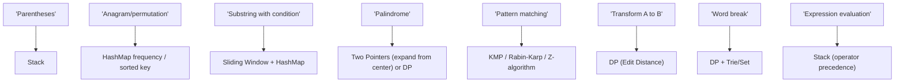
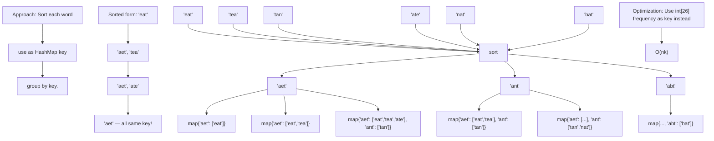
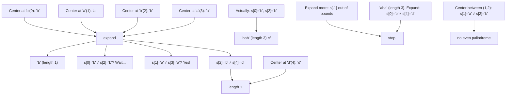

**Navigation**: [< Previous](17_Backtracking_Plus_Pruning.md) | [Back to Index](../00_MASTER_INDEX.md) | [Next >](19_Matrix_Plus_Grid_Traversal.md)

# String + Advanced Tricks — Combined Pattern Guide

**WHY this combination?** Strings combine array access, hashing, sliding window, DP, and specialized algorithms (KMP, Rabin-Karp). Most "string" problems are actually pattern problems in disguise.

### ⚠️ Constraint Lens

| Given Constraints | Do This |
|-------------------|---------|
| substring with character limit | sliding window |
| subsequence / edit relation | DP |
| exact pattern matching once | KMP / rolling hash |
| many patterns | Aho-Corasick |
| fixed lowercase alphabet | `int[26]` frequency |
| Unicode/general chars | hashmap/code-point aware logic |
| repeated substring/palindrome hard constraints | suffix/Manacher/rolling hash |

Full map: [Constraint-Based Pattern Selection](25_Constraint_Based_Pattern_Selection.md).

### 🧠 Deep Intuition — Strings Are Disguised Pattern Problems

Most string problems aren't really "string" problems — they're array, hash, or DP problems wearing a string costume. The key is to **identify the underlying pattern**:

- "Find all anagrams in a string" → This is a **sliding window** problem with a frequency map
- "Edit distance" → This is a **2D DP** problem (same as LCS family)
- "Valid parentheses" → This is a **stack** problem
- "Longest palindromic substring" → **Two pointers** (expand from center) or **DP**

The string-specific part is usually just the data representation, not the algorithm.

#### Why String Immutability Matters in Java

In Java, strings are immutable — every concatenation creates a new String object. `s += c` inside a loop creates O(n) new strings of increasing size, resulting in **O(n²) total time** for what looks like an O(n) loop. Always use `StringBuilder` for building strings incrementally — it uses an internal array and amortizes to O(n) total time.

#### The `int[26]` Trick — Why It's Faster Than HashMap

For problems involving only lowercase letters, `int[26]` (indexed by `c - 'a'`) is strictly better than `HashMap<Character, Integer>`:
- **Array access is O(1)** with no hash computation, no collision handling, no boxing/unboxing
- **Comparison of two frequency arrays** is O(26) = O(1), while comparing two HashMaps is O(n) with higher constant factors
- **Memory**: 26 ints = 104 bytes vs HashMap's ~1000+ bytes for the same data

Use `int[128]` when the problem involves ASCII characters (uppercase, digits, etc.), and HashMap only when the character set is unbounded (Unicode).

---

## 🧠 PATTERN DECODER FOR STRING PROBLEMS

```
String problem?
├── "Parentheses" → Stack
├── "Anagram/permutation" → HashMap frequency / sorted key
├── "Substring with condition" → Sliding Window + HashMap
├── "Palindrome" → Two Pointers (expand from center) or DP
├── "Pattern matching" → KMP / Rabin-Karp / Z-algorithm
├── "Transform A to B" → DP (Edit Distance)
├── "Word break" → DP + Trie/Set
├── "Expression evaluation" → Stack (operator precedence)
└── "Justify/format" → Simulation
```

**Flow:**
1. 'Parentheses'
2. Stack
3. 'Anagram/permutation'
4. HashMap frequency / sorted key
5. 'Substring with condition'
6. Sliding Window + HashMap
7. 'Palindrome'
8. Two Pointers (expand from center) or DP
9. 'Pattern matching'
10. KMP / Rabin-Karp / Z-algorithm
11. 'Transform A to B'
12. DP (Edit Distance)



---


## 📐 CORE TEMPLATES

### Template 1: Character Frequency (int[26] trick)
```java
// Faster than HashMap for lowercase letters
int[] freq = new int[26];
for (char c : s.toCharArray()) freq[c - 'a']++;

// Compare two frequency arrays → O(26) = O(1)
boolean isAnagram = Arrays.equals(freq1, freq2);
```

### Template 2: Palindrome Check (Expand from Center)
```java
int expandFromCenter(String s, int left, int right) {
    while (left >= 0 && right < s.length() && s.charAt(left) == s.charAt(right)) {
        left--; right++;
    }
    return right - left - 1;  // palindrome length
}
// Call for each center: expandFromCenter(s, i, i) and expandFromCenter(s, i, i+1)
```

### Template 3: KMP Pattern Matching
```java
// Build failure function
int[] buildLPS(String pattern) {
    int[] lps = new int[pattern.length()];
    int len = 0, i = 1;
    while (i < pattern.length()) {
        if (pattern.charAt(i) == pattern.charAt(len)) {
            lps[i++] = ++len;
        } else if (len > 0) {
            len = lps[len - 1];  // fall back
        } else {
            lps[i++] = 0;
        }
    }
    return lps;
}
```

---

## � FULL WALKTHROUGH: Group Anagrams

```
Problem: Group words that are anagrams.
         ["eat","tea","tan","ate","nat","bat"]

Approach: Sort each word → use as HashMap key → group by key.

WHY sorted-key works:
  Anagrams have the same characters, just rearranged.
  Sorted form: "eat" → "aet", "tea" → "aet", "ate" → "aet" — all same key!

Step-by-step:
  "eat" → sort → "aet" → map{"aet": ["eat"]}
  "tea" → sort → "aet" → map{"aet": ["eat","tea"]}
  "tan" → sort → "ant" → map{"aet": ["eat","tea"], "ant": ["tan"]}
  "ate" → sort → "aet" → map{"aet": ["eat","tea","ate"], "ant": ["tan"]}
  "nat" → sort → "ant" → map{"aet": [...], "ant": ["tan","nat"]}
  "bat" → sort → "abt" → map{..., "abt": ["bat"]}

  Result: [["eat","tea","ate"], ["tan","nat"], ["bat"]] ✅

Time: O(n · k log k) where k = max word length | Space: O(nk)
Optimization: Use int[26] frequency as key instead of sorting → O(nk)
```

**Flow:**
1. Approach: Sort each word
2. use as HashMap key
3. group by key.
4. Sorted form: 'eat'
5. 'aet', 'tea'
6. 'aet', 'ate'
7. 'aet' — all same key!
8. 'eat'
9. sort



---

## 🔬 FULL WALKTHROUGH 2: Longest Palindromic Substring (Expand Around Center)

```
Problem: Find the longest palindromic substring in "babad".

Approach: For each character (and between each pair), expand outward
          while characters match.

WHY center expansion? A palindrome mirrors around its center.
Total centers: 2n-1 (n single chars + n-1 between-pairs).

Step-by-step (showing key centers):
  Center at 'b'(0): "b" → expand → 'b' (length 1)
  Center at 'a'(1): "a" → expand → s[0]='b' ≠ s[2]='b'? Wait...
    Actually: s[0]='b', s[2]='b' → "bab" (length 3) ✅
    Expand more: s[-1] out of bounds → stop.
  Center at 'b'(2): "b" → expand → s[1]='a' ≠ s[3]='a'? Yes!
    "aba" (length 3). Expand: s[0]='b' ≠ s[4]='d' → stop.
  Center between (1,2): s[1]='a' ≠ s[2]='b' → no even palindrome
  Center at 'a'(3): "a" → expand → s[2]='b' ≠ s[4]='d' → length 1
  Center at 'd'(4): "d" → length 1

  Longest: "bab" or "aba" (both length 3) ✅

Time: O(n²) | Space: O(1)
NOTE: Manacher's algorithm does this in O(n) but is rarely asked.
```

**Flow:**
1. Center at 'b'(0): 'b'
2. expand
3. 'b' (length 1)
4. Center at 'a'(1): 'a'
5. expand
6. s[0]='b' ≠ s[2]='b'? Wait...
7. Actually: s[0]='b', s[2]='b'
8. 'bab' (length 3) ✅
9. Expand more: s[-1] out of bounds
10. stop.



---


## 🛡️ EDGE CASES & COMMON MISTAKES

```
COMMON MISTAKES:
1. String comparison: using == instead of .equals() in Java
   "abc" == "abc" may be true (string pool) but NOT guaranteed!
2. Off-by-one with substring(): s.substring(start, end) is [start, end)
3. Forgetting empty string checks: s == null || s.isEmpty()
4. KMP: Building LPS array wrong — the prefix function is tricky.
   Test on "AAAA" (lps=[0,1,2,3]) and "ABCABD" (lps=[0,0,0,1,2,0])
5. Palindrome: not handling even-length palindromes separately
   "abba" has center BETWEEN b and b, not AT any single character
```

---

## 📊 COMPLEXITY SUMMARY

| Problem | Approach | Time | Space |
|---------|----------|------|-------|
| Group Anagrams | Sort key + HashMap | O(n·k log k) | O(nk) |
| Group Anagrams | Freq key + HashMap | O(nk) | O(nk) |
| Longest Palindrome | Expand from center | O(n²) | O(1) |
| Longest Palindrome | Manacher's | O(n) | O(n) |
| Pattern Search | KMP | O(n+m) | O(m) |
| Pattern Search | Rabin-Karp | O(n+m) avg | O(1) |
| Valid Parentheses | Stack | O(n) | O(n) |

---


🔬 **Section Challenge — 📊 COMPLEXITY SUMMARY**

**Challenge 1 (Reasoning):** Prefix sum initialized as `prefix[0] = 0` — why the leading zero and not `prefix[0] = arr[0]`?
<details><summary>Answer</summary>

`prefix[0] = 0` (empty prefix) makes range sum formula uniform: `sum(l,r) = prefix[r+1] - prefix[l]`. Without the 0: `sum(0,r) = prefix[r] - 0` (special case needed). With it: `sum(0,r) = prefix[r+1] - prefix[0] = prefix[r+1]`. Same formula everywhere. This is the 'sentinel' pattern — adding a dummy initial value to eliminate special cases. Same trick used in dummy linked list nodes.
</details>


## 📋 PRACTICE PROBLEMS — From Your Excel Sheet
| # | Problem | Companies | Key Insight |
|---|---------|-----------|-------------|
| 1 | [Valid Parentheses](https://leetcode.com/problems/valid-parentheses/) | Salesforce | Stack matching |
| 2 | [Print Duplicates in String](https://www.geeksforgeeks.org/print-all-the-duplicates-in-the-input-string/) | — | Frequency counting |
| 3 | [strStr (indexOf)](https://leetcode.com/problems/implement-strstr/) | Salesforce | KMP or built-in |
| 4 | [Longest Common Prefix](https://leetcode.com/problems/longest-common-prefix/) | — | Vertical scan or trie |
| 5 | [Valid Palindrome II](https://leetcode.com/problems/valid-palindrome-ii/) | Amazon, Salesforce | Two pointers + skip one |

### Medium
| # | Problem | Companies | Key Insight |
|---|---------|-----------|-------------|
| 6 | [Integer to Roman](https://leetcode.com/problems/integer-to-roman/) | Amazon | Greedy: largest denomination first |
| 7 | [Generate Parentheses](https://leetcode.com/problems/generate-parentheses/) | Salesforce | Backtracking with open/close count |
| 8 | [Simplify Path](https://leetcode.com/problems/simplify-path/) | Amazon | Stack for directory components |
| 9 | [Smallest Window (all chars)](https://practice.geeksforgeeks.org/problems/smallest-window-in-a-string-containing-all-the-characters-of-another-string-1587115621/1) | Amazon | Sliding window + freq match |
| 10 | [Reverse Words in String](https://leetcode.com/problems/reverse-words-in-a-string/) | Amazon | Split + reverse or two-pointer |
| 11 | [Rabin-Karp](https://www.geeksforgeeks.org/rabin-karp-algorithm-for-pattern-searching/) | Salesforce | Rolling hash matching |
| 12 | [Group Anagrams](https://leetcode.com/problems/group-anagrams/) | — | Sorted key or freq key |
| 13 | [Word Wrap](https://practice.geeksforgeeks.org/problems/word-wrap1646/1) | Salesforce | DP: minimize penalty |
| 14 | [Basic Calculator II](https://leetcode.com/problems/basic-calculator-ii/) | — | Stack with operator precedence |
| 15 | Edit Distance | — | Classic 2D DP |

### Hard
| # | Problem | Companies | Key Insight |
|---|---------|-----------|-------------|
| 16 | [Valid Number](https://leetcode.com/problems/valid-number/) | Walmart | State machine / DFA |
| 17 | [Integer to English Words](https://leetcode.com/problems/integer-to-english-words/) | — | Divide by 1000 + lookup |
| 18 | [Minimum Window Substring](https://leetcode.com/problems/minimum-window-substring/) | Salesforce | Variable window + freq matching |
| 19 | [Text Justification](https://leetcode.com/problems/text-justification/) | — | Simulation: pack + distribute spaces |
| 20 | [Boyer-Moore](https://www.geeksforgeeks.org/boyer-moore-algorithm-for-pattern-searching/) | Walmart | Bad character + good suffix |
| 21 | [Distinct Subsequences](https://leetcode.com/problems/distinct-subsequences/) | — | DP: count ways to form t from s |

### Trie Problems
| # | Problem | Companies | Key Insight |
|---|---------|-----------|-------------|
| 22 | [Design Add/Search Words](https://leetcode.com/problems/design-add-and-search-words-data-structure/) | — | Trie + DFS for '.' wildcard |
| 23 | [Word Break (Trie)](https://www.geeksforgeeks.org/word-break-problem-trie-solution/) | Amazon | Trie lookup + DP |
| 24 | [Trie Insert/Search](https://www.geeksforgeeks.org/trie-insert-and-search/) | Amazon | Basic trie implementation |
| 25 | [K Anagrams](https://practice.geeksforgeeks.org/problems/k-anagrams-1/0) | Amazon | Freq diff ≤ k |
| 26 | [Palindrome Pairs](https://leetcode.com/problems/palindrome-pairs/) | Amazon | Trie + palindrome suffix check |
| 27 | [Phone Directory](https://practice.geeksforgeeks.org/problems/phone-directory/0) | — | Trie prefix traversal |

---

## 🔥 STRING TRICKS CHEAT SHEET

| Trick | Code | When |
|-------|------|------|
| Char frequency array | `int[26]` or `int[128]` | Faster than HashMap |
| StringBuilder | `sb.append(c)` | Build strings (immutable!) |
| String → char[] | `s.toCharArray()` | In-place manipulation |
| Sort string | `new String(Arrays.sort(arr))` | Anagram grouping |
| Char math | `c - 'a'` gives 0-25 | Array index |
| Reverse string | `new StringBuilder(s).reverse()` | Quick reverse |
| Rolling hash | `hash = hash * base + c` | Pattern matching O(1) |

---

📖 **Related Chapters:**
- [03_Algorithms/13_String_Algorithms_Complete.md](../03_Algorithms/13_String_Algorithms_Complete.md) — String algorithms
- [03_Algorithms/06d_String_Algorithms.md](../03_Algorithms/06d_String_Algorithms.md) — Advanced string algos

---
[← 17 Backtracking+Pruning](17_Backtracking_Plus_Pruning.md) | [19 Matrix+Grid →](19_Matrix_Plus_Grid_Traversal.md)


---

**Navigation**: [< Previous](17_Backtracking_Plus_Pruning.md) | [Back to Index](../00_MASTER_INDEX.md) | [Next >](19_Matrix_Plus_Grid_Traversal.md)


