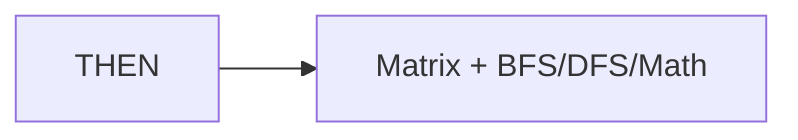
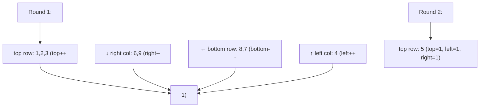
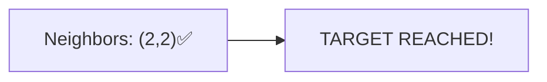
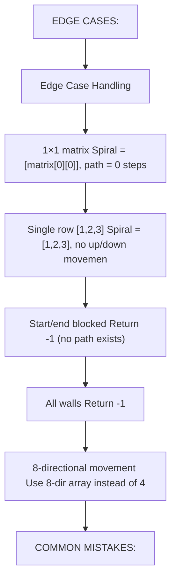

**Navigation**: [< Previous](18_String_Plus_Advanced.md) | [Back to Index](../00_MASTER_INDEX.md) | [Next >](20_BitManipulation_Plus_Tricks.md)

# Matrix + Grid Traversal — Combined Pattern Guide

**WHY this combination?** 2D grids are graphs where each cell connects to its 4 (or 8) neighbors. BFS/DFS on grids solve island counting, flood fill, shortest path, and rotation problems.

### 🧠 Deep Intuition — Grids Are Implicit Graphs

A 2D matrix with R rows and C columns is really a **graph with R×C nodes** where each cell (r,c) has edges to its 4 (or 8) neighbors. You never need to explicitly build this graph — the adjacency is implicit in the grid structure. This is why DFS/BFS on grids use the direction array `{{0,1},{0,-1},{1,0},{-1,0}}` — it defines the edges.

#### DFS vs BFS for Grid Problems

- **DFS (recursion or stack)**: Use for **exploring/marking connected components** (island counting, flood fill). DFS is simpler to implement recursively and uses the call stack. Caveat: for very large grids, recursive DFS can cause stack overflow — use iterative DFS or BFS instead.

- **BFS (queue)**: Use for **shortest path** problems on grids. BFS explores cells in order of increasing distance, so the first time you reach the target is via the shortest path. Also essential for **multi-source BFS** — starting from multiple cells simultaneously (rotten oranges, distance to nearest 1).

#### Multi-Source BFS — A Key Grid Technique

Instead of running BFS from each source cell separately (O(k × R×C) for k sources), add ALL source cells to the queue at the start. They become "level 0," and BFS naturally computes the minimum distance from *any* source to every cell in a single O(R×C) pass. This is the correct approach for "rotten oranges" and "distance to nearest" problems.

#### In-Place Visited Marking — Trading Purity for Efficiency

Instead of maintaining a separate `boolean[][] visited` array, you can mark visited cells by modifying the grid itself (e.g., changing `'1'` to `'0'` or using a sentinel value like `'#'`). This saves O(R×C) space. However, it modifies the input — only use this when the problem allows it or when you can restore the grid afterwards.

---

## 🧠 WHEN TO RECOGNIZE

```
IF the problem has:
  ✅ 2D grid/matrix
  ✅ "Number of islands" / "Connected regions"
  ✅ "Shortest path" in maze
  ✅ "Rotate" / "Spiral" / "Transpose"
  ✅ "Flood fill" / "Surrounded regions"
THEN → Matrix + BFS/DFS/Math
```

**Flow:**
1. THEN
2. Matrix + BFS/DFS/Math



---

## 📐 CORE TEMPLATES

### Template 1: DFS Flood Fill (Island Counting)
```java
int[][] dirs = {{0,1},{0,-1},{1,0},{-1,0}};

int numIslands(char[][] grid) {
    int count = 0;
    for (int i = 0; i < grid.length; i++)
        for (int j = 0; j < grid[0].length; j++)
            if (grid[i][j] == '1') { dfs(grid, i, j); count++; }
    return count;
}

void dfs(char[][] grid, int r, int c) {
    if (r < 0 || r >= grid.length || c < 0 || c >= grid[0].length || grid[r][c] != '1') return;
    grid[r][c] = '0';  // mark visited
    for (int[] d : dirs) dfs(grid, r + d[0], c + d[1]);
}
```

### Template 2: BFS Shortest Path in Grid
```java
int shortestPath(int[][] grid, int[] start, int[] end) {
    Queue<int[]> queue = new LinkedList<>();
    boolean[][] visited = new boolean[m][n];
    queue.offer(start);
    visited[start[0]][start[1]] = true;
    int dist = 0;

    while (!queue.isEmpty()) {
        int size = queue.size();
        for (int i = 0; i < size; i++) {
            int[] cell = queue.poll();
            if (cell[0] == end[0] && cell[1] == end[1]) return dist;
            for (int[] d : dirs) {
                int nr = cell[0] + d[0], nc = cell[1] + d[1];
                if (nr >= 0 && nr < m && nc >= 0 && nc < n && !visited[nr][nc] && grid[nr][nc] == 0) {
                    visited[nr][nc] = true;
                    queue.offer(new int[]{nr, nc});
                }
            }
        }
        dist++;
    }
    return -1;
}
```

### Template 3: Spiral Traversal
```java
List<Integer> spiralOrder(int[][] matrix) {
    List<Integer> result = new ArrayList<>();
    int top = 0, bottom = m-1, left = 0, right = n-1;
    while (top <= bottom && left <= right) {
        for (int c = left; c <= right; c++) result.add(matrix[top][c]); top++;
        for (int r = top; r <= bottom; r++) result.add(matrix[r][right]); right--;
        if (top <= bottom) { for (int c = right; c >= left; c--) result.add(matrix[bottom][c]); bottom--; }
        if (left <= right) { for (int r = bottom; r >= top; r--) result.add(matrix[r][left]); left++; }
    }
    return result;
}
```

### Template 4: Rotate 90° Clockwise
```java
// Transpose + Reverse each row
void rotate(int[][] matrix) {
    int n = matrix.length;
    // Transpose
    for (int i = 0; i < n; i++)
        for (int j = i+1; j < n; j++)
            { int t = matrix[i][j]; matrix[i][j] = matrix[j][i]; matrix[j][i] = t; }
    // Reverse each row
    for (int[] row : matrix) {
        int l = 0, r = n-1;
        while (l < r) { int t = row[l]; row[l] = row[r]; row[r] = t; l++; r--; }
    }
}
```

---

## � FULL WALKTHROUGH: Spiral Matrix Traversal

```
Problem: Return elements of matrix in spiral order.
  Matrix:  1  2  3
           4  5  6
           7  8  9

Approach: 4 boundaries (top, bottom, left, right). Move inward.

Step-by-step:
  top=0, bottom=2, left=0, right=2

  Round 1: → top row:    1,2,3  (top++ → 1)
            ↓ right col:  6,9    (right-- → 1)
            ← bottom row: 8,7    (bottom-- → 1)
            ↑ left col:   4      (left++ → 1)

  Round 2: → top row:    5      (top=1, left=1, right=1)
            top > bottom, stop.

  Result: [1,2,3,6,9,8,7,4,5] ✅

WHY 4 boundaries? Cleaner than direction arrays + visited set.
Each boundary shrinks inward after processing that side.

Time: O(R×C) | Space: O(1) extra (output doesn't count)
```

**Flow:**
1. Round 1:
2. top row: 1,2,3 (top++
3. 1)
4. ↓ right col: 6,9 (right--
5. 1)
6. ← bottom row: 8,7 (bottom--
7. 1)
8. ↑ left col: 4 (left++
9. 1)
10. Round 2:
11. top row: 5 (top=1, left=1, right=1)



---

## 🔬 FULL WALKTHROUGH 2: BFS Shortest Path in Grid

```
Problem: Find shortest path from (0,0) to (2,2) in grid.
  Grid:  0  0  0     (0 = open, 1 = wall)
         1  1  0
         0  0  0

Approach: BFS from (0,0). First time we reach (2,2) = shortest path.

Step-by-step:
  Queue: [(0,0)], visited: {(0,0)}, dist=0

  Level 0 (dist=0): Process (0,0)
    Neighbors: (0,1)✅ (1,0)=wall ❌
    Queue: [(0,1)]

  Level 1 (dist=1): Process (0,1)
    Neighbors: (0,2)✅ (1,1)=wall ❌
    Queue: [(0,2)]

  Level 2 (dist=2): Process (0,2)
    Neighbors: (1,2)✅
    Queue: [(1,2)]

  Level 3 (dist=3): Process (1,2)
    Neighbors: (2,2)✅ → TARGET REACHED!
    Queue: [(2,2)]

  Answer: shortest path = 4 steps ✅ (or 5 cells visited)

KEY: BFS guarantees shortest path in unweighted grids.
     Mark visited WHEN ADDING to queue, not when processing!

Time: O(R×C) | Space: O(R×C)
```

**Flow:**
1. Neighbors: (2,2)✅
2. TARGET REACHED!



---


## 🛡️ EDGE CASES & COMMON MISTAKES

```
EDGE CASES:
┌────────────────────────────────┬──────────────────────────────────────────┐
│ Edge Case                      │ Handling                                 │
├────────────────────────────────┼──────────────────────────────────────────┤
│ 1×1 matrix                    │ Spiral = [matrix[0][0]], path = 0 steps   │
│ Single row [1,2,3]            │ Spiral = [1,2,3], no up/down movement     │
│ Single column [[1],[2],[3]]   │ Spiral = [1,2,3], no left/right movement  │
│ Non-square matrix (m≠n)       │ Boundaries still work, check conditions   │
│ Start/end blocked             │ Return -1 (no path exists)                │
│ All walls                     │ Return -1                                 │
│ 8-directional movement        │ Use 8-dir array instead of 4              │
└────────────────────────────────┴──────────────────────────────────────────┘

COMMON MISTAKES:
1. Spiral: not checking top<=bottom BEFORE bottom row traversal
   On non-square matrices, you may re-traverse already-visited rows!
2. BFS: marking visited AFTER dequeue instead of WHEN enqueueing
   Causes duplicate processing → TLE and incorrect distances
3. Rotation: using extra matrix when problem says "in-place"
   Transpose + reverse = O(1) extra space
4. Forgetting bounds check: row < 0 || row >= R || col < 0 || col >= C
5. Set Matrix Zeroes: zeroing as you scan → cascade effect
   Mark first, then zero in a second pass!
```

**Flow:**
1. EDGE CASES:
2. Edge Case Handling
3. 1×1 matrix Spiral = [matrix[0][0]], path = 0 steps
4. Single row [1,2,3] Spiral = [1,2,3], no up/down movemen
5. Start/end blocked Return -1 (no path exists)
6. All walls Return -1
7. 8-directional movement Use 8-dir array instead of 4



---

## 📊 COMPLEXITY SUMMARY

| Problem | Time | Space | Notes |
|---------|------|-------|-------|
| Spiral Traversal | O(R×C) | O(1) | 4-boundary technique |
| Rotate 90° | O(R×C) | O(1) | Transpose + reverse |
| BFS Shortest Path | O(R×C) | O(R×C) | Queue + visited |
| DFS Flood Fill | O(R×C) | O(R×C) | Stack/recursion |
| Set Matrix Zeroes | O(R×C) | O(1) | First row/col as markers |
| Binary Search in Matrix | O(log(R×C)) | O(1) | Treat as 1D sorted array |

---


🔬 **Section Challenge — 📊 COMPLEXITY SUMMARY**

**Challenge 1 (Reasoning):** Prefix sum initialized as `prefix[0] = 0` — why the leading zero and not `prefix[0] = arr[0]`?
<details><summary>Answer</summary>

`prefix[0] = 0` (empty prefix) makes range sum formula uniform: `sum(l,r) = prefix[r+1] - prefix[l]`. Without the 0: `sum(0,r) = prefix[r] - 0` (special case needed). With it: `sum(0,r) = prefix[r+1] - prefix[0] = prefix[r+1]`. Same formula everywhere. This is the 'sentinel' pattern — adding a dummy initial value to eliminate special cases. Same trick used in dummy linked list nodes.
</details>


## 📋 PRACTICE PROBLEMS — From Your Excel Sheet
| # | Problem | Companies | Key Insight |
|---|---------|-----------|-------------|
| 1 | [Maximum Size Rectangle of 1s](https://www.geeksforgeeks.org/maximum-size-rectangle-binary-sub-matrix-1s/) | — | Histogram per row + stack |
| 2 | [Number of Islands](https://www.geeksforgeeks.org/find-number-of-islands/) | — | DFS/BFS flood fill |
| 3 | [Surrounded Regions (O/X)](https://www.geeksforgeeks.org/given-matrix-o-x-replace-o-x-surrounded-x/) | — | DFS from borders first |
| 4 | [Spiral Matrix](https://leetcode.com/problems/spiral-matrix/) | Salesforce | Four-boundary traversal |
| 5 | [Rotate Image](https://leetcode.com/problems/rotate-image/) | Salesforce | Transpose + reverse |
| 6 | [Set Matrix Zeroes](https://leetcode.com/problems/set-matrix-zeroes/) | Microsoft | Use first row/col as markers |
| 7 | [Word Search](https://leetcode.com/problems/word-search/) | — | DFS backtracking on grid |

### From Other Sections (Grid-Based)
| # | Problem | Key Insight |
|---|---------|-------------|
| 8 | [Flood Fill](https://leetcode.com/problems/flood-fill/) | BFS/DFS from source |
| 9 | [Rotten Oranges](https://practice.geeksforgeeks.org/problems/rotten-oranges2536/1) | Multi-source BFS |
| 10 | [Distance of Nearest 1](https://practice.geeksforgeeks.org/problems/distance-of-nearest-cell-having-1-1587115620/1) | Multi-source BFS |
| 11 | [Longest Increasing Path](https://leetcode.com/problems/longest-increasing-path-in-a-matrix/) | DFS + memoization |
| 12 | [Game of Life](https://leetcode.com/problems/game-of-life/) | Encode states in bits |

---

## 🔥 GRID TRICKS

| Trick | Code | When |
|-------|------|------|
| Direction array | `int[][] dirs = {{0,1},{0,-1},{1,0},{-1,0}}` | All 4/8 neighbors |
| In-place visited | `grid[r][c] = '#'` | Avoid extra boolean array |
| Multi-source BFS | Add ALL sources to queue first | "From all 1s simultaneously" |
| Border DFS first | Process borders, then interior | Surrounded regions |
| Encode state in-place | `cell = cell + 10 * newState` | Game of Life |

---

📖 **Related Chapters:**
- [02_Data_Structures/04_2D_Arrays_Matrix.md](../02_Data_Structures/04_2D_Arrays_Matrix.md) — Matrix basics

---
[← 18 String+Advanced](18_String_Plus_Advanced.md) | [20 BitManip+Tricks →](20_BitManipulation_Plus_Tricks.md)


---


---

## 🏋️ Practice & Interview Questions — Arrays

Attempt each before looking at the answer. Time yourself.

### Predict / Trace
**Q1.** What is the output? `int[] a = {1,2,3}; int[] b = a; b[0] = 99; System.out.println(a[0]);`
<details><summary>Answer</summary>

`99` — arrays are objects; `b = a` copies the **reference**, not the data. Both point to the same array.
</details>

**Q2.** What is the time complexity of inserting at index 0 of an array of size N?
<details><summary>Answer</summary>

O(N) — every element must shift right by one position.
</details>

**Q3.** Given sorted array `[1,3,5,7,9]`, binary search for 6 — trace the mid values.
<details><summary>Answer</summary>

lo=0,hi=4 → mid=2 (value=5) → lo=3,hi=4 → mid=3 (value=7) → lo=3,hi=2 → NOT FOUND
</details>

### LeetCode / Coding
**Q4.** ⭐ Two Sum — find indices of two numbers that add to target. O(N) solution.
<details><summary>Solution</summary>

```java
Map<Integer,Integer> map = new HashMap<>();
for(int i=0;i<nums.length;i++){
    int comp = target - nums[i];
    if(map.containsKey(comp)) return new int[]{map.get(comp), i};
    map.put(nums[i], i);
}
```
</details>

**Q5.** ⭐ Maximum Subarray (Kadane's Algorithm). Write the O(N) solution.
<details><summary>Solution</summary>

```java
int maxSum = nums[0], curr = nums[0];
for(int i=1;i<nums.length;i++){
    curr = Math.max(nums[i], curr + nums[i]);
    maxSum = Math.max(maxSum, curr);
}
return maxSum;
```
</details>

**Q6.** ⭐ Best Time to Buy and Sell Stock — single pass O(N).
<details><summary>Solution</summary>

```java
int minPrice = Integer.MAX_VALUE, maxProfit = 0;
for(int p : prices){
    minPrice = Math.min(minPrice, p);
    maxProfit = Math.max(maxProfit, p - minPrice);
}
return maxProfit;
```
</details>

**Q7.** ⭐ Product of Array Except Self — without division, O(N).
<details><summary>Solution</summary>

```java
int[] res = new int[n];
res[0] = 1;
for(int i=1;i<n;i++) res[i] = res[i-1] * nums[i-1];
int right = 1;
for(int i=n-1;i>=0;i--){ res[i] *= right; right *= nums[i]; }
return res;
```
</details>

**Q8.** ⭐⭐ Container With Most Water (Two Pointers).
<details><summary>Solution</summary>

```java
int l=0, r=nums.length-1, max=0;
while(l<r){
    max = Math.max(max, Math.min(height[l],height[r])*(r-l));
    if(height[l]<height[r]) l++; else r--;
}
```
</details>

**Q9.** ⭐⭐ 3Sum — find all unique triplets summing to 0. O(N²).
<details><summary>Solution</summary>

```java
Arrays.sort(nums);
for(int i=0;i<n-2;i++){
    if(i>0 && nums[i]==nums[i-1]) continue;
    int l=i+1, r=n-1;
    while(l<r){
        int s=nums[i]+nums[l]+nums[r];
        if(s==0){ result.add(List.of(nums[i],nums[l++],nums[r--])); 
            while(l<r&&nums[l]==nums[l-1])l++; while(l<r&&nums[r]==nums[r+1])r--; }
        else if(s<0) l++; else r--;
    }
}
```
</details>

**Q10.** ⭐⭐ Rotate Array by k positions in-place O(1) space.
<details><summary>Solution</summary>

```java
// Reverse full array, then reverse first k, then reverse rest
k %= n;
reverse(nums, 0, n-1);
reverse(nums, 0, k-1);
reverse(nums, k, n-1);
```
</details>

**Q11.** ⭐⭐ Find the duplicate number in array [1..n] — O(N) time, O(1) space (Floyd's cycle).
<details><summary>Solution</summary>

```java
int slow=nums[0], fast=nums[0];
do{ slow=nums[slow]; fast=nums[nums[fast]]; } while(slow!=fast);
slow=nums[0];
while(slow!=fast){ slow=nums[slow]; fast=nums[fast]; }
return slow;
```
</details>

**Q12.** ⭐⭐⭐ Trapping Rain Water — O(N) two-pointer solution.
<details><summary>Solution</summary>

```java
int l=0,r=n-1,lMax=0,rMax=0,water=0;
while(l<r){
    if(height[l]<=height[r]){
        if(height[l]>=lMax) lMax=height[l]; else water+=lMax-height[l];
        l++;
    } else {
        if(height[r]>=rMax) rMax=height[r]; else water+=rMax-height[r];
        r--;
    }
}
```
</details>

### Interview Questions
**Q13.** What's the difference between `ArrayList` and `LinkedList` for index access?
<details><summary>Answer</summary>

ArrayList: O(1) random access (array backing). LinkedList: O(N) — must traverse from head. Use ArrayList for most cases; LinkedList only when frequent insertions/deletions at head/tail.
</details>

**Q14.** When would you use `int[]` over `ArrayList<Integer>`?
<details><summary>Answer</summary>

`int[]`: primitive, no boxing overhead, fixed-size, cache-friendly. `ArrayList<Integer>`: dynamic resizing, collection API, but 4-16x memory overhead per element due to Integer boxing.
</details>

**Q15.** What is cache locality and why do arrays benefit from it?
<details><summary>Answer</summary>

CPU loads data in cache lines (~64 bytes). Arrays store elements contiguously → sequential access loads entire cache line at once → very fast. LinkedList nodes are scattered in heap → each node access = potential cache miss.
</details>

### MCQ Rapid Fire
| # | Question | Answer |
|---|---|---|
| 1 | Array access a[i] time complexity | O(1) |
| 2 | Array insertion at middle time complexity | O(N) |
| 3 | Default value of int[] in Java | 0 |
| 4 | Arrays.sort() algorithm for primitives | Dual-pivot QuickSort |
| 5 | Arrays.sort() algorithm for objects | TimSort (stable) |
| 6 | Arrays.copyOfRange(a,2,5) — how many elements? | 3 (indices 2,3,4) |
| 7 | Can arrays store null? | Yes (reference arrays only) |
| 8 | Arrays.fill(a, 7) — what does it do? | Sets every element to 7 |
| 9 | Multi-dim array a[3][4] — total elements? | 12 |
| 10 | Arrays.binarySearch requires? | Sorted array |


---

## 🧠 Deep Conceptual Questions — Arrays & Memory

These questions test your REASONING, not just recall. Think before expanding.

**C1. Why is array access O(1)?**
<details><summary>Deep Answer</summary>

Arrays store elements at **contiguous memory addresses**. Given base address B and element size S:
`address(i) = B + (i × S)` — this is a single multiplication and addition (constant time regardless of N).
The CPU can compute this directly without any traversal. This is why arrays are the fastest data structure for indexed access.
</details>

**C2. Why does cache performance matter for algorithms, and why do arrays win?**
<details><summary>Deep Answer</summary>

Modern CPUs fetch memory in **cache lines** (~64 bytes). When you access `array[i]`, the CPU also loads `array[i+1]` through `array[i+7]` into L1 cache automatically (spatial locality). Sequential array access hits cache nearly 100% of the time (~1ns). LinkedList traversal: each node is at a random heap address → each step is a potential **cache miss** (~100ns). For 1M elements: array traversal ≈ 1ms; linked list ≈ 100ms. Same O(N), 100x different in practice.
</details>

**C3. Why does `Arrays.sort()` use different algorithms for primitives vs objects?**
<details><summary>Deep Answer</summary>

**Primitives (`int[]`)**: Uses Dual-Pivot QuickSort. No stability needed (equal ints are indistinguishable). QuickSort is in-place (O(1) extra space), cache-friendly (sequential access), fastest in practice. **Objects (`Integer[]`)**: Uses TimSort (hybrid MergeSort + InsertionSort). MUST be stable — equal objects may have different fields that should preserve original order (think: sort by name, then by age — equal names must stay age-ordered). TimSort guarantees O(N log N) worst case; QuickSort can degrade to O(N²) if not careful.
</details>

**C4. Why is inserting at the beginning of an array O(N) but appending at end is O(1) amortized?**
<details><summary>Deep Answer</summary>

**Insert at index 0**: must shift every element right → N operations always.
**Append**: if capacity exists, write at `arr[size]` → O(1). If full, resize (double capacity) → copy all N elements. But resizing happens only after 1, 2, 4, 8... N elements. Total copies over N appends = N/2 + N/4 + ... = N. Average per operation = N/N = O(1) — this is **amortized analysis**. ArrayList uses this strategy.
</details>

**C5. What is the REAL cost of `ArrayList.remove(0)` in a 1M element list? Why?**
<details><summary>Deep Answer</summary>

~1 million array element shifts. Java calls `System.arraycopy()` — a native bulk memory move. Even though it's one instruction, it copies 1M references = 4MB-8MB of memory movement. At memory bandwidth ~20GB/s: ~200-400 microseconds actual cost. Not "slow" but definitely O(N) — avoid repeatedly removing from the front of a large ArrayList. Use `ArrayDeque` for front-removal O(1).
</details>

**C6. Two Sum: why does the HashMap approach work, and what's its actual space tradeoff?**
<details><summary>Deep Answer</summary>

HashMap approach: as you iterate, store `{value → index}`. For each element, check if `target - current` already seen. This is the **complement pattern**: instead of "find two that sum to target", reframe as "have I seen what I need?". Space: O(N) worst case (all elements unique, no match until last pair). But we trade space for a reduction from O(N²) to O(N) time — classic space-time tradeoff. The 1-pass variant finds the answer in one scan without a second loop.
</details>

**C7. Sliding Window: what is the INVARIANT being maintained?**
<details><summary>Deep Answer</summary>

A sliding window maintains a **window [left, right]** where some property (max sum, no duplicates, valid substring) holds. The invariant: the window always satisfies the constraint. When violated: shrink from left until valid again. This avoids re-examining elements already processed — each element enters and leaves the window exactly once → O(N). Mental model: two pointers chasing each other, never crossing, each moving forward-only.
</details>

**C8. Prefix Sum: why does it reduce range-sum queries from O(N) to O(1)?**
<details><summary>Deep Answer</summary>

`prefix[i] = arr[0] + arr[1] + ... + arr[i]`. Sum of range [l,r] = `prefix[r] - prefix[l-1]`. Precomputation: O(N). Each query: O(1) subtraction. Without prefix sum: each query scans the range = O(N) per query → O(N×Q) total for Q queries. With prefix sum: O(N) build + O(Q) queries = O(N+Q). Break-even at Q=1; better for Q>1. Classic **precomputation tradeoff**: pay once, query forever.
</details>

**C9. Why does Kadane's Algorithm work for Maximum Subarray?**
<details><summary>Deep Answer</summary>

The key insight: at each position i, the maximum subarray ending at i is either:
1. `arr[i]` alone (start fresh — previous subarray was negative, drags us down)
2. `arr[i] + best_ending_at[i-1]` (extend the previous best)

`curr = max(arr[i], curr + arr[i])` captures this exactly. If curr becomes negative, it's better to start fresh at next element. We track global max throughout. This is a 1D DP where the "state" is "maximum subarray sum ending here". The recurrence is the key reasoning step.
</details>

**C10. Binary Search: why does `mid = lo + (hi - lo) / 2` instead of `(lo + hi) / 2`?**
<details><summary>Deep Answer</summary>

**Integer overflow!** If `lo + hi` exceeds `Integer.MAX_VALUE` (2,147,483,647), the sum wraps to a negative number. For huge arrays (lo=1B, hi=2B), `lo + hi = 3B > 2.1B`. This bug brought down a famous JDK implementation of binary search in 2006 (Joshua Bloch's blog post). `lo + (hi - lo) / 2` can never overflow since `hi - lo` is always positive and smaller than either value alone.
</details>


> **Navigation**: [< Previous](18_String_Plus_Advanced.md) | [Back to Index](../00_MASTER_INDEX.md) | [Next >](20_BitManipulation_Plus_Tricks.md)