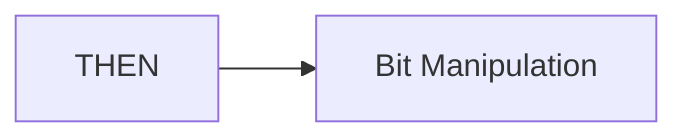
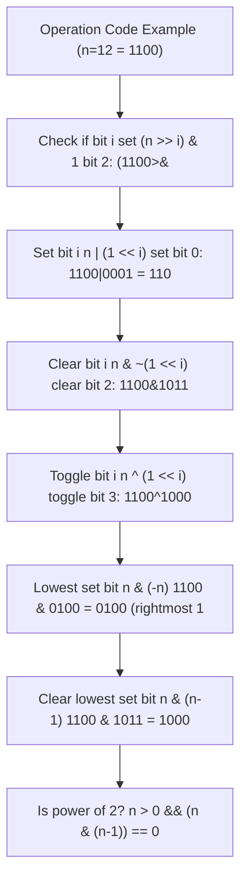
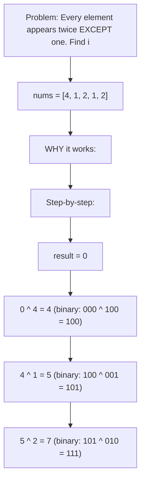
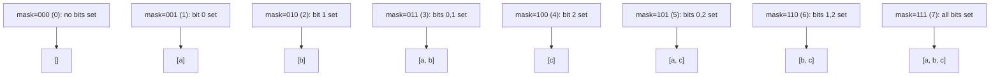
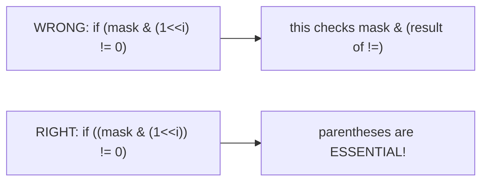

> **Navigation**: [< Previous](19_Matrix_Plus_Grid_Traversal.md) | [Back to Index](../00_MASTER_INDEX.md) | [Next >](21_Intervals_Pattern.md)

# Bit Manipulation + Tricks — Combined Pattern Guide

> **WHY this matters?** Bit manipulation provides O(1) operations that replace expensive loops. XOR finds unique elements, bitmasks encode sets, and bit tricks optimize space and time.

---

## 🧠 WHEN TO RECOGNIZE

```
IF the problem says:
  ✅ "Single number" / "Find unique"
  ✅ "Power of 2" / "Count bits"
  ✅ "Subset enumeration" with bitmask
  ✅ "Without using +, -, *, /"
  ✅ "Swap without temp"
THEN → Bit Manipulation
```

> **Flow**: THEN → Bit Manipulation



---

## 📐 ESSENTIAL BIT OPERATIONS

### Cheat Sheet
```
Operation              Code                    Example (n=12 = 1100)
────────────────────────────────────────────────────────────────────
Check if bit i set     (n >> i) & 1            bit 2: (1100>>2)&1 = 1 ✓
Set bit i              n | (1 << i)            set bit 0: 1100|0001 = 1101
Clear bit i            n & ~(1 << i)           clear bit 2: 1100&1011 = 1000
Toggle bit i           n ^ (1 << i)            toggle bit 3: 1100^1000 = 0100
Lowest set bit         n & (-n)                1100 & 0100 = 0100 (rightmost 1)
Clear lowest set bit   n & (n-1)               1100 & 1011 = 1000
Is power of 2?         n > 0 && (n & (n-1)) == 0
Count set bits         Integer.bitCount(n)     bitCount(1100) = 2
```

> **Flow**: Operation Code Example (n=12 = 1100) → Check if bit i set (n &gt;&gt; i) & 1 bit 2: (1100&gt;& | Check if bit i set (n &gt;&gt; i) & 1 bit 2: (1100&gt;& → Set bit i n | (1 &lt;&lt; i) set bit 0: 1100|0001 = 110 | Set bit i n | (1 &lt;&lt; i) set bit 0: 1100|0001 = 110 → Clear bit i n & ~(1 &lt;&lt; i) clear bit 2: 1100&1011  | Clear bit i n & ~(1 &lt;&lt; i) clear bit 2: 1100&1011  → Toggle bit i n ^ (1 &lt;&lt; i) toggle bit 3: 1100^1000 | Toggle bit i n ^ (1 &lt;&lt; i) toggle bit 3: 1100^1000 → Lowest set bit n & (-n) 1100 & 0100 = 0100 (rightmost 1 | Lowest set bit n & (-n) 1100 & 0100 = 0100 (rightmost 1 → Clear lowest set bit n & (n-1) 1100 & 1011 = 1000 | ...+1 more



### Key Patterns
```java
// XOR: a ^ a = 0, a ^ 0 = a
// Find single number in array where all others appear twice:
int single = 0;
for (int num : nums) single ^= num;  // pairs cancel out
return single;

// Subset enumeration with bitmask:
for (int mask = 0; mask < (1 << n); mask++) {
    for (int i = 0; i < n; i++) {
        if ((mask & (1 << i)) != 0) {
            // element i is in this subset
        }
    }
}
```

---

## � FULL WALKTHROUGH: Single Number (XOR trick)

```
Problem: Every element appears twice EXCEPT one. Find it.
         nums = [4, 1, 2, 1, 2]

Approach: XOR all elements. Duplicates cancel out (a ^ a = 0).

WHY it works:
  XOR properties: a ^ 0 = a,  a ^ a = 0,  commutative + associative

Step-by-step:
  result = 0
  0 ^ 4 = 4           (binary: 000 ^ 100 = 100)
  4 ^ 1 = 5           (binary: 100 ^ 001 = 101)
  5 ^ 2 = 7           (binary: 101 ^ 010 = 111)
  7 ^ 1 = 6           (binary: 111 ^ 001 = 110)  ← 1 cancels
  6 ^ 2 = 4           (binary: 110 ^ 010 = 100)  ← 2 cancels

  Answer: 4 ✅ (only the unique element survives)

Time: O(n) | Space: O(1)
Why not HashMap? HashMap works but uses O(n) space. XOR uses O(1).
```

> **Flow**: Problem: Every element appears twice EXCEPT one. Find i → nums = [4, 1, 2, 1, 2] | nums = [4, 1, 2, 1, 2] → WHY it works: | WHY it works: → Step-by-step: | Step-by-step: → result = 0 | result = 0 → 0 ^ 4 = 4 (binary: 000 ^ 100 = 100) | 0 ^ 4 = 4 (binary: 000 ^ 100 = 100) → 4 ^ 1 = 5 (binary: 100 ^ 001 = 101) | ...+1 more



---

## 🔬 FULL WALKTHROUGH 2: Subset Generation Using Bitmask

```
Problem: Generate all subsets of [a, b, c] using bit manipulation.

Approach: For n elements, there are 2ⁿ subsets. Each subset maps to a
          binary number from 0 to 2ⁿ-1. Bit i = 1 means include element i.

Step-by-step (n=3, so 2³=8 subsets):
  mask=000 (0): no bits set      → []
  mask=001 (1): bit 0 set        → [a]
  mask=010 (2): bit 1 set        → [b]
  mask=011 (3): bits 0,1 set     → [a, b]
  mask=100 (4): bit 2 set        → [c]
  mask=101 (5): bits 0,2 set     → [a, c]
  mask=110 (6): bits 1,2 set     → [b, c]
  mask=111 (7): all bits set     → [a, b, c]

Code:
  for (int mask = 0; mask < (1 << n); mask++) {
      List<Character> subset = new ArrayList<>();
      for (int i = 0; i < n; i++) {
          if ((mask & (1 << i)) != 0) subset.add(arr[i]);
      }
      result.add(subset);
  }

WHY bitmask? Elegant, no recursion needed. Perfect for n ≤ 20.
Also used in Bitmask DP (TSP, assignment problems).

Time: O(n × 2ⁿ) | Space: O(n × 2ⁿ) for output
WARNING: Only works for n ≤ 20-25. Beyond that, 2ⁿ explodes.
```

> **Flow**: mask=000 (0): no bits set → [] | mask=001 (1): bit 0 set → [a] | mask=010 (2): bit 1 set → [b] | mask=011 (3): bits 0,1 set → [a, b] | mask=100 (4): bit 2 set → [c] | mask=101 (5): bits 0,2 set → [a, c] | ...+2 more



---

## 🛡️ EDGE CASES & COMMON MISTAKES

```
COMMON MISTAKES:
1. Java: bit operations on int overflow at n=31. Use long for n>30.
2. Forgetting that >> is arithmetic (preserves sign), >>> is logical
   For unsigned shift: always use >>>
3. Operator precedence: & has LOWER precedence than ==
   WRONG: if (mask & (1<<i) != 0)  → this checks mask & (result of !=)
   RIGHT: if ((mask & (1<<i)) != 0)  → parentheses are ESSENTIAL!
4. Missing Number: XOR approach requires XORing BOTH values AND indices
   XOR just values doesn't work — you need the "expected" set too
5. Signed integers: -1 in binary is all 1s (two's complement)
   Be careful with right shift on negative numbers
```

> **Flow**: WRONG: if (mask & (1&lt;&lt;i) != 0) → this checks mask & (result of !=) | RIGHT: if ((mask & (1&lt;&lt;i)) != 0) → parentheses are ESSENTIAL!



---

## 📊 COMPLEXITY SUMMARY

| Problem | Approach | Time | Space |
|---------|----------|------|-------|
| Single Number | XOR all | O(n) | O(1) |
| Missing Number | XOR or math | O(n) | O(1) |
| Power of Two | n & (n-1) == 0 | O(1) | O(1) |
| Count Set Bits | Brian Kernighan | O(k) k=set bits | O(1) |
| Subset Generation | Bitmask | O(n × 2ⁿ) | O(2ⁿ) |
| Bitmask DP (TSP) | DP on subsets | O(2ⁿ × n²) | O(2ⁿ × n) |

---

## 📋 PRACTICE PROBLEMS — From Your Excel Sheet
| # | Problem | Key Insight |
|---|---------|-------------|
| 1 | [Power of Two](https://leetcode.com/problems/power-of-two/) | `n & (n-1) == 0` |
| 2 | [Missing Number](https://leetcode.com/problems/missing-number/) | XOR all indices and values |
| 3 | [Counting Bits](https://leetcode.com/problems/counting-bits/) | `dp[i] = dp[i>>1] + (i&1)` |
| 4 | [Reverse Integer](https://leetcode.com/problems/reverse-integer/) | Modulo + overflow check |
| 5 | [Palindrome Number](https://leetcode.com/problems/palindrome-number/) | Compare half |
| 6 | [Add Binary](https://leetcode.com/problems/add-binary/) | Simulate addition |

### Medium
| # | Problem | Key Insight |
|---|---------|-------------|
| 7 | [Ones and Zeroes](https://leetcode.com/problems/ones-and-zeroes/) | 2D knapsack (bit-related theme) |

### From Math Section
| # | Problem | Companies | Key Insight |
|---|---------|-----------|-------------|
| 8 | [Excel Sheet Column Title](https://leetcode.com/problems/excel-sheet-column-title/) | — | Base-26 conversion |
| 9 | [Maximum Product of Three](https://leetcode.com/problems/maximum-product-of-three-numbers/) | — | Sort: max of two negatives × positive |
| 10 | [Minimum Moves to Equal Array](https://leetcode.com/problems/minimum-moves-to-equal-array-elements/) | — | Math: sum - n*min |
| 11 | [Happy Number](https://leetcode.com/problems/happy-number/) | Salesforce | Floyd's cycle in digit-square sequence |
| 12 | [Max Points on Line](https://leetcode.com/problems/max-points-on-a-line/) | — | Slope HashMap with GCD |
| 13 | [Valid Square](https://leetcode.com/problems/valid-square/) | Salesforce | Distance set has exactly 2 values |
| 14 | [Kth Factor of N](https://leetcode.com/problems/the-kth-factor-of-n/) | — | Iterate up to sqrt |

### Sorting & Searching from Excel
| # | Problem | Companies | Key Insight |
|---|---------|-----------|-------------|
| 15 | [Permute Two Arrays](https://www.geeksforgeeks.org/permute-two-arrays-sum-every-pair-greater-equal-k/) | Salesforce | Sort asc + desc, pair-check |
| 16 | [Ceiling in Sorted Array](https://www.geeksforgeeks.org/ceiling-in-a-sorted-array/) | — | Binary search upper bound |
| 17 | [Find Pair with Difference](https://www.geeksforgeeks.org/find-a-pair-with-the-given-difference/) | Walmart, Salesforce | Sort + two pointer |
| 18 | [Check if Reversing Sub-Array Sorts](https://www.geeksforgeeks.org/check-reversing-sub-array-make-array-sorted/) | — | Find dip, reverse, verify |
| 19 | [Radix Sort](https://www.geeksforgeeks.org/radix-sort/) | Amazon | Counting sort per digit |
| 20 | [Product Array Puzzle](https://www.geeksforgeeks.org/a-product-array-puzzle/) | — | Prefix product + suffix product |
| 21 | [Find Peak Element](https://leetcode.com/problems/find-peak-element/) | — | Binary search on answer |
| 22 | [Allocate Minimum Pages](https://practice.geeksforgeeks.org/problems/allocate-minimum-number-of-pages0937/1) | Salesforce | Binary search on answer |
| 23 | [Min Swaps to Sort](https://www.geeksforgeeks.org/minimum-number-swaps-required-sort-array/) | — | Graph cycles counting |
| 24 | [Aggressive Cows](https://www.spoj.com/problems/AGGRCOW/) | Microsoft | Binary search on answer |
| 25 | [Search in Rotated Array](https://leetcode.com/problems/search-in-rotated-sorted-array/) | Salesforce | Modified binary search |
| 26 | [Count Smaller After Self](https://leetcode.com/problems/count-of-smaller-numbers-after-self/) | — | Merge sort counting |
| 27 | [Split Array Largest Sum](https://leetcode.com/problems/split-array-largest-sum/) | Walmart | Binary search on answer |

### Segment Tree from Excel
| # | Problem | Companies | Key Insight |
|---|---------|-----------|-------------|
| 28 | [Range Sum Query Immutable](https://leetcode.com/problems/range-sum-query-immutable/) | Goldman Sachs | Prefix sum (no segment tree needed) |
| 29 | [Range Sum Query Mutable](https://leetcode.com/problems/range-sum-query-mutable/) | Salesforce | Segment tree or BIT |
| 30 | [Count of Smaller Numbers After Self](https://leetcode.com/problems/count-of-smaller-numbers-after-self/) | — | Segment tree / merge sort |
| 31 | [Count of Range Sum](https://leetcode.com/problems/count-of-range-sum/) | Salesforce | Segment tree / merge sort |

---

## 🔥 BIT TRICKS SUMMARY

| Problem Type | Trick | Complexity |
|-------------|-------|-----------|
| Find unique (pairs repeat) | XOR all elements | O(n), O(1) |
| Count set bits | `n &= (n-1)` in loop | O(k) k=set bits |
| Is power of 2 | `n & (n-1) == 0` | O(1) |
| Swap without temp | `a ^= b; b ^= a; a ^= b;` | O(1) |
| Enumerate subsets | Bitmask 0 to 2^n-1 | O(2^n) |
| Get/Set/Clear bit | Shift and mask | O(1) |

---

📖 **Related Chapters:**
- [03_Algorithms/10_Bit_Manipulation_Complete.md](../03_Algorithms/10_Bit_Manipulation_Complete.md) — Bit manipulation deep dive
- [03_Algorithms/08a_NumberTheory_Core.md](../03_Algorithms/08a_NumberTheory_Core.md) — Number theory

---
[← 19 Matrix+Grid](19_Matrix_Plus_Grid_Traversal.md) | [Back to Index →](../00_MASTER_INDEX.md)
