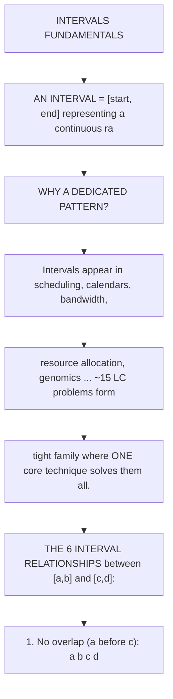
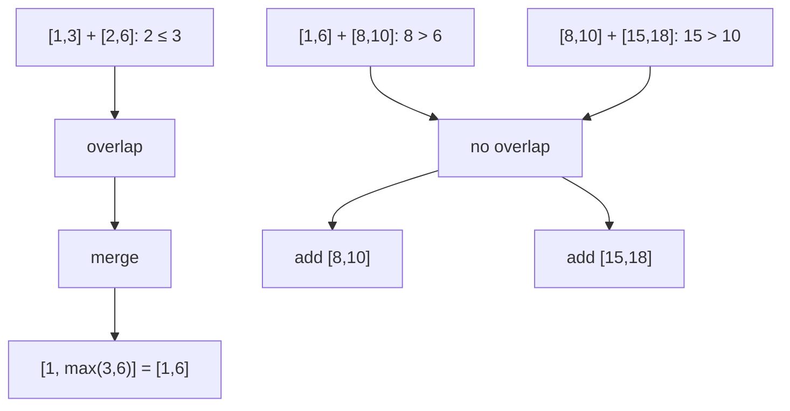
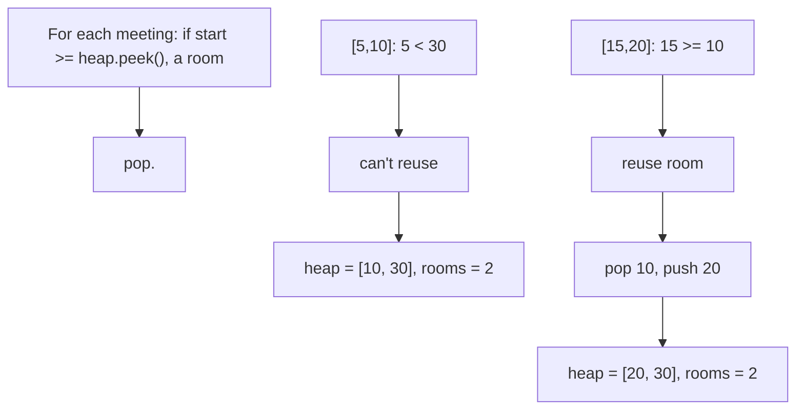
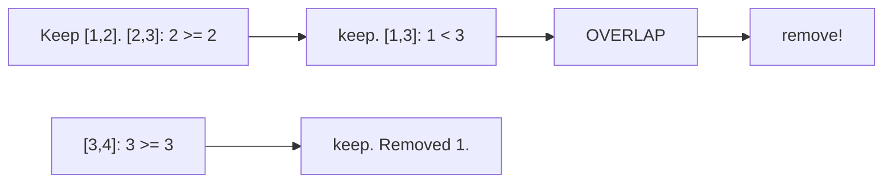
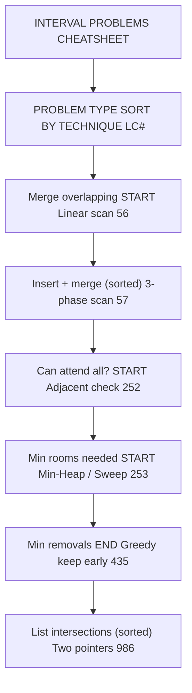

> **Navigation**: [< Previous](20_BitManipulation_Plus_Tricks.md) | [Back to Index](../00_MASTER_INDEX.md) | [Next >](22_Cyclic_Sort_Pattern.md)

> **Pattern 21** | [Prev](20_BitManipulation_Plus_Tricks.md) | [Index](../00_MASTER_INDEX.md) | [Next](22_Cyclic_Sort_Pattern.md)

---

# 📚 INTERVAL PROBLEMS — THE COMPLETE PATTERN GUIDE

```
┌──────────────────────────────────────────────────────────────────┐
│                 INTERVALS FUNDAMENTALS                           │
├──────────────────────────────────────────────────────────────────┤
│                                                                  │
│  AN INTERVAL = [start, end] representing a continuous range      │
│                                                                  │
│  WHY A DEDICATED PATTERN?                                        │
│  Intervals appear in scheduling, calendars, bandwidth,           │
│  resource allocation, genomics ... ~15 LC problems form a        │
│  tight family where ONE core technique solves them all.          │
│                                                                  │
│  THE 6 INTERVAL RELATIONSHIPS between [a,b] and [c,d]:           │
│                                                                  │
│  1. No overlap (a before c):  a──b     c──d                      │
│  2. Overlap (partial):        a────b                             │
│                                  c────d                          │
│  3. a contains c:             a────────b                         │
│                                 c──d                             │
│  4. c contains a:               a──b                             │
│                               c────────d                         │
│  5. Overlap (reverse):          a────b                           │
│                               c────d                             │
│  6. No overlap (c before a):  c──d     a──b                      │
│                                                                  │
│  KEY INSIGHT: Sort by start → reduces 6 cases to 2-3 checks.     │
│                                                                  │
│  DECISION TREE:                                                  │
│  ┌── Merge overlapping?     → Merge Intervals (LC 56)            │
│  ├── Insert into sorted?    → Insert Interval (LC 57)            │
│  ├── Max simultaneous?      → Meeting Rooms II (LC 253)          │
│  ├── Can I attend all?      → Meeting Rooms (LC 252)             │
│  ├── Remove min to avoid?   → Non-overlapping Intervals (LC 435) │
│  ├── Find intersection?     → Interval List Intersections(LC 986)│
│  └── Min platforms/rooms?   → Sweep Line / Min Heap              │
│                                                                  │
└──────────────────────────────────────────────────────────────────┘
```

**Flow:**
- INTERVALS FUNDAMENTALS
- ↓
- AN INTERVAL = [start, end] representing a continuous ra
- ↓
- WHY A DEDICATED PATTERN?
- ↓
- Intervals appear in scheduling, calendars, bandwidth,
- ↓
- resource allocation, genomics ... ~15 LC problems form
- ↓
- tight family where ONE core technique solves them all.
- ↓
- THE 6 INTERVAL RELATIONSHIPS between [a,b] and [c,d]:



---

## PART 0: THE MENTAL MODEL — "Sort, Scan, Decide"

## The Real-World Origin

📖 CALENDAR APPS: Google Calendar must detect overlapping events.
When you schedule 2-3pm and 2:30-4pm, it highlights the conflict.
This is literally the Overlapping Intervals check.
📖 MEETING ROOMS: Amazon's meeting room allocator uses a min-heap
of end times. When a new meeting starts, check if any room is free
(earliest end time ≤ new start). If not, allocate a new room.
📖 NETWORK BANDWIDTH: Merging bandwidth reservation intervals to
find total allocated vs available capacity.
📖 GENOMICS: Gene expression intervals on chromosomes — merging
overlapping regions to find functional units.
📖 OPERATING SYSTEMS: Memory allocation = interval management.
malloc/free creates and merges free memory intervals.
## The Two Core Techniques

TECHNIQUE 1: SORT + LINEAR SCAN
Sort all intervals by start time.
Iterate once, maintaining some running state (last end, merged list, etc.)
Works for: Merge, Insert, Non-overlapping, Intersections
Time: O(n log n) for sort + O(n) scan = O(n log n)
TECHNIQUE 2: SWEEP LINE (Event-based)
Convert intervals to events: +1 at start, -1 at end.
Sort all events by time. Sweep left to right, tracking count.
Works for: Meeting Rooms II, Max Overlap, Minimum Platforms
Time: O(n log n)
TECHNIQUE 2b: SORT + MIN-HEAP (variant of sweep)
Sort by start. Min-heap of end times tracks active intervals.
When new interval starts: pop expired (end ≤ start), push new end.
Heap size = current overlap count.
Works for: Meeting Rooms II, Min Platforms

**Which Technique To Use**:
- "Merge/modify intervals" → Sort + Scan
- "Count/max simultaneous" → Sweep Line or Min-Heap
## The Overlap Check — Memorize This

Two intervals [a,b] and [c,d] OVERLAP if and only if:
a ≤ d  AND  c ≤ b
Equivalently, they DON'T overlap if:  b < c  OR  d < a
After sorting by start (a ≤ c), overlap simplifies to:
c ≤ b   (next start ≤ current end)
This ONE check drives 80% of interval problems.
## Difficulties & Common Mistakes

1. Not sorting first — intervals aren't guaranteed sorted in input
2. Sorting by end when you should sort by start (or vice versa)
- Merge/Insert → sort by START
- Non-overlapping removal → sort by END (greedy)
- Meeting Rooms II → sort by START
3. Off-by-one: [1,5] and [5,8] — do they overlap?
Problem-dependent! Read carefully. Usually YES for intervals.
4. Forgetting Integer.compare() for comparator (a[0]-b[0] overflows)
5. Not extending existing interval's end with Math.max during merge
6. Using == instead of <= for overlap check

---

## PROBLEM 1: Merge Intervals (LC 56) — THE Foundation

```
DIFFICULTY: Medium
COMPANIES: Google, Facebook, Amazon, Microsoft, Bloomberg
PATTERN: Sort by start + Linear Merge

PROBLEM: Merge all overlapping intervals.
  Input:  [[1,3],[2,6],[8,10],[15,18]]
  Output: [[1,6],[8,10],[15,18]]

VISUAL:
  Before sort: could be any order
  After sort by start:
  1───3
    2──────6
                8───10
                          15───18
  
  [1,3] + [2,6]: 2 ≤ 3 → overlap → merge → [1, max(3,6)] = [1,6]
  [1,6] + [8,10]: 8 > 6 → no overlap → add [8,10]
  [8,10] + [15,18]: 15 > 10 → no overlap → add [15,18]

SOLUTION:
```

**Flow:**
- [1,3] + [2,6]: 2 ≤ 3
- ↓
- overlap
- ↓
- merge
- ↓
- [1, max(3,6)] = [1,6]
- ↓
- [1,6] + [8,10]: 8 > 6
- ↓
- no overlap
- ↓
- add [8,10]
- ↓
- [8,10] + [15,18]: 15 > 10
- ↓
- no overlap



```java
public int[][] merge(int[][] intervals) {
    Arrays.sort(intervals, (a, b) -> Integer.compare(a[0], b[0]));
    List<int[]> result = new ArrayList<>();
    result.add(intervals[0]);
    
    for (int i = 1; i < intervals.length; i++) {
        int[] last = result.get(result.size() - 1);
        if (intervals[i][0] <= last[1]) {       // Overlap!
            last[1] = Math.max(last[1], intervals[i][1]);  // Extend end
        } else {
            result.add(intervals[i]);             // No overlap
        }
    }
    return result.toArray(new int[result.size()][]);
}
```

```
COMPLEXITY: Time O(n log n) | Space O(n)
TEMPLATE: This is the base template for all "merge" interval problems.
```

---

## PROBLEM 2: Insert Interval (LC 57)

```
DIFFICULTY: Medium
COMPANIES: Google, Facebook, LinkedIn
PATTERN: Sort + 3-Phase Scan

PROBLEM: Insert a new interval into sorted non-overlapping intervals, merge if needed.
  Input:  intervals = [[1,3],[6,9]], newInterval = [2,5]
  Output: [[1,5],[6,9]]

THREE PHASES:
  Phase 1: Add all intervals that END BEFORE new starts
  Phase 2: MERGE all overlapping intervals with new
  Phase 3: Add all remaining intervals (start AFTER new ends)

SOLUTION:
```

```java
public int[][] insert(int[][] intervals, int[] newInterval) {
    List<int[]> result = new ArrayList<>();
    int i = 0, n = intervals.length;
    
    // Phase 1: Add all intervals before newInterval
    while (i < n && intervals[i][1] < newInterval[0]) {
        result.add(intervals[i++]);
    }
    
    // Phase 2: Merge overlapping intervals
    while (i < n && intervals[i][0] <= newInterval[1]) {
        newInterval[0] = Math.min(newInterval[0], intervals[i][0]);
        newInterval[1] = Math.max(newInterval[1], intervals[i][1]);
        i++;
    }
    result.add(newInterval);
    
    // Phase 3: Add remaining intervals
    while (i < n) {
        result.add(intervals[i++]);
    }
    return result.toArray(new int[result.size()][]);
}
```

```
COMPLEXITY: Time O(n) — input is already sorted | Space O(n)
```

---

## PROBLEM 3: Meeting Rooms I (LC 252)

```
DIFFICULTY: Easy
COMPANIES: Amazon, Facebook, Google
PATTERN: Sort + Overlap Check

PROBLEM: Can a person attend all meetings? (No overlaps?)
  Input:  [[0,30],[5,10],[15,20]]
  Output: false (5 < 30, so [0,30] and [5,10] overlap)

SOLUTION:
```

```java
public boolean canAttendMeetings(int[][] intervals) {
    Arrays.sort(intervals, (a, b) -> Integer.compare(a[0], b[0]));
    for (int i = 1; i < intervals.length; i++) {
        if (intervals[i][0] < intervals[i - 1][1]) return false;  // Overlap
    }
    return true;
}
```

```
COMPLEXITY: Time O(n log n) | Space O(1)
```

---

## PROBLEM 4: Meeting Rooms II (LC 253) — Min Rooms Needed

```
DIFFICULTY: Medium
COMPANIES: Amazon, Google, Facebook, Bloomberg, Microsoft
PATTERN: Sort + Min-Heap (or Sweep Line)

PROBLEM: Find minimum conference rooms needed.
  Input:  [[0,30],[5,10],[15,20]]
  Output: 2

APPROACH 1: Min-Heap of end times
  Sort by start. Heap tracks earliest ending meeting.
  For each meeting: if start >= heap.peek(), a room freed → pop.
  Always push current end. Heap size = rooms needed.

  [0,30]: heap = [30], rooms = 1
  [5,10]: 5 < 30 → can't reuse → heap = [10, 30], rooms = 2
  [15,20]: 15 >= 10 → reuse room → pop 10, push 20 → heap = [20, 30], rooms = 2

APPROACH 2: Sweep Line
  Events: +1 at each start, -1 at each end. Sort. Max running count = answer.

SOLUTION (Min-Heap):
```

**Flow:**
- For each meeting: if start >= heap.peek(), a room
- ↓
- pop.
- ↓
- [5,10]: 5 < 30
- ↓
- can't reuse
- ↓
- heap = [10, 30], rooms = 2
- ↓
- [15,20]: 15 >= 10
- ↓
- reuse room
- ↓
- pop 10, push 20
- ↓
- heap = [20, 30], rooms = 2



```java
public int minMeetingRooms(int[][] intervals) {
    Arrays.sort(intervals, (a, b) -> Integer.compare(a[0], b[0]));
    PriorityQueue<Integer> heap = new PriorityQueue<>();  // min-heap of end times
    
    for (int[] interval : intervals) {
        if (!heap.isEmpty() && heap.peek() <= interval[0]) {
            heap.poll();  // Room freed
        }
        heap.offer(interval[1]);
    }
    return heap.size();
}
```

```
SOLUTION (Sweep Line):
```

```java
public int minMeetingRooms(int[][] intervals) {
    int[] starts = new int[intervals.length];
    int[] ends = new int[intervals.length];
    for (int i = 0; i < intervals.length; i++) {
        starts[i] = intervals[i][0];
        ends[i] = intervals[i][1];
    }
    Arrays.sort(starts);
    Arrays.sort(ends);
    
    int rooms = 0, endPtr = 0;
    for (int start : starts) {
        if (start < ends[endPtr]) {
            rooms++;            // Need new room
        } else {
            endPtr++;           // Reuse a room
        }
    }
    return rooms;
}
```

```
COMPLEXITY: Both O(n log n) | Space O(n)
SWEEP LINE IS MORE GENERAL — works for "max overlap" variants too.
```

---

## PROBLEM 5: Non-overlapping Intervals (LC 435) — Min Removals

```
DIFFICULTY: Medium
COMPANIES: Amazon, Microsoft
PATTERN: Sort by END + Greedy

PROBLEM: Minimum intervals to remove to make rest non-overlapping.
  Input:  [[1,2],[2,3],[3,4],[1,3]]
  Output: 1 (remove [1,3])

GREEDY INSIGHT:
  Sort by END time. Always keep the interval that ends earliest.
  This maximizes room for future intervals (like Activity Selection).

  Sorted by end: [1,2] [2,3] [1,3] [3,4]
  Keep [1,2]. [2,3]: 2 >= 2 → keep. [1,3]: 1 < 3 → OVERLAP → remove!
  [3,4]: 3 >= 3 → keep. Removed 1.

SOLUTION:
```

**Flow:**
- Keep [1,2]. [2,3]: 2 >= 2
- ↓
- keep. [1,3]: 1 < 3
- ↓
- OVERLAP
- ↓
- remove!
- ↓
- [3,4]: 3 >= 3
- ↓
- keep. Removed 1.



```java
public int eraseOverlapIntervals(int[][] intervals) {
    Arrays.sort(intervals, (a, b) -> Integer.compare(a[1], b[1]));  // Sort by END
    int removals = 0, prevEnd = Integer.MIN_VALUE;
    
    for (int[] interval : intervals) {
        if (interval[0] >= prevEnd) {
            prevEnd = interval[1];   // Keep this interval
        } else {
            removals++;              // Remove (overlaps with kept one)
        }
    }
    return removals;
}
```

```
COMPLEXITY: Time O(n log n) | Space O(1)
KEY: Sort by END for greedy removal. Sort by START for merge.
```

---

## PROBLEM 6: Interval List Intersections (LC 986)

```
DIFFICULTY: Medium
COMPANIES: Facebook, Google
PATTERN: Two Pointers on Two Sorted Lists

PROBLEM: Find intersections of two sorted interval lists.
  Input:  A = [[0,2],[5,10],[13,23],[24,25]]
           B = [[1,5],[8,12],[15,24],[25,26]]
  Output: [[1,2],[5,5],[8,10],[15,23],[24,24],[25,25]]

TECHNIQUE: Two pointers. Intersection exists when max(starts) ≤ min(ends).

SOLUTION:
```

```java
public int[][] intervalIntersection(int[][] A, int[][] B) {
    List<int[]> result = new ArrayList<>();
    int i = 0, j = 0;
    
    while (i < A.length && j < B.length) {
        int lo = Math.max(A[i][0], B[j][0]);
        int hi = Math.min(A[i][1], B[j][1]);
        
        if (lo <= hi) {
            result.add(new int[]{lo, hi});
        }
        // Advance pointer of interval that ends first
        if (A[i][1] < B[j][1]) i++;
        else j++;
    }
    return result.toArray(new int[result.size()][]);
}
```

```
COMPLEXITY: Time O(m + n) | Space O(m + n) for result
ELEGANT: The Math.max/Math.min trick handles all overlap cases.
```

---

## PROBLEM 7: Minimum Number of Arrows to Burst Balloons (LC 452)

```
DIFFICULTY: Medium
COMPANIES: Facebook, Microsoft
PATTERN: Sort by end + Greedy (same as Non-overlapping)

PROBLEM: Each balloon is interval [start, end]. An arrow at x bursts all 
         balloons where start ≤ x ≤ end. Min arrows?

THIS IS "Non-overlapping Intervals" IN DISGUISE.
Max non-overlapping groups = number of arrows needed.

SOLUTION:
```

```java
public int findMinArrowShots(int[][] points) {
    Arrays.sort(points, (a, b) -> Integer.compare(a[1], b[1]));  // Sort by end
    int arrows = 1, arrowPos = points[0][1];
    
    for (int i = 1; i < points.length; i++) {
        if (points[i][0] > arrowPos) {  // Can't reach → need new arrow
            arrows++;
            arrowPos = points[i][1];
        }
    }
    return arrows;
}
```

```
COMPLEXITY: Time O(n log n) | Space O(1)
```

---

## 📋 Summary: the Interval Pattern Cheatsheet

```
┌─────────────────────────────────────────────────────────────────────────┐
│                    INTERVAL PROBLEMS CHEATSHEET                         │
├─────────────────────────────────────────────────────────────────────────┤
│                                                                         │
│  PROBLEM TYPE        │ SORT BY  │ TECHNIQUE        │ LC#                │
│  ════════════════════╪══════════╪══════════════════╪═══════════════════ │
│  Merge overlapping   │ START    │ Linear scan      │ 56                 │
│  Insert + merge      │ (sorted) │ 3-phase scan     │ 57                 │
│  Can attend all?     │ START    │ Adjacent check   │ 252                │
│  Min rooms needed    │ START    │ Min-Heap / Sweep │ 253                │
│  Min removals        │ END      │ Greedy keep early│ 435                │
│  List intersections  │ (sorted) │ Two pointers     │ 986                │
│  Min arrows          │ END      │ Greedy groups    │ 452                │
│  Employee free time  │ START    │ Merge + gaps     │ 759                │
│                                                                         │
│  GOLDEN RULES:                                                          │
│  1. Sort by START for merge/overlap problems                            │
│  2. Sort by END for greedy selection/removal problems                   │
│  3. Overlap check: next.start ≤ curr.end (after sorting by start)       │
│  4. For "max simultaneous": use Sweep Line or Min-Heap                  │
│  5. Use Integer.compare() to avoid overflow in comparators              │
│                                                                         │
└─────────────────────────────────────────────────────────────────────────┘
```

**Flow:**
- INTERVAL PROBLEMS CHEATSHEET
- ↓
- PROBLEM TYPE SORT BY TECHNIQUE LC#
- ↓
- Merge overlapping START Linear scan 56
- ↓
- Insert + merge (sorted) 3-phase scan 57
- ↓
- Can attend all? START Adjacent check 252
- ↓
- Min rooms needed START Min-Heap / Sweep 253
- ↓
- Min removals END Greedy keep early 435



---

## 📋 CURATED PRACTICE PROBLEMS

| # | Problem | LC# | Pattern | Company |
|---|---------|-----|---------|---------|
| 1 | [Merge Intervals](https://leetcode.com/problems/merge-intervals/) | 56 | Sort + Merge | Google, Facebook |
| 2 | [Insert Interval](https://leetcode.com/problems/insert-interval/) | 57 | 3-Phase Scan | Google, Facebook |
| 3 | [Meeting Rooms](https://leetcode.com/problems/meeting-rooms/) | 252 | Sort + Overlap | Amazon |
| 4 | [Meeting Rooms II](https://leetcode.com/problems/meeting-rooms-ii/) | 253 | Min-Heap / Sweep | Amazon, Google |
| 5 | [Non-overlapping Intervals](https://leetcode.com/problems/non-overlapping-intervals/) | 435 | Sort End + Greedy | Amazon |
| 6 | [Interval List Intersections](https://leetcode.com/problems/interval-list-intersections/) | 986 | Two Pointers | Facebook |
| 7 | [Min Arrows Burst Balloons](https://leetcode.com/problems/minimum-number-of-arrows-to-burst-balloons/) | 452 | Sort End + Greedy | Facebook |
| 8 | [Employee Free Time](https://leetcode.com/problems/employee-free-time/) | 759 | Merge + Gap Find | Uber |
| 9 | [My Calendar I](https://leetcode.com/problems/my-calendar-i/) | 729 | TreeMap / Overlap | Google |
| 10 | [My Calendar II](https://leetcode.com/problems/my-calendar-ii/) | 731 | Sweep Line | Google |
| 11 | [Car Pooling](https://leetcode.com/problems/car-pooling/) | 1094 | Sweep Line | Google |
| 12 | [Remove Covered Intervals](https://leetcode.com/problems/remove-covered-intervals/) | 1288 | Sort + Compare | Amazon |

---

> **Navigation**: [< Previous](20_BitManipulation_Plus_Tricks.md) | [Back to Index](../00_MASTER_INDEX.md) | [Next >](22_Cyclic_Sort_Pattern.md)
