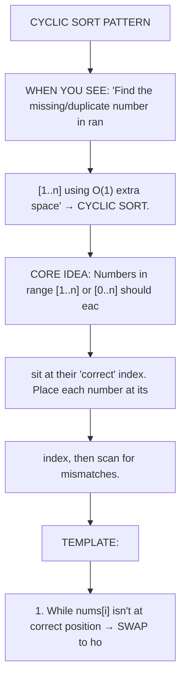
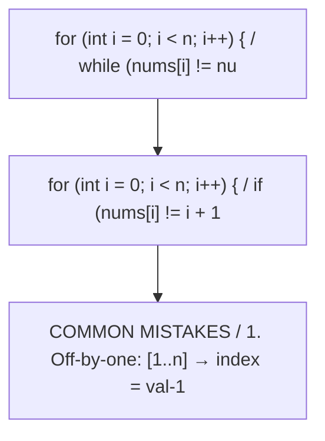
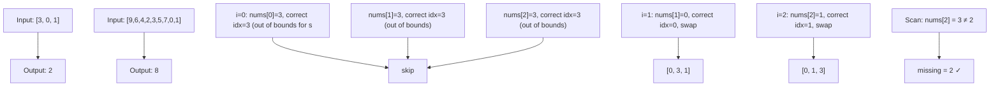
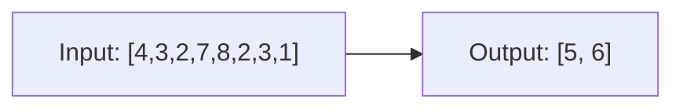
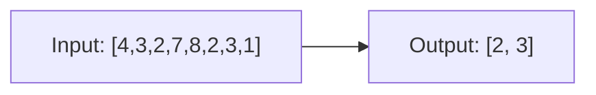
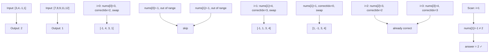
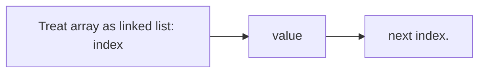
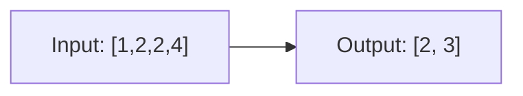
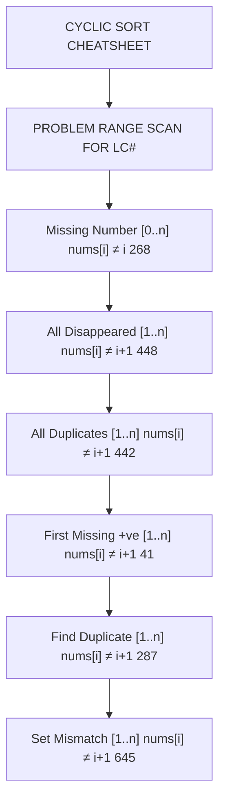

**Navigation**: [< Previous](21_Intervals_Pattern.md) | [Back to Index](../00_MASTER_INDEX.md) | [Next >](23_Knapsack_Family.md)

**Pattern 22** | [Prev](21_Intervals_Pattern.md) | [Index](../00_MASTER_INDEX.md)

---

# 📚 CYCLIC SORT — THE MISSING PATTERN

### ⚠️ Constraint Lens

| Given Constraints | Do This |
|-------------------|---------|
| values are exactly in `[1..N]` or `[0..N-1]` | cyclic sort is possible |
| need `O(1)` extra space | cyclic sort fits |
| values are arbitrary/huge | use hashmap/sort instead |
| duplicates exist | guard swaps to avoid infinite loops |
| input cannot be mutated | use hashmap/boolean array instead |

Full map: [Constraint-Based Pattern Selection](25_Constraint_Based_Pattern_Selection.md).

```
┌─────────────────────────────────────────────────────────────────┐
│                  CYCLIC SORT PATTERN                            │
├─────────────────────────────────────────────────────────────────┤
│                                                                 │
│  WHEN YOU SEE: "Find the missing/duplicate number in range      │
│  [1..n] using O(1) extra space"  →  CYCLIC SORT.                │
│                                                                 │
│  CORE IDEA: Numbers in range [1..n] or [0..n] should each       │
│  sit at their "correct" index. Place each number at its home    │
│  index, then scan for mismatches.                               │
│                                                                 │
│  TEMPLATE:                                                      │
│    1. While nums[i] isn't at correct position → SWAP to home    │
│    2. Scan array: where nums[i] ≠ expected → that's answer      │
│                                                                 │
│  TIME: O(n)  |  SPACE: O(1)  ← the magic of this pattern        │
│                                                                 │
└─────────────────────────────────────────────────────────────────┘
```

**Flow:**
1. CYCLIC SORT PATTERN
2. WHEN YOU SEE: 'Find the missing/duplicate number in ran
3. [1..n] using O(1) extra space'
4. CYCLIC SORT.
5. [1..n] using O(1) extra space'
6. CYCLIC SORT.
7. CORE IDEA: Numbers in range [1..n] or [0..n] should eac
8. sit at their 'correct' index. Place each number at its
9. index, then scan for mismatches.
10. TEMPLATE:



---

## PART 0: THE MENTAL MODEL — "Everyone Go Home"

```
┌──────────────────────────────────────────────────────────────────────────────┐
│            CYCLIC SORT — COMPLETE THEORY & PATTERN                           │
└──────────────────────────────────────────────────────────────────────────────┘

┌──────────────────────────────────────────────────────────────────────────────┐
│ THE REAL-WORLD ORIGIN                                                        │
├──────────────────────────────────────────────────────────────────────────────┤
│                                                                              │
│ 📖 ROLL CALL: Imagine a teacher with 30 students numbered 1-30.               │
│    She asks each to stand at their numbered desk. After everyone             │
│    moves, empty desks = absent students, two at one desk = duplicate.        │
│    This IS cyclic sort.                                                      │
│                                                                              │
│ 📖 LIBRARY SHELVING: Books numbered 1-1000 need to go to their                │
│    shelf position. Rather than sort them, place each at its                  │
│    designated slot. Missing books = gaps. Two copies = duplicates.           │
│                                                                              │
│ 📖 NETWORK PACKET REASSEMBLY: TCP packets numbered sequentially.              │
│    Place each at its sequence number slot. Missing slots = lost packets.     │
│                                                                              │
└──────────────────────────────────────────────────────────────────────────────┘

┌──────────────────────────────────────────────────────────────────────────────┐
│ WHY CYCLIC SORT INSTEAD OF HASH SET?                                         │
├──────────────────────────────────────────────────────────────────────────────┤
│                                                                              │
│  HASH SET: O(n) time, O(n) space  ← easy but uses extra memory               │
│  SORTING:  O(n log n) time, O(1) space  ← doesn't leverage range constraint  │
│  CYCLIC:   O(n) time, O(1) space  ← optimal when numbers ∈ [1..n]            │
│                                                                              │
│  RECOGNIZE IT: Anytime you see:                                              │
│    • "Given array of n numbers from range [1..n]" (or [0..n])                │
│    • "Find missing / duplicate / correction"                                 │
│    • "O(1) extra space"                                                      │
│    → Cyclic Sort.                                                            │
│                                                                              │
│  WHY O(n)? Each element swaps at most once to its correct position.          │
│  Even though there's a while loop inside a for loop, total swaps ≤ n.        │
│                                                                              │
└──────────────────────────────────────────────────────────────────────────────┘

┌──────────────────────────────────────────────────────────────────────────────┐
│ THE BASE TEMPLATE                                                            │
├──────────────────────────────────────────────────────────────────────────────┤
│                                                                              │
│  For numbers in range [1..n], correct index = nums[i] - 1                    │
│  For numbers in range [0..n], correct index = nums[i]                        │
│                                                                              │
│  STEP 1: Place each number at correct index                                  │
│  ┌─────────────────────────────────────────┐                                 │
│  │ for (int i = 0; i < n; i++) {           │                                 │
│  │     while (nums[i] != nums[correctIdx]) │  ← swap until correct           │
│  │         swap(nums, i, correctIdx);      │                                 │
│  │ }                                       │                                 │
│  └─────────────────────────────────────────┘                                 │
│                                                                              │
│  STEP 2: Scan for mismatches                                                 │
│  ┌─────────────────────────────────────────┐                                 │
│  │ for (int i = 0; i < n; i++) {           │                                 │
│  │     if (nums[i] != i + 1)               │  ← this position is wrong       │
│  │         // i+1 is missing/duplicate     │                                 │
│  │ }                                       │                                 │
│  └─────────────────────────────────────────┘                                 │
│                                                                              │
└──────────────────────────────────────────────────────────────────────────────┘

┌──────────────────────────────────────────────────────────────────────────────┐
│ COMMON MISTAKES                                                              │
├──────────────────────────────────────────────────────────────────────────────┤
│ 1. Off-by-one: [1..n] → index = val-1, but [0..n-1] → index = val            │
│ 2. Infinite loop: must check nums[i] != nums[correctIdx], NOT nums[i] != i+1 │
│    (if duplicate exists, swapping back and forth forever)                    │
│ 3. Ignoring out-of-range values: if val < 1 or val > n, SKIP the swap        │
│ 4. Trying to use this on ranges that aren't [0..n] or [1..n]                 │
│ 5. Forgetting step 2: the sort itself doesn't produce the answer, the        │
│    subsequent scan does                                                      │
└──────────────────────────────────────────────────────────────────────────────┘
```

**Flow:**
1. for (int i = 0; i < n; i++) { / while (nums[i] != nu
2. for (int i = 0; i < n; i++) { / if (nums[i] != i + 1
3. COMMON MISTAKES / 1. Off-by-one: [1..n]
4. index = val-1



---

## PROBLEM 1: Find the Missing Number (LC 268)

```
DIFFICULTY: Easy
COMPANIES: Amazon, Microsoft
PATTERN: Cyclic Sort + Scan

PROBLEM: Given array of n numbers from [0..n], find the missing one.
  Input:  [3, 0, 1]  → Output: 2
  Input:  [9,6,4,2,3,5,7,0,1] → Output: 8

VISUAL (n=3, range [0..3]):
  Start: [3, 0, 1]
  i=0: nums[0]=3, correct idx=3 (out of bounds for size 3) → skip
  i=1: nums[1]=0, correct idx=0, swap → [0, 3, 1]
       nums[1]=3, correct idx=3 (out of bounds) → skip
  i=2: nums[2]=1, correct idx=1, swap → [0, 1, 3]
       nums[2]=3, correct idx=3 (out of bounds) → skip
  Result: [0, 1, 3]
  Scan: nums[2] = 3 ≠ 2 → missing = 2  ✓

SOLUTION:
```

**Flow:**
1. Input: [3, 0, 1]
2. Output: 2
3. Input: [9,6,4,2,3,5,7,0,1]
4. Output: 8
5. i=0: nums[0]=3, correct idx=3 (out of bounds for s
6. skip
7. i=1: nums[1]=0, correct idx=0, swap
8. [0, 3, 1]
9. nums[1]=3, correct idx=3 (out of bounds)
10. skip
11. i=2: nums[2]=1, correct idx=1, swap
12. [0, 1, 3]



```java
public int missingNumber(int[] nums) {
    int n = nums.length;
    
    // Cyclic sort: place each num at index = num (range [0..n])
    for (int i = 0; i < n; i++) {
        while (nums[i] < n && nums[i] != i) {
            swap(nums, i, nums[i]);
        }
    }
    
    // Scan for mismatch
    for (int i = 0; i < n; i++) {
        if (nums[i] != i) return i;
    }
    return n;  // All [0..n-1] present, so n is missing
}

private void swap(int[] nums, int i, int j) {
    int temp = nums[i];
    nums[i] = nums[j];
    nums[j] = temp;
}
```

```
COMPLEXITY: Time O(n) | Space O(1)
NOTE: Gauss formula (n*(n+1)/2 - sum) also works for Easy version.
      But Cyclic Sort generalizes to harder variants below.
```

---


## PROBLEM 2: Find All Numbers Disappeared in Array (LC 448)

```
DIFFICULTY: Easy
COMPANIES: Amazon, Google
PATTERN: Cyclic Sort + Scan for all mismatches

PROBLEM: Find ALL missing numbers in [1..n].
  Input:  [4,3,2,7,8,2,3,1]  → Output: [5, 6]

SOLUTION:
```

**Flow:**
1. Input: [4,3,2,7,8,2,3,1]
2. Output: [5, 6]



```java
public List<Integer> findDisappearedNumbers(int[] nums) {
    int n = nums.length;
    
    // Cyclic sort: place nums[i] at index nums[i]-1
    for (int i = 0; i < n; i++) {
        while (nums[i] != nums[nums[i] - 1]) {
            swap(nums, i, nums[i] - 1);
        }
    }
    
    // Collect all positions where nums[i] != i+1
    List<Integer> result = new ArrayList<>();
    for (int i = 0; i < n; i++) {
        if (nums[i] != i + 1) result.add(i + 1);
    }
    return result;
}
```

```
COMPLEXITY: Time O(n) | Space O(1) excluding output
```

---


## PROBLEM 3: Find All Duplicates in Array (LC 442)

```
DIFFICULTY: Medium
COMPANIES: Amazon, Microsoft, Facebook
PATTERN: Cyclic Sort + duplicate detection

PROBLEM: Find all duplicates in [1..n] where each appears at most twice.
  Input:  [4,3,2,7,8,2,3,1]  → Output: [2, 3]

SOLUTION:
```

**Flow:**
1. Input: [4,3,2,7,8,2,3,1]
2. Output: [2, 3]



```java
public List<Integer> findDuplicates(int[] nums) {
    int n = nums.length;
    
    // Cyclic sort
    for (int i = 0; i < n; i++) {
        while (nums[i] != nums[nums[i] - 1]) {
            swap(nums, i, nums[i] - 1);
        }
    }
    
    // Where nums[i] != i+1, nums[i] is the duplicate
    List<Integer> result = new ArrayList<>();
    for (int i = 0; i < n; i++) {
        if (nums[i] != i + 1) result.add(nums[i]);
    }
    return result;
}
```

```
COMPLEXITY: Time O(n) | Space O(1) excluding output
KEY INSIGHT: After sort, duplicates end up at "wrong" positions.
            nums[i] != i+1 means nums[i] is a duplicate (it's already at its home).
```

---


## PROBLEM 4: First Missing Positive (LC 41) — THE HARD ONE

```
DIFFICULTY: Hard
COMPANIES: Amazon, Google, Facebook, Microsoft, Uber
PATTERN: Cyclic Sort with range filtering

PROBLEM: Find the smallest missing positive integer.
  Input:  [3,4,-1,1]  → Output: 2
  Input:  [7,8,9,11,12] → Output: 1

WHY IT'S HARD: Array contains negatives, zeros, and out-of-range values.
KEY INSIGHT: Answer must be in [1..n+1]. Ignore anything outside [1..n].

VISUAL:
  [3, 4, -1, 1]  n=4, we care about [1..4] only
  i=0: nums[0]=3, correctIdx=2, swap → [-1, 4, 3, 1]
       nums[0]=-1, out of range → skip
  i=1: nums[1]=4, correctIdx=3, swap → [-1, 1, 3, 4]
       nums[1]=1, correctIdx=0, swap → [1, -1, 3, 4]
       nums[1]=-1, out of range → skip
  i=2: nums[2]=3, correctIdx=2 → already correct
  i=3: nums[3]=4, correctIdx=3 → already correct
  Result: [1, -1, 3, 4]
  Scan: i=1 → nums[1]=-1 ≠ 2 → answer = 2  ✓

SOLUTION:
```

**Flow:**
1. Input: [3,4,-1,1]
2. Output: 2
3. Input: [7,8,9,11,12]
4. Output: 1
5. i=0: nums[0]=3, correctIdx=2, swap
6. [-1, 4, 3, 1]
7. nums[0]=-1, out of range
8. skip
9. i=1: nums[1]=4, correctIdx=3, swap
10. [-1, 1, 3, 4]
11. nums[1]=1, correctIdx=0, swap
12. [1, -1, 3, 4]



```java
public int firstMissingPositive(int[] nums) {
    int n = nums.length;
    
    for (int i = 0; i < n; i++) {
        // Only place values in valid range [1..n]
        while (nums[i] > 0 && nums[i] <= n && nums[i] != nums[nums[i] - 1]) {
            swap(nums, i, nums[i] - 1);
        }
    }
    
    for (int i = 0; i < n; i++) {
        if (nums[i] != i + 1) return i + 1;
    }
    return n + 1;
}
```

```
COMPLEXITY: Time O(n) | Space O(1)
THIS IS THE CLASSIC HARD INTERVIEW QUESTION. The range filter (> 0 && <= n
is what makes it work with arbitrary input.
```

---


## PROBLEM 5: Find the Duplicate Number (LC 287)

```
DIFFICULTY: Medium
COMPANIES: Amazon, Google, Microsoft, Bloomberg
PATTERN: Cyclic Sort OR Floyd's Cycle Detection

PROBLEM: Array of n+1 integers in [1..n], exactly one duplicate. Find it.
         Must not modify array. O(1) space.

APPROACH 1: Cyclic Sort (modifies array — violates "must not modify" constraint)
```

```java
// Simple but MODIFIES array
public int findDuplicate(int[] nums) {
    for (int i = 0; i < nums.length; i++) {
        while (nums[i] != nums[nums[i] - 1]) {
            swap(nums, i, nums[i] - 1);
        }
    }
    // The duplicate sits at the wrong spot
    for (int i = 0; i < nums.length; i++) {
        if (nums[i] != i + 1) return nums[i];
    }
    return -1;
}
```

```
APPROACH 2: Floyd's Cycle Detection (O(1) space, no modification)
  Treat array as linked list: index → value → next index.
  Duplicate creates a cycle. Find cycle entry = duplicate.
```

**Flow:**
1. Treat array as linked list: index
2. value
3. next index.



```java
public int findDuplicate(int[] nums) {
    int slow = nums[0], fast = nums[0];
    do {
        slow = nums[slow];
        fast = nums[nums[fast]];
    } while (slow != fast);
    
    slow = nums[0];
    while (slow != fast) {
        slow = nums[slow];
        fast = nums[fast];
    }
    return slow;
}
```

```
COMPLEXITY: Both O(n) | Floyd's uses O(1) space without modification
```

---


## PROBLEM 6: Set Mismatch (LC 645)

```
DIFFICULTY: Easy
COMPANIES: Amazon
PATTERN: Cyclic Sort

PROBLEM: Array [1..n] with one duplicate and one missing. Find both.
  Input:  [1,2,2,4]  → Output: [2, 3]

SOLUTION:
```

**Flow:**
1. Input: [1,2,2,4]
2. Output: [2, 3]



```java
public int[] findErrorNums(int[] nums) {
    int n = nums.length;
    
    for (int i = 0; i < n; i++) {
        while (nums[i] != nums[nums[i] - 1]) {
            swap(nums, i, nums[i] - 1);
        }
    }
    
    for (int i = 0; i < n; i++) {
        if (nums[i] != i + 1) {
            return new int[]{nums[i], i + 1};  // [duplicate, missing]
        }
    }
    return new int[0];
}
```

```
COMPLEXITY: Time O(n) | Space O(1)
```

---

## 🔄 Summary: Cyclic Sort Decision Table

```
┌─────────────────────────────────────────────────────────────────────────┐
│                    CYCLIC SORT CHEATSHEET                               │
├─────────────────────────────────────────────────────────────────────────┤
│                                                                         │
│  TRIGGER: "n numbers in range [0..n] or [1..n]" + "O(1) space"          │
│                                                                         │
│  PROBLEM              │ RANGE   │ SCAN FOR           │ LC#              │
│  ═════════════════════╪═════════╪════════════════════╪═════════════════ │
│  Missing Number       │ [0..n]  │ nums[i] ≠ i      │ 268                │
│  All Disappeared      │ [1..n]  │ nums[i] ≠ i+1    │ 448                │
│  All Duplicates       │ [1..n]  │ nums[i] ≠ i+1    │ 442                │
│  First Missing +ve    │ [1..n]  │ nums[i] ≠ i+1    │ 41                 │
│  Find Duplicate       │ [1..n]  │ nums[i] ≠ i+1    │ 287                │
│  Set Mismatch         │ [1..n]  │ nums[i] ≠ i+1    │ 645                │
│                                                                         │
│  TEMPLATE:                                                              │
│  1. while (nums[i] out of range) skip                                   │
│  2. while (nums[i] != nums[correctIdx]) swap                            │
│  3. Scan: where nums[i] ≠ expected → answer                             │
│                                                                         │
│  THE SWAP GUARD: Always compare nums[i] with nums[correctIdx]           │
│  NOT nums[i] with i+1. This prevents infinite loops on duplicates.      │
│                                                                         │
└─────────────────────────────────────────────────────────────────────────┘
```

**Flow:**
1. CYCLIC SORT CHEATSHEET
2. PROBLEM RANGE SCAN FOR LC#
3. Missing Number [0..n] nums[i] ≠ i 268
4. All Disappeared [1..n] nums[i] ≠ i+1 448
5. All Duplicates [1..n] nums[i] ≠ i+1 442
6. First Missing +ve [1..n] nums[i] ≠ i+1 41
7. Find Duplicate [1..n] nums[i] ≠ i+1 287



---


🔬 **Section Challenge — 🔄 Summary: Cyclic Sort Decision Table**

**Challenge 1 (Reasoning):** Prefix sum initialized as `prefix[0] = 0` — why the leading zero and not `prefix[0] = arr[0]`?
<details><summary>Answer</summary>

`prefix[0] = 0` (empty prefix) makes range sum formula uniform: `sum(l,r) = prefix[r+1] - prefix[l]`. Without the 0: `sum(0,r) = prefix[r] - 0` (special case needed). With it: `sum(0,r) = prefix[r+1] - prefix[0] = prefix[r+1]`. Same formula everywhere. This is the 'sentinel' pattern — adding a dummy initial value to eliminate special cases. Same trick used in dummy linked list nodes.
</details>


## 📋 CURATED PRACTICE PROBLEMS

| # | Problem | LC# | Difficulty | Key Twist |
|---|---------|-----|-----------|-----------|
| 1 | [Missing Number](https://leetcode.com/problems/missing-number/) | 268 | Easy | Range [0..n] |
| 2 | [Find All Disappeared Numbers](https://leetcode.com/problems/find-all-numbers-disappeared-in-an-array/) | 448 | Easy | Multiple missing |
| 3 | [Find All Duplicates](https://leetcode.com/problems/find-all-duplicates-in-an-array/) | 442 | Medium | Multiple duplicates |
| 4 | [First Missing Positive](https://leetcode.com/problems/first-missing-positive/) | 41 | Hard | Range filtering |
| 5 | [Find the Duplicate Number](https://leetcode.com/problems/find-the-duplicate-number/) | 287 | Medium | Floyd's alt |
| 6 | [Set Mismatch](https://leetcode.com/problems/set-mismatch/) | 645 | Easy | Dup + missing |
| 7 | [Couples Holding Hands](https://leetcode.com/problems/couples-holding-hands/) | 765 | Hard | Cyclic swap variant |
| 8 | [Kth Missing Positive](https://leetcode.com/problems/kth-missing-positive-number/) | 1539 | Easy | Binary search variant |

