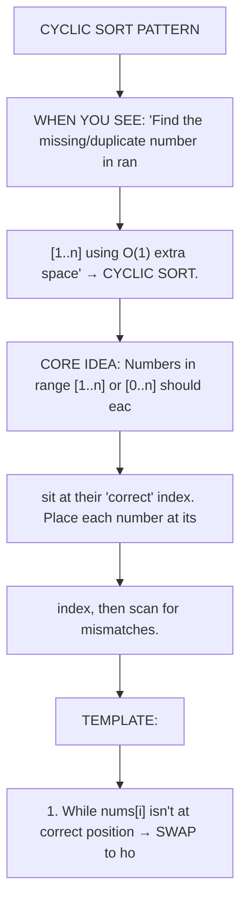
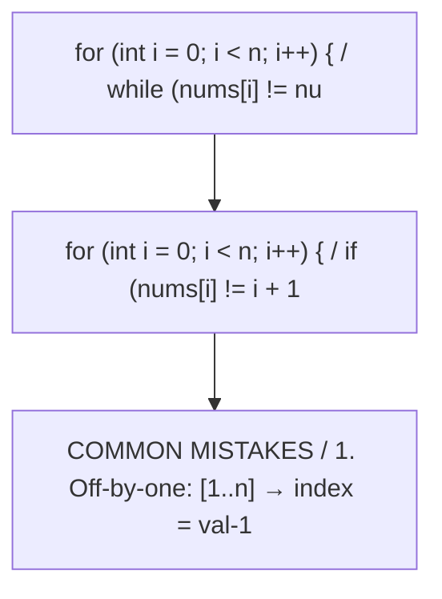
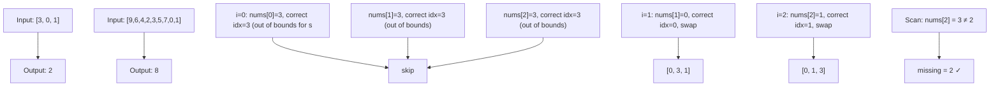
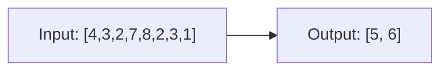
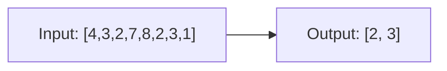
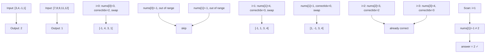
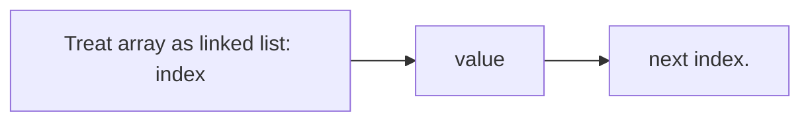
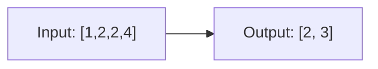
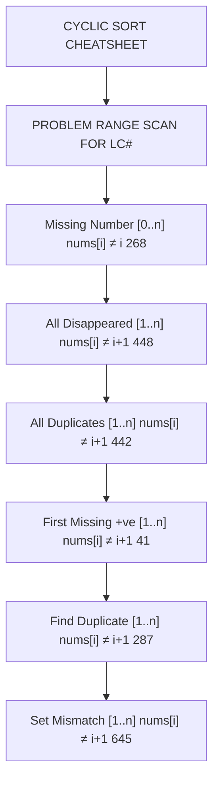

> **Navigation**: [< Previous](21_Intervals_Pattern.md) | [Back to Index](../00_MASTER_INDEX.md) | [Next >](23_Knapsack_Family.md)

> **Pattern 22** | [Prev](21_Intervals_Pattern.md) | [Index](../00_MASTER_INDEX.md)

---

# 📚 CYCLIC SORT — THE MISSING PATTERN

```
┌─────────────────────────────────────────────────────────────────┐
│                  CYCLIC SORT PATTERN                            │
├─────────────────────────────────────────────────────────────────┤
│                                                                 │
│  WHEN YOU SEE: "Find the missing/duplicate number in range      │
│  [1..n] using O(1) extra space"  →  CYCLIC SORT.                │
│                                                                 │
│  CORE IDEA: Numbers in range [1..n] or [0..n] should each       │
│  sit at their "correct" index. Place each number at its home    │
│  index, then scan for mismatches.                               │
│                                                                 │
│  TEMPLATE:                                                      │
│    1. While nums[i] isn't at correct position → SWAP to home    │
│    2. Scan array: where nums[i] ≠ expected → that's answer      │
│                                                                 │
│  TIME: O(n)  |  SPACE: O(1)  ← the magic of this pattern        │
│                                                                 │
└─────────────────────────────────────────────────────────────────┘
```

**Flow:**
- CYCLIC SORT PATTERN
- ↓
- WHEN YOU SEE: 'Find the missing/duplicate number in ran
- ↓
- [1..n] using O(1) extra space'
- ↓
- CYCLIC SORT.
- ↓
- [1..n] using O(1) extra space'
- ↓
- CYCLIC SORT.
- ↓
- CORE IDEA: Numbers in range [1..n] or [0..n] should eac
- ↓
- sit at their 'correct' index. Place each number at its
- ↓
- index, then scan for mismatches.
- ↓
- TEMPLATE:



---

## PART 0: THE MENTAL MODEL — "Everyone Go Home"

```
┌──────────────────────────────────────────────────────────────────────────────┐
│            CYCLIC SORT — COMPLETE THEORY & PATTERN                           │
└──────────────────────────────────────────────────────────────────────────────┘

┌──────────────────────────────────────────────────────────────────────────────┐
│ THE REAL-WORLD ORIGIN                                                        │
├──────────────────────────────────────────────────────────────────────────────┤
│                                                                              │
│ 📖 ROLL CALL: Imagine a teacher with 30 students numbered 1-30.               │
│    She asks each to stand at their numbered desk. After everyone             │
│    moves, empty desks = absent students, two at one desk = duplicate.        │
│    This IS cyclic sort.                                                      │
│                                                                              │
│ 📖 LIBRARY SHELVING: Books numbered 1-1000 need to go to their                │
│    shelf position. Rather than sort them, place each at its                  │
│    designated slot. Missing books = gaps. Two copies = duplicates.           │
│                                                                              │
│ 📖 NETWORK PACKET REASSEMBLY: TCP packets numbered sequentially.              │
│    Place each at its sequence number slot. Missing slots = lost packets.     │
│                                                                              │
└──────────────────────────────────────────────────────────────────────────────┘

┌──────────────────────────────────────────────────────────────────────────────┐
│ WHY CYCLIC SORT INSTEAD OF HASH SET?                                         │
├──────────────────────────────────────────────────────────────────────────────┤
│                                                                              │
│  HASH SET: O(n) time, O(n) space  ← easy but uses extra memory               │
│  SORTING:  O(n log n) time, O(1) space  ← doesn't leverage range constraint  │
│  CYCLIC:   O(n) time, O(1) space  ← optimal when numbers ∈ [1..n]            │
│                                                                              │
│  RECOGNIZE IT: Anytime you see:                                              │
│    • "Given array of n numbers from range [1..n]" (or [0..n])                │
│    • "Find missing / duplicate / correction"                                 │
│    • "O(1) extra space"                                                      │
│    → Cyclic Sort.                                                            │
│                                                                              │
│  WHY O(n)? Each element swaps at most once to its correct position.          │
│  Even though there's a while loop inside a for loop, total swaps ≤ n.        │
│                                                                              │
└──────────────────────────────────────────────────────────────────────────────┘

┌──────────────────────────────────────────────────────────────────────────────┐
│ THE BASE TEMPLATE                                                            │
├──────────────────────────────────────────────────────────────────────────────┤
│                                                                              │
│  For numbers in range [1..n], correct index = nums[i] - 1                    │
│  For numbers in range [0..n], correct index = nums[i]                        │
│                                                                              │
│  STEP 1: Place each number at correct index                                  │
│  ┌─────────────────────────────────────────┐                                 │
│  │ for (int i = 0; i < n; i++) {           │                                 │
│  │     while (nums[i] != nums[correctIdx]) │  ← swap until correct           │
│  │         swap(nums, i, correctIdx);      │                                 │
│  │ }                                       │                                 │
│  └─────────────────────────────────────────┘                                 │
│                                                                              │
│  STEP 2: Scan for mismatches                                                 │
│  ┌─────────────────────────────────────────┐                                 │
│  │ for (int i = 0; i < n; i++) {           │                                 │
│  │     if (nums[i] != i + 1)               │  ← this position is wrong       │
│  │         // i+1 is missing/duplicate     │                                 │
│  │ }                                       │                                 │
│  └─────────────────────────────────────────┘                                 │
│                                                                              │
└──────────────────────────────────────────────────────────────────────────────┘

┌──────────────────────────────────────────────────────────────────────────────┐
│ COMMON MISTAKES                                                              │
├──────────────────────────────────────────────────────────────────────────────┤
│ 1. Off-by-one: [1..n] → index = val-1, but [0..n-1] → index = val            │
│ 2. Infinite loop: must check nums[i] != nums[correctIdx], NOT nums[i] != i+1 │
│    (if duplicate exists, swapping back and forth forever)                    │
│ 3. Ignoring out-of-range values: if val < 1 or val > n, SKIP the swap        │
│ 4. Trying to use this on ranges that aren't [0..n] or [1..n]                 │
│ 5. Forgetting step 2: the sort itself doesn't produce the answer, the        │
│    subsequent scan does                                                      │
└──────────────────────────────────────────────────────────────────────────────┘
```

**Flow:**
- for (int i = 0; i < n; i++) { / while (nums[i] != nu
- ↓
- for (int i = 0; i < n; i++) { / if (nums[i] != i + 1
- ↓
- COMMON MISTAKES / 1. Off-by-one: [1..n]
- ↓
- index = val-1



---

## PROBLEM 1: Find the Missing Number (LC 268)

```
DIFFICULTY: Easy
COMPANIES: Amazon, Microsoft
PATTERN: Cyclic Sort + Scan

PROBLEM: Given array of n numbers from [0..n], find the missing one.
  Input:  [3, 0, 1]  → Output: 2
  Input:  [9,6,4,2,3,5,7,0,1] → Output: 8

VISUAL (n=3, range [0..3]):
  Start: [3, 0, 1]
  i=0: nums[0]=3, correct idx=3 (out of bounds for size 3) → skip
  i=1: nums[1]=0, correct idx=0, swap → [0, 3, 1]
       nums[1]=3, correct idx=3 (out of bounds) → skip
  i=2: nums[2]=1, correct idx=1, swap → [0, 1, 3]
       nums[2]=3, correct idx=3 (out of bounds) → skip
  Result: [0, 1, 3]
  Scan: nums[2] = 3 ≠ 2 → missing = 2  ✓

SOLUTION:
```

**Flow:**
- Input: [3, 0, 1]
- ↓
- Output: 2
- ↓
- Input: [9,6,4,2,3,5,7,0,1]
- ↓
- Output: 8
- ↓
- i=0: nums[0]=3, correct idx=3 (out of bounds for s
- ↓
- skip
- ↓
- i=1: nums[1]=0, correct idx=0, swap
- ↓
- [0, 3, 1]
- ↓
- nums[1]=3, correct idx=3 (out of bounds)
- ↓
- skip
- ↓
- i=2: nums[2]=1, correct idx=1, swap
- ↓
- [0, 1, 3]



```java
public int missingNumber(int[] nums) {
    int n = nums.length;
    
    // Cyclic sort: place each num at index = num (range [0..n])
    for (int i = 0; i < n; i++) {
        while (nums[i] < n && nums[i] != i) {
            swap(nums, i, nums[i]);
        }
    }
    
    // Scan for mismatch
    for (int i = 0; i < n; i++) {
        if (nums[i] != i) return i;
    }
    return n;  // All [0..n-1] present, so n is missing
}

private void swap(int[] nums, int i, int j) {
    int temp = nums[i];
    nums[i] = nums[j];
    nums[j] = temp;
}
```

```
COMPLEXITY: Time O(n) | Space O(1)
NOTE: Gauss formula (n*(n+1)/2 - sum) also works for Easy version.
      But Cyclic Sort generalizes to harder variants below.
```

---


## PROBLEM 2: Find All Numbers Disappeared in Array (LC 448)

```
DIFFICULTY: Easy
COMPANIES: Amazon, Google
PATTERN: Cyclic Sort + Scan for all mismatches

PROBLEM: Find ALL missing numbers in [1..n].
  Input:  [4,3,2,7,8,2,3,1]  → Output: [5, 6]

SOLUTION:
```

**Flow:**
- Input: [4,3,2,7,8,2,3,1]
- ↓
- Output: [5, 6]



```java
public List<Integer> findDisappearedNumbers(int[] nums) {
    int n = nums.length;
    
    // Cyclic sort: place nums[i] at index nums[i]-1
    for (int i = 0; i < n; i++) {
        while (nums[i] != nums[nums[i] - 1]) {
            swap(nums, i, nums[i] - 1);
        }
    }
    
    // Collect all positions where nums[i] != i+1
    List<Integer> result = new ArrayList<>();
    for (int i = 0; i < n; i++) {
        if (nums[i] != i + 1) result.add(i + 1);
    }
    return result;
}
```

```
COMPLEXITY: Time O(n) | Space O(1) excluding output
```

---


## PROBLEM 3: Find All Duplicates in Array (LC 442)

```
DIFFICULTY: Medium
COMPANIES: Amazon, Microsoft, Facebook
PATTERN: Cyclic Sort + duplicate detection

PROBLEM: Find all duplicates in [1..n] where each appears at most twice.
  Input:  [4,3,2,7,8,2,3,1]  → Output: [2, 3]

SOLUTION:
```

**Flow:**
- Input: [4,3,2,7,8,2,3,1]
- ↓
- Output: [2, 3]



```java
public List<Integer> findDuplicates(int[] nums) {
    int n = nums.length;
    
    // Cyclic sort
    for (int i = 0; i < n; i++) {
        while (nums[i] != nums[nums[i] - 1]) {
            swap(nums, i, nums[i] - 1);
        }
    }
    
    // Where nums[i] != i+1, nums[i] is the duplicate
    List<Integer> result = new ArrayList<>();
    for (int i = 0; i < n; i++) {
        if (nums[i] != i + 1) result.add(nums[i]);
    }
    return result;
}
```

```
COMPLEXITY: Time O(n) | Space O(1) excluding output
KEY INSIGHT: After sort, duplicates end up at "wrong" positions.
            nums[i] != i+1 means nums[i] is a duplicate (it's already at its home).
```

---


## PROBLEM 4: First Missing Positive (LC 41) — THE HARD ONE

```
DIFFICULTY: Hard
COMPANIES: Amazon, Google, Facebook, Microsoft, Uber
PATTERN: Cyclic Sort with range filtering

PROBLEM: Find the smallest missing positive integer.
  Input:  [3,4,-1,1]  → Output: 2
  Input:  [7,8,9,11,12] → Output: 1

WHY IT'S HARD: Array contains negatives, zeros, and out-of-range values.
KEY INSIGHT: Answer must be in [1..n+1]. Ignore anything outside [1..n].

VISUAL:
  [3, 4, -1, 1]  n=4, we care about [1..4] only
  i=0: nums[0]=3, correctIdx=2, swap → [-1, 4, 3, 1]
       nums[0]=-1, out of range → skip
  i=1: nums[1]=4, correctIdx=3, swap → [-1, 1, 3, 4]
       nums[1]=1, correctIdx=0, swap → [1, -1, 3, 4]
       nums[1]=-1, out of range → skip
  i=2: nums[2]=3, correctIdx=2 → already correct
  i=3: nums[3]=4, correctIdx=3 → already correct
  Result: [1, -1, 3, 4]
  Scan: i=1 → nums[1]=-1 ≠ 2 → answer = 2  ✓

SOLUTION:
```

**Flow:**
- Input: [3,4,-1,1]
- ↓
- Output: 2
- ↓
- Input: [7,8,9,11,12]
- ↓
- Output: 1
- ↓
- i=0: nums[0]=3, correctIdx=2, swap
- ↓
- [-1, 4, 3, 1]
- ↓
- nums[0]=-1, out of range
- ↓
- skip
- ↓
- i=1: nums[1]=4, correctIdx=3, swap
- ↓
- [-1, 1, 3, 4]
- ↓
- nums[1]=1, correctIdx=0, swap
- ↓
- [1, -1, 3, 4]



```java
public int firstMissingPositive(int[] nums) {
    int n = nums.length;
    
    for (int i = 0; i < n; i++) {
        // Only place values in valid range [1..n]
        while (nums[i] > 0 && nums[i] <= n && nums[i] != nums[nums[i] - 1]) {
            swap(nums, i, nums[i] - 1);
        }
    }
    
    for (int i = 0; i < n; i++) {
        if (nums[i] != i + 1) return i + 1;
    }
    return n + 1;
}
```

```
COMPLEXITY: Time O(n) | Space O(1)
THIS IS THE CLASSIC HARD INTERVIEW QUESTION. The range filter (> 0 && <= n
is what makes it work with arbitrary input.
```

---


## PROBLEM 5: Find the Duplicate Number (LC 287)

```
DIFFICULTY: Medium
COMPANIES: Amazon, Google, Microsoft, Bloomberg
PATTERN: Cyclic Sort OR Floyd's Cycle Detection

PROBLEM: Array of n+1 integers in [1..n], exactly one duplicate. Find it.
         Must not modify array. O(1) space.

APPROACH 1: Cyclic Sort (modifies array — violates "must not modify" constraint)
```

```java
// Simple but MODIFIES array
public int findDuplicate(int[] nums) {
    for (int i = 0; i < nums.length; i++) {
        while (nums[i] != nums[nums[i] - 1]) {
            swap(nums, i, nums[i] - 1);
        }
    }
    // The duplicate sits at the wrong spot
    for (int i = 0; i < nums.length; i++) {
        if (nums[i] != i + 1) return nums[i];
    }
    return -1;
}
```

```
APPROACH 2: Floyd's Cycle Detection (O(1) space, no modification)
  Treat array as linked list: index → value → next index.
  Duplicate creates a cycle. Find cycle entry = duplicate.
```

**Flow:**
- Treat array as linked list: index
- ↓
- value
- ↓
- next index.



```java
public int findDuplicate(int[] nums) {
    int slow = nums[0], fast = nums[0];
    do {
        slow = nums[slow];
        fast = nums[nums[fast]];
    } while (slow != fast);
    
    slow = nums[0];
    while (slow != fast) {
        slow = nums[slow];
        fast = nums[fast];
    }
    return slow;
}
```

```
COMPLEXITY: Both O(n) | Floyd's uses O(1) space without modification
```

---


## PROBLEM 6: Set Mismatch (LC 645)

```
DIFFICULTY: Easy
COMPANIES: Amazon
PATTERN: Cyclic Sort

PROBLEM: Array [1..n] with one duplicate and one missing. Find both.
  Input:  [1,2,2,4]  → Output: [2, 3]

SOLUTION:
```

**Flow:**
- Input: [1,2,2,4]
- ↓
- Output: [2, 3]



```java
public int[] findErrorNums(int[] nums) {
    int n = nums.length;
    
    for (int i = 0; i < n; i++) {
        while (nums[i] != nums[nums[i] - 1]) {
            swap(nums, i, nums[i] - 1);
        }
    }
    
    for (int i = 0; i < n; i++) {
        if (nums[i] != i + 1) {
            return new int[]{nums[i], i + 1};  // [duplicate, missing]
        }
    }
    return new int[0];
}
```

```
COMPLEXITY: Time O(n) | Space O(1)
```

---

## 🔄 Summary: Cyclic Sort Decision Table

```
┌─────────────────────────────────────────────────────────────────────────┐
│                    CYCLIC SORT CHEATSHEET                               │
├─────────────────────────────────────────────────────────────────────────┤
│                                                                         │
│  TRIGGER: "n numbers in range [0..n] or [1..n]" + "O(1) space"          │
│                                                                         │
│  PROBLEM              │ RANGE   │ SCAN FOR           │ LC#              │
│  ═════════════════════╪═════════╪════════════════════╪═════════════════ │
│  Missing Number       │ [0..n]  │ nums[i] ≠ i      │ 268                │
│  All Disappeared      │ [1..n]  │ nums[i] ≠ i+1    │ 448                │
│  All Duplicates       │ [1..n]  │ nums[i] ≠ i+1    │ 442                │
│  First Missing +ve    │ [1..n]  │ nums[i] ≠ i+1    │ 41                 │
│  Find Duplicate       │ [1..n]  │ nums[i] ≠ i+1    │ 287                │
│  Set Mismatch         │ [1..n]  │ nums[i] ≠ i+1    │ 645                │
│                                                                         │
│  TEMPLATE:                                                              │
│  1. while (nums[i] out of range) skip                                   │
│  2. while (nums[i] != nums[correctIdx]) swap                            │
│  3. Scan: where nums[i] ≠ expected → answer                             │
│                                                                         │
│  THE SWAP GUARD: Always compare nums[i] with nums[correctIdx]           │
│  NOT nums[i] with i+1. This prevents infinite loops on duplicates.      │
│                                                                         │
└─────────────────────────────────────────────────────────────────────────┘
```

**Flow:**
- CYCLIC SORT CHEATSHEET
- ↓
- PROBLEM RANGE SCAN FOR LC#
- ↓
- Missing Number [0..n] nums[i] ≠ i 268
- ↓
- All Disappeared [1..n] nums[i] ≠ i+1 448
- ↓
- All Duplicates [1..n] nums[i] ≠ i+1 442
- ↓
- First Missing +ve [1..n] nums[i] ≠ i+1 41
- ↓
- Find Duplicate [1..n] nums[i] ≠ i+1 287



---


> 🔬 **Section Challenge — 🔄 Summary: Cyclic Sort Decision Table**
>
> **Challenge 1 (Reasoning):** Prefix sum initialized as `prefix[0] = 0` — why the leading zero and not `prefix[0] = arr[0]`?
> <details><summary>Answer</summary>
>
> `prefix[0] = 0` (empty prefix) makes range sum formula uniform: `sum(l,r) = prefix[r+1] - prefix[l]`. Without the 0: `sum(0,r) = prefix[r] - 0` (special case needed). With it: `sum(0,r) = prefix[r+1] - prefix[0] = prefix[r+1]`. Same formula everywhere. This is the 'sentinel' pattern — adding a dummy initial value to eliminate special cases. Same trick used in dummy linked list nodes.
> </details>
>

## 📋 CURATED PRACTICE PROBLEMS

| # | Problem | LC# | Difficulty | Key Twist |
|---|---------|-----|-----------|-----------|
| 1 | [Missing Number](https://leetcode.com/problems/missing-number/) | 268 | Easy | Range [0..n] |
| 2 | [Find All Disappeared Numbers](https://leetcode.com/problems/find-all-numbers-disappeared-in-an-array/) | 448 | Easy | Multiple missing |
| 3 | [Find All Duplicates](https://leetcode.com/problems/find-all-duplicates-in-an-array/) | 442 | Medium | Multiple duplicates |
| 4 | [First Missing Positive](https://leetcode.com/problems/first-missing-positive/) | 41 | Hard | Range filtering |
| 5 | [Find the Duplicate Number](https://leetcode.com/problems/find-the-duplicate-number/) | 287 | Medium | Floyd's alt |
| 6 | [Set Mismatch](https://leetcode.com/problems/set-mismatch/) | 645 | Easy | Dup + missing |
| 7 | [Couples Holding Hands](https://leetcode.com/problems/couples-holding-hands/) | 765 | Hard | Cyclic swap variant |
| 8 | [Kth Missing Positive](https://leetcode.com/problems/kth-missing-positive-number/) | 1539 | Easy | Binary search variant |

---


---

## 🏋️ Practice & Interview Questions — Algorithms

### Sorting
**Q1.** Which sorting algorithm does Java use for `Arrays.sort(int[])`? Why not MergeSort?
<details><summary>Answer</summary>

**Dual-Pivot QuickSort** — for primitives. MergeSort requires O(N) extra space. QuickSort is in-place and cache-friendly. Stability doesn't matter for primitives (equal ints are indistinguishable). For objects (`Arrays.sort(Object[])`), Java uses **TimSort** (stable, O(N log N) worst).
</details>

**Q2.** Trace Merge Sort on `[4,2,7,1]`.
<details><summary>Answer</summary>

Split: `[4,2]` `[7,1]` → Split: `[4]` `[2]` `[7]` `[1]` → Merge: `[2,4]` `[1,7]` → Merge: `[1,2,4,7]`
</details>

**Q3.** ⭐⭐ Sort Colors (Dutch National Flag — 3-way partition).
<details><summary>Solution</summary>

```java
int lo=0, mid=0, hi=n-1;
while(mid<=hi){
    if(nums[mid]==0) swap(nums,lo++,mid++);
    else if(nums[mid]==1) mid++;
    else swap(nums,mid,hi--);
}
```
</details>

### Binary Search
**Q4.** ⭐ Search in Rotated Sorted Array.
<details><summary>Solution</summary>

```java
int lo=0, hi=n-1;
while(lo<=hi){
    int mid=(lo+hi)/2;
    if(nums[mid]==target) return mid;
    if(nums[lo]<=nums[mid]){ // left half sorted
        if(nums[lo]<=target&&target<nums[mid]) hi=mid-1; else lo=mid+1;
    } else { // right half sorted
        if(nums[mid]<target&&target<=nums[hi]) lo=mid+1; else hi=mid-1;
    }
}
return -1;
```
</details>

**Q5.** ⭐ Find First and Last Position (binary search twice).
<details><summary>Solution</summary>

```java
// First: find leftmost with while(lo<hi){ if arr[mid]>=target hi=mid else lo=mid+1 }
// Last: find rightmost with while(lo<hi){ if arr[mid]<=target lo=mid+1 else hi=mid } return lo-1
```
</details>

**Q6.** ⭐⭐ Koko Eating Bananas — binary search on answer.
<details><summary>Key insight</summary>

Binary search the eating speed k in range [1, max(piles)]. For each k, calculate hours needed. Find minimum k where hours ≤ H.
</details>

### Dynamic Programming
**Q7.** ⭐ Climbing Stairs — n steps, 1 or 2 at a time. How many ways?
<details><summary>Solution</summary>

```java
// Fibonacci sequence! dp[i] = dp[i-1] + dp[i-2]
int a=1, b=1;
for(int i=2;i<=n;i++){ int c=a+b; a=b; b=c; }
return b;
```
</details>

**Q8.** ⭐ Coin Change — minimum coins for amount.
<details><summary>Solution</summary>

```java
int[] dp = new int[amount+1]; Arrays.fill(dp, amount+1);
dp[0]=0;
for(int i=1;i<=amount;i++)
    for(int c:coins) if(c<=i) dp[i]=Math.min(dp[i],dp[i-c]+1);
return dp[amount]>amount?-1:dp[amount];
```
</details>

**Q9.** ⭐⭐ Longest Common Subsequence.
<details><summary>Solution</summary>

```java
int[][] dp=new int[m+1][n+1];
for(int i=1;i<=m;i++) for(int j=1;j<=n;j++){
    if(text1.charAt(i-1)==text2.charAt(j-1)) dp[i][j]=dp[i-1][j-1]+1;
    else dp[i][j]=Math.max(dp[i-1][j],dp[i][j-1]);
}
return dp[m][n];
```
</details>

**Q10.** ⭐⭐ Word Break — can string be segmented using dictionary words?
<details><summary>Solution</summary>

```java
boolean[] dp=new boolean[n+1]; dp[0]=true;
for(int i=1;i<=n;i++) for(String w:wordDict)
    if(i>=w.length()&&dp[i-w.length()]&&s.substring(i-w.length(),i).equals(w)) dp[i]=true;
return dp[n];
```
</details>

**Q11.** ⭐⭐⭐ Edit Distance (Levenshtein).
<details><summary>Solution</summary>

```java
int[][] dp=new int[m+1][n+1];
for(int i=0;i<=m;i++) dp[i][0]=i;
for(int j=0;j<=n;j++) dp[0][j]=j;
for(int i=1;i<=m;i++) for(int j=1;j<=n;j++){
    if(word1.charAt(i-1)==word2.charAt(j-1)) dp[i][j]=dp[i-1][j-1];
    else dp[i][j]=1+Math.min(dp[i-1][j-1],Math.min(dp[i-1][j],dp[i][j-1]));
}
```
</details>

### Graph Algorithms
**Q12.** ⭐ Number of Islands (BFS/DFS grid traversal).
<details><summary>Solution</summary>

```java
for each cell (i,j) if grid[i][j]=='1': count++; BFS/DFS to mark all connected land as visited
```
</details>

**Q13.** ⭐⭐ Course Schedule — detect cycle in directed graph (Topological sort).
<details><summary>Solution</summary>

```java
// Kahn's algorithm: indegree array + BFS queue
// If result size == numCourses → no cycle → can finish
```
</details>

**Q14.** ⭐⭐ Dijkstra's Shortest Path.
<details><summary>Solution</summary>

```java
PriorityQueue<int[]> pq=new PriorityQueue<>((a,b)->a[1]-b[1]); // [node, dist]
pq.offer(new int[]{src,0}); dist[src]=0;
while(!pq.isEmpty()){
    int[] curr=pq.poll(); int u=curr[0],d=curr[1];
    if(d>dist[u]) continue; // stale
    for(int[] neighbor:graph[u]) if(dist[u]+neighbor[1]<dist[neighbor[0]]){
        dist[neighbor[0]]=dist[u]+neighbor[1]; pq.offer(new int[]{neighbor[0],dist[neighbor[0]]});
    }
}
```
</details>

### MCQ Rapid Fire
| # | Question | Answer |
|---|---|---|
| 1 | QuickSort avg/worst | O(N log N) avg, O(N²) worst |
| 2 | MergeSort space complexity | O(N) |
| 3 | HeapSort space complexity | O(1) (in-place) |
| 4 | Binary search precondition | Sorted array |
| 5 | BFS time complexity on graph | O(V+E) |
| 6 | DFS space complexity | O(V) (recursion stack) |
| 7 | Dijkstra fails on | Negative weight edges |
| 8 | Bellman-Ford handles | Negative weights, detects negative cycles |
| 9 | Floyd-Warshall use case | All-pairs shortest path, O(V³) |
| 10 | Topological sort requires | Directed Acyclic Graph (DAG) |


---

## 🧠 Deep Conceptual Questions — Algorithm Design & Analysis

**C1. What does O(N log N) "feel like" and why is it the complexity barrier for comparison-based sorting?**
<details><summary>Deep Answer</summary>

O(N log N) for N=1M ≈ 20M operations. O(N²) ≈ 1 trillion. The difference is 50,000x. **Comparison sort lower bound**: any comparison-based sort must distinguish between N! possible orderings. Each comparison has 2 outcomes. A decision tree with N! leaves needs ≥ log₂(N!) height ≈ N log N (Stirling's approximation). Therefore NO comparison sort can beat O(N log N) in the worst case. Non-comparison sorts (counting sort, radix sort, bucket sort) break this bound by using non-comparison operations — but require constraints on input (e.g., integer range bounded by N).
</details>

**C2. Greedy algorithms: when do they work and what must be proven?**
<details><summary>Deep Answer</summary>

A greedy algorithm makes the locally optimal choice at each step. Works when problem has: (1) **Greedy choice property**: local optimal leads to global optimal — the choice never needs to be revised. (2) **Optimal substructure**: optimal solution to the problem contains optimal solutions to subproblems. To PROVE greedy is correct: use "exchange argument" — assume optimal solution differs from greedy, show you can swap greedy's choice in without making it worse, contradiction. Greedy FAILS when: future choices depend on current choice in complex ways (use DP instead). Classic works: interval scheduling, Huffman coding, Dijkstra. Classic fails: 0-1 knapsack (use DP).
</details>

**C3. Dynamic Programming: what is "overlapping subproblems" and why does it matter?**
<details><summary>Deep Answer</summary>

Overlapping subproblems: the same sub-computation appears multiple times. Fibonacci: `fib(5)` calls `fib(4)` and `fib(3)`. `fib(4)` also calls `fib(3)`. Without memoization: `fib(3)` computed exponentially many times → O(2^N). With memoization: each sub-result computed once and stored → O(N). DP is valuable SPECIFICALLY when: (1) problem has optimal substructure AND (2) subproblems overlap. If no overlap: just use divide-and-conquer (merge sort's subproblems don't overlap → no DP needed). DP = "smart recursion" = avoid recomputing.
</details>

**C4. Top-down (memoization) vs Bottom-up (tabulation) DP — when to choose each?**
<details><summary>Deep Answer</summary>

**Top-down (memoization)**: Write natural recursion + cache results. Easy to implement, only computes needed subproblems (sparse computation). Cons: recursion overhead and stack depth risk. Use when: problem is naturally recursive, only a fraction of subproblems needed. **Bottom-up (tabulation)**: Fill DP table iteratively from base cases. No recursion overhead, better cache performance, easier space optimization. Use when: need all subproblems (or most of them), want to optimize space (can often reduce to 1D from 2D). Rule: start with top-down for correctness verification, optimize to bottom-up for performance.
</details>

**C5. Dijkstra's Algorithm: why does it fail on negative weights?**
<details><summary>Deep Answer</summary>

Dijkstra assumes: once a node is "settled" (extracted from the priority queue with its final shortest distance), that distance is optimal. With negative weights: settling node A at distance 5 might not be final — a path through B (distance 7) → C (edge -10) → A gives distance -3. But A was already settled! Dijkstra doesn't revisit settled nodes. Bellman-Ford handles negatives by relaxing ALL edges N-1 times — no "settled" assumption. For graphs with negative cycles: Bellman-Ford detects them (if distances still decrease after N-1 rounds, there's a negative cycle).
</details>

**C6. Union-Find: why is path compression + union by rank/size nearly O(1)?**
<details><summary>Deep Answer</summary>

**Path compression**: when finding the root of element x, make every node on the path point directly to the root. Flattens the tree. Future finds on those paths: O(1). **Union by rank**: always attach the smaller tree under the larger → limits tree height to O(log N). Combined: inverse Ackermann function α(N) amortized — so slow-growing it's practically constant (α(10^80) = 4). Neither alone is optimal: path compression without union by rank → O(log N) amortized. Union by rank without path compression → O(log N). Together → α(N) ≈ O(1) amortized. Used in: Kruskal's MST, cycle detection, connected components.
</details>

**C7. Binary Search on the Answer — what types of problems does it apply to?**
<details><summary>Deep Answer</summary>

When the answer space is **monotone**: "if X is achievable, then all values less extreme than X are also achievable." Problems: minimize the maximum (aggressive cows, split array), find minimum valid threshold (Koko bananas, minimum days to bloom), divide-and-conquer feasibility. Template: binary search on the answer range [lo, hi], for each mid check `isFeasible(mid)` in O(N) or O(N log N). Total: O(N log(answer_range)). Key insight: reframe "find optimal value" as "find smallest X where condition holds" → enables binary search on a non-array space.
</details>

**C8. Why does merge sort guarantee stability while quicksort doesn't?**
<details><summary>Deep Answer</summary>

**Merge sort stability**: during merge, when two elements are equal, we always take from the LEFT array first → preserves original relative order. **QuickSort instability**: the partition step swaps elements across the pivot without regard to original order. Two equal elements may be placed on opposite sides of the pivot, reversing their order. QuickSort CAN be made stable (Lomuto partition with careful implementation) but loses performance. Java uses TimSort for objects (stable), dual-pivot quicksort for primitives (stability irrelevant since primitives without fields).
</details>

**C9. Backtracking: what's the difference from plain DFS and when to use vs DP?**
<details><summary>Deep Answer</summary>

**Backtracking vs DFS**: DFS visits every path. Backtracking prunes paths early when a constraint is violated — avoids exploring infeasible branches. Same asymptotic but drastically different practical performance with good pruning. **Backtracking vs DP**: backtracking for **combinatorial/enumeration** problems (find all solutions, permutations, subsets). DP for **optimization** problems (find optimal single solution). Backtracking produces exponential solutions in worst case but is necessary when you need ALL solutions. DP finds the optimal in polynomial time when overlapping subproblems exist.
</details>

**C10. What is amortized analysis and how does it differ from average-case analysis?**
<details><summary>Deep Answer</summary>

**Amortized**: analyzes the average cost per operation over a SEQUENCE of operations — in the worst case. No probability involved. Guarantees: N operations ALWAYS take O(N·T) total, even if some individual operations are O(N·T). Example: ArrayList append is O(N) when resizing, but amortized O(1) because resizing is rare. **Average-case**: analyzes expected cost of a SINGLE operation assuming random input. QuickSort is O(N log N) average-case (random pivot). Amortized is a stronger guarantee — it holds even for adversarial input sequences.
</details>


> **Navigation**: [< Previous](21_Intervals_Pattern.md) | [Back to Index](../00_MASTER_INDEX.md)
