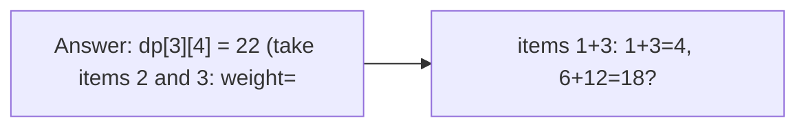
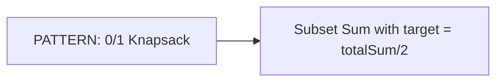
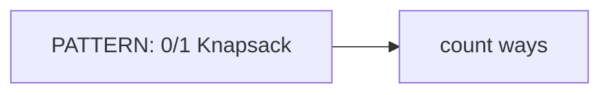
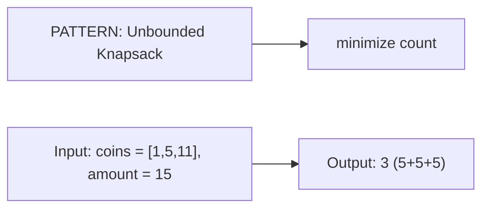
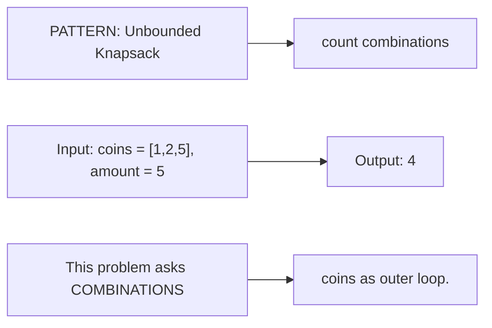
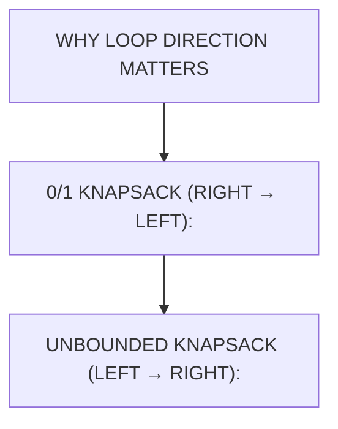

**Navigation**: [< Previous](22_Cyclic_Sort_Pattern.md) | [Back to Index](../00_MASTER_INDEX.md)

**Pattern 23** | [Index](../00_MASTER_INDEX.md)

---

# 📚 KNAPSACK FAMILY — THE UNIFICATION GUIDE

## The Knapsack Family Tree

KNAPSACK
/    |     \
0/1  Unbounded  Bounded
/ | \     |         |
Subset  Target Partition  Coin    Rod
Sum     Sum    Equal    Change   Cut
(LC416) (LC494)(LC416)  (LC322) (GFG)
|
Coin Ways
(LC518)

**Insight**: ALL these problems share ONE core recurrence:
dp[i][w] = max/min/count of (take item, skip item)
The ONLY difference: 0/1 vs unbounded vs bounded.

---

## PART 0: THEORY — "Take/Skip × Capacity"

```
┌──────────────────────────────────────────────────────────────────────────────┐
│           KNAPSACK FAMILY — COMPLETE THEORY & UNIFICATION                    │
└──────────────────────────────────────────────────────────────────────────────┘

┌──────────────────────────────────────────────────────────────────────────────┐
│ THE REAL-WORLD ORIGIN                                                        │
├──────────────────────────────────────────────────────────────────────────────┤
│                                                                              │
│ 📖 CARGO LOADING: A delivery truck has weight capacity W.                     │
│    Each package has weight and profit. Maximize profit without               │
│    exceeding capacity. This IS the 0/1 Knapsack.                             │
│                                                                              │
│ 📖 BUDGET ALLOCATION: Company has budget B. Projects have costs               │
│    and expected returns. Pick subset to maximize ROI.                        │
│                                                                              │
│ 📖 CLOUD COST OPTIMIZATION: You have N instance types with different          │
│    CPU/memory/cost. Fill capacity constraints to minimize total cost.        │
│    → Multi-dimensional knapsack.                                             │
│                                                                              │
│ 📖 CUTTING STOCK: Steel rod of length L. Cuts of length l₁,l₂,...             │
│    sell for p₁,p₂,... Maximize revenue. Unlimited cuts → Unbounded.          │
│                                                                              │
│ 📖 CRYPTOCURRENCY CHANGE: Exchange coins of denominations d₁,d₂,...           │
│    to make amount A. Minimum coins? That's Coin Change.                      │
│                                                                              │
└──────────────────────────────────────────────────────────────────────────────┘

┌──────────────────────────────────────────────────────────────────────────────┐
│ THE THREE KNAPSACK TYPES                                                     │
├──────────────────────────────────────────────────────────────────────────────┤
│                                                                              │
│  TYPE 1: 0/1 KNAPSACK                                                        │
│  Each item used AT MOST ONCE.                                                │
│  Direction: iterate capacity RIGHT → LEFT (backward)                         │
│  Why? Prevents reusing same item. Each dp[w] uses previous row's values.     │
│                                                                              │
│  TYPE 2: UNBOUNDED KNAPSACK                                                  │
│  Each item used UNLIMITED times.                                             │
│  Direction: iterate capacity LEFT → RIGHT (forward)                          │
│  Why? dp[w-weight] already includes current item → reuse allowed.            │
│                                                                              │
│  TYPE 3: BOUNDED KNAPSACK (k copies each)                                    │
│  Each item used at most k times.                                             │
│  Technique: Binary splitting → reduce to 0/1 with log(k) virtual items.      │
│                                                                              │
│  ┌────────────────────────────────────────────────────────────────────┐      │
│  │  HOW TO TELL WHICH TYPE:                                          │       │
│  │  • "Each element at most once" → 0/1                              │       │
│  │  • "Unlimited supply / coins / cuts" → Unbounded                  │       │
│  │  • "At most k of each" → Bounded                                 │        │
│  │  • "Subset of array" → 0/1 (each element used once)              │        │
│  └────────────────────────────────────────────────────────────────────┘      │
│                                                                              │
└──────────────────────────────────────────────────────────────────────────────┘

┌──────────────────────────────────────────────────────────────────────────────┐
│ THE UNIFIED RECURRENCE                                                       │
├──────────────────────────────────────────────────────────────────────────────┤
│                                                                              │
│  For each item i with weight w_i and value v_i:                              │
│                                                                              │
│  0/1:       dp[w] = max(dp[w], dp[w - w_i] + v_i)    (iterate w: W → w_i)    │
│  Unbounded: dp[w] = max(dp[w], dp[w - w_i] + v_i)    (iterate w: w_i → W)    │
│                                                                              │
│  SAME FORMULA. Only the loop direction changes!                              │
│                                                                              │
│  For COUNTING variants (how many ways?):                                     │
│    dp[w] += dp[w - w_i]                                                      │
│                                                                              │
│  For MINIMIZATION variants (min coins):                                      │
│    dp[w] = min(dp[w], dp[w - w_i] + 1)                                       │
│                                                                              │
│  ┌────────────────────────────────────────────────────────────────────┐      │
│  │ AGGREGATE FUNCTION determines the variant:                        │       │
│  │  max(...)  → maximize value/profit                                │       │
│  │  min(...)  → minimize cost/coins                                  │       │
│  │  sum +=    → count number of ways                                 │       │
│  │  || (OR)   → can we achieve target? (boolean)                     │       │
│  └────────────────────────────────────────────────────────────────────┘      │
│                                                                              │
└──────────────────────────────────────────────────────────────────────────────┘

┌──────────────────────────────────────────────────────────────────────────────┐
│ THE TRANSFORMATION PIPELINE                                                  │
├──────────────────────────────────────────────────────────────────────────────┤
│                                                                              │
│  STEP 1: Identify → what's the "item"? what's the "weight/capacity"?         │
│  STEP 2: Type → 0/1 or Unbounded?                                            │
│  STEP 3: Objective → max, min, count, or boolean?                            │
│  STEP 4: Write recurrence                                                    │
│  STEP 5: Space optimize with 1D array + correct direction                    │
│                                                                              │
│  EXAMPLES:                                                                   │
│  ┌──────────────────┬──────────┬───────────┬──────────┬───────────────┐      │
│  │ Problem          │ Item     │ Capacity  │ Type     │ Objective     │      │
│  ├──────────────────┼──────────┼───────────┼──────────┼───────────────┤      │
│  │ 0/1 Knapsack     │ object   │ weight    │ 0/1      │ max profit    │      │
│  │ Subset Sum       │ number   │ target    │ 0/1      │ boolean       │      │
│  │ Partition Equal   │ number   │ sum/2     │ 0/1      │ boolean       │     │
│  │ Target Sum ±      │ number   │ (S+T)/2   │ 0/1      │ count         │     │
│  │ Coin Change      │ coin     │ amount    │ unbounded│ min count     │      │
│  │ Coin Change II   │ coin     │ amount    │ unbounded│ count ways    │      │
│  │ Rod Cutting      │ length   │ rod len   │ unbounded│ max profit    │      │
│  │ Ones and Zeroes  │ string   │ (m, n)    │ 0/1      │ max count     │      │
│  └──────────────────┴──────────┴───────────┴──────────┴───────────────┘      │
│                                                                              │
└──────────────────────────────────────────────────────────────────────────────┘

┌──────────────────────────────────────────────────────────────────────────────┐
│ COMMON MISTAKES                                                              │
├──────────────────────────────────────────────────────────────────────────────┤
│ 1. Wrong loop direction: RIGHT→LEFT for 0/1, LEFT→RIGHT for unbounded        │
│ 2. Confusing "count ways" with "count combinations":                         │
│    • Items in outer loop, capacity inner → COMBINATIONS (no order)           │
│    • Capacity in outer loop, items inner → PERMUTATIONS (order matters)      │
│ 3. Wrong base case: dp[0] = 0 for min, dp[0] = 1 for count,                  │
│    dp[0] = true for boolean                                                  │
│ 4. Not handling impossible case: for min, init dp[] = Integer.MAX_VALUE      │
│    except dp[0] = 0                                                          │
│ 5. Off-by-one in 2D → 1D space optimization conversion                       │
│ 6. Forgetting: Target Sum needs (target+sum)%2==0 check first                │
└──────────────────────────────────────────────────────────────────────────────┘
```

---

## PROBLEM 1: Classic 0/1 Knapsack

```
THE TEMPLATE PROBLEM — not on LeetCode but on every interview prep list.

PROBLEM: n items with weights[] and values[]. Capacity W. Maximize value.

VISUAL (3 items, W=4):
  items:  weight=[1, 2, 3], value=[6, 10, 12]
  
  2D Table dp[i][w] = max value using items 0..i-1 with capacity w:
        w=0  w=1  w=2  w=3  w=4
  i=0    0    0    0    0    0
  i=1    0    6    6    6    6     (item1: w=1, v=6)
  i=2    0    6   10   16   16    (item2: w=2, v=10)
  i=3    0    6   10   16   22    (item3: w=3, v=12)
  
  Answer: dp[3][4] = 22 (take items 2 and 3: weight=5?NO → items 1+3: 1+3=4, 6+12=18?
                         Actually: items 1+2: 1+2=3, 6+10=16, then item3: 3≤4, 12.
                         Best: items 2+3: 2+3=5>4, NO. Items 1+2: 16. item 1+3: 18.
                         dp[3][4] = max(dp[2][4], dp[2][4-3]+12) = max(16, dp[2][1]+12) = max(16, 6+12) = 22? 
                         Wait: dp[2][1]=6, so 6+12=18. dp[2][4]=16. Answer = 18.)
  
  Correction: dp[3][4] = max(dp[2][4], dp[2][1]+12) = max(16, 18) = 18
```

**Flow:**
1. Answer: dp[3][4] = 22 (take items 2 and 3: weight=
2. items 1+3: 1+3=4, 6+12=18?



```java
// 2D solution
public int knapsack(int[] weights, int[] values, int W) {
    int n = weights.length;
    int[][] dp = new int[n + 1][W + 1];
    
    for (int i = 1; i <= n; i++) {
        for (int w = 0; w <= W; w++) {
            dp[i][w] = dp[i - 1][w];  // Skip item
            if (weights[i - 1] <= w) {
                dp[i][w] = Math.max(dp[i][w], 
                    dp[i - 1][w - weights[i - 1]] + values[i - 1]);  // Take item
            }
        }
    }
    return dp[n][W];
}

// 1D space-optimized (RIGHT → LEFT)
public int knapsack1D(int[] weights, int[] values, int W) {
    int[] dp = new int[W + 1];
    
    for (int i = 0; i < weights.length; i++) {
        for (int w = W; w >= weights[i]; w--) {      // ← RIGHT to LEFT!
            dp[w] = Math.max(dp[w], dp[w - weights[i]] + values[i]);
        }
    }
    return dp[W];
}
```

```
COMPLEXITY: Time O(n×W) | Space O(W) with 1D optimization
```

---

## PROBLEM 2: Partition Equal Subset Sum (LC 416)

```
DIFFICULTY: Medium
COMPANIES: Amazon, Facebook, Google
PATTERN: 0/1 Knapsack → Subset Sum with target = totalSum/2

TRANSFORMATION:
  "Can we partition into two equal subsets?"
  → "Can we find a subset summing to totalSum/2?"
  → 0/1 Knapsack: item=number, capacity=sum/2, objective=boolean

SOLUTION:
```

**Flow:**
1. PATTERN: 0/1 Knapsack
2. Subset Sum with target = totalSum/2



```java
public boolean canPartition(int[] nums) {
    int sum = 0;
    for (int n : nums) sum += n;
    if (sum % 2 != 0) return false;  // Odd sum → impossible
    
    int target = sum / 2;
    boolean[] dp = new boolean[target + 1];
    dp[0] = true;
    
    for (int num : nums) {
        for (int t = target; t >= num; t--) {      // RIGHT → LEFT (0/1)
            dp[t] = dp[t] || dp[t - num];
        }
    }
    return dp[target];
}
```

```
COMPLEXITY: Time O(n × sum) | Space O(sum)
```

---


🔬 **Section Challenge — PROBLEM 2: Partition Equal Subset Sum (LC 416)**

**Challenge 1 (Reasoning):** Prefix sum initialized as `prefix[0] = 0` — why the leading zero and not `prefix[0] = arr[0]`?
<details><summary>Answer</summary>

`prefix[0] = 0` (empty prefix) makes range sum formula uniform: `sum(l,r) = prefix[r+1] - prefix[l]`. Without the 0: `sum(0,r) = prefix[r] - 0` (special case needed). With it: `sum(0,r) = prefix[r+1] - prefix[0] = prefix[r+1]`. Same formula everywhere. This is the 'sentinel' pattern — adding a dummy initial value to eliminate special cases. Same trick used in dummy linked list nodes.
</details>


## PROBLEM 3: Target Sum (LC 494)

```
DIFFICULTY: Medium
COMPANIES: Facebook, Google, Amazon
PATTERN: 0/1 Knapsack → count ways

TRANSFORMATION (the clever part):
  Assign + or - to each number to reach target T.
  Let P = sum of positives, N = sum of negatives.
  P - N = T and P + N = totalSum
  → P = (T + totalSum) / 2
  → COUNT subsets summing to (T + totalSum) / 2  ← 0/1 knapsack count!

SOLUTION:
```

**Flow:**
1. PATTERN: 0/1 Knapsack
2. count ways



```java
public int findTargetSumWays(int[] nums, int target) {
    int sum = 0;
    for (int n : nums) sum += n;
    if ((sum + target) % 2 != 0 || Math.abs(target) > sum) return 0;
    
    int subsetSum = (sum + target) / 2;
    int[] dp = new int[subsetSum + 1];
    dp[0] = 1;  // One way to make sum 0: pick nothing
    
    for (int num : nums) {
        for (int s = subsetSum; s >= num; s--) {   // RIGHT → LEFT (0/1)
            dp[s] += dp[s - num];
        }
    }
    return dp[subsetSum];
}
```

```
COMPLEXITY: Time O(n × target) | Space O(target)
KEY: The mathematical transformation is the hardest part!
```

---


🔬 **Section Challenge — PROBLEM 3: Target Sum (LC 494)**

**Challenge 1 (Reasoning):** Prefix sum initialized as `prefix[0] = 0` — why the leading zero and not `prefix[0] = arr[0]`?
<details><summary>Answer</summary>

`prefix[0] = 0` (empty prefix) makes range sum formula uniform: `sum(l,r) = prefix[r+1] - prefix[l]`. Without the 0: `sum(0,r) = prefix[r] - 0` (special case needed). With it: `sum(0,r) = prefix[r+1] - prefix[0] = prefix[r+1]`. Same formula everywhere. This is the 'sentinel' pattern — adding a dummy initial value to eliminate special cases. Same trick used in dummy linked list nodes.
</details>


## PROBLEM 4: Coin Change — Minimum Coins (LC 322)

```
DIFFICULTY: Medium
COMPANIES: Amazon, Google, Apple, Microsoft
PATTERN: Unbounded Knapsack → minimize count

PROBLEM: Coins of given denominations, find min coins to make amount.
  Input:  coins = [1,5,11], amount = 15 → Output: 3 (5+5+5)

SOLUTION:
```

**Flow:**
1. PATTERN: Unbounded Knapsack
2. minimize count
3. Input: coins = [1,5,11], amount = 15
4. Output: 3 (5+5+5)



```java
public int coinChange(int[] coins, int amount) {
    int[] dp = new int[amount + 1];
    Arrays.fill(dp, amount + 1);  // "infinity"
    dp[0] = 0;
    
    for (int coin : coins) {
        for (int a = coin; a <= amount; a++) {       // LEFT → RIGHT (unbounded!)
            dp[a] = Math.min(dp[a], dp[a - coin] + 1);
        }
    }
    return dp[amount] > amount ? -1 : dp[amount];
}
```

```
COMPLEXITY: Time O(coins × amount) | Space O(amount)
```

---


## PROBLEM 5: Coin Change II — Count Ways (LC 518)

```
DIFFICULTY: Medium
COMPANIES: Amazon, Google
PATTERN: Unbounded Knapsack → count combinations

PROBLEM: Number of COMBINATIONS of coins to make amount.
  Input:  coins = [1,2,5], amount = 5 → Output: 4

CRITICAL DISTINCTION:
  COMBINATIONS (order doesn't matter): coins outer, amount inner
  PERMUTATIONS (order matters): amount outer, coins inner
  
  This problem asks COMBINATIONS → coins as outer loop.

SOLUTION:
```

**Flow:**
1. PATTERN: Unbounded Knapsack
2. count combinations
3. Input: coins = [1,2,5], amount = 5
4. Output: 4
5. This problem asks COMBINATIONS
6. coins as outer loop.



```java
public int change(int amount, int[] coins) {
    int[] dp = new int[amount + 1];
    dp[0] = 1;
    
    for (int coin : coins) {                   // Items OUTER
        for (int a = coin; a <= amount; a++) {  // LEFT → RIGHT (unbounded)
            dp[a] += dp[a - coin];
        }
    }
    return dp[amount];
}
```

```
PERMUTATIONS variant (Combination Sum IV — LC 377):
```

```java
public int combinationSum4(int[] nums, int target) {
    int[] dp = new int[target + 1];
    dp[0] = 1;
    
    for (int t = 1; t <= target; t++) {         // Capacity OUTER
        for (int num : nums) {                   // Items INNER
            if (t >= num) dp[t] += dp[t - num];
        }
    }
    return dp[target];
}
```

```
COMPLEXITY: Both O(coins × amount) | Space O(amount)
REMEMBER: Outer/inner loop order controls combinations vs permutations!
```

---


## PROBLEM 6: Ones and Zeroes (LC 474)

```
DIFFICULTY: Medium
COMPANIES: Google
PATTERN: 2D 0/1 Knapsack (two capacity dimensions)

PROBLEM: Strings of 0s and 1s. Find largest subset with at most m 0s and n 1s.

KEY INSIGHT: This is 0/1 knapsack with TWO weights (count of 0s, count of 1s)
             and TWO capacities (m, n).

SOLUTION:
```

```java
public int findMaxForm(String[] strs, int m, int n) {
    int[][] dp = new int[m + 1][n + 1];
    
    for (String s : strs) {
        int zeros = 0, ones = 0;
        for (char c : s.toCharArray()) {
            if (c == '0') zeros++;
            else ones++;
        }
        // 0/1 → iterate BACKWARDS on both dimensions
        for (int i = m; i >= zeros; i--) {
            for (int j = n; j >= ones; j--) {
                dp[i][j] = Math.max(dp[i][j], dp[i - zeros][j - ones] + 1);
            }
        }
    }
    return dp[m][n];
}
```

```
COMPLEXITY: Time O(strs × m × n) | Space O(m × n)
```

---

## 📌 The Direction Rule — Visual Proof

```
┌──────────────────────────────────────────────────────────────────────────────┐
│ WHY LOOP DIRECTION MATTERS                                                   │
├──────────────────────────────────────────────────────────────────────────────┤
│                                                                              │
│  Consider item: weight=2, value=3. Capacity W=6.                             │
│                                                                              │
│  0/1 KNAPSACK (RIGHT → LEFT):                                                │
│  dp = [0, 0, 0, 0, 0, 0, 0]                                                  │
│                                                                              │
│  w=6: dp[6] = max(dp[6], dp[4]+3) = 3    dp=[0,0,0,0,0,0,3]                  │
│  w=5: dp[5] = max(dp[5], dp[3]+3) = 3    dp=[0,0,0,0,0,3,3]                  │
│  w=4: dp[4] = max(dp[4], dp[2]+3) = 3    dp=[0,0,0,0,3,3,3]                  │
│  w=3: dp[3] = max(dp[3], dp[1]+3) = 3    dp=[0,0,0,3,3,3,3]                  │
│  w=2: dp[2] = max(dp[2], dp[0]+3) = 3    dp=[0,0,3,3,3,3,3]                  │
│  ✅ Item used only ONCE (dp[4] used old dp[2]=0, not the updated 3)           │
│                                                                              │
│  UNBOUNDED KNAPSACK (LEFT → RIGHT):                                          │
│  dp = [0, 0, 0, 0, 0, 0, 0]                                                  │
│                                                                              │
│  w=2: dp[2] = max(dp[2], dp[0]+3) = 3    dp=[0,0,3,0,0,0,0]                  │
│  w=3: dp[3] = max(dp[3], dp[1]+3) = 3    dp=[0,0,3,3,0,0,0]                  │
│  w=4: dp[4] = max(dp[4], dp[2]+3) = 6    dp=[0,0,3,3,6,0,0]  ← used new!     │
│  w=5: dp[5] = max(dp[5], dp[3]+3) = 6    dp=[0,0,3,3,6,6,0]                  │
│  w=6: dp[6] = max(dp[6], dp[4]+3) = 9    dp=[0,0,3,3,6,6,9]                  │
│  ✅ Item reused multiple times (dp[4] used updated dp[2]=3 → 2 copies)        │
│                                                                              │
└──────────────────────────────────────────────────────────────────────────────┘
```

**Flow:**
1. WHY LOOP DIRECTION MATTERS
2. 0/1 KNAPSACK (RIGHT
3. LEFT):
4. 0/1 KNAPSACK (RIGHT
5. LEFT):
6. UNBOUNDED KNAPSACK (LEFT
7. RIGHT):



---

## 📋 CURATED PRACTICE PROBLEMS — KNAPSACK FAMILY

| # | Problem | LC# | Type | Objective | Key Insight |
|---|---------|-----|------|-----------|-------------|
| 1 | [Partition Equal Subset Sum](https://leetcode.com/problems/partition-equal-subset-sum/) | 416 | 0/1 | Boolean | Target = sum/2 |
| 2 | [Target Sum](https://leetcode.com/problems/target-sum/) | 494 | 0/1 | Count | Math transform: (S+T)/2 |
| 3 | [Last Stone Weight II](https://leetcode.com/problems/last-stone-weight-ii/) | 1049 | 0/1 | Min diff | Same as partition |
| 4 | [Coin Change](https://leetcode.com/problems/coin-change/) | 322 | Unbounded | Min count | fill=∞, dp[0]=0 |
| 5 | [Coin Change II](https://leetcode.com/problems/coin-change-ii/) | 518 | Unbounded | Count combos | Items outer loop |
| 6 | [Combination Sum IV](https://leetcode.com/problems/combination-sum-iv/) | 377 | Unbounded | Count perms | Capacity outer loop |
| 7 | [Ones and Zeroes](https://leetcode.com/problems/ones-and-zeroes/) | 474 | 0/1 2D | Max subset | Two capacities |
| 8 | [Profitable Schemes](https://leetcode.com/problems/profitable-schemes/) | 879 | 0/1 2D | Count | Hard: 2D knapsack |
| 9 | [Minimum Cost For Tickets](https://leetcode.com/problems/minimum-cost-for-tickets/) | 983 | Unbounded | Min cost | Travel day variant |
| 10 | [Perfect Squares](https://leetcode.com/problems/perfect-squares/) | 279 | Unbounded | Min count | Squares as coins |

---

**Navigation**: [Back to Index](../00_MASTER_INDEX.md)
