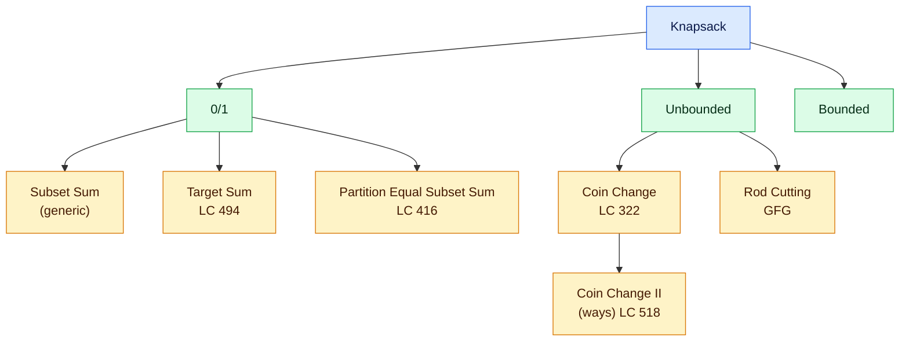

# 🧩 Knapsack Family — Pattern Guide

> **Navigation**: [← Cyclic Sort](22_Cyclic_Sort_Pattern.md) | [Chapter index](00_INDEX.md) | [Kadane and Subarray Patterns →](24_Kadanes_Subarray_Patterns.md)

**Pattern 23** | [Index](../00_MASTER_INDEX.md) | [Next](24_Kadanes_Subarray_Patterns.md)

---

## 🔗 Bridge — Where This Chapter Fits

| Dimension | This chapter |
| --- | --- |
| **Builds on** | [DP Pattern Recognition](16_DP_Pattern_Recognition.md), [DP Fundamentals](../03_Algorithms/04b_DP_Fundamentals.md) |
| **You will learn** | 0/1 knapsack, partition, target sum, coin change (min and count), multi-dimensional knapsack, and the loop-direction rule |
| **Leads to** | [Constraint-Based Selection](25_Constraint_Based_Pattern_Selection.md), [Approximation & LP](../03_Algorithms/25_Online_Approximation_And_Linear_Programming.md) |
| **Abstraction level** | Subset search `O(2ⁿ)` → **take/skip × capacity table** → pseudo-polynomial `O(nW)` |

> [!NOTE]
> The full gap-free reading order and dependency graph are in the [Learning Path](00_LEARNING_PATH.md).

---

## 💬 Explain It Like a Study Partner — Knapsack Family

### 1. The bottom line

Every "choose items under a budget" problem is the same table: for each item, take it or skip it, for each remaining capacity.

### 2. The textbook core

- 0/1: iterate capacity **downwards** so an item is used once.
- Unbounded (coin change): iterate capacity **upwards** so items can repeat.
- Min coins uses `min`, counting ways uses `+`, feasibility uses `or`.
- `O(nW)` is pseudo-polynomial — exponential in the bit-length of `W`.

### 3. The real-world analogy

Packing a **suitcase with a weight limit**: for every item you decide to bring it or leave it.

### 4. Walkthrough

1. Items `(w,v)`: `(1,15),(3,20),(4,30)`, capacity 4.
2. `dp[w]` = best value with weight ≤ `w`.
3. Process item 1: `dp[1..4] = 15`; item 2: `dp[3] = 20, dp[4] = 35`; item 3: `dp[4] = max(35, 30) = 35`.
4. Answer 35.

> [!NOTE]
> **Quick check:** Why iterate capacity downwards for 0/1 knapsack? *So `dp[w − wt]` still refers to the previous item's row.*


### 5. Check yourself

**Q1.** Fewest coins from `[1,2,5]` for amount 11?

<details><summary>Answer</summary>

**3** (5 + 5 + 1).

</details>

**Q2.** Number of combinations to make 5 from `[1,2,5]` with unlimited coins?

<details><summary>Answer</summary>

**4**: `5`, `2+2+1`, `2+1+1+1`, `1+1+1+1+1`.

</details>

**Q3.** Which capacity-loop direction is used for 0/1 versus unbounded knapsack?

<details><summary>Answer</summary>

Downwards for 0/1 (each item once); upwards for unbounded (items can repeat).

</details>

---

## Historical Evolution

**Inventor / Originator:** George Dantzig named and studied the knapsack problem (*Discrete-Variable Extremum Problems*, Operations Research, 1957); Bellman's dynamic-programming formulation appeared in the same period. Gilmore and Gomory (1961) treated cutting stock; Karp (1972) listed knapsack/subset-sum among NP-complete problems; Horowitz and Sahni (1974) gave the `O(2^(n/2))` meet-in-the-middle algorithm; Ibarra and Kim (1975) gave the first FPTAS.

**Predecessor context:** Selection under a capacity limit was solved by enumerating subsets, `O(2ⁿ)`.

**Evolution narrative:** The DP table `dp[i][w]` solves it in pseudo-polynomial time `O(n·W)`, which is fast when `W` is small and exponential in the *bit length* of `W` — consistent with NP-hardness.

**Modern practice:** Budget allocation, cargo loading, partition problems, coin change and subset-sum variants.

- **Dantzig — 1957**: Knapsack formulation and greedy bounds
- **Bellman — 1957**: DP solution
- **Karp — 1972**: NP-completeness
- **Horowitz & Sahni — 1974**: Meet in the middle, `O(2^(n/2))`
- **Ibarra & Kim — 1975**: Fully polynomial-time approximation scheme

---

## Production Reality

> [!TIP]
> **Solution fails or is too slow?** Run the five-step [Pattern Mis-Selection Debug Workflow](00_PATTERN_MASTER_GUIDE.md#pattern-mis-selection-debug-workflow) before changing code: the bug is often the pattern, not the implementation.

**Pattern-Specific Failure Modes:**

- **DP state dimension overflow for large n (10⁴ × 10⁴ grid = 100M cells)** — 2D DP table for knapsack with n=10,000 and capacity=10,000 requires 100M cells (~800MB for longs), exceeding memory limits. Detection: check `n * capacity` vs available memory; use 1D DP (rolling array) when possible.

- **0/1 vs unbounded vs fractional confusion — different transitions** — Wrong variant choice produces completely wrong answers. 0/1 knapsack iterates backward; unbounded iterates forward. Detection: verify which variant the problem requires; test with repeated items.

- **Integer overflow on `dp[i] + weight`** — When capacity is large (e.g., 10⁹), adding to dp values can overflow int. Detection: use long for dp array; test with maximum capacity.

**Production Selection Heuristic:** Use 1D DP rolling array for knapsack to save space. Always verify the variant (0/1, unbounded, fractional). Use long to prevent overflow on large capacities.

---

## 📚 KNAPSACK FAMILY — THE UNIFICATION GUIDE

### The Knapsack Family Tree



**How to read this diagram.** The three branches are the three ways an item can be used: at most once (0/1), any number of times (unbounded) or a limited number of times (bounded). Leaves are the classic problems of each kind.

**Insight**: ALL these problems share ONE core recurrence:
dp[i][w] = max/min/count of (take item, skip item)
The ONLY difference: 0/1 vs unbounded vs bounded.

#### ⚠️ Constraint Lens

| Given Constraints                | Do This                                      |
| -------------------------------- | -------------------------------------------- |
| each item used once              | 0/1 knapsack, iterate capacity backward      |
| item can be reused               | unbounded knapsack, iterate capacity forward |
| count ways                       | addition recurrence                          |
| min coins/items                  | min recurrence with infinity initialization  |
| target sum is huge but `N` small | meet-in-the-middle or pruning                |
| weights include negatives        | classic knapsack does not apply directly     |

Full map: [Constraint-Based Pattern Selection](25_Constraint_Based_Pattern_Selection.md).

---

### PART 0: THEORY — "Take/Skip × Capacity"

```
┌──────────────────────────────────────────────────────────────────────────────┐
│           KNAPSACK FAMILY — COMPLETE THEORY & UNIFICATION                    │
└──────────────────────────────────────────────────────────────────────────────┘

┌──────────────────────────────────────────────────────────────────────────────┐
│ THE REAL-WORLD ORIGIN                                                        │
├──────────────────────────────────────────────────────────────────────────────┤
│                                                                              │
│ 📖 CARGO LOADING: A delivery truck has weight capacity W.                     │
│    Each package has weight and profit. Maximize profit without               │
│    exceeding capacity. This IS the 0/1 Knapsack.                             │
│                                                                              │
│ 📖 BUDGET ALLOCATION: Company has budget B. Projects have costs               │
│    and expected returns. Pick subset to maximize ROI.                        │
│                                                                              │
│ 📖 CLOUD COST OPTIMIZATION: You have N instance types with different          │
│    CPU/memory/cost. Fill capacity constraints to minimize total cost.        │
│    → Multi-dimensional knapsack.                                             │
│                                                                              │
│ 📖 CUTTING STOCK: Steel rod of length L. Cuts of length l₁,l₂,...             │
│    sell for p₁,p₂,... Maximize revenue. Unlimited cuts → Unbounded.          │
│                                                                              │
│ 📖 CRYPTOCURRENCY CHANGE: Exchange coins of denominations d₁,d₂,...           │
│    to make amount A. Minimum coins? That's Coin Change.                      │
│                                                                              │
└──────────────────────────────────────────────────────────────────────────────┘

┌──────────────────────────────────────────────────────────────────────────────┐
│ THE THREE KNAPSACK TYPES                                                     │
├──────────────────────────────────────────────────────────────────────────────┤
│                                                                              │
│  TYPE 1: 0/1 KNAPSACK                                                        │
│  Each item used AT MOST ONCE.                                                │
│  Direction: iterate capacity RIGHT → LEFT (backward)                         │
│  Why? Prevents reusing same item. Each dp[w] uses previous row's values.     │
│                                                                              │
│  TYPE 2: UNBOUNDED KNAPSACK                                                  │
│  Each item used UNLIMITED times.                                             │
│  Direction: iterate capacity LEFT → RIGHT (forward)                          │
│  Why? dp[w-weight] already includes current item → reuse allowed.            │
│                                                                              │
│  TYPE 3: BOUNDED KNAPSACK (k copies each)                                    │
│  Each item used at most k times.                                             │
│  Technique: Binary splitting → reduce to 0/1 with log(k) virtual items.      │
│                                                                              │
│  ┌────────────────────────────────────────────────────────────────────┐      │
│  │  HOW TO TELL WHICH TYPE:                                          │       │
│  │  • "Each element at most once" → 0/1                              │       │
│  │  • "Unlimited supply / coins / cuts" → Unbounded                  │       │
│  │  • "At most k of each" → Bounded                                 │        │
│  │  • "Subset of array" → 0/1 (each element used once)              │        │
│  └────────────────────────────────────────────────────────────────────┘      │
│                                                                              │
└──────────────────────────────────────────────────────────────────────────────┘

┌──────────────────────────────────────────────────────────────────────────────┐
│ THE UNIFIED RECURRENCE                                                       │
├──────────────────────────────────────────────────────────────────────────────┤
│                                                                              │
│  For each item i with weight w_i and value v_i:                              │
│                                                                              │
│  0/1:       dp[w] = max(dp[w], dp[w - w_i] + v_i)    (iterate w: W → w_i)    │
│  Unbounded: dp[w] = max(dp[w], dp[w - w_i] + v_i)    (iterate w: w_i → W)    │
│                                                                              │
│  SAME FORMULA. Only the loop direction changes!                              │
│                                                                              │
│  For COUNTING variants (how many ways?):                                     │
│    dp[w] += dp[w - w_i]                                                      │
│                                                                              │
│  For MINIMIZATION variants (min coins):                                      │
│    dp[w] = min(dp[w], dp[w - w_i] + 1)                                       │
│                                                                              │
│  ┌────────────────────────────────────────────────────────────────────┐      │
│  │ AGGREGATE FUNCTION determines the variant:                        │       │
│  │  max(...)  → maximize value/profit                                │       │
│  │  min(...)  → minimize cost/coins                                  │       │
│  │  sum +=    → count number of ways                                 │       │
│  │  || (OR)   → can we achieve target? (boolean)                     │       │
│  └────────────────────────────────────────────────────────────────────┘      │
│                                                                              │
└──────────────────────────────────────────────────────────────────────────────┘

┌──────────────────────────────────────────────────────────────────────────────┐
│ THE TRANSFORMATION PIPELINE                                                  │
├──────────────────────────────────────────────────────────────────────────────┤
│                                                                              │
│  STEP 1: Identify → what's the "item"? what's the "weight/capacity"?         │
│  STEP 2: Type → 0/1 or Unbounded?                                            │
│  STEP 3: Objective → max, min, count, or boolean?                            │
│  STEP 4: Write recurrence                                                    │
│  STEP 5: Space optimize with 1D array + correct direction                    │
│                                                                              │
│  EXAMPLES:                                                                   │
│  ┌──────────────────┬──────────┬───────────┬──────────┬───────────────┐      │
│  │ Problem          │ Item     │ Capacity  │ Type     │ Objective     │      │
│  ├──────────────────┼──────────┼───────────┼──────────┼───────────────┤      │
│  │ 0/1 Knapsack     │ object   │ weight    │ 0/1      │ max profit    │      │
│  │ Subset Sum       │ number   │ target    │ 0/1      │ boolean       │      │
│  │ Partition Equal   │ number   │ sum/2     │ 0/1      │ boolean       │     │
│  │ Target Sum ±      │ number   │ (S+T)/2   │ 0/1      │ count         │     │
│  │ Coin Change      │ coin     │ amount    │ unbounded│ min count     │      │
│  │ Coin Change II   │ coin     │ amount    │ unbounded│ count ways    │      │
│  │ Rod Cutting      │ length   │ rod len   │ unbounded│ max profit    │      │
│  │ Ones and Zeroes  │ string   │ (m, n)    │ 0/1      │ max count     │      │
│  └──────────────────┴──────────┴───────────┴──────────┴───────────────┘      │
│                                                                              │
└──────────────────────────────────────────────────────────────────────────────┘

┌──────────────────────────────────────────────────────────────────────────────┐
│ COMMON MISTAKES                                                              │
├──────────────────────────────────────────────────────────────────────────────┤
│ 1. Wrong loop direction: RIGHT→LEFT for 0/1, LEFT→RIGHT for unbounded        │
│ 2. Confusing "count ways" with "count combinations":                         │
│    • Items in outer loop, capacity inner → COMBINATIONS (no order)           │
│    • Capacity in outer loop, items inner → PERMUTATIONS (order matters)      │
│ 3. Wrong base case: dp[0] = 0 for min, dp[0] = 1 for count,                  │
│    dp[0] = true for boolean                                                  │
│ 4. Not handling impossible case: for min, init dp[] = Integer.MAX_VALUE      │
│    except dp[0] = 0                                                          │
│ 5. Off-by-one in 2D → 1D space optimization conversion                       │
│ 6. Forgetting: Target Sum needs (target+sum)%2==0 check first                │
└──────────────────────────────────────────────────────────────────────────────┘
```

---

### PROBLEM 1: Classic 0/1 Knapsack

```
THE TEMPLATE PROBLEM — not on LeetCode but on every interview prep list.

PROBLEM: n items with weights[] and values[]. Capacity W. Maximize value.

VISUAL (3 items, W=4):
  items:  weight=[1, 2, 3], value=[6, 10, 12]

  2D Table dp[i][w] = max value using items 0..i-1 with capacity w:
        w=0  w=1  w=2  w=3  w=4
  i=0    0    0    0    0    0
  i=1    0    6    6    6    6     (item1: w=1, v=6)
  i=2    0    6   10   16   16    (item2: w=2, v=10)
  i=3    0    6   10   16   22    (item3: w=3, v=12)

  Answer: dp[3][4] = 22 (take items 2 and 3: weight=5?NO → items 1+3: 1+3=4, 6+12=18?
                         Actually: items 1+2: 1+2=3, 6+10=16, then item3: 3≤4, 12.
                         Best: items 2+3: 2+3=5>4, NO. Items 1+2: 16. item 1+3: 18.
                         dp[3][4] = max(dp[2][4], dp[2][4-3]+12) = max(16, dp[2][1]+12) = max(16, 6+12) = 22?
                         Wait: dp[2][1]=6, so 6+12=18. dp[2][4]=16. Answer = 18.)

  Correction: dp[3][4] = max(dp[2][4], dp[2][1]+12) = max(16, 18) = 18
```

```java
// 2D solution
public int knapsack(int[] weights, int[] values, int W) {
    int n = weights.length;
    int[][] dp = new int[n + 1][W + 1];

    for (int i = 1; i <= n; i++) {
        for (int w = 0; w <= W; w++) {
            dp[i][w] = dp[i - 1][w];  // Skip item
            if (weights[i - 1] <= w) {
                dp[i][w] = Math.max(dp[i][w],
                    dp[i - 1][w - weights[i - 1]] + values[i - 1]);  // Take item
            }
        }
    }
    return dp[n][W];
}

// 1D space-optimized (RIGHT → LEFT)
public int knapsack1D(int[] weights, int[] values, int W) {
    int[] dp = new int[W + 1];

    for (int i = 0; i < weights.length; i++) {
        for (int w = W; w >= weights[i]; w--) {      // ← RIGHT to LEFT!
            dp[w] = Math.max(dp[w], dp[w - weights[i]] + values[i]);
        }
    }
    return dp[W];
}
```

```
COMPLEXITY: Time O(n×W) | Space O(W) with 1D optimization
```

---

### PROBLEM 2: Partition Equal Subset Sum (LC 416)

```
DIFFICULTY: Medium
COMPANIES: Amazon, Facebook, Google
PATTERN: 0/1 Knapsack → Subset Sum with target = totalSum/2

TRANSFORMATION:
  "Can we partition into two equal subsets?"
  → "Can we find a subset summing to totalSum/2?"
  → 0/1 Knapsack: item=number, capacity=sum/2, objective=boolean

SOLUTION:
```

```java
public boolean canPartition(int[] nums) {
    int sum = 0;
    for (int n : nums) sum += n;
    if (sum % 2 != 0) return false;  // Odd sum → impossible

    int target = sum / 2;
    boolean[] dp = new boolean[target + 1];
    dp[0] = true;

    for (int num : nums) {
        for (int t = target; t >= num; t--) {      // RIGHT → LEFT (0/1)
            dp[t] = dp[t] || dp[t - num];
        }
    }
    return dp[target];
}
```

```
COMPLEXITY: Time O(n × sum) | Space O(sum)
```

---

### PROBLEM 3: Target Sum (LC 494)

```
DIFFICULTY: Medium
COMPANIES: Facebook, Google, Amazon
PATTERN: 0/1 Knapsack → count ways

TRANSFORMATION (the clever part):
  Assign + or - to each number to reach target T.
  Let P = sum of positives, N = sum of negatives.
  P - N = T and P + N = totalSum
  → P = (T + totalSum) / 2
  → COUNT subsets summing to (T + totalSum) / 2  ← 0/1 knapsack count!

SOLUTION:
```

```java
public int findTargetSumWays(int[] nums, int target) {
    int sum = 0;
    for (int n : nums) sum += n;
    if ((sum + target) % 2 != 0 || Math.abs(target) > sum) return 0;

    int subsetSum = (sum + target) / 2;
    int[] dp = new int[subsetSum + 1];
    dp[0] = 1;  // One way to make sum 0: pick nothing

    for (int num : nums) {
        for (int s = subsetSum; s >= num; s--) {   // RIGHT → LEFT (0/1)
            dp[s] += dp[s - num];
        }
    }
    return dp[subsetSum];
}
```

```
COMPLEXITY: Time O(n × target) | Space O(target)
KEY: The mathematical transformation is the hardest part!
```

---

### PROBLEM 4: Coin Change — Minimum Coins (LC 322)

```
DIFFICULTY: Medium
COMPANIES: Amazon, Google, Apple, Microsoft
PATTERN: Unbounded Knapsack → minimize count

PROBLEM: Coins of given denominations, find min coins to make amount.
  Input:  coins = [1,5,11], amount = 15 → Output: 3 (5+5+5)

SOLUTION:
```

```java
public int coinChange(int[] coins, int amount) {
    int[] dp = new int[amount + 1];
    Arrays.fill(dp, amount + 1);  // "infinity"
    dp[0] = 0;

    for (int coin : coins) {
        for (int a = coin; a <= amount; a++) {       // LEFT → RIGHT (unbounded!)
            dp[a] = Math.min(dp[a], dp[a - coin] + 1);
        }
    }
    return dp[amount] > amount ? -1 : dp[amount];
}
```

```
COMPLEXITY: Time O(coins × amount) | Space O(amount)
```

---

### PROBLEM 5: Coin Change II — Count Ways (LC 518)

```
DIFFICULTY: Medium
COMPANIES: Amazon, Google
PATTERN: Unbounded Knapsack → count combinations

PROBLEM: Number of COMBINATIONS of coins to make amount.
  Input:  coins = [1,2,5], amount = 5 → Output: 4

CRITICAL DISTINCTION:
  COMBINATIONS (order doesn't matter): coins outer, amount inner
  PERMUTATIONS (order matters): amount outer, coins inner

  This problem asks COMBINATIONS → coins as outer loop.

SOLUTION:
```

```java
public int change(int amount, int[] coins) {
    int[] dp = new int[amount + 1];
    dp[0] = 1;

    for (int coin : coins) {                   // Items OUTER
        for (int a = coin; a <= amount; a++) {  // LEFT → RIGHT (unbounded)
            dp[a] += dp[a - coin];
        }
    }
    return dp[amount];
}
```

```
PERMUTATIONS variant (Combination Sum IV — LC 377):
```

```java
public int combinationSum4(int[] nums, int target) {
    int[] dp = new int[target + 1];
    dp[0] = 1;

    for (int t = 1; t <= target; t++) {         // Capacity OUTER
        for (int num : nums) {                   // Items INNER
            if (t >= num) dp[t] += dp[t - num];
        }
    }
    return dp[target];
}
```

```
COMPLEXITY: Both O(coins × amount) | Space O(amount)
REMEMBER: Outer/inner loop order controls combinations vs permutations!
```

---

### PROBLEM 6: Ones and Zeroes (LC 474)

```
DIFFICULTY: Medium
COMPANIES: Google
PATTERN: 2D 0/1 Knapsack (two capacity dimensions)

PROBLEM: Strings of 0s and 1s. Find largest subset with at most m 0s and n 1s.

KEY INSIGHT: This is 0/1 knapsack with TWO weights (count of 0s, count of 1s)
             and TWO capacities (m, n).

SOLUTION:
```

```java
public int findMaxForm(String[] strs, int m, int n) {
    int[][] dp = new int[m + 1][n + 1];

    for (String s : strs) {
        int zeros = 0, ones = 0;
        for (char c : s.toCharArray()) {
            if (c == '0') zeros++;
            else ones++;
        }
        // 0/1 → iterate BACKWARDS on both dimensions
        for (int i = m; i >= zeros; i--) {
            for (int j = n; j >= ones; j--) {
                dp[i][j] = Math.max(dp[i][j], dp[i - zeros][j - ones] + 1);
            }
        }
    }
    return dp[m][n];
}
```

```
COMPLEXITY: Time O(strs × m × n) | Space O(m × n)
```

---

#### Why Loop Direction Is Forced — The 2D-to-1D Derivation Most People Skip

The "Direction Rule" box below shows the visual trace, but it doesn't show the *derivation*: why does the *same recurrence* `dp[w] = max(dp[w], dp[w - weight] + value)` produce correct answers for both 0/1 and unbounded knapsack, when only the loop direction changes? That question is what makes the rule feel inevitable instead of arbitrary — and once you see it, you can re-derive the right direction for any new knapsack variant without looking it up.

**The starting point: 2D DP.** The honest formulation of 0/1 knapsack is `dp[i][w]` = max value using the first `i` items with capacity `w`. The recurrence is:

```
dp[i][w] = max(
    dp[i-1][w],                        // skip item i
    dp[i-1][w - weight_i] + value_i    // take item i (uses first i-1 items)
)
```

Note `dp[i-1][...]` — the "previous row." That's the constraint "each item used at most once": when item `i` is taken, the rest of the knapsack must be filled using *only items 0 through i-1*. The 2D table has `n × W` cells and the recurrence fills them in row-by-row order.

**The 1D optimization — collapse rows.** We don't actually need to keep the whole table. `dp[i][w]` only depends on `dp[i-1][...]`, the previous row. So we can overwrite `dp[i][w]` in place, treating the array as "currently holds `dp[i-1][...]`, will hold `dp[i][...]` after this iteration." The loop becomes `for w in range(W, weight-1, -1): dp[w] = max(dp[w], dp[w - weight] + value)`.

**The question: why backward?** When we update `dp[w] = max(dp[w], dp[w - weight] + value)`, we're reading `dp[w - weight]`. We want that read to give us the *previous row's value* (`dp[i-1][w - weight]`), not the value we just wrote in this iteration (`dp[i][w - weight]`). If we iterate `w` left-to-right, then when we reach `w`, we may have *already updated* `dp[w - weight]` earlier in the same iteration — that means we'd be reading the current row, not the previous row. For 0/1 knapsack that would let us use item `i` more than once (because `dp[w - weight]` would already include item `i`).

Iterating `w` right-to-left guarantees that when we read `dp[w - weight]`, `w - weight < w` and we haven't updated it yet in this iteration. So we read the previous row. Backward iteration = "0/1" semantics, for free.

**For unbounded knapsack, we want the opposite.** We want `dp[w - weight]` to give us the *current row's* value — because the current row already includes "take item i" some number of times, and reading it again means "take it one more time." So we iterate left-to-right: when we reach `w`, we've already updated `dp[w - weight]` earlier in this iteration, so the read picks up the unlimited-use value. Forward iteration = "unbounded" semantics.

**The derivation in one sentence:** *The loop direction is whatever makes the in-place read produce the row semantics you want.* Backward reads the previous row (each item used at most once). Forward reads the current row (unlimited reuse). The same recurrence, the same array, different reading semantics.

**The bounded variant (at most `k` copies of each item).** Naively: a `k`-loop inside the outer `w`-loop adds `O(k)` to each item's iteration, giving `O(nWk)` total. The binary-splitting trick reduces this to `O(nW log k)` by replacing each "item with `k` copies" with `log₂(k)` virtual items. Why does this work?

Split `k` copies into groups of `1, 2, 4, 8, ..., 2^(⌊log k⌋)` plus possibly a remainder. For example, `k = 10` splits into `1, 2, 4, 3` (or equivalently `1, 2, 4, 2, 1` using a different decomposition). Now the original "you can use this item 0 to 10 times" becomes "you can use each virtual item 0 or 1 times" — exactly the 0/1 knapsack setting! And every number 0 to 10 can be uniquely written as a sum of distinct values from `{1, 2, 4, 3}` — that's the whole reason binary representation works.

Why `log(k)` virtual items suffice: any number from 0 to `k` can be written as a binary expansion (in terms of `{1, 2, 4, 8, ...}`) plus at most one "remainder" group. So we cover all `k+1` multiplicity choices with `⌈log₂(k+1)⌉` virtual items.

**Counting variants — same rule, different aggregate.** For "how many ways to make amount A?" (Coin Change II), the recurrence is `dp[w] += dp[w - coin]` (not `max`, just accumulation). Same direction logic applies: iterate left-to-right for unbounded (count ways to use unlimited copies), iterate right-to-left for 0/1 (count ways where each coin is used at most once). The direction rule generalizes to *any* in-place DP that rolls over a single dimension — it's not specific to knapsack.

🔬 **Section Challenge — Knapsack Direction**

**Challenge 1 (Failure Mode, 5 min):** You're implementing 0/1 knapsack but accidentally iterate `w` left-to-right. You submit, and it passes the small test cases but fails the large ones. What specifically goes wrong — concretely, what answer does it produce for a small example?

<details><summary>Answer</summary>

Take items: `[{weight: 1, value: 10}, {weight: 2, value: 15}]` with capacity `W = 3`. The correct 0/1 knapsack answer is **25** (use both items, weight 1+2=3, value 10+15=25).

With forward iteration (the bug), the algorithm behaves as if each item can be reused:

```
Initial: dp = [0, 0, 0, 0]

Item 0 (w=1, v=10), forward iteration w = 1 → 3:
  w=1: dp[1] = max(dp[1], dp[0] + 10) = 10      dp = [0, 10,  0,  0]
  w=2: dp[2] = max(dp[2], dp[1] + 10) = 20      dp = [0, 10, 20,  0]  ← reads updated dp[1]
  w=3: dp[3] = max(dp[3], dp[2] + 10) = 30      dp = [0, 10, 20, 30]  ← reads updated dp[2]

Item 1 (w=2, v=15), forward iteration w = 2 → 3:
  w=2: dp[2] = max(20, dp[0] + 15) = 20         dp = [0, 10, 20, 30]
  w=3: dp[3] = max(30, dp[1] + 15) = 30         dp = [0, 10, 20, 30]
```

Answer reported: `dp[3] = 30` — **wrong** (correct is 25).

What went wrong: when processing item 0 forward, `dp[2]` read the *current* value of `dp[1]` (10), which already included item 0. So the algorithm "used item 0 twice" in a single outer iteration. The same happened again for `dp[3]`. The forward direction means each cell reads from cells that may have already been updated in *this* iteration — the same semantics as unbounded knapsack.

With backward iteration (correct):

```
Item 0 (w=1, v=10), backward iteration w = 3 → 1:
  w=3: dp[3] = max(0, dp[2] + 10) = 0           dp = [0, 0, 0, 0]   ← dp[2] still 0
  w=2: dp[2] = max(0, dp[1] + 10) = 0           dp = [0, 0, 0, 0]
  w=1: dp[1] = max(0, dp[0] + 10) = 10          dp = [0, 10, 0, 0]

Item 1 (w=2, v=15), backward iteration w = 3 → 2:
  w=3: dp[3] = max(0, dp[1] + 15) = 25          dp = [0, 10, 0, 25]  ✓
  w=2: dp[2] = max(0, dp[0] + 15) = 15          dp = [0, 10, 15, 25]
```

Answer reported: `dp[3] = 25` ✓

Failure-mode summary: forward iteration under 0/1 semantics systematically over-counts by allowing each item to be used multiple times. The result is the *unbounded* knapsack answer, not the 0/1 answer — and since unbounded answers can be larger, the output is typically too high. Small test cases with single-use items may pass by coincidence; larger inputs expose the bug deterministically.

</details>

**Challenge 2 (Bounded Derivation, 5 min):** A bounded knapsack problem has 1 item with weight 2, value 3, and `k = 7` copies available, capacity W = 14. The binary-splitting trick replaces this with how many virtual items, and what are their weights/values?

<details><summary>Answer</summary>

`k = 7` decomposes as `7 = 1 + 2 + 4` (powers of 2 that sum to ≤ 7). So we get 3 virtual items: `{weight: 2, value: 3}`, `{weight: 4, value: 6}`, `{weight: 8, value: 12}`.

Now we run 0/1 knapsack on these 3 virtual items with capacity 14:
- Take all three: weight 2+4+8 = 14, value 3+6+12 = 21. Fits exactly!
- That corresponds to using the original item 1+2+4 = 7 times.

Any number 0 to 7 can be expressed as a sum of a subset of `{1, 2, 4}`:
- 0: empty
- 1: {1}
- 2: {2}
- 3: {1, 2}
- 4: {4}
- 5: {1, 4}
- 6: {2, 4}
- 7: {1, 2, 4}

So we cover all 8 multiplicity choices with 3 virtual items, and the answer for any capacity is the same as bounded knapsack with 7 copies. The total DP cost is `O(W × log k) = O(14 × 3) = O(42)` instead of `O(W × k) = O(98)`.

If `k` weren't exactly a sum of distinct powers of 2 (e.g., `k = 10`), we'd use `{1, 2, 4, 3}` (4 virtual items) since `1+2+4 = 7 ≤ 10` covers 0-7, and the additional `{3}` covers 8-10. Total `⌈log₂(k+1)⌉ = 4` virtual items.

</details>


### 📌 The Direction Rule — Visual Proof

**WHY LOOP DIRECTION MATTERS**

```text
Consider item: weight=2, value=3. Capacity W=6.

0/1 KNAPSACK (RIGHT → LEFT):
dp = [0, 0, 0, 0, 0, 0, 0]

w=6: dp[6] = max(dp[6], dp[4]+3) = 3    dp=[0,0,0,0,0,0,3]
w=5: dp[5] = max(dp[5], dp[3]+3) = 3    dp=[0,0,0,0,0,3,3]
w=4: dp[4] = max(dp[4], dp[2]+3) = 3    dp=[0,0,0,0,3,3,3]
w=3: dp[3] = max(dp[3], dp[1]+3) = 3    dp=[0,0,0,3,3,3,3]
w=2: dp[2] = max(dp[2], dp[0]+3) = 3    dp=[0,0,3,3,3,3,3]
✅ Item used only ONCE (dp[4] used old dp[2]=0, not the updated 3)

UNBOUNDED KNAPSACK (LEFT → RIGHT):
dp = [0, 0, 0, 0, 0, 0, 0]

w=2: dp[2] = max(dp[2], dp[0]+3) = 3    dp=[0,0,3,0,0,0,0]
w=3: dp[3] = max(dp[3], dp[1]+3) = 3    dp=[0,0,3,3,0,0,0]
w=4: dp[4] = max(dp[4], dp[2]+3) = 6    dp=[0,0,3,3,6,0,0]  ← used new!
w=5: dp[5] = max(dp[5], dp[3]+3) = 6    dp=[0,0,3,3,6,6,0]
w=6: dp[6] = max(dp[6], dp[4]+3) = 9    dp=[0,0,3,3,6,6,9]
✅ Item reused multiple times (dp[4] used updated dp[2]=3 → 2 copies)
```

---

### 📋 CURATED PRACTICE PROBLEMS — KNAPSACK FAMILY

| #   | Problem                                                                                 | LC#  | Type      | Objective    | Key Insight             |
| --- | --------------------------------------------------------------------------------------- | ---- | --------- | ------------ | ----------------------- |
| 1   | [Partition Equal Subset Sum](https://leetcode.com/problems/partition-equal-subset-sum/) | 416  | 0/1       | Boolean      | Target = sum/2          |
| 2   | [Target Sum](https://leetcode.com/problems/target-sum/)                                 | 494  | 0/1       | Count        | Math transform: (S+T)/2 |
| 3   | [Last Stone Weight II](https://leetcode.com/problems/last-stone-weight-ii/)             | 1049 | 0/1       | Min diff     | Same as partition       |
| 4   | [Coin Change](https://leetcode.com/problems/coin-change/)                               | 322  | Unbounded | Min count    | fill=∞, dp[0]=0         |
| 5   | [Coin Change II](https://leetcode.com/problems/coin-change-ii/)                         | 518  | Unbounded | Count combos | Items outer loop        |
| 6   | [Combination Sum IV](https://leetcode.com/problems/combination-sum-iv/)                 | 377  | Unbounded | Count perms  | Capacity outer loop     |
| 7   | [Ones and Zeroes](https://leetcode.com/problems/ones-and-zeroes/)                       | 474  | 0/1 2D    | Max subset   | Two capacities          |
| 8   | [Profitable Schemes](https://leetcode.com/problems/profitable-schemes/)                 | 879  | 0/1 2D    | Count        | Hard: 2D knapsack       |
| 9   | [Minimum Cost For Tickets](https://leetcode.com/problems/minimum-cost-for-tickets/)     | 983  | Unbounded | Min cost     | Travel day variant      |
| 10  | [Perfect Squares](https://leetcode.com/problems/perfect-squares/)                       | 279  | Unbounded | Min count    | Squares as coins        |

---


---

## 🏢 Enterprise Lens — Knapsack Family

| Area | What top-tier engineering looks like |
| ---- | ------------------------------------ |
| **Where it runs in production** | Budget allocation, cargo loading, portfolio selection under limits, partition checks |
| **Failure modes** | Wrong loop direction; confusing "exact weight" with "at most weight"; huge `W` blowing memory |
| **Testing and verification** | Brute-force subsets for `n ≤ 15`; test zero capacity and items heavier than capacity |

---

## Reality Check

**"Knapsack means the weight-and-value problem"** → Knapsack is a FAMILY signature: choose from items under a capacity-like budget, optimizing or counting. Subset-sum (can I hit target), partition-equal-halves, coin change (min coins AND count ways), target-sum-with-signs, and stone-smashing are all knapsacks in costume. The recognition cue is a per-item include-or-exclude decision against a bounded accumulator — nouns vary, structure repeats.

**"0/1 and unbounded knapsack differ by a lot of code"** → They differ by ONE loop direction in the 1D formulation: capacity descending for 0/1 (each item used once — reading last round's values), ascending for unbounded (reuse allowed — reading this round's). This is the family's central mechanical fact, the most common silent bug when adapting a memorized template, and the standard interview probe ("why does your inner loop go downward?").

**"Count-the-ways and min-coins are interchangeable recurrences"** → Different algebra on the same state: counting SUMS over choices with dp[0]=1; optimization takes MIN or MAX with dp[0]=0 and infinity sentinels elsewhere — and the sentinel handling (skip unreachable states or they poison minimums) is where implementations diverge from formulas. Permutation-counting (coin arrangements where order matters) additionally swaps the loop NESTING order — items-outer counts combinations, capacity-outer counts permutations, a distinction most people discover only by failing that exact problem.

**"The DP array indexes items"** → The 1D array indexes the BUDGET axis (capacity, target sum); items live only in the outer iteration. Misassigning axes produces plausible-looking wrong tables. And some family members budget on surprising axes: profit-target problems index achieved-profit (capped at target), digit problems index digit-sums — the axis is "the bounded quantity the future cares about," which is the state-design question wearing knapsack clothes.

**"Pseudo-polynomial is an academic footnote"** → O(n times W) is polynomial in the VALUE of W, exponential in its bit-length — so knapsack DP is practical for W up to millions and hopeless for cryptographic-scale targets, which is exactly why subset-sum stays NP-complete while your solution passes. The interview-grade sentence: "this is pseudo-polynomial; if capacity were 10 to the 18th I would need meet-in-the-middle or branch-and-bound instead." It signals you know the boundary of your own tool.
