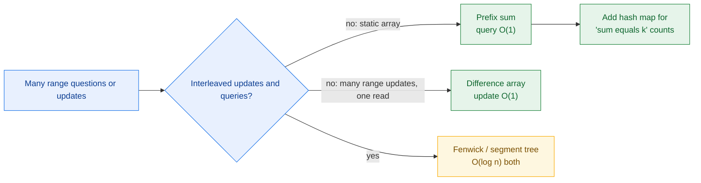
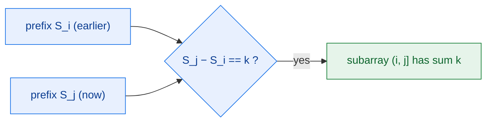

# 🧩 Prefix Sum & Difference Array — Pattern Guide

**Navigation**: [< Previous](25_Constraint_Based_Pattern_Selection.md) | [Back to Index](00_INDEX.md) | [Next >](27_Union_Find_Pattern.md)

**Pattern 26** | [Prev](25_Constraint_Based_Pattern_Selection.md) | [Index](00_INDEX.md)

---

## 🔗 Bridge — Where This Chapter Fits

| Dimension | This chapter |
| --- | --- |
| **Builds on** | [Arrays](../02_Data_Structures/01b_Arrays.md), [HashMap + Counting](10_HashMap_Plus_Counting.md), [Sliding Window](01_Sliding_Window.md) |
| **You will learn** | 1D and 2D prefix sums, range-sum queries in `O(1)`, prefix sum + hash map for "subarray sum = k", and difference arrays for many range updates |
| **Leads to** | [Kadane](24_Kadanes_Subarray_Patterns.md), [Intervals](21_Intervals_Pattern.md), [Fenwick / segment trees](../03_Algorithms/07a_Advanced_DS_Core.md) (when updates and queries interleave) |
| **Abstraction level** | Repeated range scans → **precompute once** → answer each query in `O(1)`; the inverse trick (difference array) makes range *updates* `O(1)` |

> [!NOTE]
> The full gap-free reading order and dependency graph are in the [Learning Path](00_LEARNING_PATH.md).

---

## 💬 Explain It Like a Study Partner — Prefix Sum & Difference Array

### 1. The bottom line

Pay `O(n)` once to store running totals, and every range-sum question afterwards costs two lookups and a subtraction.

### 2. The textbook core

- `prefix[i]` = sum of the first `i` elements; `sum(l..r) = prefix[r+1] − prefix[l]`.
- Subarray sum equals `k`: at each position look up how many earlier prefixes equal `prefix − k` in a hash map (seed the map with prefix `0`).
- **Difference array** `d`: add `x` to `a[l..r]` by `d[l] += x; d[r+1] -= x`; one final prefix sum rebuilds the array.
- 2D: `P[r+1][c+1] = g[r][c] + P[r][c+1] + P[r+1][c] − P[r][c]`; rectangle sum by inclusion–exclusion.
- Prefix sum and difference array are inverses (like integral and derivative).

### 3. The real-world analogy

A **bank statement with a running balance**: the amount spent between two dates is the difference of two balances, so you never re-add the individual transactions.

### 4. Walkthrough

1. Array `[3, 1, 4, 1, 5]` → prefix `[0, 3, 4, 8, 9, 14]`.
2. Sum of indices 1..3 = `prefix[4] − prefix[1] = 9 − 3 = 6` (1 + 4 + 1).
3. Updates "add 2 to indices 1..3" and "add 3 to indices 2..4" on a zero array of 5: difference array `[0, 2, 3, 0, −2, −3]`.
4. Running sum rebuilds `[0, 2, 5, 5, 3]`.

> [!NOTE]
> **Quick check:** Why seed the hash map with prefix `0 → 1`? *So subarrays that start at index 0 are counted.*

---

## ⚡ At a Glance



**How to read this diagram.** Start from the shape of your workload: a static array uses prefix sums, many range updates followed by one read use a difference array, and interleaved updates and queries need a tree structure.

| Signal in the problem | Think |
| --- | --- |
| "sum of a range" asked many times | Prefix sum |
| "number of subarrays with sum k" (negatives allowed) | Prefix sum + hash map |
| "add `x` to every element in `[l, r]`" many times | Difference array |
| rectangle sums in a grid | 2D prefix sum |
| queries *and* updates mixed | Fenwick / segment tree |

---

## Historical Evolution

**Inventor / Originator:** Cumulative sums are old statistics (cumulative distributions); the parallel **prefix computation** was studied by Ladner and Fischer (1980) and popularised by Blelloch (*Prefix Sums and Their Applications*, 1990). The 2D version in graphics is the **summed-area table** (Franklin Crow, 1984). Peter Fenwick's 1994 paper introduced the binary indexed tree for dynamic prefix sums.

**Predecessor context:** Each range query re-added its elements, `O(n)` per query.

**Evolution narrative:** Precomputation turns repeated aggregation into subtraction; the difference array applies the same idea in reverse to batch range updates.

**Modern practice:** Used inside databases (cumulative aggregates, window functions), image libraries (box filters), and scheduling and booking systems.

- **Ladner & Fischer — 1980**: Parallel prefix computation
- **Crow — 1984**: Summed-area tables for texture mapping
- **Blelloch — 1990**: Prefix sums as a general parallel primitive
- **Fenwick — 1994**: Binary indexed tree for dynamic prefix sums

---

## Template — 1D prefix sum, subarray count, difference array, 2D

```java
// 1D prefix: p[i] = sum of a[0..i-1]
static long[] prefix(int[] a) {
    long[] p = new long[a.length + 1];
    for (int i = 0; i < a.length; i++) p[i + 1] = p[i] + a[i];
    return p;
}
static long rangeSum(long[] p, int l, int r) { return p[r + 1] - p[l]; }   // inclusive l..r

// Number of subarrays with sum == k (negatives allowed)
static int subarraySumEqualsK(int[] a, int k) {
    Map<Long, Integer> seen = new HashMap<>();
    seen.put(0L, 1);                               // empty prefix
    long sum = 0; int count = 0;
    for (int x : a) {
        sum += x;
        count += seen.getOrDefault(sum - k, 0);
        seen.merge(sum, 1, Integer::sum);
    }
    return count;
}

// Apply many "add delta to [l, r]" updates, then read the array once
static int[] applyUpdates(int n, int[][] ups) {    // ups: {l, r, delta}
    long[] d = new long[n + 1];
    for (int[] u : ups) { d[u[0]] += u[2]; d[u[1] + 1] -= u[2]; }
    int[] out = new int[n]; long run = 0;
    for (int i = 0; i < n; i++) { run += d[i]; out[i] = (int) run; }
    return out;
}

// 2D prefix and rectangle query
static long[][] prefix2D(int[][] g) {
    int R = g.length, C = g[0].length;
    long[][] p = new long[R + 1][C + 1];
    for (int r = 0; r < R; r++)
        for (int c = 0; c < C; c++)
            p[r + 1][c + 1] = g[r][c] + p[r][c + 1] + p[r + 1][c] - p[r][c];
    return p;
}
static long rect(long[][] p, int r1, int c1, int r2, int c2) {
    return p[r2 + 1][c2 + 1] - p[r1][c2 + 1] - p[r2 + 1][c1] + p[r1][c1];
}
```

`subarraySumEqualsK([1,1,1], 2) = 2`; `applyUpdates(5, {{1,3,2},{2,4,3}}) = [0, 2, 5, 5, 3]`.

## Why the hash-map version works

If the prefix after index `j` is `S_j`, a subarray `(i, j]` has sum `S_j − S_i`. It equals `k` exactly when `S_i = S_j − k`. Counting how often each earlier prefix has appeared therefore counts the matching starts for the current end.



**How to read this diagram.** Two prefix values determine one subarray; the hash map lets you find every earlier `S_i` that satisfies the equation in `O(1)`.

## Variants

| Variant | Trick |
| --- | --- |
| Subarray sum divisible by `k` | Store prefix `mod k` counts (normalise negatives with `((x % k) + k) % k`) |
| Longest subarray with sum `k` | Store the **first** index of each prefix |
| Equal 0s and 1s | Map 0 → −1, then longest subarray with sum 0 |
| Product of array except self | Prefix and suffix products |
| XOR range queries | Same idea with XOR as the operation (self-inverse) |

## Common mistakes

- Forgetting the seed `prefix 0` entry.
- Mixing inclusive and exclusive indices (`p[r+1] − p[l]`).
- Using a sliding window when the array has negative numbers.
- Overflowing `int` when sums are large.
- Applying updates to a prefix array in place when queries are interleaved — rebuild cost is `O(n)` per update; use a Fenwick tree instead.

## Complexity

| Operation | Time | Space |
| --- | --- | --- |
| Build prefix (1D) | `O(n)` | `O(n)` |
| Range sum query | `O(1)` | — |
| Subarray sum = k count | `O(n)` expected | `O(n)` |
| Range update (difference) | `O(1)` each, `O(n)` final rebuild | `O(n)` |
| 2D build / query | `O(rc)` / `O(1)` | `O(rc)` |

---

## 🏢 Enterprise Lens — Prefix Sum & Difference Array

| Area | What top-tier engineering looks like |
| ---- | ------------------------------------ |
| **Where it runs in production** | Analytics dashboards (range totals), image processing (summed-area tables), batch range updates (booking and capacity systems), histogram and heat-map aggregation |
| **Failure modes** | Off-by-one between inclusive and exclusive bounds; `int` overflow on large sums (use `long`); using prefix sums when updates interleave with queries (needs a Fenwick or segment tree) |
| **Testing and verification** | Compare against nested-loop sums on random arrays (2 000 cases including negatives); test empty ranges, single elements, and `k` not present |

---

## 🧪 Practice Ladder

| Level | Problem | Idea |
| ----- | ------- | ---- |
| 1 | Range Sum Query – Immutable (LC 303) | 1D prefix |
| 2 | Subarray Sum Equals K (LC 560) | Prefix + hash map |
| 3 | Continuous Subarray Sum (LC 523) | Prefix mod k |
| 4 | Range Addition (LC 370) | Difference array |
| 5 | Range Sum Query 2D – Immutable (LC 304) | 2D prefix |
| 6 | Corporate Flight Bookings (LC 1109) | Difference array on bookings |

## Reality Check

> [!CAUTION]
> "Prefix sums are only for sums." The same idea works for any invertible operation (XOR, products without zeros, counts per character); it fails when the operation has no inverse (min, max) — use a sparse table or segment tree for those.

---

[← 25_Constraint_Based_Pattern_Selection.md](25_Constraint_Based_Pattern_Selection.md) | [Index](00_INDEX.md) | [27_Union_Find_Pattern.md →](27_Union_Find_Pattern.md)
