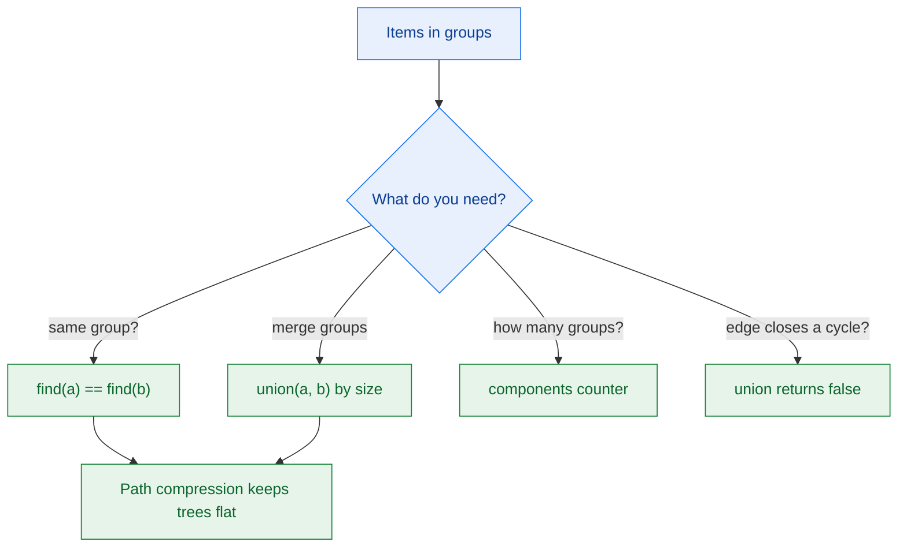
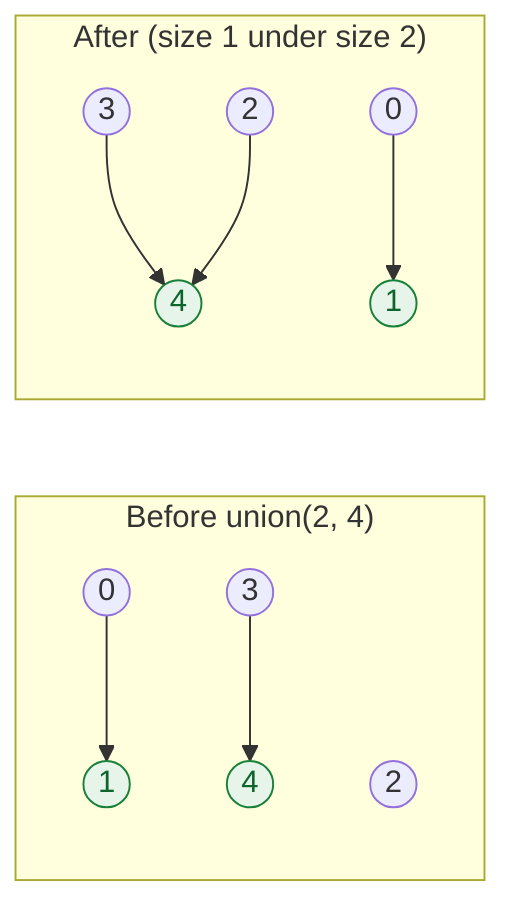

# 🧩 Union-Find (Disjoint Set Union) — Pattern Guide

> **Navigation**: [← Prefix Sum & Difference Array](26_Prefix_Sum_And_Difference_Array.md) | [Chapter index](00_INDEX.md) | [Topological Sort →](28_Topological_Sort_Pattern.md)

**Pattern 27** | [Prev](26_Prefix_Sum_And_Difference_Array.md) | [Index](00_INDEX.md)

---

## 🔗 Bridge — Where This Chapter Fits

| Dimension | This chapter |
| --- | --- |
| **Builds on** | [Graph + Traversal](14_Graph_Plus_Traversal.md), [Arrays](../02_Data_Structures/01b_Arrays.md) |
| **You will learn** | `find` with path compression, `union` by size, counting components, detecting redundant edges, Kruskal-style merging, and offline connectivity |
| **Leads to** | [Shortest Paths](30_Shortest_Path_Pattern.md) (MST context), [Union-Find in Algorithms](../03_Algorithms/14_Union_Find_DSU_Complete.md), [Advanced Graphs](../03_Algorithms/05d_Graphs_Advanced_Algos.md) |
| **Abstraction level** | Repeated BFS for "are these connected?" → **a forest of parent pointers** → near-constant-time merge and query |

> [!NOTE]
> The full gap-free reading order and dependency graph are in the [Learning Path](00_LEARNING_PATH.md).

---

## 💬 Explain It Like a Study Partner — Union-Find

### 1. The bottom line

Keep every item in a labelled group; merging two groups and asking "same group?" both take almost constant time.

### 2. The textbook core

- Each set is a tree; the root is its representative.
- `find(x)` follows parents to the root and **compresses** the path (here, path halving).
- `union(a, b)` links the smaller tree under the larger (**union by size**).
- With both optimisations a sequence of `m` operations on `n` elements costs `O(m·α(n))`, where `α` is the inverse Ackermann function (≤ 4 in practice).
- Union-find only **merges**; it cannot split sets (use offline tricks or other structures for deletions).

### 3. The real-world analogy

**Friend groups at a party**: when two people are introduced, their groups merge; to check whether two people are in the same circle you compare the circle leaders.

### 4. Walkthrough

1. Start with 5 singleton sets `{0},{1},{2},{3},{4}`.
2. `union(0,1)` and `union(3,4)` → sets `{0,1}`, `{2}`, `{3,4}`; components = 3.
3. `union(1,2)` → `{0,1,2}`; components = 2.
4. `union(0,2)` returns `false`: they are already together (this edge would close a cycle).

> [!NOTE]
> **Quick check:** Why compress paths? *So repeated finds on the same deep chain become near-constant time.*


### 5. Check yourself

**Q1.** Five nodes: `union(0,1)`, `union(1,2)`, `union(3,4)`. How many components?

<details><summary>Answer</summary>

**2** (`{0,1,2}` and `{3,4}`).

</details>

**Q2.** What does `union(0,2)` return afterwards, and what does that mean?

<details><summary>Answer</summary>

`false`: they are already connected, so that edge would close a cycle.

</details>

**Q3.** What do path compression and union by size achieve together?

<details><summary>Answer</summary>

Nearly constant amortised time per operation, `O(α(n))`.

</details>

---

## ⚡ At a Glance



**How to read this diagram.** Every question you can ask of union-find reduces to `find` and `union`; path compression and union by size are what make both operations fast.

| Signal in the problem | Think |
| --- | --- |
| "are x and y connected?" with edges arriving over time | Union-find |
| "number of connected components / islands" with merges | Union-find |
| "does this edge create a cycle?" (undirected) | `union` returns false |
| "minimum spanning tree" | Kruskal + union-find |
| accounts/emails merging, equivalence classes | Union-find with a map to ids |

---

## Historical Evolution

**Inventor / Originator:** Bernard Galler and Michael Fischer described the forest-of-trees equivalence algorithm in 1964 (*An improved equivalence algorithm*). Hopcroft and Ullman (1973) analysed it with a `log* n` bound and Robert Tarjan (1975) proved the tight inverse-Ackermann bound.

**Predecessor context:** Equivalence relations were maintained as lists or labels that had to be rewritten on every merge, `O(n)`.

**Evolution narrative:** Linking trees by root with two small optimisations (union by size/rank, path compression) gives almost-constant amortised time. Kruskal's 1956 spanning-tree algorithm later became the standard application.

**Modern practice:** Standard in graph libraries, game map generation (connected regions), and clustering pipelines.

- **Galler & Fischer — 1964**: Forest representation of equivalence classes
- **Hopcroft & Ullman — 1973**: `O(log* n)` amortised analysis
- **Tarjan — 1975**: Tight inverse-Ackermann bound

---

## Template

```java
static class DSU {
    int[] parent, size;
    int components;

    DSU(int n) {
        parent = new int[n]; size = new int[n]; components = n;
        for (int i = 0; i < n; i++) { parent[i] = i; size[i] = 1; }
    }

    int find(int x) {                       // path halving (iterative)
        while (parent[x] != x) { parent[x] = parent[parent[x]]; x = parent[x]; }
        return x;
    }

    boolean union(int a, int b) {           // false if already connected
        int ra = find(a), rb = find(b);
        if (ra == rb) return false;
        if (size[ra] < size[rb]) { int t = ra; ra = rb; rb = t; }
        parent[rb] = ra; size[ra] += size[rb];
        components--;
        return true;
    }
}

// Redundant Connection (LC 684): first edge that closes a cycle
static int[] redundantConnection(int[][] edges) {
    DSU d = new DSU(edges.length + 1);
    for (int[] e : edges) if (!d.union(e[0], e[1])) return e;
    return null;
}
```

`redundantConnection({{1,2},{1,3},{2,3}}) = [2, 3]`.

## How a union looks



**How to read this diagram.** Arrows point from child to parent and green nodes are roots. The smaller tree (just node 2) is hung under the root (4) of the larger one, so depth stays small.

## Variants

| Variant | Idea |
| --- | --- |
| Weighted union-find | Store the offset to the parent to answer "difference between x and y" queries |
| Union-find with a map | Map strings/emails to integer ids first (accounts merge) |
| Offline deletions | Reverse time: process deletions backwards as additions |
| Bipartite check | Union `x` with the opposite colour node of its neighbours (2n nodes) |

## Common mistakes

- Comparing `parent[a]` with `parent[b]` instead of `find(a)` with `find(b)`.
- Using recursion for `find` on adversarial inputs (stack overflow before compression).
- Forgetting to update the `components` counter.
- Expecting `union` to support "disconnect".

## Complexity

| Operation | Amortised time |
| --- | --- |
| `find` | `O(α(n))` |
| `union` | `O(α(n))` |
| Build | `O(n)` |
| Space | `O(n)` |

---

## 🏢 Enterprise Lens — Union-Find

| Area | What top-tier engineering looks like |
| ---- | ------------------------------------ |
| **Where it runs in production** | Kruskal minimum spanning tree, network connectivity monitoring, image segmentation, clustering, equivalence classes in compilers (type unification) |
| **Failure modes** | Forgetting to call `find` before comparing; recursion depth on unbalanced trees (use the iterative `find`); assuming it supports deletions |
| **Testing and verification** | Compare component counts and pairwise connectivity with a Floyd–Warshall reachability matrix on 1 000 random graphs |

---

## 🧪 Practice Ladder

| Level | Problem | Idea |
| ----- | ------- | ---- |
| 1 | Number of Provinces (LC 547) | Count components |
| 2 | Redundant Connection (LC 684) | Cycle detection while adding edges |
| 3 | Number of Connected Components in an Undirected Graph (LC 323) | Count merges |
| 4 | Accounts Merge (LC 721) | Union by email, map to ids |
| 5 | Satisfiability of Equality Equations (LC 990) | Union equalities, check inequalities |
| 6 | Min Cost to Connect All Points (LC 1584) | Kruskal with union-find |

## Reality Check

> [!CAUTION]
> "Union-find solves any connectivity question." It handles **growing** connectivity only. For deletions or shortest paths use graph search (see [Graph + Traversal](14_Graph_Plus_Traversal.md)) or offline reversal.

---

[← 26_Prefix_Sum_And_Difference_Array.md](26_Prefix_Sum_And_Difference_Array.md) | [Index](00_INDEX.md) | [28_Topological_Sort_Pattern.md →](28_Topological_Sort_Pattern.md)
